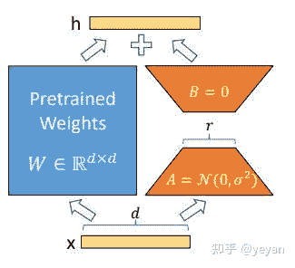
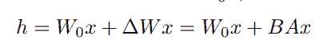
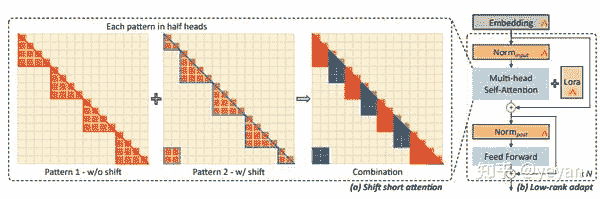
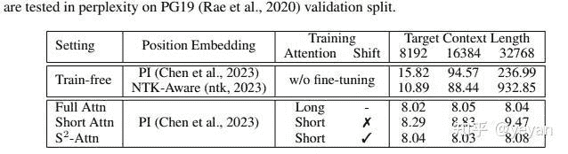
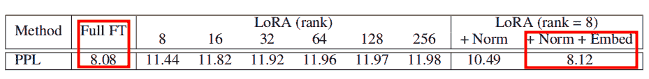
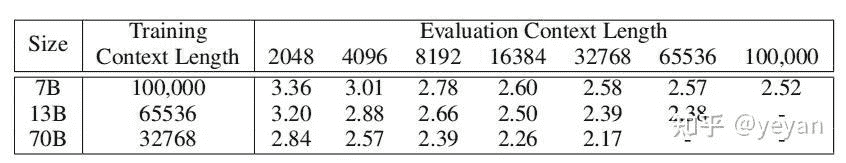
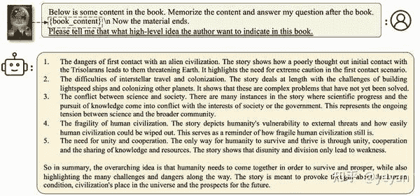

# 【大语言模型】LongLoRA:大语言模型长文本的高效微调方法

> 来源：[https://agijuejin.feishu.cn/docx/HzSIdkqZTobZfox9O8Tcs9o2nkf](https://agijuejin.feishu.cn/docx/HzSIdkqZTobZfox9O8Tcs9o2nkf)

> 作者：[yeyan](https://www.zhihu.com/people/yeyan-67)

> 原文： [https://zhuanlan.z](https://zhuanlan.zhihu.com/p/658067243)hihu.com/p/658067...

## 1.背景

一般大[模型预训练时文本的长](https://link.zhihu.com/?target=https%3A//www.reddit.com/r/LocalLLaMA/comments/14lz7j5/ntkaware_scaled_rope_allows_llama_models_to_have/)度[是](https://link.zhihu.com/?target=https%3A//kexue.fm/archives/9675)固定的，如llama的tokens预训练长度为2048，llama2为4096。为了支持更长的文本，就需要微调模型，目前大部分采用长度外推，即修改位置编码的策略，比如Position Interpolation (位置内插，需要微调), NTK-aware (通过修改rope的   β \beta 进制的   β \beta ，不需要微调就能实现不错的效果）等方法，具体可以参考【 Transformer升级之路：10、RoPE是一种β进制编码 - 科学空间|Scientific Spaces 】。

采用位置编码策略，为了达到更好的效果，一般需要对整个模型进行微调，而大语言模型参数比较多，就非常耗费资源。

LongLoRA主要提出一种通过LoRA机制进行微调的方法，减少训练参数，提高训练效率。

LoRA( Low-Rank Adaptation )的原理比较简单，如下图所示：





其中W为原始预训练的模型，A先将特征从d降维到r，B再将升维到d维（r<d），从而减少参数，微调时只训练AB。

## 2.LongLoRA

### 2.1 SHIFT SHORT ATTENTION

一般的transformer的attention计算复杂度为   O(n2) O(n^{2}) ,n为序列长度，使得llm长文本微调训练慢且资源消耗多。

受swin-transformer的启发，本文提出了SHIFT SHORT ATTENTION 的方法，如下图所示：



在长文本训练中，计算消耗主要来自self attention模块。由于输入很长，我们将self attention分成几组。如上图Pattern1，实验时，在训练和测试阶段都采用8192个token作为输入，分成4组，则每一组self attention的token大小为2048。这种模式是有效的，但随着上下文长度的增加，模型的困惑度(perplexity)也会变得更大。原因是在不同的组之间没有信息交换。

为了解决信息交换问题，参考swin-transformer，采用shift操作，对group进行平移，用group大小的一半，让group移动了一半。以8192的上下文长度为例，在Pattern1中，group 1的token从1到2048进行self attention。在Pattern1中，group被移动了1024。group 1的token从1025开始，到3072结束，而第一个和最后1024个token属于同一组。这种模式不增加训练复杂度，但是能达到和标准attention一致的效果。

对比结果如下图，说明采用shift操作，模型困惑度(perplexity)指标变小。



SHIFT SHORT ATTENTION实现非常简单，如下代码：

```
# shift short attention伪代码 Pseudocode of Shift Short Attention in PyTorch-like style.
# B: batch size; S: sequence length or number of tokens; G: group size;
# H: number of attention heads; D: dimension of each attention head
# qkv in shape (B, N, 3, H, D), projected queries, keys, and values
# Key line 1: split qkv on H into 2 chunks, and shift G/2 on N
#*************************
# cat: concatenation; 
# chunk: split into the specified number of chunks; 
# roll: roll the tensor along the given dimension.
#*************************
qkv = cat((qkv.chunk(2, 3)[0], qkv.chunk(2, 3)[1].roll(-G/2, 1)), 3).view(B*N/G,G,3,H,D)
# standard self-attention function
out = self_attn(qkv)
# out in shape (B, N, H, D)
# Key line 2: split out on H into 2 chunks, and then roll back G/2 on N
out = cat((out.chunk(2, 2)[0], out.chunk(2, 2)[1].roll(G/2, 1)), 2)
```

### 2.2 提高LoRA在长文本的能力

虽然LoRA微调具有简单，参数少的特点，效果也不错。实验发现，LoRA和完全微调之间的差距随着目标上下文长度的增大而增大。为了减少这种差距，在LoRA微调的训练过程中，放开embeded和normalization层（这2部分参数很少），称这种方法为  LoRA^{+} ，结果如下图，放开Norm和Embeded，和全部微调的结果基本一样。



### 2.3 实验结果

训练数据集采用 [Redpajama ](https://link.zhihu.com/?target=https%3A//github.com/togethercomputer/RedPajama-Data)，是一个完全开放的数据集，包含 1200 亿个tokens。

评估数据集采用 [pg19 ](https://link.zhihu.com/?target=https%3A//github.com/google-deepmind/pg19)和 Arxiv Math Proof-pile 数据集，其中pg-19包含了28752本书，共约 11GB，Proof-pile是一个数学文本数据集。

在8个A100上微调，将llama2 7B/13B/70B模型分别扩展到100K，65536, 32768长度。



如下图，将书本的一些长内容作文输入，或者对于的答案，如果将其应用到论文总结，应该不错，目前demo中只支持上传txt文档。



## 3.参考

+   [yeyan：【llm大语言模型】](https://zhuanlan.zhihu.com/p/651248009)一文看懂llama2(原理,模型,训练)

+   [longLoRA论文](https://link.zhihu.com/?target=https%3A//arxiv.org/pdf/2309.12307.pdf)

+   [LongLoRA代码](https://link.zhihu.com/?target=https%3A//github.com/dvlab-research/longlora)

+   [T](https://link.zhihu.com/?target=https%3A//kexue.fm/archives/9675)ransformer升级之路：10、RoPE是一种β进制编码 - 科学空间|Scientific Spaces

+   [LongLoRA在线测试地址](https://link.zhihu.com/?target=https%3A//9415315be10389c622.gradio.live/)