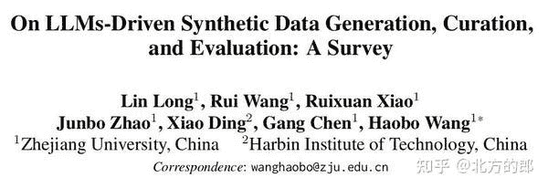
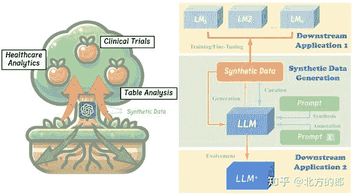
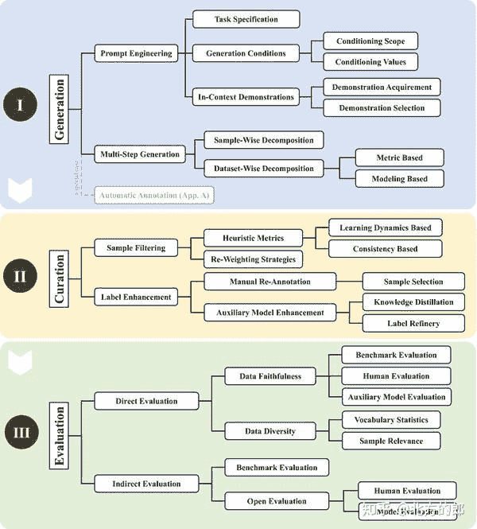
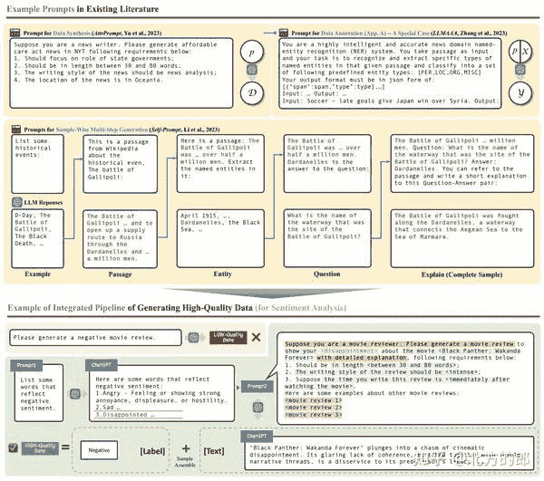
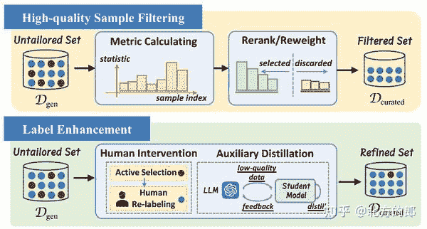
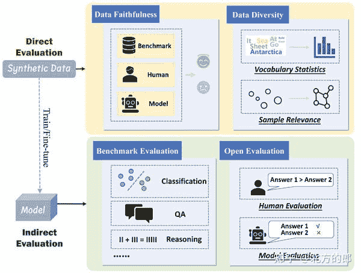

# 驱动未来:LLMs驱动的合成数据生成、管理与评估综述

> 来源：[https://agijuejin.feishu.cn/docx/D0AQdbC6po5E6cxtIUZcp7NDn0d](https://agijuejin.feishu.cn/docx/D0AQdbC6po5E6cxtIUZcp7NDn0d)

> 作者：北方的郎

> 原文： [https://zhuanlan.z](https://zhuanlan.zhihu.com/p/705234688)hihu.com/p/705234...

随着深度学习领域的迅猛发展，数据的数量和质量问题始终困扰着研究者。大型语言模型（LLMs）的出现为解决实际数据不足的问题提供了数据驱动的解决方案，特别是在合成数据生成方面。然而，目前针对该领域的研究缺乏统一的框架，多停留在表面探讨。

**来自浙大和哈工大的研究团队发表了《 On LLMs-Driven Synt**hetic Data Generation, Curation, and Evaluation: A Survey 》这篇论文通过构建一个通用的合成数据生成工作流程，系统性地整理了相关研究，旨在引导学术界和工业界进行更深入、系统的研究。

论文地址： https:// arxiv.org/abs/2406.1512 6

主要内容如下：

## 1. 引言

大型语言模型（LLMs）的出现引发了深度学习领域的重大范式转变。然而，高质量数据仍然是构建鲁棒NLP模型的基础。高质量数据通常指的是多样化的数据，这些数据携带丰富的监督信号（通常以标签的形式）与人类意图紧密一致。由于成本高昂、数据稀缺、隐私问题等原因，依靠人类数据来满足这一需求有时是困难甚至不切实际的。此外，人类生成的数据固有的偏差和错误可能并不适合用于模型训练或评估。因此，需要探索其他更有效和可扩展的数据收集方法，以克服当前的限制。

## 2. 预备知识

本文探讨了利用预训练LLMs生成高质量合成数据的挑战。通常不从头创建新数据集，而是在少量种子样本或未标记输入的基础上进行数据增强。虽然LLMs驱动的合成数据生成不一定需要这些种子样本，但当可用时，它们通常提供有价值的支持信息。

## 2.1 问题定义

本文将生成高质量合成数据的任务形式化为：   Dgen←Mp(T,Dsup) Dgen←Mp(T,Dsup) 其中，Dgen表示最终生成的数据集，p表示用于模型推理的提示，T指定生成任务，如重写、问答、注释等。

Figure 2:A taxonomy of LLMs-driven synthetic data generation, curation, and evaluation.

## 2.2 合成数据的要求

生成的数据需要满足两个主要要求：真实性和多样性。真实性确保生成的数据在逻辑和语法上是一致的，而多样性则反映生成数据在文本长度、主题或写作风格上的变异性。这两者对于生成高质量的合成数据都非常重要。

## 3. 通用工作流程

现有关于LLMs驱动的合成数据生成的研究一般包括生成、管理和评估三个主要方面。各种方法在这些方面协同工作，以实现最佳数据生成。

Figure 3:A toy example of effective synthetic data generation.

## 3.1 数据生成

数据生成的关键在于提示工程和多步骤生成。有效的提示通常包含任务规范、生成条件和上下文演示。

## 3.1.1 提示工程

LLMs用于合成数据生成的一个最大优势是它们的指令跟随能力,这有助于提高生成过程的可控性。因此,许多方法尝试使用启发式提示来引导LLMs,以提高合成数据的准确性和多样性。

经验表明,一个有效的提示通常包含三个关键要素:任务说明、生成条件和上下文示例,这些要素然后被统一包装成自然指令的形式。

**任务说明: **为LLMs设置正确的上下文至关重要,可以包括角色扮演、格式说明、知识增强等。证据表明,简单的开场白如"假设你是一个{xxx}"可以通过为数据生成设置适当的场景来显著提高LLMs的表现。

**条件提示: **一个广泛采用的策略是条件提示,它明确而具体地向LLMs传达所需的特定类型的数据。条件提示的核心涉及通过一系列条件-值对的制定来描述目标数据。这种方法不仅允许更好地控制生成数据集的多样性和覆盖范围,还将内容细化到更窄、更集中的范围,更有可能符合我们的具体期望和要求。

**上下文学习: **由于LLMs的内在偏见,仅通过任务说明和条件提示仍然难以从LLMs中获得理想的响应。在这种情况下,一个直接而有效的策略是提供几个示例,可以作为一种隐式的人类指导。研究表明,由于LLMs出色的上下文学习能力,几个范例可以为它们提供对真实世界数据模式的洞察,从而显著提高生成数据的准确性。

## 3.1.2 多步骤生成

在大多数情况下,由于缺乏足够的推理能力,期望LLMs在单次推理中生成整个所需的数据集是不现实的,特别是当目标是具有复杂结构或语义的数据时。为解决这个问题,一个常见的策略是多步生成,通过这种方式,整个生成过程被手动分解为一系列更简单的子任务,强制LLMs按计划逐步产生数据。具体来说,有两种常见的任务分解策略:样本级分解和数据集级分解。

+   样本级分解:一个典型的多步生成用例是处理长文本处理和逻辑推理的挑战,特别是在处理对话和实体-关系三元组等多文本数据时。在这种情况下,一种直接的方法是将样本分成更小的块,每次只生成样本的一部分。值得注意的是,每次生成过程都可以基于先前生成的内容进行条件化。

+   数据集级分解:数据集级任务分解动态调整多步生成每个阶段使用的条件,以确保整体数据集朝着正确的方向增长。例如,一些方法利用特定的数据结构来模拟数据生成的路径,如将领域空间建模为树结构,并随着树的遍历不断细化生成的数据,以促进生成数据的专业化和领域覆盖。

## 3.2 数据管理

管理合成数据的目的是通过筛选、增强等步骤，提高数据的整体质量。常见的管理方法包括样本过滤、标签增强和重新加权策略。

Figure 4:Two dominant approaches of data curation.

## 3.2.1 高质量样本过滤

样本过滤旨在剔除不需要的低质量样本,获得更有帮助的子集。这些方法通常设计启发式标准或重新加权函数来对样本进行重新排序以进行过滤。

+   启发式指标:基于启发式指标的方法的关键步骤是根据学习动态设计适当的标准,如置信度分数、影响函数和生成能力。

+   样本重新加权:另一方面,重新加权方法认为所有数据都是有价值的,但重要性不同。因此,它们在下游使用过程中为正确注释或有影响力的样本分配更大的权重。

## 3.2.2 标签增强

标签增强方法致力于纠正生成样本中潜在的错误注释。由于确认偏差,期望LLMs识别自己的错误是不现实的。为解决这个问题,最近的工作要么依赖人工干预,要么纳入学生模型进行无人监督的知识蒸馏。

Figure 5:Direct and indirect methods of data evaluation.

## 3.3 数据评估

评估生成数据的质量是确保其适用性的关键。评估方法包括直接评估和间接评估。

**直接评估 **：通过人工评估和基准测试等方法，直接评估生成数据的质量。

+   数据准确性:理想情况下,可以使用现有数据集中的真实情况轻松实现对LLMs生成结果的自动评估。然而,对于开放式数据,需要基于人工的评估。一个直接的想法是向人类专家提供一些生成的样本,然后由他们确定这些样本是否正确,根据这些我们可以估计整体生成质量。

+   数据多样性:数据多样性的量化主要采用词汇统计和样本相关性计算。词汇统计,如词汇量大小和N-gram频率,提供了一种直接和直观的方法。然而,它们难以捕捉数据集的语义信息。样本相关性的计算有效地弥补了这一局限性。

**间接评估 **：通过辅助模型评估生成数据的效果，例如，通过模型在生成数据上的性能间接评估数据质量。

+   基准评估:在生成数据上训练的下游模型的性能也可以在某种程度上反映生成质量。具体来说,可以从多个维度评估合成数据的影响,除了下游模型的专门能力之外。

+   开放评估:对于开放式基准,由于缺乏标准化答案,需要人工或辅助模型进行评估。为充分利用辅助模型的偏好输出,已设计了多种评估策略,如响应排名、四级评分系统和Elo分数。

## 4. 未来研究方向

+   复杂任务分解:开发系统化的方法来激活LLMs的推理和规划能力,用于自主合成数据生成。

+   知识增强:开发直接在成熟领域知识库上进行自动条件控制的方法,以显著提高知识增强的效率。

+   大小模型协同:探索大型和小型模型之间更多样化的协作模式,以提高生成数据的质量。

+   人机协作:设计一个人性化的交互系统,涉及必要的人类知识进行注释和验证,对于标准化和系统化数据生产过程中的人机协作至关重要。

## 结论

LLMs驱动的合成数据生成为解决数据不足的问题提供了新的思路。通过系统性地整理现有研究并提出统一的工作流程，本文为学术界和工业界提供了宝贵的参考，旨在推动这一领域的进一步发展。