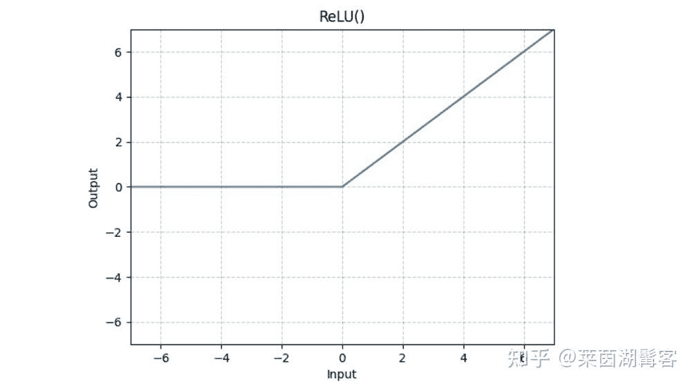
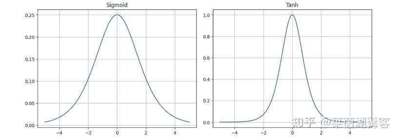
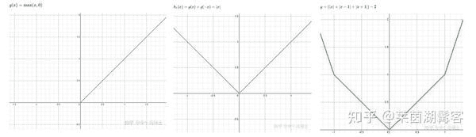
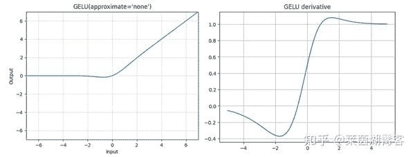
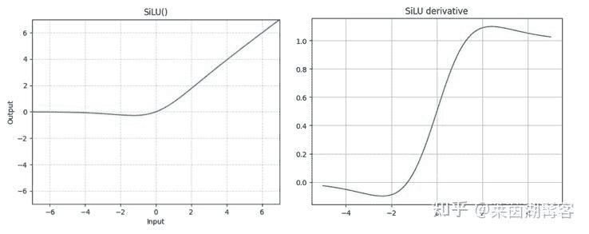
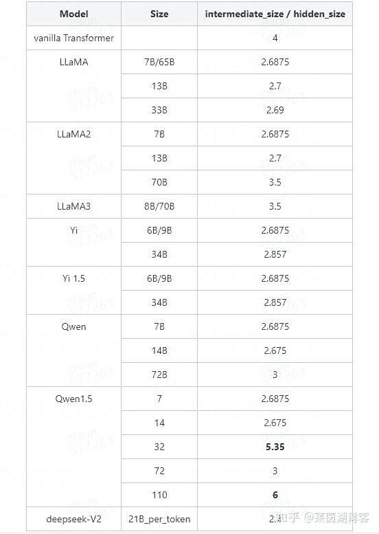

# LLM细节盘点(1)：激活函数

> 来源：[https://agijuejin.feishu.cn/docx/M3z5dGBhpoyZcix0tc8coBDAnob](https://agijuejin.feishu.cn/docx/M3z5dGBhpoyZcix0tc8coBDAnob)

> 作者：[咸鱼王](https://www.zhihu.com/people/wow-kong)

> 原文： [https://zhuanlan.z](https://zhuanlan.zhihu.com/p/696237380)hihu.com/p/696237...

激活函数一般用于向ANN引入非线性变换，以提高模型的表示能力 [1] 。相比其他组件，激活函数的选择在LLM中可以称得上相对丰富多样了，本文将总结并介绍当前一些主流LLM的激活函数。

## 01 概览

| Activation | Model | Size |
| --- | --- | --- |
| ReLU | OPT | 175B |
| GeLU | GPT-3 | 175B |
| GeLU | Falcon | 40B |
| GeLU | BLOOM | 176B |
| GEGLU | chatGLM | 6B |
| SwiGLU | PaLM | 540B |
| SwiGLU | LLaMA | 7B/13B/33B/65B |
| SwiGLU | LLaMA2 | 7B/13B/70B |
| SwiGLU | LLaMA3 | 8B/70B |
| SwiGLU | Baichuan | 7B/13B |
| SwiGLU | Baichuan2 | 7B/13B |
| SwiGLU | chatGLM2 | 6B |
| SwiGLU | chatGLM3 | 6B |
| SwiGLU | GLM4 | 9B |
| SwiGLU | Yi | 6B/9B/34B |
| SwiGLU | Yi 1.5 | 6B/9B/34B |
| SwiGLU | Qwen | 1.8B/7B/14B/72B |
| SwiGLU | Qwen1.5 | 0.5B/1.8B/4B/7B/14B/32B/72B/110B/A2.7B |
| SwiGLU | deepseek | 7B/67B |
| SwiGLU | deepseek-V2 | 236B-A21B |
| SwiGLU | Mistral | 7B |
| SwiGLU | Mixtral | 8*7B/8*22B |

**一**些常见的LLM即激活函数如上表，另外笔者发现有些朋友 分不清SiLU、Swish和SwiGLU，或根据config.json误认为某些LLM的激活函数就是SiLU ，具体见4.2。

## 02 ReLU

### 2.1 Intro

ReLU即Rectified Linear unit，因计算简便、不易受梯度消失干扰，是DNN时代最常见的激活函数之一，由于ReLU引入稀疏性，因此在生物学上更合理，且更高效、鲁棒、线性可分 [2] [3] 。

ReLU(x)=max(0,x)=\left\{\begin{array}{l} x,\ x>0 \\ 0,\ x\leq0 \end{array}\right. \tag{2.1}



### 2.2 为什么ReLU不易受梯度消失影响

梯度消失是早期DNN训练的老生常谈，传统的激活函数如sigmoid、tanh，其导数值  \sigma'(V) 会随着  |V| 的增加迅速减小（如下图），从而在链式求导下梯度会随着层深呈指数衰减、甚至趋向于0（见式2.2）。



Assume\quad f_{n} := f_{n}(\mathbf{x}) = \sigma (\mathbf{W}_{n} \sigma( \mathbf{W}_{n-1} ... \sigma(\mathbf{W}_{0} \mathbf{x})...)=\sigma(\mathbf{W}_{n}f_{n-1}) \\ Then, \quad \displaystyle\frac{\partial f_n}{\partial \mathbf{W}_t}= \frac{\partial f_n}{\partial f_{n-1}} \cdot \frac{\partial f_{n-1}}{\partial f_{n-2}} \cdot ... \cdot \frac{\partial f_t}{\partial \mathbf{W}_t}\\ =(\mathbf{W}_{n}\sigma'(\mathbf{W}_{n}f_{n-1}))\cdot (\mathbf{W}_{n-1}\sigma'(\mathbf{W}_{n-1}f_{n-2}))\cdot ...\cdot (\sigma'(\mathbf{W}_{t}f_{t-1})f_{t-1}) \\ =(\prod_{k=t+1}^{n}\mathbf{W}_{k}) \cdot (\prod_{k=t}^{n}\sigma'(\mathbf{W}_kf_{k-1})) \cdot f_{t-1} \tag{2.2}

反观ReLU的导数直接就是0/1，不仅节省计算，还完全避免了链式求导中因  \sigma' 累乘带来的衰减问题，不过ReLU在零点不连续，因此梯度一般人为设定为0或1（Pytorch中为0 [4] ）。

ReLU'(x)=\left\{\begin{array}{l} 1,\ x>0 \\ 0,\ x<0 \end{array}\right. \tag{2.3}

同时应注意， **只**调整激活函数并不意味着梯度消失完全被解决，合理搭配LN+初始化+残差+激活函数+clip，才是避免梯度消失/膨胀的有效方式。

### 2.3 为什么ReLU能引入非线性

如开头所说，激活函数是为了向模型引入非线性变换能力，但是作为线性分段函数的ReLU，为什么能够引入非线性呢？

首先从定义出发，ReLU虽然是线性分段函数，但并不满足线性函数的性质 [5] （式2.4），实际上属于非线性函数。

f(a\mathbf{x}+b\mathbf{y})=af(\mathbf{x})+bf(\mathbf{y}) \tag{2.4}

具体的，在不添加激活函数或激活函数为线性函数的情况下，基于式2.4，层数堆叠相比单层并不会带来额外收益：

f_1=\sigma[\mathbf{W}_1\sigma (\mathbf{W}_0 \mathbf{x}+ \mathbf{b}_0)+\mathbf{b}_1] \\ =\sigma[\sigma(\mathbf{W}_1\mathbf{W}_0\mathbf{x}+\mathbf{W}_1\mathbf{b}_0) + \sigma(\mathbf{b}_1')] \\ =\sigma[\sigma(\mathbf{W}_1\mathbf{W}_0 \mathbf{x}+\mathbf{W}_1\mathbf{b}_0 + \mathbf{b}_1')] \\ :=\sigma'(\mathbf{W}_0'\mathbf{x} + \mathbf{b'}_0)=f'_0 \tag{2.5}

显然ReLU不满足式2.4，除非所有神经元都被激活，否则并不会如式2.5一样坍塌至单层网络。另一个比较直观的解释是，将  f_n 横向展开（如2.6），随着神经元个数（即网络宽度）的增加，多个分段函数  ReLU(\cdot) 的叠加可以逼近复杂非线性变换 [6] 。

f_{n,i}=ReLU[\Sigma_{j=0}^H(w_{i,j}f_{n-1,j}+b_j)], \quad where\quad f_{n-1,j}=ReLU(\cdot) \tag{2.6}



## 03 SiLU & GELU

GELU即Gaussian Error Linear Unit，如下式，  \Phi(x) 表示高斯分布的CDF。

GELU(x)=x*\Phi(x)=\frac{1}{2}x(1+erf(\frac {x} {\sqrt{2}} ))\approx \frac 1 2x(1+tanh(\sqrt{\frac {2}{\pi}}(x+0.044715x^3))) \tag{3.1}



SiLU即Sigmoid-weighted Linear Unit， 实际上ReLU、GELU、SiLU都可以认为是Swish的个例 （如下式，  \beta 可以是constant/variable），当  \beta=1 时就是SiLU，  \beta=1.702 时就（近似）是GeLU，  \beta\rightarrow \infty 时就是ReLU。

Swish(x)=x*\sigma(\beta x)=x/(1+e^{-\beta x}) \tag{3.2}



**作**为ReLU的平滑结果，SiLU和GeLU性质十分相似，都是 无上界（避免过饱和）、有下界且趋向于0（起到正则效果）、非单调（能输出负向梯度，对不同初始化和学习率鲁棒性更高）、平滑（更易优化）函数 ，一般可以作为ReLU的上位替代 [7] [8] [9] [10] 。

## 04 GLU系列

### 4.1 GLU

GLU即Gated Linear Unit，定义为两个变换结果的元素积，Google曾经验证过GLU系列相比Swish系列（ReLU/SiLU/GELU）效果更好，但是很“摆烂”地将其归因于炼丹玄学 [11] 。

> We offer no explanation as to why these architectures seem to work; we attribute their success, as all else, to divine benevolence.

GLU(a,b)=a\otimes\sigma(b) \tag{4.1}

### 4.2 GeGLU & SwiGLU

GEGLU和SwiGLU分别为GELU-based GLU、Swish-based GLU， 都是Swish系列与GLU的组合 ，具体如式4.2、4.3，一般而言SwiGLU效果会比GeGLU稍胜一筹 [11] [12] [13] 。

GeGLU(x,W_{up},W_{gate},b_{up},b_{gate})=GELU(xW_{up}+b_{up})\otimes(xW_{gate}+b_{gate}) \tag{4.2}

SwiGLU(x,W_{up},W_{gate},b_{up},b_{gate})=SiLU(xW_{up}+b_{up})\otimes(xW_{gate}+b_{gate}) \tag{4.3}

在实际应用时一般会 **省略偏置项 **，从而基于SwiGLU的FFN如式4.4。由于GLU引入了额外参数，因此一般会适当降低intermediate维度，以确保FFN的参数量相对不变，部分范例如图4.1。

FFN_{SwiGLU}(x,W_{up},W_{gate},W_{down})=(SiLU(xW_{up})\otimes xW_{gate})W_{down} \tag{4.4}



**因此LLaMA、Baichuan、Qwen等系列模型 **虽然在config.json中显示的激活函数是SiLU，实际是基于SiLU搭建的SwiGLU ，具体实现代码如下，显然在FFN中相比SiLU多了  W_{gate} 。

```
def swiglu(x):
    return F.silu(self.w1(x)) * self.w3(x)
```

虽然智谱的chatGLM2/3实现方式与LLaMA、Baichuan、Qwen等系列有所区别，但本质相同，只是将  W_{up} 和  W_{gate} 进行合并以提高计算效率。

```
class MLP(torch.nn.Module):
    &quot;&quot;&quot;MLP.
    MLP will take the input with h hidden state, project it to 4*h
    hidden dimension, perform nonlinear transformation, and project the
    state back into h hidden dimension.
    &quot;&quot;&quot;

    def __init__(self, config: ChatGLMConfig, device=None):
        super(MLP, self).__init__()

        self.add_bias = config.add_bias_linear

        # Project to 4h. If using swiglu double the output width, see https://arxiv.org/pdf/2002.05202.pdf
        self.dense_h_to_4h = nn.Linear(
            config.hidden_size,
            config.ffn_hidden_size * 2,
            bias=self.add_bias,
            device=device,
            **_config_to_kwargs(config)
        )

        def swiglu(x):
            x = torch.chunk(x, 2, dim=-1)
            return F.silu(x[0]) * x[1]

        self.activation_func = swiglu

        # Project back to h.
        self.dense_4h_to_h = nn.Linear(
            config.ffn_hidden_size,
            config.hidden_size,
            bias=self.add_bias,
            device=device,
            **_config_to_kwargs(config)
        )

    def forward(self, hidden_states):
        # [s, b, 4hp]
        intermediate_parallel = self.dense_h_to_4h(hidden_states)
        intermediate_parallel = self.activation_func(intermediate_parallel)
        # [s, b, h]
        output = self.dense_4h_to_h(intermediate_parallel)
        return output
```

作为SiLU与GLU的结合，SwiGLU同样具备SiLU无上界、有下界、非单调和平滑的优势，但为何相同参数量下引入门控能够带来额外收益，目前并没有一篇paper能较好地解释，或许真的如Noam所言，这只是炼丹的艺术。

最后再提一嘴，当前ReLU系列颇有文艺复兴之势：以可忽略的性能为代价，使用ReLU系列能够引入稀疏性和更好的（潜在的）计算优势，随着LLM量级的不断提升，ReLU或许会再次成为第一选择 [13] [14] [15] 。

---

## 参考

1.  [Activation function https://e](https://en.wikipedia.org/wiki/Activation_function)n.wikipedia.org/wiki/Activation_function

1.  [R](https://en.wikipedia.org/wiki/Rectifier_(neural_networks))ectifier (neural networks) https://en.wikipedia.org/wiki/Rectifier_(neural_networks)

1.  Deep Sparse Rectif[ier Neural Networks https://proce](https://proceedings.mlr.press/v15/glorot11a/glorot11a.pdf#page=4.83&gsr=0)edings.mlr.press/v15/glorot11a/glorot11a.pdf#page=4.83&gsr=0

1.  [G](https://discuss.pytorch.org/t/gradient-of-relu-at-0/64345/5)radient of ReLu at 0 https://discuss.pytorch.org/t/gradient-of-relu-at-0/64345/5

1.  [Linear function https://e](https://en.wikipedia.org/wiki/Linear_function)n.wikipedia.org/wiki/Linear_function

1.  [为](https://www.zhihu.com/question/266696998/answer/2098487531)什么说Relu是非线性激活函数，在大于0部分不是线性的吗？ https://www.zhihu.com/question/266696998/answer/2098487531

1.  SEARCHING FOR ACTIVATION FUNCTIONS https://arxiv.org/pdf/1710.05941

1.  Sigmoid-Weighted Linear Units for Neural Network Function Approximation in Reinforcement Learning https://arxiv.org/pdf/1702.03118

1.  SWISH: A SELF-GATED ACTIVATION FUNCTION https://arxiv.org/pdf/1710.05941v1

1.  GAUSSIAN ERROR LINEAR UNITS (GELUS) https://arxiv.org/pdf/1606.08415

1.  ^ a b GLU Variants Improve Transformer https://arxiv.org/pdf/2002.05202

1.  What Language Model to Train if You Have One Million GPU Hours? https://arxiv.org/pdf/2210.15424

1.  ^ a b ReLU 2 Wins: Discovering Efficient Activation Functions for Sparse LLMs https://arxiv.org/pdf/2402.03804

1.  ReLU Strikes Back: Exploiting Activation Sparsity in Large Language Models https://arxiv.org/pdf/2310.04564

1.  Learn To be Efficient: Build Structured Sparsity in Large Language Models https://arxiv.org/pdf/2402.06126