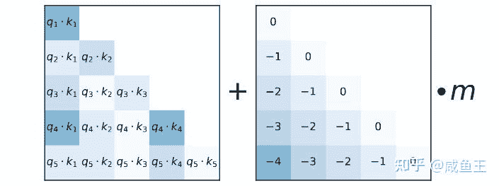
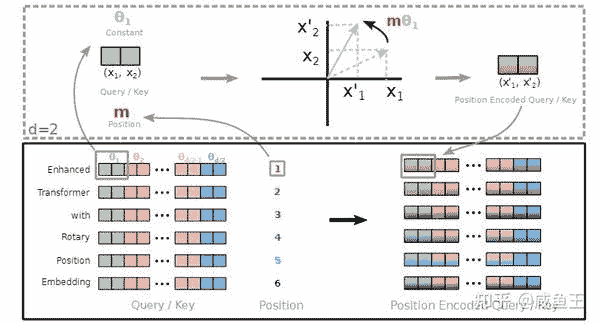
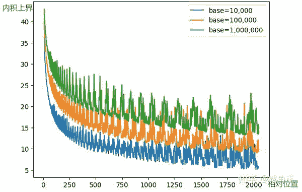
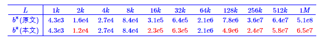
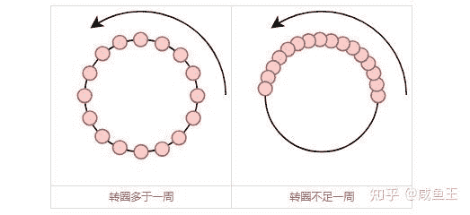

# LLM细节盘点(2)：位置编码

> 来源：[https://agijuejin.feishu.cn/docx/Q0KNdLWf5oM89MxEthQcynEXnsc](https://agijuejin.feishu.cn/docx/Q0KNdLWf5oM89MxEthQcynEXnsc)

> 作者：[咸鱼王](https://www.zhihu.com/people/wow-kong)

> 原文： [https://zhuanlan.z](https://zhuanlan.zhihu.com/p/697549003)hihu.com/p/697549...

## 01 概览

目前一些主流开源模型所使用的位置编码如下表，可以看出：

1.  RoPE已经成为LLM的标配；

1.  随着数据质量、数量及训练最大长度的增加，RoPE的   base base 也逐渐从早期的经典配置   104 10^4 ，普遍增加至   106 10^6 的数量级，以获得更好的长文本处理能力；

1.  外推方法从早期的PI，逐渐演变成NTK系列（Yi/chatglm3-4）和YARN（DeepSeek-v2、Qwen2-128K）。

| 位置编码 | Model | Version | base |
| --- | --- | --- | --- |
| Alibi | Baichuan | 7B-base/chat  13B-base/chat |  |
|  | Baichuan2 | 13B-base/chat/V2 |  |
| RoPE | Baichuan2 | 7B-base/chat | 10,000 |
|  | LLaMA | 7B/13B/30B/65B | 10,000 |
|  | LLaMA2 | 7B-base/chat  13B-base/chat  70B-base/chat | 10,000 |
|  | LLaMA3 | 8B-base/chat  70B-base/chat | 500,000 |
|  | chatglm | 6B-chat | 10,000 |
|  | chatglm2 | 6B-chat | 10,000 |
|  |  | 6B-32K | 10,000（PI外推/16） |
|  | chatglm3 | 6B-base/chat | 10,000 |
|  |  | 6B-32K | 500,000（NTK） |
|  |  | 6B-128K | 5,000,000（NTK） |
|  | glm4 | 9B-base | 10,000 |
|  |  | 9B-chat | 5,000,000（NTK） |
|  |  | 9B-1M | 100,000,000（NTK） |
|  | Yi | 9B-base/chat | 10,000 |
|  |  | 6B-base/chat 34B-chat | 5,000,000（NTK） |
|  |  | 9B-200K 34B-200K | 10,000,000（NTK） |
|  | Yi-1.5 | 6B-base/chat  9B-base/chat/16K/32K  34B-base/chat/16K/32K | 5,000,000 |
|  | Qwen | 1.8B-base/chat  7B-base/chat  14B-base/chat | 10,000 |
|  |  | 72B-base/chat | 1,000,000 |
|  | Qwen1.5 | 0.5B-base/chat  1.8B-base/chat  7B-base/chat  14B-base/chat  32B-base/chat  72B-base/chat  110B-base/chat  A2.7B-base/chat | 1,000,000 |
|  |  | 4B-base/chat | 5,000,000 |
|  | Qwen2 | 0.5B-base/chat  1.5B-base/chat  7B-base/chat  72B-base/chat  57B-A14B-base/chat | 1,000,000 |
|  | DeepSeek-llm | 7B-base/chat  67B-base/chat | 10,000 |
|  | DeepSeek-moe | base/chat | 10,000 |
|  | DeepSeek-V2 | base/chat | 400,000（YARN） |

本文将简要介绍Alibi及RoPE两种算法，并重点针对RoPE的特性、外推方法、  base 选择做进一步分析。

## 02 Alibi

作为位置编码及外推的经典之作，Alibi的思路非常简洁朴素、易于实现([1])：

(2.1)𝑞𝑚𝑇𝑘𝑛−𝜆|𝑚−𝑛|然而Alibi并不能算作严格意义上的位置编码：首先位置 |𝑚−𝑛| 只能感知距离、无法辨别方向，是结合了单向语言模型的因果mask才具备较准确的位置识别能力（实际上单向语言模型不加位置编码也能有不错的效果）。其次Alibi以mask的形式叠加， ⟨𝑞,𝑘⟩ 本质仍是位置不敏感的运算。但是由于多层结构的传递、及其提供的远程衰减特性，Alibi仍然是一个行之有效的方案。



## 03 RoPE

RoPE即旋转位置编码 (Rotary Position Embedding, RoPE)，是苏神提出、在LLM时代得到广泛应用的相对位置编码，其基本思路是在向量空间中借助向量旋转，等价实现 ⟨𝑓(𝑞𝑚,𝑚),𝑓(𝑘𝑛,𝑛)⟩=𝑔(𝑞𝑚,𝑘𝑛,𝑚−𝑛) ，从而以乘性绝对位置编码的形式、向attention计算中引入token-wise相对位置的信息([2])([3])。苏神如何受到Sinusoidal绝对位置编码启发、并提出RoPE的过程此处不再赘述，只对RoPE的基本原理和特性做简要介绍。

### 3.1 基本原理

假设 𝑞=ℎ𝑊𝑄,𝑘=ℎ𝑊𝐾∈[𝐵,𝐿,ℎ,𝑑] ，其中 (𝑞𝑚,𝑘𝑛) 分别表示 (𝑞,𝑘) 中token位置为 (𝑚,𝑛) 的分量。RoPE的做法是沿 𝑎𝑥𝑖𝑠=−1 ，将 𝑞𝑚=(𝑞0,𝑞1,...,𝑞𝑑−2,𝑞𝑑−1) 两两视为一组向量 𝑞𝑚,𝑖=(𝑞𝑖,𝑞𝑖+1) ，并根据当前token的绝对位置 𝑚 进行旋转变换：

(3.1)𝑞~𝑚,0=𝑓(𝑞𝑚,0,𝑚)=𝑅𝑚𝑞𝑚,0=(cos 𝑚𝜃−sin 𝑚𝜃sin 𝑚𝜃cos 𝑚𝜃)(𝑞0𝑞1)𝑘~𝑛,0=𝑓(𝑘𝑛,0,𝑛)=𝑅𝑛𝑘𝑛,0=(cos 𝑛𝜃−sin 𝑛𝜃sin 𝑛𝜃cos 𝑛𝜃)(𝑘0𝑘1)



通过与当前token绝对位置有关的向量旋转 (𝑅𝑚,𝑅𝑛) ，我们成功向原先位置不敏感的 (𝑞,𝑘) 引入了绝对位置信息。基于 (𝑞~𝑚,𝑘~𝑛) ，我们进一步通过内积计算注意力分数：

(3.2)attn_score𝑚,𝑛=⟨𝑞~𝑚,𝑘~𝑛⟩=(𝑅𝑚𝑞𝑚)𝑇(𝑅𝑛𝑘𝑛)结合旋转矩阵的性质 𝑅𝑎𝑇=𝑅−𝑎, 𝑅𝑎+𝑏=𝑅𝑎𝑅𝑏 ，可得：(3.3)⟨𝑓(𝑞𝑚,𝑚),𝑓(𝑘𝑛,𝑛)⟩=(𝑅𝑚𝑞𝑚)𝑇(𝑅𝑛𝑘𝑛)=𝑞𝑚𝑇𝑅𝑛−𝑚𝑘𝑛:=𝑔(𝑞𝑚,𝑘𝑛,𝑛−𝑚)从上式可以看出， (𝑞~𝑚,𝑘~𝑛) 的绝对位置编码信息，由于矩阵旋转的特性，在attention计算中变换为与相对位置 𝑛−𝑚 有关的信息。由于旋转矩阵作为正交矩阵不会改变向量的模长，因此通常来说不会改变原模型的稳定性。

结合内积的线性叠加性，我们将式(3.1)拓展到整个维度：

(3.4)(cos 𝑚𝜃0−sin 𝑚𝜃000…00sin 𝑚𝜃0cos 𝑚𝜃000…0000cos 𝑚𝜃1−sin 𝑚𝜃1…0000sin 𝑚𝜃1cos 𝑚𝜃1…00⋮⋮⋮⋮⋱⋮⋮0000…cos 𝑚𝜃𝑑/2−1−sin 𝑚𝜃𝑑/2−10000…sin 𝑚𝜃𝑑/2−1cos 𝑚𝜃𝑑/2−1)(𝑞0𝑞1𝑞2𝑞3⋮𝑞𝑑−2𝑞𝑑−1)考虑到式(3.4)的旋转变换矩阵是一个极度稀疏的矩阵，在实现时一般会使用更加高效的计算方式：

(3.5)(𝑞0𝑞1𝑞2𝑞3⋮𝑞𝑑−2𝑞𝑑−1)⊗(cos 𝑚𝜃0cos 𝑚𝜃0cos 𝑚𝜃1cos 𝑚𝜃1⋮cos 𝑚𝜃𝑑/2−1cos 𝑚𝜃𝑑/2−1)+(−𝑞1𝑞0−𝑞3𝑞2⋮−𝑞𝑑−1𝑞𝑑−2)⊗(sin 𝑚𝜃0sin 𝑚𝜃0sin 𝑚𝜃1sin 𝑚𝜃1⋮sin 𝑚𝜃𝑑/2−1sin 𝑚𝜃𝑑/2−1)

确定了 𝑓(⋅) 的形式之后，我们还需要明确 𝑓(⋅) 中 𝜃𝑖 的公式。RoPE中 𝜃𝑖 的计算方式沿用了Sinusoidal绝对位置编码中的算法，以确保RoPE的远程衰减特性：

(3.6)𝜃𝑖=𝑏𝑎𝑠𝑒−2𝑖/𝑑

### 3.2 远程衰减特性

为了更好的分析远程衰减特性，我们可以将RoPE表示为复数形式，并将向量旋转以复数乘法的方式表示为：

(3.7)𝑓(𝑞𝑚,0,𝑚)=𝑅𝑚𝑞𝑚,0=(𝑞0+𝑖𝑞1)(cos 𝑚𝜃0+𝑖sin 𝑚𝜃0)=𝑞𝑚,0𝑒𝑖𝑚𝜃0𝑓(𝑘𝑛,0,𝑛)=𝑅𝑛𝑘𝑛,0=(𝑘0+𝑖𝑘1)(cos 𝑛𝜃0+𝑖sin 𝑛𝜃0)=𝑘𝑛,0𝑒𝑖𝑛𝜃0

由于 ⟨𝑎,𝑏⟩=𝑅𝑒[𝑎𝑏∗] ，因此

(3.8)⟨𝑓(𝑞𝑚,0,𝑚),𝑓(𝑘𝑛,0,𝑛)⟩=⟨𝑞𝑚,0𝑒𝑖𝑚𝜃0,𝑘𝑛,0𝑒𝑖𝑛𝜃0⟩=𝑅𝑒[𝑞𝑚,0𝑘𝑛,0∗𝑒𝑖(𝑚−𝑛)𝜃0]

拓展到一般情况，

(3.9)⟨𝑓(𝑞𝑚,𝑚),𝑓(𝑘𝑛,𝑛)⟩=𝑅𝑒[Σ𝑖=0𝑑/2−1𝑞𝑚,2𝑖𝑘𝑛,2𝑖∗𝑒𝑖(𝑚−𝑛)𝜃𝑖]不妨记 ℎ𝑖=𝑞𝑚,2𝑖𝑘𝑛,2𝑖∗ ， 𝑆𝑗=Σ𝑖=0𝑗𝑒𝑖(𝑚−𝑛)𝜃𝑖 ，并约定 ℎ𝑑/2=0,𝑆0=0 ，则可以基于Abel变化将上式转变为如下形式：

(3.10)Σ𝑖=0𝑑/2−1𝑞𝑚,2𝑖𝑘𝑛,2𝑖∗𝑒𝑖(𝑚−𝑛)𝜃𝑖=Σ𝑖=0𝑑/2−1ℎ𝑖(𝑆𝑖+1−𝑆𝑖)=−Σ𝑖=0𝑑/2−1𝑆𝑖+1(ℎ𝑖+1−ℎ𝑖)从而，

(3.11)|Σ𝑖=0𝑑/2−1𝑞𝑚,2𝑖𝑘𝑛,2𝑖∗𝑒𝑖(𝑚−𝑛)𝜃𝑖|=|Σ𝑖=0𝑑/2−1𝑆𝑖+1(ℎ𝑖+1−ℎ𝑖)|≤Σ𝑖=0𝑑/2−1|𝑆𝑖+1||ℎ𝑖+1−ℎ𝑖|≤(max𝑖|ℎ𝑖+1−ℎ𝑖|)Σ𝑖=0𝑑/2−1|𝑆𝑖+1|

通过考察上界 Σ𝑖=0𝑑/2−1|𝑆𝑖+1| 可以观测attention score与相对位置的关系，具体如图3.2，注意力分数呈现明显的远程衰减特性，即LLM能够天然地对临近token赋予更多注意力、对更远token赋予更少的注意力。此外，不同的 𝑏𝑎𝑠𝑒 呈现不同的衰减趋势，越大的 𝑏𝑎𝑠𝑒 衰减越慢、衰减区间越长，具备更好的长文本处理能力；但相应地转速越慢、相邻token的间距越小，需要更充分的训练以区分位置关系。



除了明显的衰减趋势之外，图中还呈现一定**的震荡**现象，然而曲线表达的是注意力分数 上界 与相对位置的关系，实际上模型可以通过训练使衰减曲线更加平滑，但在训练区间之外，震荡性质就无法保证了，所以这也是RoPE无法长度外推到任意距离的主要原因。

### 3.3 语义聚合特性

除3.2所分析的远程衰减外，我们往往希望位置编码具备语义聚合的特性，即语义相似的token趋向于获得更高的注意力([4])([5])。

现考虑对于 𝑞𝑚 ，有随机的 𝑘𝑛，以及与 𝑞𝑚 语义相近的 𝑘𝑛′=𝑞𝑚+𝜖 （ 𝜖 为零均值扰动），显然我们希望满足以下趋势：

(3.12)E𝑞,𝑘,𝜖[𝑞𝑚𝑇𝑅𝑛−𝑚𝑘𝑛′−𝑞𝑚𝑇𝑅𝑛−𝑚𝑘𝑛]≥0

假设 𝑞,𝑘∼𝑁(𝜇,𝜎2) ，结合 𝐸(𝑋2)=𝐷(𝑋)+𝐸(𝑋)2 ，则：

(3.13)E𝑞,𝑘,𝜖[𝑞𝑚𝑇𝑅𝑛−𝑚(𝑞𝑚+𝜖)−𝑞𝑚𝑇𝑅𝑛−𝑚𝑘𝑛]=E𝑞[𝑞𝑚𝑇𝑅𝑛−𝑚𝑞𝑚]−E𝑞,𝑘[𝑞𝑚𝑇𝑅𝑛−𝑚𝑘𝑛]=E𝑞[𝑞𝑚𝑇𝑅𝑛−𝑚𝑞𝑚]−E𝑞[𝑞𝑚]𝑇𝑅𝑛−𝑚E𝑘[𝑘𝑛]=E𝑞[𝑞𝑚𝑇𝑅𝑛−𝑚𝑞𝑚]−𝜇21𝑇𝑅𝑛−𝑚1=E𝑞[Σ𝑖=0𝑑/2−1(𝑞2𝑖2+𝑞2𝑖+12)cos (𝑛−𝑚)𝜃𝑖]−Σ𝑖=0𝑑/2−12𝜇2cos (𝑛−𝑚)𝜃𝑖=Σ𝑖=0𝑑/2−12(𝜇2+𝜎2)cos (𝑛−𝑚)𝜃𝑖−Σ𝑖=0𝑑/2−12𝜇2cos (𝑛−𝑚)𝜃𝑖=Σ𝑖=0𝑑/2−12𝜎2cos (𝑛−𝑚)𝜃𝑖

因此，为了使上式大于等于零，应满足下式，其中 𝐿train 代表训练阶段的最大长度：

(3.14)∀𝑙∈range(0,𝐿train−1),Σ𝑖=0𝑑/2−12𝜎2cos 𝑙𝜃𝑖≥0

最终得到在不同 𝐿train 下对应的 𝑏𝑎𝑠𝑒 下界为：



因此可以看出，为了让LLM具备更好的长文本能力， 𝑏𝑎𝑠𝑒 有明确下界，且下界值随着 𝐿train 的增加而增加；苏神同样通过渐进估计，得出" 𝑏𝑎𝑠𝑒 至少应该与保持 𝐿train 同一数量级"的结论。

### 3.4 外推

当预测阶段文本长度 𝐿inf 超过 𝐿train 时（即外推），LLM主要面临两个问题：预测时用到了没训练过的位置编码（不管绝对还是相对）；预测时注意力机制所处理的token数量远超训练时的数量([6])。目前各种外推算法主要解决的是第一个问题：通过不同缩放策略，将超出训练分布的最大相位进行压缩还原，记 𝑐=𝐿train/𝐿𝑖𝑛𝑓<=1 。

线性插值 (Positional Interpolation, PI) 通过线性压缩，直接将token位置等比压缩，使整个维度分量的旋转速度变慢，周期变大([7])：

(3.15)PI(𝜃𝑖)=𝑐∗𝜃𝑖

NTK-aware相比PI是一种非线性的缩放算法：通过对 𝑏𝑎𝑠𝑒 乘以 𝑐𝑑2−𝑑 ，相当于PI中将常数项 𝑐 变成了与维度有关的变量 𝑐𝑖𝑑/2−1 ，从而在 𝑖→0 的高频部分， 𝑐𝑖𝑑/2−1 的值趋向于1，因此依赖于充分训练的高频分量进行外推；在 𝑖→𝑑2−1 的低频部分， 𝑐𝑖𝑑/2−1 的值趋向于 𝑐 ，因此依赖插值确保相位不会越界([8])：

(3.16)NTKaware(𝜃𝑖)=(𝑏𝑎𝑠𝑒⋅𝑐𝑑2−𝑑)−2𝑖𝑑=𝑐𝑖𝑑/2−1∗𝜃𝑖

NTK-by-parts在NTK-aware的基础上，对高频、低频做进一步区分([9])。定义旋转周期为 𝜆𝑖=2𝜋/𝜃𝑖 ，因此维度 𝑖 的位置编码在训练中最大转了 𝑟𝑖=𝐿train/𝜆𝑖 圈。NTK-by-parts额外引入超参 (𝛼,𝛽) ： 𝑟𝑖<𝛼 时为低频分量，外推时更易受未经训练过的位置编码影响，因此进行线性插值； 𝑟𝑖>𝛽 时为高频分量，旋转周期足够模型外推，因此不做处理；中间部分则基于NTK-aware进行外推。

(3.17)NTKby_parts(𝜃𝑖)=(1−𝛾(𝑟𝑖))PI(𝜃𝑖)+𝛾(𝑟𝑖)𝜃𝑖,𝑤ℎ𝑒𝑟𝑒 𝛾(𝑟𝑖)={0,if 𝑟𝑖<𝛼1,if 𝑟𝑖>𝛽𝑟𝑖−𝛼𝛽−𝛼,𝑜𝑡ℎ𝑒𝑟𝑤𝑖𝑠𝑒

YARN在NTK-by-parts的基础上，对注意力分布进行了修正([10])。结合3.2的分析，我们可以看出注意力分数会随着相对距离的增加逐渐衰减，PI或NTK类方法本质上都通过降低旋转频率、缩短token之间的相对距离实现外推，会导致使注意力分数上界整体变大、破坏了注意力原有分布。因此，一个非常直观的想法是，在调整旋转频率以外推之后，通过温度系数适当修正注意力分布：

(3.18)𝑞𝑇𝑘𝑑→𝑞𝑇𝑘𝑡𝑑,𝑤ℎ𝑒𝑟𝑒  1𝑡=1−0.1∗𝑙𝑛(𝑐)

### 3.5 从外推的角度看待base的选择

从3.4可以看出，位置编码部分实际可以区分为高频域和低频域：

1.  𝑟𝑖>𝛽 的高频域在训练阶段遍历多个周期，因此圆内的每个角度几乎都能得到充分训练， 𝜃𝑖 几乎不存在OOD问题，可以直接进行外推。此外，由于高频分量的周期性，模型只能学到相对局部的位置关系。

1.  𝑟𝑖<1 的低频域在训练阶段未转完一个周期，在 𝑙>𝐿train→𝑙∗𝑏𝑎𝑠𝑒−2𝑖/𝑑>𝐿train∗𝑏𝑎𝑠𝑒−2𝑖/𝑑 时，就会导致 𝜃𝑖 越界，因此需要通过内插压缩到原本的弧内。与高频分量不同，模型可以通过（尤其是单调区间的）低频分量的远程衰减关系，学习与第一个token的绝对位置关系。



**因此，NTK系列及Y**ARN在内插时都基于 高频外推、低频内插 的准则，而PI对不同频段的分量等比压缩，扰乱了模型的局部分辨率，因此没经过微调的情况下往往效果很差。

**另外，既然高频分量具备较好的外推性， 是否**可以通过降低  𝑏𝑎𝑠𝑒  来提高高频分量占比甚至直接去掉低频分量呢 ？复旦的团队证实在微调阶段缩小  𝑏𝑎𝑠𝑒 最低至500以提高外推能力是可行的 [11] （但被百川团队质疑是片面**的外推能力：尽管降低了PPL，但并不具备真实的长文本理解和处理能力 [**4] ），苏神发现直接在pretrain阶段使用该策略时效果反而会下降 [12] ；其次根据上述理论，高频学习到的是局部的相对距离，低频学习到的是远程的绝对距离，两者相互补充、都很重要，因此 一味通过降低  𝑏𝑎𝑠𝑒  提高理论上的外推能力，反而可能因为减少低频分量给模型带来的信息增益、或不具备较好的语义聚合特性，从而导致效果下降 。

### 3.6 代码实现

本节基于LLaMA代码给出一份RoPE的典型实现范例。

首先基于模型超参，生成式(3.5)中的三角函数值（由于是常量，可以在训练阶段缓存并长期使用）：

```
class LlamaRotaryEmbedding(nn.Module):
    def __init__(self, dim, max_position_embeddings=2048, base=10000, device=None, scaling_factor=1.0):
        super().__init__()
        self.scaling_factor = scaling_factor
        self.dim = dim
        self.max_position_embeddings = max_position_embeddings
        self.base = base
        inv_freq = 1.0 / (self.base ** (torch.arange(0, self.dim, 2, dtype=torch.int64).float().to(device) / self.dim))
        self.register_buffer(&quot;inv_freq&quot;, inv_freq, persistent=False)
        # For BC we register cos and sin cached
        self.max_seq_len_cached = max_position_embeddings
        t = torch.arange(self.max_seq_len_cached, device=device, dtype=torch.int64).type_as(self.inv_freq)
        t = t / self.scaling_factor
        freqs = torch.outer(t, self.inv_freq)
        # Different from paper, but it uses a different permutation in order to obtain the same calculation
        emb = torch.cat((freqs, freqs), dim=-1)
        self.register_buffer(&quot;_cos_cached&quot;, emb.cos().to(torch.get_default_dtype()), persistent=False)
        self.register_buffer(&quot;_sin_cached&quot;, emb.sin().to(torch.get_default_dtype()), persistent=False)

    @property
    def sin_cached(self):
        logger.warning_once(
            &quot;The sin_cached attribute will be removed in 4.39. Bear in mind that its contents changed in v4.38. Use &quot;
            &quot;the forward method of RoPE from now on instead. It is not used in the `LlamaAttention` class&quot;
        )
        return self._sin_cached

    @property
    def cos_cached(self):
        logger.warning_once(
            &quot;The cos_cached attribute will be removed in 4.39. Bear in mind that its contents changed in v4.38. Use &quot;
            &quot;the forward method of RoPE from now on instead. It is not used in the `LlamaAttention` class&quot;
        )
        return self._cos_cached

    @torch.no_grad()
    def forward(self, x, position_ids):
        # x: [bs, num_attention_heads, seq_len, head_size]
        inv_freq_expanded = self.inv_freq[None, :, None].float().expand(position_ids.shape[0], -1, 1)
        position_ids_expanded = position_ids[:, None, :].float()
        # Force float32 since bfloat16 loses precision on long contexts
        # See https://github.com/huggingface/transformers/pull/29285
        device_type = x.device.type
        device_type = device_type if isinstance(device_type, str) and device_type != &quot;mps&quot; else &quot;cpu&quot;
        with torch.autocast(device_type=device_type, enabled=False):
            freqs = (inv_freq_expanded.float() @ position_ids_expanded.float()).transpose(1, 2)
            emb = torch.cat((freqs, freqs), dim=-1)
            cos = emb.cos()
            sin = emb.sin()
        return cos.to(dtype=x.dtype), sin.to(dtype=x.dtype)
```

然后对 (𝑞,𝑘) 附加乘性绝对位置编码（对应式(3.5)），但与式(3.5)将相邻分量作为一组向量的做法不同，为便于操作，实现时一般直接将 𝑞𝑚 对半切分，把相差 𝑑/2 的两个值 (𝑞0,𝑞𝑑/2) 作为一组向量：

```
def rotate_half(x):
    &quot;&quot;&quot;Rotates half the hidden dims of the input.&quot;&quot;&quot;
    x1 = x[..., : x.shape[-1] // 2]
    x2 = x[..., x.shape[-1] // 2 :]
    return torch.cat((-x2, x1), dim=-1)


def apply_rotary_pos_emb(q, k, cos, sin, position_ids=None, unsqueeze_dim=1):
    &quot;&quot;&quot;Applies Rotary Position Embedding to the query and key tensors.

    Args:
        q (`torch.Tensor`): The query tensor.
        k (`torch.Tensor`): The key tensor.
        cos (`torch.Tensor`): The cosine part of the rotary embedding.
        sin (`torch.Tensor`): The sine part of the rotary embedding.
        position_ids (`torch.Tensor`, *optional*):
            Deprecated and unused.
        unsqueeze_dim (`int`, *optional*, defaults to 1):
            The &#x27;unsqueeze_dim&#x27; argument specifies the dimension along which to unsqueeze cos[position_ids] and
            sin[position_ids] so that they can be properly broadcasted to the dimensions of q and k. For example, note
            that cos[position_ids] and sin[position_ids] have the shape [batch_size, seq_len, head_dim]. Then, if q and
            k have the shape [batch_size, heads, seq_len, head_dim], then setting unsqueeze_dim=1 makes
            cos[position_ids] and sin[position_ids] broadcastable to the shapes of q and k. Similarly, if q and k have
            the shape [batch_size, seq_len, heads, head_dim], then set unsqueeze_dim=2.
    Returns:
        `tuple(torch.Tensor)` comprising of the query and key tensors rotated using the Rotary Position Embedding.
    &quot;&quot;&quot;
    cos = cos.unsqueeze(unsqueeze_dim)
    sin = sin.unsqueeze(unsqueeze_dim)
    q_embed = (q * cos) + (rotate_half(q) * sin)
    k_embed = (k * cos) + (rotate_half(k) * sin)
    return q_embed, k_embed
```

之后就是正常的attention计算流程。

---

## 参考

1.  TRAIN SHORT, TEST LONG: ATTENTION WITH LINEAR BIASES ENABLES INPUT LENGTH EXTRAPOLATION https://arxiv.org/pdf/2108.12409

1.  ROFORMER: ENHANCED TRANSFORMER WITH ROTARY POSITION EMBEDDING https://arxiv.org/pdf/2104.09864

1.  Transformer升级之路：2、博采众长的旋转式位置编码 https://kexue.fm/archives/8265

1.  ^ a b Base of RoPE Bounds Context Length https://arxiv.org/abs/2405.14591

1.  Transformer升级之路：18、RoPE的底数设计原则 https://www.kexue.fm/archives/10122

1.  Transformer升级之路：7、长度外推性与局部注意力 https://www.kexue.fm/archives/9431

1.  Things I'm Learning Whil[e](https://kaiokendev.github.io/til#extending-context-to-8k) Training SuperHOT https://kaiokendev.github.io/til#extending-context-to-8k

1.  NTK[-A](https://www.reddit.com/r/LocalLLaMA/comments/14lz7j5/ntkaware_scaled_rope_allows_llama_models_to_have/)ware Scaled RoPE allows LLaMA models to have extended (8k+) context size without any fine-tuning and minimal perplexity degradation. https://www.reddit.com/r/LocalLLaMA/comments/14lz7j5/ntkaware_scaled_rope_allows_llama_models_to_have/

1.  Add NTK-Aware interpolation "b[y parts" correction h](https://github.com/jquesnelle/yarn/pull/1)ttps://github.com/jquesnelle/yarn/pull/1

1.  YaRN: Efficient Context Window Extension of Large Language Models https://arxiv.org/pdf/2309.00071

1.  SCALING LAWS OF ROPE-BASED EXTRAPOLATION https://arxiv.org/pdf/2310.05209

1.  Transformer升级之路：16、“复盘”长度外推技术 https://kexue.fm/archives/9948