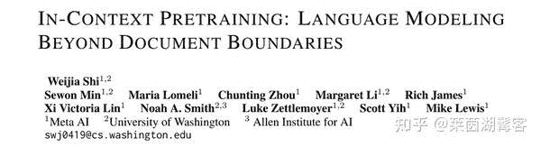
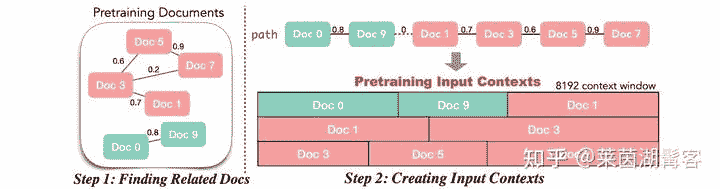
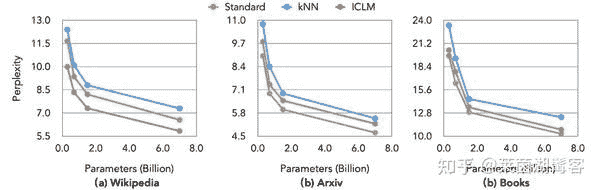
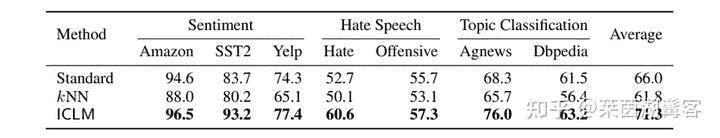
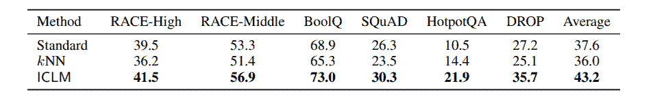
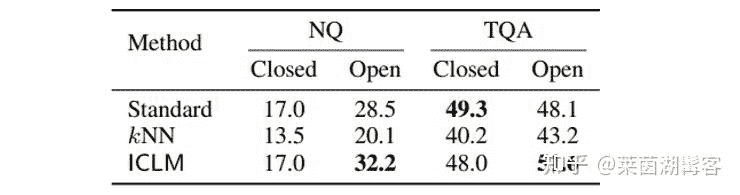
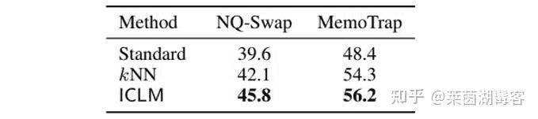
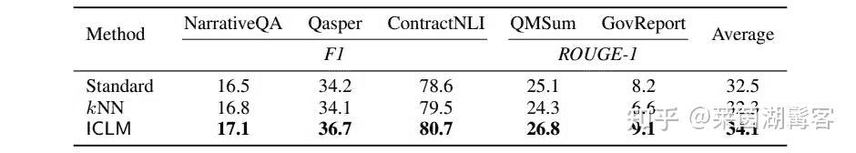

# LLM在Pretrain时如何做好拼接

> 来源：[https://agijuejin.feishu.cn/docx/UQEQdryrtoYFYGxzzYpcbSehngQ](https://agijuejin.feishu.cn/docx/UQEQdryrtoYFYGxzzYpcbSehngQ)

> 作者：[咸鱼王](https://www.zhihu.com/people/wow-kong)

> 原文链接： [https://zhuanlan.z](https://zhuanlan.zhihu.com/p/676647785)hihu.com/p/676647...

为了提高pretrain效率、拓展LLM最大长度，随机将若干条短文本进行拼接是pretrain阶段常见手段，但这种"强扭的瓜"究竟是否合理？



**论文链接：**

[I](https://link.zhihu.com/?target=https%3A//arxiv.org/pdf/2310.10638.pdf%25EF%25BC%2589)N-CONTEXT PRETRAINING: LANGUAGE MODELING BEYOND DOCUMENT BOUNDARIES

## 01 背景

由于pretrain过高的实验成本，延用成功案例的训练策略无可厚非，但是这些策略是否最优仍未可知。该篇论文从pretrain阶段短文本拼接方案为切入点，尝试给出一种更加合理的拼接策略。同时，笔者尝试以本篇论文为主干，结合相关文章和笔者的个人见解，对这些拼接策略做进一步分析。

## 02 一些常见的拼接方案

### 2.1 Random Concatenate

随机**将短文本   {e**xamplesi∈D**} \{example**s_{i\in D}\} 拼接成   {Examplesk∈D} \{Examples_{k\in D}\} 以 打满maxLen 是pretrain的常见手段，该方法不仅能够 降低padding占比、提高训练效率 ，还能使LLM具备 更好的长文本处理能力 。

但笔者认为，绝大多数情况下构成   Ex**ample Example 的多**个   examples examples 彼此 互不相关，无法提供有效的上下文信息 ，LLM自然也无法从拓宽的窗口中获得反馈。甚至，在语料较少、分布比较集中时， LLM很有可能从多次、偶然的（因拼接导致的）噪音共现中拟合到错误的特征 。当然，如果语料足够多、分布足够广，LLM仍能通过足够的contrastive，逐渐聚焦于   example example 本身而非其他无关   examples examples 。此外，也有一些使用specialToken对   examples examples 进行软隔离的方案，但没有额外的正则手段时，使用specialToken进行隔离或许只是鸡生蛋、蛋生鸡的死循环。

### 2.2 Random Concatenate + NoiseMask

为缓解2.1所述的无关   examples examples 间的噪音共现问题，笔者尝试过添加自定义attentionMask，使LLM在pretrain时仅focus on当前   example example ，经笔者测试，该方法在ICL few-shot上相比2.1（也即常规pretrain方法）有1.6%左右的提升。

```
def segment_causal_mask(input_ids, device, val=float(&quot;-inf&quot;)):
    bsz, tgt_len = input_ids.shape
    cum_lens = torch.arange(1, tgt_len+1, device=device).unsqueeze(0) * \
               torch.eq(input_ids, EosTokenId).int().to(device)

    mask = torch.zeros([bsz, tgt_len, tgt_len]).to(device)
    for i, _cum_lens in enumerate(cum_lens):
        for v in _cum_lens:
            mask[i,v:,:v] = val

    return mask
```

但这种方式仍存在一个问题，相对位置编码（如ALIBI、ROPE）的token-wise相对位置信息会在atten**tionScor**e矩阵对**应**位置有所体现，如果施加了attentionMask，这部分相对位置信息经过softmax会被 完全掩盖/误杀 ，也即 LLM无法在BP过程中，从跨  examples 间获得反馈（不论是相对位置的反馈还是语义信息的反馈） 。因此在不考虑外推性的前提下，这种pretrain方法仍是在短文本窗口内进行训练，没有真正意义上实现maxLen级别的长文本训练，只能起到提高训练效率的作用。

另外，尽管2.1中没有利用attentionMask，LLM是否能从无关  examples 构成的窗口中获取对（更远）**相对位置的正向反馈仍然存疑（如果数据构成表**现为远的都不相关，即便没有mask，LLM也倾向于忽略更远的tokens）， 或许这也是多数LLM在拓宽maxLen之后，长文本支持效果仍然差强人意的原因之一。

### 2.3 Random Concatenate + Cluster

鉴于2.2存在的问题，能否既不施加attentionMask，也能让**LLM不受跨  examples 干扰****甚至还能获益的方法呢？一**个直观的想法就是 以实体、语义等维度对  \{examples_{i\in D}\} 进行聚类 ，使构成同一个  Example 的  examples 存在 真实可靠的信息共现前提 ，从而LLM更加不容易从噪音共现中学偏，也能从pretrain中适应更加广泛全局的attention、从而具备更好的长文本处理能力。

**笔者曾经尝****试沿实体维**度进行聚类，但发现了一个比较棘手的问题： 信息重复 ，以及经过关键词、语义去重后仍难以避免的 信息泄露 （或者说二者本质相同，只是程度的分别）。在此情况下LLM有 从memorize变成了copy 的风险，或许这就是后来实验结论没有显著的原因。

本文作者提出的ICLM实际上也是一种类似的方法，即基于语义对  examples 进行聚合、拼接，因此笔者开始时也十分好奇作者如何妥善处理泄露问题。

### 2.4 IN-CONTEXT PRETRAINING

作者在文中提出的pretrain方法，基本思想是在拼接时，利用语义相似度，优先将最相似的  \{examples_{i\in D}\} 进行拼接，从而构成语义更加连贯流畅的上下文，基本流程如下图：

1.  将  \{examples_{i\in D}\} embedding化（作者使用了contriever）；

1.  基于余弦距离进行数据 **去重 **；

1.  基于旅行商思想，不断串联最相关的  e**xampl**e （每个  example 用完即扔 ，不会repeat）；

1.  基于拼接后的  \{Examples_{k\in D}\} 进行pretrain；



作者在文中多次强调了数据去重的重要性，并经过消融实验验证了去重对ICLM的正向增益。相比实体，沿语义聚合的  \{examples_{i\in D}\} 分布更加平缓，受泄露影响的风险更低；此外，分布更广泛的数据、更妥善的去重操作，或许也是ICLM能够有效的重要原因。

## 03 实验

### 3.1 实验设置

基于LLAMA+CommonCrawl（306B tokens）进行预训练，maxLen为8192，batchSize为400万tokens。对比方法：

1.  Standard：常规pretrain拼接方法，随机选取若干个  examples 进行拼接；

1.  kNN：对于每个  example ，选取top-K个  examples 进**行拼接，**可能会有重复（注意这种repeat不同于一般的过采样或多轮训练，一般是 不均匀 的，更易导致过拟合）；

1.  ICLM：即本文提出的方法。

### 3.2 实验结果

作**者首先评**测了3种pretrain model在wiki、arxiv、Books这三种高质量corpus下的 PPL ，如下图所示。结论可以说是非常明了，在不同corpus、在不同参量下，ICLM方法始终优于Standard始终优于kNN。



作者又基于32-shot，测试了不同model的情感分类、主题分类、仇恨言论检测能力，如下表所示，结论与PPL实验基本一致，ICLM的 In-context learning分类效果 显著优于Standard方法（+8%），kNN仍是最差。



**阅读理解上**的实验结论也基本相同，如下表，ICLM在 阅读理解 的2-shot测试上和Standard拉开了更大的差距（+14%），可以看出In-context pretraining对LLM的理解和推理能力有不小的正向增益。



作者又基于NQ和TQA分别进行了clos**e/ope**n测试，前者主**要评测LLM**的 世界知识 ，后者则侧重 RAG能力 。在closed测试中，ICLM整体略低于Standard方法，这似乎也可以解释：即便作者利用余弦距离对examples进行去重，仍无法避免邻近examples中存在部分repeat或信息泄露，因此在pretrain阶段， LLM存在copy而非memory的风险 ，进而导致ICLM的知识记忆效果相对较差。在open也即RAG测试中，ICLM则再次表现出了明显优势（+9%）。另外，尽管kNN的pretrain方法形似RAG，仍未取得更好的结果，原因大概还是过拟合。



另外，**为测试LLM遵循指令&reference的能力（尤其在**RAG下很有意义），作者在NQ-Swap和MemoTrap进行了测试（该测试集中instruction/reference基本都与LLM知识存在冲突），具体结果如下表，ICLM展现了更大的优势，也即 更倾向于依赖context进行生成（更遵循instruction、更忠实reference） 。



最后也是最值得关心的一点，作者基于SCROLL**进行了长文本推理**测试，以对比几种方法的 长文本支持效果 ，具体如下表，ICLM相比Standard方式在不同数据集上都普遍存在增益（+5%）。



## 04 结论

该篇文章给出了沿语义维度进行短文本拼接的pretrain策略，从论文作者给出的实验来看，可以说实验维度非常全面，实验结果大获全胜。

笔者认为，该方法 **从真正意义上拓宽了LLM的max**Le**n、attentionWindow ： 相比普通pretrain方法，ICLM能从长文本窗口获得更高受益，（尤其对更远**的token）更加concentrated，也具备更好的长文本理解能力、instruction following和reference dependent能力 。

但是ICLM也存在copy而非memorize的的风险，或许在知识记忆上有一定劣势，尤其在没有妥善处理好信息重复或泄露问题时会更加严重；此外对于continue pretrain的场景，如果语料较少、分布比较集中，拼接时会以更高概率出现泄露问题，需要更加妥善处理。