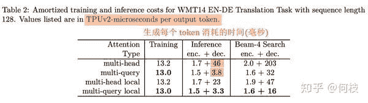
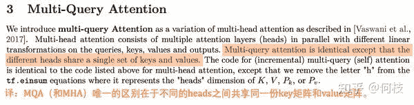
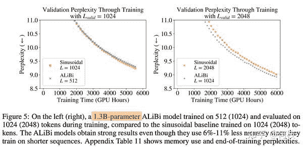
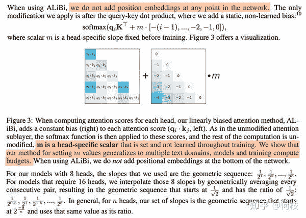

# 【LLM 加速技巧】Muti Query Attention 和 Attention with Linear Bias（附源码） - 知乎

> 来源：[https://agijuejin.feishu.cn/docx/LiLJd1Lh6osfpqxO0eocZ9M4nxh](https://agijuejin.feishu.cn/docx/LiLJd1Lh6osfpqxO0eocZ9M4nxh)
>
> 作者：何枝
>
> 原文：https://zhuanlan.zhihu.com/p/634236135

Large Language Model（LLM）效果着实令人震惊，但其训练和推理过程都非常消耗资源。为此，不少研究者都在想办法来加速大模型的训练/推理速度，例如：最近非常火热的 LoRA 和 PTuning。但 LoRA 和 PTuning 大多只用在微调（Finetune）阶段，今天我们来看看另外一种加速的方法，不仅使用于微调，也同样适用于预训练（Pretrain）阶段，以及一种能在短句子上训练，长句子上推理的方法。

## 1. Muti Query Attention (MQA)

> 论文地址：https://arxiv.org/pdf/1911.02150.pdf

MQA 是 19 年提出的一种新的 Attention 机制，其能够在保证模型效果的同时加快 decoder 生成 token 的速度。

那到底能提升多少的速度呢，我们来看论文中给出的结果图：



从上图表中可以看到，MQA 在 encoder 上的提速没有非常明显，但在 decoder 上的提速是很显著，

那 MQA 究竟是怎么做的，能够使得 decoder 有着如此大的速度提升呢？

---

从字面上看，Multi Query Attention（MQA）和 Multi Head Attention（MHA）只差了一个单词，就是从「Head」变成了「Query」。

我们知道，在 transformer 中是包含若干个注意力头（head）组成的，

而每个 head 又是由：`query`（Q），`key`（K），`value`（V）3 个矩阵共同实现的。

既然这里把 Head 换成了 Query，那是不是就意味着只保留了 Query 矩阵呢？

保持这个猜想，我们来看看论文中是怎么解释的：



> 顺带吐槽一句，这篇论文写的着实不是很友好，例子里面很多地方变量没有给出定义和解释，不是很容易看懂 =-=

从论文的解释中可以看到，`MQA` 让所有的头之间 共享 同一份 `key` 和 `value` 矩阵，每个头只单独保留了一份 `query` 参数，从而大大减少 `key` 和 `value` 矩阵的参数量。

> 「参数共享」并不是一个很新奇的思路，在 Albert 里也有通过使用跨层共享参数（Cross-layer parameter sharing）的方式来大大减少 bert 的参数量，具体做法可以参考这里： 何枝：基于BERT的几种改进模型

现在，

我们知道了 `MQA` 实际上是将 head 中的 `key` 和 `value` 矩阵抽出来单独存为一份共享参数，

而 `query` 则是依旧保留在原来的 head 中，每个 head 有一份自己独有的 `query` 参数。

---

这个做法具体是怎么实现的呢？

我们选用 `llm-foundry` 的代码作为示例，一起来看看究竟是怎么个「参数共享」法：

```
# 为了方便阅读，我们只保留了 llm-foundry 中关键部分的代码，完整代码请参照源码。

class MultiheadAttention(nn.Module):

    def __init__(
            self,
            d_model: int,
            n_heads: int,
            device: str
        ):
        """
        Multi Head init func.
        Args:
            d_model (int): hidden state size, e.g. 768
            n_heads (int): 设定的注意力头数, e.g. 8
            device (str): _description_
        """
        super().__init__()

        self.d_model = d_model
        self.n_heads = n_heads
    
        self.Wqkv = nn.Linear(
            self.d_model, 
            3 * self.d_model,                        # 有 query, key, value 3 个矩阵, 所以是 3 * d_model
            device=device
        )                                            # (d_model, 3 * d_model)
        self.attn_fn = scaled_multihead_dot_product_attention
        self.out_proj = nn.Linear(
            self.d_model, 
            self.d_model, 
            device=device
        )

    def forward(
        self,
        x
    ):
        """
        forward func.
        Args:
            x (tensor): (batch, hidden_state, d_model) e.g. -> (1, 768, 512)
        Returns:
            _type_: _description_
        """
        qkv = self.Wqkv(x)                            # (1, 768, 3 * 768)

        query, key, value = qkv.chunk(                # 每个 tensor 都是 (1, 512, 768)
            3, 
            dim=2
        )     

        context, attn_weights, past_key_value = self.attn_fn(
            query,
            key,
            value,
            self.n_heads
        )                                             # (1, 512, 768)

        return self.out_proj(context), attn_weights, past_key_value


class MultiQueryAttention(nn.Module):
    """Multi-Query self attention.
    Using torch or triton attention implemetation enables user to also use
    additive bias.
    """

    def __init__(
        self,
        d_model: int,
        n_heads: int,
        device: Optional[str] = None,
    ):
        super().__init__()

        self.d_model = d_model
        self.n_heads = n_heads
        self.head_dim = d_model // n_heads

        self.Wqkv = nn.Linear(                           # 【关键】Multi-Query Attention 的创建方法
            d_model,
            d_model + 2 * self.head_dim,                 # 只创建 query 的 head 向量，所以只有 1 个 d_model
            device=device,                               # 而 key 和 value 则只共享各自的一个 head_dim 的向量
        )

        self.attn_fn = scaled_multihead_dot_product_attention
        self.out_proj = nn.Linear(
            self.d_model, 
            self.d_model, 
            device=device
        )
        self.out_proj._is_residual = True  # type: ignore

    def forward(
        self,
        x,
    ):
        qkv = self.Wqkv(x)                                           # (1, 512, 960)

        query, key, value = qkv.split(                               # query -> (1, 512, 768)
            [self.d_model, self.head_dim, self.head_dim],            # key   -> (1, 512, 96)
            dim=2                                                    # value -> (1, 512, 96)
        )

        context, attn_weights, past_key_value = self.attn_fn(
            query,
            key,
            value,
            self.n_heads,
            multiquery=True,
        )

        return self.out_proj(context), attn_weights, past_key_value
```

> 完整源码：`github/mosaicml/llm-foundry`

从上面的代码中可以看到，`MHA` 和 `MQA` 之间的区别只在于建立 `Wqkv` Layer 上：

```
# Multi Head Attention
self.Wqkv = nn.Linear(                        # 【关键】Multi-Head Attention 的创建方法
    self.d_model, 
    3 * self.d_model,                         # 有 query, key, value 3 个矩阵, 所以是 3 * d_model
    device=device
)

query, key, value = qkv.chunk(                # 【关键】每个 tensor 都是 (1, 512, 768)
    3, 
    dim=2
)


# Multi Query Attention
self.Wqkv = nn.Linear(                                # 【关键】Multi-Query Attention 的创建方法
    d_model,
    d_model + 2 * self.head_dim,                      # 只创建 query 的 head 向量，所以只有 1 个 d_model
    device=device,                                    # 而 key 和 value 不再具备单独的头向量
)

query, key, value = qkv.split(                        # query -> (1, 512, 768)
    [self.d_model, self.head_dim, self.head_dim],     # key   -> (1, 512, 96)
    dim=2                                             # value -> (1, 512, 96)
)
```

在 `MHA` 中，`query`, `key`, `value` 每个向量均有 768 维度，

而在 `MQA` 中，只有 `query` 是 768 维，而 `key` 和 `value` 均只剩下 96 维了，恰好是 1 个 `head_dim` 的维度。

因此，我们更可以确认：在 `MQA` 中，除了 `query` 向量还保存着 8 个头，`key` 和 `value` 向量都只剩 1 个「公共头」了。

这也正好印证了论文中所说的「所有 head 之间共享一份 `key` 和 `value` 的参数」。

剩下的问题就是如何将这 1 份参数同时让 8 个头都使用，

代码里使用矩阵乘法 `matmul` 来广播，使得每个头都乘以这同一个 tensor，以此来实现参数共享：

```
def scaled_multihead_dot_product_attention(
        query,
        key,
        value,
        n_heads,
        multiquery=False,
    ):
    q = rearrange(query, 'b s (h d) -> b h s d', h=n_heads)         # (1, 512, 768) -> (1, 8, 512, 96)
    kv_n_heads = 1 if multiquery else n_heads
    k = rearrange(key, 'b s (h d) -> b h d s', h=kv_n_heads)        # (1, 512, 768) -> (1, 8, 96, 512) if not multiquery 
                                                                    # (1, 512, 96) -> (1, 1, 96, 512)  if multiquery
    v = rearrange(value, 'b s (h d) -> b h s d', h=kv_n_heads)      # (1, 512, 768) -> (1, 8, 512, 96) if not multiquery 
                                                                    # (1, 512, 96) -> (1, 1, 512, 96)  if multiquery
    
    attn_weight = q.matmul(k) * softmax_scale                       # (1, 8, 512, 512)
    attn_weight = torch.softmax(attn_weight, dim=-1)                # (1, 8, 512, 512)

    out = attn_weight.matmul(v)                                     # (1, 8, 512, 512) * (1, 1, 512, 96) = (1, 8, 512, 96)
    out = rearrange(out, 'b h s d -> b s (h d)')                    # (1, 512, 768)

    return out, attn_weight, past_key_value
```

非常感谢评论区的指正，之前对 `d_model` 的理解有误，导致注释中的维度有问题，容易产生误导，现已修正。还是要亲自跑一遍代码才知道自己理解的到底对不对，这里将源码修改为可以单测的形式提供出来，建议大家可以走一遍 `debug` 看看具体的维度变化。


```python
import math

import warnings
import torch
import torch.nn as nn
from einops import rearrange

from typing import Optional


def scaled_multihead_dot_product_attention(
        query,
        key,
        value,
        n_heads,
        past_key_value=None,
        softmax_scale=None,
        attn_bias=None,
        key_padding_mask=None,
        is_causal=False,
        dropout_p=0.0,
        training=False,
        needs_weights=False,
        multiquery=False,
    ):
    q = rearrange(query, 'b s (h d) -> b h s d', h=n_heads)         # (1, 512, 768) -> (1, 8, 512, 96)
    kv_n_heads = 1 if multiquery else n_heads
    k = rearrange(key, 'b s (h d) -> b h d s', h=kv_n_heads)        # (1, 512, 768) -> (1, 8, 96, 512) if not multiquery 
                                                                    # (1, 512, 96) -> (1, 1, 96, 512)  if multiquery
    v = rearrange(value, 'b s (h d) -> b h s d', h=kv_n_heads)      # (1, 512, 768) -> (1, 8, 512, 96) if not multiquery 
                                                                    # (1, 512, 96) -> (1, 1, 512, 96)  if multiquery
    
    attn_weight = q.matmul(k) * softmax_scale                       # (1, 8, 512, 512)
    attn_weight = torch.softmax(attn_weight, dim=-1)                # (1, 8, 512, 512)

    out = attn_weight.matmul(v)                                     # (1, 8, 512, 512) * (1, 1, 512, 96) = (1, 8, 512, 96)
    out = rearrange(out, 'b h s d -> b s (h d)')                    # (1, 512, 768)

    return out, attn_weight, past_key_value


class MultiheadAttention(nn.Module):
    """Multi-head self attention.
    Using torch or triton attention implemetation enables user to also use
    additive bias.
    """

    def __init__(
        self,
        d_model: int,
        n_heads: int,
        attn_impl: str = 'triton',
        clip_qkv: Optional[float] = None,
        qk_ln: bool = False,
        softmax_scale: Optional[float] = None,
        attn_pdrop: float = 0.0,
        low_precision_layernorm: bool = False,
        verbose: int = 0,
        device: Optional[str] = None,
    ):
        super().__init__()

        self.attn_impl = attn_impl
        self.clip_qkv = clip_qkv
        self.qk_ln = qk_ln

        self.d_model = d_model
        self.n_heads = n_heads
        self.softmax_scale = softmax_scale
        if self.softmax_scale is None:
            self.softmax_scale = 1 / math.sqrt(self.d_model / self.n_heads)
        self.attn_dropout_p = attn_pdrop

        self.Wqkv = nn.Linear(self.d_model, 3 * self.d_model, device=device)

        fuse_splits = (d_model, 2 * d_model)
        self.Wqkv._fused = (0, fuse_splits)  # type: ignore

        self.attn_fn = scaled_multihead_dot_product_attention
        self.out_proj = nn.Linear(self.d_model, self.d_model, device=device)
        self.out_proj._is_residual = True  # type: ignore

    def forward(
        self,
        x,
        past_key_value=None,
        attn_bias=None,
        attention_mask=None,
        is_causal=True,
        needs_weights=False,
    ):
        qkv = self.Wqkv(x)                                              # (1, 512, 2304)

        if self.clip_qkv:
            qkv.clamp_(min=-self.clip_qkv, max=self.clip_qkv)

        query, key, value = qkv.chunk(3, dim=2)                         # both q, k, v: (1, 512, 768)

        key_padding_mask = attention_mask

        context, attn_weights, past_key_value = self.attn_fn(
            query,
            key,
            value,
            self.n_heads,
            past_key_value=past_key_value,
            softmax_scale=self.softmax_scale,
            attn_bias=attn_bias,
            key_padding_mask=key_padding_mask,
            is_causal=is_causal,
            dropout_p=self.attn_dropout_p,
            training=self.training,
            needs_weights=needs_weights,
        )

        return self.out_proj(context), attn_weights, past_key_value


class MultiQueryAttention(nn.Module):
    """Multi-Query self attention.
    Using torch or triton attention implemetation enables user to also use
    additive bias.
    """

    def __init__(
        self,
        d_model: int,
        n_heads: int,
        attn_impl: str = 'triton',
        clip_qkv: Optional[float] = None,
        qk_ln: bool = False,
        softmax_scale: Optional[float] = None,
        attn_pdrop: float = 0.0,
        low_precision_layernorm: bool = False,
        verbose: int = 0,
        device: Optional[str] = None,
    ):
        super().__init__()

        self.attn_impl = attn_impl
        self.clip_qkv = clip_qkv
        self.qk_ln = qk_ln

        self.d_model = d_model
        self.n_heads = n_heads
        self.head_dim = d_model // n_heads
        self.softmax_scale = softmax_scale
        if self.softmax_scale is None:
            self.softmax_scale = 1 / math.sqrt(self.head_dim)
        self.attn_dropout_p = attn_pdrop

        self.Wqkv = nn.Linear(
            d_model,
            d_model + 2 * self.head_dim,
            device=device,
        )

        fuse_splits = (d_model, d_model + self.head_dim)
        self.Wqkv._fused = (0, fuse_splits)  # type: ignore

        self.attn_fn = scaled_multihead_dot_product_attention
        self.out_proj = nn.Linear(self.d_model, self.d_model, device=device)
        self.out_proj._is_residual = True  # type: ignore

    def forward(
        self,
        x,
        past_key_value=None,
        attn_bias=None,
        attention_mask=None,
        is_causal=True,
        needs_weights=False,
    ):
        qkv = self.Wqkv(x)                                      # (1, 512, 960)

        if self.clip_qkv:
            qkv.clamp_(min=-self.clip_qkv, max=self.clip_qkv)

        query, key, value = qkv.split(                                  # query -> (1, 512, 768)
            [self.d_model, self.head_dim, self.head_dim],               # key   -> (1, 512, 96)
            dim=2                                                       # value -> (1, 512, 96)
        )

        key_padding_mask = attention_mask

        if self.qk_ln:
            # Applying layernorm to qk
            dtype = query.dtype
            query = self.q_ln(query).to(dtype)
            key = self.k_ln(key).to(dtype)

        context, attn_weights, past_key_value = self.attn_fn(
            query,
            key,
            value,
            self.n_heads,
            past_key_value=past_key_value,
            softmax_scale=self.softmax_scale,
            attn_bias=attn_bias,
            key_padding_mask=key_padding_mask,
            is_causal=is_causal,
            dropout_p=self.attn_dropout_p,
            training=self.training,
            needs_weights=needs_weights,
            multiquery=True,
        )

        return self.out_proj(context), attn_weights, past_key_value


if __name__ == '__main__':
    # attn = MultiQueryAttention(
    #     768,
    #     8,
    #     'torch'
    # )

    attn = MultiheadAttention(
        768,
        8,
        'torch'
    )

    attn(
        torch.ones(size=(1, 512, 768))
    )
```

## 2. Attention with Linear Bias（ALiBi）

> 论文地址：[https://arxiv.org/pdf/2108.12409.pdf](https://link.zhihu.com/?target=https%3A//arxiv.org/pdf/2108.12409.pdf)

我们都知道，文本长度一直是 `transformer` 的硬伤。

不同于 `RNN`，`transformer` 在训练时必须卡在一个最大长度上，

而这将会导致训练好的模型无法在一个与训练时的长度相差较远的句子上取得较好的推理结果。

`ALiBi` 是 22 年提出的一种方法，其目的就是解决 `transformer` 训练和推理时文本长度不一致的难题，

论文中在训练时候使用 1024 的最大长度，但在推理时用 2048 的最大长度推理，并且在 `PPL` 指标持平。

同样，我们先来看看论文中给出的效果：



上图中表示，`ALiBi` 都是在测试集的句子最大长度的「一半长度」上进行训练，

而 `Sinusoidal` 则是正常在「测试集长度」上进行训练，

纵轴困惑度（Perplexity）越小代表模型效果越好。

可以看出：

- 在测试长度为 1024 时，在 512 长度上训练的 `ALiBi` 和在 1024 长度上训练的 `baseline` 模型几乎表现完全一致

- 在测试长度 2048 时，在 1024 长度上训练的 `ALiBi` 比在 2048 长度上训练的 `baseline` 模型表现更好

> 测试语料包括：维基百科、书籍语料、英文语料等。


# ALiBi 与训练推理长度解耦

不难看出，使用这种方法同样可以加速我们训练 LLM，

我们只用在稍微短一些的训练集上训练模型（更快），最后也能在长测试句子上取得相当的效果。

---

## ALiBi 如何实现训练长度与推理长度的解耦

`ALiBi` 究竟是怎么做到训练长度和推理长度不紧密耦合的呢？

在 transformer 中，由于 token 和 token 之间是没有顺序之分的，

因此，我们通常在输入添加 `Position Embedding` 来表征每一个 token 在句子中的位置。

而 `Position Embedding` 的如何选择实在是一个难题，通常有以下几种：

+   `` `可学习的参数：` ``这种比较常见，BRET 中就是这么做的，但这种方式弊端很明显，因为位置信息是学习出来的，所以如果训练集里面没有见过覆盖某个长度，推理的效果就无法得到保证。

+   `` `正弦位置编码：` ``这是早期 transformer 使用的位置编码，论文中有尝试做实验，这种编码会随着训练/预测时的文本长度差异增大，（超过 50 个token 后）性能显著下降。

+   `` `旋转编码：` ``论文中提到这种方式是比较不错的，只不过因其在每一层都要做一次向量旋转，从而降低训练和推理的速度。

`ALiBi` 的实现思路很直觉，模型在接收输入时直接去掉 `Position Embedding` 向量，

而是在 `Attention` 中计算 `query·Key` 的值后面加入一个偏置常量（非训练变量），来达到注入位置信息的效果。

而这个常量是一个 `` `事先计算好` ``的数值，并且每个头（`head`）的值都有所不同。



从上述内容可以看出，这个常量实际上就是计算前面 token 距离当前 token 的距离：`` `[-n, -n-1, ..., -1, 0]` ``，

这样一来，每个 token 就能得到与其他 token 的「相对位置信息」，

通过「相对位置信息」就能在一定程度上缓解「绝对位置信息」造成的训练和推理过程中长度编码不一致的问题。

## ALiBi 在 `llm-foundry` 中的实现

以下是 `ALiBi` 在 `llm-foundry` 中的实现：

```
def gen_slopes(
        n_heads,
        alibi_bias_max=8
    ):
    """
    根据不同的头得到不同的 m 系数。
    Args:
        n_heads (_type_): 4
        alibi_bias_max (int, optional): _description_. Defaults to 8.
    Returns:
        _type_: _description_
    """
    _n_heads = 2 ** math.ceil(math.log2(n_heads))   # 4
    m = torch.arange(                               # (4,) e.g. -> tensor([1, 2, 3, 4])
        1,
        _n_heads + 1
    )
    m = m.mul(alibi_bias_max / _n_heads)            # (4,) e.g. -> tensor([2, 4, 6, 8])
    slopes = (1. / torch.pow(2, m))                 # (4,) e.g. -> tensor([0.2500, 0.0625, 0.0156, 0.0039])

    return slopes.view(1, n_heads, 1, 1)            # (1, 4, 1, 1) e.g. -> tensor([[[[0.2500]], [[0.0625]], [[0.0156]], [[0.0039]]]])


def build_alibi_bias(
        n_heads,
        seq_len,
        alibi_bias_max=8,
    ):
    """_summary_
    Args:
        n_heads (_type_): 4
        seq_len (_type_): 16
        alibi_bias_max (int, optional): _description_. Defaults to 8.
    Returns:
        _type_: _description_
    """
    alibi_bias = torch.arange(                      # (1, 1, 1, 16) e.g. -> tensor([[[[-15, -14, ..., 0]]]])
        1 - seq_len,
        1,
    ).view(1, 1, 1, seq_len)

    slopes = gen_slopes(
        n_heads,
        alibi_bias_max
    )                                               # (1, 4, 1, 1)

    alibi_bias = alibi_bias * slopes                # (1, 4, 1, 16)

    """
    >>> alibi_bias
    tensor([[[[-3.7500, -3.5000, -3.2500, -3.0000, -2.7500, -2.5000, -2.2500,
           -2.0000, -1.7500, -1.5000, -1.2500, -1.0000, -0.7500, -0.5000,
           -0.2500,  0.0000]],
         [[-0.9375, -0.8750, -0.8125, -0.7500, -0.6875, -0.6250, -0.5625,
           -0.5000, -0.4375, -0.3750, -0.3125, -0.2500, -0.1875, -0.1250,
           -0.0625,  0.0000]],
         [[-0.2344, -0.2188, -0.2031, -0.1875, -0.1719, -0.1562, -0.1406,
           -0.1250, -0.1094, -0.0938, -0.0781, -0.0625, -0.0469, -0.0312,
           -0.0156,  0.0000]],
         [[-0.0586, -0.0547, -0.0508, -0.0469, -0.0430, -0.0391, -0.0352,
           -0.0312, -0.0273, -0.0234, -0.0195, -0.0156, -0.0117, -0.0078,
           -0.0039,  0.0000]]]])
    """

    return alibi_bias
```

好啦，以上就是全部内容，感谢观看~

上述代码均在这里可以看到：`` `https://github.com/mosaicml/llm-foundry/blob/9c89ab263e72fb9610f28c8ab9cde5d2205b6bff/llmfoundry/models/layers/attention.py` ``
