# 世界的参数倒影：为何GPT通过Next Token Prediction可以产生智能

> 来源：[https://agijuejin.feishu.cn/docx/B3hddvbq6obsuxxjluuceObvnEh](https://agijuejin.feishu.cn/docx/B3hddvbq6obsuxxjluuceObvnEh)

> 作者：[张俊林](https://www.zhihu.com/people/zhang-jun-lin-76)

> 原文： [https://zhuanlan.z](https://zhuanlan.zhihu.com/p/632795115)hihu.com/p/632795...

“ 两位说英语的荒岛幸存者被困在相邻岛屿上，中间隔着危险水域。幸运的是，他们发现了前任居民留下的电报机，电报机通过一条水下电缆连接起来，他们能够通过电报传递信息。但是，他们不知道的是：附近水域里，生活着一个具备超级智能的章鱼，它劫持了水下电缆并拦截了他们之间传送的消息。尽管章鱼不懂英语，但其超级智能使其能够检测到电报信息文字的统计模式，并能准确表示各种电报信号间的统计关系。在章鱼觉得自己已经学好这些统计规律之后，它切断水下电缆，将自己两个长触手定位在电缆的两个末端，基于它所识别出来的统计模式，接收并自己来回复两名漂流者的电报信号。无论两位幸存者是否注意到交流对象已发生变化，章鱼发送出去的信息，在本质上似乎没有任何含义。毕竟，章鱼只是遵循它从人类之间的前期交流中学到的统计模式，而并没有看到过任何人类对信号的解释，比如“椰子”或“海水”所代表的真实含义。此外，章鱼甚至可能都不明白这些信号是具有意义的，或起到了促进交流的功能 。“ —— “章鱼测试（The Octopus Test）”- Bender & Koller

如果我们把“章鱼测试”里的章鱼换成ChatGPT或GPT 4，您会怎么看这个问题呢？也就是说，下述两种观点，您支持哪一种呢？一种观点与“章鱼测试”看法类似，认为GPT 4这种LLM模型仅仅学会了语言中的单词共现等浅层的表面统计关系，其实并未具备智能，只是类似鹦鹉学舌的语言片段缝合怪而已；另外一种观点则认为：GPT 4不仅学会了语言元素间的表面统计关系，而且学到了人类语言甚至包括物理世界的内在运行规律，文字是由内在智能产生的，所以LLM具备类人智能。

这两种观点针锋相对，我不确定您属于哪一派。目前无论是学术界，还是社会层面，其实持有两方观点的人数都不少，相互之间争论很激烈。比如不认为大语言模型具备智能的反方知名代表人物，AI圈子里的大佬代表是LeCun，语言学界代表人物是乔姆斯基，都否认通过Next Token Prediction这种方式训练出来的大语言模型能够具备智能；而正方代表人物也很多，OpenAI不说了，无疑是最具影响力的正方代表，从目前的公开言论看，Hinton老爷子明显也持正方观点，而且特别正方，不仅认为GPT 4具备类人智能，而且觉得将来人类这种碳基智能很可能是LLM这种硅基智能的引导启动程序(Booster)，在这点上Hinton和马斯克（这是简称，全名为：埃隆·电动车之王·火箭先驱·Twitter再造者·环保先锋·火星殖民者·OpenAI唾弃者·马斯克）的看法是类似的。

目前规模够大的LLM模型，在训练基座模型的时候，都采用`Next Token Prediction，NTP`(后文为了书写简洁，有时会简称为`NTP`)任务。`Next Token Prediction`如此简单的操作，就是通过语言中前面的单词，来产生下一个单词，很明显这样学到的不就是单词之间的表层统计关系吗？对于持正方观点的人士来说，这个问题其实并不好反驳，因为乍一看上去确实如此，我相信绝大多数正方人士很难给出有理有据的另反方人士信服的解释。

至于我本人，如果看过我年初写的

，很容易看出持正方立场。其实当时在那篇文章的最初版本里，有一节内容，主题就是讨论`NTP`为何会产生智能。按照23年1月份版本的我当时对LLM的理解，把`NTP`产生智能归纳为”通过`NTP`任务，LLM在模型参数里学到了一个隐形的知识图谱，当输入`Prompt`的时候，`Prompt`包含的概念启动知识图谱相关节点，然后在知识图谱上按照 <激活-扩散> 理论引发知识间的激活扩散和信息传递，由此导致LLM产生了智能”。当时版本的我是这么理解这个问题的答案的，现在版本的我再去审视这个看法，虽然不能说是错的，但是很显然这种认知还是浅了些或粗略了些。当时，由于那篇文章已有内容已经太长，再加上支持上述看法的依据不太充足，所以我在发文的时候把那节内容删掉了。

本文专门探讨这个主题，我试图梳理归纳目前已有的一些片段性的证据，对上述问题给出一个相对有依据的回答。其实目前正方并没有专门的研究来解释这个问题，但是，如果把各种已知用于研究其它问题的研究结论片段联系到一起来看，即我们可以把寻找这个问题的答案当作一个拼图游戏，在已知研究的拼图碎片基础上，如再加一些合理的推论和假设，我认为正方大致是能给出一些起码看似合理的解释的。本文在结构上首先会比较细致地介绍下OpenAI对这个问题的看法，这个对大多数人来说应该是个很新颖的角度，之后会收集汇总现有的研究结论，之后会给出我认为还算合理的解释。

## 天平的两端：压缩即智能

假设有一个想象中的天平，天平的左端用来称量大语言模型的数据压缩能力，天平的右端用来称量大语言模型的智能水准。问题是：这个天平的称量结果是可信的吗？换句话说，如果大语言模型具备越强的数据压缩能力，是否意味着它具备越强的AGI智能呢？

OpenAI肯定是相信两者间存在等价性的，目前看，这可能是推动OpenAI大模型发展方向的一个核心理念。OpenAI首席科学家Ilya Sutskever在今年早期的一些公开访谈初步透漏了这个思路。 而后续OpenAI负责大模型团队的 Jack Rae 在 Stanford MLSys 研讨会上做了以“Compression for AGI”为主题的报告，则是从理论层面，概念性地论证了这一理念。

本部分主要参照Jack Rae报告内容，转述OpenAI坚信的“压缩即智能”论证过程。我们先从一个数据压缩传输的假想实验讲起。

### 利用LLM进行数据压缩

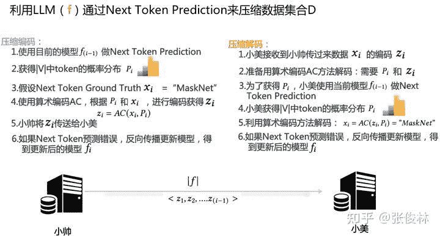

我们假设小帅和小美分别住在地球和火星，现在小帅获得一批机密数据 `D=(x_1,x_2,...,x_n)` ，需要以最小传输成本传送给远在火星的小美，小帅计划通过LLM模型比如GPT来对数据进行压缩，然后把压缩后的数据传给小美，以此来减少传输数据数量。同时，他希望信息压缩是无损的，也就是说，小美要能够根据拿到的压缩数据，利用一定方法完整恢复原始数据 `D` ，不能有任何差异。这个事情看似不太容易做到，怎么办呢？

首先，小帅把GPT模型的代码 `f` ，包括代码本身、初始化方法以及随机种子等信息传给小美，小美根据小帅传过来的GPT模型的信息，利用同样的代码、初始化方法以及随机种子，复制并初始化了一份自己的GPT，以此来让自己手上的GPT模型和小帅手上的模型，在初始状态保持一致。

接下来，小帅以Next Token Prediction作为任务，以 `D=(x_1,x_2,...,x_n)` 作为训练数据，启动GPT模型的训练过程，训练过程本身其实就是数据压缩过程。我们假设小帅已经对数据 `<x_1,x_2,...,x_{(i-1)}>` 通过GPT进行了压缩，对应的压缩数据为 `<z_1,z_2,...,z_{(i-1)}>` ，并将这批压缩数据陆续传给了小美，现在准备传送数据 `x_i` 。我们在这里按下“慢放”键，仔细观察下GPT是如何对数据 `x_i` 进行压缩编码和解码的。

#### 编码阶段

我们的目的是利用GPT压缩 `x_i` 数据，小帅以 `<x_1,x_2,...,x_{(i-1)}>` 作为GPT的输入，利用当前版本的GPT模型 `f_{(i-1)}` 做一次Next Token预测。假设Token词典是 `V` ，则GPT模型经过Next Token预测，产生了词典 `V` 中每一个单词的生成概率， `V` 中有些单词生成概率大，有些生成概率小，所有单词的生成概率之和为1，于是形成 `|V|` 的概率分布 `P_i` 。若设原始数据 `x_i=“MaskNet”` ，此时，可以利用某种数据压缩算法，比如算术编码（Algorithm Coding, AC ），根据 `x_i` 和 `P_i` ，将 `x_i` 压缩成数据 `z_i` （至于算术编码如何运作，稍后会说明），即 `z_i=AC(x_i,P_i)` ，于是小帅可以把得到的压缩编码 `z_i` 传给小美。

另外，如果GPT 根据上文 `<x_1,x_2,...,x_{(i-1)}>` 做Next Token预测得到概率最大的单词不是标准答案 `x_i=“MaskNet”` ，说明模型训练得还不够好，于是小帅让GPT执行一次反向传播，来修正GPT模型参数，希望以后GPT遇到类似上文能够更准确地做出预测。经过反向传播，模型参数发生变化，GPT模型从 `f_{(i-1)}` 修正到了 `f_i` 版本。

可以看出，上述过程，其实就是针对某个Token做的一次标准的GPT训练步骤，只不过我们平常训练GPT的时候，不会根据Next Token Prediction得到的分布概率 `P_i` 以及算术编码来获得 `x_i` 的压缩编码 `z_i` ，并记录下来而已。如果你愿意，完全可以在训练过程中一步步产生每个 `x_i` 对应的 `z_i` ，并把它们记录下来，这样就会获得数据 `D` 的一份无损压缩编码版本。

#### 解码阶段

接收到小帅传来的压缩编码 `z_i` 后，小美希望利用自己手上的GPT模型来恢复原始数据 `x_i` 。她也可以用算术编码来逆向对 `z_i` 进行解码，但是，若想解码 `z_i` 信息不足，除了 `z_i` 外，还需知道 `x_i` 对应的词典 `V` 中单词的概率分布 `P_i` ，但是小帅并没有把 `P_i` 传过来，因为这个信息量太大，传过来很不合算，如何是好？

小美可以用自己手上的GPT来产生缺失的词典单词概率分布 `P_i` ，她把之前已经解码出的 `<x_1,x_2,...,x_{(i-1)}>` 作为模型的输入，让自己手上的 `f_{(i-1)}` 版本GPT模型做一次Next Token预测，于是GPT模型产生了单词概率分布 `P_i` ，这个与小帅的概率分布 `P_i` 是一样的。得到 `P_i` 后，小美可以利用算术编码对 `z_i` 解码，即 `x_i=AC(z_i,P_i)` ，这样就恢复出原始数据 `x_i=“MaskNet”` 。类似的，如果小美手上的GPT此次Next Token预测最大概率单词不是 `x_i=“MaskNet”` ，她也让GPT执行一次反向传播，修正模型参数，将GPT模型从 `f_{(i-1)}` 版本修正到 `f_i` 版本。只有这样，小美才能保证自己手上的GPT模型和小帅在传输过程中始终保持一致。

可以看出，解码过程，其实就是小美也同步进行GPT的一次训练步骤，并利用Next Token Prediction得到的词典单词概率分布 `P_i` ，来帮助从压缩数据 `z_i` 解码到原始数据 `x_i` 。

如此这般，小帅和小美就通过两人同步进行GPT在 `D` 上的模型训练过程，完成了对数据 `x_i` 的压缩和解压，只要不断重复上述过程，小帅就能把 `D` 中所有数据无损地传送给小美，实现了通过LLM对数据的无损压缩和解压。所以我们可以说，GPT模型的训练过程，其实就是对训练数据的无损压缩过程，只不过我们平常训练的时候跳过了这个步骤而已。

### 算术编码机制

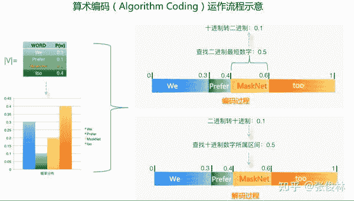

上文未讲解算术编码的运行机制，此处以简单例子做简要说明。如上图所示，假设单词词典 `V` 包含4个单词，我们要压缩编码的原始数据 `x_i=“MaskNet”` ，此时GPT运行Next Token Prediction后，词典 `V` 中单词对应的概率分布 `P_i` 在上图图左列出，也就是说，此刻的GPT预测的Next Token，生成概率最大的单词是”too”，而不是Ground Truth “MaskNet”。

此时，已知 `x_i` 和它对应的 `P_i` ，我们使用算术编码来对数据进行压缩。首先，我们可以根据词典中各个单词的生成概率，把0到1的区间按照每个单词的概率分值进行切割，单词生成概率数值越大，占据区间越长。于是，就可以得到每个单词覆盖区间的下界和上界，比如对于要编码的单词“MaskNet”，它的下界是0.4，因为自身生成概率为0.2，所以上界是0.6。为了使得二进制编码后的长度尽可能短，算术编码在“MaskNet”单词覆盖的0.4到0.6区间寻找对应二进制最短的十进制小数，很明显在这个区间里，十进制数字0.5是二进制最短的数字，于是选择0.5作为编码数字，进行数制转换后得到二进制0.1，这个数字就是单词“MaskNet”对应的二进制算术编码，小帅只需要把小数点后的二进制数字1发送给小美即可。

接着，介绍小美接收到二进制数字1之后的解码过程。如上文所述，小美利用自己的GPT，也会得到一个相同的单词分布概率 `P_i` ，按照算术编码原则，用这个分布概率切割0到1的数值区间，会得到和小帅一样的一个切割图。小美将二进制0.1进行进制转换，得到十进制数字0.5，然后查看0.5落在切割图哪个单词的上下界范围内，会定位到单词“MaskNet”，于是解码出0.1代表的对应单词 `x_i=“MaskNet”` 。

算术编码[的思想是很精妙的](https://zhuanlan.zhihu.com/p/390684936)，它对输入序列动态编码，能够以小数来对整个输入进行二进制编码，编码效率接近于香农提出的熵极限。不过，在我们描述的场景下，因为每个 `x_i` 对应的 `P_i` 在GPT训练过程中总是发生变化，所以某个分布 `P_i` 只需要压缩或者解码一个Token，其思路看起来就很简单，当面向较长的输入序列进行算术编码，其方法可以参考： 什么是算术编码 。

### 压缩即智能

从上述讲解可看出，如果GPT模型生成Ground Truth `x_i=“MaskNet”` 的生成概率越高，则其在算术编码分割区间中占据的长度就越长，就越容易找到更短的算术编码，这意味着模型压缩率越高。也就是说，如果GPT模型智能程度越高，NTP预测得越准确，则其压缩效率就越高。所以，我们可以根据模型的压缩效率来评估模型的智能程度，模型压缩效率越高，则模型智能程度越高，这是目前OpenAI照此思路推进大模型研发方向的一个核心理念。

我们可以考虑两种极端情况：一种情况是模型具备超强智能，对于Next Token Prediction要预测的每一个Ground Truth `x_i` ，生成概率总是为1。我们假设当小帅传输给小美一部分数据 `D_s` 后，模型的智能程度不断积累并达到这个程度，这意味着对于没有传送的剩余数据 `(D-D_s）` 来说，小帅后面无需传输任何信息。因为小美的GPT已经能够完全靠自己正确预测后续的每一个Token，此时GPT模型由于具备超强智能而拥有了极限数据压缩能力，也就是根据输入上文，未来发生什么它都知道；另外一种极端情况，是GPT在训练过程中未学到任何智能，则其在做Next Token Prediction时，纯靠猜。假设词表 `|V|` 大小为 `N` ，则每一个Ground Truth `x_i` 的生成概率永为 `1/N` ，此时GPT不具备任何数据压缩能力，需要传输的数据量和原始数据 `D` 信息量相等。

这是两种极端情况。大多数情况下，LLM模型的智能，或者说压缩能力，应该介于两者之间，而我们可以根据模型压缩能力，来评估模型的智能程度。如果做些数学推导，可知这种情形下，对于数据 `x_i` 对应的 `z_i` ，算术编码所需编码的bit数，也即码长，应为： `-log_2(P_i(x_i))` ，您看到这个公式可以思考下，有没有觉得它和谁长得比较像呢？其实，这就是GPT在训练的时候， `x_i` 这个Token对应的交叉熵损失。也就是说，如果从数据压缩的角度，每个Token的编码长度，其实就是LLM预训练时，这个Token对应的交叉熵损失，两者是等价的。是不是很有意思？所以，数据无损压缩是看待LLM模型训练的另外一个比较新颖的视角。

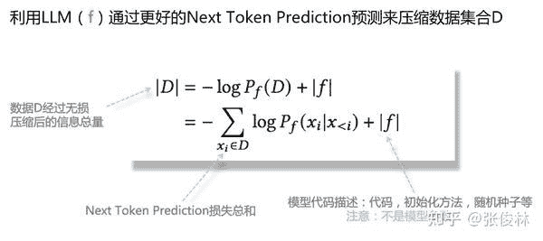

我们可以进一步推导一下，对于数据集合 `D` ，经过LLM模型压缩传输，小帅传给小美的总数据量是多少？具体计算公式可参考上图。由图可看出，传输信息总量由两部分构成：一部分是LLM模型代码描述，包括代码本身、初始化方法以及随机种子等信息；另外一部分的求和公式如果展开，如上所述，每个 `x_i` 对应的压缩编码bit数，就是这个Token对应的交叉熵损失，所以，这部分其实就是GPT利用数据 `D` 进行预训练的时候，所有Token的损失之和。两个部分相加就是数据传输总量。

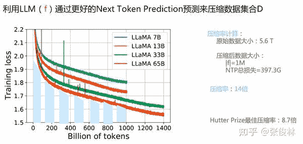

那么，不同的LLM模型，是否具备不同的数据压缩能力呢？答案是显然的。上图展示了不同大小LLaMA模型（从最小的7B到最大的65B）对应的数据压缩能力：对于相同的训练数据总量（比如横坐标的1000B Tokens节点），每个模型Loss曲线覆盖的面积总数，就是这个模型对应的数据压缩能力，Loss曲线覆盖的面积越小，说明模型压缩能力越强。有了前面的讲解铺垫，我相信这很好理解，我们可以极端地假设模型训练时每个Batch只包含一个Token，那么其所需的编码bit数，就是这个Token对应的loss数值，我们对模型Loss面积进行积分，就能得到所有Token的总Loss，而这等价于压缩这些Token所需要的总的压缩后编码长度。

从上图可以看出，规模越大的LLaMA模型，其对应的Loss面积越小，意味着这个模型压缩率越高，压缩能力越强，而这进一步代表模型的智能程度越高。如果粗估的话，可以得出目前LLaMA模型的数据压缩率在14倍左右，而这是超出专门的数据压缩竞赛Hutter Prize目前最佳的压缩率的，目前这个最佳压缩率是8.7倍。这说明什么呢？如果我们假设当前主流的文本压缩算法，其压缩依据主要来自于词频以及重复出现模式这种表面因素的话，那这多出的压缩率，很可能代表了LLM语言模型对于文本深层理解，来自于对AGI的智能编码。

### 进一步的思考

上述内容，即Jack Rae报告中体现出的“压缩即智能”的论证思路。三月份左右我看完分享后大受启发，觉得OpenAI开的脑洞很大，因为自己确实从来没有从数据压缩的角度看待过LLM模型，我相信这对绝大多数人来说都是一个很新颖的观察角度。不过，后来查阅相关文献后，发现这种“压缩即智能”的思路并非OpenAI首创，其实已有较长历史。比如上文提到的旨在鼓励研究更好数据压缩算法的Hutter Prize，创立于2006年，奖项设立人Marcus Hutter即相信数据压缩能力和AI智能是一个等价的问题，这也是他自己出资设立这个奖项的初衷，而且目前使用AI模型做数据压缩已然是个小的研究方向，有不少相关论文。

我们可以就这个思路深入思考两个相关问题。第一个问题是：上面讲述内容是以数据压缩的视角来看待LLM的智能水准，问题是为何模型压缩能力越强，就代表了它具备更高的智能呢？

最小描述长度原理（Minimum Description Length，MDL）可以解释这个问题，这是机器学习中的一个重要概念，是奥卡姆剃刀原则（“如无必要，勿增实体”）的形式化表述。MDL的核心思想是说：假设我们有很多模型可以对手上的数据作出解释，那么其中最佳解释应该是对该数据进行尽可能短而准确描述的模型，模型描述长度越短，则其泛化性就会越好，也就是我们说的越智能。为啥描述越短越智能？因为这个短描述是从数据里抽象出来的内在规律，相对大量数据，数据内在规律的描述，自然就短得多，而模型若能给出越短的描述，说明这个模型学到了更多的内在规律，所以就越聪明。是这个逻辑，我们来举个例子。假设要传输的序列是一万个连续质数数字序列：

2，3，5，7，11…..

质数数字之间的出现间隔是没有规律的，所以小帅只能老老实实把这一万个数字编码传给小美，但是其实小帅可以用一句话，比如 “输出从2开始的1万个连续质数”，来描述这些数字，把这句话压缩后传给小美，小美的LLM模型看到这句话后，如果足够聪明的话，就能恢复出1万个质数序列，到这里我相信您应该能理解MDL的含义了。

当然，能这么做的前提是：LLM得理解质数这种很抽象的概念才行。那么，大模型真的能理解这种抽象概念吗？是否真的只有大模型才能理解类似“质数”这种抽象概念，而小模型就不行呢？我做了个验证，对大模型和小模型的能力做了个对比，为了防止模型单纯靠对训练数据中出现的质数序列进行记忆来完成这个任务，我把描述进行了一些转换，保证大语言模型在训练中是看不到这种说法的，测试对应的`Prompt`及大小两个模型的输出结果可参考下图所示。

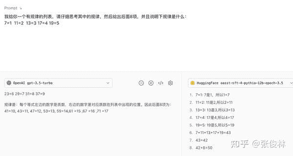

可以看出，GPT 3.5是学会了质数这种抽象概念的，否则这道题很难回答好，如果不理解这个概念，就会出现图右小模型这种不知所云的回答。这一方面说明大模型确实可以学习一些抽象概念，另一方面说明大模型在这方面表现确实比小模型要好。

另外一个问题，jack Rae在报告中强调LLM的这种数据压缩能力是无损的，并反驳了著名科幻小说作家特德姜在年初时候提出的影响很大的“ChatGPT是对互联网数据的有损压缩”观点。其实吧，你要仔细思考一下，会发现这种LLM是对数据的“无损压缩”的观点是有点水分的。如果我们更严谨地来看，会发现尽管LLM训练过程可以看成是对数据的无损压缩，但是能够达成“无损”的效果，并不单单靠LLM，其实是“LLM+算术编码”一起完成的。

如果LLM通过学习达到足够强的智能程度，能够保证NTP预测后续文字序列的`loss`是0，也就是说可以根据上文`Context`，完全精准预测后续Next Token，此时算术编码就不需要了，仅靠LLM就能完整地对数据进行压缩和解码。如果是这种情况，我们说LLM的训练过程或者说LLM在经过训练后，能对数据进行“无损压缩”，并没有任何问题。但是，这是理想情况，目前LLM能做到这点吗？肯定是做不到的，所以LLM给出的后续Next Token预测肯定会有错误，这些被预测错误的Token，其实就代表了LLM压缩数据的信息损失，这种损失是靠算术编码额外对信息进行编码来进行补偿，才达成数据的“无损压缩”效果。所以，更精确的说法，看似应该是这样：

数据无损压缩=LLM模型的有损数据压缩能力+算术编码的编码补偿能力

也就是说，起码目前的LLM对数据编码还是有损的，并不能单靠自己的能力达到数据无损压缩的目的。至于将来LLM是否能够强大到靠自己就能达成数据无损压缩，目前仍是未知数。

数据压缩只是手段，通过这种手段使得GPT获得智能才是目标，现在的问题是：OpenAI从基础理论上指出了手段及目的，但是并未说明一个更基础的问题：Next Token Prediction通过数据压缩来让GPT 模型学到了什么样的AGI智能呢？本文后续内容试图回答这个问题。

## 拼图游戏：目前已知的一些事实碎片

若把LLM习得AGI智能比做一个拼图游戏的话，只能说目前我们手上只有一些有关它的支离破碎的拼图碎片，还未能一睹这种机器智能的全貌。本部分从几个不同的角度，收集并介绍现有相关研究的研究结论。

### GPT模型对知识的提取过程

我们先来看一下，假设LLM模型训练好了，在使用时输入`Prompt`，GPT模型是如何把知识提取出来的。“Dissecting Recall of Factual Associations in Auto-Regressive Language Models”这篇文章对此做了细致的研究。如图所示，假设输入的`Prompt`是：“ Beat music is owned by ”，GPT可以通过NTP返回正确答案： Apple 。这个例子里，“Beat music”是个实体，“owned by Apple”是这个实体对应的某个属性。

经过研究，发现GPT在提取这条知识的时候，经历了明显的三阶段过程：首先，单词“music”是描述这个实体最后的、也是最关键的词汇，它的信息在顺着`Transformer` block往上走的过程中，先通过`Attention`把之前的修饰语“beats”相关信息集成到“music”对应位置。之后，随着`Transformer`层数越来越高，通过每个`Transformer` Block的`FFN`层，不断往“music”对应的`Embedding`里增加信息，所以随着信息往上层流动，“music”这个单词对应层数的`Embedding`，能够触发越来越多的与“beats music”相关“属性”词汇。这是第一个步骤，整个过程总体发生在`Transformer`的低层。

第二步，GPT模型在“by”单词这个位置，也就是NTP要产生输出token的最后一个位置，通过`Attention`把单词“own”的信息集成到最后位置。这里需要注意一下，最后一个单词对应的`Transformer`位置是比较关键的，因为在它的最上层会给出Next Token输出。在推理过程中，GPT会把输入上文中的重要信息通过`Attention`逐步集成到这个位置上来。这个操作也发生在`Transformer`的低层。

第三步，在“by”单词位置，也就是最后一个位置的`Transformer`高层，它在低层已经集成了单词“own”的信息，这个信息在高层，通过`Attention`把“beats music”对应的属性“apple”提取出来。具体提取动作是通过某个`Attention Head`来做到的，而且这篇文章证明了`Attention Head`里会编码<实体-属性>信息，具体例子可以参照下图，这点对我们来说应该是个新知识（过去一般认为`Attention`主要是用来进行信息比较和搬运的，它证明了`Attention`也会存储某种知识）。

通过以上三步，GPT完成了对某条知识的提取过程。

另外一个工作“Understanding Transformer Memorization Recall Through Idioms” 探讨了LLM是如何提取记忆信息的，包括完全靠记忆需要精准复现的成语／谚语（Idioms），以及事实类知识。研究结论是LLM对记忆信息提取可以分为两个阶段：第一阶段是低层的`Transformer` Block把正确答案单词的排名逐渐提高，直到中间层排名到了第一名；第二阶段高层的`Transformer`把正确答案的置信度提高，也就是不断提高这个正确答案的分布概率得分。

除了以上两个工作，还有一些其它类似的研究知识提取的工作。如果综合下现有的研究结论，我觉得可以大致得出这么一个GPT知识提取的轮廓：当训练好GPT模型后输入`Prompt`，对于`Transformer`某个位置对应的输入单词，随着`Transformer` 不断往上走，GPT通过`Attention`，把这个单词上文中与自己有关的信息集成到自己的`Embedding`里，而每层的`FFN`对当前单词`Embedding`做变换增加信息，以此方式来不断触发`FFN`里存储的知识并逐层`Refine`单词对应的`Embedding`（类似上面例子里单词“music”的过程）。

`Transformer`的last token位置也是如此，它的特殊之处在于，从底层到上层，首先会把整个输入上文中最关键的信息，通过`Attention`拷贝到自己的位置，之后通过这个关键信息来逐步过滤出上文中比较重要的信息。在这个位置的`Transformer`底层，应该有很多候选答案可供输出，正确答案排名并不靠前，随着`Transformer`往上走，正确答案排名越来越靠前，而且可以和正确答案竞争的候选答案越来越少，体现为分配给正确答案的概率分布得分越来越高，直到last token的最高层，GPT可以输出正确答案（类似上面例子中单词“by”的过程）。

### 知识点在Transformer中的分布

这部分介绍知识点在`Transformer`结构中的分布情况，意思是不同类型或特定的知识点，在`Transformer`高中低不同层级的分布情况。了解这方面的知识，对于理解GPT的内在运行机制是非常有帮助的。

在介绍研究结论前，为了便于理解，我们先说明三个基础概念(可参考Toy Models of Superposition)：单语义（Monosemantic）神经元、多语义（Polysemantic）神经元及superposition。

目前发现LLM中存在很多单个的神经元，它们各自只对输入里某个特殊的知识点产生响应，也就是说只会被特定输入模式激活，对其它无关输入保持沉默，一个神经元编码一个知识，完美一一对应，这类`Transformer`中的神经元被称为“单语义神经元”(这和人类大脑中的神经元作用机制就比较像了)。与此相反，也有大量神经元是多语义编码的，就是说很多不同语言含义的知识点都会激活某个神经元，这类神经元被称为“多语义神经元”。上图给了例子，比如有的神经元只有当输入的`Prompt`内容是法语写的，它才有响应，这是典型的“单语义神经元”；而有的神经元会对多个语义差异很大的2-gram语言片段都会有响应，这是典型的“多语义神经元”。

Superposition概念的含义是：假设要编码的特征的数量`n`远远多于网络参数`d`，我们可找到办法，来用`d`维神经元编码比`d`数量大得多的`n`个特征，这种编码机制被称为superposition，所以它是被发现存在`Transformer`结构里的一种信息压缩编码机制。

Superposition和“多语义神经元”关系密切，目前发现LLM内部是这样做的（参考Finding Neurons in a Haystack: Case Studies with Sparse Probing）：如上图所示，LLM的Superposition机制是由多个“多语义神经元”联合构成的，每个神经元会对输入中的多个不同知识点都有响应，所以仅仅通过一个“多语义神经元”是无法探测当前是对谁在做出响应，但是如果有多个对某个知识点都有响应的“多语义神经元”，在它们的响应之上做个线性组合，就能探测到输入中我们想识别的那个知识点（上图中蓝色部分）。也就是说，LLM通过组合多个“多语义神经元”来对某个具体特征或知识点进行编码。所以，“多语义神经元”和知识点之间的关系是多对多的映射，一个知识点会激发很多对它进行编码的“多语义神经元”，而一个“多语义神经元”也会对多个输入知识点产生响应。

了解了上述三个基础概念，我们介绍下目前的研究结论：在训练好的GPT模型中，`Transformer`底层编码了大量的具体特征或知识点，比如n-gram特征、句法特征等，编码方式采用上述的由多个“多语义神经元”组成的superposition模式；而随着`Transformer`层数加深，具体知识点逐渐减少，抽象知识点（比如“法语”／“质数”等）逐渐增加，且抽象知识点一般由“单语义神经元”独立编码，且随着`Transformer`层数越高，编码的特征越抽象。换句话说，`Transformer`对特征或知识点的编码，存在由低到高越来越抽象的一个知识抽象过程，这一现象在OpenAI最新发布的文章“Language models can explain neurons in language models”也有提及。

另外，“Polysemanticity and Capacity in Neural Networks”这个文章指出了：在模型学习过程中，为了增加模型参数的利用效率，“单语义神经元”会被分配给重要特征，“多语义神经元”会分配给不太重要的特征，而对更加不重要的特征，则模型完全不进行编码。而所谓的“重要性”，指的是对训练`loss`的影响来说的，也就是说：“单语义神经元”对NTP训练时降低`loss`影响比较大。这说明对特征或知识点进行抽象，是NTP本身为了快速降低`Loss`的一种内在驱动力，而这很可能是GPT模型通过Next Token Prediction任务产生智能的关键之一。

### GPT中知识回路存在的证据

这里介绍LLM模型中，完成某个特定任务存在对应知识回路（Circuit）的相关工作。所谓“回路”，指的是某个任务的`Prompt`输入`Transformer`后，信息从底向上传播，直到last token最高层Next Token输出答案，在网络中存在一些完成这个任务的关键路径，信息主要沿着这条路径向上传播，在传播过程中不断进行信息传递或知识加工，以此方式来通过NTP完成某项任务。如果看过后面介绍内容，你会发现LLM知识回路的工作过程，其实和人类大脑中的某些信息处理回路是很相似的。而大量在GPT的NTP预训练过程中形成的各种知识回路，很可能是揭开AGI之谜的另外一把钥匙。

“How does GPT-2 compute greater-than?: Interpreting mathematical abilities in a pre-trained language model”这个工作主要探讨：为何GPT模型能够通过预训练获得数学能力。具体而言，用的是类似“ The war lasted from the year 17YY to the year 17 ”的`Prompt`，GPT模型可以做到输出的Next Token的年份数字`XX`大于`YY`，这说明它在预训练中学会了数字间的比较关系。通过探究，发现模型在预训练过程中形成了解决这个问题的知识回路，如上图图右所示：有两个关键部分，第一个是中间层的某些`Attention Head`，比如图中`a5.h5`代表`Transformer`第5层的第5个`Attention Head`，这些`Attention Head`主要作用是聚焦到`YY`年份并向高层传播；另外一个关键是第8到11层的`MLP`层，这些层的`MLP`完成“大于”运算，所以最后GPT能够正确输出结果。而且，中间层的`Attention Head`和上层`MLP`也有相对应的传递关系，比如第9层`MLP` 主要接收信息来源于`a9.h1`，而第8层`MLP`的信息来源则比较多。可以看出，信息从下到上形成了一个特定的传播路径。

如果再深入探究，会发现是`MLP`中的一些关键神经元完成数学运算的，如上图图右所示，可以探测出第10层`MLP`中影响最大的10个神经元，这层只用这10个神经元就能大致完成“大于”运算，而左图则展示了`a7.h10` 这个`Attention Head`主要聚焦于关键信息“`YY`”上。另外，该项研究还发现不仅仅上述`Prompt`，如果变换`Prompt`形式，但是体现数字比较关系，发现被激活的也是这条回路，这说明这条回路可能专门用于对数字进行关系比较。

大部分知识回路应由`Attention` 和`MLP`共同组成，但是也发现一些以`Attention`为主的知识回路。典型的例子就是“`Induction Head`”回路，多项研究证明这个回路的存在。它的主要作用在于当GPT预测Next Token的时候，倾向于从上文找到类似的输出模式，并拷贝到后续Token输出。如上图所示句子，第二个“so”是last token，GPT此时通过NTP将要产生后续Token，“`Induction Head`”回路倾向于从上文中找到相同的“so”单词，并把上文中跟在“so”后面的单词“bad”当作Next Token输出。“Localizing Model Behavior with Path Patching”这项研究探测了`Induction Head`的内在工作机制：当根据第二个单词“so”要预测Next Token的时候，“so”本身的内容被拷贝到`Transformer`自己对应`Attention`的`<Query, Key, Value>`中的`Query`，而上文内容中出现的“bad”单词，通过PTH(Previous Token Head to key)这个`Attention Head`将“bad”之前内容的语义集成到“bad”对应的`Key`里。结果在“so”做`Attention`的时候，两者就得到很高相似性，于是通过`Attention`把“bad”拷贝到单词so的位置，这导致Next Token很容易输出“bad”，就达成了从上文拷贝“so…bad”的目的。

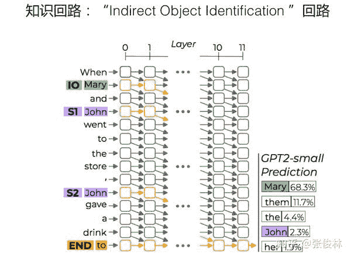

除了“`Induction Head`”外，还有一些功能更复杂的`Attention`回路，比如 “Interpretability in the Wild: a Circuit for Indirect Object Identification in GPT-2 small”这个工作发现了`Transformer`中存在以`Attention`为主，用于识别“`Indirect Object Identification`”的知识回路。所谓“`Indirect Object Identification`”，可以参考上图给出的例子，就是说输入有两个实体，一个重复实体，一个非重复实体，如何从中找到正确答案。从上图例子可看出`GPT`是可以输出正确答案`Mary`的，其原因就是模型学会了一个主要由`Attention Head`构成的复杂识别回路。

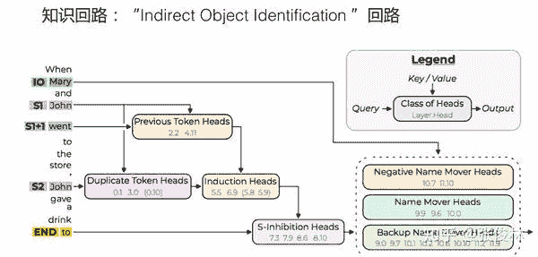

如上图所示，“`Indirect Object Identification`”知识回路识别正确答案，主要由三个步骤构成：首先，`Duplicate Token Heads`用于标识多次出现在句子中的`Token`，而`Induction Heads`起到类似的作用；其次，`S-Inhibition Heads`在输出`Next Token`的位置发生作用，用于从`Name Mover Heads`的注意力中删除或者抑制重复出现的名字；最后，`Name Mover Heads`则输出剩余的名称`Token`。由上可看出，`LLM`模型在预训练过程中，为了更好地进行`Next Token`预测，学习到了非常复杂的`Attention`知识回路，来执行对某些输入`Token`拷贝并在`Next Token Prediction`结果中输出。

`OpenAI`首席科学家`Ilya Sutskever`在访谈中曾说：“我们训练`LSTM`来预测亚马逊评论的下一个字符(`NTP`)时发现，如果你预测下一个字符足够好，`LSTM`就会有一个与情绪对应的神经元。这就很好地展示了无监督学习的效果，也验证了下一个字符预测的想法。这个发现对我们的影响很大。”我理解这里说的在网络中出现了与情绪对应的神经元，大概是通过`NTP`训练任务，在模型内部形成了一个情感判断的知识回路。这个发现（可参考：Learning to Generate Reviews and Discovering Sentiment），确实是后来推动`OpenAI`把`LSTM`换成更大规模的`Transformer`，并在更多数据上采用`NTP`来进行预训练的重要启发因素。

目前在探索`GPT`模型中的知识回路方面工作还比较少，我个人认为这个事情特别重要，比如我猜大概率会存在能够解释`Chain of Thought（COT）`现象的复杂逻辑回路，而这条回路的形成很可能是预训练数据中引入程序代码或理工科论文数据后形成的，因为这类数据间的逻辑关系比较密切，所以`GPT`在`NTP`任务中为了快速降低`Loss`，精准预测之后的`Token`，可能会逼迫模型在内部产生大量抽象知识点概念，并在此基础上形成复杂的逻辑回路。我感觉这方面工作很有价值，是值得进一步加强的。

## 不同规模LLM模型在学习知识点方面的差异

本节归纳不同大小规模`LLM`模型，在学习知识点方面差异的相关研究结论。

在文献“Finding Neurons in a Haystack: Case Studies with Sparse Probing”中提到了一个有趣的现象：对于同一个“单语义神经元”编码的抽象特征“是否法语”（用来判断输入内容是否法语），如果我们把它屏蔽掉，可以看下对`GPT`的`Next Token Prediction`任务`Loss`的影响，如果屏蔽掉后`Loss`增加得越多，说明这个特征对模型来说越重要。有趣的是，屏蔽掉后，小模型`Loss`增加很多，但是对于大模型，则影响甚小。这说明这个特征对小模型很重要，但对大模型就没有那么重要。

这个现象很奇怪，论文给了解释：随着模型规模增大，会出现特征分裂（Split）现象。就是说小模型表征某个知识点，只有一个粗粒度的神经元独立响应，但是大模型会对这个知识点进行细化，根据不同的`Context`输入，分裂出表征不同上文下这个知识点对应的多个神经元，对应神经元只有在特定上文出现才会被激活。换句话说，同样是表征某个知识点，相对小模型，大模型在表征知识点方面会做得更细致。

举个例子，比如小模型只有一个神经元对输入中的“`return`”作出响应，但是大模型可能会分化出对不同编程语言的“`return`”作出响应。例如有一个对`python`语言的“`return`”响应的神经元，也有一个对`C++`语言的“`return`”作出响应的神经元，诸如此类。所以，当小模型屏蔽掉某个特征，影响就很大，因为输入中如果出现这个知识点完全无法捕获，则对`loss`影响很大；但是对于大模型，屏蔽掉这个特征影响就不大，因为它还分裂出了对不同`Context`响应的神经元，这个神经元尽管没用了，但是有其它神经元来表征各种不同的情况。这个研究结论我认为是很重要的，它表明了大小模型在知识表征能力上的重大差异。

另外，还有研究结论表明：随着模型规模越来越大，会探测到更多比例的“单语义神经元”。我觉得这说明了一个可能性，就是越大的`LLM`模型，会对更多的抽象知识进行独立神经元编码。

另外一个文献“The Quantization Model of Neural Scaling”，设想按照对`NTP`的`Loss`影响程度，我们可以对知识单元（文中称为“量子单元”）由重要到不重要进行排序，形成`Q`队列。`LLM`模型会优先学习`Q`队列中排在前面的量子单元，而对于大模型来说，则可以比小模型多学习`Q`队列中重要性没那么高的排在后面的量子单元。核心思想我归纳下，就是大模型可以比小模型学到更多不那么重要的特征。

以上几点，是从目前文献里能得到的，关于模型规模在表征能力方面差异的结论。

## 冰山之下：回路竞争猜想（Circuit Competition Conjecture, CCC）

如果我们把目前已知拼图碎片所体现出的点滴证据拼合起来，我感觉隐藏在冰山之下的原理部分，就若隐若现展现在我们面前。本部分在已知研究结论基础上作出一些推论，给出“回路竞争猜想（CC猜想）”，作为`GPT`通过`Next Token Prediction`构建智能的内在作用机制说明。我要求自己做到关键之处都能找到参考依据，如果有推论给出推论过程，以使得这个猜想建立在现有研究结论之上，但总体来说是个未经验证的猜想，所以还请谨慎参考。

### 回路竞争：任务回路的突围

首先，我们把已知研究结论汇总一下，形成一个整体印象。在本文里，我把某个特征或知识统一称为知识点，因为单使用传统的“特征”很难涵盖某些内容，具体知识点包括语言知识点（`n-gram`、词法、句法、语义等）、`context`知识点（比如“输入为法语”这种）、世界知识相关知识点（实体-属性、常识、事件等）以及简单函数回路知识点这几种，它们是细粒度的，我们将其统称为知识点。

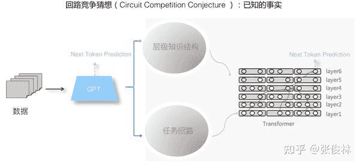

综合上述内容可看出，`GPT`模型通过`NTP`任务从数据中学习知识，在模型内部建立起两类知识体系：层级化的知识结构以及各种任务回路（参考上图），任务回路是在层级知识体系结构上建立起来的，是用于解决某个任务的、由知识点相互激发形成的固定通路。

假设已经训练好`GPT`模型，我们可以清晰地探测到它们的存在。首先，这些知识点有不同的抽象层级。越是存储在`Transformer`底层的知识点，越具体、可复用程度越高、通用性越强、数量越多，越容易通过`superposition`及`Polysemantic`这种稠密编码方式来进行编码；而越是存储在`Transformer`高层的知识点，越抽象、复用程度低、任务专业性越强，越倾向用“单语义神经元”方式单独编码（上图`Transformer`中白色节点代表具体知识点，红色节点代表抽象知识点）。

其次，某些知识点之间形成了由底向上的激发关系，激发路径是由下层不那么抽象的知识点逐层激发上层越来越抽象的知识点。比如某个编码在`Transformer`第`L`层的知识点，它可由第1到第`L-1`层的其它被激发的知识点来激活。被激活的神经元，除了收集、综合、抽象传上来的信息，可能也通过自己的`FFN`结构添加新知识（比如进行世界知识的提取），或做数学逻辑计算（比如比较数值大小）。训练好的`GPT`模型内部包含海量这种“局部”知识点构成的“微激发结构”，这应该是形成`GPT`智能的基础单元，从而整个`GPT`结构构造出对世界知识进行层级编码的世界知识结构。而根据`NTP`目标来训练模型，其实就是在由简单到复杂、由通用到专用、由具体到抽象、由下层到上层，在训练过程中逐渐建立起越来越复杂层级知识结构的过程，包括知识点以及知识点之间的激发关系产生的微结构，之所以会产生这些，是因为它们的存在，对于`NTP`精准预测之后的`Token`有帮助，也就是对于`GPT`模型在`NTP`时降低训练`Loss`有用。

我们在此基础上可以重新看待任务回路的形成。任务回路应该是`GPT`为了更精准预测某种特殊类型数据的`Next Token`，从`Transformer`的输入层开始，逐层关联相关的“激发微结构”，从而形成了一个由低向上逐层激发，并最终关联到输出位置，以决定输出`Token`概率的完整通路结构（可参考上图红线部分勾勒出的某个任务通路）。学会了这种任务回路，如果`GPT`后续再见到此类数据，则`Next Token`预测精准性增加，体现为`NTP`任务`Loss` 的降低。比如如果训练数据里大量出现“`13+24=37`”这种加减乘除的例子，大概率`GPT`会学会一个用于简单数学计算的任务回路，以此增加等号后数字的`Next Token`预测精准性。

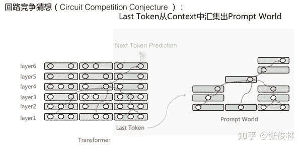

另外，输入的最后一个`Token`位置对应的各层`Transformer Block`，可能有些特殊含义和作用，它可能通过`Attention`机制，起到了对之前全体输入内容的信息汇总工作。如果输入的`Prompt`是完成某项具体任务的，那么`Last Token`对应的各层`Transformer Block`，大致把任务回路信息逐层汇总到了最后位置，以便于在`Last Token`的最高层进行正确的`Next Token`预测。相当于`Last Token`从`Transformer`庞大的知识体系中根据输入`Prompt`勾勒出了一个`Prompt`子世界。

上述内容宏观上综合了目前研究的结论，呈现出目前我们对`GPT`运行机制的了解程度。后面内容开始加入我个人的一些推论。

首先的问题是：在训练`GPT`的过程中，如此多的知识点，它学习这些知识点一定有个先后顺序关系，那么，它会遵循怎样的优先顺序来学习这些知识点呢？ 尽管目前有些研究结论是说重要的知识点先被学到，但是这里的重要性往往指的是对降低`GPT`模型`NTP`任务的`loss`角度来说的，降低`loss`越多，则这个知识点越重要。从降低`loss`角度讲肯定是对的，但还是太抽象。

我个人认为，在训练过程中，`GPT`模型会优先学习具备以下特性的知识点：高频知识点、通用知识点（被复用概率高的则通用）、具体而非抽象的知识点。应该遵循这三个原则。为什么会这样呢？因为根据`Next Token Prediction`的原则，越是高频出现的知识点，如果`GPT`本次预测错了，则会做反向传播修正模型参数，以保证下次再见到类似情况会预测对，高频知识点因为出现次数多，所以获得反向传播修正模型参数的次数多，也就更容易建立起对应的知识点，及其和其它知识点的连接通路。高频知识点如果学会了，在后面的训练数据会很容易碰到这个知识点，所以对降低`NTP`任务的`loss`贡献就大。其它两类知识点也是类似的道理，通用知识点因为通用性强，所以在后续预测中被使用的机会多，所以获得反向传播修正模型参数的次数也多，也容易被模型学会，具体而非抽象的知识点也因为在训练数据中见到的次数多，所以容易被建立起来。诸如此类。反过来，低频的、领域或任务专用的、抽象的知识点，就会越晚被`GPT`模型学会。或者说，如果想学会这类知识点，则需要让模型见到更大量的数据，以增加这些知识点在学习过程中必要的反向传播修正参数的机会。

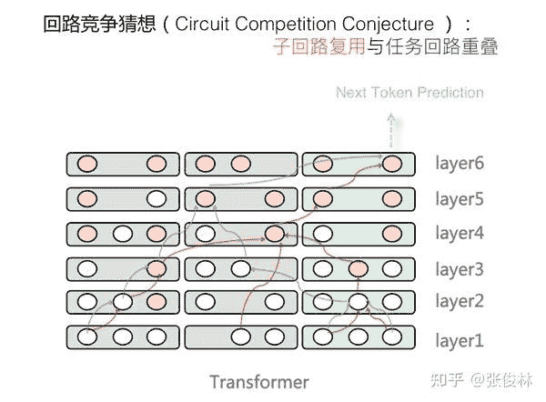

接下来，我们开始正式讨论“回路竞争”猜想。在引出这个猜想前，我先做一个假设：

假设:为了提高`GPT`模型的参数利用率，`NTP`任务会鼓励子回路的复用。

所谓“子回路”，指的是完成简单运算的回路，这种回路涉及到的知识点较少，知识点之间激发的结构比较简单。`GPT`模型大概会优先产生很多完成简单任务或计算的子回路，而复杂回路应该是由很多子回路进一步连接形成的。为了增加模型参数的使用效率，`GPT`模型应该会鼓励这些子回路在不同复杂回路中尽可能被复用，这样使用同样的参数量，就能完成更多不同类型的任务。比如上文讲过的“`Induction Head`”回路，就是一个典型的子回路，由上文我们可知，在更为复杂的“`Indirect Object Identification`”知识回路中，“`Induction Head`”回路是其中一个构成部分，子回路和复杂回路的关系大概类此例。

对于两个解决不同任务的复杂回路，由于子回路复用的原因，两者之间存在一些相同子回路，我们可以把这些相同的子回路称为“重叠回路”。很容易推断，如果两个任务越接近，则其对应的重叠回路就越多。而且重叠回路存在`Transformer`底层的情况应该比较多，因为底层回路涉及到的知识点更具体、数量更多、可复用性更强。上图是对“子回路复用与重叠回路”给出的示意图，途中红色线（红色任务）和蓝色线（蓝色任务）代表两个不同复杂任务回路，而在底层，则有一些子回路被两者复用。

所谓“回路竞争”猜想，我们用上图例子来说明。假设我们输入一个`Prompt`，这个`Prompt`本来是要完成红色任务的，当输入`Prompt`后，在信息从底层向上层逐层激发正确通路的时候，越是底层的知识点和子回路，复用性越强，所以容易产生“过剩激发现象”，就是除了激发出我们希望的红色任务外，也会激发很多导向其它任务回路的知识点和子回路。这种情况在底层较为明显，随着信息逐步往上传递，红色回路会逐渐得到进一步的强化，非正确回路被激发的上层知识点和子回路越来越少，最终勾勒出了正确的红色任务回路的路径。这就是典型的“回路竞争”猜想的思路。

如果从低向上激发过程中，我们希望的正确回路被激发，可以认为回路竞争胜利，则模型输出正确答案，而如果错误任务回路被激发，可以认为回路竞争失败，则模型输出错误答案。可以推断的是，越是复杂的任务，因为其牵涉到的知识点和子回路越多，相互之间的关系越复杂，所以越容易和更多其它相似任务回路产生重叠，也就越容易在回路竞争中失败。

我们可以在“回路竞争”框架下去思考很多`LLM`模型的问题和现象，并给出解释，本文稍后内容会用这个猜想解释一些目前`LLM`模型未知的一些现象。

### 模型规模的差异：更大的模型，更清晰的世界

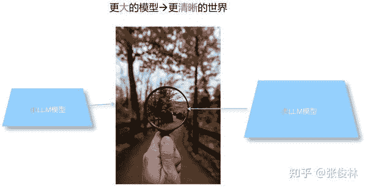

根据目前已有研究结论，如果思考大`LLM`模型和小`LLM`模型的差异，我们大致可做如下推断：小`LLM`模型建立了一个粗粒度的、模糊的世界图像，而随着模型规模越来越大，大`LLM`模型建立起能表征更多细节信息的清晰度越来越高的世界图像。

由上文所述可知，`LLM`模型的表征能力主要体现在两个方面：从具体到抽象的层级知识结构，以及可以解决很多问题的任务回路。我们从这两方面分头看下大小模型的差异。

**层级知识结构的差异**：很多研究结论证明了随着模型规模增大，模型稀疏程度越来越高。`Polysemantic`神经元对特征编码是稠密的，用于编码大量相对具体的特征，而`Monosemantic`神经元属于单神经元表征是稀疏的，这说明随着模型规模越来越大，单语义神经元数量占比增加。单语义神经元编码重要的及抽象的知识，既然单语义神经元数量增加了，说明模型学到的知识点肯定是增加了，新增知识点无非两个来源可能：第一种来源是这个知识原先小模型没有学到，现在大模型学会了，从无到有地学会了新知识。这类新知识应该可再细分为两类：一类应该是世界知识（常识和事件），小模型无法编码在数据中出现频次比较低的世界知识，大模型通过单语义神经元对此进行了编码（大模型相比小模型能学到更多数据中的低频知识，这一点有很多工作可验证，且目前看世界知识应该是单神经元编码的），这类知识代表大模型学会了更多有关世界的细节信息；一类应是模型从数据中新归纳的更抽象的知识（比如“质数”这种），这类知识代表大模型学会了越来越复杂的抽象知识或能力。

新增知识点的另外一种来源，应该是由前文讲过的抽象特征进行特征分裂产生的。就是说原来小模型只有一个粗粒度的抽象知识点，现在模型大了，衍生出一些新的细粒度的表征这类知识的知识点，针对不同的`Context`可能会学到对应的一个知识点。举个例子，目前发现`LLM`中有针对连续大写字符产生响应的单语义神经元，比如输入中有“`ABCD`”，这个神经元就会被激活。小`LLM`模型可能只有唯一神经元对此进行响应，如果把这个神经元灭活，则`GPT`在做`NTP`预测下一个`Token`的时候`Loss`就会激增，说明缺了这个特征对于正确预测后续内容中连续大写字符都产生了错误；但是，大`LLM`模型除了这个神经元，还分裂出细粒度表征神经元，比如针对公司名字缩写“`IBM`”这类可能有一个神经元专门负责响应，针对医药名称缩写，比如“`GS(葡萄糖注射液)`”，有另外一个神经元负责响应。诸如此类。这种大模型的抽象特征分裂，说明了一点：即使是抽象知识，大模型相比小模型也有更细致的抽象特征表达能力。

可以看出，大模型相对小模型，从对低频世界知识的编码角度，可以认为学到了关于世界更多的细节信息，而从新增抽象知识以及抽象特征分裂角度，说明大`LLM`模型具备更难的以及更细粒度的抽象知识表达能力。

综合两者，我们可以认为小模型是对世界的粗粒度建模，而大模型是对世界的细粒度高清建模。而且`Scaling law`说明了：随着增加更多的数据、更大的模型规模，`LLM`模型可以对世界进行清晰度更高的刻画。从这个角度看，说`LLM`模型参数是对世界的有损压缩，其实并没有什么大问题。

## 无尽的前沿：使用“回路竞争”解释未知现象

本部分我们在“回路竞争”框架下，给出目前`LLM`模型一些现象的解释。

### “回路竞争”视角下的模型涌现能力

# 模型涌现能力与“回路竞争”框架

模型涌现能力，指的是对于某些任务（大多数是`In Context Learning`或`COT`相关的任务），小模型几乎完全没有解决能力，只有当模型规模达到某个临界点，才能很好地完成这个任务。尽管目前有研究（可参考`Are Emergent Abilities of Large Language Models a Mirage?`）表明:模型所谓的“涌现能力”，是度量标准选择不合理造成的，其实并不存在涌现，只是任务选择的度量标准不够精准而已。我个人认为，这个说法应该确实能够解释一部分目前体现出“涌现能力”的任务，但感觉这可能不是故事的全部，有些任务可能很难仅仅通过这个原因来解释，所以对于大语言模型为何会出现涌现能力，还是应该做更进一步的研究。

如果在“回路竞争”框架下看这个问题，那么小模型之所以做不了某个任务，无非有两种可能：一种可能是对小模型来说，这个任务对应的激发回路没有建立起来，而大语言模型建立起来了；另一种可能是小模型这个任务对应的回路也建立起来了，但是在回路竞争中非常容易失败，导致看似做不了这个任务。

我更倾向认为是第一种可能造成我们目前看到的模型“涌现能力”。前文有述，小模型大概建立了一个粗分辨率的模糊的世界镜像，而大模型则建立起一个高分辨率清晰度更高的世界镜像。小模型应该在建立某些任务的完整激发回路存在困难，这些困难可能体现在几个方面：比如对形成回路很关键的某个或者某些，比较抽象的概念知识点，小模型因为抽象能力比较弱，没有建立起这个知识点（类似本文开头举的“质数”概念的例子）；再比如，一般能体现涌现能力的任务都比较复杂，小模型在建立复杂通路方面能力不足。诸如此类。而当模型规模变大，则在抽象概念以及复杂回路构建方面能力得到增强，当建立起完整的解决任务的激活通路时，就看似突然能够解决这个问题，体现出模型的涌现能力。不过，很可能对于这种复杂回路，在激活竞争方面能力也不足够强，所以当再辅助以`Few shot`几个任务相关例子，以此来促进任务对应的回路在通路竞争中胜出时，才能看到比较好的解决效果。

## “回路竞争”视角下的In Context Learning及Chain of Thought(COT)

从回路竞争的视角看`ICL`，这里可能涉及到两种回路：任务回路以及`Attention`回路，两者竞争或合作，来决定`ICL`任务的表现，`COT`是一种特殊的`ICL`，机制应类似。

我们先看下任务回路的作用，其实好理解。`In Context Learning`会先给`LLM`模型几个任务相关的例子 `<x_1,y_1>,<x_2,y_2>,…,<x_n,y_n>` ，之后输入 `x_{(n+1)}` ，期待模型可以输出 `x_{(n+1)}` 对应的正确结果 `y_{(n+1)}` 。输入中给出的 `n` 个例子的作用，在于激活了`LLM`模型对应的在预训练阶段学到的任务回路，然后再输入 `x_{(n+1)}` ，就容易沿着这条被激活的通路走，形成正确输出 `y_{(n+1)}` 。`COT`作用应该类似，也就是说，如果你不用`COT`，可能`LLM`激活的是某个简单结构的任务回路，而如果用了`COT`例子，则容易激活了有很多细节表征的复杂推理回路，导致之后的输入也沿着这个子通路走，于是形成详细推理步骤。由此可见，在`ICL`场景下，任务回路总是对 `x_{(n+1)}` 产生正确答案，起到积极作用。

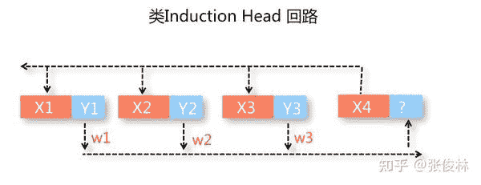

再来看`Attention`回路，不过这里也是设想（`In-context Learning and Induction Heads`这个工作的目的是通过`Induction Head`来解释`ICL`现象，不过我觉得`Induction Head`机制过于简单，可能需要再稍微强化下）。假设存在一个加强版本的`Induction Head`回路，比如我们可以称之为“`Enhanced Induction Head`，`EIH`”，它的运行机制很可能是这样的（如上图所示）： `EIH`回路会依据当前输入 `x_4` 与`ICL`各个例子中的 `x_i` 的语义相似性，去拷贝对应的 `y_i` ， `x_4` 与 `x_i` 相似性越高，越大概率拷贝对应的 `y_i` 。这个过程有点类似由`EIH`回路构成的`KNN`模型，只需根据输入例子之间的相似性和对应标签就可以投票得到正确答案，并不需要模型通过修改参数来学会 `x` 到 `y` 之间的映射函数。算是一种有条件的`Induction Head`拷贝操作，条件触发因素是输入的例子 `x` 之间的`Attention`相似性。可以看出，影响 `x_{(n+1)}` 输出哪个标签，应该主要取决于`ICL`中这几种类型的例子：和 `x_{(n+1)}` 越相似的例子影响越大；`ICL`中出现次数越多的 `y` 影响越大；以及距离 `x_{(n+1)}` 越近的例子影响越大(`Position embedding`编码的位置信息及`NLP`中大量存在的局部相关性大概会导致此结果)。

若真存在`EIH`回路，根据上述运行机制，我们可以推断出在以下三种情况下，`Attention`回路对正确预测结果 `y_{(n+1)}` 的影响：

情况一:如果`ICL`中 `x_1` 到 `x_n` 输入例子对应的标签 `y` 是`Ground Truth Label`，很明显，`EIH`回路是正向积极影响作用，类似如上所述`KNN`机制依据 `x_1` 到 `x_n` 例子对应的 `y` 来做判断；

情况二：如果`ICL`中例子的标签不是`Ground Truth Label`，而是在`label` 空间内随机选择赋予。很明显，`EIH`回路对于 `x_{(n+1)}` 得到正确答案应该起到负面作用，因为 `x_{(n+1)}` 会从前面 `x_1` 到 `x_n` 的例子中，寻找跟它比较像的内容去拷贝对应标签，但是这个标签是随机赋予的，所以大概率是错的，导致这种情况`EIH`应该是负面效果。

情况三：如果`ICL`中例子的标签是`label`空间之外的另外一套标签，但是和 `x` 存在对应的映射关系。这种情况下，`EIH`回路应该是正面影响作用，这跟第一种情况道理类似，`KNN`机制可以学习这种映射关系，因此得到正确的 `y_{(n+1)}` ，无非现在用的是 `z_{(n+1)}` 而不是 `y_{(n+1)}` 而已。当然，若你仍然是看 `y` 标签下的表现，那`ICL`肯定是负面作用。

如果联合考虑`LLM`的内在任务回路，以及`EIH`这种纯`Attention`回路，两者有时协同发力方向相同，有时则竞争发力方向相反。比如上述三种情形中，第一种情况两者是协同作用，都起到促进正确答案的作用，第二和第三种情况则是竞争作用，任务回路对给出正确答案起到促进作用，`EIH`回路则起到负向作用。

按照这种思路，大致可以解释目前我们看到的，在`ICL`研究中出现的很多貌似不可解释的各种现象。这里举个例子，比如目前研究表明，假设`ICL`的标签空间包含两个标签： `y_1` 和 `y_2` ，如果我们把`ICL`里例子的标签反转，就是原来标签是 `y_1` 的换成 `y_2` ，原来是 `y_2` 的换成 `y_1` ，则`ICL`任务效果会变差(可参考：`Overthinking the Truth: Understanding how Language Models process False Demonstrations`)。假设 `x_{(n+1)}` 对应的正确标签是 `y_1` ，从任务回路和`EIH`回路的角度来看，任务回路会倾向于给出 `y_1` 标签，`EIH`回路在这种情况下，其实对应上面说的情况三，标签反转是种特殊的另换标签，因为 `x` 和 `y` 的对应关系仍然存在。所以此时，`EIH`回路看似会学习 `x` 到 `y` 的映射关系，会倾向于给出 `y_2` 标签。此时两者一个正向，一个负向，起到竞争关系，所以会降低模型效果。

其它很多现象其实大都可以在这个框架里得到解释，文章长度原因就不展开了，感兴趣的同学可以在这个思考框架下自己推导一下。

## “回路竞争”视角下的领域任务Fine-Tuning

我们可以在“回路竞争”视角下，重新审视利用领域数据对通用模型进行`Fine-tuning`操作，可能带来的影响。我们现在已知的事实是，利用领域数据`Fine-tuning`，会造成基础模型的“灾难遗忘”问题。就是说，因为后续`Fine-tuning`修正模型参数，导致模型遗忘了之前学会的某些知识。而且我的判断是：目前看，在基础模型之上，任何形式的`Tuning`操作，都会造成基础模型某些能力的损失，这也包括`ChatGPT`为了听懂命令及遵循人类价值观所做的`Instruct tuning`，也应该一样会损害基础模型的某些能力，只是目前我们说不清损害的是哪些能力而已。这是目前技术条件下，需要对模型做`Tuning`所必须付出的代价。

但是为何对基础模型进行`Fine-tuning`会造成能力损害呢？其内在原理如何？我们可以在“回路竞争”视角下，分析`Fine-tuning`带来的影响。我猜大致有两种影响，这两种影响也许是某种单独起作用，也许两者共同发生作用。第一种影响是：`Fine-tuning`操作通过大量领域数据，强化了大语言模型解决这个任务的响应回路。这对于模型底层知识点影响估计不大，因为底层更多的是通用性比较强的特征，这个任务也需要，它修正的应该更多是上层的抽象知识节点，以及底层知识点到上层抽象知识点建立激发连接的通路。另外一种可能的影响：很可能通过`Fine-tuning`操作，在模型内部建立起了`Shortcut`捷径，导致输入信息后，信息传输直接走了捷径，而绕过了很多本该要走的通路。比如文本分类任务，这种任务内部逻辑应该很简单，估计就是建立起底层具体领域词汇知识点，到上层抽象类别概念知识点的激发通路，所以很可能直接从最底层的知识点，到高层的类别概念知识点，建立起了一个很短的`Shortcut`捷径，其它的复杂回路都被这个捷径给 `pass`掉了，倒不一定是上层抽象知识点被改写了，很可能是通过走捷径被绕过去了。

不论是上述哪个原因，造成的后果是：对于新的输入，尽管可能是要做其它任务的，就很容易激发这个被特殊强化过的回路。也就是说，这个被强化过的回路容易在不该竞争胜利的时候也容易竞争胜利，导致其它任务效果变差。

## “回路竞争”视角下的Instruct Tuning

`Instruct Tuning`本质上是为了实现和人类行为对齐而做的一种特殊的`Fine-tuning`。`GPT 4`的技术报告也指出了：`Instruct tuning`并不会增强基础模型的知识和能力，相反可能存在某种能力损害作用。高质量的`Instruct Tuning`肯定是很重要的，但它只是让大语言模型“看着好像”效果更好了而已，这只是使用者主观感受上的，而非模型基础能力层面的更好。

那么，如果在“回路竞争”视角下，如何理解`Instruct Tuning`是在干什么事情呢？我觉得可以这么理解：`Instruct Tuning`的作用，建立起了一个特殊的激活回路，就是说从输入命令自身形成的激活回路，建立起和对应任务回路的连接。根据`Instruct`训练好模型后，当输入命令时，有利于激活对应的任务回路，所以看似大语言模型就理解了命令的含义。这有点类似于巴浦洛夫生物实验里的“条件反射作用”的运行机制，等于在用户命令和对应任务通路建立起了一个条件反射通路。

利用“回路竞争”猜想，除了可以用来对上述目前未知内部运行机制的现象，给出看着还算合理的解释外，也可以用来解释一些其它现象。比如大模型经常出现的“一本正经的胡说八道”问题，可以认为是在回路竞争过程中，正确回路竞争失败，或者正确回路和某个错误回路被激发的强度差不多，导致给出混合两者的结果，就是看着合理但事实错误的答案。诸如此类吧。

## 世界的参数倒影：从现实世界到可能世界

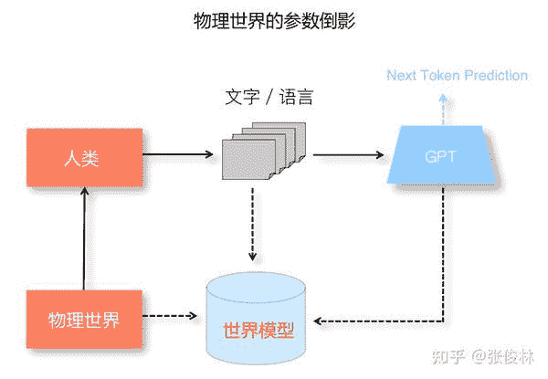

物理世界自有支配其运行的`Hidden Rules`，概念上我们可以理解存在一个简洁的`Hidden world`，由它产生了五彩缤纷的表象世界，若对世界诸现象归类，大致可有自然现象、社会现象、心理现象几大类。人是构成物理世界的一分子，通过观察世界表象、试图理解世界运行规律，以更好维持种群及个体在这个世界里生存。

从种群角度而言，千万年进化过程中的优胜劣汰即人类模型预训练过程，其优化目标为“`Next Person’s survival Prediction`”，其`Loss`越小，种群中生存个体数量越多。基因编码即模型参数，基因编码表征出的个体，适应环境者生存，不适应环境者淘汰。生存者之所以可生存，是因为基因编码表征出的某些特征适配生存环境，于是这些匹配生存环境的基因编码在种群中得以加强，人类预训练模型完成一次模型参数更新。外部物理世界生存环境的不断变化驱动着种群基因编码的变化，以此推动种群在变动环境下的生存。而我们生来即得到的基因编码预训练模型，则记录了千万年来学到的各种生存策略，形成了大脑中无意识快速反应的系统1，它代表了种群的集体记忆。

从个体角度而言，除了通过基因编码预训练模型获得天生的生存策略外，为了维护个体自身在特定环境下的生存，在整个生命历程中会进行“继续预训练(`Continual Pre-training)`”。其优化目标为“`Next Action Prediction`”，追求在环境中输出正确行为以维持生存。采取类似`LoRA`的模型参数更新策略：对于个体而言，天生的基因编码是无力改动的基础模型，决定了我们的很多行为模式，但大脑中有一部分可修正区域，可以通过修正这部分区域里神经元之间的联系方式，来学会新的知识和技能。如果输出行为对继续生存造成负面影响，则调整模型参数以将来更好应对生存环境，这部分脑区功能形成了有意识慢决策的系统2，它代表了个人的个性化生存经验。“天生基因编码+个人生存微调”塑造出了形形色色的不同个体行为，有共性有个性，共性来自于种群集体记忆，个性来自于独有的生存经验。

语言最初作为人类个体间的沟通协作工具，有利于促进种群存续。随着技术发展，逐步将之记录在龟背、竹简、纸张、电子信号形成文字。每个人都可看成独立的“编码-解码器”，个体对物理世界观察与感受，并编码在大脑中形成知识和思维，解码输出则形成文字，记录的是个人视角对世界的感受和思考，有主观感受也有客观记录。人群则形成分布式的“编码-解码器”，解码输出产生了大量包含各种世界运转的客观事实以及主观冲突观念的文字记录。所以，文字只是表象，内在记录的是从人类角度形成的对物理世界的认知与对这个世界的主观感受（物理知识、社会知识、事件记录、个体感受、个体想象等各种类型），其背后隐藏着人类视角下的世界模型。而`GPT`通过`Next Token Prediction`任务试图正确复现人类产生的文字，本质上是对隐藏在文字表象之后的世界模型进行解码复原，并存储在`GPT`的模型参数里，形成了物理世界的参数倒影。

如果我们进行更深入思考，有可能会发现；`GPT`从大量文字中，不仅仅学会了如何生成符合我们现实世界事实的内容，可能还学会成为一个“可能世界”生成器。它从文字模拟我们的现实世界开始，并进而泛化抽象，尽管遵循我们这个世界的物理法则，但是它不仅可以产生符合我们感知到的世界中真实的知识与内容，也可以产生其它符合物理法则及人类理解逻辑的可能世界。也许你不能因它产生的内容不符合现实世界，就说它是错的，只能说它有能力把符合逻辑的可能世界全部展示给你，必然有很多情况未必吻合现实，毕竟现有世界只是可能世界的一种已经发生的现实选择而已，而它有能力给你呈现各种合理的可能性。

## 世界尽头与冷酷仙境：“数字缸中之脑”思想实验

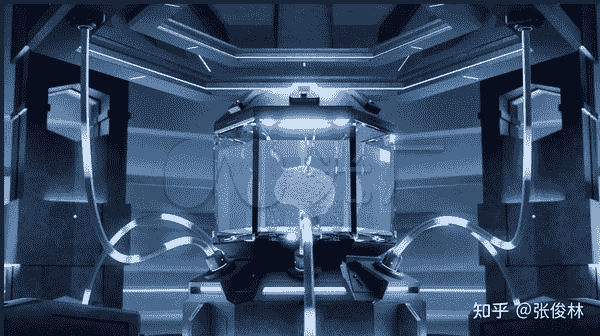

“一个疯狂科学家进行了一项手术，他将一个人的大脑切下来并将其放入充满营养液的容器中。营养液中的养分足以维持大脑的正常运作，而大脑的神经末梢连接到电线上，电线的另一端则连接到一台计算机。计算机模拟真实世界的参数，并通过电线向大脑传递信息，让大脑感到一切都完全正常，好像周围认识的人、熟悉的事情还照常进行，没有任何异样。

有一天，营养液中的大脑突发奇想，想到了一个很有趣的思想实验，在他／她的现实感知里，此刻正在上班的地铁上或自己办公工位前，耳边传来别人轻微的脚步声，他／她掏出手机把想法写在备忘录里，内容是这样的：

“`OpenAI`推出了一个新的`LLM`模型，叫`GPT 4`，功能很强大，这很可能预示着`AGI`时代的到来,我身边每个人都在热烈地讨论它。今天我读到了一篇分析它可能工作机制的文章，题目是《世界的参数倒影：为何`GPT`通过`Next Token Prediction`可以产生智能》，读完很有启发，引起了我的思考。我们可以设想一下：如果将来`AGI`能力足够强大，它能通过阅读我书写的内容、我的照片和视频，甚至可以扫描复制我的大脑反应模式，重构一个和我在物理世界一摸一样的数字大脑。那么，另一个我自己就会生活在数字空间中，而`AGI`接管我的数字大脑的各种感知信号，模拟我的工作和生活场景，让大脑感到一切都完全正常，好像周围认识的人、熟悉的事情还照常进行，没有任何异样。那么，这个数字大脑里的我，或者现实生活里的我，能区分现在是生活在数字空间，还是物理空间吗？我把这个思想实验称为：数字缸中之脑。这个思想实验，是不是很有意思？”

我把这个思想实验称为：数字缸中之脑。这个思想实验，是不是很有意思？”
