# 大语言模型的涌现能力：现象与解释

> 来源：[https://agijuejin.feishu.cn/docx/P7mndGdHMosJiGxqpVmcLIrCn9e](https://agijuejin.feishu.cn/docx/P7mndGdHMosJiGxqpVmcLIrCn9e)

> 作者：[张俊林](https://www.zhihu.com/people/zhang-jun-lin-76)

> 原文：[https://zhuanlan.zhihu.com/p/621438653](https://zhuanlan.zhihu.com/p/621438653)

注1：本文整理自我在今年3月11日“中国人工智能学会”主办的「ChatGPT 及大模型专题研讨会」上《大型语言模型的涌现能力：现象与解释》的现场分享，介绍了大语言模型中的涌现现象，以及关于涌现能力背后原因的相关猜想。感谢CSDN帮助整理的文字稿。

注2：另，有人问了，既然很多自然现象也体现出涌现能力，那么大语言模型的涌现现象需要解释吗？我个人认为是需要的。毕竟，说大语言模型的某个特殊现象属于“涌现现象”，也是被个别研究提出来，未有确切证明或证据，是否它和自然现象中出现的涌现现象内在机制是类似或一样的，其实可以存疑。而且我认为大模型的这个现象，背后应该有些我们可以理解的原因。如果我们不追求现象背后的解释，仅仅把目前解释不了的现象统一归类为涌现或者其它什么概念，就此了之。那么，其实我们也可以把大模型的目前理解不了的很多现象，统一归类为这是一种“神迹”，那世界上很多事情就简单多了。另另，用Grokking解释涌现现象，尽管我把它称为”用玄学解释玄学“，但是觉得还是值得深入探索的方向，也许可以把上面的说法，优化为”用含玄量较低的玄学解释另外一个含玄量较高的玄学“。

注3：如果仔细分析的话，大语言模型的这个所谓“涌现现象”，如果仅仅把现象归因于模型规模，目前看大概率是把问题简化了，很有可能影响因素是多样化的。如果让我归纳的话，某个任务，大语言模型是否会出现“涌现现象”这个变量 `y` ，很可能是以下多因素影响的某个未知函数：`y=f("模型参数规模"，"训练数据量大小","训练充分程度","具体任务类型")`

而关于此，需要进一步更深入的研究与解释。

## 什么是大模型的涌现能力

复杂系统学科里已经对涌现现象做过很久的相关研究。那么，什么是“涌现现象”？当一个复杂系统由很多微小个体构成，这些微小个体凑到一起，相互作用，当数量足够多时，在宏观层面上展现出微观个体无法解释的特殊现象，就可以称之为“涌现现象”。

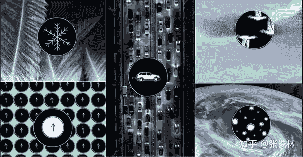

在日常生活中也有一些涌现现象，比如雪花的形成、堵车、动物迁徙、涡流形成等。这里以雪花为例来解释：雪花的构成是水分子，水分子很小，但是大量的水分子如果在外界温度条件变化的前提下相互作用，在宏观层面就会形成一个很规律、很对称、很美丽的雪花。

那么问题是：超级大模型会不会出现涌现现象？显然我们很多人都知道答案，答案是会的。

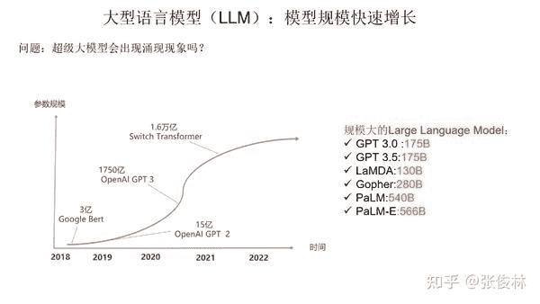

我们先来看下大语言模型的规模增长情况。如果归纳下大语言模型在近两年里最大的技术进展，很有可能就是模型规模的快速增长。如今，大规模模型一般超过 100B，即千亿参数。如 Google 发布的多模态具身视觉语言模型 PaLM-E，由540B 的 PaLM 文本模型和 22B 的 VIT图像模型构成，两者集成处理多模态信息，所以它的总模型规模是 566B。

大语言模型规模不断增长时，对下游任务有什么影响？对于不同类型的任务，有三种不同的表现：

第一类任务表现出伸缩法则：这类任务一般是知识密集型任务。随着模型规模的不断增长，任务效果也持续增长，说明这类任务对大模型中知识蕴涵的数量要求较高。

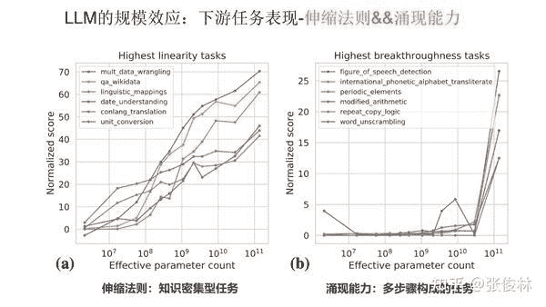

第二类任务表现出涌现能力：这类任务一般是由多步骤构成的复杂任务。只有当模型规模大到一定程度时，效果才会急剧增长，在模型规模小于某个临界值之前，模型基本不具备任务解决能力。这就是典型的涌现能力的体现。这类任务呈现出一种共性：大多数是由多步骤构成的复杂任务。

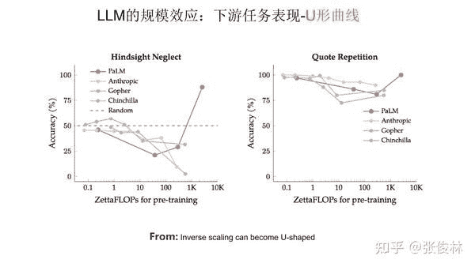

第三类任务数量较少，随着模型规模增长，任务效果体现出一个U 形曲线。如上图所示，随着模型规模增长，刚开始模型效果会呈下降趋势，但当模型规模足够大时，效果反而会提升。如果对这类任务使用 思维链CoT技术，这些任务的表现就会转化成伸缩法则，效果也会随着模型规模增长而持续上升。

因此，模型规模增长是必然趋势，当推进大模型规模不断增长的时候，涌现能力的出现会让任务的效果更加出色。

## LLM 表现出的涌现现象

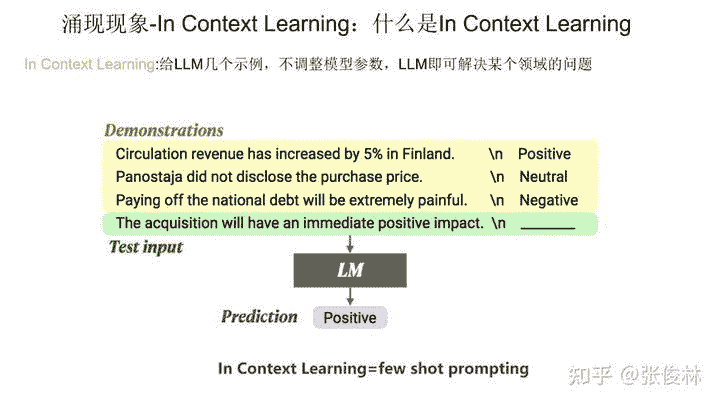

目前有两大类被认为具有涌现能力的任务，第一类是 In Context Learning（“Few-Shot Prompt”），用户给出几个例子，大模型不需要调整模型参数，就能够处理好任务（参考上图给出的情感计算的例子）。

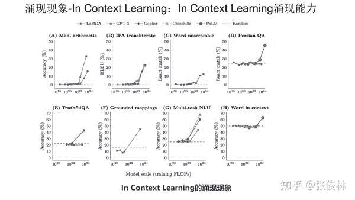

如上图展示，利用In Context Learning，已经发现在各种类型的下游任务中，大语言模型都出现了涌现现象，体现在在模型规模不够大的时候，各种任务都处理不好，但是当跨过某个模型大小临界值的时候，大模型就突然能比较好地处理这些任务。

第二类具备涌现现象的技术是思维链( CoT)。CoT本质上是一种特殊的few shot prompt，就是说对于某个复杂的比如推理问题，用户把一步一步的推导过程写出来，并提供给大语言模型（如下图蓝色文字内容所示），这样大语言模型就能做一些相对复杂的推理任务。

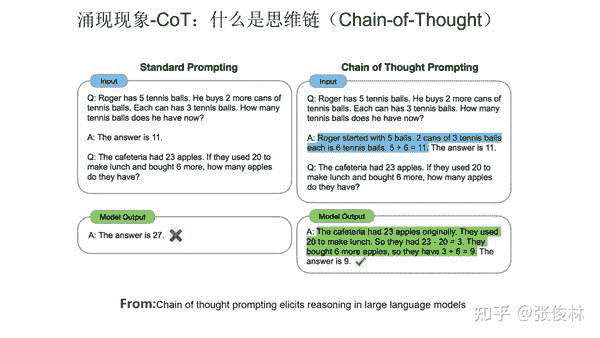

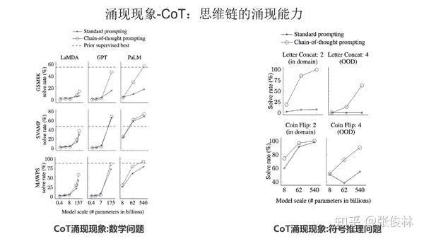

从上图可以看出，无论是数学问题、符号推理问题，CoT 都具备涌现能力。

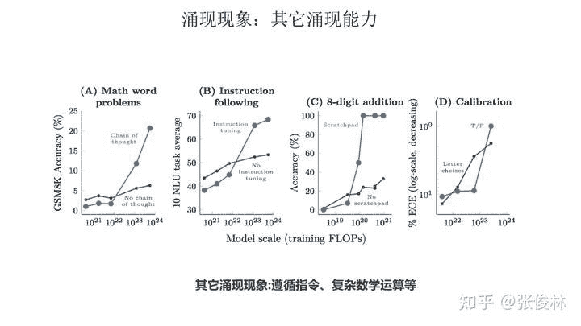

除此之外，其他任务也有涌现能力，如上图所示的数学多位数加法、命令理解等。

## LLM 模型规模和涌现能力的关系

可以看出，涌现能力和模型的规模大小有一定的关联关系 ，那么，我们的问题是，具体而言，两者是怎样的关系呢？

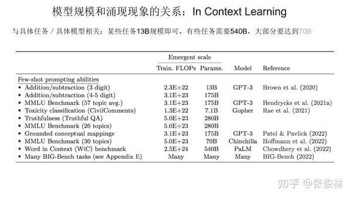

我们分头来看，先看下In Context Learning 的涌现能力和模型规模的关系。上图展示了对于不同类型的具体任务， In Context Learning 的涌现能力和模型规模的对照关系。

从图中数据可以看出，我们很难给出一个唯一的模型大小数值。不同类型的任务，在In Context Learning方面，模型多大才具备涌现能力，这跟具体的任务有一定的绑定关系。例如：图表第一行的3位数加法任务，模型只要达到 13B（130亿参数），就可以具备涌现能力，但是对倒数第二行的 Word in Context Benchmark任务而言，目前证明，只有540B 大小的模型才可以做到这点。我们只能说，就In Context Learning而言，如果模型达到 100B， 大多数任务可以具备涌现能力。

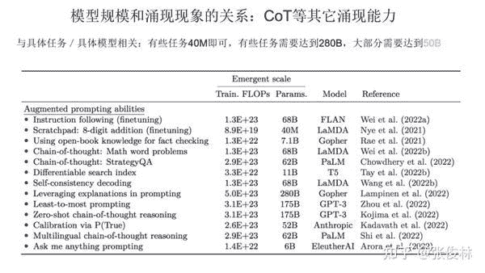

对于CoT来说，结论也是类似的，就是说要想出现涌现能力，模型规模大小和具体任务有一定的绑定关系。

把模型做小会影响 LLM 的涌现能力吗？

因为对很多任务来说，只有模型规模做到比较大，才能具备涌现能力，所以我个人比较关心下列问题：我们能不能把模型做小？把模型做小是否会影响到LLM的涌现能力？这是个很有趣的问题。我们这里拿两个小模型代表来探讨这个问题。

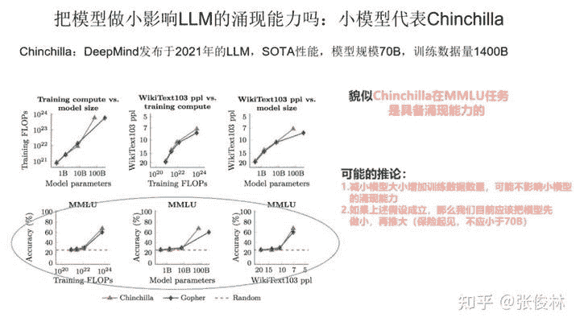

第一个小模型代表，是 DeepMind 2021年发表的模型 Chinchilla，这个模型目前做各种任务的效果，和 540B大小的PaLM 基本相当。Chinchilla的思路是给更多的数据，但是把模型规模做小。具体而言，它对标的是Gopher模型，Chinchilla模型大小只有 70B，是Gopher的四分之一，但是付出的代价是训练数据总量，是Gopher的四倍，所以基本思路是通过放大训练数据量，来缩小模型规模。

我们把Chinchilla规模做小了，问题是它还具备涌现能力吗？从上图给出的数据可以看出，起码我们可以说， Chinchilla 在自然语言处理的综合任务 MMLU 上是具备涌现能力的。如果小模型也能具备涌现能力，那么这其实侧面反映了一个问题：对于类似 GPT3 这样的模型而言，很可能它175B 这么多的模型参数，并没有被充分利用，因此，我们在以后训练模型的时候，可以考虑先增加训练数据，降低模型参数量，把模型做小，先把模型参数利用充分，在这个基础上，再继续增加数据，并推大模型规模。也即是说，目前看，我们先把模型做小，再把模型做大，看上去是可行的。

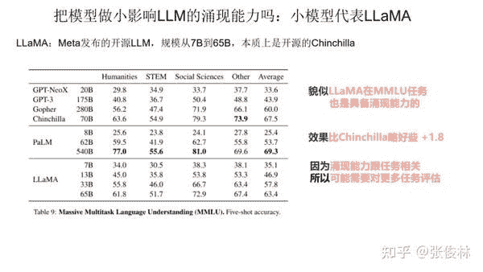

第二个小模型代表是 Meta 发布的开源模型 LLaMA，它的做法其实很好理解，本质上就是开源的 Chinchilla，它的思路是完全遵照 Chinchilla 来做的，就是说增加训练数据，但是把模型规模做小。那么LLaMA是否具备涌现能力呢？从上图表格数据可以看出， 虽然LLaMA 在MMLU这个任务上比 Chinchilla 稍差一些，但是效果也不错。这说明LLaMA在MMLU上基本也是具备涌现能力的。

其实，有个工作目前还没有看到有人做，但是这个工作是很有价值的，就是充分测试当模型变得足够小（比如10B-50B规模）以后，各种任务的涌现能力是否还具备？这是个很有价值的事情，因为如果我们的结论是即使把模型规模做小，各种任务的涌现能力可以保持，那么我们就可以放心地先追求把模型做小。

## 模型训练中的顿悟现象

这里介绍一个比较新的研究方向，顿悟现象，英文叫 “Grokking”。 在这里介绍模型训练过程中的顿悟，目的是希望建立起它和大模型涌现能力之间的联系，我在本文后面会尝试用顿悟现象来解释大模型的涌现能力。

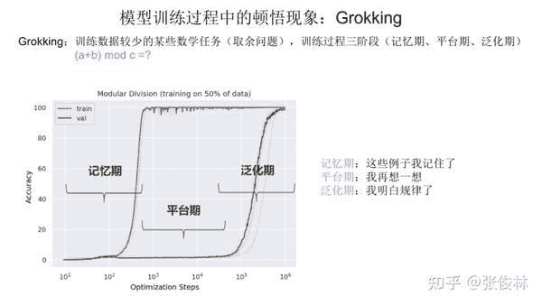

我们首先解释下什么是顿悟现象。如上图所示，对于一个 训练数据较少 的数学任务（通常是数字求和取余数的问题），研究人员发现一种新奇的现象。比如我们将数据集切成两块，50% 数据作为训练集（图中红线展示了随着训练过程往后走，任务指标的变化情况），50% 的数据作为验证集（图中绿线的走势展示了训练动态）。在学习数字求和取余这个任务时，它的训练动态会经历三个阶段：

+   第一个阶段是记忆期：红线对应的训练数据指标突然走高，代表模型记住了50%的训练数据的结果，而绿线对应的验证集指标接近0，说明模型完全没有泛化能力，就是说没有学会这个任务的规律。所以这个阶段模型只是在单纯地记忆训练数据。

+   第二个阶段是平台期：这个阶段是记忆期的延续，体现为验证集合效果仍然很差，说明模型仍然没有学会规律。

+   第三个阶段是泛化期：这个阶段验证集合效果突然变好，这说明突然之间，模型学会了任务里的规律，也就是我们说的，出现了顿悟现象，突然就学明白了。

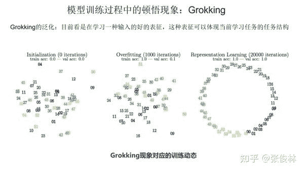

后续研究表明：Grokking 本质上是在学习输入数字的一个好的表征。如图所示，可以看到由初始化向记忆期再到顿悟现象出现的过程，数字的表征逐步开始体现当前学习任务的任务结构。

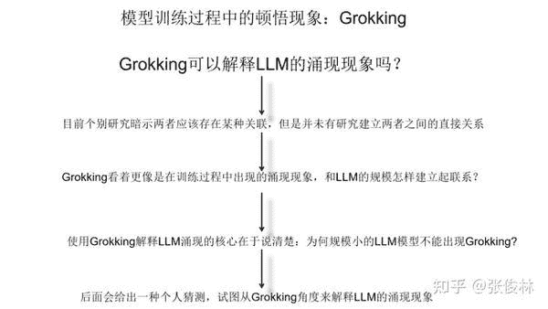

那么 ，我们能用Grokking 来解释大模型的涌现现象吗？目前，有部分研究暗示两者实际是存在某些关联的，但尚未有研究明确地指出两者之间的关系。两者从走势曲线看是非常接近的，但是有很大区别，因为Grokking描述的是模型训练动态中的表现，而涌现表达的是模型规模变化时的任务表现，虽然走势相近，但两者不是一回事。我认为，要想用Grokking解释涌现现象，核心是要解释清楚下列问题：为什么规模小的语言模型不会出现 Grokking ？这是个很关键的问题。因为如果规模小以及规模大的语言模型都会出现Grokking，那么说明Grokking和模型规模无关，也就不可能用来解释大模型的涌现现象。本文后面，我会给出一个自己的猜想，来建立两者之间的联系。

## LLM 涌现能力的可能原因

为什么随着模型增大会出现涌现现象？这里给出三种猜想。前两种是现有文献提出的，第三个是我试图采用Grokking来解释涌现现象的猜想。

### 猜想一：任务的评价指标不够平滑

一种猜想是因为很多任务的评价指标不够平滑，导致我们现在看到的涌现现象。关于这一点，我们拿 `Emoji_movie` 任务来给出解释。`Emoji_movie`任务是说输入 Emoji图像，要求 LLM 给出完全正确的电影名称，只有一字不错才算正确，错一个单词都算错。 如上图所示，输入的Emoji是一个女孩的笑脸，后面跟着三张鱼类的图片，您可以猜猜这是什么电影。下面左侧的 2m代表 模型参数规模是 200 万参数，以及对应模型给出的回答。可以看出，随着模型规模不断增大至 128B 时，LLM才能完全猜对电影名称，但是在模型到了125m和4b的时候，其实模型已经慢慢开始接近正确答案了。

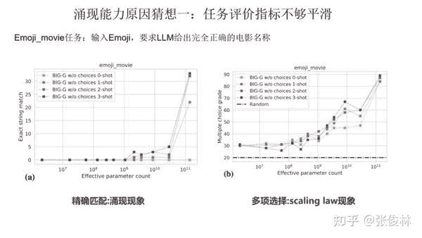

如果评价指标要求很严格，要求一字不错才算对，那么`Emoji_movie`任务我们就会看到涌现现象的出现，如上图图左所示。但是，如果我们把问题形式换成多选题，就是给出几个候选答案，让LLM选，那么随着模型不断增大，任务效果在持续稳定变好，但涌现现象消失，如上图图右所示。这说明评价指标不够平滑，起码是一部分任务看到涌现现象的原因。

### 猜想二：复杂任务 vs 子任务

开始的时候我们提到过，展现出涌现现象的任务有一个共性，就是任务往往是由多个子任务构成的复杂任务。也就是说，最终任务过于复杂，如果仔细分析，可以看出它由多个子任务构成，这时候，子任务效果往往随着模型增大，符合 Scaling Law，而最终任务则体现为涌现现象。这个其实好理解，比如我们假设某个任务 `T` 有 5 个子任务 `Sub-T` 构成，每个 sub-T 随着模型增长，指标从 40% 提升到 60%，但是最终任务的指标只从 1.1% 提升到了 7%，也就是说宏观上看到了涌现现象，但是子任务效果其实是平滑增长的。

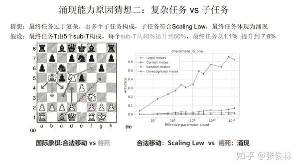

我们拿下国际象棋任务来作为例子，如上图所示，让语言模型预测下一步，最终评价指标是只有“将”死才算赢。如果按“将死”评估（红线），发现随着模型增大，模型在缓慢上升，符合涌现的表现。若评估LLM合法移动（绿线），而在合法的移动步骤里进行正确选择才够最后“将死”是个子任务，所以其实这是比将死简单的一个子任务。我们看合法移动随着模型规模，效果持续上升。此时，我们是看不到涌现现象的。

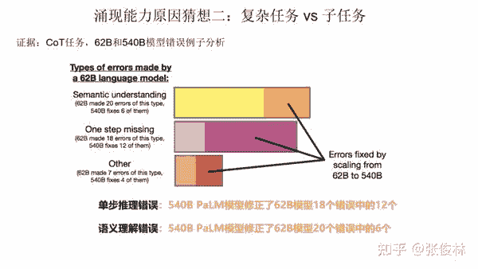

这里可以给出一个例证，如上图所示，对于CoT 任务，谷歌用 62B 和 540B 模型对LLM做错的例子进行了错误分析。对于62B做错、而540B做对的例子分析，可以看出，最多的一类错误来自于单步推理错误，这其实也能侧面说明复杂任务和子任务的关系。

### 猜想三：用 Grokking 来解释涌现

这里介绍我设想的如何用Grokking来解释涌现现象的一种猜想，在建立两者之间关系前，我们先来看两个已知的事实，然后在事实基础上作出推论。

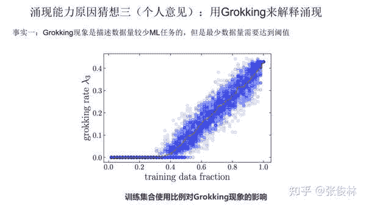

首先，第一个事实是 Grokking 现象是描述训练数据量较少的 ML 任务的，但是任务最小训练数据量必须达到一定的量，才会出现 Grokking 现象。这里有两点，一个是本身训练数据量少，另外是最小数据量要达到临界值。只有同时满足上面两个条件，才有可能出现Grokking现象。上图的意思是：当我们只拿40%及以下比例的数据来训练模型的时候，我们看不到Grokking现象，只有记忆没有泛化，只有最小训练数据比例超过40%，才会出现模型的顿悟。这是一个已被验证的事实。

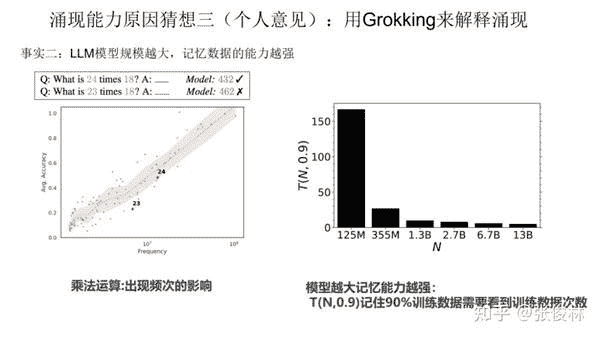

第二个事实是 LLM 模型规模越大，记忆数据的能力越强。关于这点目前有很多研究已经可以证明，如果简单理解的话，可以理解为：对于某个任务 `T`，假设预训练数据里包含与任务 `T` 相关的训练数据量有100条，那么大模型可以记住其中的70条，而小模型可能只能记住30条。虽不精确，但大概是这个意思。

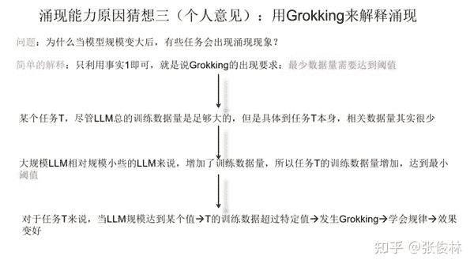

在上面的两个事实基础上，我们试图来用Grokking解释大模型的涌现现象。首先我们给出一个简单的解释，这个解释只需要利用第一个事实即可，就是说，任务的最少训练数据量需要达到临界值，才会出现Grokking。在这个事实下，对于某个任务 `T`，尽管我们看到的预训练数据总量是巨大的，但是与 `T` 相关的训练数据其实数量很少。当我们推大模型规模的时候，往往会伴随着增加预训练数据的数据量操作，这样，当模型规模达到某个点的时候，与任务 `T` 相关的数据量，突然就达到了最小要求临界点，于是我们就看到了这个任务产生了Grokking现象。在语言模型的宏观角度，看起来就是模型达到了某个规模，突然任务 `T` 效果就开始变好，而模型规模较小的时候，因为没有达到临界值，所以一直没有Grokking现象，看起来就是语言模型没有这个能力。这是一种可以从Grokking角度解释大模型涌现现象的可能。

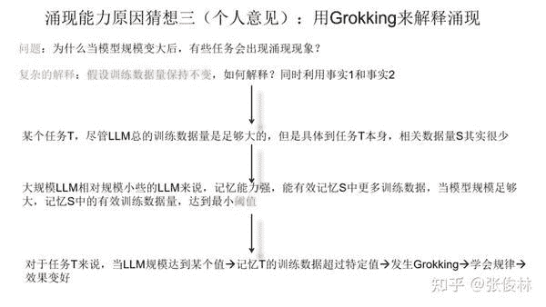

上面这个猜想其实有个约束条件，因为我们有个假设，说随着模型规模增大，训练数据量也在增大。如果这个假设不存在，也就是说，随着模型规模增大，我们固定住训练数据量不变。那么，这种情况下，怎么能用Grokking解释涌现现象呢？此时如果我们同时利用事实1和事实2，也可以给出一个解释。更具体来说，我们假设在预训练数据中，某个任务T有 100 个训练数据，当模型规模小的时可能只记得 30 个，达不到Grokking现象的临界点，而当模型规模推大时，因为模型记忆能力增强，可能就能记住其中的50个，这意味着它可能超过了Grokking的临界点，于是会出现 Grokking 里面的泛化现象。如果从这个角度看，其实我们也可以从Grokking角度来解释为何只有大模型才会具备涌现现象。

编辑于 2023-04-12 20:54 ・IP 属地北京

「真诚赞赏，手留余香」

赞赏

还没有人赞赏，快来当第一个赞赏的人吧！
