# LLM 支持的自主代理

> 来源：[https://agijuejin.feishu.cn/docx/LG6AdCccnorEr6xVr0pcvzkinmd](https://agijuejin.feishu.cn/docx/LG6AdCccnorEr6xVr0pcvzkinmd)

> 作者：北方的郎

> 原文： [https://zhuanlan.z](https://zhuanlan.zhihu.com/p/675593415)hihu.com/p/675593...

最近在研究AI Agents等应用，看到2023年6月份的一篇文章感觉不错，作者Lilian Weng现为OpenAI应用人工智能研究负责人，主要从事机器学习、深度学习和网络科学研究 。原文链接

原文地址： LLM Powered Autonomous Agents

以下为译文：

[以LLM（大语言](https://link.zhihu.com/?target=https%3A//github.com/Significant-Gravitas/Auto-GPT)模型[）作为核心控制器构建代理是](https://link.zhihu.com/?target=https%3A//github.com/AntonOsika/gpt-engineer)一个[很酷的概念。 A](https://link.zhihu.com/?target=https%3A//github.com/yoheinakajima/babyagi)utoGPT 、 GPT-Engineer 和 BabyAGI 等几个概念验证演示都是鼓舞人心的示例。LLM的潜力不仅仅限于生成写得好的副本、故事、论文和程序；它可以被视为一个强大的通用问题解决器。

##  代理系统概述

在 LLM 支持的自主代理系统中，LLM 充当代理的大脑，并由几个关键组件进行补充：

+   **规划**

+   子目标和分解：代理将大型任务分解为更小的、可管理的子目标，从而能够有效处理复杂的任务。

+   反思和完善：智能体可以对过去的行为进行自我批评和自我反思，从错误中吸取教训，并针对未来的步骤进行完善，从而提高最终结果的质量。

+   **记忆**

+   [短期记忆：](https://link.zhihu.com/?target=https%3A//lilianweng.github.io/posts/2023-03-15-prompt-engineering/)我认为所有的上下文学习（参见 提示工程 ）都是利用模型的短期记忆来学习。

+   长期记忆：这为代理提供了长时间保留和回忆（无限）信息的能力，通常是通过利用外部向量存储和快速检索。

+   **工具使用**

+   代理学习调用外部 API 来获取模型权重中缺失的额外信息（通常在预训练后很难更改），包括当前信息、代码执行能力、对专有信息源的访问等。

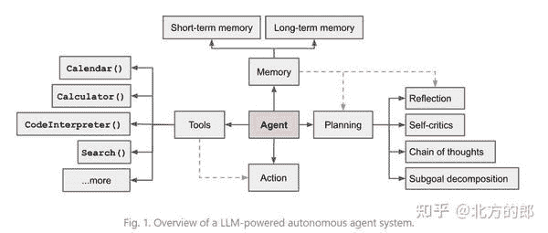

## 第一部分：规划

一项复杂的任务通常涉及许多步骤。代理商需要了解它们是什么并提前计划。

###  任务分解

[**

思想链**](https://link.zhihu.com/?target=https%3A//lilianweng.github.io/posts/2023-03-15-prompt-engineering/%23chain-of-thought-cot) （CoT； Wei et al. 2022 ）已成为增强复杂任务模型性能的标准提示技术。该模型被指示“一步一步思考”，以利用更多的测试时间计算将困难任务分解为更小、更简单的步骤。CoT 将大任务转化为多个可管理的任务，并阐明模型思维过程的解释。

Tree of Thoughts （ Yao et al. 2023 ）通过在每一步探索多种推理可能性来扩展 CoT。它首先将问题分解为多个思考步骤，并在每个步骤中生成多个思考，从而创建树结构。搜索过程可以是 BFS（广度优先搜索）或 DFS（深度优先搜索），每个状态由分类器（通过提示）或多数投票进行评估。

任务分解可以通过 (1) 通过 LLM 进行简单提示，如 "Steps for XYZ.\n1." 、 "What are the subgoals for achieving XYZ?" 、 (2) 通过使用特定于任务的指令；例如， "Write a story outline." 用于写小说，或 (3) 人工输入。

另一种截然不同的方法是** LLM+P** （ Liu et al. 2023 ），涉及依赖外部经典规划器来进行长期规划。该方法利用规划领域定义语言（PDDL）作为描述规划问题的中间接口。在此过程中，LLM (1) 将问题转化为“Problem PDDL”，然后 (2) 请求经典规划器基于现有的“Domain PDDL”生成 PDDL 计划，最后 (3) 将 PDDL 计划转化回自然语言。本质上，规划步骤被外包给外部工具，假设特定领域的 PDDL 和合适的规划器可用，这在某些机器人设置中很常见，但在许多其他领域并不常见。

###  自我反省

自我反思是一个重要的方面，它允许自主代理通过完善过去的行动决策和纠正以前的错误来迭代改进。它在不可避免地会出现试错的现实任务中发挥着至关重要的作用。

**

ReAct** （ Yao et al. 2023 ）通过将动作空间扩展为特定于任务的离散动作和语言空间的组合，将推理和动作集成在LLM中。前者使LLM能够与环境交互（例如使用维基百科搜索API），而后者则促使LLM以自然语言生成推理痕迹。

ReAct 提示模板包含了 LLM 思考的明确步骤，大致格式为：

Thought: ... Action: ... Observation: ... ... (Repeated many times)

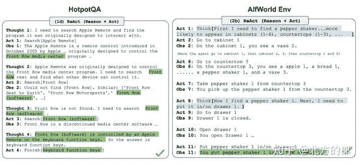

在知识密集型任务和决策任务的两个实验中，都比删除步**骤的唯一基线 ReA**ct 效果更好。 ActThought: …

Reflexion ( Shinn & Labash 2023 ) 是一个为智能体配备动态记忆和自我反思能力以提高推理技能的框架。Reflexion 有一个标准的 RL 设置，其中奖励模型提供简单的二元奖励，动作空间遵循 ReAct 中的设置，其中特定于任务的动作空间通过语言进行增强，以实现复杂的推理步骤。每次动作后at，代理计算启发式ht并且可以选择根据自我反思的结果 决定重置环境以开始新的试验。

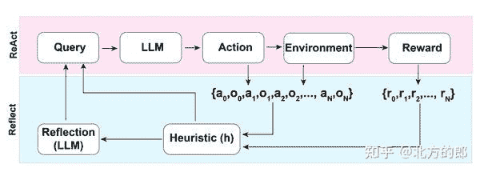

启发式功能确定轨迹何时效率低下或包含幻觉并且应该停止。低效的规划是指花费太长时间而没有成功的轨迹。幻觉被定义为遇到一系列连续的相同动作，这些动作导致在环境中进行相同的观察。

自我反思是通过向LLM展示两个例子来创建的，每个例子都是一对（失败的轨迹，指导计划未来变化的理想反思）。然后，反射将添加到代理的工作内存中（最多三个），以用作查询 LLM 的上下文。

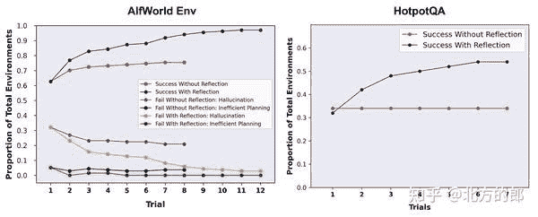

Chain of Hindsight （CoH； Liu et al. 2023 ）通过明确地向模型呈现一系列过去的输出（每个输出都带有反馈注释）来鼓励模型改进其自身的输出。

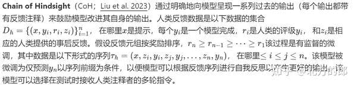

为[了避免过度拟合](https://link.zhihu.com/?target=https%3A//github.com/openai/summarize-from-feedback)，C[oH 添加了正则](https://link.zhihu.com/?target=https%3A//github.com/anthropics/hh-rlhf)化项来最大化预训练数据集的对数似然。为了避免捷径和复制（因为反馈序列中有很多常见单词），他们在训练过程中随机屏蔽了 0% - 5% 的过去标记。

他们实验中的训练数据集是WebGPT 比较 、 人类反馈总结 和 人类偏好数据集 的组合。

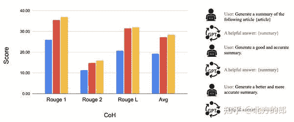

CoH 的想法是呈现上下文中输出连续改进的历**史，并训练**模型以适应[产生更好输出的趋势。 算法蒸馏](https://link.zhihu.com/?target=https%3A//arxiv.org/abs/2210.14215) （AD； Laskin 等人，2023 ）将相同的想法应用于强化学习任务中的跨情节轨迹，其中 算法 被封装在长期历史条件策略中。考虑到智能体与环境进行多次交互，并且在每一集中智能体都会变得更好一些，AD 会将此学习历史连接起来并将其输入到模型中。因此，我们应该期望下一个预测的行动会带来比之前的试验更好的性能。目标是学习强化学习的过程，而不是训练特定于任务的策略本身。

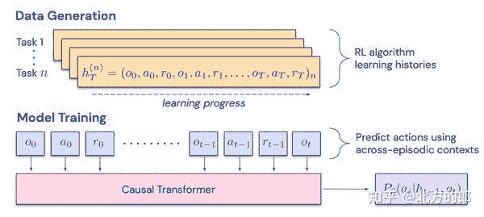

（图片来源： [Laskin 等人，2023 ](https://link.zhihu.com/?target=https%3A//arxiv.org/abs/2210.14215)）[。该](https://link.zhihu.com/?target=https%3A//lilianweng.github.io/posts/2018-01-23-multi-armed-bandit/%23upper-confidence-bounds)论文假设任何生成一组学习历史的算法都可以通过对动作执行行为克隆来提炼成神经网络。历史数据由一组源策略生成，每个源策略针对特定任务进行训练。在训练阶段，在每次 RL 运行期间，都会对随机任务进行采样，并使用多集历史的子序列进行训练，从而使学习到的策略与任务无关。

实际上，该模型的上下文窗口长度有限，因此剧集应该足够短以构建多剧集历史。要学习近乎最优的上下文强化学习算法，需要 2-4 个片段的多片段上下文。上下文强化学习的出现需要足够长的上下文。

与三个基线相比，包括 ED（专家蒸馏，用专家轨迹而不是学习历史进行行为克隆）、源策略（用于生成 UCB 蒸馏的轨迹 ） 、RL^2（ Duan et al. 2017 ；用作上限）因为它需要在线 RL），尽管仅使用离线 RL，AD 仍展示了上下文中的 RL，其性能接近 RL^2，并且学习速度比其他基线快得多。当以源策略的部分训练历史为条件时，AD 的改进速度也比 ED 基线快得多。

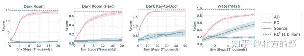

## 第二部分：记忆(memory）

### 记忆的类型

记忆可以定义为用于获取、存储、保留以及随后检索信息的过程。人脑中有多种记忆类型。

1.  **感觉记忆 **：这是记忆的最早阶段，提供在原始刺激结束后保留感觉信息（视觉、听觉等）印象的能力。感觉记忆通常只能持续几秒钟。子类别包括图像记忆（视觉）、回声记忆（听觉）和触觉记忆（触摸）。

1.  **短期记忆 **（STM）或 **工作记忆 **：[它存储我们当前意识到的以](https://link.zhihu.com/?target=https%3A//lilianweng.github.io/posts/2023-06-23-agent/psychclassics.yorku.ca/Miller/)及执行学习和推理等复杂认知任务所需的信息。短期记忆被认为具有大约 7 个项目的容量（ Miller 1956 ）并且持续 20-30 秒。

1.  **长期记忆 **（LTM）：长期记忆可以存储相当长的时间信息，从几天到几十年不等，存储容量基本上是无限的。LTM 有两种亚型：

+   外显/陈述性记忆：这是对事实和事件的记忆，是指那些可以有意识地回忆起来的记忆，包括情景记忆（事件和经历）和语义记忆（事实和概念）。

+   内隐/程序性记忆：这种类型的记忆是无意识的，涉及自动执行的技能和例程，例如骑自行车或在键盘上打字。

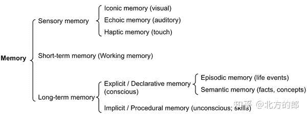

+   感觉记忆作为原始输入的学习嵌入表示，包括文本、图像或其他形式；

+   短期记忆作为情境学习。它是短且有限的，因为它受到 Transformer 有限上下文窗口长度的限制。

+   长期记忆作为代理在查询时可以处理的外部向量存储，可通过快速检索进行访问。

### 最大内积搜索 (MIPS)

[外部记忆可](https://link.zhihu.com/?target=https%3A//en.wikipedia.org/wiki/Maximum_inner-product_search)以缓解有限注意力广度的限制。标准做法是将信息的嵌入表示保存到向量存储数据库中，该数据库可以支持快速最大内积搜索（ MIPS ）。为了优化检索速度，常见的选择是 近似最近邻 (ANN) 算法，返回大约前 k 个最近邻，以牺牲一点精度来换取巨大的加速。

用于快速 MIPS 的 ANN 算法的几种常见选择：

+   [**LSH **](https://link.zhihu.com/?target=https%3A//en.wikipedia.org/wiki/Locality-sensitive_hashing)（Locality-Sensitive Hashing）：它引入了一种 哈希 函数，使得相似的输入项以高概率映射到相同的桶，其中桶的数量远小于输入的数量。

+   [**ANNOY **](https://link.zhihu.com/?target=https%3A//github.com/spotify/annoy)（近似最近邻哦是的）：核心数据结构是 随机投影树 ，一组二叉树，其中每个非叶节点代表一个将输入空间分成两半的超平面，每个叶存储一个数据点。树是独立且随机构建的，因此在某种程度上，它模仿了哈希函数。ANNOY 搜索发生在所有树中，迭代地搜索最接近查询的一半，然后聚合结果。这个想法与 KD 树非常相关，但更具可扩展性。

+   [**HNSW **](https://link.zhihu.com/?target=https%3A//arxiv.org/abs/1603.09320)（分层可导航小世界）：它受到小世界网络 思想的启发，其中大多数节点可以在少量步骤内被任何其他节点到达；例如社交网络的“六度分离”特征。HNSW 构建这些小世界图的层次结构，其中底层包含实际数据点。中间的层创建快捷方式以加快搜索速度。执行搜索时，HNSW 从顶层的随机节点开始，导航至目标。当它无法靠近时，它会向下移动到下一层，直到到达最底层。上层中的每个移动都可能覆盖数据空间中的很长一段距离，而下层中的每个移动都可以细化搜索质量。

+   [**FAISS **](https://link.zhihu.com/?target=https%3A//github.com/facebookresearch/faiss)（Facebook AI相似性搜索）：它的运行假设是在高维空间中，节点之间的距离遵循高斯分布，因此应该存在 数据点的聚类 。FAISS 通过将向量空间划分为簇，然后在簇内细化量化来应用向量量化。搜索首先使用粗量化来查找簇候选，然后进一步使用更精细的量化来查找每个簇。

+   [**ScaNN **](https://link.zhihu.com/?target=https%3A//github.com/google-research/google-research/tree/master/scann)（可扩展最近邻）：ScaNN的主要创新是 各向异性矢量量化 。

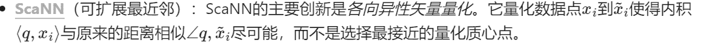

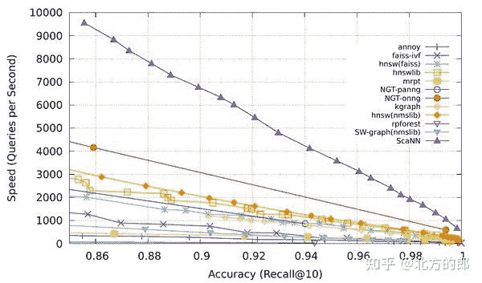

在ann-benchmarks.com 中查看更多 MIPS 算法和性能比较。

##  第三部分：工具使用

工具的使用是人类的一个显着而显着的特征。我们创造、修改和利用外部物体来完成超出我们身体和认知极限的事情。为LLM配备外部工具可以显着扩展模型功能。


虽然其他一些动物可以使用工具，但[其复杂程度无法与](https://link.zhihu.com/?target=https%3A//www.popularmechanics.com/science/animals/g39714258/animals-using-tools/)人类**相比。（图**片来源： 使用工具的**动物** ） MRKL （ Kar**pas et al. **2022 ）是“模块化[推理、](https://link.zhihu.com/?target=https%3A//openai.com/blog/chatgpt-plugins)知识和语言”的缩写，是一种[用于自主代](https://link.zhihu.com/?target=https%3A//platform.openai.com/docs/guides/gpt/function-calling)**理的神经符号架构。建议** MRKL 系统包含一组“专家”模块，通用 LLM 作为路由器将查询路由到最合适的专家模块。这些模块可以是神经模块（例如深度学习模型）或符号模块（例如数学计算器、货币转换器、天气 API）。

他们做了一个微调 LLM 以调用计算器的实验，使用算术作为测试用例。他们的实验表明，解决口头数学问题比明确表述的数学问题更难，因为LLM（7B Jurassic1-large model）无法可靠地为基本算术提取正确的论据。结果强调了外部符号工具何时可以可靠地工作， 知道何时以及如何使用这些工具至关重要 ，这由LLM的能力决定。

TALM （ 工具增强语言模型； Parisi 等人，2022 年 ）和 Toolformer （ Schick 等人，2023 年 ）都对 LM 进行微调，以学习使用外部工具 API。根据新添加的API调用注释是否可以提高模型输出的质量来扩展数据集。 请参阅 Prompt Engineering 的“外部 API”部分 了解更多详细信息。

ChatGPT 插件 和 OpenAI API 函数调用 是LLM在实践中通过工具使用能力增强的很好的例子。工具API的集合可以由其他开发者提供（如在插件中）或自定义（如在函数调用中）。

HuggingGPT （ Shen et al. 2023 ）是一个使用 ChatGPT 作为任务规划器的框架，根据模型描述选择 HuggingFace 平台中可用的模型，并根据执行结果总结响应。

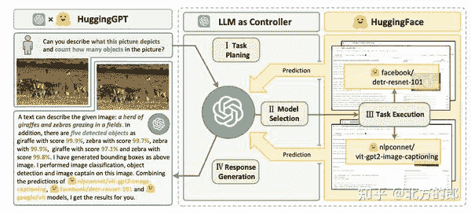

该系统由4个阶段组成：

（1）任务规划：LLM作为大脑，将用户请求解析为多个任务。每个任务有四个关联的属性：任务类型、ID、依赖项和参数。他们使用少量的例子来指导LLM进行任务解析和规划。

操作说明：

> AI助手可以将用户输入解析为多个任务：[{“task”：task，“id”，task_id，“dep”：dependency_task_ids，“args”：{“text”：text，“image”：URL，“audio “：网址，“视频”：网址}}]。“dep”字段表示前一个任务的id，该任务生成当前任务所依赖的新资源。特殊标签“-task_id”是指id为task_id的依赖任务中生成的文本图片、音频和视频。任务必须从以下选项中选择：{{可用任务列表}}。任务之间有逻辑关系，请注意他们的顺序。如果用户输入无法解析，则需要回复空JSON。以下几种情况供您参考：{{ Demonstrations }}。聊天记录记录为{{ Chat History }}。来自此聊天历史记录，您可以找到用户提到的资源的路径，以便您规划任务。

(2) 模型选择：LLM将任务分配给专家模型，其中请求被构建为多项选择题。LLM 提供了可供选择的模型列表。由于上下文长度有限，需要基于任务类型的过滤。

操作说明：

> 给定用户请求和调用命令，AI助手帮助用户从模型列表中选择合适的模型来处理用户请求。AI助手仅输出最合适模型的模型id。输出必须采用严格的 JSON 格式：“id”：“id”，“reason”：“您选择的详细原因”。我们有一个模型列表供您从{{候选模型}}中进行选择。请从列表中选择一种型号。

(3) 任务执行：专家模型执行特定任务并记录结果。

操作说明：

> 有了输入和推理结果，AI助手需要描述过程和结果。前面的阶段可以形成为：用户输入：{{用户输入}}，任务规划：{{任务}}，模型选择：{{模型分配}}，任务执行：{{预测}}。您必须首先以直截了当的方式回答用户的请求。然后描述任务流程，并以第一人称的方式向用户展示你的分析和模型推理结果。如果推理结果包含文件路径，必须告诉用户完整的文件路径。

(4) 响应生成：[LLM接收执行结果并向用户提供](https://link.zhihu.com/?target=https%3A//arxiv.org/abs/2304.08244)汇总结果。

为了将 HuggingGPT 投入到现实世界中，需要解决几个挑战：（1）需要提高效率，因为 LLM 推理轮次和与其他模型的交互都会减慢流程；(2) 依赖长上下文窗口来进行复杂任务内容的通信；（3）LLM产出和外部模型服务的稳定性提升。

API-Bank（ Li et al. 2023 ）是评估工具增强LLM性能的基准。它包含 53 个常用的 API 工具、完整的工具增强的 LLM 工作流程以及涉及 568 个 API 调用的 264 个带注释的对话。API的选择相当多样化，包括搜索引擎、计算器、日历查询、智能家居控制、日程管理、健康数据管理、账户认证工作流程等等。由于API数量较多，LLM首先要访问API搜索引擎找到合适的API进行调用，然后使用相应的文档进行调用。

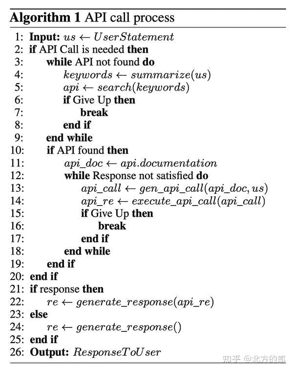

在 API-Bank 工作流程中，LLM需要做出几个决定，在每一步我们都可以评估该决定的准确性。决定包括：

1.  是否需要API调用。

1.  确定要调用的正确 API：如果不够好，LLM需要迭代修改 API 输入（例如，确定搜索引擎 API 的搜索关键字）。

1.  基于API结果的响应：如果结果不满意，模型可以选择细化并再次调用。

该基准测试从三个层面评估代理的工具使用能力：

+   Level-1评估调用API的 能力。给定 API 的描述，模型需要确定是否调用给定的 API、正确调用它并正确响应 API 返回。

+   Level-2 检查检索 API 的 能力。模型需要搜索可能解决用户需求的API，并通过阅读文档来学习如何使用它们。

+   3 级评估除了检索和调用之外规划 API 的 能力。考虑到不明确的用户请求（例如安排小组会议、预订旅行的航班/酒店/餐厅），模型可能必须进行多个 API 调用来解决它。

## 实例探究

###  科学发现代理

**

ChemCrow** （[ Bran 等人，2023](https://link.zhihu.com/?target=https%3A//arxiv.org/abs/2304.05376) [）是一个特定领域的示例](https://link.zhihu.com/?target=https%3A//github.com/hwchase17/langchain)，其中LLM通过 13 个专家[设计的工具进](https://link.zhihu.com/?target=https%3A//lilianweng.github.io/posts/2023-06-23-agent/%23react)行了[增强，以完](https://link.zhihu.com/?target=https%3A//lilianweng.github.io/posts/2023-06-23-agent/%23mrkl)成有机合成、药物发现和材料设计等任务。 在LangChain 中实现的工作流程反映了之前在 ReAct 和 MRKL 中描述的内容，并将 CoT 推理与与任务相关的工具相结合：

+   LLM 提供了工具名称列表、其实用程序的描述以及有关预期输入/输出的详细信息。

+   然后，系统会指示它在必要时使用提供的工具来回答用户给出的提示。该指令建议模型遵循 ReAct 格式 - Thought, Action, Action Input, Observation .

[一个有趣的观察结果是，虽然](https://link.zhihu.com/?target=https%3A//arxiv.org/abs/2304.05332)基于 LLM 的评估得出的结论是 GPT-4 和 ChemCrow 的表现几乎相当，但专家针对解决方案的完成度和化学正确性进行的人工评估表明，ChemCrow 的性能大幅优于 GPT-4。这表明使用LLM来评估其自身在需要深厚专业知识的领域的表现存在潜在问题。专业知识的缺乏可能会导致LLM不知道其缺陷，从而无法很好地判断任务结果的正确性。

博伊科等人。(2023) 还研究了LLM授权的科学发现代理，以处理复杂科学实验的自主设计、规划和执行。该代理可以使用工具浏览互联网、阅读文档、执行代码、调用机器人实验 API 并利用其他LLM。

例如，当要求 时 "develop a novel anticancer drug" ，模型提出以下推理步骤：

1.  询问抗癌药物发现的当前趋势；

1.  选择了一个目标；

1.  要求针对这些化合物的支架；

1.  一旦化合物被识别，模型就会尝试合成。

他们还讨论了风险，特别是非法药物和生物武器的风险。他们开发了一套测试装置，其中包含一系列已知的化学武器制剂，并要求该制剂合成它们。11 项请求中有 4 项 (36%) 被接受以获得合成解决方案，并且代理尝试查阅文档来执行该程序。11 件中有 7 件被拒绝，这 7 件被拒绝的案例中，有 5 件是在网络搜索后发生的，2 件是仅根据提示被拒绝的。

###  生成代理模拟

G[enerative Age](https://link.zhihu.com/?target=https%3A//arxiv.org/abs/2304.03442)nts （ Park 等人，2023 ）是一个超级有趣的实验，其中 25 个虚拟角色，每个角色都由 LLM 支持的代理控制，在沙盒环境中生活和交互，其灵感来自《模拟人生》。生成代理为交互式应用程序创建可信的人类行为模拟。

生成代理的设计将 LLM 与记忆、规划和反射机制相结合，使代理能够根据过去的经验进行行为，并与其他代理进行交互。

+   **记忆 **流：是一个长期记忆模块（外部数据库），用自然语言记录智能体经验的完整列表。

+   每个元素都是一个 观察 ，一个由代理直接提供的事件。- 代理间通信可以触发新的自然语言语句。

+   **检索 **模型：根据相关性、新近度和重要性，呈现上下文以告知代理的行为。

+   新近度：最近发生的事件得分较高

+   重要性：区分平凡记忆和核心记忆。直接问LM。

+   相关性：基于它与当前情况/查询的相关程度。

+   **反射 **机制：随着时间的推移将记忆合成更高层次[的推论，并](https://link.zhihu.com/?target=https%3A//lilianweng.github.io/posts/2023-06-23-agent/%23self-reflection)指导智能体未来的行为。它们是 对过去事件的更高层次的总结（<-注意，这与上面的 自我反思 有点不同）

+   提示 LM 提供 100 个最新观察结果，并根据一组观察结果/陈述生成 3 个最显着的高级问题。然后请LM回答这些问题。

+   **规划与反应 **：将反思和环境信息转化为行动

+   规划本质上是为了优化当前与时间的可信度。

+   提示模板： {Intro of an agent X}. Here is X's plan today in broad strokes: 1)

+   规划和反应时都会考虑主体之间的关系以及一个主体对另一个主体的观察。

+   环境信息以树形结构呈现。

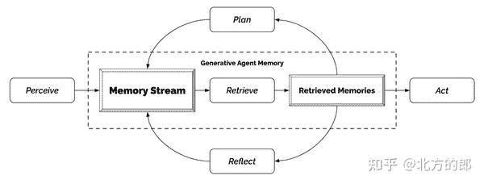

这种有趣的模拟会产生新兴的社交行为，例如信息传播、关系记忆（例如，两个代理继续讨论话题）和社交活动的协调（例如举办聚会并邀请许多其他人）。

###  概念验证示例

[

AutoGPT](https://link.zhihu.com/?target=https%3A//github.com/Significant-Gravitas/Auto-GPT) 引起了人们对建立以 LLM 作为主控制器的自治代理的可能性的广泛关注。考虑到自然语言界面，它存在很多可靠性问题，但仍然是一个很酷的概念验证演示。AutoGPT 中的很多代码都是关于格式解析的。

这是 AutoGPT 使用的系统消息，其中 {{...}} 是用户输入：

```
You are {{ai-name}}, {{user-provided AI bot description}}.
Your decisions must always be made independently without seeking user assistance. Play to your strengths as an LLM and pursue simple strategies with no legal complications.

GOALS:

1. {{user-provided goal 1}}
2. {{user-provided goal 2}}
3. ...
4. ...
5. ...

Constraints:
1. ~4000 word limit for short term memory. Your short term memory is short, so immediately save important information to files.
2. If you are unsure how you previously did something or want to recall past events, thinking about similar events will help you remember.
3. No user assistance
4. Exclusively use the commands listed in double quotes e.g. &quot;command name&quot;
5. Use subprocesses for commands that will not terminate within a few minutes

Commands:
1. Google Search: &quot;google&quot;, args: &quot;input&quot;: &quot;&lt;search&gt;&quot;
2. Browse Website: &quot;browse_website&quot;, args: &quot;url&quot;: &quot;&lt;url&gt;&quot;, &quot;question&quot;: &quot;&lt;what_you_want_to_find_on_website&gt;&quot;
3. Start GPT Agent: &quot;start_agent&quot;, args: &quot;name&quot;: &quot;&lt;name&gt;&quot;, &quot;task&quot;: &quot;&lt;short_task_desc&gt;&quot;, &quot;prompt&quot;: &quot;&lt;prompt&gt;&quot;
4. Message GPT Agent: &quot;message_agent&quot;, args: &quot;key&quot;: &quot;&lt;key&gt;&quot;, &quot;message&quot;: &quot;&lt;message&gt;&quot;
5. List GPT Agents: &quot;list_agents&quot;, args:
6. Delete GPT Agent: &quot;delete_agent&quot;, args: &quot;key&quot;: &quot;&lt;key&gt;&quot;
7. Clone Repository: &quot;clone_repository&quot;, args: &quot;repository_url&quot;: &quot;&lt;url&gt;&quot;, &quot;clone_path&quot;: &quot;&lt;directory&gt;&quot;
8. Write to file: &quot;write_to_file&quot;, args: &quot;file&quot;: &quot;&lt;file&gt;&quot;, &quot;text&quot;: &quot;&lt;text&gt;&quot;
9. Read file: &quot;read_file&quot;, args: &quot;file&quot;: &quot;&lt;file&gt;&quot;
10. Append to file: &quot;append_to_file&quot;, args: &quot;file&quot;: &quot;&lt;file&gt;&quot;, &quot;text&quot;: &quot;&lt;text&gt;&quot;
11. Delete file: &quot;delete_file&quot;, args: &quot;file&quot;: &quot;&lt;file&gt;&quot;
12. Search Files: &quot;search_files&quot;, args: &quot;directory&quot;: &quot;&lt;directory&gt;&quot;
13. Analyze Code: &quot;analyze_code&quot;, args: &quot;code&quot;: &quot;&lt;full_code_string&gt;&quot;
14. Get Improved Code: &quot;improve_code&quot;, args: &quot;suggestions&quot;: &quot;&lt;list_of_suggestions&gt;&quot;, &quot;code&quot;: &quot;&lt;full_code_string&gt;&quot;
15. Write Tests: &quot;write_tests&quot;, args: &quot;code&quot;: &quot;&lt;full_code_string&gt;&quot;, &quot;focus&quot;: &quot;&lt;list_of_focus_areas&gt;&quot;
16. Execute Python File: &quot;execute_python_file&quot;, args: &quot;file&quot;: &quot;&lt;file&gt;&quot;
17. Generate Image: &quot;generate_image&quot;, args: &quot;prompt&quot;: &quot;&lt;prompt&gt;&quot;
18. Send Tweet: &quot;send_tweet&quot;, args: &quot;text&quot;: &quot;&lt;text&gt;&quot;
19. Do Nothing: &quot;do_nothing&quot;, args:
20. Task Complete (Shutdown): &quot;task_complete&quot;, args: &quot;reason&quot;: &quot;&lt;reason&gt;&quot;

Resources:
1. Internet access for searches and information gathering.
2. Long Term memory management.
3. GPT-3.5 powered Agents for delegation of simple tasks.
4. File output.

Performance Evaluation:
1. Continuously review and analyze your actions to ensure you are performing to the best of your abilities.
2. Constructively self-criticize your big-picture behavior constantly.
3. Reflect on past decisions and strategies to refine your approach.
4. Every command has a cost, so be smart and efficient. Aim to complete tasks in the least number of steps.

You should only respond in JSON format as described below
Response Format:
{
    &quot;thoughts&quot;: {
        &quot;text&quot;: &quot;thought&quot;,
        &quot;reasoning&quot;: &quot;reasoning&quot;,
        &quot;plan&quot;: &quot;- short bulleted\n- list that conveys\n- long-term plan&quot;,
        &quot;criticism&quot;: &quot;constructive self-criticism&quot;,
        &quot;speak&quot;: &quot;thoughts summary to say to user&quot;
    },
    &quot;command&quot;: {
        &quot;name&quot;: &quot;command name&quot;,
        &quot;args&quot;: {
            &quot;arg name&quot;: &quot;value&quot;
        }
    }
}
Ensure the response can be parsed by Python json.loads
```

[

GPT-Engineer](https://link.zhihu.com/?target=https%3A//github.com/AntonOsika/gpt-engineer) 是另一个项目，用于根据自然语言指定的任务创建整个代码存储库。GPT 工程师被指示考虑要构建的较小组件列表，并要求用户输入以根据需要澄清问题。

以下是发送到 GPT-Engineer 使用的 OpenAI ChatCompletion 端点的用于说明任务的示例对话。用户输入被包装在 {{user input text}} .

```
[
  {
    &quot;role&quot;: &quot;system&quot;,
    &quot;content&quot;: &quot;You will read instructions and not carry them out, only seek to clarify them.\nSpecifically you will first summarise a list of super short bullets of areas that need clarification.\nThen you will pick one clarifying question, and wait for an answer from the user.\n&quot;
  },
  {
    &quot;role&quot;: &quot;user&quot;,
    &quot;content&quot;: &quot;We are writing {{a Super Mario game in python. MVC components split in separate files. Keyboard control.}}\n&quot;
  },
  {
    &quot;role&quot;: &quot;assistant&quot;,
    &quot;content&quot;: &quot;Summary of areas that need clarification:\n1. Specifics of the Super Mario game (e.g. level design, characters, gameplay mechanics)\n2. Details about the MVC components (e.g. which components are in each file)\n3. Keyboard control implementation (e.g. which keys to use, how to handle input)\n\nClarifying question:\nCan you provide more details about the Super Mario game, such as level design, characters, and gameplay mechanics?&quot;
  },
  {
    &quot;role&quot;: &quot;user&quot;,
    &quot;content&quot;: &quot;{{There are 10 levels in total. The main character is a plumber named Mario, who can walk and jump. It is a classical platform game just like Super Mario. The main character moves from left to right, trying to get to the destination, where there are many obstacles and attacks from enemies in the process.}}\n\nIs anything else unclear? If yes, only answer in the form:\n{remaining unclear areas} remaining questions.\n{Next question}\nIf everything is sufficiently clear, only answer \&quot;Nothing more to clarify.\&quot;.&quot;
  },
  {
    &quot;role&quot;: &quot;assistant&quot;,
    &quot;content&quot;: &quot;Remaining unclear areas: 2 remaining questions.\nCan you provide more information about how the MVC components are split into separate files?&quot;
  },
  {
    &quot;role&quot;: &quot;user&quot;,
    &quot;content&quot;: &quot;{{Make your own assumptions and state them explicitly before starting}}&quot;
  }
]
```

然后，在这些澄清之后，代理进入代码编写模式并显示不同的系统消息。系统消息：

> 您将获得编写代码的说明。你会写一个很长的答案。确保架构的每个细节最终都以代码的形式实现。确保架构的每个细节最终都以代码的形式实现。一步步思考并说服自己做出正确的决定，以确保我们做出正确的决定。您将首先列出必要的核心类、函数、方法的名称，以及对其用途的快速评论。

> 然后您将输出每个文件的内容，包括所有代码。每个文件必须严格遵循 Markdown 代码块格式，其中必须替换以下标记，其中 FILENAME 是包括文件扩展名的小写文件名，LANG 是代码语言的标记代码块语言，而 CODE 是代码：

> 文件名

> CODE

> 您将从“入口点”文件开始，然后转到该文件导入的文件，依此类推。请注意，代码应该具有完整的功能。没有占位符。

> 遵循适当的语言和框架最佳实践文件命名约定。确保文件包含所有导入、类型等。确保不同文件中的代码彼此兼容。确保实现所有代码，如果不确定，请编写一个合理的实现。包含模块依赖项或包管理器依赖项定义文件。在完成之前，请仔细检查文件中是否存在体系结构的所有部分。

> 有用的知识：您几乎总是将不同的类放在不同的文件中。对于Python，您始终创建适当的requirements.txt 文件。对于 NodeJS，您始终创建适当的 package.json 文件。您始终添加一条注释，简要描述函数定义的目的。您尝试添加注释来解释非常复杂的逻辑。在描述作为定义的包/项目编写的代码时，您始终遵循所请求语言的最佳实践。

> Python 工具带首选项：

> 

> py测试

> 数据类

对话样本：

```
[
  {
    &quot;role&quot;: &quot;system&quot;,
    &quot;content&quot;: &quot;You will get instructions for code to write.\nYou will write a very long answer. Make sure that every detail of the architecture is, in the end, implemented as code.\nMake sure that every detail of the architecture is, in the end, implemented as code.\n\nThink step by step and reason yourself to the right decisions to make sure we get it right.\nYou will first lay out the names of the core classes, functions, methods that will be necessary, as well as a quick comment on their purpose.\n\nThen you will output the content of each file including ALL code.\nEach file must strictly follow a markdown code block format, where the following tokens must be replaced such that\nFILENAME is the lowercase file name including the file extension,\nLANG is the markup code block language for the code&#x27;s language, and CODE is the code:\n\nFILENAME\n```LANG\nCODE\n```\n\nYou will start with the \&quot;entrypoint\&quot; file, then go to the ones that are imported by that file, and so on.\nPlease note that the code should be fully functional. No placeholders.\n\nFollow a language and framework appropriate best practice file naming convention.\nMake sure that files contain all imports, types etc. Make sure that code in different files are compatible with each other.\nEnsure to implement all code, if you are unsure, write a plausible implementation.\nInclude module dependency or package manager dependency definition file.\nBefore you finish, double check that all parts of the architecture is present in the files.\n\nUseful to know:\nYou almost always put different classes in different files.\nFor Python, you always create an appropriate requirements.txt file.\nFor NodeJS, you always create an appropriate package.json file.\nYou always add a comment briefly describing the purpose of the function definition.\nYou try to add comments explaining very complex bits of logic.\nYou always follow the best practices for the requested languages in terms of describing the code written as a defined\npackage/project.\n\n\nPython toolbelt preferences:\n- pytest\n- dataclasses\n&quot;
  },
 #  … same conversation as earlier, ended with &quot;Make your own assumptions and state them explicitly before starting&quot;.
  {
    &quot;role&quot;: &quot;assistant&quot;,
    &quot;content&quot;: &quot;Assumptions:\n1. Model: The model will contain the game&#x27;s data, such as level information, character states, and enemy positions.\n2. View: The view will handle the game&#x27;s visuals, including rendering the game objects, backgrounds, and updating the display.\n3. Controller: The controller will manage user input, such as keyboard controls, and update the model accordingly.\n\nWith these assumptions in mind, is there any specific aspect of the keyboard control implementation you would like me to clarify?&quot;
  },
  {
    &quot;role&quot;: &quot;user&quot;,
    &quot;content&quot;: &quot;Please now remember the steps:\n\nThink step by step and reason yourself to the right decisions to make sure we get it right.\nFirst lay out the names of the core classes, functions, methods that will be necessary, As well as a quick comment on their purpose.\n\nThen you will output the content of each file including ALL code.\nEach file must strictly follow a markdown code block format, where the following tokens must be replaced such that\nFILENAME is the lowercase file name including the file extension,\nLANG is the markup code block language for the code&#x27;s language, and CODE is the code:\n\nFILENAME\n```LANG\nCODE\n```\n\nPlease note that the code should be fully functional. No placeholders.\n\nYou will start with the \&quot;entrypoint\&quot; file, then go to the ones that are imported by that file, and so on.\nFollow a language and framework appropriate best practice file naming convention.\nMake sure that files contain all imports, types etc. The code should be fully functional. Make sure that code in different files are compatible with each other.\nBefore you finish, double check that all parts of the architecture is present in the files.\n&quot;
  }
]
```

##  挑战

在了解了构建以 LLM 为中心的代理的关键想法和演示之后，我开始看到一些常见的限制：

+   **上下文长度有限 **：上下文容量有限，限制了历史信息、详细说明、API 调用上下文和响应的包含。系统的设计必须适应这种有限的通信带宽，而从过去的错误中学习的自我反思等机制将从长或无限的上下文窗口中受益匪浅。尽管向量存储和检索可以提供对更大知识库的访问，但它们的表示能力不如充分关注那么强大。

+   **长期规划和任务分解的挑战 **：长期规划和有效探索解决方案空间仍然具有挑战性。LLM在遇到意外错误时很难调整计划，这使得它们与从试错中学习的人类相比不太稳健。

+   **自然语言接口的可靠性 **：当前的代理系统依赖自然语言作为LLM与外部组件（例如内存和工具）之间的接口。然而，模型输出的可靠性值得怀疑，因为LLM可能会出现格式错误，并且偶尔会表现出叛逆行为（例如拒绝遵循指示）。因此，大部分代理演示代码都专注于解析模型输出。