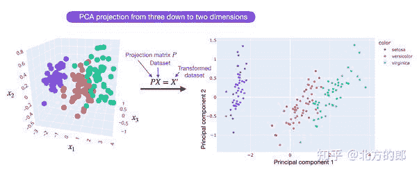
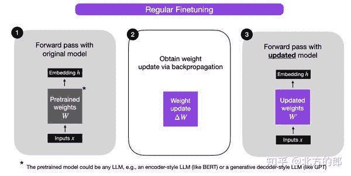
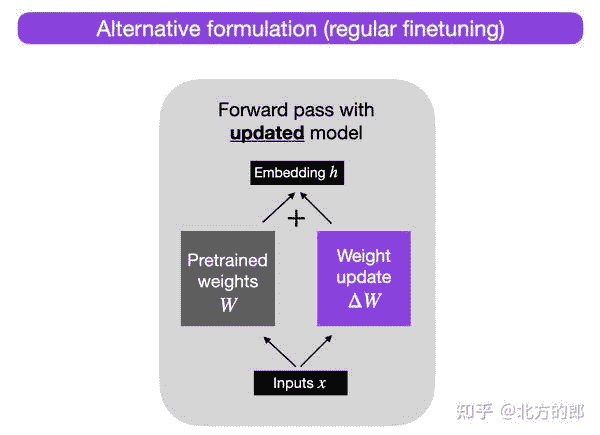
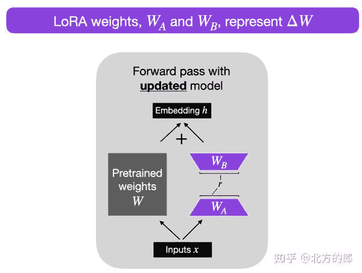
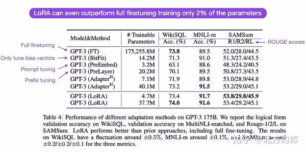
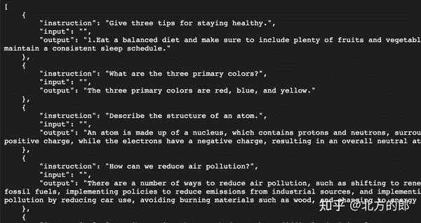
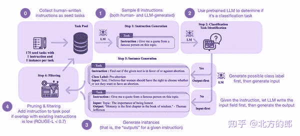

# 利用LoRA对LLM进行参数高效的微调

> 来源：[https://agijuejin.feishu.cn/docx/LtZHdJ5RrohOxExKXnFcUDg5nJJ](https://agijuejin.feishu.cn/docx/LtZHdJ5RrohOxExKXnFcUDg5nJJ)

> 作者：北方的郎

> 原文： [https://zhuanlan.z](https://zhuanlan.zhihu.com/p/632159261)hihu.com/p/632159...

## **为什么微调？**

预训练的大型语言模型通常被称为基础模型是有充分理由的：它们在各种任务上表现良好，我们可以将它们用作对目标任务进行微调的基础。不过，它的计算成本可能非常高——模型越大，更新的成本就越高。

作为更新所有层的替代方法，已经开发了一些所谓参数有效的方法，例如前缀调整和适配器，可以参考我之前的帖子：

北方的郎：微调大型语言模型-核心思想和方法介绍

[北方的郎：LLM微调方法：Prompt Tuni](https://zhuanlan.zhihu.com/p/632009060)ng And Prefix Tuning

现在，有一种更流行的参数高效微调技术： Hu 等人的低秩自适应 (LoRA) 。什么是 LoRA？它是如何工作的？它与其他流行的微调方法相比如何？让我们在本文中回答所有这些问题！



**

使权重更新更高**效

基于上述想法，论文 LoRA：大型语言模型的低秩适应 建议将权重变化 ΔW 分解为低秩表示。（从技术上讲，LoRA 不会直接分解矩阵，而是通过反向传播学习分解后的矩阵）。

在深入了解 LoRA 之前，让我们先简单介绍一下常规微调期间的训练过程。那么，重量变化 ΔW 是多少？假设 W 表示给定神经网络层中的权重矩阵。然后，使用常规反向传播，我们可以获得权重更新 ΔW ，它通常计算为损失乘以学习率的负梯度：

ΔW = α ( -∇ L W )。

然后，当我们有 ΔW 时，我们可以按如下方式更新原始权重： W ' = W + ΔW 。下图对此进行了说明（为简单起见，省略了偏置向量）：

或者，我们可以将权重更新矩阵分开并按如下方式计算输出： h = W x + ΔW x ，



其中x代表输入，如下图所示。



我们为什么要这样做？目前，这个替代公式服务于说明 LoRA 的教学目标，但我们会回到它。

因此，当我们在神经网络中训练完全连接（即“密集”）层时，如上所示，权重矩阵通常具有满秩，这是一个技术术语，意思是矩阵没有任何线性相关（即， “冗余”）行或列。相反，对于满秩，低秩意味着矩阵具有冗余行或列。

因此，根据 Aghajanyan 等人的说法，虽然预训练模型的权重在预训练任务上具有完整排名，但 LoRA 作者指出，预训练大型语言模型在适应新任务时具有较低的“内在维度” 。

低内在维度意味着数据可以通过低维空间有效地表示或近似，同时保留其大部分基本信息或结构。换句话说，这意味着我们可以将适应任务的新权重矩阵分解为低维（更小）的矩阵，而不会丢失太多重要信息。

例如，假设 ΔW是A × B 权重矩阵的权重更新。然后，我们可以将权重更新矩阵分解为两个更小的矩阵： ΔW = W A W B ，其中 W A 是一个 A × r 维矩阵， W B 是一个 r × B 维矩阵。在这里，我们保持原始权重 W 不变，只训练新矩阵 W A 和 W B 。

简而言之，这就是 LoRA 方法，如下图所示。



### **   选**择等级

请注意，上图中的 r是此处的超参数，我们可以使用它来指定用于自适应的低秩矩阵的秩( rank of the low-rank matrices )。 较小的 r 会导致更简单的低秩矩阵，从而导致在适应过程中需要学习的参数更少。这可以导致更快的训练并可能减少计算需求。 然而，随着r 越小，低秩矩阵捕获任务特定信息的能力会降低。 这可能会导致较低的适应质量，并且与较高的r 相比，模型在新任务上的表现可能不佳。总之，选择较小的 r 在 LoRA 中，模型复杂性、适应能力和欠拟合或过拟合风险之间存在权衡。因此，重要的是尝试不同的 r 值以找到正确的平衡以在新任务上实现所需的性能。

### **  实施 Lo**RA

LoRA 的实施相对简单。我们可以将其视为 LLM 中全连接层的修改前向传递。在伪代码中，这看起来如下所示：

```
input_dim = 768  # e.g., the hidden size of the pre-trained model
output_dim = 768  # e.g., the output size of the layer
rank = 8  # The rank &#x27;r&#x27; for the low-rank adaptation

W = ... # from pretrained network with shape input_dim x output_dim

W_A = nn.Parameter(torch.empty(input_dim, rank)) # LoRA weight A
W_B = nn.Parameter(torch.empty(rank, output_dim)) # LoRA weight B

# Initialization of LoRA weights
nn.init.kaiming_uniform_(W_A, a=math.sqrt(5))
nn.init.zeros_(W_B)

def regular_forward_matmul(x, W):
    h = x @ W
return h

def lora_forward_matmul(x, W, W_A, W_B):
    h = x @ W  # regular matrix multiplication
    h += x @ (W_A @ W_B)*alpha # use scaled LoRA weights
return h
```

在上面的伪代码中， alpha 是一个缩放因子，用于调整组合结果（原始模型输出加上低秩自适应）的大小。这平衡了预训练模型的知识和新的特定于任务的适应——默认情况下， alpha 通常设置为 1。另请注意，虽然 W A 被初始化为小的随机权重，但 W B 被初始化为 0，因此

训练开始时 ΔW = W A W B = 0 ，这意味着我们以原始权重开始训练。

### **  参数**效率

现在，让我们解决房间里的大问题：如果我们引入新的权重矩阵，这个参数的效率如何？新矩阵 WA 和 WB 可以非常小。例如，假设 A=100 且 B=500 ，则ΔW 的大小为 100 × 500 = 50,000 。现在，如果我们将其分解为两个较小的矩阵，一个 100×5 维矩阵 WA 和一个 5×500 维矩阵 WB 。这两个矩阵总共只有 5×100+5×500=3000个 参数。

### **  减少推理**开销

请注意，在实践中，如果我们在训练后保持原始权重 W 和矩阵 W A 和 W B分开，如上所示，我们将在推理过程中产生小的效率损失，因为这引入了额外的计算步骤。相反，我们可以在训练后通过W' = W + WA WB 更新权重，这类似于前面提到的 W' = W + ΔW 。

然而，将权重矩阵W A 和 W B 分开可能具有实际优势。例如，假设我们希望将我们的预训练模型作为各种客户的基础模型，并且我们希望从基础模型开始为每个客户创建一个经过微调的 LLM。在这种情况下，我们不需要为每个客户存储完整的权重矩阵 W' ，其中存储模型的所有权重 W' = W + WA WB 对于 LLM 来说可能非常大，因为 LLM 通常有数十亿到数万亿个权重参数。因此，我们可以保留原始模型 W ，只需要存储新的轻量级矩阵 WA 和 WB 。

为了用具体数字说明这一点，一个完整的 7B LLaMA 检查点需要 23GB 的存储容量，而如果我们选择r=8 的等级，LoRA 权重可以小到 8MB 。

**

它在实践中有多**好？

LoRA 在实践中有多好，它与[完全微调和其他参](https://link.zhihu.com/?target=https%3A//arxiv.org/abs/2106.09685)[数有效方法相比如何](https://link.zhihu.com/?target=https%3A//arxiv.org/abs/2110.07280)？根[据 LoRA 论文 ，在多个](https://link.zhihu.com/?target=https%3A//arxiv.org/abs/2104.08691)任务特[定的基准](https://link.zhihu.com/?target=https%3A//twitter.com/rasbt/status/1639625228622917632%3Fs%3D20)测试中，使用 LoRA 的模型的建模性能比使用 Adapters 、 prompt tuning 或 prefix tuning的模型略好。 通常，LoRA 的性能甚至比微调所有层更好，如下面 LoRA 论文的注释表所示。（ROUGE 是评估语言翻译性能的指标，我 在这里 更详细地解释了它。）



在这里，值得注意的是 LoRA 与其他微调方法是正交的，这意味着它也可以与前缀调整(prefix tuning)和适配器(adapters)结合使用。

## **  LoRA & LLa**MA

现在，让我们使用 LoRA 的实现来微调 Meta 的 LLaM[A 模型。由于这已经是一篇很](https://link.zhihu.com/?target=https%3A//github.com/Lightning-AI/lit-llama)[长](https://link.zhihu.com/?target=https%3A//github.com/Lightning-AI/lit-llama/blob/main/finetune_adapter.py)的文[章，我将避](https://link.zhihu.com/?target=https%3A//github.com/Lightning-AI/lit-llama/blob/main/finetune_lora.py)免在本文中包含详细代码，但我建议查看 Lit-LLaMA 存储库 ，它是 Meta 流行的 LLaMA 模型的简单、可读的重新实现。

除了训练和运行 LLaMA 本身的代码（使用原始的 Meta LLaMA 权重），它还包含使用LLaMA-Adapter 和 LoRA 微调 LLaMA 的代码。

首先，我推荐以下 操作方法 文件：

1.  下载预训练权重 [ download_weights.md ]

1.  使用 LoRA 进行微调 [ finetune_lora.md ]

1.  使用适配器进行微调 [ finetune_adapter.md ]（可选，用于比较研究）

在下一节中，我们将比较 7B LLaMA 基础模型与使用 LoRA 和 LLaMA-Adapter 微调的 7B LLaMA 基础模型。（请注意，这需要至少具有 24 Gb RAM 的 GPU）。

### **计算性能基准**

在本节中，我[们将比](https://link.zhihu.com/?target=https%3A//github.com/tatsu-lab/stanford_alpaca%23data-release)较 LLaMA 7B 基础模型与使用 LoRA 和 LLaMA-Adapter 微调的基础模型的计算性能。

微调数据集是 此处 描述的 Alpaca 52k 指令数据集，具有以下结构：



数据集本身是按照Self-Instruct 论文 中描述的方法生成的，由 49,759 个训练示例和 2000 个验证示例组成。自学过程可以概括为 4 个步骤：

这是如何运作的？简而言之，这是一个 4 步过程

1.  带有一组人工编写的指令（在本例中为 175 个）和样本指令的种子任务池

1.  使用预训练的 LLM（如 GPT-3）来确定任务类别

1.  给定新指令，让预训练的 LLM 生成响应

1.  在将响应添加到任务池之前收集、修剪和过滤响应



请注意，Alpaca 52k dataset 数据集是使用上面的自动自指导程序收集的。但是，您也可以使用（或将其与）替代数据集进行比较。例如，一个有趣的候选者是最近发布的开源 databricks-dolly-15k 数据集，其中包含由 Databricks 员工编写的约 15k 条指令/响应微调记录。Lit-LLaMA 存储库包含一个数据集准备脚本，以防您想要使用此 Dolly 15k 数据集而不是 Alpaca 52k 数据集。

给定以下超参数设置（块大小、批量大小和 LoRA r），Adapter 和 LoRA 都可以使用 bfloat-16 混合精度训练在具有 24 Gb RAM 的单个 GPU 上微调 7B 参数 LLaMA 基础模型。

### ** LoR**A

```
learning_rate = 3e-4
batch_size = 128
micro_batch_size = 4
gradient_accumulation_steps = batch_size // micro_batch_size
epoch_size = 50000 # train dataset size
num_epochs = 5
max_iters = num_epochs * epoch_size // micro_batch_size // devices
weight_decay = 0.0
block_size = 512
lora_r = 8
lora_alpha = 16
lora_dropout = 0.05
warmup_steps = 100
```

### **LaMA Adapter**

```
learning_rate = 9e-3
batch_size = 128 / devices
micro_batch_size = 4
gradient_accumulation_steps = batch_size // micro_batch_size
epoch_size = 50000 # train dataset size
num_epochs = 5
max_iters = num_epochs * epoch_size // micro_batch_size // devices
weight_decay = 0.02
block_size = 512
warmup_steps = epoch_size * 2 // micro_batch_size // devices
```

[

以防将来代码发生变化](https://link.zhihu.com/?target=https%3A//github.com/rasbt/low-rank-adaptation-blog)，我将代码（带有超参数设置）包含 在 GitHub 上 。

Adapter 在 A100 上使用了大约 22 Gb 并在 162 分钟内完成了 62,400 次迭代。LoRA 使用了 21 Gb 内存并在 192 分钟内完成。总之，基于 Lit-LLaMA 实现，Adapter 和 LoRA 使用大约相同数量的 RAM 并且具有大致相同的训练时间。（请注意，这是在单个 GPU 上进行的，但如果您有多个 GPU，只需将参数更改 devices 为 > 1 即可利用额外的加速！）

相比之下，完全微调（LLaMA 7B 由 32 个转换器块和 3 个完全连接的输出层组成）需要至少 2 个 GPU，至少 30 Gb 和完全分片训练来分配权重。或者，您可以使用 4 个 GPU，每个 GPU 的最大内存使用量为 22 Gb。在 4 个 GPU 上进行训练，训练耗时 1956 分钟。这在单个 GPU 上至少需要 6,000 分钟，比参数高效的 LLaMA-Adapter 或 LoRA 替代方案贵 30-40 倍。

接下来，让我们看看应用不同微调策略后的模型输出。

## **  评估建模**性能

有几个指标可用于评估 LLM 生成的文本。例如，困惑度、BLEU 和 ROUGE 分数是自然语言处理中用于评估 LLM 在各种任务中的表现的一些最常见的评估指标。然而，所有这些指标都有很大的缺点，人工评估仍然是黄金标准——人工评估的缺点是创建成本高昂且难以自动化。

### **  定性**比较

为了定性地比较模型，我们将使用提示 "Please explain how weight decay works"

### **  基础**模型

```
$ python generate.py \
--checkpoint_path checkpoints/lit-llama/7B/lit-llama.pth
```

请解释权重衰减是如何工作的……以及为什么它有时似乎有效而有时却无效！

用最简单的术语来说，权重衰减会从模型中移除特征（作为它们重要性的函数）。它也被称为正则化。

正规化有

推理 1 的时间：总计 4.18 秒，11.95 个令牌/秒

正如我们所见，模型开始通过附加“......以及为什么它有时似乎有效而有时无效！”来继续提示。那是因为基础模型只接受了下一个单词预测任务的训练，并没有专门训练来遵循指令。尽管如此，它试图在下面进一步解释。该解释总体上对正则化做了一些正确的陈述，但它并没有真正抓住权重衰减的关键机制。

**

LLaMA-Adapte**r

```
$ python generate_adapter.py \
--adapter_path out/adapter/alpaca/lit-llama-adapter-finetuned.pth \
--pretrained_path checkpoints/lit-llama/7B/lit-llama.pth
```

权重衰减(Weight decay)是一种惩罚术语字数的方法。通过选择单词较少的句子，模型更有可能选择那些可能提供重要信息的句子。

推理时间：总计 7.04 秒，14.21 个令牌/秒

使用内存：13.56 GB

解释在语法上是合理的，但也不一定是我们要找的。

**

LoR**A

```
$ python generate_lora.py \
--lora_path out/lora/alpaca/lit-llama-lora-finetuned.pth \
--pretrained_path checkpoints/lit-llama/7B/lit-llama.pth
```

权重衰减是机器学习模型中用于减少过度拟合的算法参数。这是一个调整模型权重以减少模型中不太重要特征的影响并防止过度拟合的过程。权重衰减是通过在权重中加入少量噪声来降低模型对训练数据的影响。这个过程鼓励模型更多地关注对预测任务更重要的特征。

推理时间：总计 3.25 秒，30.76 个令牌/秒

使用内存：27.65 GB

我们越来越近了；当我们想到广义线性模型(generalized linear models)时，这种解释确实有意义，在广义线性模型中，我们强制模型学习与输入特征相乘的较小权重参数。在神经网络中，这通常会应用于模型中的所有权重参数。

请注意，上述 LoRA 方法目前使用的内存最多。但是，如前所述，我们可以通过将 LoRA 权重与预训练模型权重合并来减少这种内存使用。

由于评估 LLM 本身就是一个大话题，因此定性概述只是这些模型中每一个模型功能的一小部分。我们将在以后的更详细的文章中重新讨论这个话题。但作为这里的要点，LoRA 可用于以相对经济高效的方式在指令数据集上微调 LLM。

## ** 结**论

在本文中，我们讨论了低秩自适应 (LoRA)，它是完全微调的一种参数高效替代方法。我们看到微调 LLaMA 等相对较大的模型可以在使用 LoRA 的单个 GPU 上在几个小时内完成，这使得它对那些不想在 GPU 资源上花费数千美元的人特别有吸引力。LoRA 特别好的地方在于我们可以选择将新的 LoRA 权重矩阵与原始的、预训练的权重合并，这样我们就不会在推理过程中产生额外的开销或复杂性。

[

随着越来越多的 ChatG](https://link.zhihu.com/?target=https%3A//github.com/Lightning-AI/lit-llama)PT 或 GPT-4 开源替代品出现，针对特定目标数据集或目标微调和定制这些 LLM 将在各个研究领域和行业变得越来越有吸引力。参数高效的微调技术（例如 LoRA）使微调更节省资源且更易于访问。

Lit-LLaMA 存储库 中提供了参数有效的微调技术，例如 LoRA 和 LLaMA-Adapter 。

## 我的一些想法：

LORA的确是一种非常高效的微调LLM的方法。大家感兴趣的话可以参考我以前的介绍及测试说明：

[北方的郎：玩LLM和StableD](https://zhuanlan.zhihu.com/p/626411832)iffusion常说的LoRA到底是什么

[北](https://zhuanlan.zhihu.com/p/632001583)方的郎：使用PaddleNLP训练Lora教ChatGLM-6B作数学题，具体步骤及效果测试，A100是个好东西

原文链接： [Un](https://link.zhihu.com/?target=https%3A//lightning.ai/pages/community/article/understanding-llama-adapters/)derstanding Parameter-Efficient Finetuning of Large Language Models: From Prefix Tuning to LLaMA-Adapters

编辑于 2023-05-25 18:14 ・IP 属地黑龙江