# 大模型全栈总览【合集·下】

> 来源：[https://agijuejin.feishu.cn/docx/Oa2MdMX9coi78JxMgeWcEP53nnh](https://agijuejin.feishu.cn/docx/Oa2MdMX9coi78JxMgeWcEP53nnh)

# 👀快看👀

> **作者：**[**大模型解码室**](https://space.bilibili.com/386792168)

> **原文链接：**[**大模型全栈总览**](https://www.bilibili.com/video/BV1PCTFe8EHe/?spm_id_from=333.999.0.0&vd_source=5a54577a6bc7d876f6e5df88640c8e9f)

> **推荐指数：⭐️⭐️⭐️⭐️⭐️**

> **观看时间：3h48min**

---

# ⚡️摘要⚡️

> 该系列由大模型解码室作者制作整理，内容包含大模型强化学习的视频课程合集，涵盖了从基础到进阶的各个方面，包括 RLHF、DPO、IPO、KTO 等概念和实战演练，以及分布式训练中的数据并行等技术。

---

# 🤖分集🤖

### 08大模型全栈-强化学习01-RLHF前言传统强化学习

介绍强化学习的关键实体、交互过程，通过例子强调奖励设计，并且对奖励概念及在 NLP 领域的应用进行了讨论。

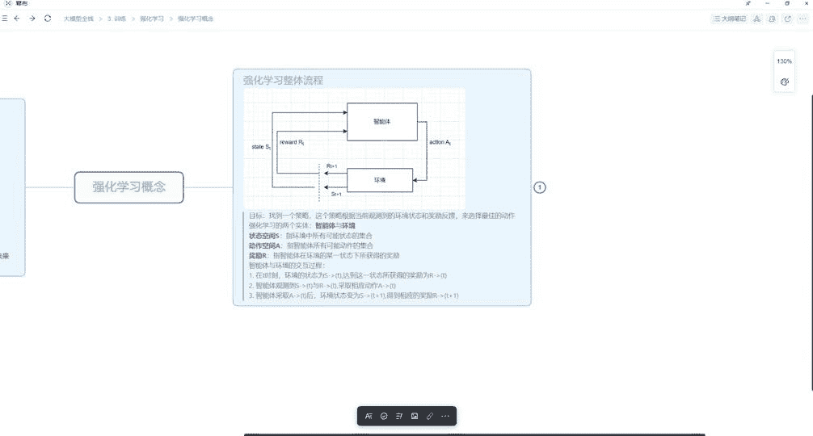

[08大模型全栈-强化学习01-RLHF前言传统强化学习 下午2.53.32.mp4](https://internal-api-drive-stream.feishu.cn/space/api/box/stream/download/all/VRd5bLNn5ooP2oxYqNRcn441n3e)

### 09大模型全栈-强化学习02-RLHF前言LLM强化学习

阐述大语言模型中强化学习应用，包括概念、输出、收益、状态、策略区分及举例。

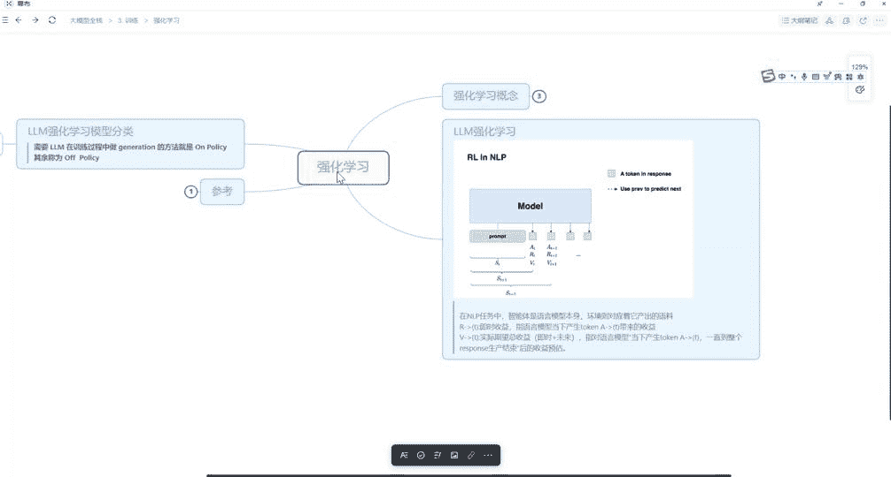

[09大模型全栈-强化学习02-RLHF前言LLM强化学习.mp4](https://internal-api-drive-stream.feishu.cn/space/api/box/stream/download/all/IqNnbuFo9o5FzxxfaYjcA2JLndh)

### 10大模型全栈-强化学习03-RLHF原理以及流程介绍

RLHF 模型由四个模型构成，训练流程分为三个阶段。各模型作用明确，有多种损失函数。但也存在算力消耗大、容易崩溃等挑战。

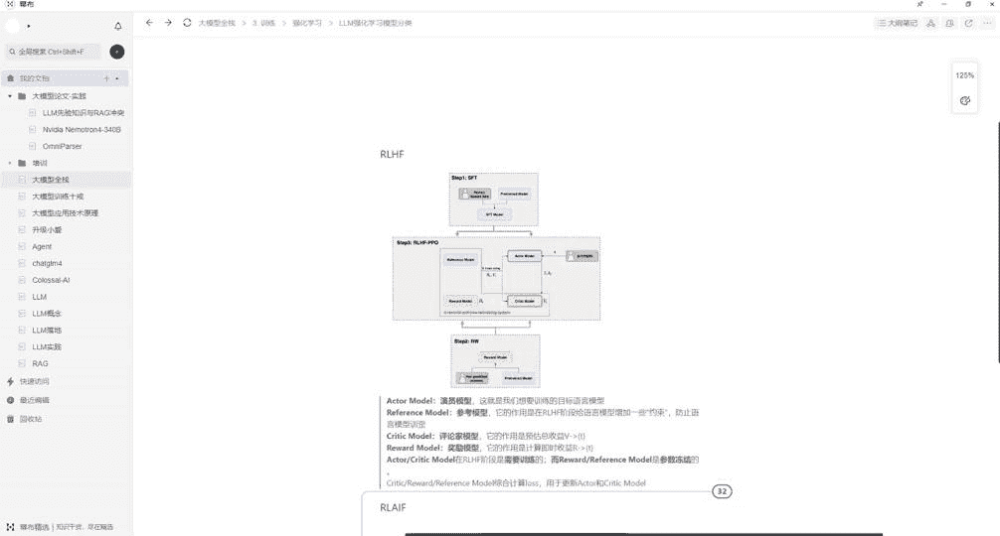

[10大模型全栈-强化学习03-RLHF原理以及流程介绍 下午2.53.32.mp4](https://internal-api-drive-stream.feishu.cn/space/api/box/stream/download/all/YDwsbqKEcobSFBxLVGOcHswCnqe)

### 11大模型全栈-强化学习04-RLHF实战-deepspeed-chat实战

微软开源的 DeepSpeed Chat 项目，解决大型模型强化学习问题。提出混合引擎等技术，降低内存消耗，提供易用训练代码，实验证明成果并指出不稳定性及建议。

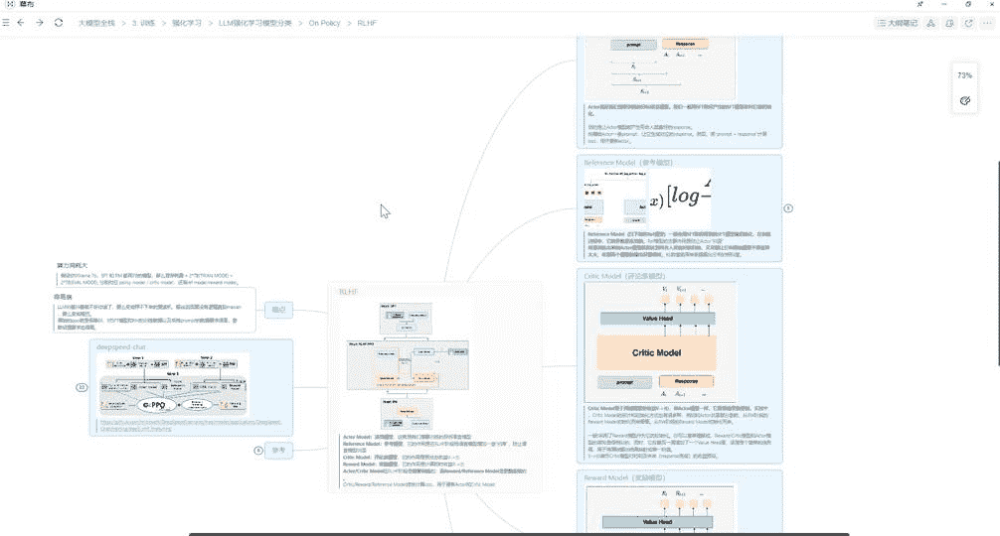

[11大模型全栈-强化学习04-RLHF实战-deepspeed-chat实战.mp4](https://internal-api-drive-stream.feishu.cn/space/api/box/stream/download/all/SjsebCxBsoLFp7xUIg5cFqmanyc)

### 12大模型全栈-强化学习05-RLHF实战-端到端全流程解决方案-轩辕大模型强化学习完整流程介绍（数据+奖励模型+强化学习调参经验）

介绍轩辕 6B 大模型全栈学习实践，涵盖强化学习，包括偏好数据构建、奖励模型训练及强化学习阶段细节等。

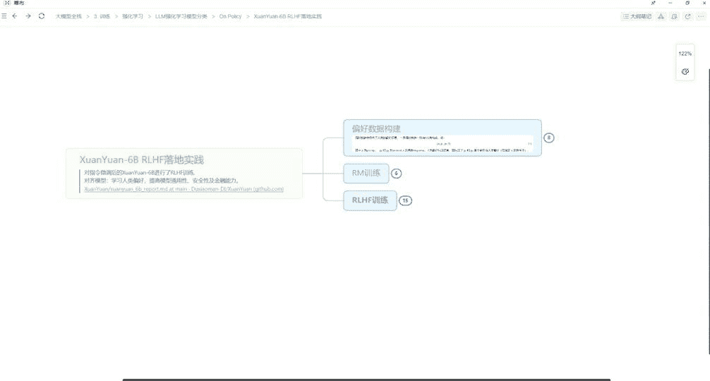

[12大模型全栈-强化学习05-RLHF实战-端到端全流程解决方案-轩辕大模型强化学习完整流程介绍（数据+奖励模型+强化学习调参经验）.mp4](https://internal-api-drive-stream.feishu.cn/space/api/box/stream/download/all/MBB6bKKZTondKnxBnDwcFK5DnBh)

### 13大模型全栈-强化学习06-DPO流程、代码以及损失函数介绍

探讨强化学习中 DPO 相较 on policy 的优势，包括降低复杂度等，介绍训练流程、数据集、超参数及损失函数与代码。

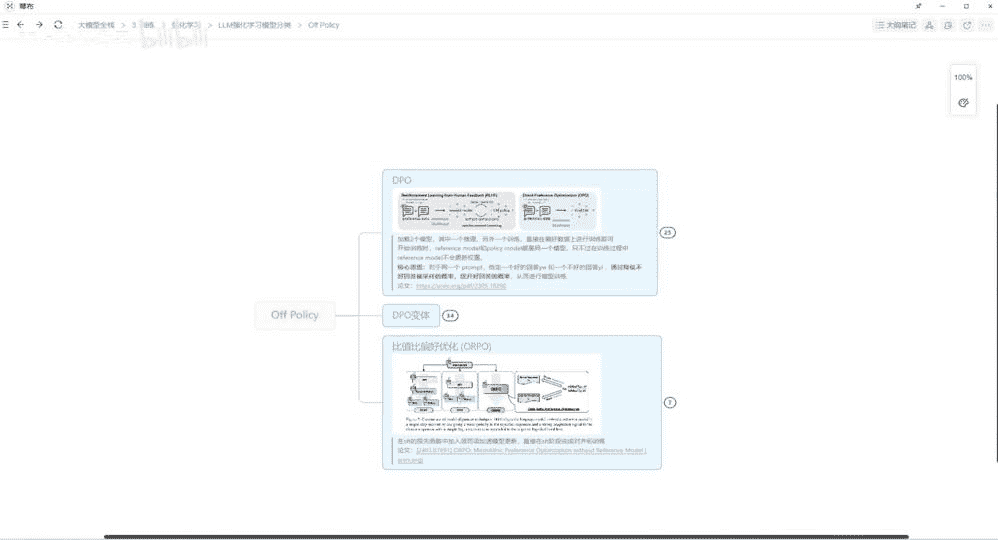

[13大模型全栈-强化学习06-DPO流程、代码以及损失函数介绍.mp4](https://internal-api-drive-stream.feishu.cn/space/api/box/stream/download/all/YvQ2bgjqqorkRdxBQihcSUWenje)

### 14大模型全栈-强化学习07-DPO原理公式推导

介绍 DPO 算法中 DPU 和 PPU 优化目标一致，展开 KL 散度计算与公式推导，讨论奖励模型及 DPO 变体。

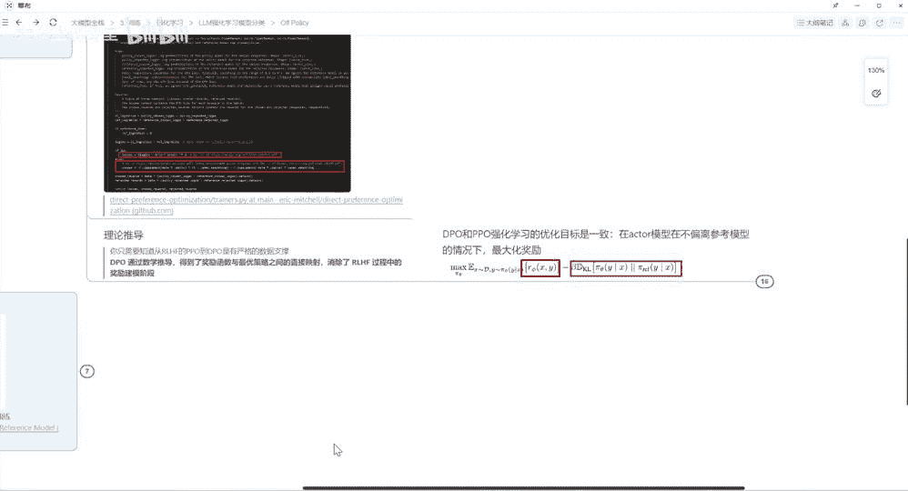

[14大模型全栈-强化学习07-DPO原理公式推导 下午2.53.32.mp4](https://internal-api-drive-stream.feishu.cn/space/api/box/stream/download/all/KWaIbQJcSog2Zox7oIrcMqmznfh)

### 15大模型全栈-强化学习08-DPO变体：IPO、KTO：无需偏好数据实现对齐

介绍 DPO 变体 IPO 和 KTO，IPO 用正则项防过拟合，KTO 创新数据获取与反馈，比较二者实践表现。

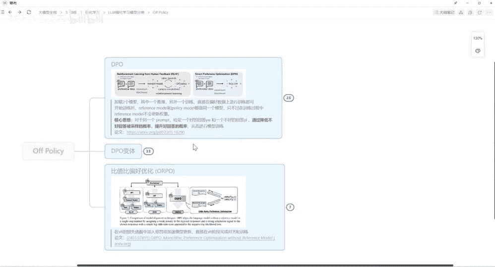

[15大模型全栈-强化学习08-DPO变体：IPO、KTO：无需偏好数据实现对齐.mp4](https://internal-api-drive-stream.feishu.cn/space/api/box/stream/download/all/PNvIbLSKGoGu2qxbPXrcHAvInec)

### 16大模型全栈-强化学习09-DPO变体：TDPO：更细粒度控制的DPO；RPO：带有离线奖励的DPO

讨论强化学习中 TDPO 和 RPO 改进模型，TDPO 控制 token 级 KL 散度，RPO 引入奖励差异性，二者实践效果良好。

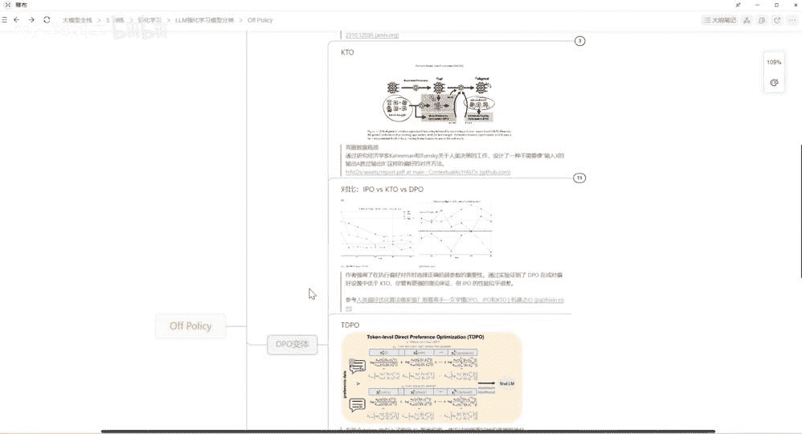

[16大模型全栈-强化学习09-DPO变体：TDPO：更细粒度控制的DPO；RPO：带有离线奖励的DPO 下午2.53.32.mp4](https://internal-api-drive-stream.feishu.cn/space/api/box/stream/download/all/OnWfbznr0o1dkxxJtX9cCerunpe)

### 17大模型全栈-强化学习10-DPO变体-DPOP+ORPO：微调阶段实现对齐

阐述了DPOP 和 ORPO 在强化学习中的作用，DPOP 避免负面样本影响，ORPO 实现模型对齐，还提及局限性及应用。

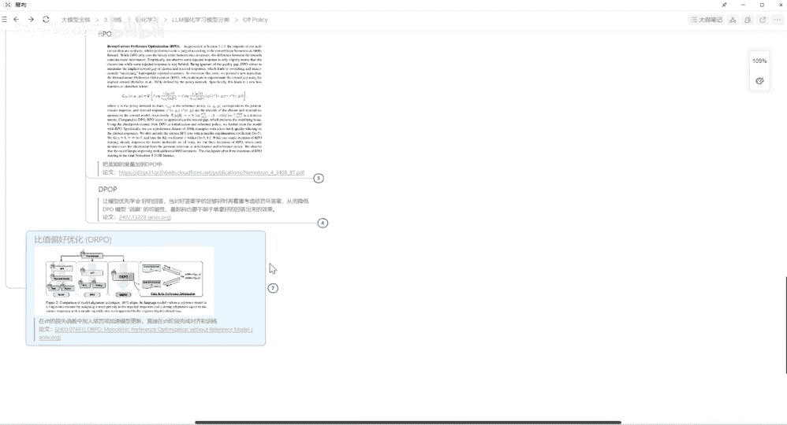

[17大模型全栈-强化学习10-DPO变体-DPOP+ORPO：微调阶段实现对齐 下午2.53.32.mp4](https://internal-api-drive-stream.feishu.cn/space/api/box/stream/download/all/OCq9bh8xGoOwThxjzBgcweqBnFb)

### 18大模型全栈-分布式训练01-数据并行01-数据并行-Ring–Allreduce和PS原理

阐述数据并行和模型参数并行概念及应用，包括数据分割处理、参数同步更新等，还讨论相关并行策略及在 PyTorch 中的应用。

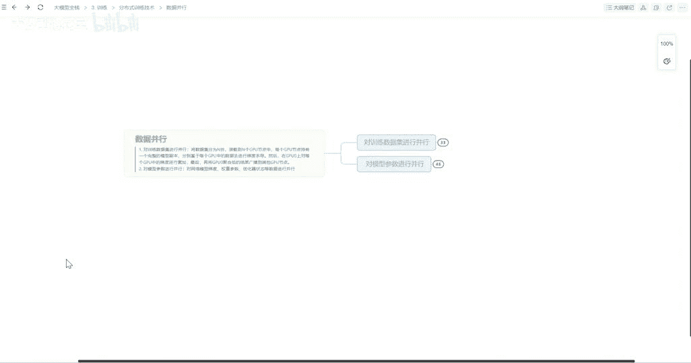

[18大模型全栈-分布式训练01-数据并行-Ring–Allreduce和PS原理.mp4](https://internal-api-drive-stream.feishu.cn/space/api/box/stream/download/all/AyoSbynQkocuDSxyoQhc2g8dnPg)

### 19大模型全栈-分布式训练02-数据并行-deepspeed zero1/2/3原理

探讨数据并行中的模型参数并行技术，介绍 DeepSpeed 的 Zero 系列及 FSDP、CPU Offload 等，强调理解其重要性以加速训练。

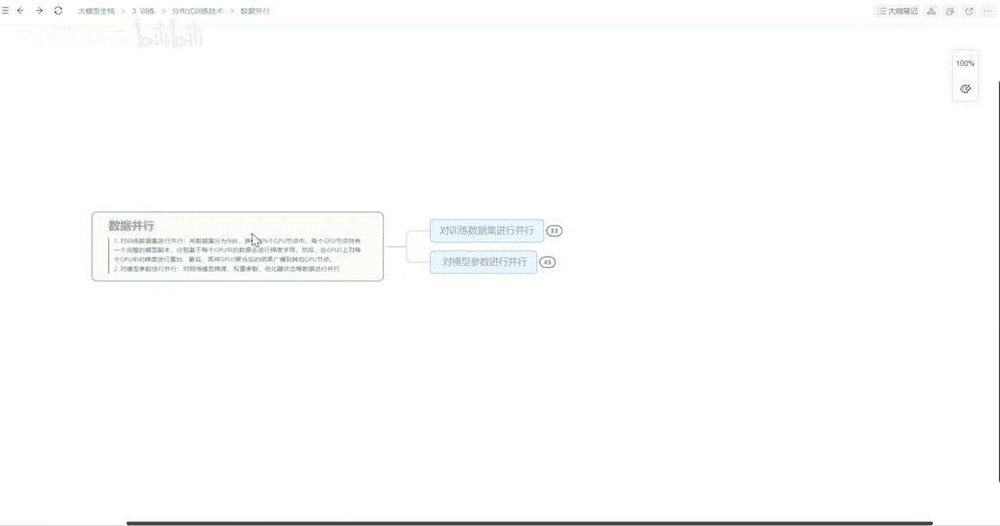

[19大模型全栈-分布式训练02-数据并行-deepspeed zero1_2_3原理.mp4](https://internal-api-drive-stream.feishu.cn/space/api/box/stream/download/all/NrtBbrQUtoRizBxhD6HccftCn3c)

---

# ✏️课代表✏️

+   强化学习在大模型中的重要性：强调了强化学习在优化大模型性能中的作用，特别是通过 RLHF 和 DPO 等技术实现模型对齐和提升。

>

+   DPO 和其变体的应用：详细阐述了 DPO 原理和公式推导，以及 IPO、KTO、TDPO、RPO 等变体在实际应用中的效果和优势。

>

+   数据并行技术的探讨：介绍了数据并行和模型参数并行的概念，以及 DeepSpeed Zero 系列等技术在加速大模型训练中的应用。

>

+   微调阶段的对齐实现：DPOP 和 ORPO 在强化学习微调阶段的作用，以及它们如何避免负面样本影响和实现模型对齐。

>

+   分布式训练的并行策略：讨论了在 PyTorch 中实现数据并行的策略，包括数据分割处理和参数同步更新等。