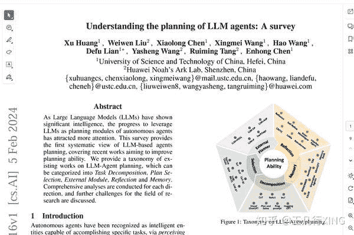
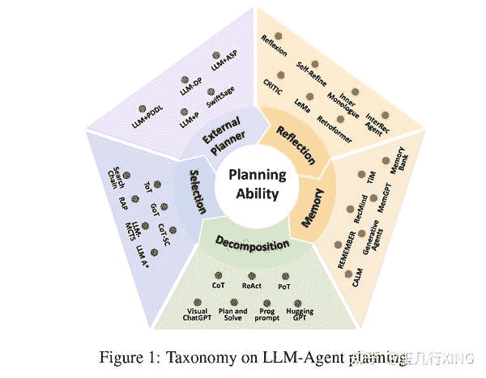
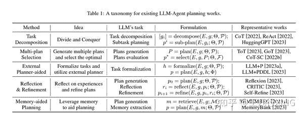
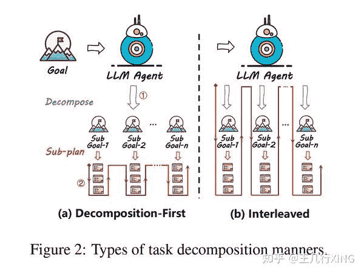
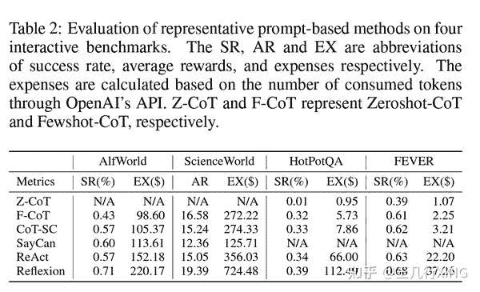

# Agent Planning 最新综述：Understanding the planning of LLM agents: A survey

> 来源：[https://agijuejin.feishu.cn/docx/V2jtdFZXlob4vnxfAXacIlDunHc](https://agijuejin.feishu.cn/docx/V2jtdFZXlob4vnxfAXacIlDunHc)

> 作者：王几行XING

> 原文：[https://zhuanlan.z](https://zhuanlan.zhihu.com/p/705094045)hihu.com/p/705094...

## 论文简介

随着 [大规模语言模型 ](https://www.zhihu.com/search?q=%E5%A4%A7%E8%A7%84%E6%A8%A1%E8%AF%AD%E8%A8%80%E6%A8%A1%E5%9E%8B&search_source=Entity&hybrid_search_source=Entity&hybrid_search_extra=%7B%22sourceType%22%3A%22article%22%2C%22sourceId%22%3A705094045%7D)**（LLMs）展现出显著的智能**[，将LLM](https://www.zhihu.com/search?q=%E4%BB%A3%E7%90%86%E8%A7%84%E5%88%92&search_source=Entity&hybrid_search_source=Entity&hybrid_search_extra=%7B%22sourceType%22%3A%22article%22%2C%22sourceId%22%3A705094045%7D)s用作自主代理的 规划 (pla**nni**ng) 模块的进展吸引了更多关注。这项综述首次提供了关于基于LLM的 代理规划 的系统视角，涵盖了旨在提高规划能力的最新工作。我们对现有的LLM-代理 规划 工作进行了分类，可以分为:

+   任务分解 Task Decomposition

+   计划选择 Plan Selection

+   外部模块 External Module

+   反思 Reflection

+   和 [记忆五类 ](https://www.zhihu.com/search?q=%E8%AE%B0%E5%BF%86%E4%BA%94%E7%B1%BB&search_source=Entity&hybrid_search_source=Entity&hybrid_search_extra=%7B%22sourceType%22%3A%22article%22%2C%22sourceId%22%3A705094045%7D)Memory

+   论文对每个方向进行了全面的分析，并讨论了这一研究领域的进一步挑战。

## 引言 introduction

+   自主代理作为 [智能实体 ](https://www.zhihu.com/search?q=%E6%99%BA%E8%83%BD%E5%AE%9E%E4%BD%93&search_source=Entity&hybrid_search_source=Entity&hybrid_search_extra=%7B%22sourceType%22%3A%22article%22%2C%22sourceId%22%3A705094045%7D)的重要性，这些代理可以通过 **感知环境、规划和执行动作 **来完成特定任务。 **规划 **被认为是代理最关键的能力之一，需要复杂的理解、推理和决策过程。

+   **规划任务的一般公式 **，描述了在 [时间步长 ](https://www.zhihu.com/search?q=%E6%97%B6%E9%97%B4%E6%AD%A5%E9%95%BF&search_source=Entity&hybrid_search_source=Entity&hybrid_search_extra=%7B%22sourceType%22%3A%22article%22%2C%22sourceId%22%3A705094045%7D)t、环境E、 [动作空间 ](https://www.zhihu.com/search?q=%E5%8A%A8%E4%BD%9C%E7%A9%BA%E9%97%B4&search_source=Entity&hybrid_search_source=Entity&hybrid_search_extra=%7B%22sourceType%22%3A%22article%22%2C%22sourceId%22%3A705094045%7D)A和任务目标g的情况下，生成一系列动作的规划过程。

+   **传统的规划 **方法主要依赖于 **符号方法 **或基于 **强化学习 ****的方法，并指出这些方法**[**的局限性。**](https://www.zhihu.com/search?q=%E8%87%AA%E7%84%B6%E8%AF%AD%E8%A8%80&search_source=Entity&hybrid_search_source=Entity&hybrid_search_extra=%7B%22sourceType%22%3A%22article%22%2C%22sourceId%22%3A705094045%7D)** 符号方法需要将灵**[**活的 自然**](https://www.zhihu.com/search?q=%E7%AC%A6%E5%8F%B7%E5%BB%BA%E6%A8%A1&search_source=Entity&hybrid_search_source=Entity&hybrid_search_extra=%7B%22sourceType%22%3A%22article%22%2C%22sourceId%22%3A705094045%7D)语言 描述的问题转换为 符号建模 ，而 强化学习方法通常需要大量的样本来学习有效的策略 。

+   指出近年来大规模语言模型（LLMs）的出现标志着范式的转变，LLMs在各个领域取得了显著成功，展示了在

+   推理

+   [工具使用](https://www.zhihu.com/search?q=%E5%B7%A5%E5%85%B7%E4%BD%BF%E7%94%A8&search_source=Entity&hybrid_search_source=Entity&hybrid_search_extra=%7B%22sourceType%22%3A%22article%22%2C%22sourceId%22%3A705094045%7D)

+   规划

+   和执行指令方面的显著智能。

+   利用LLMs作为代理认知核心的潜力，存在多种方法以利用LLMs提高代理的规划能力。现有的综述往往缺乏对规划能力的详细分析。

+   本综述的目标是系统地分析LLM代理的规划能力，涵盖五个主要方向的现有方法，并对每个方向进行全面分析，旨在提供LLM代理规划能力的系统视角。

## 研究分类 Taxonomy

[LLM代理](https://www.zhihu.com/search?q=%E7%B3%BB%E7%BB%9F%E5%88%86%E7%B1%BB&search_source=Entity&hybrid_search_source=Entity&hybrid_search_extra=%7B%22sourceType%22%3A%22article%22%2C%22sourceId%22%3A705094045%7D)的规划能力研究领域的繁荣景象，论文提出了一种新的 系统分类 方法，将现有的工作划分为五个主要类别：

+   任务分解

+   多计划选择

+   外部模块辅助规划

+   反思与改进以及

+   记忆增强规划

通过表格（Table 1），论文展示了现有LLM-代理规划工作的分类，明确了每个方向的代表性方法和公式。

### 模块一： **任务分解**

采用“ [分而治之 ](https://www.zhihu.com/search?q=%E5%88%86%E8%80%8C%E6%B2%BB%E4%B9%8B&search_source=Entity&hybrid_search_source=Entity&hybrid_search_extra=%7B%22sourceType%22%3A%22article%22%2C%22sourceId%22%3A705094045%7D)”的思想，将复杂任务分解为多个子任务，然后依次为每个子任务进行规划。过程可分为两个步骤：首先分解复杂任务，其次为每个子任务规划。

### 模块二：多计划选择

这种方法让 LLM 生成 **多种任务的备选计划 **，然后 **使用与任务相关的 **[**搜索算法 **](https://www.zhihu.com/search?q=%E6%90%9C%E7%B4%A2%E7%AE%97%E6%B3%95&search_source=Entity&hybrid_search_source=Entity&hybrid_search_extra=%7B%22sourceType%22%3A%22article%22%2C%22sourceId%22%3A705094045%7D)**选择一个最佳计划执行 **。其过程可以用公式表示。

### 模块三： [外部模块辅助计划](https://www.zhihu.com/search?q=%E5%A4%96%E9%83%A8%E6%A8%A1%E5%9D%97%E8%BE%85%E5%8A%A9%E8%AE%A1%E5%88%92&search_source=Entity&hybrid_search_source=Entity&hybrid_search_extra=%7B%22sourceType%22%3A%22article%22%2C%22sourceId%22%3A705094045%7D)

这种方法通过利用 **外部规划器 ****来提升规划过程，旨在解决生成**计划的**效率和可行性问题。 LLM主要**负责任务的形式化 ，而 外部规划器执行具体的计划生成 。

### 模块四：反思和改进

这种方法通过反思和改进来提高规划能力。鼓励LLM 反思失败，并根据反思结果改进计划 。其过程可通过反思和改进循环来实现。

### 记忆枕隔墙规划

通过额外的记忆模块来增强规划能力，其中存储了有价值的信息，如常识、过去的经验和领域特定知识。规划时，LLM可以从记忆模块中提取相关信息，辅助规划过程。

这五个模块是互相关联的，而不是相互排斥的，通常涉及同时采用多种技术。

## 3 任务分解模块 Task Decomposition

### 任务分解方法的重要性

现实世界的环境通常复杂多变，通过一步规划过程来解决复杂任务是一个巨大的挑战。因此，任务分解方法采用“分而治之”的思想，将复杂任务分解为几个子任务，然后依次为每个子任务进行规划。

### 任务分解的一般过程

涉及两个关键步骤：

+   首先，将复杂任务分解为子任务（称为“分解”步骤），

+   [然后为每](https://www.zhihu.com/search?q=%E5%AD%90%E8%A7%84%E5%88%92&search_source=Entity&hybrid_search_source=Entity&hybrid_search_extra=%7B%22sourceType%22%3A%22article%22%2C%22sourceId%22%3A705094045%7D)个子任务进行规划（称为“ 子规划 ”步骤）。

+   当前的任务分解方法一般分为两类：

+   分解优先和

+   [交替分解](https://www.zhihu.com/search?q=%E4%BA%A4%E6%9B%BF%E5%88%86%E8%A7%A3&search_source=Entity&hybrid_search_source=Entity&hybrid_search_extra=%7B%22sourceType%22%3A%22article%22%2C%22sourceId%22%3A705094045%7D)

### 分解 [优先方法](https://www.zhihu.com/search?q=%E4%BC%98%E5%85%88%E6%96%B9%E6%B3%95&search_source=Entity&hybrid_search_source=Entity&hybrid_search_extra=%7B%22sourceType%22%3A%22article%22%2C%22sourceId%22%3A705094045%7D)

首先将任务分解为 [子目标 ](https://www.zhihu.com/search?q=%E5%AD%90%E7%9B%AE%E6%A0%87&search_source=Entity&hybrid_search_source=Entity&hybrid_search_extra=%7B%22sourceType%22%3A%22article%22%2C%22sourceId%22%3A705094045%7D)，然后依次为每个子目标进行规划。这种方法的代表性方法包括：

+   [Huggi](https://www.zhihu.com/search?q=%E6%99%BA%E8%83%BD%E4%BB%A3%E7%90%86&search_source=Entity&hybrid_search_source=Entity&hybrid_search_extra=%7B%22sourceType%22%3A%22article%22%2C%22sourceId%22%3A705094045%7D)ngGPT，利用各种多模态模型构建 智能代理 ，负责分解人类输入的任务、选择模型和生成最终响应

+   Plan-and-Solve，改进了零样本 Chain-of-Thought 方法，通过两个步骤的提示指令进行任务分解和规划

+   和ProgPrompt，将自然语言描述的任务转换为编码问题，任务规划被自然地转化为函数生成

### 描述交替分解方法

在任务分解和子任务规划之间交替进行，每次分解只揭示一个或两个子任务。代表性方法包括：

+   Chain-of-Thought（CoT），揭示了LLM的少样本学习能力，通过构建的轨迹引导LLM进行复杂问题的推

+   ReAct，将推理和规划分开，交替进行推理和行动步骤，显著提高了规划能力

+   [PAL，通过](https://www.zhihu.com/search?q=%E4%BB%A3%E7%A0%81%E8%A7%A3%E9%87%8A%E5%99%A8&search_source=Entity&hybrid_search_source=Entity&hybrid_search_extra=%7B%22sourceType%22%3A%22article%22%2C%22sourceId%22%3A705094045%7D)利用LLM的编码能力，在推理过程中生成代码，并使用 代码解释器 执行代码来获得解决方

+   Program-of-Thought（PoT），将推理过程完全形式化为编程，利用训练在代码相关数据上的CodeX模型，增强了在数学和金融问题上的性能

+   Visual ChatGPT

### [任务分解方法 ](https://www.zhihu.com/search?q=%E4%BB%BB%E5%8A%A1%E5%88%86%E8%A7%A3%E6%96%B9%E6%B3%95&search_source=Entity&hybrid_search_source=Entity&hybrid_search_extra=%7B%22sourceType%22%3A%22article%22%2C%22sourceId%22%3A705094045%7D)的优缺点

分解**优先方法的优势在于**创建子任务与原始任务之间的更强相关性，减少任务遗忘和幻觉的风险。然而，由于子任务在一开始就确定，额外的调整机制是必要的，否则某一步中的一个错误会导致失败。 交替分解和子规划 根据环境反馈动态调整分解，改善了容错能力，但对于复杂任务，过长的轨迹可能导致LLM出现幻觉，在后续子任务和子规划过程中偏离原始目标。

任务分解方法显著增强了LLM-代理解决复杂任务的能力，但仍存在一些挑战。首先是任务分[解引入的额](https://www.zhihu.com/search?q=%E8%AE%A1%E7%AE%97%E6%88%90%E6%9C%AC&search_source=Entity&hybrid_search_source=Entity&hybrid_search_extra=%7B%22sourceType%22%3A%22article%22%2C%22sourceId%22%3A705094045%7D)外开销，将任务分解为多个子任务需要更多的推理和生成，导致额外的时间和 计算成本 。其次，对于高度复杂的任务，规划受到LLM上下文长度的限制，导致规划轨迹的遗忘。

## 4 多计划选择

由于**任务的复杂性**和L**LM的固有不确**定性，LLM-Agent为给定任务生成的计划可能会多种多样。尽管LLM具有强大的推理能力，但单一计划可能是次优甚至不可行的。因此，多计划选择的方法更加自然，包含两个主要步骤： 多计划生成 和 最佳计划选择 。

[多计划生成](https://www.zhihu.com/search?q=%E7%94%9F%E6%88%90%E6%A8%A1%E5%9E%8B&search_source=Entity&hybrid_search_source=Entity&hybrid_search_extra=%7B%22sourceType%22%3A%22article%22%2C%22sourceId%22%3A705094045%7D)[涉及生成多个路径](https://www.zhihu.com/search?q=top-k%E9%87%87%E6%A0%B7&search_source=Entity&hybrid_search_source=Entity&hybrid_search_extra=%7B%22sourceType%22%3A%22article%22%2C%22sourceId%22%3A705094045%7D)**的计划，以组成候选**计划集。主流方法考虑在 生成模**型 的解码过**程中引入不确定性。自一致性方法利用温度采样、 top-k采样 等策略，在解码过程中获得多个不同的推理路径。 树形思维（ToT ）提出了两种生成计划的策略： 采样和建议 。

+   [**图形思维 **](https://www.zhihu.com/search?q=%E5%9B%BE%E5%BD%A2%E6%80%9D%E7%BB%B4&search_source=Entity&hybrid_search_source=Entity&hybrid_search_extra=%7B%22sourceType%22%3A%22article%22%2C%22sourceId%22%3A705094045%7D)**（GoT） **通过添加思想的变换扩展了ToT，支持任意思想聚合

+   [LLM-MCTS](https://www.zhihu.com/search?q=%E8%92%99%E7%89%B9%E5%8D%A1%E6%B4%9B%E6%A0%91%E6%90%9C%E7%B4%A2&search_source=Entity&hybrid_search_source=Entity&hybrid_search_extra=%7B%22sourceType%22%3A%22article%22%2C%22sourceId%22%3A705094045%7D)和RAP利用LLM作为 蒙特卡洛树搜索 （MCTS）的启发式策略函数，通过多次调用获得多个潜在动作

[为从候选计划中](https://www.zhihu.com/search?q=%E5%90%AF%E5%8F%91%E5%BC%8F%E6%90%9C%E7%B4%A2%E7%AE%97%E6%B3%95&search_source=Entity&hybrid_search_source=Entity&hybrid_search_extra=%7B%22sourceType%22%3A%22article%22%2C%22sourceId%22%3A705094045%7D)选择最佳计划，采用了各种 启发式搜索算法

+   自一致性方法应用简单的多数投票策略，将获得最多票数的计划视为最佳选择。

+   树形思维支持 [树搜索算法 ](https://www.zhihu.com/search?q=%E6%A0%91%E6%90%9C%E7%B4%A2%E7%AE%97%E6%B3%95&search_source=Entity&hybrid_search_source=Entity&hybrid_search_extra=%7B%22sourceType%22%3A%22article%22%2C%22sourceId%22%3A705094045%7D)，例如常规的 [广度优先搜索 ](https://www.zhihu.com/search?q=%E5%B9%BF%E5%BA%A6%E4%BC%98%E5%85%88%E6%90%9C%E7%B4%A2&search_source=Entity&hybrid_search_source=Entity&hybrid_search_extra=%7B%22sourceType%22%3A%22article%22%2C%22sourceId%22%3A705094045%7D)（BFS）和深度优先搜索（DFS）。

+   选择扩展节点时，它使用 LLMs 评估多个动作并选择最佳动作。

+   **与ToT**类似，LLM-MCTS 和 RAP 也使用 树结构 来辅助多计划搜索。LLM 利用人工智能中的经典算法来辅助LLM进行搜索

多计划选择的可扩展性具有显著优势，在广阔的搜索空间中提供了更广泛的潜在解决方案探索。然而，这一优势伴随着固有的权衡。增加的计算需求，尤其是对于大令牌数量或计算的模型，带来了实际挑战。尤其是在资源有限的场景中，如在线服务，成本考虑变得至关重要。此外，依赖LLM进行计划评估引入了新的挑战。由于LLM在排序任务中的表现仍在审查中，进一步验证和微调其在此特定背景下的能力是必要的。LLM的随机性增加了选择的随机性，可能影响选择计划的一致性和可靠性。

## 5 外部规划器辅助 External Planner-Aided Planning

+   尽管**大规模语言模****型（LLMs**）表[**现出强大的推**](https://www.zhihu.com/search?q=%E7%A5%9E%E7%BB%8F%E8%A7%84%E5%88%92%E5%99%A8&search_source=Entity&hybrid_search_source=Entity&hybrid_search_extra=%7B%22sourceType%22%3A%22article%22%2C%22sourceId%22%3A705094045%7D)理和任务分解能力，但在面对具有复杂约束的环境（如数学问题解决或生成可接受的动作）时仍存在挑战。为了解决这些挑战，几种方法将LLMs与 外部规划器 结合起来。根据所引入的规划器，这些方法可以分为 符号规划器 和 神经规划器 。

+   **符号规划器段 **：符号规划器在 [自动化规划 ](https://www.zhihu.com/search?q=%E8%87%AA%E5%8A%A8%E5%8C%96%E8%A7%84%E5%88%92&search_source=Entity&hybrid_search_source=Entity&hybrid_search_extra=%7B%22sourceType%22%3A%22article%22%2C%22sourceId%22%3A705094045%7D)领域已经使用了数十年

+   基于PDDL等符号形式化模型进行符号推理，以识别从初始状态到目标状态的最优路径。

+   [LLM+P ](https://www.zhihu.com/search?q=LLM%2BP&search_source=Entity&hybrid_search_source=Entity&hybrid_search_extra=%7B%22sourceType%22%3A%22article%22%2C%22sourceId%22%3A705094045%7D)方法通过引入基于PDDL的符号规划器增强了LLM的规划能力，将问题组织成文本语言提示输入到LLM中，随后使用快速向下规划器进行规划。

+   LLM-DP方法在动态交互环境中应用了类似的符号规划器。

+   LLM+PDDL方法添加了手动验证步骤以检查生成的PDDL模型中的潜在问题。

+   LLM+ASP方法将自然语言描述的问题转化为原子事实，并使用ASP求解器生成计划

+   [**神经规划器段 **](https://www.zhihu.com/search?q=%E7%A5%9E%E7%BB%8F%E8%A7%84%E5%88%92%E5%99%A8%E6%AE%B5&search_source=Entity&hybrid_search_source=Entity&hybrid_search_extra=%7B%22sourceType%22%3A%22article%22%2C%22sourceId%22%3A705094045%7D)：神经规划器是通过 **强化学习 **或 **模仿学习 **技术训练的深度模型，展示了在特定领域内的有效规划能力。

+   [例如，DRRN将规](https://www.zhihu.com/search?q=%E9%A9%AC%E5%B0%94%E5%8F%AF%E5%A4%AB%E5%86%B3%E7%AD%96%E8%BF%87%E7%A8%8B&search_source=Entity&hybrid_search_source=Entity&hybrid_search_extra=%7B%22sourceType%22%3A%22article%22%2C%22sourceId%22%3A705094045%7D)划过程建模为 马尔可夫决策过程 ，通过强化学习训练策略网络。

+   决[策变压器](https://www.zhihu.com/search?q=%E4%B8%8D%E5%B8%B8%E8%A7%81&search_source=Entity&hybrid_search_source=Entity&hybrid_search_extra=%7B%22sourceType%22%3A%22article%22%2C%22sourceId%22%3A705094045%7D)（DT）通过模仿学习训练变压器[模型，克隆](https://www.zhihu.com/search?q=%E6%B3%9B%E5%8C%96%E8%83%BD%E5%8A%9B&search_source=Entity&hybrid_search_source=Entity&hybrid_search_extra=%7B%22sourceType%22%3A%22article%22%2C%22sourceId%22%3A705094045%7D)人类的决策行为。神经规划器在各自领域内表现出优秀的规划能力，但在面对复杂和 不常见 的问题时，训练数据不足导致其 泛化能力 较弱。为此，几种工作探索了将LLM与轻量级神经规划器结合，以进一步增强规划能力。

+   **讨论段 **：利用外部规划器辅助规划的策略中，**LLM主要扮演**支持角**色，其主要功能包括**[ 解析文本](https://www.zhihu.com/search?q=%E4%BB%A3%E7%A0%81%E7%94%9F%E6%88%90&search_source=Entity&hybrid_search_source=Entity&hybrid_search_extra=%7B%22sourceType%22%3A%22article%22%2C%22sourceId%22%3A705094045%7D)[反馈 和提](https://www.zhihu.com/search?q=%E7%AC%A6%E5%8F%B7AI&search_source=Entity&hybrid_search_source=Entity&hybrid_search_extra=%7B%22sourceType%22%3A%22article%22%2C%22sourceId%22%3A705094045%7D) 供额外的推理信息 ，以辅助解决复杂问题。具体而言[，LLM在](https://www.zhihu.com/search?q=%E7%AC%A6%E5%8F%B7%E6%A8%A1%E5%9E%8B&search_source=Entity&hybrid_search_source=Entity&hybrid_search_extra=%7B%22sourceType%22%3A%22article%22%2C%22sourceId%22%3A705094045%7D) 代码生成 能力上的增强[**使其有可能**](https://www.zhihu.com/search?q=%E7%AC%A6%E5%8F%B7%E7%B3%BB%E7%BB%9F&search_source=Entity&hybrid_search_source=Entity&hybrid_search_extra=%7B%22sourceType%22%3A%22article%22%2C%22sourceId%22%3A705094045%7D)处理更一般的任务。传统 [符号AI](https://www.zhihu.com/search?q=%E5%AE%8C%E5%A4%87%E6%80%A7&search_source=Entity&hybrid_search_source=Entity&hybrid_search_extra=%7B%22sourceType%22%3A%22article%22%2C%22sourceId%22%3A705094045%7D) 系统的一个显著缺点是构建符号模型的复杂性和对人类专家的依赖，而LLM加速了这一过程，使得 符号模型 的建立更加快速和优化。 符号系统 带来的优势包括理论上的 完备性 、稳定性和可解释性。结合统计AI与LLM的组合有望成为未来人工智能发展的主要趋势。

## 6 反思和改进 Reflection and Refinement

**反思和改进 **是规划过程中不可或缺的部分，它们增强了LLM-Agent的容错能力和错误纠正能力。**由于LLM-Ag**ent在规划过程中可能出**现幻觉问题和对复杂问题的推理**能力不足， 反思和总结失败 有助于代理在后续尝试中 纠正错误并打破“思维循环” 。

**自我改进方法 ****：自我改进（Sel**f-refine）利用 生成、反馈和改进 的迭代过程。在每次生成之后，LLM会为计划生成反馈，根据反馈进行调整。

+   **Reflexion **方法通过引入 **评估器 **来评估轨迹，LLM在 **检测到错误 **时生成 [自我反思 ](https://www.zhihu.com/search?q=%E8%87%AA%E6%88%91%E5%8F%8D%E6%80%9D&search_source=Entity&hybrid_search_source=Entity&hybrid_search_extra=%7B%22sourceType%22%3A%22article%22%2C%22sourceId%22%3A705094045%7D)，帮助纠正错误。

+   **CRITIC **方法使用外部工具（如 [知识库 ](https://www.zhihu.com/search?q=%E7%9F%A5%E8%AF%86%E5%BA%93&search_source=Entity&hybrid_search_source=Entity&hybrid_search_extra=%7B%22sourceType%22%3A%22article%22%2C%22sourceId%22%3A705094045%7D)和搜索引擎）验证LLM生成的动作，然后利用外部知识进行自我纠正，显著减少事实错误。

+   **InteRecAgent **采用 ReChain 机制进行自我纠正，使用LLM评估交互推荐代理生成的响应和工具使用计划，总结错误反馈，并决定是否重新开始规划。

+   **LEMA **方法首先收集错误的规划样本，然后使用更强大的GPT-4进行纠正，这些纠正后的样本用于微调LLM-Agent，在不同规模的LLaMA模型上显著提高性能 。

**反思策略与强化学习 **：自我反思策略与强化学习的原理类**似，ag**ent 扮演[决策者的角](https://www.zhihu.com/search?q=%E8%A7%A6%E5%8F%91%E7%AD%96%E7%95%A5&search_source=Entity&hybrid_search_source=Entity&hybrid_search_extra=%7B%22sourceType%22%3A%22article%22%2C%22sourceId%22%3A705094045%7D)色，如策** 略网络 **。环境反**馈 触发策略 网络**[**的更新。然而**](https://www.zhihu.com/search?q=%E9%95%BF%E6%9C%9F%E5%92%8C%E7%9F%AD%E6%9C%9F&search_source=Entity&hybrid_search_source=Entity&hybrid_search_extra=%7B%22sourceType%22%3A%22article%22%2C%22sourceId%22%3A705094045%7D)**，与深****度强化学习通过修改模型参数实**现更新不同， LLM agent 通过自我反思实现更新 ，生成 文本反馈 。这些 文本反馈可以作为 长期和短期 记忆 ，通过提示影响代理的后续规划输出。然而，这种 文本形式的更新缺乏收敛保证 ，表明持续反思无法最终使LLM代理达到特定目标 。

## 7 记忆增强规划 Memory-Augmented Planning

+   记忆是增强规划能力和提升潜力的重要途径。关于LLM-Agent的记忆机制，目前主要有两种方法：

+   基于RAG的记忆

+   嵌入式记忆 。

+   **基于RAG的记忆段 **：检索增强生成（RAG）技术通过检索信息来辅助文本生成。RAG方法能够为LLM提供最新知识，适用于LL[M-Age](https://www.zhihu.com/search?q=%E7%9F%A5%E8%AF%86%E5%9B%BE%E8%B0%B1&search_source=Entity&hybrid_search_source=Entity&hybrid_search_extra=%7B%22sourceType%22%3A%22article%22%2C%22sourceId%22%3A705094045%7D)nt在任务规划过程中从**记忆中检索与任务相关的**经验**。这些记**忆通常**存储在额外的存**储中，形式多样，包括文本、表格、 知识图谱 等。代表性方法如 Generative Agents 、 MemoryBank 、 TiM 和R ecMind 都使用文本编码模型将每个记忆编码为向量，并建立索引结构以便在检索时使用 。

+   嵌入式记忆段（Em**bodied **Memory） ：嵌入式记忆通过 微调 LLM ，使其能够记[住规划相关](https://www.zhihu.com/search?q=%E5%85%88%E9%AA%8C%E7%9F%A5%E8%AF%86&search_source=Entity&hybrid_search_source=Entity&hybrid_search_extra=%7B%22sourceType%22%3A%22article%22%2C%22sourceId%22%3A705094045%7D)的信息。这些体验样本通常来自代理与环境的交互，可能包括环境的常识、任务相关的 先验知识 以及成功或失败的经验。

+   嵌入式记忆的成本较高，但参数高效微调（PEFT）技术可以减少成本并加速训练，如LoRA、QLoRA、P-tuning等。

+   代表性方法如 **CALM **和 TDT 通过微调 GPT-2 和 TDT 模型来记住规划相关信息，并在规划任务中表现出色 。

+   **讨论段 **：RAG和微调两种记忆方法各有优缺点。

+   **RAG方法提供实时、低成**本的外部记忆更新，主要以自然语言文本为主，但 依赖于检索算法的准确性 。

+   **微调通过修改参数提**供更大的记忆容量，但 更新记忆的成本高 ，且难以保留细粒度细节。

记忆增强的LLM-Agent在规划中表现出增强的成长性和容错性，但记忆生成严重依赖于LLM的生成能力。通过自生成记忆来改进较弱的LLM-Agent仍然是一个需要探索的挑战 。

## 8 Evaluation 评估

+   [评估代理的](https://www.zhihu.com/search?q=%E5%9F%BA%E5%87%86%E6%B5%8B%E8%AF%95&search_source=Entity&hybrid_search_source=Entity&hybrid_search_extra=%7B%22sourceType%22%3A%22article%22%2C%22sourceId%22%3A705094045%7D)规划能力是该研究领域中的一个关键问题。本文探讨了几种主流的 基准测试 方法，将它们分类为以下几种类型：

+   交互式游戏环境

+   交互式检索环境

+   交互式编程环境

+   **交互式游戏环境段 **：游戏环境可以基于代理的动作提供实时多模态反馈，包括文本和**视觉反馈。目前，最广**泛**使用的游戏环境是 **Mi**necraft ，agen**t 需要收集材料以创建工具来获得更多奖励。agent 创建的工具数量通常用作评估指标。另一类流行的环境是基于文本的交互式环境，如 ALFWorld 和 ScienceWorld ，代理在一个自然语言描述的环境中进行有限的动作和位置操作，成功率或获得的奖励通常用作评估指标。与Minecraft相比，这些基于文本的交互式环境通常更简单，反馈更直接，动作更少。

+   **交互式检索环境段 **：交互式检索 [环境模拟 ](https://www.zhihu.com/search?q=%E7%8E%AF%E5%A2%83%E6%A8%A1%E6%8B%9F&search_source=Entity&hybrid_search_source=Entity&hybrid_search_extra=%7B%22sourceType%22%3A%22article%22%2C%22sourceId%22%3A705094045%7D)了人类在现实生活中进行 [信息检索 ](https://www.zhihu.com/search?q=%E4%BF%A1%E6%81%AF%E6%A3%80%E7%B4%A2&search_source=Entity&hybrid_search_source=Entity&hybrid_search_extra=%7B%22sourceType%22%3A%22article%22%2C%22sourceId%22%3A705094045%7D)**和推理的过程。在这些环境中，**代理通常可以与 搜索引擎和其他网络服务交互 ，使用 搜索关键词或执行**点击、前进和后退等**操作**以获取更多信** 息**，从而回答问题或完**成信息检索任务。常用的检索环境包括基于Wikipedia引擎的问题回答任务（如 HotPotQA 和 Fever ）以及寻找特定信息的网络浏览任务，如 WebShop、Mind2Web 和 WebArena 。任务成功率通常用作指标。

+   **交互式编程环境段 **：交互式编程环境模拟了程序员与计算机之间的交互，测试代理解决计算机相关问题的规划能力。在这些环境中，代理需要通过编写代码或指[令与计算](https://www.zhihu.com/search?q=%E6%95%B0%E6%8D%AE%E5%BA%93&search_source=Entity&hybrid_search_source=Entity&hybrid_search_extra=%7B%22sourceType%22%3A%22article%22%2C%22sourceId%22%3A705094045%7D)机交互以解决问题**。他们会收到各种反馈，包**括编**译和运行时错误消息以**及执行结果。流行的交互式编**程环境涉及操作系**统、 数据库 等**相关问题，如** Agent Bench 和 MiniWoB++ 。这些现有的交互环境大多 缺乏细粒度评估 ，性能主要通过 最终成功率 进行评估。

+   **实验段 **：我们在四个基准测试上进行了实验，以验证代表性工作的性能，结果显示在表2中。

论文实施了六种基于提示的方法，涵盖任务分解、多路径选择和反思。实验表明：

+   随着费用的增加，性能提高

+   复杂任务建议使用少量示例

+   反思在提高成功率方面起着关键作用，尤其是对于复杂任务。

## 9 论文总结

+   大规模语言模型（LLMs）展示出的智能以及其在增强代理规划能力方面的潜力。本文回顾了主要的方法，并在四个基准测试上进行了实验，证明了性能随着费用的增加而提高。尽管这些工作在规划能力上取得了进展，但仍存在一些重大挑战。

+   **幻觉问题 **：LLMs在规划过程中经常出现幻觉，导致不合理的计划、不忠实于任务提示或未能[遵循复杂指](https://www.zhihu.com/search?q=%E6%8F%90%E7%A4%BA%E5%B7%A5%E7%A8%8B&search_source=Entity&hybrid_search_source=Entity&hybrid_search_extra=%7B%22sourceType%22%3A%22article%22%2C%22sourceId%22%3A705094045%7D)令。例如，计划可能包含与环境中不存在的物品交互的动作。尽管通过精心的 提示工程 可以缓解这些问题，但它们反映了LLMs的根本缺陷。

+   **计划可行性段 **：**指出LLMs在**[生成计划时](https://www.zhihu.com/search?q=%E6%9C%AA%E6%9D%A5%E6%96%B9%E5%90%91&search_source=Entity&hybrid_search_source=Entity&hybrid_search_extra=%7B%22sourceType%22%3A%22article%22%2C%22sourceId%22%3A705094045%7D)可能难以遵守复杂的约束条件，尤其是处理LLM训练过程中不常见的约束条件时。连接LLMs与 符号规划模型 而不改变LLM本身是一个有前景的 未来方向 。

+   **计划效率段 **：生成高效计划是规划中的一个关键问**题。然而，**现有的LLM代理在规划时通常 基于LLM输出的生成计划，未考虑生成计划的效率 。因此，未来的发展可能需要引入额外的 效率评估 模块，与LLM协同工作以生成更高效的计划。

+   **多模态环境反馈段 ****：LLMs最初是为处理文本输入**而设计的，但现 实世界的环境反馈通常是多模态 的，包括图像、音频等，这些反馈在自然语言中难以描述。因此，LLM代理在处理此类场景时面临限制。未来的考虑可能涉及整合多模态大模型的开发并重新审视相关的规划策略。

+   **细粒度评估段 **：现有基准测试主要依赖于任务的最终完成状态，缺乏细粒度的逐步评估。此外，环境反馈通常是基于规则的， 过于简单，与现实世界的场景相去甚远 。未来的一个潜在方向是利用 高智能模型如LLM设计更现实的评估环境 。

论文网址：chrome-extension://efaidnbmnnnibpcajpcglclefindmkaj/ https:// arxiv.org/pdf/2402.0271 6