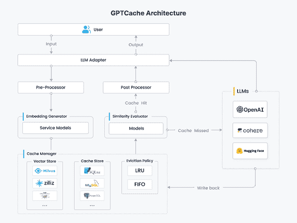

# GPTCache-提升LLM响应速度，释放无限潜能

> 来源：[https://agijuejin.feishu.cn/docx/YIqVdGJPRoYBT3xwT8xcFP2vnRf](https://agijuejin.feishu.cn/docx/YIqVdGJPRoYBT3xwT8xcFP2vnRf)

> 作者：lucas大叔

> 原文：[https://zhuanlan.z](https://zhuanlan.zhihu.com/p/689450121)hihu.com/p/689450...

以Chat[GPT为代](https://www.zhihu.com/search?q=%E8%AE%A1%E7%AE%97%E6%88%90%E6%9C%AC&search_source=Entity&hybrid_search_source=Entity&hybrid_search_extra=%7B%22sourceType%22%3A%22article%22%2C%22sourceId%22%3A689450121%7D)表的LLM展现出了各种各样的能力，基于这些能力可以开发许多场景应用。当应用LLM API调用量大时，费用会急剧增加。另外，在多并发请求场景，LLM服务响应时间可能会变慢。为了应对这些实际的挑战，在LLM应用中引入缓存机制是一种不错的解决方案。GPTCache作为针对LLM应用的性能优化解决方案，旨在帮助开发者更高效地利用有限的计算资源。通过缓存和重用计算结果，显著提高模型的运行速度，降低 计算成本 。

## 什么是GPTCache

GPTCache是一个开源库，能够通过缓存语言模型的响应，来提高 GPT 应用的效率和速度。GPTCache允许用户根据自己的需求自定义缓存规则，包括 embedding 函数、相似性计算方式、存储位置和存储逐出规则等。目前，GPTCache 支持 OpenAI ChatGPT 接口和 LangChain 接口。

## 为什么使用 GPTCache？

+   提升性能
将 LLM 响应存储在缓存中可以显著减少检索响应所需的时间。如果之前的请求已经存储在缓存中，能够更大幅度地降低响应时间，提高应用程序的整体性能。

+   节省开销
大多数LLM服务根据请求次数和 token 的组合收费。缓存 LLM 响应可以减少[对服务 A](https://www.zhihu.com/search?q=%E8%AF%AD%E4%B9%89%E7%BC%93%E5%AD%98&search_source=Entity&hybrid_search_source=Entity&hybrid_search_extra=%7B%22sourceType%22%3A%22article%22%2C%22sourceId%22%3A689450121%7D)PI 的调用次数，从而节省成本。尤其是在高流量场景下，缓存尤为重要。如果不使用 语义缓存 ，可能会多次调用 API，产生极高的费用。

+   提高可扩展性
缓存 LLM 响应可以通过降低 LLM 服务的负载来提高整体应用的可扩展性。语义缓存有助于避免系统瓶颈，确保应用可以处理更多请求。

+   降低开发成本
语义缓存工具能够减少LLM应用的开发成本。开发过程中需要连接LLM API，因此成本可能会十分高昂。GPTCache 界面与LLM API 相同，可存储模型生成数据。使用 GPTCache 无需再连接至LLM API，从而降低成本。

+   降低网络延迟
语[义缓存更](https://www.zhihu.com/search?q=%E5%AE%A2%E6%88%B7%E7%AB%AF&search_source=Entity&hybrid_search_source=Entity&hybrid_search_extra=%7B%22sourceType%22%3A%22article%22%2C%22sourceId%22%3A689450121%7D)靠近 客户端 ，可以减少从 LLM 服务检索数据所需的时间。降低网络延迟能有效提升用户的整体体验。

+   [提升可用性](https://www.zhihu.com/search?q=%E8%AE%BF%E9%97%AE%E9%80%9F%E7%8E%87&search_source=Entity&hybrid_search_source=Entity&hybrid_search_extra=%7B%22sourceType%22%3A%22article%22%2C%22sourceId%22%3A689450121%7D)
LLM 服务频繁限制用户或客户端在特定时间段内访问服务器的频次。触达 访问速率 上限时，请求会被屏蔽。用户不得不等待一段时间后才可以继续访问服务器，这种限制会导致服务中断。使用 GPTCache 后，您可以根据应用用户数量和查询量灵活快速扩展，保障服务可用性和性能。

总的来说，开发用于存储LLM响应的语义缓存可以提供多种好处，包括性能改进、降低成本、更好的可伸缩性、自定义性和降低网络延迟。

## GPTCache 的工作原理

GP[TCache](https://www.zhihu.com/search?q=%E7%BC%93%E5%AD%98%E5%91%BD%E4%B8%AD%E7%8E%87&search_source=Entity&hybrid_search_source=Entity&hybrid_search_extra=%7B%22sourceType%22%3A%22article%22%2C%22sourceId%22%3A689450121%7D) 利用在线服务的数据局部性特点，存储常用数据，降低检索时间，减轻后端服务器负载。与传统缓存系统不同，GPTCache 进行语义缓存，识别并存储相似或相关的查询以提高 缓存命中率 。

GPTCache 通过 embeddin[g 算法](https://www.zhihu.com/search?q=%E6%95%B0%E6%8D%AE%E5%BA%93&search_source=Entity&hybrid_search_source=Entity&hybrid_search_extra=%7B%22sourceType%22%3A%22article%22%2C%22sourceId%22%3A689450121%7D)将查询问题转换为向量并使用向量 数据库 进行 相似性搜索 ，从缓存中检索相关查询。 GPTCache 采用了模块化的设计，允许用户灵活自定义每个模块。

虽然语义缓存可能会返回假正类（false positive）和负类（negative）结果，但 GPTCache 提供 3 种性能指标来帮助开发人员优化其缓存系统。

通过上述流程，GPTCache 能够从缓存中寻找并召回相似或相关查询，如下图所示。



GPTCache 模块化的架构设计方便用户定制个性化语义缓存。每个模块都提供多种选择，适合各种应用场景。

### [**大模型适配器 **](https://www.zhihu.com/search?q=%E5%A4%A7%E6%A8%A1%E5%9E%8B%E9%80%82%E9%85%8D%E5%99%A8&search_source=Entity&hybrid_search_source=Entity&hybrid_search_extra=%7B%22sourceType%22%3A%22article%22%2C%22sourceId%22%3A689450121%7D)**（LLM Adapter）**

适配器将LLM请求转换为 [缓存协议 ](https://www.zhihu.com/search?q=%E7%BC%93%E5%AD%98%E5%8D%8F%E8%AE%AE&search_source=Entity&hybrid_search_source=Entity&hybrid_search_extra=%7B%22sourceType%22%3A%22article%22%2C%22sourceId%22%3A689450121%7D)，并将缓存结果转换为 LLM 响应。适配器方便轻松集成所有大模型，并可灵活扩展。GPTCache 支持多种大模型，包括：

+   OpenAI ChatGPT API

+   langchain

+   Minigpt4

+   Llamacpp

+   dolly

+   后续将支持：Hugging Face Hub、Bard、Anthropic 等

### 预处理器（Pre-Processor）

预处理器管理、分析请求，并在将请求发送至 LLM 前调整请求格式，具体包括：移除输入中冗余的信息、压缩输入信息、切分长文本、执行其他相关任务等。

### [**向量生成器 **](https://www.zhihu.com/search?q=%E5%90%91%E9%87%8F%E7%94%9F%E6%88%90%E5%99%A8&search_source=Entity&hybrid_search_source=Entity&hybrid_search_extra=%7B%22sourceType%22%3A%22article%22%2C%22sourceId%22%3A689450121%7D)（Embedding Generator）

Embedding 生成器将用户查询的问题转化为 embedding 向量，便于后续的向量相似性检索。GPTCache 支持多种模型，包括：

+   OpenAI embedding API

+   ONNX（GPTCache/paraphrase-albert-onnx 模型）

+   Hugging Face embedding API

+   Cohere embedding API

+   fastText embedding API

+   SentenceTransformers embedding API

+   Timm 模型库中的图像模型

### 缓存存储（Cache Store）

[GPTCache](https://www.zhihu.com/search?q=%E6%95%B0%E6%8D%AE%E5%BA%93%E7%AE%A1%E7%90%86%E7%B3%BB%E7%BB%9F&search_source=Entity&hybrid_search_source=Entity&hybrid_search_extra=%7B%22sourceType%22%3A%22article%22%2C%22sourceId%22%3A689450121%7D) 将 LLM 响应存储在各种 数据库管理系统 中。GPTCache 支持丰富的缓存存储数据库，用户可根据性能、可扩展性需求和成本预算，灵活选择最适合的数据库。GPTCache 支持多个热门数据库，包括：

+   [SQLite](https://link.zhihu.com/?target=https%3A//sqlite.org/docs.html)

+   [DuckDB](https://link.zhihu.com/?target=https%3A//duckdb.org/)

+   [PostgreSQL](https://link.zhihu.com/?target=https%3A//www.postgresql.org/)

+   [MySQL](https://link.zhihu.com/?target=https%3A//www.mysql.com/)

+   [MariaDB](https://link.zhihu.com/?target=https%3A//mariadb.org/)

+   [SQL Server](https://link.zhihu.com/?target=https%3A//www.microsoft.com/en-us/sql-server/)

+   [Oracle](https://link.zhihu.com/?target=https%3A//www.oracle.com/)

+   [DynamoDB](https://link.zhihu.com/?target=https%3A//aws.amazon.com/dynamodb/)

### 向量存储（Vector Store）

向量存储模块会根据输入请求的 embedding 查找 top-K 最相似的请求。简而言之，该模块用于评估请求之间的相似性。GPTCache 的界面十分友好，提供丰富的向量存储数据库。选择不同的向量数据库会影响相似性检索的效率和准确性。GPTCache 支持多个向量数据库，包括：

+   [Milvus](https://link.zhihu.com/?target=https%3A//milvus.io/)

+   [Zilliz Cloud](https://link.zhihu.com/?target=https%3A//zilliz.com.cn/cloud)

+   Milvus Lite

+   Hnswlib

+   PGVector

+   Chroma

+   DocArray

+   FAISS

+   qdrant

+   weaviate

### [逐出策略 ](https://www.zhihu.com/search?q=%E9%80%90%E5%87%BA%E7%AD%96%E7%95%A5&search_source=Entity&hybrid_search_source=Entity&hybrid_search_extra=%7B%22sourceType%22%3A%22article%22%2C%22sourceId%22%3A689450121%7D)（Eviction Policy）管理

[控制缓存存储和](https://www.zhihu.com/search?q=%E7%BC%93%E5%AD%98%E6%9B%BF%E6%8D%A2%E6%9C%BA%E5%88%B6&search_source=Entity&hybrid_search_source=Entity&hybrid_search_extra=%7B%22sourceType%22%3A%22article%22%2C%22sourceId%22%3A689450121%7D)向量存储模块的操作。缓存满了之后， 缓存替换机制 会决定淘汰哪些数据，为新数据腾出空间。GPTCache 目前支持以下两种标准逐出策略：

+   “最近最少使用”逐出策略（Least Recently Used，LRU）

+   “先进先出”逐出策略（First In First Out，FIFO）

### [**相似性评估器 **](https://www.zhihu.com/search?q=%E7%9B%B8%E4%BC%BC%E6%80%A7%E8%AF%84%E4%BC%B0%E5%99%A8&search_source=Entity&hybrid_search_source=Entity&hybrid_search_extra=%7B%22sourceType%22%3A%22article%22%2C%22sourceId%22%3A689450121%7D)（Similarity Evaluator）

GPTCache 中的相似性评估模块从 Cache Storage 和 Vector Store 中收集数据，并使用各种策略来确定输入请求与来自 Vector Store 的请求之间的相似性。该模块用于确定某一请求是否与缓存匹配。GPTCache 提供标准化接口，集成各种相似性计算方式。多样的的相似性计算方式能够灵活满足不同的需求和应用场景。GPTCache 根据其他用例和需求提供灵活性。

### [**后处理器 **](https://www.zhihu.com/search?q=%E5%90%8E%E5%A4%84%E7%90%86%E5%99%A8&search_source=Entity&hybrid_search_source=Entity&hybrid_search_extra=%7B%22sourceType%22%3A%22article%22%2C%22sourceId%22%3A689450121%7D)（Post-Processor）

后处理器负责在返回响应前处理最终响应。如果没有命中缓存中存储的数据，LLM Adapter会从 LLM 请求响应并将响应写入缓存存储中。

---

## 安装GPTCache

+   你可以快速尝试GPTCache，无需大量开[发就可以将](https://www.zhihu.com/search?q=%E4%BB%A3%E7%A0%81%E4%BB%93%E5%BA%93&search_source=Entity&hybrid_search_source=Entity&hybrid_search_extra=%7B%22sourceType%22%3A%22article%22%2C%22sourceId%22%3A689450121%7D)其放入生产环境中。但请注意， 代码仓库 仍在大力开发中。

+   默认情况下只安装有限数量的库来支持基本的缓存功能。当需要使用其他功能时，将自动安装相关的库。

+   确保Python版本为3.8.1或更高版本。

+   如果由于pip版本低而在安装库时遇到问题，请运行：python-m pip install --upgrade pip。

```
# clone GPTCache repo
git clone -b dev https://github.com/zilliztech/GPTCache.git
cd GPTCache

# install the repo
pip install -r requirements.txt
python setup.py install
```

## 文档问答示例

本[节探索了如何使用lan](https://www.zhihu.com/search?q=map_reduce&search_source=Entity&hybrid_search_source=Entity&hybrid_search_extra=%7B%22sourceType%22%3A%22article%22%2C%22sourceId%22%3A689450121%7D)gchain基于开源LLM在一组文档上进行问答，以stuff chain为例验证效果。对于 map_reduce ，refine和map_rerank等类型的chain，感兴趣的同学可参考官网文档自行验证。

### 准备工作

首先导入必要的packages

```
import time
import torch
from gptcache import cache
from gptcache.manager import CacheBase, VectorBase, get_data_manager
from gptcache.similarity_evaluation.distance import SearchDistanceEvaluation
from gptcache.embedding import LangChain

from langchain.document_loaders import PyPDFLoader
from langchain.embeddings import HuggingFaceEmbeddings
from langchain import HuggingFacePipeline
from transformers import AutoTokenizer, pipeline, AutoModelForCausalLM
from langchain.text_splitter import RecursiveCharacterTextSplitter
from langchain.vectorstores import Milvus
from langchain.chains.question_answering import load_qa_chain
from gptcache.adapter.langchain_models import LangChainLLMs
```

设置本地模型及文件路径

```
data_file = &quot;../data/中华人民共和国证券法(2019修订).pdf&quot;
model_path = &quot;/root/models/Baichuan2-13B-Chat&quot;
embed_path = &quot;/root/models/bge-large-zh-v1.5&quot;
```

### 加载embedding模型

官方教程中使用 [onnx ](https://www.zhihu.com/search?q=onnx&search_source=Entity&hybrid_search_source=Entity&hybrid_search_extra=%7B%22sourceType%22%3A%22article%22%2C%22sourceId%22%3A689450121%7D)作为 [embed](https://www.zhihu.com/search?q=%E6%8C%87%E5%AE%9A%E6%96%87%E6%9C%AC&search_source=Entity&hybrid_search_source=Entity&hybrid_search_extra=%7B%22sourceType%22%3A%22article%22%2C%22sourceId%22%3A689450121%7D)ding 模型，但它仅支持512个token，而且只支持英语。为了验证中文问答效果，我们利用 langchain 提供的方法加载文本 embedding 模型，其中 gptcache.embedding.langchain 类实现用 LangChain 为 指定文本 生成文本嵌入。

```
embeddings = HuggingFaceEmbeddings(
    model_name=embed_path,
    model_kwargs={&quot;device&quot;: &quot;cuda&quot;},
    encode_kwargs={&quot;normalize_embeddings&quot;: True},
)
encoder = LangChain(embeddings=embeddings)
```

### Cache初始化

初始化cache有两种方式，一是用ma[p cache(精准匹配缓存)](https://www.zhihu.com/search?q=DataBase%20cache&search_source=Entity&hybrid_search_source=Entity&hybrid_search_extra=%7B%22sourceType%22%3A%22article%22%2C%22sourceId%22%3A689450121%7D)，二是用 DataBase cache (相似搜索缓存)，建议使用第二种方式。

定义get_content_func()函数获取question形成prompt:

```
# get the content(only question) form the prompt to cache
def get_content_func(data, **_):
    return data.get(&quot;prompt&quot;).split(&quot;Question&quot;)[-1]
```

**精准匹配缓存初始化**

```
# from gptcache import cache
# cache.init(pre_embedding_func=get_content_func)
```

**相似匹配缓存初始化**

当初始化GPTCache时，需要配置下面四个参数：

+   pre_em[beddi](https://www.zhihu.com/search?q=%E7%89%B9%E6%80%A7%E5%90%91%E9%87%8F&search_source=Entity&hybrid_search_source=Entity&hybrid_search_extra=%7B%22sourceType%22%3A%22article%22%2C%22sourceId%22%3A689450121%7D)ng_func : 提取 特性向量 之前的预处理

+   embedding_func : 提取文本特征向量的方法

+   data_manager : 用于缓存管理的DataManager

+   similarity_evaluation : 缓存命中后的评估方法

采用sqlite作为缓存数据库，还支持 postgresql，mysql，mariadb，sqlserver 和 oracle等作为缓存数据库 。

采用milvus作为向量数据库，相似度评估采用SearchDistanceEvaluation, 基于向量搜索距离判断相似度，特点是简单、速度快，但准确度不是很高。 此外还有几种相似度评估方法，例如，

+   OnnxModelEvaluation用模型评估两个问题之间的相关度。但由于是小模型，只支持512个token，但准确度比基于距离的方式要高。

+   [NumpyN](https://www.zhihu.com/search?q=llm%E8%AF%B7%E6%B1%82&search_source=Entity&hybrid_search_source=Entity&hybrid_search_extra=%7B%22sourceType%22%3A%22article%22%2C%22sourceId%22%3A689450121%7D)ormEvaluation计算 llm请求 和缓存数据两个嵌入向量之间的距离，也是又快又简单，准确度和基于距离的方法几乎一样。

+   [KReciprocalEval](https://www.zhihu.com/search?q=K-reprocical%E7%AE%97%E6%B3%95&search_source=Entity&hybrid_search_source=Entity&hybrid_search_extra=%7B%22sourceType%22%3A%22article%22%2C%22sourceId%22%3A689450121%7D)uation使用 K-reprocical算法 为重排序计算相似度,召回多个缓存数据比较。这种方法需要召回多次，时间消耗较多，相对来说准确度更高。

+   CohereRerankEvaluation用 cohere rerank api 服务, 准确度更高, 需要付费调用。

+   [Seque](https://www.zhihu.com/search?q=%E5%BA%8F%E5%88%97%E5%8C%B9%E9%85%8D&search_source=Entity&hybrid_search_source=Entity&hybrid_search_extra=%7B%22sourceType%22%3A%22article%22%2C%22sourceId%22%3A689450121%7D)nceMatchEvaluation, 序列匹配 , 适合多轮对话场景, 分别对每轮对话评估相似度, 然后通过比例得到最终分数。

+   TimeEvaluation评估缓存创建时间，避免使用过时的缓存 。

+   SbertCrossencoderEvaluation用sbert模型做重排序评估，是当前已知最好的相似度评估方法。

```
[cache_base ](https://www.zhihu.com/search?q=vector_base&amp;search_source=Entity&amp;hybrid_search_source=Entity&amp;hybrid_search_extra=%7B%22sourceType%22%3A%22article%22%2C%22sourceId%22%3A689450121%7D)= CacheBase(&#x27;sqlite&#x27;)
vector_base = VectorBase(&#x27;milvus&#x27;, host=&#x27;XX.XX.XX.XX&#x27;, port=&#x27;19530&#x27;, dimension=encoder.dimension, collection_name=&#x27;cache&#x27;)
data_manager = get_data_manager(cache_base, vector_base)
cache.init(
    pre_embedding_func=get_content_func,
    embedding_func=encoder.to_embeddings,
    data_manager=data_manager,
    similarity_evaluation=SearchDistanceEvaluation(),
    )
```

### 数据准备

加载数据，写入milvus库。

```
loader = PyPDFLoader(data_file)
documents = loader.load_and_split()
text_splitter = RecursiveCharacterTextSplitter(chunk_size=512, chunk_overlap=32)
texts = text_splitter.split_documents(documents)

vector_db = Milvus.from_documents(
    texts,
    embeddings,
    connection_args={&quot;host&quot;: &quot;XX.XX.XX.XX&quot;, &quot;port&quot;: &quot;19530&quot;},
)
```

### 加载LLM

这里没有选择调用OpenAI API，而是选择加载开源LLM。 langchain adapter 提供了标准接口与langchain支持的LLM连接。

```
tokenizer = AutoTokenizer.from_pretrained(model_path,
                                          device_map=&quot;auto&quot;,
                                          trust_remote_code=True,
                                          torch_dtype=torch.float16)

model = AutoModelForCausalLM.from_pretrained(
    model_path,
    torch_dtype=torch.float16,
    trust_remote_code=True,
    device_map=&quot;auto&quot;,
)

pipeline = pipeline(
    &quot;text-generation&quot;,
    model=model,
    tokenizer=tokenizer,
    return_full_text=True,
)

hf_llm = HuggingFacePipeline(pipeline=pipeline)
llm = LangChainLLMs(llm=hf_llm)
```

### stuff chain

在 [stuff chain模式 ](https://www.zhihu.com/search?q=stuff%20chain%E6%A8%A1%E5%BC%8F&search_source=Entity&hybrid_search_source=Entity&hybrid_search_extra=%7B%22sourceType%22%3A%22article%22%2C%22sourceId%22%3A689450121%7D)下验证效果，同一个问题问两次，第三次问一个相似问题。执行时间分别为49.67s、0.52s和0.53s。可见使用缓存机制后，同样或相似问题的查询响应时间得到大幅度降低。

```
chain = load_[qa_cha](https://www.zhihu.com/search?q=%E5%85%AC%E5%BC%80%E5%8F%91%E8%A1%8C%E6%96%B0%E8%82%A1&amp;search_source=Entity&amp;hybrid_search_source=Entity&amp;hybrid_search_extra=%7B%22sourceType%22%3A%22article%22%2C%22sourceId%22%3A689450121%7D)in(llm, chain_type=&quot;stuff&quot;)

query = &quot;公司首次公开发行新股，应当符合哪些条件？&quot;
docs = vector_db.similarity_search(query)

st = time.time()
result = chain({&quot;input_documents&quot;: docs, &quot;question&quot;: query}, return_only_outputs=True)
et = time.time()
print(&quot;The first execution time:&quot;, et-st)
print(&quot;result:&quot;, result)

st = time.time()
result = chain({&quot;input_documents&quot;: docs, &quot;question&quot;: query}, return_only_outputs=True)
et = time.time()
print(&quot;The second execution time:&quot;, et-st)
print(&quot;result:&quot;, result)

similar_query = &quot;公司首次公开发行新股，要符合什么条件？&quot;
docs = vector_db.similarity_search(similar_query)

st = time.time()
result = chain({&quot;input_documents&quot;: docs, &quot;question&quot;: similar_query}, return_only_outputs=True)
et = time.time()
print(&quot;A similar query execution time：&quot;, et-st)
print(&quot;result:&quot;, result)
```

## 参考资料

Zilliz 开源 AI 应用工具

[https:// github.com/z](https://link.zhihu.com/?target=https%3A//github.com/zilliztech/GPTCache)illiztech/G PTCache

[LLM Caching integr](https://link.zhihu.com/?target=https%3A//python.langchain.com/docs/integrations/llms/llm_caching)ations | ️ Langchain

[https:// gptcache.readthedocs.io /en/latest/boo](https://link.zhihu.com/?target=https%3A//gptcache.readthedocs.io/en/latest/bootcamp/langchain/question_answering.html)tcamp/langchain/question_answering.html