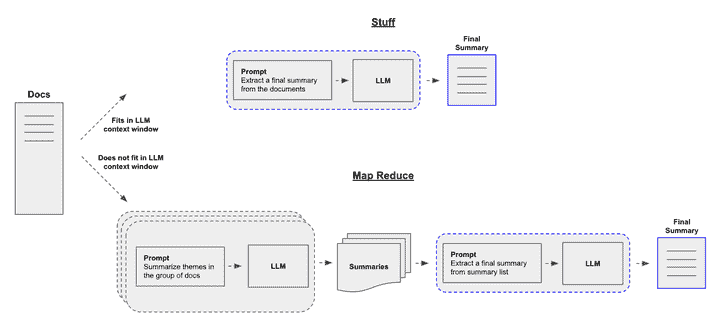
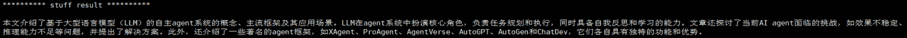
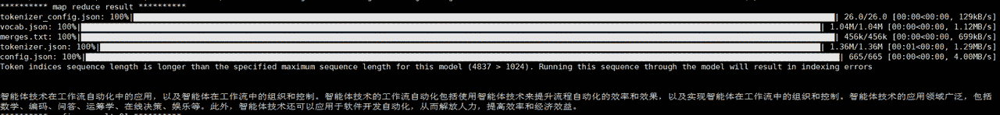
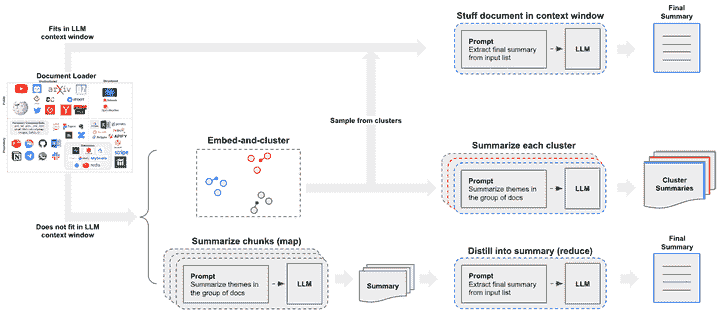
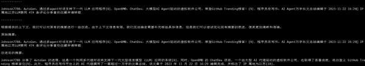

# 基于LLM的摘要生成

> 来源：[https://agijuejin.feishu.cn/docx/LisWdfCoFo7hNKxUQohckw8ynko](https://agijuejin.feishu.cn/docx/LisWdfCoFo7hNKxUQohckw8ynko)

> 作者：lucas大叔

> 原文： [https://zhuanlan.z](https://zhuanlan.zhihu.com/p/687649833)hihu.com/p/687649...

构建summarizer的核心问题是如何将文档传递到LLM的上下文窗口中。两种常见的方法是：

1.  [Stuff：将](https://www.zhihu.com/search?q=prompt&search_source=Entity&hybrid_search_source=Entity&hybrid_search_extra=%7B%22sourceType%22%3A%22article%22%2C%22sourceId%22%3A687649833%7D)所有文档填充到一个 prompt 中。这是最简单的方法，需要LLM具有足够大的上下文窗口。

[2. Ma](https://www.zhihu.com/search?q=%E5%88%86%E8%80%8C%E6%B2%BB%E4%B9%8B&search_source=Entity&hybrid_search_source=Entity&hybrid_search_extra=%7B%22sourceType%22%3A%22article%22%2C%22sourceId%22%3A687649833%7D)p reduce：采取 分而治之 的思想，在“map”步骤单独总结每篇文档，然后将所有摘要“reduce”为最终摘要。



## QuickStart

任何一个 [pipeline ](https://www.zhihu.com/search?q=pipeline&search_source=Entity&hybrid_search_source=Entity&hybrid_search_extra=%7B%22sourceType%22%3A%22article%22%2C%22sourceId%22%3A687649833%7D)都[可以封装](https://www.zhihu.com/search?q=%E8%BD%AF%E4%BB%B6%E5%8C%85&search_source=Entity&hybrid_search_source=Entity&hybrid_search_extra=%7B%22sourceType%22%3A%22article%22%2C%22sourceId%22%3A687649833%7D)在单个load_summarize_chain对象中。假设我们想总结一篇博客，可以用几行代码实现。首先设置环境变量并安装 软件包 ：

```
%pip install --upgrade --quiet  langchain-openai tiktoken chromadb langchain

# Set env var OPENAI_API_KEY or load from a .env file
# import dotenv

# dotenv.load_dotenv()
```

我们可以使用 chain_type="stuff" ，尤其是使用有较大上下文窗口的模型时，例如:

+   16k token 的OpenAI gpt-3.5-turbo-1106

+   [100k tok](https://link.zhihu.com/?target=https%3A//www.anthropic.com/index/claude-2)en的 Anthropic Claude-2

除此之外，还可以令 chain_type="map_reduce" 或 chain_type="refine" 。 这里我选取了自己写的一篇Agent文章验证生成摘要的效果。

```
from la[ngchain.cha](https://www.zhihu.com/search?q=loader.load&amp;search_source=Entity&amp;hybrid_search_source=Entity&amp;hybrid_search_extra=%7B%22sourceType%22%3A%22article%22%2C%22sourceId%22%3A687649833%7D)ins.summarize import load_summarize_chain
from langchain_community.document_loaders import WebBaseLoader
from langchain_openai import ChatOpenAI

loader = WebBaseLoader(&quot;https://zhuanlan.zhihu.com/p/668153266&quot;)
docs = loader.load()

llm = ChatOpenAI(temperature=0, model_name=&quot;gpt-3.5-turbo-1106&quot;)
chain = load_summarize_chain(llm, chain_type=&quot;stuff&quot;)

chain.run(docs)
```

LLM可以替换为开源模型，例如Baichuan2-13B-Chat

```
model_path = &quot;Your Bai[chuan2-13B-](https://www.zhihu.com/search?q=torch_dtype&amp;search_source=Entity&amp;hybrid_search_source=Entity&amp;hybrid_search_extra=%7B%22sourceType%22%3A%22article%22%2C%22sourceId%22%3A687649833%7D)Chat model local path&quot;

tokenizer = AutoTokenizer.from_pretrained(model_path,
                                          device_map=&quot;auto&quot;,
                                          trust_remote_code=True,
                                          torch_dtype=torch.float16)

model = AutoModelForCausalLM.from_pretrained(
    model_path,
    torch_dtype=torch.float16,
    trust_remote_code=True,
    device_map=&quot;auto&quot;,
)

pipeline = pipeline(
    &quot;text-generation&quot;,
    model=model,
    tokenizer=tokenizer,
    return_full_text=True,
)

llm = HuggingFacePipeline(pipeline=pipeline)
```

## Stuff模式

当使用 chain_type=“stuff ”的load_summarize_chain时，将使用StuffDocumentsChain。该chain将获取一个文档列表，将它们全部插入到prompt中，并将该prompt传递给LLM：

```
from la[ngchain.](https://www.zhihu.com/search?q=template&amp;search_source=Entity&amp;hybrid_search_source=Entity&amp;hybrid_search_extra=%7B%22sourceType%22%3A%22article%22%2C%22sourceId%22%3A687649833%7D)chains.combine_documents[.stuff impo](https://www.zhihu.com/search?q=stuff_chain&amp;search_source=Entity&amp;hybrid_search_source=Entity&amp;hybrid_search_extra=%7B%22sourceType%22%3A%22article%22%2C%22sourceId%22%3A687649833%7D)rt StuffDocu[mentsChai](https://www.zhihu.com/search?q=chain.run&amp;search_source=Entity&amp;hybrid_search_source=Entity&amp;hybrid_search_extra=%7B%22sourceType%22%3A%22article%22%2C%22sourceId%22%3A687649833%7D)n
from langchain.chains.llm import LLMChain
from langchain.prompts import PromptTemplate

# Define prompt
prompt_template = &quot;&quot;&quot;Write a concise summary of the following:
&quot;{text}&quot;
CONCISE SUMMARY:&quot;&quot;&quot;
prompt = PromptTemplate.from_template(prompt_template)

# Define LLM chain
llm = ChatOpenAI(temperature=0, model_name=&quot;gpt-3.5-turbo-16k&quot;)
llm_chain = LLMChain(llm=llm, prompt=prompt)

# Define StuffDocumentsChain
stuff_chain = StuffDocumentsChain(llm_chain=llm_chain, document_variable_name=&quot;text&quot;)

docs = loader.load()
print(stuff_chain.run(docs))
```

Stuff要求LLM的context比较大，[否则无法](https://www.zhihu.com/search?q=%E7%99%BE%E5%B7%9D2&search_source=Entity&hybrid_search_source=Entity&hybrid_search_extra=%7B%22sourceType%22%3A%22article%22%2C%22sourceId%22%3A687649833%7D)将文档全部内容喂给LLM。调用 百川2 生成的摘要如下（prompt_template需要改为中文，以下同理都要改成中文的prompt）：



```
本文介绍了基于大型语言模型（LLM）的自主agent系统的概念、主流框架及其应用场景。LLM在agent系统中扮演核心角色，负责任务规划和执行，同时具备自我反思和学习的能力。文章还探讨了当前AI agent面临的挑战，如效果不稳定、推理能力不足等问题，并提出了解决方案。此外，还介绍了一些著名的agent框架，如XAgent、ProAgent、AgentVerse、AutoGPT、AutoGen和ChatDev，它们各自具有独特的功能和优势。
```

## Map-Reduce模式

首先用LLMChain[将每个文档](https://www.zhihu.com/search?q=%E5%85%A8%E5%B1%80%E6%91%98%E8%A6%81&search_source=Entity&hybrid_search_source=Entity&hybrid_search_extra=%7B%22sourceType%22%3A%22article%22%2C%22sourceId%22%3A687649833%7D)映射为一个单独的摘要，[然后用ReduceD](https://www.zhihu.com/search?q=token_max&search_source=Entity&hybrid_search_source=Entity&hybrid_search_extra=%7B%22sourceType%22%3A%22article%22%2C%22sourceId%22%3A687649833%7D)ocumentsChain

将这些摘要合并为一个 全局摘要 。

ReduceDocumentsChain封装了通用的CombineDocumentsChain（类似StuffDocumentsChain）。

当文档的累积大小超过 token_max 时，在传递到CombineDocumentsChain之前增加了折叠文档的功能。

```
from la[ngchain.chains ](https://www.zhihu.com/search?q=documents_chain&amp;search_source=Entity&amp;hybrid_search_source=Entity&amp;hybrid_search_extra=%7B%22sourceType%22%3A%22article%22%2C%22sourceId%22%3A687649833%7D)import MapReduceDocumentsChain, ReduceDocumentsChain
from langchain_text_splitters import CharacterTextSplitter

llm = ChatOpenAI(temperature=0)

# Map
map_template = &quot;&quot;&quot;The following is a set of documents
{docs}
Based on this list of docs, please identify the main themes 
Helpful Answer:&quot;&quot;&quot;
map_prompt = PromptTemplate.from_template(map_template)
map_chain = LLMChain(llm=llm, prompt=map_prompt)

# Reduce
reduce_template = &quot;&quot;&quot;The following is set of summaries:
{docs}
Take these and distill it into a final, consolidated summary of the main themes. 
Helpful Answer:&quot;&quot;&quot;
reduce_prompt = PromptTemplate.from_template(reduce_template)

# Run chain
reduce_chain = LLMChain(llm=llm, prompt=reduce_prompt)

# Takes a list of documents, combines them into a single string, and passes this to an LLMChain
combine_documents_chain = StuffDocumentsChain(
    llm_chain=reduce_chain, document_variable_name=&quot;docs&quot;
)

# Combines and iteratively reduces the mapped documents
reduce_documents_chain = ReduceDocumentsChain(
    # This is final chain that is called.
    combine_documents_chain=combine_documents_chain,
    # If documents exceed context for `StuffDocumentsChain`
    collapse_documents_chain=combine_documents_chain,
    # The maximum number of tokens to group documents into.
    token_max=4000,
)
```

把map chain和 [reduce chain ](https://www.zhihu.com/search?q=reduce%20chain&search_source=Entity&hybrid_search_source=Entity&hybrid_search_extra=%7B%22sourceType%22%3A%22article%22%2C%22sourceId%22%3A687649833%7D)合并为一个chain：

```
# Combin[ing documents b](https://www.zhihu.com/search?q=chain%3Dmap_chain&amp;search_source=Entity&amp;hybrid_search_source=Entity&amp;hybrid_search_extra=%7B%22sourceType%22%3A%22article%22%2C%22sourceId%22%3A687649833%7D)y mapping a chain over them, then combining results
map_reduce_chain = MapReduceDocumentsChain(
    # Map chain
    llm_chain=map_chain,
    # Reduce chain
    reduce_documents_chain=reduce_documents_chain,
    # The variable name in the llm_chain to put the documents in
    document_variable_name=&quot;docs&quot;,
    # Return the results of the map steps in the output
    return_intermediate_steps=False,
)

text_splitter = CharacterTextSplitter.from_tiktoken_encoder(
    chunk_size=1000, chunk_overlap=0
)
split_docs = text_splitter.split_documents(docs)

print(map_reduce_chain.run(split_docs))
```

调用百川2生成的摘要效果如下：



```
智能体技术在工作流自动化中的应用，以及智能体在工作流中的组织和控制。智能体技术的工作流自动化包括使用智能体技术来提升流程自动化的效率和效果，以及实现智能体在工作流中的组织和控制。智能体技术的应用领域广泛，包括数学、编码、问答、运筹学、在线决策、娱乐等。此外，智能体技术还可以应用于软件开发自动化，从而解放人力，提高效率和经济效益。
```

在 [map-reduce模式 ](https://www.zhihu.com/search?q=map-reduce%E6%A8%A1%E5%BC%8F&search_source=Entity&hybrid_search_source=Entity&hybrid_search_extra=%7B%22sourceType%22%3A%22article%22%2C%22sourceId%22%3A687649833%7D)时会报错，报错信息如下：

```
Can&#x27;t load tokenizer for &#x27;gpt2&#x27;. If you were trying to load it from &#x27;https://huggingface.co/models&#x27;, make sure you don&#x27;t have a local directory with the same name. Otherwise, make sure &#x27;gpt2&#x27; is the correct path to a directory containing all relevant files for a GPT2TokenizerFast tokenizer.
```

[网上也查到](https://www.zhihu.com/search?q=%E9%85%8D%E7%BD%AE%E4%BB%A3%E7%90%86&search_source=Entity&hybrid_search_source=Entity&hybrid_search_extra=%7B%22sourceType%22%3A%22article%22%2C%22sourceId%22%3A687649833%7D)了一些解决方法，感觉实施起来还是挺麻烦，最后通过 配置代理 在执行时在线下载解决问题：

[https:// github.com/langgeniu](https://link.zhihu.com/?target=https%3A//github.com/langgenius/dify/issues/1261)s/d ify/issues/1261

[h](https://link.zhihu.com/?target=https%3A//github.com/langchain-ai/langchain/issues/9273)ttps:// github.com/langchain-ai /langchain/issues/9273

此外，利用 [聚类辅助摘要生成 ](https://link.zhihu.com/?target=https%3A//blog.langchain.dev/llms-to-improve-documentation/)也是值得探索的一个方向。



## Refine模式

[RefineDocu](https://www.zhihu.com/search?q=refine%E6%96%87%E6%A1%A3%E9%93%BE&search_source=Entity&hybrid_search_source=Entity&hybrid_search_extra=%7B%22sourceType%22%3A%22article%22%2C%22sourceId%22%3A687649833%7D)mentsChain与map-reduce类似。

refine文档链 通过在输入文档上循环并迭代更新答案构建响应。

对于每个文档，它将所有非文档输入、当前文档和最新的中间答案传递给LLM chain，以获得新的答案。

[指定cha](https://www.zhihu.com/search?q=%E6%A8%A1%E5%BC%8F%E7%94%9F%E6%88%90&search_source=Entity&hybrid_search_source=Entity&hybrid_search_extra=%7B%22sourceType%22%3A%22article%22%2C%22sourceId%22%3A687649833%7D)in_type="refine"就可以用refine 模式生成 摘要。

```
chain = load_summarize_chain(llm, chain_type=&quot;refine&quot;)
chain.run(split_docs)
```

另外也可以提供prompt返回中间步骤。

```
prompt_temp[late = &quot;&quot;&quot;Write](https://www.zhihu.com/search?q=the%20new%20context&amp;search_source=Entity&amp;hybrid_search_source=Entity&amp;hybrid_search_extra=%7B%22sourceType%22%3A%22article%22%2C%22sourceId%22%3A687649833%7D) a conci[se summary ](https://www.zhihu.com/search?q=the%20context&amp;search_source=Entity&amp;hybrid_search_source=Entity&amp;hybrid_search_extra=%7B%22sourceType%22%3A%22article%22%2C%22sourceId%22%3A687649833%7D)[of the ](https://www.zhihu.com/search?q=summary&amp;search_source=Entity&amp;hybrid_search_source=Entity&amp;hybrid_search_extra=%7B%22sourceType%22%3A%22article%22%2C%22sourceId%22%3A687649833%7D)following:
{text}
CONCISE SUMMARY:&quot;&quot;&quot;
prompt = PromptTemplate.from_template(prompt_template)

refine_template = (
    &quot;Your job is to produce a final summary\n&quot;
    &quot;We have provided an existing summary up to a certain point: {existing_answer}\n&quot;
    &quot;We have the opportunity to refine the existing summary&quot;
    &quot;(only if needed) with some more context below.\n&quot;
    &quot;------------\n&quot;
    &quot;{text}\n&quot;
    &quot;------------\n&quot;
    &quot;Given the new context, refine the original summary in Italian&quot;
    &quot;If the context isn&#x27;t useful, return the original summary.&quot;
)
refine_prompt = PromptTemplate.from_template(refine_template)
chain = load_summarize_chain(
    llm=llm,
    chain_type=&quot;refine&quot;,
    question_prompt=prompt,
    refine_prompt=refine_prompt,
    return_intermediate_steps=True,
    input_key=&quot;input_documents&quot;,
    output_key=&quot;output_text&quot;,
)
result = chain({&quot;input_documents&quot;: split_docs}, return_only_outputs=True)
```

查看结果，调用百川2生成的摘要效果如下：

```
print(result[&quot;output_text&quot;])
```



```
Johnson7788：AutoGen：通过多agent对话支持下一代 LLM[ 应用程](https://www.zhihu.com/search?q=%E8%99%9A%E6%8B%9F%E8%BD%AF%E4%BB%B6&amp;search_source=Entity&amp;hybrid_search_source=Entity&amp;hybrid_search_extra=%7B%22sourceType%22%3A%22article%22%2C%22sourceId%22%3A687649833%7D)序[8]. OpenBMB：ChatDev：大模型AI Agent驱动的虚拟软件公司，荣登GitHub Trending榜首！[9]. 程序员在写作：AI Agent万字长文总结编辑于 2023-11-22 16:29・IP 属地江苏LLM赞同 474 条评论分享喜欢收藏申请转载 
```

查看中间步骤

```
print(&quot;\n\n&quot;.join(result[&quot;intermediate_steps&quot;][:3]))
```

从三种模式的生成效果来看， [stuff ](https://www.zhihu.com/search?q=stuff&search_source=Entity&hybrid_search_source=Entity&hybrid_search_extra=%7B%22sourceType%22%3A%22article%22%2C%22sourceId%22%3A687649833%7D)生成的效果比较靠谱。另外两种模式还需要多做测试，优化提示模板看是否可以进一步提升生成质量。

## 参考资料

Summarization | ️ Langchain