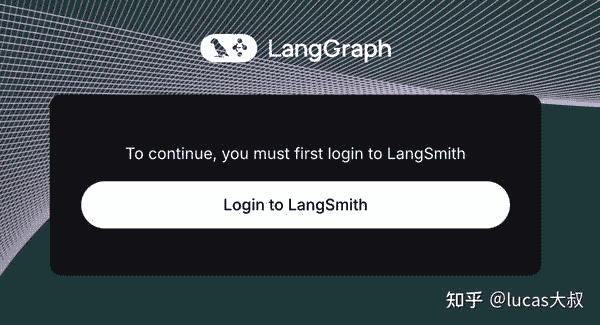
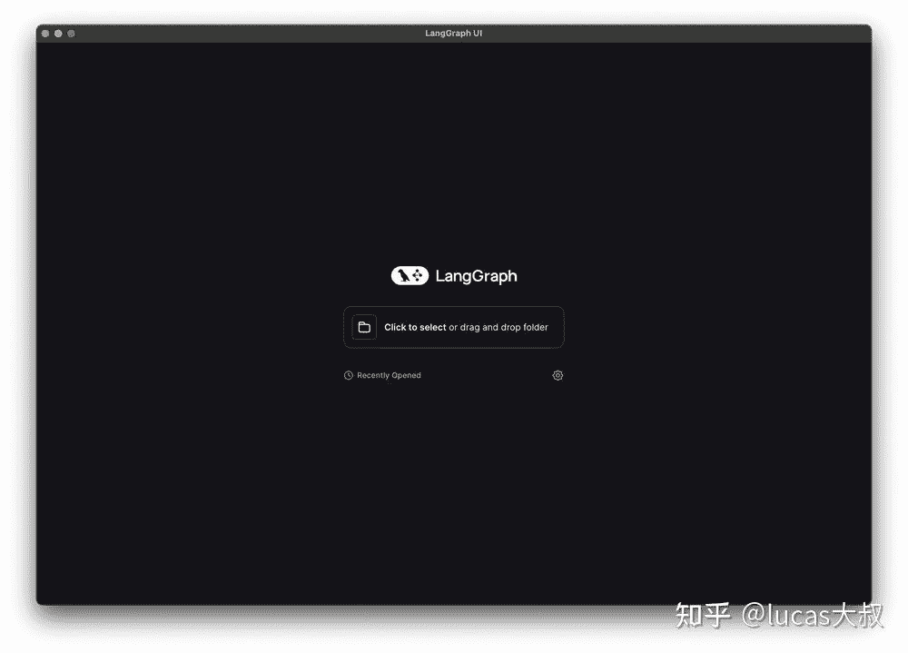
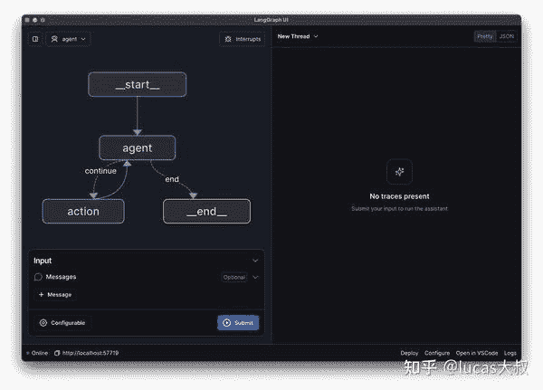

# LangGraph Studio: 首个agent IDE

> 来源：[https://agijuejin.feishu.cn/docx/N1fzdPDo3o44Qpx98CQc2odQnyc](https://agijuejin.feishu.cn/docx/N1fzdPDo3o44Qpx98CQc2odQnyc)

> 作者：lucas大叔

> 原文： [https://zhuanlan.z](https://zhuanlan.zhihu.com/p/713379247)hihu.com/p/713379...

LLM为开发新型智能体应用铺平了道路——随着LLM应用的进化，有效开发它们[所需的工具也必](https://www.zhihu.com/search?q=%E9%9B%86%E6%88%90%E5%BC%80%E5%8F%91%E7%8E%AF%E5%A2%83&search_source=Entity&hybrid_search_source=Entity&hybrid_search_extra=%7B%22sourceType%22%3A%22article%22%2C%22sourceId%22%3A713379247%7D)[须发展。](https://www.zhihu.com/search?q=%E5%85%AC%E6%B5%8B%E7%89%88&search_source=Entity&hybrid_search_source=Entity&hybrid_search_extra=%7B%22sourceType%22%3A%22article%22%2C%22sourceId%22%3A713379247%7D)Langchain官方发布了第一个专门为智能体开发设计的 集成开发环境 ——LangGraph Studio的 公测版 本。

LangGraph Studio提供了开发LLM应用的新方法，专门的智能体IDE用于可视化、交互和调试复杂的智能体应用程。本文将简要概述LangGraph，然后探索LangGraph Studio如何简化智能体应用的开发。

---

## LangGraph

2023年1月，Langchain官方推出了LangGraph，一个用于构建智能体应用的高度可控的低级编排框架。[从那以后，我们看到团队](https://link.zhihu.com/?target=https%3A//blog.langchain.dev/langgraph-cloud/)为生产构建了更复杂的智能体应用；反过来，我们在LangGraph上投入了大量资金，今年6月发布了 stable 0.1 版本。

LangGraph具有持久层，可以实现“人在环路”交互，它擅长构建需要高度特定领域认知架构的复杂（即不止一个LLM调用）应用。我们在生产中看到的大多数智能体都符合这一描述。

[LangGra](https://link.zhihu.com/?target=https%3A//github.com/langchain-ai/langgraph%3Fref%3Dblog.langchain.dev)ph[是完全开源的，提供 P](https://link.zhihu.com/?target=https%3A//github.com/langchain-ai/langgraphjs%3Fref%3Dblog.langchain.dev)ython 和 Javascript 版本。无论有无 LangChain 它都能运行 ，并与LangSmith无缝集成。

## LangGraph Studio

虽然 LangGraph 为开发智能体应用提供了新的框架，但我们也坚信需要新的工具使开发过程更容易。构建 LLM 应用不同于传统的软件开发，需要传统代码编辑器之外的不同工具。

编[码对于开发L](https://www.zhihu.com/search?q=%E4%BB%A3%E7%A0%81%E7%BC%96%E8%BE%91%E5%99%A8&search_source=Entity&hybrid_search_source=Entity&hybrid_search_extra=%7B%22sourceType%22%3A%22article%22%2C%22sourceId%22%3A713379247%7D)LM应用仍然很重要——毕竟，生产就绪的LangGraph应用在创建的图的节点和边具有复杂的自定义逻辑。我们的目标不是取代 代码编辑器 ，而是用为LangGraph应用量身定制的工具来增强开发体验。

L[angGr](https://www.zhihu.com/search?q=%E5%8F%AF%E8%A7%86%E5%8C%96%E5%9B%BE&search_source=Entity&hybrid_search_source=Entity&hybrid_search_extra=%7B%22sourceType%22%3A%22article%22%2C%22sourceId%22%3A713379247%7D)aph Studio通过可视化和与图交互变得容易来达成这一点，即使开发仍然主要在代码中进行。 可视化图 有助于开发人员理解其结构。此外，你可以在智能体的轨迹中途修改智能体结果（或特定节点背后的逻辑），让你在那个时间点与状态迭代进行交互和操作。

## LangGraph Studio使用

LangGraph Studio是一款桌面应用，目前可用于A[ppl](https://link.zhihu.com/?target=https%3A//github.com/langchain-ai/langgraph-studio%3Fref%3Dblog.langchain.dev)e Silicon。你可以在此处 下载 。对更多平台的支持即将推出

下载并打开LangGraph Studio[后，系统会](https://www.zhihu.com/search?q=%E5%B8%90%E6%88%B7%E7%99%BB%E5%BD%95&search_source=Entity&hybrid_search_source=Entity&hybrid_search_extra=%7B%22sourceType%22%3A%22article%22%2C%22sourceId%22%3A713379247%7D)提示你使用LangSmith 帐户登录 。LangSmith的[所有用户](https://www.zhihu.com/search?q=%E6%B5%8B%E8%AF%95%E7%89%88&search_source=Entity&hybrid_search_source=Entity&hybrid_search_extra=%7B%22sourceType%22%3A%22article%22%2C%22sourceId%22%3A713379247%7D)（包括拥有免费帐户的用户）目前都可以在LangGraph Studio 测试版 期间访问它。

下载LangSmith后，你可以打开一个目录。该目录至少需要包含一个定义了图的Python文件。

接下来，你需要创建 langgraph. json 文件，其中包含已定义智能体的位置、安装的依赖项[以及要加载的环境变量等详](https://link.zhihu.com/?target=https%3A//github.com/langchain-ai/langgraph-example%3Fref%3Dblog.langchain.dev)细信息。该文件可以在UI中创建，也可以作为文件存在于目录中。满足这些要求的示例存储库，请参阅此 GitHub repo 。

打开目录后，为智能体构建 [运行环境 ](https://www.zhihu.com/search?q=%E8%BF%90%E8%A1%8C%E7%8E%AF%E5%A2%83&search_source=Entity&hybrid_search_source=Entity&hybrid_search_extra=%7B%22sourceType%22%3A%22article%22%2C%22sourceId%22%3A713379247%7D)。构建完成后，你应该会看到图的可视化以及用于与智能体交互的方框。

当与智能体交互时，你将获得有关正在发生步骤的实时信息流。可以看到智能体决定调用哪些工具，调用这些工具，然后继续循环。

[如果偏离轨](https://www.zhihu.com/search?q=%E8%B0%83%E8%AF%95%E6%A8%A1%E5%BC%8F&search_source=Entity&hybrid_search_source=Entity&hybrid_search_extra=%7B%22sourceType%22%3A%22article%22%2C%22sourceId%22%3A713379247%7D)道，你可以随时中断智能体，或者可以中断智能体在“ 调试模式 ”下运行，它会在图的每一步之后暂停（因此你可以逐步遍历）。

如果你不喜欢智能体在特定步骤的响应，可以直接修改响应，然后基于新的响应继续。这对于模拟如果智能体或工具返回不同内容时会发生什么情况很有用。

你还可以修改底层代码，然后重新运行节点。LangGraph Studio 会检测到底层代码文件的更改，允许你在代码编辑器中更新提示，并在智能体响应不佳时重新运行节点。这可以使对长期运行的智能体进行迭代变得更容易。

## 总结

构建智能体应用与传统软件开发有所不同。虽然代码编辑器仍然重要，但也需要为智能体设计的新[集成开发](https://www.zhihu.com/search?q=%E5%BE%88%E6%9C%9F%E5%BE%85&search_source=Entity&hybrid_search_source=Entity&hybrid_search_extra=%7B%22sourceType%22%3A%22article%22%2C%22sourceId%22%3A713379247%7D)环境。LangGra[ph ](https://link.zhihu.com/?target=https%3A//github.com/langchain-ai/langgraph-studio%3Fref%3Dblog.langchain.dev)Studio 就是朝这个方向迈出的一步，我们 很期待 看到它如何提升你的工作流程。 有关 LangGraph Studio 的更多信息，请查阅 文档 。

## 参考文档

[h](https://link.zhihu.com/?target=https%3A//blog.langchain.dev/langgraph-studio-the-first-agent-ide/)ttps:// blog.langchain.dev/lang graph-studio-the-first-agent-ide/

[G](https://link.zhihu.com/?target=https%3A//github.com/langchain-ai/langgraph-example%3Fref%3Dblog.langchain.dev)itHub - langchain-ai/langgraph-example at blog.langchain.dev

[https:// github.com/langchain-ai /](https://link.zhihu.com/?target=https%3A//github.com/langchain-ai/langgraph-studio%3Fref%3Dblog.langchain.dev)langgraph-studio?ref=blog.langchain.dev