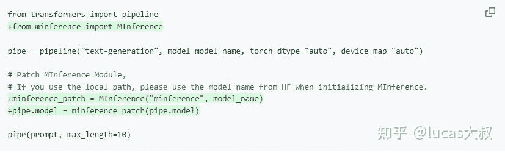
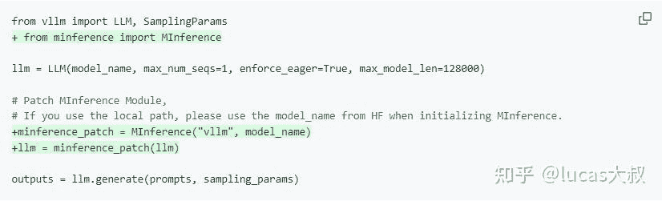
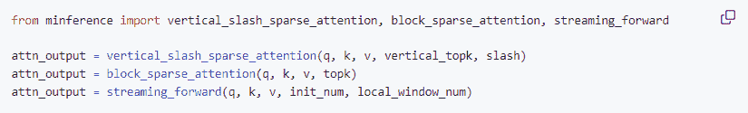
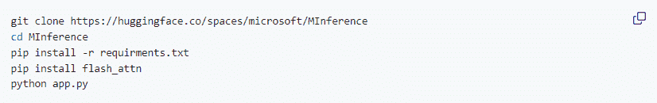
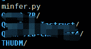

# MInference：微软出品，长上下文LLM推理提速10倍

> 来源：[https://agijuejin.feishu.cn/docx/Lvz0dlW6LoLv9MxY2exc3ARcnlg](https://agijuejin.feishu.cn/docx/Lvz0dlW6LoLv9MxY2exc3ARcnlg)

> 作者：lucas大叔

> 原文： [https://zhuanlan.z](https://zhuanlan.zhihu.com/p/713480349)hihu.com/p/713480...

**MInference 1.0 **利[用LL](https://www.zhihu.com/search?q=%E7%A8%80%E7%96%8F&search_source=Entity&hybrid_search_source=Entity&hybrid_search_extra=%7B%22sourceType%22%3A%22article%22%2C%22sourceId%22%3A713480349%7D)M注意力的动态稀疏特性（表现出一些静态模式）加速长上下文LLM的预填充。它首先离线确定每个头属于哪个 稀疏 模式，然后在线近似稀疏索引，用最优自定义内核动态计算注意力。在A100上，这种方法在保持准确率的同时，实现了高达10倍的预填充加速。


## 快速启动

### 环境要求

+   Torch

+   FlashAttention-2 (Optional)

+   Triton == 2.1.0

要使用 MInference，需首先用 pip 安装：

```
pip install minference
```

### 支持的模型

通用 MInference 支持任何解码LLM，包括LLaMA风格的模型和Phi模型。该项目已经适配[了市场](https://link.zhihu.com/?target=https%3A//github.com/microsoft/MInference/blob/main/experiments)上几乎所有[可用的开](https://www.zhihu.com/search?q=%E7%A8%80%E7%96%8F%E5%A4%B4&search_source=Entity&hybrid_search_source=Entity&hybrid_search_extra=%7B%22sourceType%22%3A%22article%22%2C%22sourceId%22%3A713480349%7D)源长上下文LLM。如果你的模型不在支持列表中，可以按照 指南 手动生成 稀疏头 配置。

执行以下操作可以获取支持的LLM的完整列表：

```
from minference import get_support_models
get_support_models()
```

当前，支持如下LLM：

+   LLaMA-3.1: [meta-llama/Meta-L](https://link.zhihu.com/?target=https%3A//huggingface.co/meta-llama/Meta-Llama-3.1-8B-Instruct)lama-3.1-8B-Instruct

+   LLaMA-3: [gradientai/Llama](https://link.zhihu.com/?target=https%3A//huggingface.co/gradientai/Llama-3-8B-Instruct-262k)-3[-8B-Instruct-262k , gradie](https://link.zhihu.com/?target=https%3A//huggingface.co/gradientai/Llama-3-8B-Instruct-Gradient-1048k)nt[ai/Llama-3-8B-Instruct-Gra](https://link.zhihu.com/?target=https%3A//huggingface.co/gradientai/Llama-3-8B-Instruct-Gradient-4194k)di[ent-1048k , gradientai/Lla](https://link.zhihu.com/?target=https%3A//huggingface.co/gradientai/Llama-3-70B-Instruct-Gradient-262k)ma[-3-8B-Instruct-Gradient-41](https://link.zhihu.com/?target=https%3A//huggingface.co/gradientai/Llama-3-70B-Instruct-Gradient-1048k)94k , gradientai/Llama-3-70B-Instruct-Gradient-262k , gradientai/Llama-3-70B-Instruct-Gradient-1048k

+   GLM-4: THUDM/glm-4-9b-chat-1m

+   Yi: 01-ai/Yi-9B-200K

+   Phi-3: microsoft/Phi-3-mini-128k-instruct

+   Qwen2: Qwen/Qwen2-7B-Instruct

### MInference使用

对HF



对vLLM，要求vllm>=0.4.1



仅使用内核



本地 [gradio demo](https://www.zhihu.com/search?q=gradio%20demo&search_source=Entity&hybrid_search_source=Entity&hybrid_search_extra=%7B%22sourceType%22%3A%22article%22%2C%22sourceId%22%3A713480349%7D)



更多详细信息，请参阅 [Examples ](https://link.zhihu.com/?target=https%3A//github.com/microsoft/MInference/tree/main/examples)和 [Experiments ](https://link.zhihu.com/?target=https%3A//github.com/microsoft/MInference/tree/main/experiments)[。另外，有关](https://link.zhihu.com/?target=https%3A//dl.acm.org/doi/10.1145/3600006.3613139)动态[编译器PIT的](https://link.zhihu.com/?target=https%3A//github.com/microsoft/SparTA/tree/pit_artifact)更多信息请参阅 paper 和 GitHub 。

## 实操验证

验证 THUDM/glm-4-9b-chat-1m 模型使用，首先导入必要的包：

```
import torch
from minference import MInference
from transformers import AutoTokenizer, AutoModelForCausalLM
```

### 加载本地LLM

由于项目有加载LLM验证，所以为了成功加载本地事先已下载的LLM，需要把执行的.py文件和LLM按如下结构存储：



### 配置model和prompt

```
[model_n](https://www.zhihu.com/search?q=%E5%B9%BF%E4%B8%9C%E6%B1%9F%E9%97%A8%E8%8D%B7%E5%A1%98%E9%95%87&amp;search_source=Entity&amp;hybrid_search_source=Entity&amp;hybrid_search_extra=%7B%22sourceType%22%3A%22article%22%2C%22sourceId%22%3A713480349%7D)ame = &quot;THUDM/glm-4-9b-chat-1m&quot;
prompt = &#x27;&#x27;&#x27;
你是信息抽取专家，请抽取文本中的姓名：

# 文本内容
刘德华（Andy Lau），1961年9月27日出生于中国香港，祖籍广东江门荷塘镇，华语影视男演员、流行乐歌手、电影制片人、作词人。

&#x27;&#x27;&#x27;
```

### 加载tokenizer和model

```
tokenizer = AutoTokenizer.from_pretrained(model_name, trust_remote_code=True)
message = [{&quot;role&quot;: &quot;user&quot;, &quot;content&quot;: prompt}]
inputs = tokenizer.apply_chat_template(
            message,
            add_generation_prompt=True,
            tokenize=True,
            return_tensors=&quot;pt&quot;,
            return_dict=True
        )
inputs = inputs.to(&quot;cuda&quot;)

model = AutoModelForCausalLM.from_pretrained(
    model_name,
    torch_dtype=torch.bfloat16,
    low_cpu_mem_usage=True,
    trust_remote_code=True,
).to(&quot;cuda&quot;).eval()

minference_patch = MInference(&quot;minference&quot;, model_name)
model = minference_patch(model)
```

### 生成响应

```
gen_kwargs = {&quot;max_length&quot;: 1024, &quot;do_sample&quot;: True, &quot;top_k&quot;: 1}
with torch.no_grad():
    outputs = model.generate(**inputs, **gen_kwargs)
    outputs = outputs[:, inputs[&#x27;input_ids&#x27;].shape[1]:]
    response = tokenizer.decode(outputs[0], skip_special_tokens=True)
    print(response)
```

返回结果为

```
根据您提供的信息，刘德华（Andy Lau）
```

## 参考文档

[https:// github.com/mi](https://link.zhihu.com/?target=https%3A//github.com/microsoft/MInference)crosoft/MI nference

[h](https://link.zhihu.com/?target=https%3A//github.com/microsoft/MInference/blob/main/examples/run_hf.py)ttps:// github.com/microsoft/MI nference/blob/main/examples/run_hf.py

glm-4-9b-chat-1m