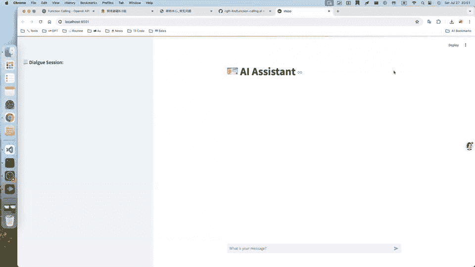

# 【大模型函数调用】function calling及自动发邮件案例

> 来源：[https://agijuejin.feishu.cn/docx/HWrJdCIF0o5ewLxvaCjcPaNonkb](https://agijuejin.feishu.cn/docx/HWrJdCIF0o5ewLxvaCjcPaNonkb)

# 👀快看👀

> **作者：**[**胖虎遛二狗**](https://space.bilibili.com/65742859)

> **原文链接：**【大模型函数调用】function calling及自动发邮件案例

> 相关代码和数据：https://github.com/echonoshy/cgft-llm

---

# ⚡️摘要⚡️

> 主要介绍了如何通过大模型函数调用（function calling）实现自动发送邮件的功能，并通过示例演示了整个过程。

---

# 🤖分集🤖

### 【大模型函数调用】function calling及自动发邮件案例

讲解大模型函数调用概念，以大模型帮发邮件为例，介绍其工作原理，演示对话及任务执行，说明代码配置，包括 126 邮箱授权码等，还讨论记忆性问题及提出思考题。

[【大模型函数调用】function calling及自动发邮件案例.mp4](https://internal-api-drive-stream.feishu.cn/space/api/box/stream/download/all/K1ORbEU5ro6py2xUlSQcpbBOnEe)

---

# ✏️课代表✏️

+   大模型本质上是一个函数，它接收输入并返回输出，但不具备执行函数的能力。

>

+   通过函数调用（function calling），可以让大模型在特定情况下调用外部函数，实现自动化任务，如发送邮件。

>

+   大模型的输出可以通过控制温度（randomness）来确定，使其在相同输入下能够返回相同的输出。

>

+   在实现自动发送邮件的案例中，需要定义工具（tools）和工作流程（workflow），以便大模型根据提供的信息决定是否执行发送邮件的函数。

>

+   为了保持对话的连贯性，可以采用滑动窗口或摘要的方法来处理大模型的记忆性问题。

>

+   在开发 AI 机器人时，应该将对话、情感和动作能力的输出结合起来，通过解析和映射这些字段来实现机器人的多样化功能。

>

+   开源代码和 GitHub 资源被提供，供开发者学习和实践大模型函数调用的相关知识。

>

+   强调了大模型函数调用的实用性和应用前景，以及通过社区互动和反馈来促进知识更新和项目改进的重要性。