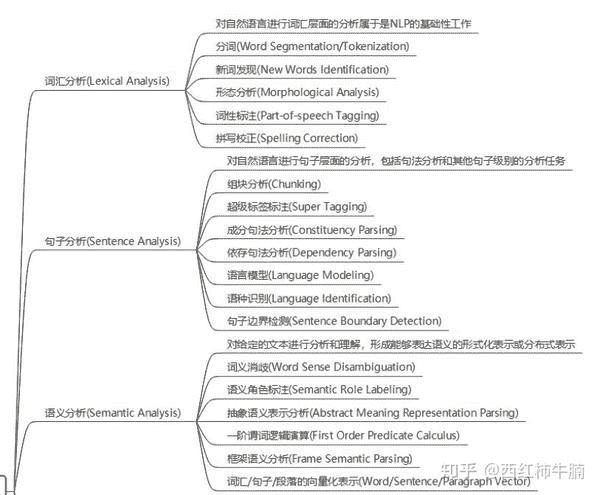
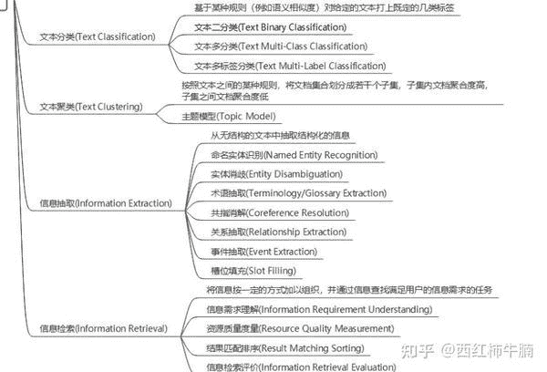
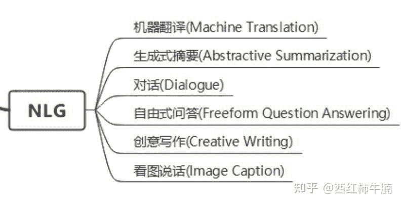

# 大模型LLM不能做什么？那些研究方向将要消失？

> 来源：[https://agijuejin.feishu.cn/docx/KIDbdOyEwoMb15xOvKbcombvnJx](https://agijuejin.feishu.cn/docx/KIDbdOyEwoMb15xOvKbcombvnJx)

> 作者：西红柿牛腩

> 原文： [https://zhuanlan.z](https://zhuanlan.zhihu.com/p/625829906)hihu.com/p/625829...

简单粗暴结论，接收反驳，^_^：

[1、 NL](https://www.zhihu.com/search?q=%E4%B8%AD%E6%96%87%E5%88%86%E8%AF%8D&search_source=Entity&hybrid_search_source=Entity&hybrid_search_extra=%7B%22sourceType%22%3A%22article%22%2C%22sourceId%22%3A625829906%7D)P很多中间任务领域将要[消失，比如](https://www.zhihu.com/search?q=%E5%8F%A5%E6%B3%95%E5%88%86%E6%9E%90&search_source=Entity&hybrid_search_source=Entity&hybrid_search_extra=%7B%22sourceType%22%3A%22article%22%2C%22sourceId%22%3A625829906%7D)NER实体识别， 中文分词 、词性标注、NE[R、 句法](https://www.zhihu.com/search?q=%E4%BB%A3%E7%A0%81%E7%94%9F%E6%88%90&search_source=Entity&hybrid_search_source=Entity&hybrid_search_extra=%7B%22sourceType%22%3A%22article%22%2C%22sourceId%22%3A625829906%7D)分析 、指代消解、语义Parser。相比而言end2end的文本生成方向，比如文本摘要， 代码生成 、机器翻译大放异彩。

2、 大模型的工作，主要是 [工程问题 ](https://www.zhihu.com/search?q=%E5%B7%A5%E7%A8%8B%E9%97%AE%E9%A2%98&search_source=Entity&hybrid_search_source=Entity&hybrid_search_extra=%7B%22sourceType%22%3A%22article%22%2C%22sourceId%22%3A625829906%7D)，技术不是主要的

3、 大模型要走向 [垂直领域 ](https://www.zhihu.com/search?q=%E5%9E%82%E7%9B%B4%E9%A2%86%E5%9F%9F&search_source=Entity&hybrid_search_source=Entity&hybrid_search_extra=%7B%22sourceType%22%3A%22article%22%2C%22sourceId%22%3A625829906%7D)的封闭状态。OpenAI的封闭是开始而不是终结。

大模型的定义：人人都在谈论大模型LLMs，但是大[模型的定](https://www.zhihu.com/search?q=%E4%BA%9A%E9%A9%AC%E9%80%8A&search_source=Entity&hybrid_search_source=Entity&hybrid_search_extra=%7B%22sourceType%22%3A%22article%22%2C%22sourceId%22%3A625829906%7D)义貌似还没有公认结论。本文采用 亚马逊 [1]的一篇综述给出的定义：

LLM（Large Language Models） ：在大量数据集上进行预训练，而不针对特定任务调优的庞大的语言模型；

微调模型fine-tuned models：通常是较小的语言模型，它们也经过预训练，然后在更小的特定任务数据集上进一步调优

## 1.1 大模型不能做什么可以做什么

在传统的 [自然语言理解 ](https://www.zhihu.com/search?q=%E8%87%AA%E7%84%B6%E8%AF%AD%E8%A8%80%E7%90%86%E8%A7%A3&search_source=Entity&hybrid_search_source=Entity&hybrid_search_extra=%7B%22sourceType%22%3A%22article%22%2C%22sourceId%22%3A625829906%7D)natural language understanding (NLU)领域， fine-tuned model比LLM更好的选择，在各个开源数据集表现绝对是霸榜。

在NLU领域数据集，比如GLUE& SuperGL[UE等， ](https://www.zhihu.com/search?q=%E7%9F%A5%E8%AF%86%E5%9B%BE%E8%B0%B1&search_source=Entity&hybrid_search_source=Entity&hybrid_search_extra=%7B%22sourceType%22%3A%22article%22%2C%22sourceId%22%3A625829906%7D)fine-tuned model 表现优异，得益于数据集标注完整，数据特征分不一致。但是这些中间任务，句法分析，信息抽取（ 知识图谱 领域的实体抽取，关系抽取，属性抽取，事件抽取），是因为原先的技术跟不上，人为中间切开的任务划分，现实世界的人类根本没有实际需求。一段话的实体识别给实际用户，用户会很懵，我要这些NER做什么？给我结果，我想要结果。

自[然语言生成](https://www.zhihu.com/search?q=%E8%BE%93%E5%85%A5%E6%96%87%E6%9C%AC&search_source=Entity&hybrid_search_source=Entity&hybrid_search_extra=%7B%22sourceType%22%3A%22article%22%2C%22sourceId%22%3A625829906%7D)[(natu](https://www.zhihu.com/search?q=%E6%9C%BA%E5%99%A8%E7%BF%BB%E8%AF%91&search_source=Entity&hybrid_search_source=Entity&hybrid_search_extra=%7B%22sourceType%22%3A%22article%22%2C%22sourceId%22%3A625829906%7D)[ral l](https://www.zhihu.com/search?q=%E7%94%9F%E6%88%90%E6%96%87%E6%9C%AC&search_source=Entity&hybrid_search_source=Entity&hybrid_search_extra=%7B%22sourceType%22%3A%22article%22%2C%22sourceId%22%3A625829906%7D)anguage Generation NLG)主要包含两大类，第一类侧重讲 输入文本 转换为新的符号，比如文本摘要、 机器翻译 。第二类侧重开放式生成，重点强调从头 生成文本 或符号，比如制作电子邮件和PPT演讲稿，新闻撰写、创作故事和诗词，编写代码。

由于强大的生成能力和创造力，LLM在大多数生成任务上都表现出优势。ChatGPT的火爆，3个月时间，中国大陆出现了二十多个大模型，并且更多的大公司小公司都在开始大模型的研究和尝试应用。

[大模型可以解决什么问题？](https://www.zhihu.com/search?q=fine-tuning&search_source=Entity&hybrid_search_source=Entity&hybrid_search_extra=%7B%22sourceType%22%3A%22article%22%2C%22sourceId%22%3A625829906%7D)大模型训练后的数据 fine-tuning 在一定表现更好？模型规模继续加大，参数量继续增多，精度还能上涨吗？

## 1.2 大模型的工作，主要是工程问题，技术不是主要的

大多数工业界的场景中，大模型并不能直接发挥价值。

深度学习时代，目前还没有解决 [神经网络 ](https://www.zhihu.com/search?q=%E7%A5%9E%E7%BB%8F%E7%BD%91%E7%BB%9C&search_source=Entity&hybrid_search_source=Entity&hybrid_search_extra=%7B%22sourceType%22%3A%22article%22%2C%22sourceId%22%3A625829906%7D)为什么有效，理论基础在哪里。大模型更想一个大函数，入参千万，出参千万，中间过程一坨狗屎，谁也不知道那个结构和参数有效没有效，只能通过对比试验来强行解释。decoder-only一定比 encoder-decoder更有效？没有人解释得清楚。

比如ImageNet这个最简单的任务，不使用Transformer架构，也可以超过ViT。在实际的工业应用中，速度、内存、功耗、训练成本都是KPI和金钱。

## 1.3 大模型走向封闭状态

不[要觉得Op](https://www.zhihu.com/search?q=%E9%A2%86%E5%9F%9F%E6%A8%A1%E5%9E%8B&search_source=Entity&hybrid_search_source=Entity&hybrid_search_extra=%7B%22sourceType%22%3A%22article%22%2C%22sourceId%22%3A625829906%7D)enAI不开源chatGPT是霸权，阿里腾讯百度字节，用只有侵犯用户隐私数据训练出来的垂直 领域模型 ，比如电商、用户画像和用户[消费习惯，](https://www.zhihu.com/search?q=%E5%90%84%E7%8E%A9%E5%90%84%E7%9A%84&search_source=Entity&hybrid_search_source=Entity&hybrid_search_extra=%7B%22sourceType%22%3A%22article%22%2C%22sourceId%22%3A625829906%7D)用户每天几点睡觉喜欢买神马喜欢偷窥什么内容，这些是互联网垄断行业的根基，不可能开放。各个专业应用比如物流煤炭电力供应链，实在是公司自己存亡的生命线，不好意思数据不能开放模型也不能开放。而开放的通用大模型，除了用户体验一下新鲜，带不来商业价值，最终只有 各玩各的 。

1.Harnessing the Power of LLMs in Practice: A Survey on ChatGPT and Beyond, arXiv:2304.13712v1

编辑于 2023-04-29 18:17 ・IP 属地广东

「真诚赞赏，手留余香」

赞赏

还没有人赞赏，快来当第一个赞赏的人吧！