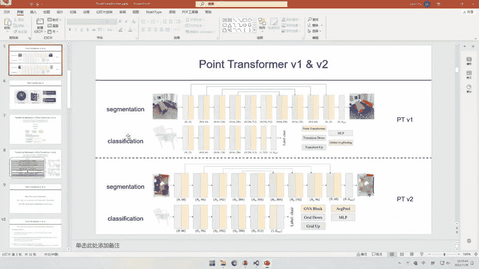

# Point Transformer v1 v2 v3简介

> 来源：[https://agijuejin.feishu.cn/docx/J6KRdIKiQo0i8NxFJOycb9ibnob](https://agijuejin.feishu.cn/docx/J6KRdIKiQo0i8NxFJOycb9ibnob)

# 👀快看👀

> **作者：**[**NobleAI**](https://space.bilibili.com/3546595134015939)

> 原文链接：Point Transformer v1 v2 v3简介

---

# ⚡️摘要⚡️

> 主要介绍了 Point Transformer 系列模型（v1、v2、v3）的发展历程、架构变化以及关键技术，并探讨了这些模型在 3D 点云处理任务中的应用和改进。

---

# 🤖分集🤖

### Point Transformer v1 v2 v3简介

> 阐述 Point Transformer 系列模型演进。先介绍 v1 用自注意力机制处理 3D 点云任务；再分析 v2 引入 GVA、改进位置编码及用 Graph Pooling 替代 KNN；最后介绍 v3 的创新，如序列化点云、新相对位置编码等提升准确率和效率。

[Point Transformer v1 v2 v3简介.mp4](https://internal-api-drive-stream.feishu.cn/space/api/box/stream/download/all/JsFhbNqrGo9ztnxPnOScFPa2nNb)

---

# ✏️课代表✏️

+   Point Transformer v1 引入了自注意力机制，通过 KNN 进行局部特征提取，适用于点云的分类和语义分割任务。

>

+   Point Transformer v2 通过 GV A 机制减少了参数量，提高了模型的泛化能力；改进了相对位置编码，增强了对 3D 空间信息的敏感性；引入了 Graph Pooling，减少了计算复杂度。

>

+   Point Transformer v3 采用了 Serialization 技术，通过将点云序列化，简化了注意力机制的计算，提高了处理效率；提出了新的位置编码方法，进一步提升了模型性能。

>

+   作者认为，模型性能的提升更多依赖于规模和数据的利用，而不仅仅是模型结构的创新。通过引入 Serialization 和改进的位置编码，Point Transformer v3 在保持模型简洁的同时，显著提高了处理 3D 点云的能力。