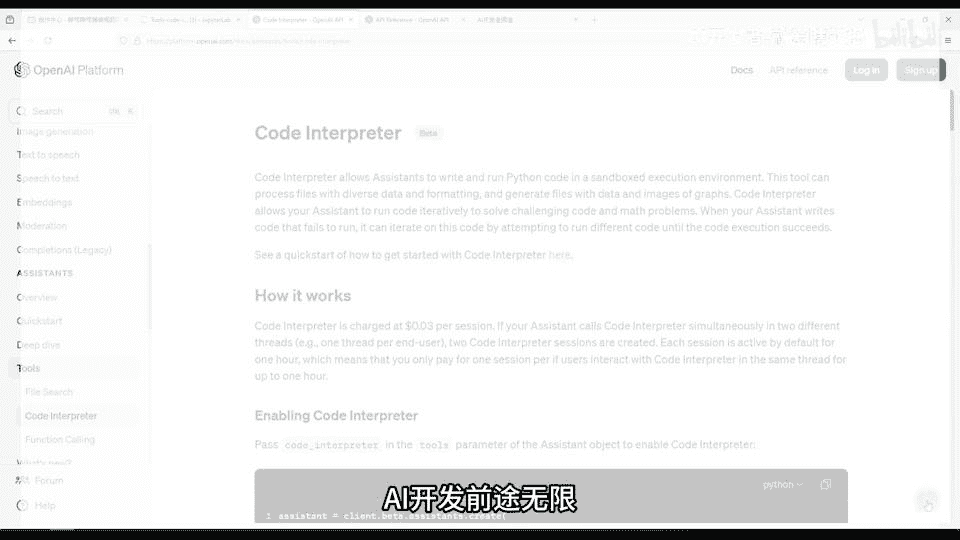

# LLM应用最最最重要的设计模式：Code Interpreter模式

> 来源：[https://agijuejin.feishu.cn/docx/UqRtdUy8oo8d3cxHb8lcObrcnQc](https://agijuejin.feishu.cn/docx/UqRtdUy8oo8d3cxHb8lcObrcnQc)

# 👀快看👀

> **作者：**[**AI开发者-就爱瞎鼓捣**](https://space.bilibili.com/3546604218878676)

> **原文链接：**LLM应用最最最重要的设计模式：Code Interpreter模式

> 视频中的文档及代码分享：https://techdiylife.github.io/blog/blog.html?category1=c01&blogid=0063

---

# ⚡️摘要⚡️

> 了解 Code interpreter 以及如何使用 OpenAI API 来使用 Code Interpreter。

---

# 🤖分集🤖

### LLM应用最最最重要的设计模式：Code Interpreter模式

介绍了 OpenAI 的 code interpreter，包括其功能如在沙盒环境运行 Python 代码、处理多种文件等，可用于代码验证、数据分析等，通过实例演示使用方法及处理数据步骤，分析可能遇到的问题，强调其作为大模型补充的重要性，还提到开源版工具 open interpret 及未来将介绍本地化处理。

[LLM应用最最最重要的设计模式：Code Interpreter模式.mp4](https://internal-api-drive-stream.feishu.cn/space/api/box/stream/download/all/FfVrbshM3oPdNqxgHr0cvxFOn7d)

---

# ✏️课代表✏️

+   功能概述：解释 code interpreter 的基本功能，包括在沙盒执行环境写和运行 Python 代码、处理多种数据和格式文件、生成含数据和图形图像文件。强调可反复运行代码解决复杂问题，提及费用和时间限制。

>

+   应用场景：根据 OpenAI 描述总结其用途，如 Python 代码验证、辅助数据分析、调用图表和图像生成程序、生成动画及用于 OCR 处理从 PDF 提取文本。指出大语言模型在计算和作图方面不足，code interpreter 可作为补充。

>

+   实例演示：通过实际例子演示使用 chat gbt 的 web 端和 API 统计表格中语音数据总时间长度，展示后台自动处理数据过程，详细说明使用 OpenAI 的 API 进行数据处理的步骤，包括建立文件对象、创建 assistant 对象和 thread 以及运行和打印 message 信息。

>

+   问题分析与未来展望：分析 code interpreter 处理数据时可能遇到的问题，如数据格式错误和超出 token 数限制，强调其作为大模型补充的重要性，用于处理大模型不擅长部分并验证其生成内容。提到开源版工具 open interpret，表明未来会介绍其本地化处理。