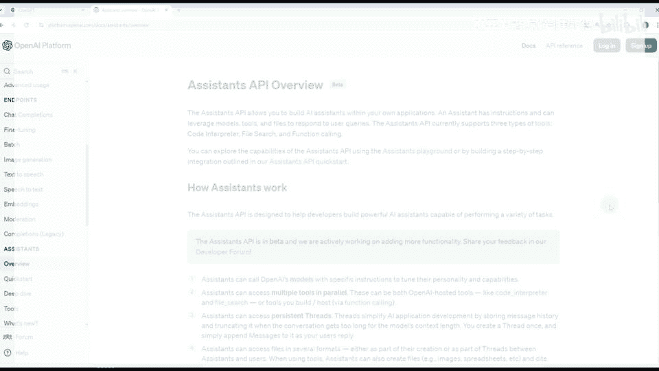

# Agents系列：OpenAI Assistants是如何工作的？

> 来源：[https://agijuejin.feishu.cn/docx/TzV2dt5lNojIZNx7PvjcraNonec](https://agijuejin.feishu.cn/docx/TzV2dt5lNojIZNx7PvjcraNonec)

# 👀快看👀

> **作者：**[**AI开发者-就爱瞎鼓捣**](https://space.bilibili.com/3546604218878676)

> **原文链接：**Agents系列：OpenAI Assistants是如何工作的？

> 视频中的文档及代码分享：https://techdiylife.github.io/blog/blog.html?category1=c01&blogid=0063

---

# ⚡️摘要⚡️

> 介绍一下OpenAI的RAG（file search）功能，来看看OpenAI使用了什么样的技术来优化RAG的表现。

---

# 🤖分集🤖

### Agents系列：OpenAI Assistants是如何工作的？

介绍 OpenAI 的 Assistance API，可构建 AI 助手，有个性化设置等功能，阐述其工作原理及展示简单程序运行过程。

[Agents系列：OpenAI Assistants是如何工作的？.mp4](https://internal-api-drive-stream.feishu.cn/space/api/box/stream/download/all/EgX4bfR9qo2CL0xt3Cwc8rGOn9f)

---

# ✏️课代表✏️

+   功能详述：详细说明 Assistance API 的功能，包括模型个性化设置、支持多工具并行访问、历史对话记录管理、文本截断处理及支持多种格式文件访问，简化 AI 应用开发。

>

+   工作原理阐述：描述 Assistance API 工作原理，通过创建 assistant 对象定义名称等参数，介绍 thread 对象管理会话及 run 对象处理数据的作用。

>

+   程序展示与结尾：展示最简单的 Assistance API 程序运行过程，提醒观众点赞并感谢观看，预告下期内容。