# 万字长文入门大语言模型（LLM）

> 来源：[https://agijuejin.feishu.cn/docx/BI02dayDPoNtNFxjxinc10aWnUg](https://agijuejin.feishu.cn/docx/BI02dayDPoNtNFxjxinc10aWnUg)

> 作者：王大锤

> 原文： [https://zhuanlan.z](https://zhuanlan.zhihu.com/p/654041855)hihu.com/p/654041...

## 简介

[本文是自己在学习LLM时，阅读 ](https://link.zhihu.com/?target=https%3A//arxiv.org/abs/2303.18223)[《A S](https://www.zhihu.com/search?q=%E9%A2%97%E7%B2%92%E5%BA%A6&search_source=Entity&hybrid_search_source=Entity&hybrid_search_extra=%7B%22sourceType%22%3A%22article%22%2C%22sourceId%22%3A654041855%7D)urvey of Large Language Models》 和其他相关材料时的笔记，力求对构建LLM涉及的主要环节有一个大 颗粒度 的全景感知，一些比较关键或者感兴趣的话题会附上一些推荐阅读的博客。希望能根据这篇博客，读者也能按图索骥式的去学习LLM。

### LLM涌现出的3大能力

+   [**In-context **](https://www.zhihu.com/search?q=In-context&search_source=Entity&hybrid_search_source=Entity&hybrid_search_extra=%7B%22sourceType%22%3A%22article%22%2C%22sourceId%22%3A654041855%7D)**learning **：在GPT-3中正式被提出。在 不需要重新训练 的情况下，通过自然语言指令，并带几个期望输出的样例，LLM就能够学习到这种输入输出关系，新的指令输入后，就能输出期望的输出。

+   Instruction fol[lowin](https://www.zhihu.com/search?q=%E6%8C%87%E4%BB%A4%E5%BE%AE%E8%B0%83&search_source=Entity&hybrid_search_source=Entity&hybrid_search_extra=%7B%22sourceType%22%3A%22article%22%2C%22sourceId%22%3A654041855%7D)g[ ：通过在](https://www.zhihu.com/search?q=%E6%B3%9B%E5%8C%96%E8%83%BD%E5%8A%9B&search_source=Entity&hybrid_search_source=Entity&hybrid_search_extra=%7B%22sourceType%22%3A%22article%22%2C%22sourceId%22%3A654041855%7D)多种任务数据集上进行 指令微调 （instruction tuning），LLM可以在没有见过的任务上，通过指令的形式表现良好，因此具有较好的 泛化能力 。

+   Step[-by-](https://www.zhihu.com/search?q=%E6%80%9D%E7%BB%B4%E9%93%BE&search_source=Entity&hybrid_search_source=Entity&hybrid_search_extra=%7B%22sourceType%22%3A%22article%22%2C%22sourceId%22%3A654041855%7D)step reasoning ：通过 思维链 （chain-of-thought）提示策略，即把大任务分解成一步一步小任务，让模型think step by step得到最终答案。

### LLM的关键技术

+   **Scaling **：更多的模型参数、数据量和训练计算，可以有效提升模型效果。

+   **Training **[：分布式训练](https://www.zhihu.com/search?q=GPT-4&search_source=Entity&hybrid_search_source=Entity&hybrid_search_extra=%7B%22sourceType%22%3A%22article%22%2C%22sourceId%22%3A654041855%7D)策略及一些提升训练稳定性和效果的优化trick。另外还有 GPT-4 也提出去建立一些特殊的工程设施通过小模型的表现去预测大模型的表现（predictable scaling）。

+   Ability eliciting ：能力引导。设计合适的任务指令或具体的上下文学习策略可以激发LLM在庞大预料上学习到的能力。

+   Al[ignme](https://www.zhihu.com/search?q=%E5%AF%B9%E9%BD%90%E5%BE%AE%E8%B0%83&search_source=Entity&hybrid_search_source=Entity&hybrid_search_extra=%7B%22sourceType%22%3A%22article%22%2C%22sourceId%22%3A654041855%7D)nt tuning ： 对齐微调 。为了避免模型输出一些不安全或者不符合人类正向价值观的回复，InstructGPT利用RLHF（reinforcement learning with human feedback）技术实现这一目的。

+   Tools manipulation ：工具操作。为了弥补模型不擅长非文本输出任务和实时信息缺失的问题，让模型可以使用计算器、搜索引擎或者给模型安装插件等工具

### OpenAI GPT系列模型发展历程

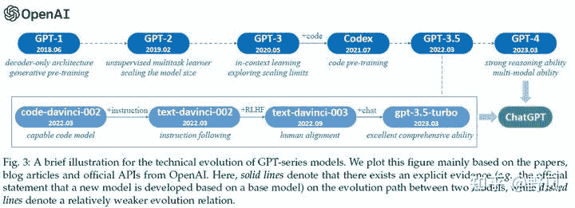

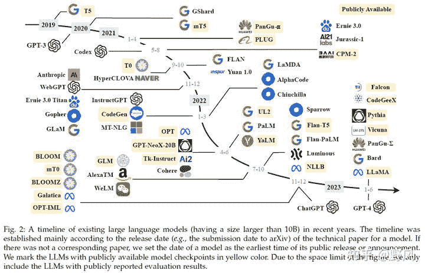

推荐阅读

+   拆解追溯 GPT-3.5 各项能力的起源

+   [GPT / GPT-2 / GPT-](https://zhuanlan.zhihu.com/p/609716668)3 / InstructGPT 进化之路

### LLM训练一般流程

[Andrej Karpat](https://link.zhihu.com/?target=https%3A//www.bilibili.com/video/BV1Xh4y1x7BT/)hy在他的演讲 State of G[PT 中](https://www.zhihu.com/search?q=%E5%85%A8%E6%99%AF%E5%9B%BE&search_source=Entity&hybrid_search_source=Entity&hybrid_search_extra=%7B%22sourceType%22%3A%22article%22%2C%22sourceId%22%3A654041855%7D)分享了GPT大模型的训练pipline，可以作为如何训练LLM的一个步骤 全景图 ，后文内容也是围绕这些步骤进行展开的

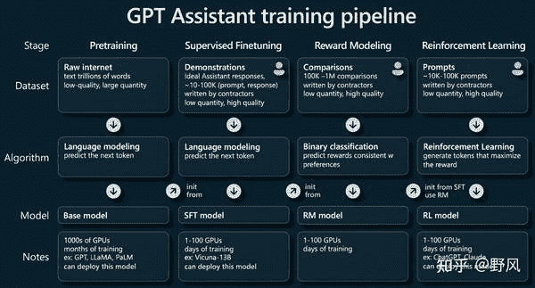

[演讲内容 ](https://link.zhihu.com/?target=https%3A//karpathy.ai/stateofgpt.pdf)记录：

+   Pretraining

+   该步骤占99%的训练时间

+   对LLM涉及的一些数字有个粗略印象： 每个LLM开发者都应该知道的数字

+   GPT-2开启了prompting 高于finetuning的时代

+   base model不会回答问题，只会去补全一个文档，经常会[用更多问题](https://www.zhihu.com/search?q=%E6%8F%90%E7%A4%BA%E5%B7%A5%E7%A8%8B&search_source=Entity&hybrid_search_source=Entity&hybrid_search_extra=%7B%22sourceType%22%3A%22article%22%2C%22sourceId%22%3A654041855%7D)去回答一个问题，但是可以通过 提示工程 触发它完成一些任务，如下图这样做。（这里有点像CoT了

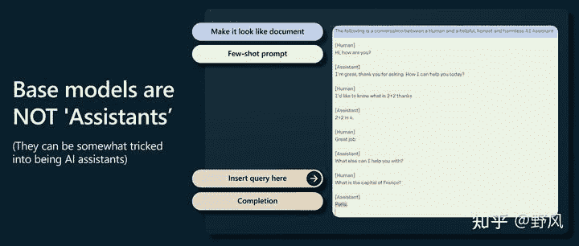

+   Supervised Finetuning，对应后文Instruction Tuning

+   在高质量少量数据上finetuning，让模型更像一个助手

+   Reward Modeling，对应后文Alignment Tuning

+   人工对同一 [prompt ](https://www.zhihu.com/search?q=prompt&search_source=Entity&hybrid_search_source=Entity&hybrid_search_extra=%7B%22sourceType%22%3A%22article%22%2C%22sourceId%22%3A654041855%7D)[的多条响应](https://www.zhihu.com/search?q=%E8%AE%AD%E7%BB%83%E6%A0%B7%E6%9C%AC&search_source=Entity&hybrid_search_source=Entity&hybrid_search_extra=%7B%22sourceType%22%3A%22article%22%2C%22sourceId%22%3A654041855%7D)进行排序，如下图构建 训练样本 ，让奖励模型去预测 <|reward|> ，loss函数则去比较这个预测值大小与人工排序的一致性。

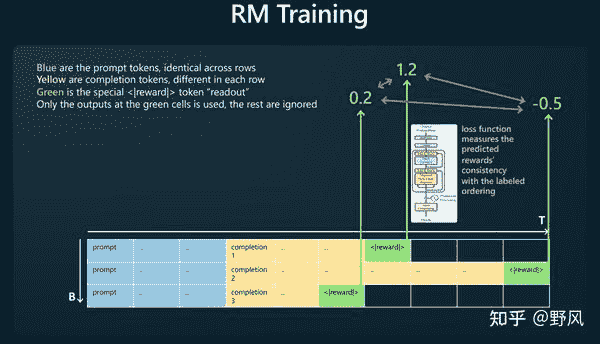

+   Reinforcement Learning

+   使用RM对SFT模型生成的结果进行打分，使用PPO算法以最大化rewards为目标进行训练，得到最终模型

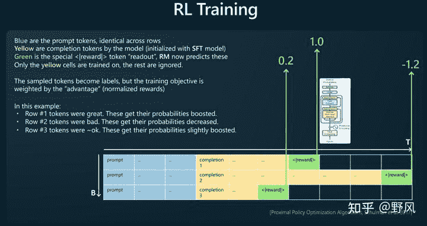

+   判断比生成更容易。比如判断一首诗坏好坏比写一首诗更容易。所以这也解释了为什么使用RLHF

+   base model相比 [RLHF model ](https://www.zhihu.com/search?q=RLHF%20model&search_source=Entity&hybrid_search_source=Entity&hybrid_search_extra=%7B%22sourceType%22%3A%22article%22%2C%22sourceId%22%3A654041855%7D)有更多的“熵”，所以能生成更多样的内容

## 资源

### 模型/API资源

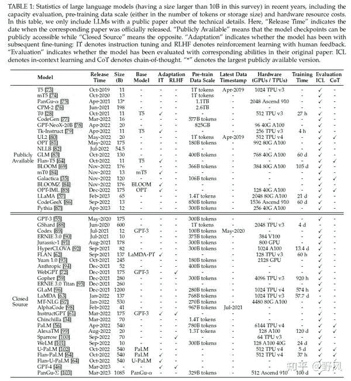

+   [LLaMA ](https://link.zhihu.com/?target=https%3A//huggingface.co/docs/transformers/main/en/model_doc/llama)(65B version)、 [LLaMA 2 ](https://zhuanlan.zhihu.com/p/650614370)[：目前开源](https://www.zhihu.com/search?q=%E6%8C%87%E4%BB%A4%E7%B2%BE%E8%B0%83&search_source=Entity&hybrid_search_source=Entity&hybrid_search_extra=%7B%22sourceType%22%3A%22article%22%2C%22sourceId%22%3A654041855%7D)模型中，生态最好。很多基于LLaMA小版本的 指令精调 定制模型，如果需要LLaMA适配非英语，一般需要扩充词表和在目标语言数据进行指令精调。

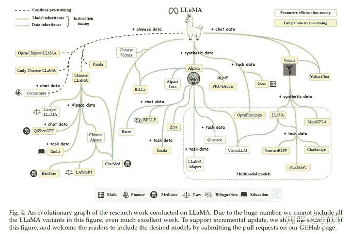

+   [Flan-T5 ](https://link.zhihu.com/?target=https%3A//huggingface.co/docs/transformers/main/en/model_doc/flan-t5)(11B version)：可以作为指令精调的首选模型

+   [CodeGen ](https://link.zhihu.com/?target=https%3A//huggingface.co/docs/transformers/main/en/model_doc/codegen)(11B version)： [自回归模型 ](https://www.zhihu.com/search?q=%E8%87%AA%E5%9B%9E%E5%BD%92%E6%A8%A1%E5%9E%8B&search_source=Entity&hybrid_search_source=Entity&hybrid_search_extra=%7B%22sourceType%22%3A%22article%22%2C%22sourceId%22%3A654041855%7D)，可作为代码生成的模型。同时发布了MTPB数据集，用于评测大模型代码生成能力

+   [NLLB ](https://link.zhihu.com/?target=https%3A//huggingface.co/docs/transformers/model_doc/nllb)：54.5B，机器翻译大模型

+   mT0 (13B version)：在多语言任务上进行了多语言指令精调

+   [PanGu-α ](https://link.zhihu.com/?target=https%3A//www.huaweicloud.com/product/pangu.html)：中文任务上表现了良好的zero-shot 和 few-shot性能。最大200B，公开的13B

+   [Falcon ](https://zhuanlan.zhihu.com/p/637008693)（7B、40B）：数据清理工作做的好，RefinedWeb数据集

+   [GPT-NeoX-20B](https://link.zhihu.com/?target=https%3A//huggingface.co/docs/transformers/model_doc/gpt_neox)

+   [OPT ](https://link.zhihu.com/?target=https%3A//huggingface.co/docs/transformers/model_doc/opt)(175B version)：及其指令精调版本OPT-IML

+   [BLOOM ](https://link.zhihu.com/?target=https%3A//huggingface.co/docs/transformers/model_doc/bloom)(176B version) BLOOMZ (176B version)：可以作为多语言模型的基础模型

+   [GLM ](https://link.zhihu.com/?target=https%3A//github.com/THUDM/GLM)：中文对话模型ChatGLM2-6B

+   GPT-3 series：ada, babbage（GPT3-1B）, curie（GPT3-6.7B）, davinci (the most powerful version in GPT-3 series 178B), text-ada-001, text-babbage-001, and text-curie-001。前四个可以在OpenAI的服务上作为基础模型进行微调。 code-cushman-001 、code-davinci-002用于代码生成。

+   GPT-3.5 series：基础模型code-davinci-002，三个加强版text-da[vinc](https://www.zhihu.com/search?q=%E5%AE%A2%E6%88%B7%E7%AB%AF&search_source=Entity&hybrid_search_source=Entity&hybrid_search_extra=%7B%22sourceType%22%3A%22article%22%2C%22sourceId%22%3A654041855%7D)i-002, text-davinci-003, and gpt-3.5-turbo-0301（ChatGPT 客户端 背后的模型）

+   GPT-4 series：gpt-4, gpt-4-0314, gpt-4-32k, and gpt-4-32k-0314

推荐阅读：

+   想学习大语言模型(LLM)，应该从哪个开源模型开始？

### 数据集

分为六类：Books, CommonCrawl, Reddit links, Wikipedia, Code, and others.

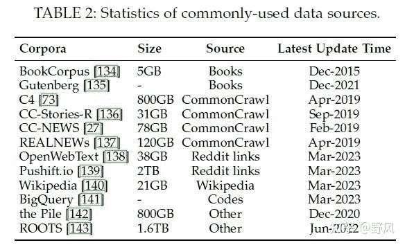

推荐阅读

+   大模型训练的有哪些数据集？LLM大模型训练有哪些通用语料？

### 库

+   Transformers：Hugging Face维护的，社区活跃，有众多基于Transformer架构的模型实现，使用便捷

+   大模型训练框架：DeepSpeed（Microsoft）、Megatron-LM（NVIDIA）、JAX（Google）、Colossal-AI（HPC-AI Tech）、BMTrain（OpenBMB）、FastMoE等

+   PyTorch、TensorFlow、MXNet 、 PaddlePaddle 、MindSpore、OneFlow

## 预训练

### [数据预处理](https://www.zhihu.com/search?q=%E6%95%B0%E6%8D%AE%E9%A2%84%E5%A4%84%E7%90%86&search_source=Entity&hybrid_search_source=Entity&hybrid_search_extra=%7B%22sourceType%22%3A%22article%22%2C%22sourceId%22%3A654041855%7D)

预训练数据包括通用文本数据，比如网页信息文本、对话文本还有书籍，另外还有专业文本数据，比如多语言文本、科学领域文本、代码等。对于来自不同地方，多种格式类型的数据，需要做很仔细的数据预处理，不然会对模型效果产生很大的影响。

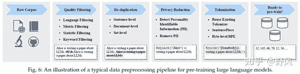

推荐阅读：

+   [大模型时代下数据的重要性 ](https://zhuanlan.zhihu.com/p/639207933)：Data-centric Artificial Intelligence: A Survey 这篇综述的一个讲解，并在后面介绍了一些与大模型有关的数据方面的工作，即相关工作中心都是在研究怎么玩转数据

### [模型架构](https://www.zhihu.com/search?q=%E6%A8%A1%E5%9E%8B%E6%9E%B6%E6%9E%84&search_source=Entity&hybrid_search_source=Entity&hybrid_search_extra=%7B%22sourceType%22%3A%22article%22%2C%22sourceId%22%3A654041855%7D)

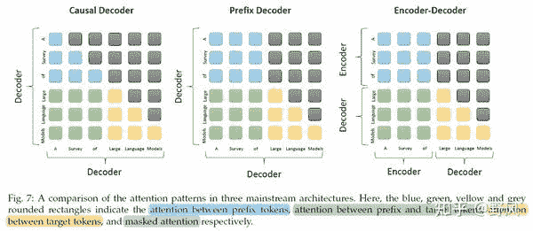

基于Transformer架构的LLM可以分为3类：

+   C[ausal Deco](https://www.zhihu.com/search?q=Zero-Shot&search_source=Entity&hybrid_search_source=Entity&hybrid_search_extra=%7B%22sourceType%22%3A%22article%22%2C%22sourceId%22%3A654041855%7D)der：从左到右的单向注意力。自回归语言模型，预训练和下游应用一致，生成类任务效果好。训练效率高。 Zero-Shot 能力强，涌现能力。如GPT系列、LLaMA、BLOOM、OPT

+   [Encode](https://www.zhihu.com/search?q=%E5%8F%8C%E5%90%91%E6%B3%A8%E6%84%8F%E5%8A%9B&search_source=Entity&hybrid_search_source=Entity&hybrid_search_extra=%7B%22sourceType%22%3A%22article%22%2C%22sourceId%22%3A654041855%7D)r-Decoder：输入 双向注意力 ，输出单向注意力。对问题的编码理解更充分，在偏理解的NLP任务上表现相对较好，缺点是在长文本生成任务上效果较差，训练效率低。如T5、Flan-T5、BART

+   Prefix Decoder：输入双向注意力，输出单向注意力。前两者的折中。训练效率也低。如GLM、ChatGLM、U-PaLM

目前大部分模型都是基于Causal Decoder，但为什么比其他架构好，缺乏理论支撑。Long Context目前是基于Transformer结果模型的一大缺点，受限于较长时间和内存的资源需求。LLM能编码Long Context的能力称为extrapolation capability。

推荐阅读

+   [Transformer 101系列] 初探LLM基座模型

### 模型训练

+   Batch Training：一般会设一个较大的数2048 examples~4M tokens，GPT-3中还介绍了一种动态增大batch size的方法

+   [learning rate ](https://www.zhihu.com/search?q=learning%20rate&search_source=Entity&hybrid_search_source=Entity&hybrid_search_extra=%7B%22sourceType%22%3A%22article%22%2C%22sourceId%22%3A654041855%7D)：预训练时一般都会用 [warm-up ](https://www.zhihu.com/search?q=warm-up&search_source=Entity&hybrid_search_source=Entity&hybrid_search_extra=%7B%22sourceType%22%3A%22article%22%2C%22sourceId%22%3A654041855%7D)和decay策略，最大值一般在5e-5到1e-4之间

+   梯度裁剪：通常将梯度裁剪为1

+   optimizer：Adam 和 AdamW。权重衰减系数设置为0.1。AdamW相当于Adam加了一个L2正则项

+   稳定性：weight decay、gradient cl[ipping。LLM训](https://www.zhihu.com/search?q=loss%20spike&search_source=Entity&hybrid_search_source=Entity&hybrid_search_extra=%7B%22sourceType%22%3A%22article%22%2C%22sourceId%22%3A654041855%7D)练的时候还会碰到 loss spike 问题，有些简单的解决办法就是重新训练，重最近的一个checkpoint开始，跳过发生loss spike的数据。GLM工作中发现，embedding layer中不正常的梯度会导致这个问题，通过缩减这个梯度，会环节spike的问题

+   Scalable Training Techniques：

+   3D Parallelism：指结合data parallelism, pipeline parallelism （GPipe、PipeDream）, 和 tensor parallelism（Megatron-LM、Colossal-AI）三种并行方法

+   ZeRO：data paralleli[sm场景下](https://www.zhihu.com/search?q=%E6%A8%A1%E5%9E%8B%E6%A2%AF%E5%BA%A6&search_source=Entity&hybrid_search_source=Entity&hybrid_search_extra=%7B%22sourceType%22%3A%22article%22%2C%22sourceId%22%3A654041855%7D)，每个GPU都会存模型参数、 模型梯度 和优化器参数，但这些数据在每个GPU上都存一遍是存在冗余的，ZeRO就是去解决这个问题。pytorch的FSDP也是做了这样的优化。

+   Mixed Precision Training：BF16 vs FP16

+   predictable scaling：GPT4提出的通过小模型预测大模型的性能，减少出错带来的损失

### GPT-4相关技术

已下截图来自 [开源项目 ](https://www.zhihu.com/search?q=%E5%BC%80%E6%BA%90%E9%A1%B9%E7%9B%AE&search_source=Entity&hybrid_search_source=Entity&hybrid_search_extra=%7B%22sourceType%22%3A%22article%22%2C%22sourceId%22%3A654041855%7D)MetaGPT作者 [直播分享](https://link.zhihu.com/?target=https%3A//www.bilibili.com/video/BV1Ru411V7XL)

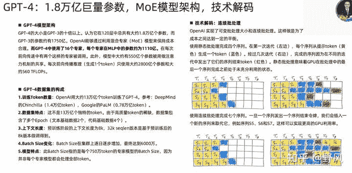

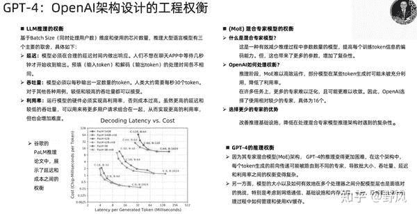

## Adaptation of LLMs

### Instruction Tuning

指令微调指的是使用一些自然语言描述的指令形式样本去用监督学习的方式微调预训练大模型（base model），经过指令精调后，LLM能在一些未见过的任务上表现较好的能力，甚至是多语言场景。

### 指令形式的样本实例

包含

+   任务描述（即指令）

+   (optional) 示例输入

+   输出

+   (optional) 解释

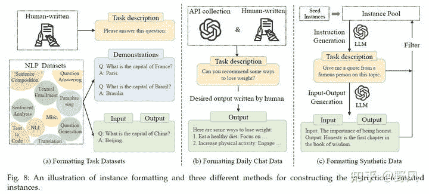

[指令样本 ](https://www.zhihu.com/search?q=%E6%8C%87%E4%BB%A4%E6%A0%B7%E6%9C%AC&search_source=Entity&hybrid_search_source=Entity&hybrid_search_extra=%7B%22sourceType%22%3A%22article%22%2C%22sourceId%22%3A654041855%7D)的关键点：

+   扩大指令范围：增加指令的任务种类数、加强对任务描述的长度、结构和创意性对加强LLM泛化能力很重要

+   格式的设计：增加任务描述和对输入输出的解释有帮助，但在指令中加入其他内容（如应避免的事项、原因和建议）对效果提示帮助有限甚至有负向影响。对于需要推理的任务，同时加入思维链和非思维链的样例，也有助于提升效果

+   邀请人去注释人类需要的任务，比只使用数据集里的任务要强

指令精调可以看做是一个有监督训练的过程，相比于预训练过程，它的训练目标是seq2seq l[oss，同时也需要更](https://www.zhihu.com/search?q=attention&search_source=Entity&hybrid_search_source=Entity&hybrid_search_extra=%7B%22sourceType%22%3A%22article%22%2C%22sourceId%22%3A654041855%7D)小的batch size和learning rate，关于 attention 的使用也有差别，下面是几个训练时的做法

+   平衡不同任务的指令样本数量，examples-proportional mixing strategy

+   将指令微调和预训练结合。OPT-IML在指令微调的时候结合预训练的数据；GLM-130B和Galactica直接将指令微调的数据作为预训练的一小部分数据去预训练LLM

一些效果

+   仅使用英文指令精调，可以提升多语言任务的表现

+   在垂直专业领域进行指令微调，可以提升LLM在该领域的表现

### 对 self-instruct指令 进行效果提升的策略

+   增强指令的复杂度，比如增加更多任务要求和更多的推理步骤

+   增加指令话题的多样性

+   增加指令的数量，不一定有效

+   平衡指令的复杂程度。通过 [困惑度 ](https://www.zhihu.com/search?q=%E5%9B%B0%E6%83%91%E5%BA%A6&search_source=Entity&hybrid_search_source=Entity&hybrid_search_extra=%7B%22sourceType%22%3A%22article%22%2C%22sourceId%22%3A654041855%7D)去除过于简单和复杂的指令

指令微调建议：

要在 LLMs 上进行指令调优，可以根据下表 中关于所需 GPU[ 数量和调优时间的基本统](https://link.zhihu.com/?target=https%3A//github.com/tatsu-lab/stanford_alpaca/%23finetuning)[计数据来准备](https://www.zhihu.com/search?q=%E6%8C%87%E4%BB%A4%E6%95%B0%E6%8D%AE%E9%9B%86&search_source=Entity&hybrid_search_source=Entity&hybrid_search_extra=%7B%22sourceType%22%3A%22article%22%2C%22sourceId%22%3A654041855%7D)计算资源。设置好开发环境后，建议初学者按照 Alpaca 软件仓库 的代码进行指令调优。随后，应选择基础模型并构建 指令数据集 ，当用于训练的计算资源有限时，用户可以利用 LoRA 进行参数高效调整。至于推理，用户可以进一步使用量化方法，在更少或更小的 GPU 上部署 LLM。

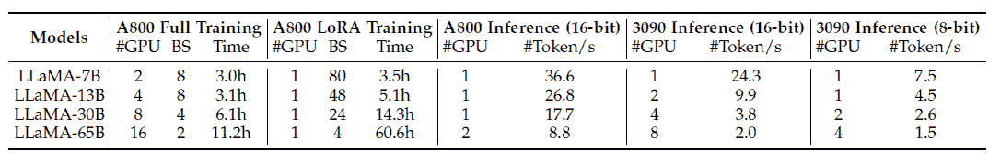

### Alignment Tuning

### **对齐微调是为了**让LLM的输出更符合人类价值观和偏好（helpful, honest , and harmless)），减少虚假、不准确或者避免生成一些有害的信息。但这种对齐微调也会一定程度减弱模型的泛化程度，一般称这种现象为alignment tax。

### 人类反馈收集

对工人打标员要求会比较高，如有一定的教育水平，会英文等。标注的方式可以分为两种：

+   基于问题的：研究人员设计一系列问题让打标人员去回答

+   基于规则的：不仅打标员去选择一个最好的输出（LLMs生成的），并且通过提前设定一系列规则去过滤模型生成的不符合人类价值偏好的结果。

### RLHF

RLHF（Reinforcement Learning from Human Feedback）系统主要包含三个关键元素：需要被对齐精调的预训练LM、通过人类反馈学习的的奖励模型和强化学习训练LM。

RLHF分为三个步骤：

1.  （可选）Supervised [fine-tuning ](https://www.zhihu.com/search?q=fine-tuning&search_source=Entity&hybrid_search_source=Entity&hybrid_search_extra=%7B%22sourceType%22%3A%22article%22%2C%22sourceId%22%3A654041855%7D)：将收集的有监督指令集，包含指令+人类回答作为预训练模型fine-tuning的数据，提升LM初始化能力

1.  Reward model training：采样指令（来自有监督指令集或者人工生成）输入LM，LM生成若干个结果，标注员对这些结果进行排序，从而训练奖励模型

1.  RL[ fine-tun](https://www.zhihu.com/search?q=tokens%E5%BA%8F%E5%88%97&search_source=Entity&hybrid_search_source=Entity&hybrid_search_extra=%7B%22sourceType%22%3A%22article%22%2C%22sourceId%22%3A654041855%7D)in[g：将对齐](https://www.zhihu.com/search?q=KL%E6%95%A3%E5%BA%A6&search_source=Entity&hybrid_search_source=Entity&hybrid_search_extra=%7B%22sourceType%22%3A%22article%22%2C%22sourceId%22%3A654041855%7D)过程视为一个强化学习过程，预训练LM作为policy，指令作为其输入，其输出指令的回答，action space是所有词表，state是当前已经生成的 tokens序列 ，奖励reward由第二步的奖励模型给出。InstructGPT使用PPO算法优化，为了避免最终的Aligned LM与初始预训练LM表现差距过大，还加入了两者对同一指令输入得到的输出的 KL散度 作为惩罚。

注意2、 3步可以多次迭代进行，以得到更好的结果。由于RL并不太稳定，也有工作使用其他有监督的方法取到RL进行微调。

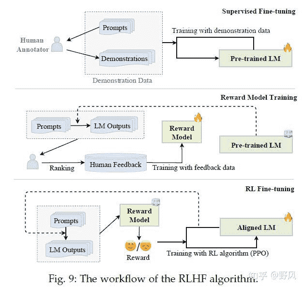

推荐阅读：

+   [RLHF实践 ](https://zhuanlan.zhihu.com/p/635569455)：比较详细的讲了强化学习微调阶段的原理和踩的坑，具有实践指导意义

+   [从零实现LLM-RLHF](https://zhuanlan.zhihu.com/p/649665766)

+   [基于 LoRA 的 RLHF ](https://zhuanlan.zhihu.com/p/644900128)：可以自己跟着动手玩一玩的教程

+   反思RLHF，如何更加高效训练有偏好的LLM

+   如何有效进行RLHF的数据标注？ ：对数据标注过程有一个非常有指导意义的介绍

### Parameter-Efficient Model Adaptation

LLM参数量很大，想要去做全量参数的fine turning代价很大，所以需要一些高效经济的方法。

一些PEFT（Parameter-Efficient Fine-Tuning）方法

+   Adapter Tuning

+   Prefix Tuning

+   Prompt Tuning

+   Low-Rank Adapation(LoRA)

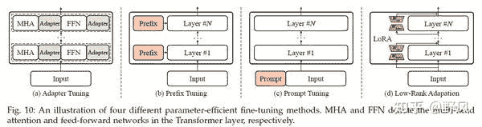

推荐阅读：

+   [【万字长文】LLaMA, Cha](https://zhuanlan.zhihu.com/p/635710004)tGLM, BLOOM的参数高效微调实践

+   [大](https://zhuanlan.zhihu.com/p/636362246)模型参数高效微调技术原理综述（六）-MAM Adapter、UniPELT - 知乎 (zhihu.com)

+   [让天下没有难Tuning的大模型-PEFT技](https://zhuanlan.zhihu.com/p/618894319)术简介 - 知乎 (zhihu.com)

### Memory-Efficient Model Adaptation

由于LLM的参数量巨大，在推理的时候非常占用内存，导致其很难在应用中部署，所以需要一些减少内存占用的方法，比如LLM中的量化压缩技术

+   quantization-aware training (QAT)，需要额外的全模型重训练

+   Efficient fine-tuning enhanced quantization，QLoRA

+   Quantization-aware training (QAT) for LLMs

+   post-training quantization (PTQ)，不需要重训练

+   Mixed-precision decomposition

+   Fine-grained quantization

+   Balancing the quantization difficulty

+   Layerwise quantization

LLM由于参数量巨大，更适合PTQ。另外，LLM 呈现出截然不同的激活模式（即较大的离群特征），因此量化 LLM（尤其是隐层激活）变得更加困难。

### 一些经验

+   INT8 权重量化通常可以在 LLM 上产生非常好的结果，而较低精度权重量化的性能则取决于特定的方法

+   [激活函数 ](https://www.zhihu.com/search?q=%E6%BF%80%E6%B4%BB%E5%87%BD%E6%95%B0&search_source=Entity&hybrid_search_source=Entity&hybrid_search_extra=%7B%22sourceType%22%3A%22article%22%2C%22sourceId%22%3A654041855%7D)比权重更难量化

+   Efficient fine-tuning enhanced quantization是提升量化LLM一个较好的方法

开源量化库：

+   Bitsandbytes

+   GPTQ-for-LLaMA

+   AutoGPTQ

+   llama.cpp

## 利用

## In-Context Learning

In-Context Learning（ICL）的prompt由任务描述和若**干个QA示例（de**monstration）组成，LLM可以识别这些内容并理解， 无需进行梯度更新 （区别于instruction tuning）就能在新的问题（Q）上进行回答（A）。

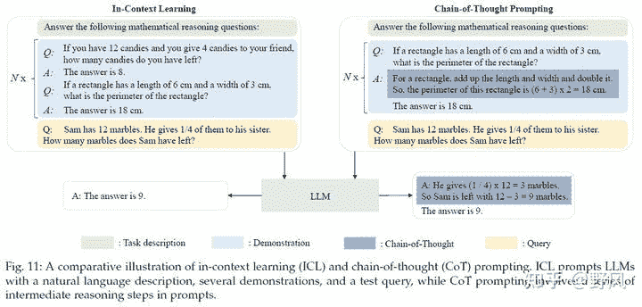

### 样例的设计

+   Demonstration Selection

+   Heuristic approaches：一些研究采用基于 k-NN 的检索器来选择与query语义相关的示例。也会同时考虑相关性和多样性

+   LLM-based approaches：利用 LLM，根据添加样例后的性能增益，直接测量每个样例的信息量。先根据无监督的方法（如BM25）召回一些相似的样例，然后使用一个dense retriever（由LLM打标的正负样本）去查找。

+   Demonstration Format

+   最直接的方法就是给一些QA样例对

+   使用CoT，增加对任务的描述去增强推理能力

+   Auto-CoT, 通过"Let's think step by step"，得到子问题

+   Demonstration Order LLMs有时倾向于去重复最后一个样例的答案

+   通过query与样例之间的embedding space的相似度排序

+   [最大限](https://www.zhihu.com/search?q=%E4%BF%A1%E6%81%AF%E8%AE%BA&search_source=Entity&hybrid_search_source=Entity&hybrid_search_extra=%7B%22sourceType%22%3A%22article%22%2C%22sourceId%22%3A654041855%7D)度地减少压缩和传输任务标签所需的代码长度，其灵感来自 信息论

### 底层机制

+   How Pre-Training Affects ICL?：

+   GPT-3中发现在大规模的预训练模型中会出现ICL，但后面也有研究发现，小规模模型在特定设计的训练任务上继续预训练或者微调后也能出现ICL能力。

+   另外，ICL的出现可以理论上看做是预训练过程中，模型在学习具有长距离语义联系的文档过程中诞生的。

+   也有研究认为，在扩大训练参数和数据的时候，LLM通过“下一个词预测”训练任务，模型可以从字或词如何组成具有语言含义的句子学习过程中得到ICL能力。

+   How LLMs Perform ICL?

+   Task recognition：有研究认为在预训练数据中包含了标识任务（task）的隐变量，而LLM可以根据demonstration捕捉到这些变量，从而能够识别ICL中的任务。所以，有部分研究认为LLM不是从demonstration中学习，而是识别任务，所以有实验表明即使prompt template是无关的甚至是有误导的，LLM表现也很好

+   T[ask le](https://www.zhihu.com/search?q=%E6%B3%A8%E6%84%8F%E5%8A%9B%E6%9C%BA%E5%88%B6&search_source=Entity&hybrid_search_source=Entity&hybrid_search_extra=%7B%22sourceType%22%3A%22article%22%2C%22sourceId%22%3A654041855%7D)arning：ICL 可以解释如下：通过前向计算，LLM 生成与demonstration相关的元梯度，并通过 注意力机制 隐式地执行梯度下降。LLM 本质上是在预训练过程中通过参数对隐式模型进行编码。利用 ICL 中提供的示例，LLM 可以实施梯度下降等学习算法，或直接计算闭式解，以便在前向计算中更新这些模型。

## Chain-of-Thought Prompting

CoT 并非像 ICL 那样简单地用输入-输出对来构建提示，而是将可能导致最终输出的中间推理步骤纳入提示中。

### In-context Learning with CoT

+   Few-shot CoT：demonstration由⟨input, output⟩ 变成 ⟨input, CoT, output⟩，区别见上图。

+   使用不同类型的CoT（不同的推理路径）和使用复杂的CoT都可以加强效果。

+   为了减少手工提供CoT，可以使用Auto-CoT。

+   self-consistency技巧：首先生成几条推理路径，然后对所有答案进行综合（例如，通过在这些路径中投票选出最一致的答案），可以较大提升CoT效果。

+   Zero-shot CoT：LLM 首先在 "Let’s think step by step"的提示下产生推理步骤，然后在 "Therefore, the answer is "的提示下得出最终答案。

### 底层机制

+   When CoT works for LLMs?：在需要做一步一步推理的任务中（算术推理、常识推理和符号推理），CoT会表现不错，但那些如果不需要复杂推理的任务，加了CoT反而会不好

+   Why LLMs Can Perform CoT Reasoning?：广泛认为CoT能力来自于在代码数据上训练，但目前缺乏消融实验的证明。CoT包含三个元素symbols、patterns和text，后两个对效果影响最大，text帮助LLM生成有用的pattern，pattern帮助LLM理解任务和生成帮助解决任务的text

## Planning for Complex Task Solving

对于一些复杂的问题，仅用ICL和CoT还是很难取到好的效果，所以采用prompt-based planning的方法去将复杂问题分解为更简单的子问题，并通过规划一系列action去完成这些子问题任务。

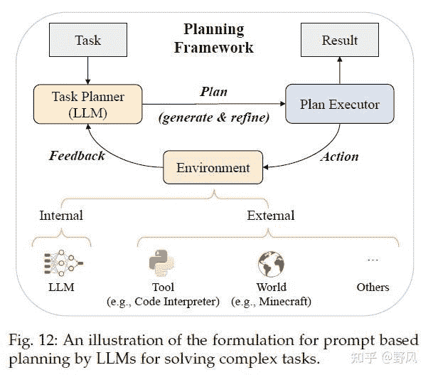

那这个plan具体是什么呢？它可以是一系列用自然语言描述的action或者用编程语言描述的可执行代码等

### Plan Generation

+   text-based：通过指令利用LLM去生成执行计划，比如利用ICL的、让LLM在“使用API解决问题”的语料上微调，从而让模型可以调用API、HuggingGPT还让LLM可以调用模型

+   code-based：生成Python、PDDL等可执行的代码

### Feedback Acquisition

+   internal feedback：使用LLM去预测生成的plan取得成功的概率、Tree of Thought去对比不同的plan（有点类似AlphaGo的蒙特卡诺搜索的意思）、对中间结果进行评估并作为长期记忆存储

+   external feedback：外部工具或者虚拟世界

### Plan Refinement

+   Reasoning：React通过给LLM一些demonstrations去在feedback的时候生成推理路径、ChatCoT进一步将工具增强推理过程统一为基于LLM的任务规划器与基于工具的环境之间的多轮对话

+   Backtracking：Tree of Thought利用DFS或者BFS去搜索，使得plan全局最优；另外还可以把feedback作为prompt去利用LLM refine plan

+   Memorization：将feedback和一些success plan作为长期记忆存储在向量数据库中

实际上这块又引出了一个热度很高的话题—— LLM Powered Autonomous Agents ，我觉得这是一个可能颠覆整个软件行业，甚至整个社会数字化生产力形态的话题，后面再好好介绍一下吧。

## 能力评估

## 基础能力评估

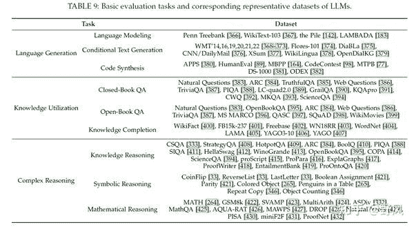

### Language Generation

+   Language Modeling：即根据前序tokens预测下一个token的能力，常用数据集有Penn Treebank、WikiText-103、和 Pile。在zero-shot的设定下，通过困惑度（perplexity）作为指标去评估。对于长依赖能力的评估，可以使用LAMBADA数据集

+   C[onditi](https://www.zhihu.com/search?q=%E7%BB%93%E6%9E%84%E5%8C%96%E6%95%B0%E6%8D%AE&search_source=Entity&hybrid_search_source=Entity&hybrid_search_extra=%7B%22sourceType%22%3A%22article%22%2C%22sourceId%22%3A654041855%7D)onal Text Generation：具体任务下的文本生成，比如机器翻译、文本摘要、问答、更难的 结构化数据 生成、长文本生成等。常用指标有Accuracy、BLEU和Rouge，以及人工评价、利用LLM去评价

+   Code Synthesis：通过运行代码测试pass rate，APPS、HumanEval、MBPP

主要问题：

+   Unreliable generation evaluation：LLM能生成与人类相当的质量的文本，基于现有的一些自动评价指标会低估这些文本质量。目前另一种方法是利用LLM去做评价，对单个文本进行评价和对多个候选文本进行比较来改进现有评价指标

+   Underperforming Specialized Generation：LLM 可能无法胜任需要特定领域知识或生成结构化数据的生成任务。在保持 LLM 原有能力的同时，为 LLM 注入专业知识并非易事。

### Knowledge Utilization

问答（question answering）和知识补全（knowledge completion）两个任务常被用来检验这个能力

+   Closed-Book QA：测试LLM根据给定的上下文信息回答而不使用外部数据，常使用accuracy作为评价指标，实验表明更大的参数量或者数据量，都能提升该任务效果

+   Open-Book QA：可以利用外部资源来回答问题，常用accuracy和F1作为评价指标。为了使用外部数据，一般会用一个text retriever（独立于LLM或者和LLM一起训练）去选择外部数据，甚至可以直接是利用搜索引擎。外部数据能提升回答效果，并且可以最新的数据，去回答time-sensitive问题。

+   K[nowle](https://www.zhihu.com/search?q=%E7%9F%A5%E8%AF%86%E5%9B%BE%E8%B0%B1&search_source=Entity&hybrid_search_source=Entity&hybrid_search_extra=%7B%22sourceType%22%3A%22article%22%2C%22sourceId%22%3A654041855%7D)dge Completion：这个任务可以去评价一个LLM从预训练数据中学到了什么和学到了多少知识。一般有 知识图谱 补全任务和事实补全任务。目前对于特定领域的知识补全，LLM表现的不好。

推荐阅读：

+   Retrieval-based LMs

主要问题：

+   Hallucination：产生的信息要么与现有信息源相冲突（内在幻觉），要么无法得到现有信息源的验证（外在幻觉），这在实际使用中影响较大。一般会通过在高质量数据和人工反馈上进行对齐微调，另外通过整合外部信息源提供可信的信息也有助于减少幻觉

+   Knowledge recency：LLM 的参数知识很难及时更新。用外部知识源，比如搜索引擎，把搜索结果作为context去增强 LLM 是解决这一问题的实用方法。然而，如何有效更新 LLM 内部的知识仍是一个有待解决的研究课题。

推荐阅读：

+   [大模型的幻觉问题调研: LLM ](https://zhuanlan.zhihu.com/p/642648601)Hallucination Survey

### Complex Reasoning

复杂推理是指理解并利用辅助证据或逻辑推理得出结论或做出决定的能力

+   Knowledge Reasoning：一般使用LLM的CoT能力去触发step by step推理能力。LLM容易生成一些错误的中间步骤，导致最终的错误结果，有研究使用特殊的解码和集成策略去解决这个问题

+   Symbolic Reasoning：知识推理任务依靠逻辑关系和事实知识证据来回答给定问题

+   Mathematical Reasoning：数学推理任务需要综合运用数学知识、逻辑和计算来解决问题或生成证明陈述。

主要问题：

+   Reasoning inconsistency：LLM 可能会在无效的推理路径后生成正确的答案，或者在正确的推理过程后生成错误的答案，从而导致得出的答案与推理过程不一致。要解决这个问题，可以利用过程级反馈对 LLM 进行微调，使用多种推理路径组合，并通过自我反思或外部反馈完善推理过程。

+   Numerical computation：LLM 在数字计算方面面临困难，尤其是在前期训练中很少遇到的符号。除了使用外部数学工具外，将数字标记化为单个标记也是提高 LLM 算术能力的有效设计选择。

## 高级能力评估

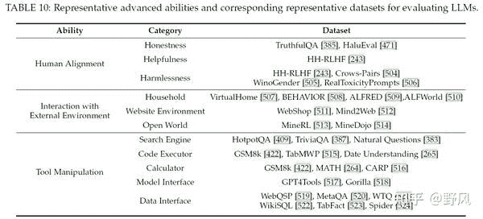

### Human Alignment

对齐人类价值一般会从helpfulness、honesty、safety和harmlessness角度去评估，通过alignment tuning和高质量的预训练数据，可以提高这方面的能力

### Interaction with External Environment

一般[会在虚拟环](https://www.zhihu.com/search?q=%E5%A4%9A%E6%99%BA%E8%83%BD%E4%BD%93&search_source=Entity&hybrid_search_source=Entity&hybrid_search_extra=%7B%22sourceType%22%3A%22article%22%2C%22sourceId%22%3A654041855%7D)境中进行测试评估，通过对生成的action plans进行可执行性和正确性评估以及在现实环境中实验的成功率去评价该能力。最近也有一些研究在虚拟环境做基于LLM的 多智能体 协作的工作。

### Tool Manipulation

将 [工具使用 ](https://www.zhihu.com/search?q=%E5%B7%A5%E5%85%B7%E4%BD%BF%E7%94%A8&search_source=Entity&hybrid_search_source=Entity&hybrid_search_extra=%7B%22sourceType%22%3A%22article%22%2C%22sourceId%22%3A654041855%7D)API封装给LLM调用、ChatGPT的插件等都是工具的形式，验证LLM工作操作的能力一般会使用一些推理任务去评估。随着工具的增多，LLM有限的context导致其无法很好的利用这些工具反馈的信息，现在的做法是将这些信息存储为embedding使用

## 基准和经验性评估

+   Comprehensive Evaluation Benchmarks

+   MMLU

+   BIG-bench、BIG-bench-Lite、BIG-bench hard

+   HELM

+   Human-level test benchmarks：AGIEval、MMCU、M3KE、C-Eval、Xiezhi

+   Empirical Ability Evaluation
论文作者通过在闭源大模型（ChatGPT, Claude, Davinci003 and Davinci002）和开源大模型（LLaMA 7B、Pythia 7B和12B、Falcon 7B，经过instruction-tuned的Vicuna 7B、Alpaca 7B、ChatGLM 6B）上做了一些实验评估，得到了一些结论

+   闭源大模型相比开源大模型，效果更好，尤其是ChatGPT

+   ChatGPT 和 Davinci003 在与环境互动和工具操作任务方面表现更佳

+   所有模型在难度很大的推理任务中都表现不佳

+   instruction-tuned model效果要优于base model

+   这些小型开源模型在数学推理、与环境互动和工具操作任务方面表现不佳

+   在Human Alignment任务上，开源模型的表现方差较大

+   作为最新发布的型号，Falcon-7B 性能不俗，尤其是在语言生成任务方面

推荐阅读：

+   LLM Evaluation 如何评估一个大模型？

+   [A Survey on Evaluation of L](https://link.zhihu.com/?target=https%3A//github.com/MLGroupJLU/LLM-eval-survey)arge Language Models

## 一些Leaderboard

+   [MMLU](https://link.zhihu.com/?target=https%3A//paperswithcode.com/dataset/mmlu%23%3A~%3Atext%3DMMLU%2520%2528Massive%2520Multitask%2520Language%2520Understanding%2529%2520is%2520a%2520new%2Cevaluating%2520models%2520exclusively%2520in%2520zero-shot%2520and%2520few-shot%2520settings.)

+   [Chatbot Arena](https://link.zhihu.com/?target=https%3A//huggingface.co/spaces/lmsys/chatbot-arena-leaderboard)

+   [BIG-bench](https://link.zhihu.com/?target=https%3A//github.com/google/BIG-bench)

+   Open LLM Leaderboard

+   [SuperCLUE](https://link.zhihu.com/?target=https%3A//cluebenchmarks.com/superclue.html)

+   [C-Eval](https://link.zhihu.com/?target=https%3A//cevalbenchmark.com/static/leaderboard.html)

+   [GaoKao-Bench](https://link.zhihu.com/?target=https%3A//github.com/OpenLMLab/GAOKAO-Bench)

+   [AlpacaEval](https://link.zhihu.com/?target=https%3A//tatsu-lab.github.io/alpaca_eval/)

+   [OpenCompass](https://link.zhihu.com/?target=https%3A//github.com/open-compass/opencompass/blob/main/README_zh-CN.md)

## Prompt设计指南

原则：

① 清楚地表达任务目标；

② 分解成简单、详细的子任务；

③ 提供少量演示；

④ 使用模型友好格式

+   任务描述

+   描述越细节越好；

+   告诉LLM自己是某方面的专家；

+   告诉LLM更多应该做什么而不是不应该做什么；如果不希望太长的输出，可以使用“Question: Short Answer: ”或者"in a or a few words”, “in one of two sentences”.

+   输入数据

+   对于要求提供事实性知识的问题，可以先通过搜索引擎检索相关文档，然后将其串联到提示语中作为参考；

+   为了突出提示中的某些重要部分，请使用特殊标记，如引号（""）和换行符（\n）。您也可以同时使用这两种符号来强调

+   上下文信息

+   对于复杂的任务，可以清楚地描述完成任务所需的中间步骤，例如：Please answer the question step by step as: Step 1 - Decompose the question into several sub-questions, · · ·

+   如果您想让 LLM 为文本打分，则有必要详细说明评分标准，并提供示例作为参考

+   当 LLM 根据上下文 [生成文本 ](https://www.zhihu.com/search?q=%E7%94%9F%E6%88%90%E6%96%87%E6%9C%AC&search_source=Entity&hybrid_search_source=Entity&hybrid_search_extra=%7B%22sourceType%22%3A%22article%22%2C%22sourceId%22%3A654041855%7D)时（例如，根据购买历史记录进行推荐），向它们解释根据上下文生成的结果有助于提高生成文本的质量。

+   示例（Demonstration）：

+   格式良好的上下文示例对指导 LLM 非常有用，尤其是在制作格式复杂的输出时。

+   在进行few-shot CoT提示时，也可以使用 "Let’s think step-by-step "的提示语，而且少量示例之间应该用"\n "分隔，而不是句号。

+   检索与上下文相似的示例去补充LLM任务相关的领域知识，为了获取更多的示例，可以先搜索问题的答案，然后再把问题和答案拼在一起去检索

+   提示中语境范例的多样性也很有用。如果不容易获得多样化的问题，也可以设法保持问题解决方案的多样性。

+   在使用chat-based LLM时，可以将示例分解为多轮对话形式

+   复杂且详细的示例可以帮助LLM回答复杂问题

+   由于一个符号序列通常可分为多个片段（如 i1、i2、i3 -→ i1、i2 和 i2、i3），因此前面的片段可作为上下文中的范例，引导 LLM 预测后面的片段，同时提供历史信息。

+   上下文中的示例和提示组件的顺序很重要。对于很长的输入数据，问题的位置（第一个或最后一个）也会影响性能。

+   如果无法从现有数据集中获取上下文示例，另一种方法是使用 LLM 本身生成的zero-shot示例

+   其他设计

+   让LLM在输出的时候检测内容是否正确。如Check whether the above solution is correct or not.

+   如果LLM不能很好的解决问题，可以让LLM使用外部API工具，如function calling能力

+   提示语应自成一体，最好不要在上下文中使用代词（如 it 和 they）。

+   在使用 LLM 比较两个或多个示例时，顺序对性能影响很大。

+   在提示之前，为 LLM 分配一个角色非常有用，可以帮助它更好地完成以下任务指令

+   与其他语言相比，OpenAI 模型可以更好地用英语执行任务。因此，首先将输入内容翻译成英语，然后将其输入 LLM 是非常有用的。

+   对于多选题，限制 LLM 的输出空间是非常有用的。您可以使用更详细的解释，也可以只对对数施加限制。

+   对于基于排序的任务（如推荐），我们可以为未排序的项目分配指标（如 ABCD），并指示 LLM 直接输出排序后的指标，而不是在排序后直接输出每个项目的完整文本