# Text2SQL数据集和技术方案整理

> 来源：<https://agijuejin.feishu.cn/docx/BztwdcgwJoLASFxBMZHckBBfnNc>

> 作者：王大锤

> 原文：<https://zhuanlan.zhihu.com/p/683535421>

## 一. 业界榜单

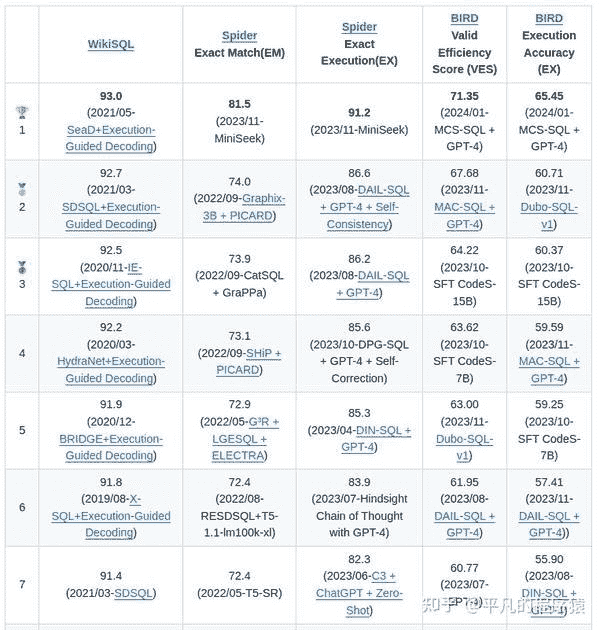

## 二. 数据集

### 2.1 WikiSQL

2017年开源的一个大型文本到SQL数据集WikiSQL，数据来自维基百科，属于一个单一的领域，包含80654个自然语言问题和77840个SQL语句。SQL语句的形式相对简单，不包括排序、分组、子查询和其他复杂操作。

**文章链接**: <https://arxiv.org/pdf/1709.00103.pdf>

**数据集**: <https://github.com/salesforce/WikiSQL>

### 2.2 Spider

2018年由耶鲁大学提出了具有多个数据库、多个表和单轮查询的文本到SQL数据集Spider。它也被公认为行业内最难的大规模跨领域评估列表。它包含10181个自然语言问题和5693个SQL语句。涉及138个不同领域的200多个数据库，难度等级分为：容易、中等、困难和极其困难。

**文章链接**: <https://arxiv.org/pdf/1809.08887.pdf>

**数据集**: <https://yale-lily.github.io/spider>

### 2.3 SParC

2019年由耶鲁大学提出了一个大型数据集SParC，用于复杂、跨域和上下文相关（多回合）的语义解析和文本到SQL任务，该数据集由4298个连贯的问题序列（12k+个独特的单个问题，由14名耶鲁学生注释的SQL查询注释）组成，这些问题是从用户与138个域的200个复杂数据库的交互中获得的。

**文章链接**: <https://arxiv.org/pdf/1906.02285.pdf>

**数据集**: <https://drive.google.com/uc?export=download&id=1Uu7NMHTR1tdQw1t7bAuM7OPU4LElVKfg>

### 2.4 CSpider

2019年西湖大学提出了一个大型中文数据集CSpider，用于复杂和跨领域的语义解析和文本到SQL任务，由2名 NLP 研究人员和1名计算机科学学生从Spider翻译而来，该数据集包含10181个问题和5693个独特的复杂SQL查询，涉及200个数据库，多个表覆盖138个不同的领域。

**文章链接**: <https://arxiv.org/pdf/1909.13293.pdf>

**数据集**: <https://drive.google.com/drive/folders/1TxCUq1ydPuBdDdHF3MkHT-8zixluQuLa?usp=sharing>

### 2.5 CoSQL

2019年，耶鲁大学和Salesforce Research提出了一个跨域数据库CoSQL，它由30k多个回合加上10k多个注释SQL查询组成，这些查询来自绿野仙踪（WOZ）收集的3k个对话，查询跨越138个域的200个复杂数据库。

**文章链接**: <https://arxiv.org/pdf/1909.05378.pdf>

**数据集**: <https://yale-lily.github.io/cosql>

### 2.6 TableQA

2020年，追一科技提出了一个大规模的跨领域自然语言到SQL的中文数据集TableQA，包括64891个问题和20311个针对6000多个表的独特SQL查询。

**文章链接**: <https://arxiv.org/pdf/2006.06434.pdf>

**数据集**: <https://www.luge.ai/#/luge/dataDetail?id=12>

### 2.7 DuSQL

2020/11，百度为跨域文本到SQL任务提出了一个大规模实用的中文数据集DuSQL，包含200个数据库、813个表和23797个问题/SQL对。

**文章链接**: <https://aclanthology.org/2020.emnlp-main.562.pdf>

**数据集**: <https://www.luge.ai/#/luge/dataDetail?id=13>

### 2.8 CHASE

2021年，华盛顿大学和微软研究院提出了KaggleDBQA，这是一个真实Web数据库的跨领域评估数据集，具有特定领域的数据类型、原始格式和不受限制的问题。它包括8个数据库中的272个示例，每个数据库平均有2.25个表。该数据集以其真实世界的数据源、自然的问题创作环境和具有丰富领域知识的数据库文档而闻名。关键统计数据：8.7%的 `WHERE` 子句、73.5%的 `VAL`、24.6%的 `SELECT` 和6.8%的 `NON-SELECT`。

**文章链接**: <https://arxiv.org/abs/2106.11455>

**数据集**: <https://github.com/Chia-Hsuan-Lee/KaggleDBQA/tree/main?tab=readme-ov-file#Data-Format>

### 2.9 BIRD-SQL

2023年，香港大学和阿里巴巴提出了一个大型跨域数据集BIRD，其中包含12751多个独特的问题-SQL对，95个大数据库，总大小为33.4GB。它还涵盖了37多个专业领域，如区块链、曲棍球、医疗保健和教育等。

**文章链接**: <https://arxiv.org/pdf/2305.03111.pdf>

**数据集**: <https://bird-bench.github.io/>

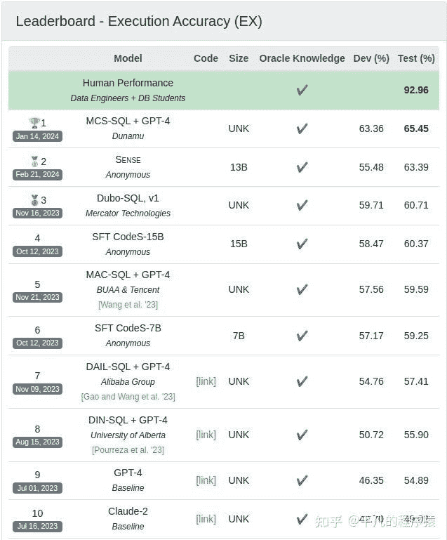

## 三. 相关技术

### 3.1 MAC-SQL

**文件链接**: <https://arxiv.org/pdf/2312.11242.pdf>

**代码链接**: <https://github.com/wbbeyourself/MAC-SQL>

**流程图**:

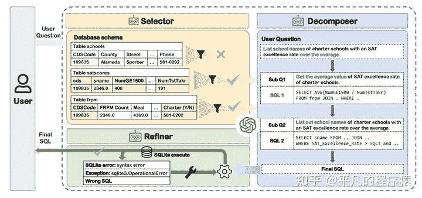

### 3.2 DBCopiLOT

**论文链接**: <https://arxiv.org/pdf/2312.03463.pdf>

**代码链接**: <https://github.com/tshu-w/DBCopilot>

**流程图**:

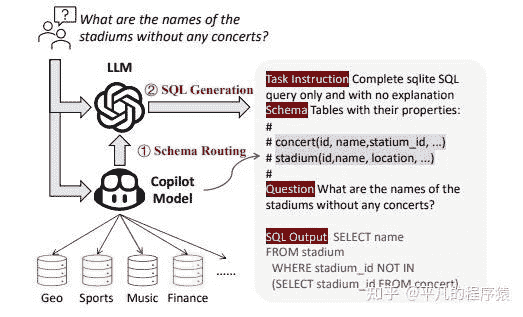

### 3.3 DAIL-SQL

**论文链接**: <https://arxiv.org/pdf/2308.15363v2.pdf>

**代码链接**:

**流程图:**

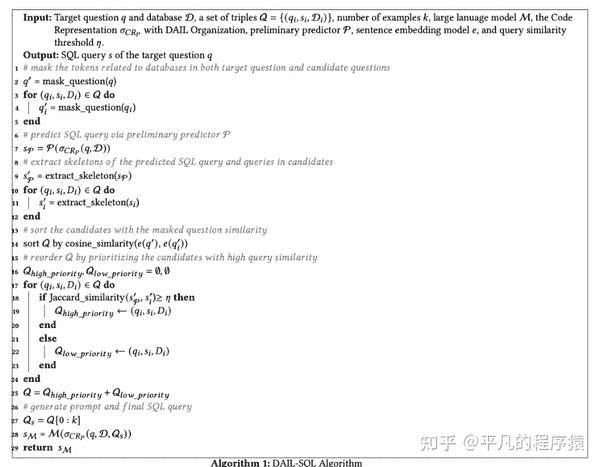

### 3.4 RESDSQL

**论文链接:**

**代码链接:**

**流程图:**

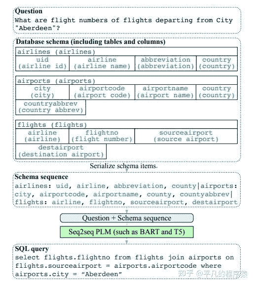

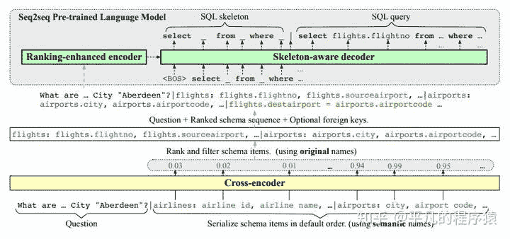

### 3.5 DAMO-ConvAI

**论文链接:**

**代码链接:**

**流程图:**

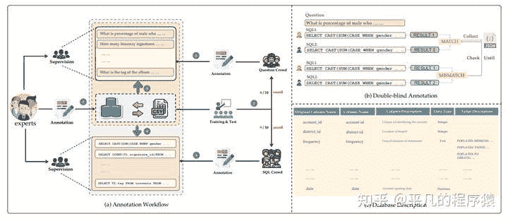

### 3.6 DIN-SQL

**论文链接:**

**代码链接:**

**流程图:**

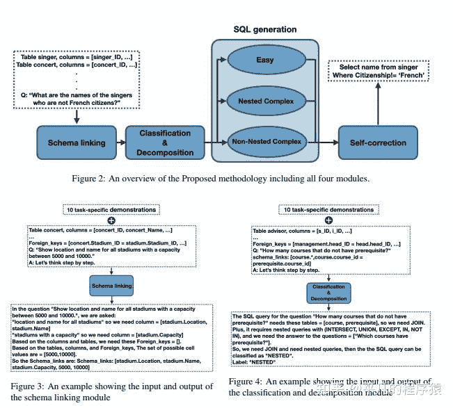

### 3.7 ChatGPT's zero-shot Text-to-SQL

**论文链接:**

**代码链接:**

**流程图:**

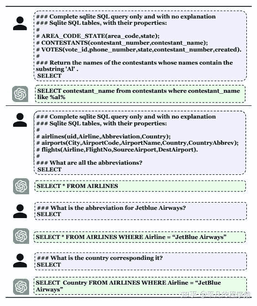

### 3.8 Binder

**论文链接:**

**代码链接:**

**流程图:**

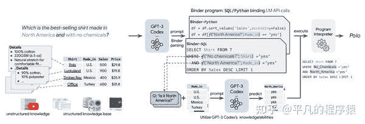

### 3.9 SC-prompt

**论文链接:**

**代码链接:**

**流程图:**

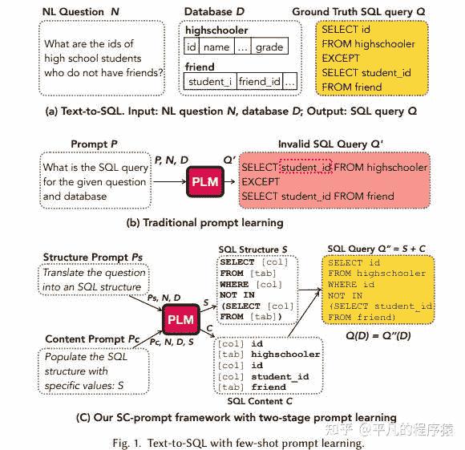

### 3.10 T5-SR

**论文链接:**

**代码链接:** 无

**流程图:**

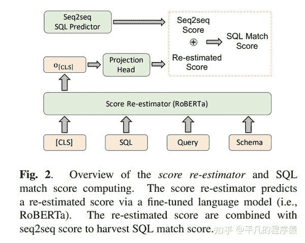

### 3.11 [S2SQL](https://www.zhihu.com/search?q=S2SQL&search_source=Entity&hybrid_search_source=Entity&hybrid_search_extra=%7B%22sourceType%22%3A%22article%22%2C%22sourceId%22%3A683535421%7D)

**论文链接:**

**代码链接:** 无

**流程图:**

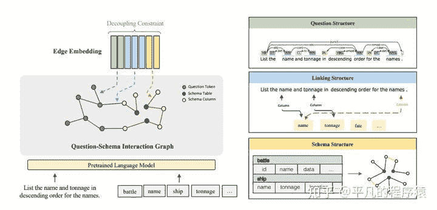

### 3.12 SeaD

**论文链接:**

**代码链接:** 无

**流程图:**

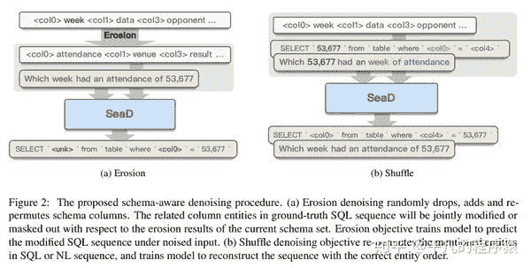

### 3.13 STAR

**论文链接:**

**代码链接:**

**流程图:**

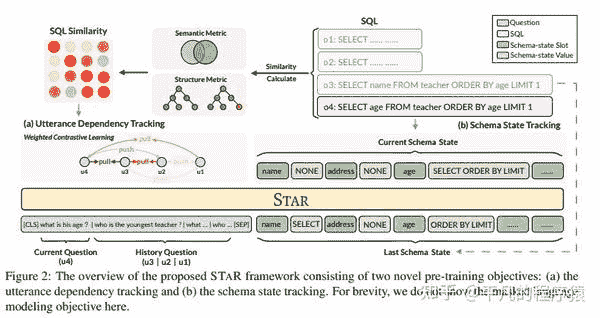

### 3.14 RASAT

**论文链接:**

**代码链接:**

**流程图:**

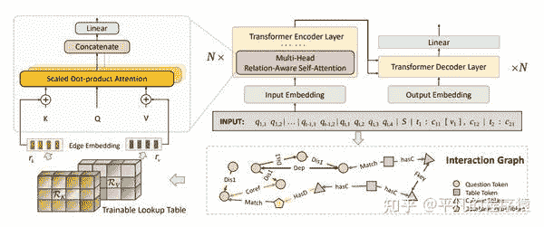

### 3.15 CQR-SQL

**论文链接:**

**代码链接:** 无

**流程图:**

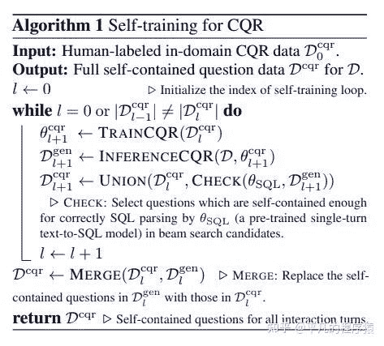

### 3.16 HIE-SQL

**论文链接:**

**代码链接:**

**流程图:**

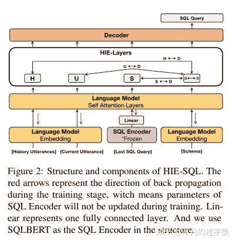

## 四. [底座模型](https://www.zhihu.com/search?q=%E5%BA%95%E5%BA%A7%E6%A8%A1%E5%9E%8B&search_source=Entity&hybrid_search_source=Entity&hybrid_search_extra=%7B%22sourceType%22%3A%22article%22%2C%22sourceId%22%3A683535421%7D)

卷麻了，自己看图体会！

国外的暂不列出。

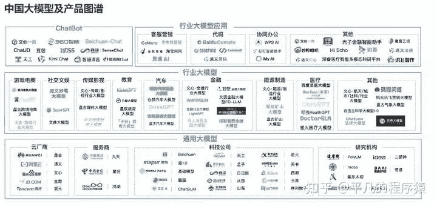
