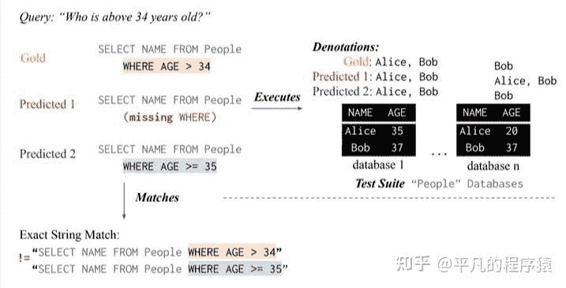
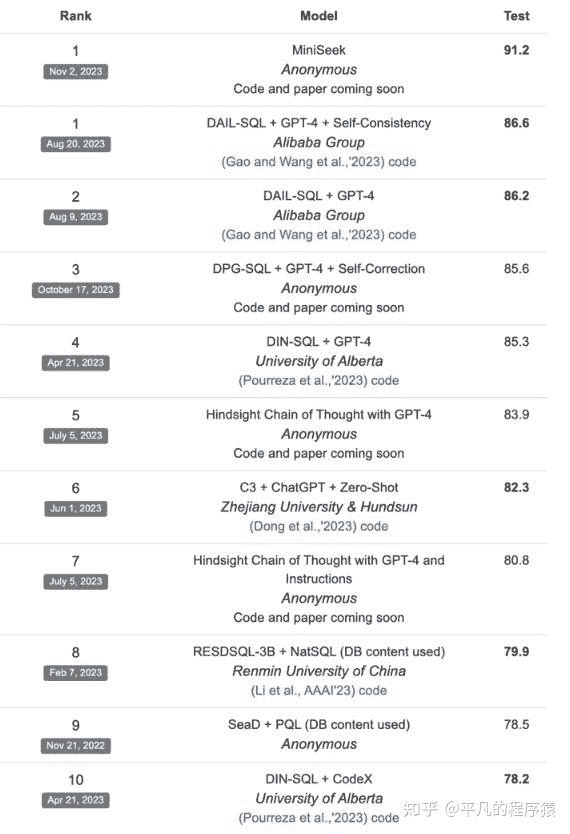
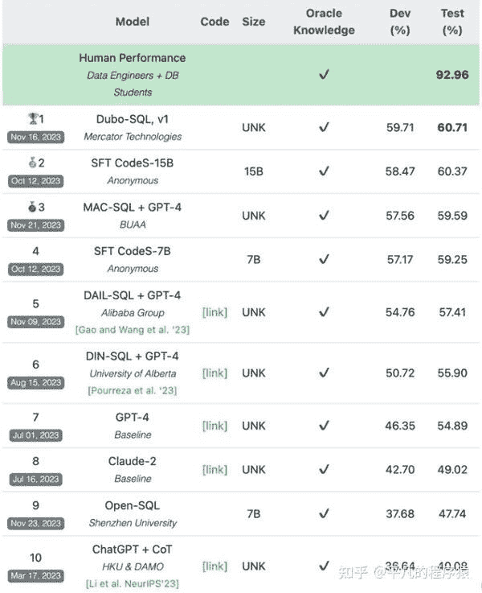
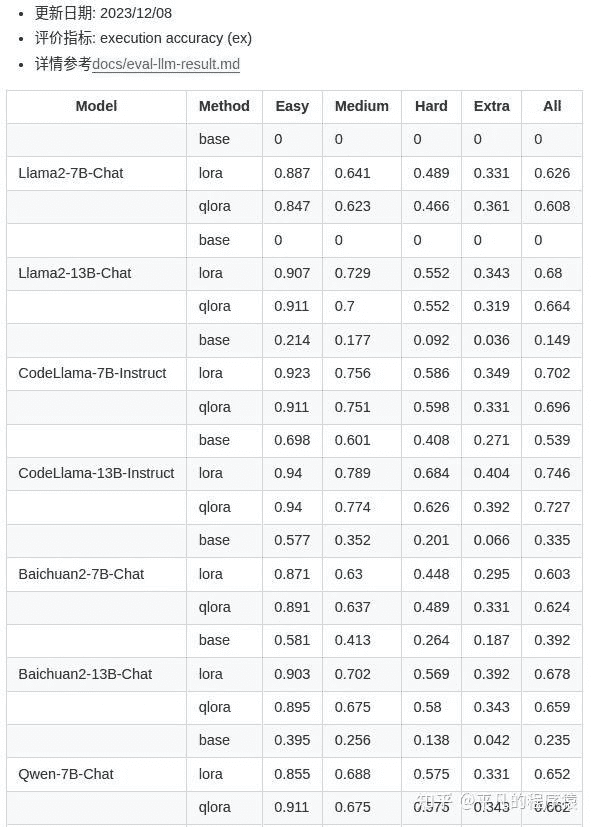
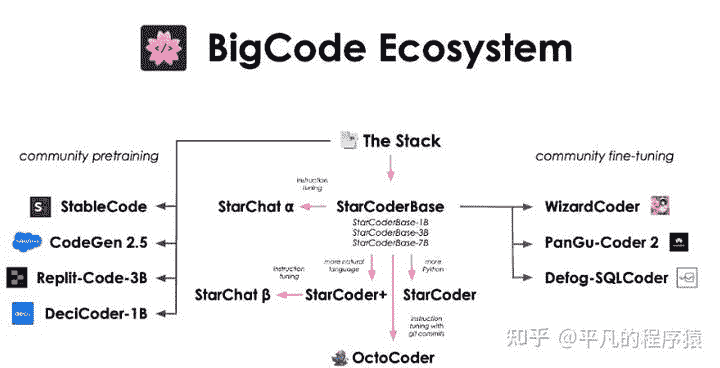
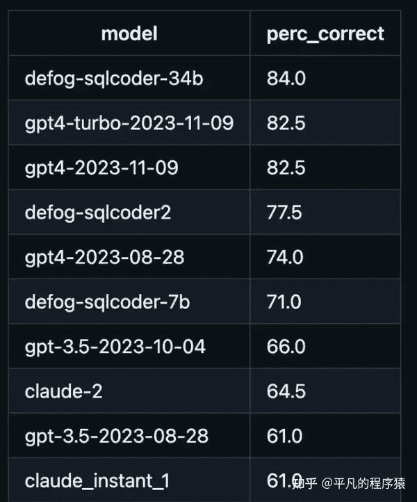
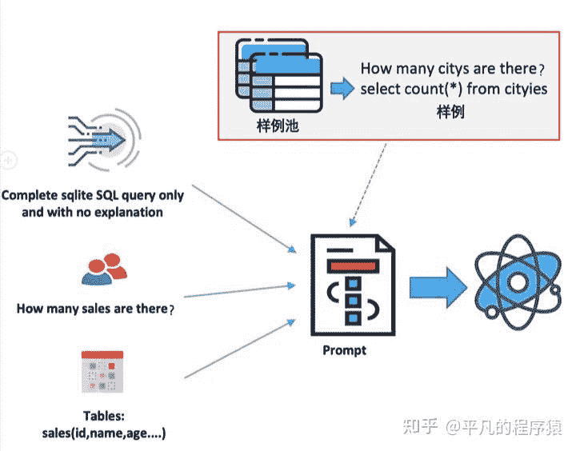
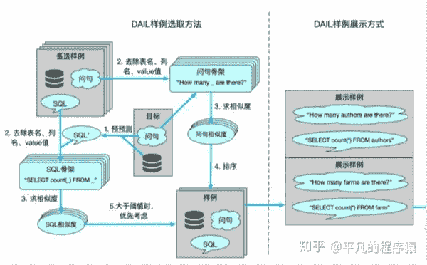
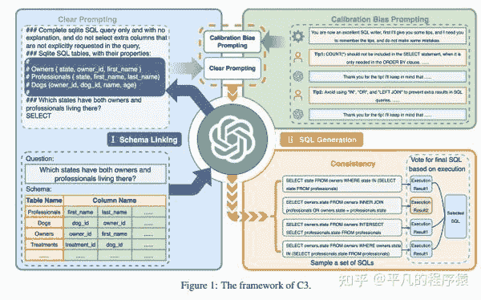
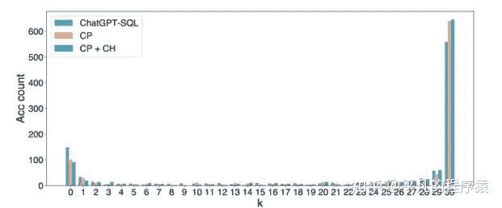

# 数据可视化Agent-基于Text2SQL的数据分析方案

> 来源：[https://agijuejin.feishu.cn/docx/PiU4dMoUfofvZKxGTjYchFYYnVc](https://agijuejin.feishu.cn/docx/PiU4dMoUfofvZKxGTjYchFYYnVc)

> 作者：王大锤

> 原文链接： [https://zhuanlan.z](https://zhuanlan.zhihu.com/p/682851514)hihu.com/p/682851...

上[篇中，我们](https://www.zhihu.com/search?q=%E6%8A%80%E6%9C%AF%E6%96%B9%E6%A1%88&search_source=Entity&hybrid_search_source=Entity&hybrid_search_extra=%7B%22sourceType%22%3A%22article%22%2C%22sourceId%22%3A682851514%7D)[探讨了企业应用中基](https://www.zhihu.com/search?q=%E8%87%AA%E7%84%B6%E8%AF%AD%E8%A8%80%E8%BD%ACSQL&search_source=Entity&hybrid_search_source=Entity&hybrid_search_extra=%7B%22sourceType%22%3A%22article%22%2C%22sourceId%22%3A682851514%7D)于自然语言的交互式数据分析[的业务驱动](https://www.zhihu.com/search?q=%E6%9F%A5%E8%AF%A2%E8%AF%AD%E8%A8%80&search_source=Entity&hybrid_search_source=Entity&hybrid_search_extra=%7B%22sourceType%22%3A%22article%22%2C%22sourceId%22%3A682851514%7D)力和场景，这里主要探讨一下基于Text2SQL的 技术方案 ，也可以理解为NL2SQL，即 自然语言转SQL , SQL作为一种结构化 查询语言 ，是数据库交互的一种标准化语言，几乎存在于所有以数据为中心的企业应用中。


基础实现:

Tex[t2SQL，简](https://www.zhihu.com/search?q=%E8%87%AA%E7%84%B6%E8%AF%AD%E8%A8%80%E7%90%86%E8%A7%A3&search_source=Entity&hybrid_search_source=Entity&hybrid_search_extra=%7B%22sourceType%22%3A%22article%22%2C%22sourceId%22%3A682851514%7D)单的说，就是把你说的自然语言转化为数据库能够听懂的SQL，然后通过数据库的"语言"与它对话，获得数据查询或统计结果。Text2SQL并不是在大模型之后才出现的话题，早在大模型出世之前已有大量专注于此任务的机器学习项目。在大模型出现以后，凭借其强大的 自然语言理解 和推理能力，让Text2SQL得到了大力的推进。

从上述的图中可以看出，Text2SQL看似一个十分简单的任务，核心是在与如何将自然语言组装成Prompt, 然后交给大模型做推理生成对应的SQL。在OpenAI公司官网上给出了一个标准的ChatGPT做自然语言转SQL的示例:

```
System
/*系统指令*/
Given the following SQL tables, your job is to write queries given a user&#x27;s request.

/*数据库内表结构*/
CREATE TABLE Orders (
OrderID int,
CustomerID int,
OrderData datetime,
OrderTime varchar(8),
PRIMARY KEY (OrderID)
);
...... //省略N张其他表

/*问题*/
Write a SQL query which computes the average total order value for all orders on 2023-04-01.
```

从上[述的任务描述上](https://www.zhihu.com/search?q=prompt&search_source=Entity&hybrid_search_source=Entity&hybrid_search_extra=%7B%22sourceType%22%3A%22article%22%2C%22sourceId%22%3A682851514%7D)看，似乎直接利用LLM做推理，就可以直接实现Text2SQL的任务。当然在实际使用中，一般是需要根据你所使用的大模型做适当的调整。但是不管组织的形式如何，端到端的Text2SQL任务的 prompt 基本包括以下几个部分:

指令(Instruction) : 期望大模型去执行的任务说明。比如: "你是一名SQL生成专家，请参考以下的表结构，直接输出对应的SQL语句，不要多余的解释说明。"

[数据结构(](https://www.zhihu.com/search?q=%E7%9B%B4%E6%8E%A5%E8%AE%BF%E9%97%AE&search_source=Entity&hybrid_search_source=Entity&hybrid_search_extra=%7B%22sourceType%22%3A%22article%22%2C%22sourceId%22%3A682851514%7D)Table Schema) : 需要使用的数据库结构的描述信息，由于大模型一般不 直接访问 数据库，所以需要将数据的结构组装到Prompt，通村包括表名、列名、列的类型、列的含义、主外键关系等等。

**参考样例(Few-Shot) **: 一般是个可选项，指导大模型生成本次SQL的参考样例。

**用户问题(Question) **: 用户输入的自然语言表达的问题，比如:"查看销量大于10000的商品名称。"

**其他提示(Tips) **: 其他你认为有必要的指示。比如要求生成SQL不允许出现的表达式，或者列名必须用'table.column'等形式。

问题:

实现一个Text2SQL的原型相对比较简单，但是在实际应用时它可能不会那样表现良好，因为它首先有[一个关键](https://www.zhihu.com/search?q=%E7%BD%AE%E4%BF%A1%E5%BA%A6&search_source=Entity&hybrid_search_source=Entity&hybrid_search_extra=%7B%22sourceType%22%3A%22article%22%2C%22sourceId%22%3A682851514%7D)[的问题: 当](https://www.zhihu.com/search?q=%E5%A4%A7%E8%AF%AD%E8%A8%80%E6%A8%A1%E5%9E%8B&search_source=Entity&hybrid_search_source=Entity&hybrid_search_extra=%7B%22sourceType%22%3A%22article%22%2C%22sourceId%22%3A682851514%7D)前AI模型输出的SQL的准确率还远远达不到人类工程师的输出精度。基于深度学习的AI模型预测本身就有 置信度 的问题，无法确保绝对的可靠性，这一点在 大语言模型 的应用层面依然存在。当然，输出的不确定性也是目前限制大模型在企业应用的最大障碍。

除大模型自身的知识能力以外，还有一些客观原因:

自然语言表达本身的歧义性，SQL本身是一种精确的编程语言。在实际的使用过程中，可能会出现无法理解或者错误理解的情况。比如: "价格低于九块九的商品有哪些?", 那么大模型可能无法识别九块九代表的是什么.

通过Prompt输入数据结构信息帮助大模型去理解任务，但仍然可能会由于缺[乏外部知识导](https://www.zhihu.com/search?q=%E5%AE%A2%E6%88%B7%E6%B5%81%E5%A4%B1%E7%8E%87&search_source=Entity&hybrid_search_source=Entity&hybrid_search_extra=%7B%22sourceType%22%3A%22article%22%2C%22sourceId%22%3A682851514%7D)致错误。比如: "分析去年的整体客户流失率?"，那么如果大模型对" 客户流失率 "不理解，自然会出现错误。

对于上述两类问题，可以参考作者前面关于Text2SQL优化的文章来优化。

Text2SQL的技术方案在企业应用中还会面临以下严重的挑战:

[执行幻觉 ](https://www.zhihu.com/search?q=%E6%89%A7%E8%A1%8C%E5%B9%BB%E8%A7%89&search_source=Entity&hybrid_search_source=Entity&hybrid_search_extra=%7B%22sourceType%22%3A%22article%22%2C%22sourceId%22%3A682851514%7D): 完成了对应的动作，但是实际得到的数据结果不符合预期。由于Text2SQL是直接用于数据库访问的语句，从理论上看，只要生成的SQL没有语法错误，便可以执行成功，哪怕转换的SQL在语义上错误的！这里和text2API的区别在与: API由于有很严格的结构化输入输出规范和校验，因此如果模型转换错误，很大概率会导致API调用的异常，使用着能够获得错误的数据反馈。

比如以下两个示例: LLM生成的两个结果都是可以正常执行的，但是第二个对应的SQL明显是错误的，对于不具备专业的SQL知识体系的用户而言，这类问题是很难发现的:

```
有多少订单价格不超过1万元?
select count(*) from order where price &lt;= 10000
select count(*) from order where price &lt;&gt; 10000
```

上述问题的根源，其实是来自于Text2SQL输出正确[性的评估困难](https://www.zhihu.com/search?q=%E8%AF%AD%E4%B9%89%E5%87%86%E7%A1%AE%E6%80%A7&search_source=Entity&hybrid_search_source=Entity&hybrid_search_extra=%7B%22sourceType%22%3A%22article%22%2C%22sourceId%22%3A682851514%7D)。这种Text2SQL输出 语义准确性 的衡量复杂性本质上基于这样一个事实:

判断LLM输出的一段代码是否正确，要比判断一个选择题答案是否正确，或者一段字符串的相似度要复杂得多。

如下面这个来自Text2SQL模型的输出评估工具TestSuiteEval中的例子:



其中Gold代表正确答案，Predicted1和Predicted2表示模型的两个输出，这里Predicted2是正确的结果，而Predicted1是错误的结果。我们来看两种评估方法:

如果用SQL的执行结果来判断: Predicted1的结果和Gold SQL的结果可能是一致的，但实际上Predicted1的SQL语句是错误的。如果直接对比输出的SQL, 由于Predicted2和正确的SQL不完全一致，可能会将Predicted2判定为错误的输出，但实际上Predicted2的SQL在这个场景下是正确的。

这就是评估text2SQL模型输出正确性的复杂所在: 即不能用输出的SQL执行结果来判断，也不能简单的把输出SQL与标准SQL对比来进行判断。

对于企业应用的Text2SQL任务而言，这类任务的建模和[评估会更加复](https://www.zhihu.com/search?q=%E5%BA%94%E7%94%A8%E6%95%B0%E6%8D%AE%E5%BA%93&search_source=Entity&hybrid_search_source=Entity&hybrid_search_extra=%7B%22sourceType%22%3A%22article%22%2C%22sourceId%22%3A682851514%7D)杂。其主要是因为真实企业的 应[用数据库 ](https://www.zhihu.com/search?q=%E6%95%B0%E6%8D%AE%E5%88%86%E6%9E%90&search_source=Entity&hybrid_search_source=Entity&hybrid_search_extra=%7B%22sourceType%22%3A%22article%22%2C%22sourceId%22%3A682851514%7D)的结[构会更加复](https://www.zhihu.com/search?q=%E6%95%B0%E6%8D%AE%E4%BB%93%E5%BA%93&search_source=Entity&hybrid_search_source=Entity&hybrid_search_extra=%7B%22sourceType%22%3A%22article%22%2C%22sourceId%22%3A682851514%7D)杂，真实的企业 数据分析 业务逻辑也会更加复杂。对于某些特定的业务场合，有几百行的SQL统计语句生成一个数据报表也很正常。除此以外，企业级别的应用不仅有正确性的要求，还要有效率性能的要求，特别是针对于大型的 数据仓库 。

针对于上述问题，是否存在很好的解决方案呢? 很遗憾，从当前业界的整体数据指标来看，让大模型在这类场景下完全胜任，达到人类工程师的精度还不大现实。但可以从以下几个方向上进行优化。

+   选择更好的底座大模型

+   微调合适的大模型

+   提示词工程优化

+   应用场景的限制和设计

1.  选择更好的底座大模型

大模型自身的优化无非对应两种选择: 选用更强大的底座大模型，或者SFT训练出更适合自身下游任务的模型。那么如何衡量text2SQL模型呢? 前文我们提到过，评估输出的SQL是否正确是个复杂的工程，好在目前已经有较多的研究项目有现成的评估结果可以参考。

**【 **[**Spider基准测试 **](https://www.zhihu.com/search?q=Spider%E5%9F%BA%E5%87%86%E6%B5%8B%E8%AF%95&search_source=Entity&hybrid_search_source=Entity&hybrid_search_extra=%7B%22sourceType%22%3A%22article%22%2C%22sourceId%22%3A682851514%7D)**】**

Spider是一个被广泛用于评估Text2SQL模型与任务的数据集，包含了1万多个自然语言的问题和相关的SQL语句，以及用来运行这些SQL的200多个数据库，横跨100[多个应用领域。你](https://www.zhihu.com/search?q=%E6%8F%90%E7%A4%BA%E6%AC%A1%E5%B7%A5%E7%A8%8B%E6%8A%80%E6%9C%AF&search_source=Entity&hybrid_search_source=Entity&hybrid_search_extra=%7B%22sourceType%22%3A%22article%22%2C%22sourceId%22%3A682851514%7D)也可以把模型和测试代码提交给官方，官方会在一个不公开的测试集上测试你的模型，并公开结果排名。目前Spider公开的最新测试结果如下(Model部分不仅仅列出了大模型，也可能包括可能的 提示次工程技术 ，如DAIL-SQL等):



**【 **[**BIRD基础测试 **](https://www.zhihu.com/search?q=BIRD%E5%9F%BA%E7%A1%80%E6%B5%8B%E8%AF%95&search_source=Entity&hybrid_search_source=Entity&hybrid_search_extra=%7B%22sourceType%22%3A%22article%22%2C%22sourceId%22%3A682851514%7D)**】**

BIRD是阿里达摩院联合香港大学一起推出的针对text2SQL的测试数据集。其作用与Spider类似，但是相对Spider更专注于学术研究，BIRD则更加考虑了真实应用中的数据库信息的复杂性，且考虑模型生成的SQL运行效率。BIRD包含了12000多个自然语言与SQL，涵盖了约37个专业领域的90多个数据库。与Spider类似，你也可以将自己的模型和测试代码提交给官方，获取官方的测试结果。最新的排名如下:



[从上述排名上](https://www.zhihu.com/search?q=GPT-4&search_source=Entity&hybrid_search_source=Entity&hybrid_search_extra=%7B%22sourceType%22%3A%22article%22%2C%22sourceId%22%3A682851514%7D)看，在通用的大模型领域， GPT-4 的表现仍然是最好的。

2. 微调合适的大模型

在进行企业应用开发时，一般会存在数据安全或者网络安全的限制，需要对大模型进行私有化部署。测试结果表明，如果直接使用当前开源的各类大语言模型，在Text2SQL的任务上表现并不好，所以SFT就成为一个常见的优化方向。在这里主要推荐2个开源的text2SQL微调项目作为参考。

**【DB-GPT-Hub】**


github:

[  ](https://link.zhihu.com/?target=https%3A//github.com/eosphoros-ai/DB-GPT-Hub/blob/main/README.zh.md)

DB-GPT-Hub是一个利用LLMs实现Text-to-SQ[L解析的实验](https://www.zhihu.com/search?q=%E6%95%B0%E6%8D%AE%E9%A2%84%E5%A4%84%E7%90%86&search_source=Entity&hybrid_search_source=Entity&hybrid_search_extra=%7B%22sourceType%22%3A%22article%22%2C%22sourceId%22%3A682851514%7D)项目，主要包含数据集收集、 数据预处理 、模型选择与构建和微调权重等步骤，通过这一系列的处理可以在提高Text-to-SQL能力的同时降低模型训练成本，让更多的开发者参与到Text-to-SQL的准确度提升工作当中，最终实现基于数据库的自动问答能力，让用户可以通过自然语言描述完成复杂数据库的查询操作等工作。

[你可以在](https://www.zhihu.com/search?q=%E6%95%B0%E6%8D%AE%E9%9B%86&search_source=Entity&hybrid_search_source=Entity&hybrid_search_extra=%7B%22sourceType%22%3A%22article%22%2C%22sourceId%22%3A682851514%7D)其基础上使用公开或者私有的 数据集 进行微调并评估效果。根据该项目的公开结果，截至2023年12月8日，相关的模型的执行准确率数据指标如下:



【SQLCoder】

202[3年8月，发布了SQLCod](https://www.zhihu.com/search?q=gpt-3.5-turbo&search_source=Entity&hybrid_search_source=Entity&hybrid_search_extra=%7B%22sourceType%22%3A%22article%22%2C%22sourceId%22%3A682851514%7D)er，这是一个先进的LLM，用于将自然语言问题转换为SQL查询。SQLCoder在基础的StarCoder模型上进行了微调。SQLCoder是一个拥有150亿参数的模型，在我们的sql-eval框架上，它在自然语言到SQL生成任务上胜过了 gpt-3.5-turbo ，并且在所有流行的开源模型中表现显著。它还明显优于大小超过10倍的text-davinci-003模型。



官网公开的内部评测结果参考:



3. 提示词工程优化

从上面的基准测试中可以看到，大部分的测试结果都结合了类似DAIL-SQL, DIN-SQL，C3-SQL这样的说明，这其实表示的是在模型测试时采用的一种生成式SQL的Prompt工程方案，因此优化的提示词工程与优秀的大模型结合是能够获得最高测试结果的方法。这里介绍2种提示词工程的方案。当然，也可以参考作者在其他文章中提到的其他技术方案进行优化。

**【DAIL-SQL】**

[阿里提出的](https://www.zhihu.com/search?q=%E6%8F%90%E7%A4%BA%E5%B7%A5%E7%A8%8B&search_source=Entity&hybrid_search_source=Entity&hybrid_search_extra=%7B%22sourceType%22%3A%22article%22%2C%22sourceId%22%3A682851514%7D)一[种针对LL](https://www.zhihu.com/search?q=%E4%BC%98%E5%8C%96%E6%96%B9%E6%B3%95&search_source=Entity&hybrid_search_source=Entity&hybrid_search_extra=%7B%22sourceType%22%3A%22article%22%2C%22sourceId%22%3A682851514%7D)M在Text**2**SQL应用的一种 提示工程 优化技术。在Spider基准测试中取得了当时最高分86.6分，在更难的BIRD数据集测试中也取得了57.41分。其核心 优化方法 的本质是: 在传统的text2SQL的提示词中通过注入一些相似的样例，利用LLM的上下文学习能力，以提高输出SQL的精度。



那么如何选择合适的样例呢? 文中介绍的是通过用户的提问找到相似的问句；再通过预生成SQL找到相似的SQL，进而通过算法进行相似度排序，取出最相似的样例(包括query和SQL)，组装到Prompt。



这种方法在实际应用中也可能会存在一个问题:大量的备选样例从哪里来? 利用现有的测试数据集可能是一个方法；另外一种可能是如果企业针对Text2SQL场景进行模型微调，那么需要准备大量的训练数据集用来作为备选案例。

**【C3-SQL】**

[浙江大学推出一](https://www.zhihu.com/search?q=%E5%B7%A5%E7%A8%8B%E4%BC%98%E5%8C%96%E6%96%B9%E6%B3%95&search_source=Entity&hybrid_search_source=Entity&hybrid_search_extra=%7B%22sourceType%22%3A%22article%22%2C%22sourceId%22%3A682851514%7D)[种针对Text2SQ](https://www.zhihu.com/search?q=zero-shot&search_source=Entity&hybrid_search_source=Entity&hybrid_search_extra=%7B%22sourceType%22%3A%22article%22%2C%22sourceId%22%3A682851514%7D)L场景的提示词 工程优化方法 ，与DAIL-SQL不同的是，这是一种 zero-shot 的提示方法(零样例)，即不在prompt增加样例，而是通过三个方面的提示或优化来提升输出的质量:



Clear Context将整个数据库模式包含在提示的上下文部分中会导致两个问题。首先，在提示中引入过多的无关项目会增加ChatGPT生成输出SQL中无关模式项目的可能性。其次，使用完整的数据库模式会导致文本长度过长，产生不必要的API成本。为了解决这两个问题，提出了一种基于ChatGPT的 zero-shot+schema-linking 方法.

Consistency Output

使用CP和CH方法，ChatGPT能够生成更高质量的SQL。然而，由于大型语言模型的固有随机性，ChatGPT的输出是不稳定的。为了了解ChatGPT不确定性输出的影响，我们分析了在不同提示下，在30次独立实验中开发集上正确计数的分布，如图4所示。在这个图中，ChatGPT-SQL是文献中提出的方法（Liu等，2023）；此外，CP和CP + CH分别表示我们提出的Clear Prompt和Clear Prompt与Clear Hint方法的组合。无论使用哪种方法，只有不到65%的SQL语句能够一致地被正确撰写。这意味着通过提高输出的一致性，模型有很大潜力正确地撰写大多数查询。



4. 应用场景限制和设计

由[于大模型输出的](https://www.zhihu.com/search?q=%E6%A8%A1%E5%9E%8B%E7%BB%93%E5%90%88%E4%BC%98%E5%8C%96&search_source=Entity&hybrid_search_source=Entity&hybrid_search_extra=%7B%22sourceType%22%3A%22article%22%2C%22sourceId%22%3A682851514%7D)不确定性和一些自然语言交互的客观原因，在Text2SQL任务上存在一定的失败或者错误的概率。即使是最先进的 模型结合优化 的提示技术，其表现也离人类有较大差距。因此除了在大模型自身及交互的提示词方面优化外。我们在实际应用中也可以针对自身的情况在应用场景设计等方面做一定的考虑。

[优先应用在](https://www.zhihu.com/search?q=%E5%8D%B3%E5%B8%AD%E6%9F%A5%E8%AF%A2&search_source=Entity&hybrid_search_source=Entity&hybrid_search_extra=%7B%22sourceType%22%3A%22article%22%2C%22sourceId%22%3A682851514%7D)特定场景。比如企业BI中的 即席查询 ，尝试引入Text2SQL的实现方案，由于即席查询的特点是条件自由变化，而相关的数据结构并不会太复杂，因此比较适合用自然语言来灵活生成查询语句。

配合使用其他的交互式分析方案，比如无法通过单次SQL交互即可[完成的统计](https://www.zhihu.com/search?q=%E6%95%B0%E6%8D%AE%E5%A4%84%E7%90%86&search_source=Entity&hybrid_search_source=Entity&hybrid_search_extra=%7B%22sourceType%22%3A%22article%22%2C%22sourceId%22%3A682851514%7D)分析任务，有着较为复杂的中间 数据处理 逻辑，可以考虑采用Text2API的方式来实现。

从较小的分析主题开始。如果企业应用底层数据实体的数量较多，可能会导致Prompt过大并超过最大的context大小，需要针对prompt的组装进行优化设计，具体做法可以参考作者前面写的技术文章。