# LLM在Text2SQL任务上的优化(Agent版)

> 来源：[https://agijuejin.feishu.cn/docx/Hd3wdKoipoTrfNx6xiqc8LoZnwb](https://agijuejin.feishu.cn/docx/Hd3wdKoipoTrfNx6xiqc8LoZnwb)

> 作者：王大锤

> 原文： [https://zhuanlan.z](https://zhuanlan.zhihu.com/p/679297827)hihu.com/p/679297...

## 一. 前言

### 1.1 背景

本文[是根据Tex](https://www.zhihu.com/search?q=%E6%95%B0%E6%8D%AE%E5%8F%AF%E8%A7%86%E5%8C%96&search_source=Entity&hybrid_search_source=Entity&hybrid_search_extra=%7B%22sourceType%22%3A%22article%22%2C%22sourceId%22%3A679297827%7D)t2SQL任务做的业务延伸，主要是在给某客户公司完成相关开发需求时遇到的具体业务问题进行的总结，并针对业务问题进行的优化。Agent版本对比V2.0等算法优化工作多了额外的 数据可视化 模块，属于商业交付的业务。算法层面的优化，可以参考作者前面的几篇文章。

这里的任务是国外的客户，数据采用的甲方[提供的数据，英文形式](https://www.zhihu.com/search?q=langchain&search_source=Entity&hybrid_search_source=Entity&hybrid_search_extra=%7B%22sourceType%22%3A%22article%22%2C%22sourceId%22%3A679297827%7D)，底座模型采用的是 langchain 的gpt4模型。

### 1.2 任务描述

给[定一个数据库](https://www.zhihu.com/search?q=%E7%BB%93%E6%9E%84%E5%8C%96%E4%BF%A1%E6%81%AF&search_source=Entity&hybrid_search_source=Entity&hybrid_search_extra=%7B%22sourceType%22%3A%22article%22%2C%22sourceId%22%3A679297827%7D)，数据库中包含多张表，然后根据用户输入的prompt信息，生成对应的SQL语句以及描述SQL 结构化信息 对应的图表类型和参数K-V对。(前端UI界面由客户公司完成)。

即完整的产品链路为用户在终端界面上输入查询prompt信息，通过LLM生成对应的SQL，完成SQL查询操作，然后根据该结果由LLM决策用什么形式展示查询结果，并生成对应的参数信息K-V对，最终以图表的形式在终端上进行响应，提升交互体验。

本期项目主要支持了基于5种图表的数据可视化，分别为柱状图、折线图、表、箱图和词云，对应了5种不同场景下的数据可视化业务需求。

### 1.3 参考功能

[  ](https://zhuanlan.zhihu.com/p/674827776)

## 二. 工作描述

本任务对比于学术界的text2SQL任务，多了三个子[任务: 图](https://www.zhihu.com/search?q=%E6%A7%BD%E4%BD%8D%E5%AF%B9%E9%BD%90&search_source=Entity&hybrid_search_source=Entity&hybrid_search_extra=%7B%22sourceType%22%3A%22article%22%2C%22sourceId%22%3A679297827%7D)表类型选择、API参数对齐和 槽位对齐 。本期的SQL[数据可视化Age](https://www.zhihu.com/search?q=end2end&search_source=Entity&hybrid_search_source=Entity&hybrid_search_extra=%7B%22sourceType%22%3A%22article%22%2C%22sourceId%22%3A679297827%7D)nt的4个子任务([青色标识部](https://www.zhihu.com/search?q=%E4%B8%9A%E5%8A%A1%E6%B5%81%E7%A8%8B&search_source=Entity&hybrid_search_source=Entity&hybrid_search_extra=%7B%22sourceType%22%3A%22article%22%2C%22sourceId%22%3A679297827%7D)分)由LLM推理完成, 后续可尝试 end2end 的模式。整体上的 业务流程 图可以参考:

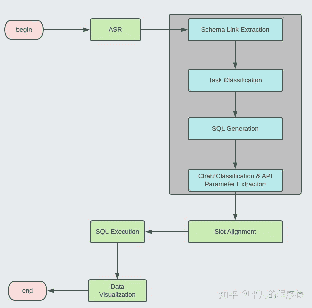

支持的五种业务场景最终展示效果参考:

**柱状图 **:

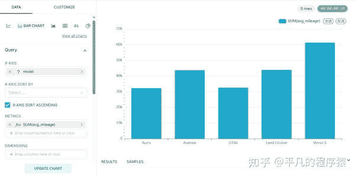

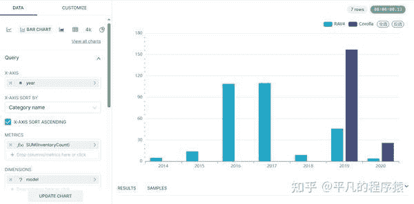

**折线图 **:

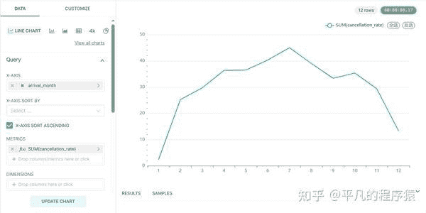

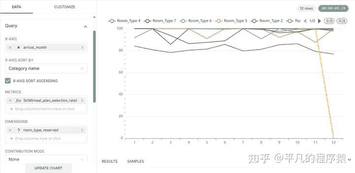

**表 **:

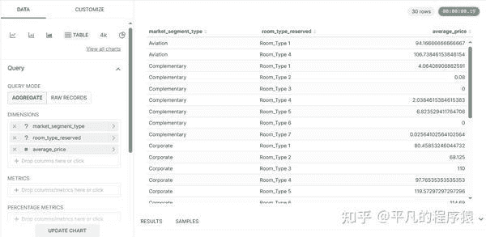

**箱图 **:

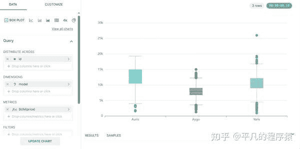

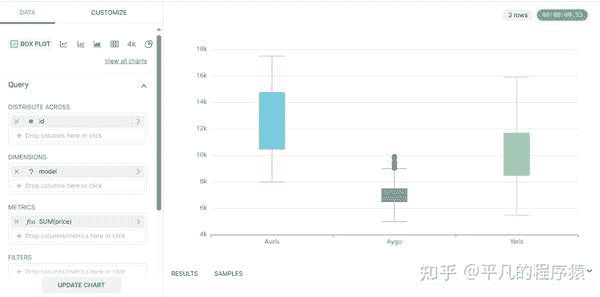

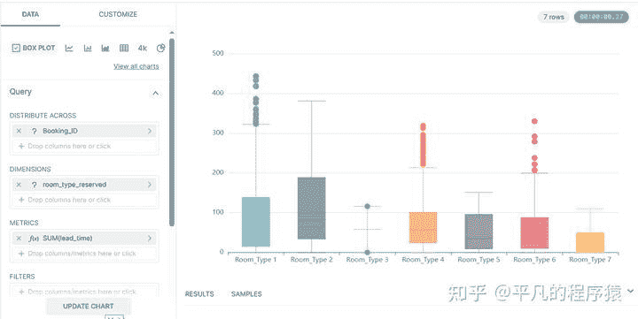

**词云 **:

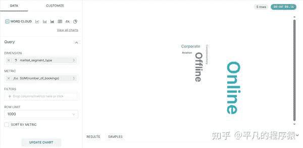

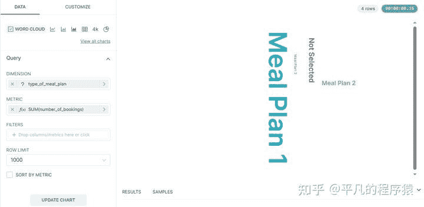

## 三. 业务建模

### 3.1 Text2SQL

本期业务的目标主要是对标了DIN-SQL的业务流程，在Schema Link Extraction任务上增加了COT的优化，并根据了业务问题优化了prompt结构。在本业务场景下，我们的prompt的结构可以表示为:

```
prompt = role + instruction + statement + context with cot + style + indicator
```

示例:

```
role = &quot;# You are a professional data analyst and very familiar with SQL functions related to databases.&quot; 
instruction = &quot;Find the schema_links for generating SQL queries for each question based on the database schema and Foreign keys.&quot; 
statement = &quot;Step-by-step analysis process is required, including the connection between columns in the table and user input question, 
             the definition of related columns, foreign key pairs that may need to be relied on.&quot;
context_with_cot = &quot;*****&quot;
style = &quot;SQL should be as concise and efficient as possible.&quot;.
indicator = The final associated information returned should be started with &#x27;schema_link:&#x27; and end with &#x27;#&#x27;.&quot;
```

Schema Link Extraction:

这里的处理逻辑和作者在V1.0中的方法类似，这块可以看下相关的文章，这里不在赘述。

[  ](https://zhuanlan.zhihu.com/p/670913902)

这里的区别是在对数据库中各表的描述，这里加入了对表的数据描述。

```
{   //这里不暴露企业隐私数据信息，大家参考下格式就好
   &quot;table&quot;:&quot;31131434&quot;,
   &quot;columns&quot;: [
      {&quot;name&quot;: &quot;id&quot;, &quot;optional&quot;: false, &quot;data_type&quot;: &quot;string&quot;, &quot;desc&quot;: &quot;1313133&quot;, &quot;primary_key&quot;: true},
      {&quot;name&quot;: &quot;name&quot;, &quot;optional&quot;: false, &quot;data_type&quot;: &quot;string&quot;, &quot;desc&quot;: &quot;3131313&quot;, &quot;primary_key&quot;: false}
   ],
   &quot;foreign_key&quot;: [
      &quot;A.id = B.id&quot;,
      &quot;A.name = B.name&quot;
   ]
}
```

输出的Schema Link信息主要包括和query相关的column, 依赖的数据项，聚合函数定义，外键关系等。如:

```
 &quot;schema_link: [TableA.column1, TableA.column2, TableA.column3, TableA.column4, count, avg, 3].&quot;
```

Task Classification:

这里的业务定义参考Spider数据集，将SQL Generation定义分为了三个类别。

**Simple **: 简单的SQL查询操作，一般不包括JOIN等聚合操作以及嵌套查询操作。(项目交付时根本没这个类型.....)

**Medium **: 中等难度的SQL查询，一般会包括JOIN等聚合操[作，不包含](https://www.zhihu.com/search?q=%E6%B5%8B%E8%AF%95%E7%94%A8%E4%BE%8B&search_source=Entity&hybrid_search_source=Entity&hybrid_search_extra=%7B%22sourceType%22%3A%22article%22%2C%22sourceId%22%3A679297827%7D)嵌套查询操作。(大部分是这类 测试用例 。)

**Hard **: 较困难的SQL查询，一般会同时包括JOIN等聚合操作，并且包括嵌套查询操作。(少量这类测试用例。)

这里加入 [Task Classific](https://www.zhihu.com/search?q=few-shot%20case&search_source=Entity&hybrid_search_source=Entity&hybrid_search_extra=%7B%22sourceType%22%3A%22article%22%2C%22sourceId%22%3A679297827%7D)ation子 任务主要还是为了针对性的去拟合 few-shot case 。不同难度的类别下的prompt会有区别，并且有难度标签在生成数据可视化参数时，能为下游子任务提供额外的信息特征，便于LLM更友好的生成对应的参数K-V对信息。

**SQL Generation:**

这里的SQL Generation是通过上一子任务确认对应的prompt模[板，根据业务](https://www.zhihu.com/search?q=query&search_source=Entity&hybrid_search_source=Entity&hybrid_search_extra=%7B%22sourceType%22%3A%22article%22%2C%22sourceId%22%3A679297827%7D)难度筛选"合适"的few-shot case示例。同时根据用户输入 query 和Schema Link的信息，完成SQL语句的生成。

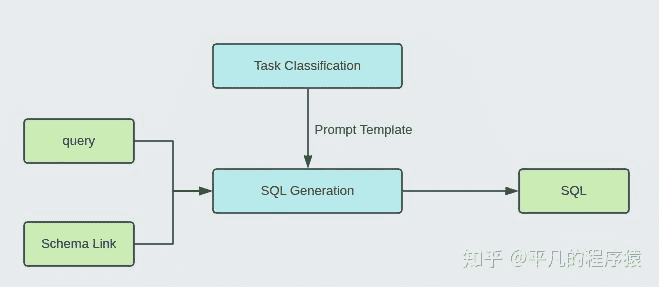

同时，这里为提升LLM推理的效果，针对性加入了COT的推理过程，关于COT的实现，可以参考作者V1.0版本优化中的介绍。

### 3.2 数据可视化

**业务场景:**

需要支持5种不同类型的图表，每种图表的API接口和参数会存在区别，包括数据的数据结构类型和是否非空, 如:

```
{ //保护企业隐私，仅参考以下API描述
   &quot;chart_a&quot;: [
       {&quot;key&quot;: &quot;param1&quot;, &quot;value_type&quot;: &quot;string&quot;, &quot;optional&quot;: true},
       {&quot;key&quot;: &quot;param2&quot;, &quot;value_type&quot;: &quot;list[tuple]&quot;, &quot;optional&quot;: false},
       {&quot;key&quot;: &quot;param3&quot;, &quot;value_type&quot;: &quot;list[string]&quot;, &quot;optional&quot;: false}
   ]
}
// 如: param1 是简单的string 参数，optional, ex: &#x27;column1&#x27;
//     param2 是list[tuple] 参数， required, ex: [(&#x27;column1&#x27;, &#x27;column2&#x27;, &#x27;SUM&#x27;)]
//     param3 是list[string] 参数, required, ex: [&#x27;column1&#x27;, &#x27;column2&#x27;]
```

**图表分类:**

和上述的Task Classfication任务类似，主要负责判断当前任务适合用哪种图表进行结果展示，这里是一个5分类任务(这里的业务未考虑OOD情况)。

[**参数抽取 **](https://www.zhihu.com/search?q=%E5%8F%82%E6%95%B0%E6%8A%BD%E5%8F%96&search_source=Entity&hybrid_search_source=Entity&hybrid_search_extra=%7B%22sourceType%22%3A%22article%22%2C%22sourceId%22%3A679297827%7D)**:**

参数抽取的任务在这个系统中，算得上相对比[较困难的一](https://www.zhihu.com/search?q=%E5%8F%82%E6%95%B0%E5%8F%96%E5%80%BC&search_source=Entity&hybrid_search_source=Entity&hybrid_search_extra=%7B%22sourceType%22%3A%22article%22%2C%22sourceId%22%3A679297827%7D)个点，这里涉及到对应API的 参数取值 的抽取和信息组合,可以用下图来表示:

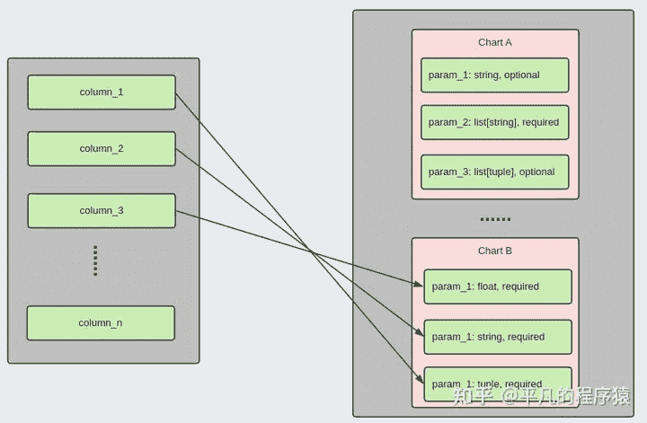

这里需要依靠LLM抽取出各个候选列和图形API参数的映射关系，而且需要根据数据的类型，转成对应的数据格式。涉及的知识推理包括:

```
1. 必要参数该抽取哪些列? 即: param1对应哪些columns？
2. 候选列该以什么形式组合? 即: string, list, sql func, tuple等复杂的组合形式?
3. 可选参数该不该赋值? 
4. 多个参数信息如何排序?
```

**槽位对齐:**

这里的槽位对齐目前是根据是业务需求进行编码实现的，解决的是LLM生[成内容的不确](https://www.zhihu.com/search?q=LLM%E6%8E%A8%E7%90%86&search_source=Entity&hybrid_search_source=Entity&hybrid_search_extra=%7B%22sourceType%22%3A%22article%22%2C%22sourceId%22%3A679297827%7D)定性问题，避免LLM生成非法参数导致API调用异常 。本模块暂未用 LLM推理 的策略实现。

**后处理:**

这里[的后处理目](https://www.zhihu.com/search?q=%E9%80%BB%E8%BE%91%E6%8E%A8%E7%90%86&search_source=Entity&hybrid_search_source=Entity&hybrid_search_extra=%7B%22sourceType%22%3A%22article%22%2C%22sourceId%22%3A679297827%7D)前是在客户端(UI对话交互界面)进行调用，主要包括SQL语句的执行和可视化接口的调用两个部分。本模块暂时没有end2end的执行方式，LLM主要是完成了后端业务全链路的 逻辑推理 ，生成了数据可视化的全部参数信息，主要包括SQL语句、图表类别和API接口所需的全部参数信息等。后续可以尝试end2end的方式，直接利用LLM调用该API实现图形化界面的生成。

## 四. 业务难点

### 4.1 数据可视化业务建模

**图表信息Schema的定义 **: 将不同的图表API定义清楚，体现出图表的差异化是很有必要的。

**参数格式定义 **: API接口的参数信息对齐，相对可以适当简化。

### 4.2 TPM问题

利用LLM在数据可视化模块容易出现TPM问题，主要有2个原因:

其一是子任务相对较多，且子任务一般包含COT推理过程，tokens容易溢出。

其二是数据可视化子任务，需要同时加入数据库的schema和API的schema信息，tokens量会较大。同时针对5个不同的数据类型，分类加入2个few-shot case，tokens容易溢出。

## 五. 合作声明

本文中声明的技术方法为作者原创，引用请备明出处，欢迎合作交流，共同成长。

作者的实践主要是围绕合作的企业方的需要进行开发的，已完成数十家相关企业的项目交付 ，请勿要随意搬运，有相关业务合作需求，可以留言联系。

