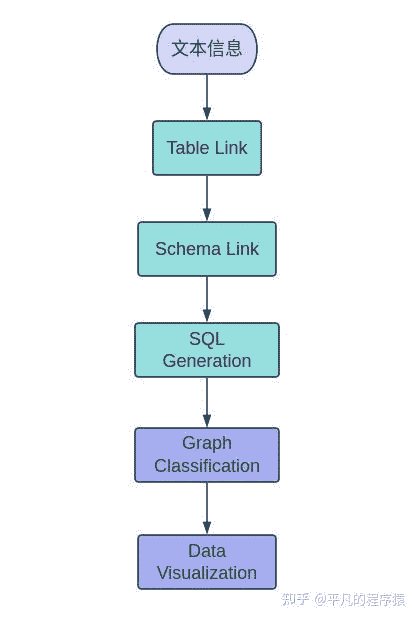
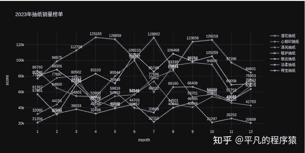
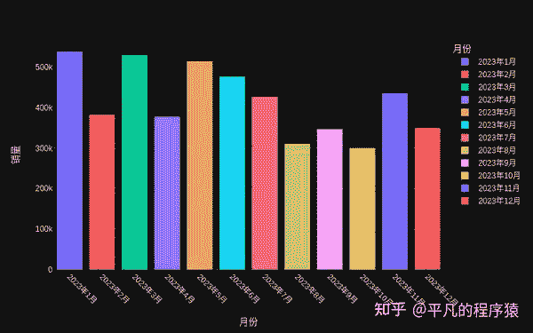
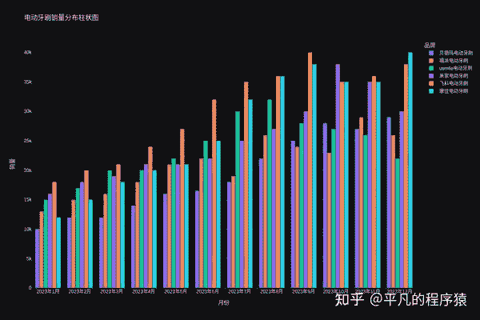
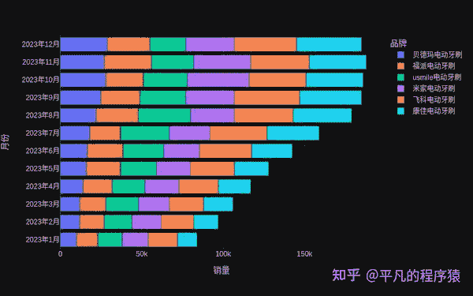
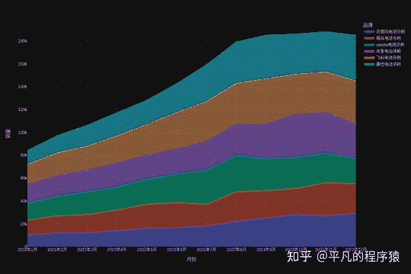
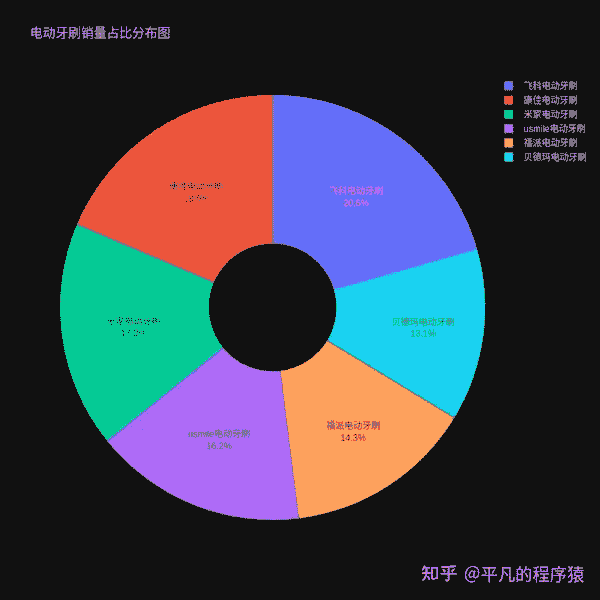

# LLM在中文Text2SQL领域的应用

> 来源：[https://agijuejin.feishu.cn/docx/IzWLdhvLsofeypxCcpacVgYInNb](https://agijuejin.feishu.cn/docx/IzWLdhvLsofeypxCcpacVgYInNb)

> 作者：王大锤

> 原文： [https://zhuanlan.z](https://zhuanlan.zhihu.com/p/674827776)hihu.com/p/674827...

## 一. 前言

### 1.1 背景

本文主要是针对中文Text2SQL业务场景做的业务落地，即通过用户输入的自然语言文本信息(Text)，转换为对应的SQL查询语句，然后通过对数据库中的数据进行检索查询，自动化生成相关的可视化表格，以可视化报表的形式与用户实现交互。

### 1.2 技术实现

> **作者基于DIN-SQL的实践 **:https://zhuanlan.zhihu.com/p/670509396

> **作者基于DIN-SQL做的一期优化:**https://zhuanlan.zhihu.com/p/670913902

> **作者基于DIN-SQL做的二期优化:**https://zhuanlan.zhihu.com/p/673474672

## 二.相关工作

对[比作者在](https://www.zhihu.com/search?q=%E6%B5%81%E7%A8%8B%E5%9B%BE&search_source=Entity&hybrid_search_source=Entity&hybrid_search_extra=%7B%22sourceType%22%3A%22article%22%2C%22sourceId%22%3A674827776%7D)二期做的优化工作，这里主要增加了数据库的IO查询，然后加入了数据的可视化智能分类，并以对应的图表结构形式实现了数据的可视化，简要的 流程图 如下:

## 三.功能描述

[作者本期总共](https://www.zhihu.com/search?q=%E6%95%B0%E6%8D%AE%E5%8F%AF%E8%A7%86%E5%8C%96&search_source=Entity&hybrid_search_source=Entity&hybrid_search_extra=%7B%22sourceType%22%3A%22article%22%2C%22sourceId%22%3A674827776%7D)支持了9个类别的图表 数据可视化 ，主要包括以下类型:

### 3.1 [折线图](https://www.zhihu.com/search?q=%E6%8A%98%E7%BA%BF%E5%9B%BE&search_source=Entity&hybrid_search_source=Entity&hybrid_search_extra=%7B%22sourceType%22%3A%22article%22%2C%22sourceId%22%3A674827776%7D)

> 示例: 查询抽纸类目月销量大于两万的产品名称和月销量。

### 3.2 柱状图

> 示例: 查询电动牙刷类目近一年的总销量。

### 3.3 [多元柱状图](https://www.zhihu.com/search?q=%E5%A4%9A%E5%85%83%E6%9F%B1%E7%8A%B6%E5%9B%BE&search_source=Entity&hybrid_search_source=Entity&hybrid_search_extra=%7B%22sourceType%22%3A%22article%22%2C%22sourceId%22%3A674827776%7D)

> 示例: 查询近一年内月销量大于一万的电动牙刷名称和销量信息。

### 3.4 条形图

> 示例: 查询电动牙刷类目近一年内月销量大于一万的产品名称和销量。

### 3.5 多元条形图

> 示例: 查询近一年内电动牙刷类目月销量大于一万的产品名称月销量信息，并以产品名称进行分组。

### 3.6 面积图

示例: 查询近一年内月销量大于一万的电动牙刷名称和销量信息。

### 3.7 [散点图](https://www.zhihu.com/search?q=%E6%95%A3%E7%82%B9%E5%9B%BE&search_source=Entity&hybrid_search_source=Entity&hybrid_search_extra=%7B%22sourceType%22%3A%22article%22%2C%22sourceId%22%3A674827776%7D)

> 示例: 查询近一年内电动牙刷类目月销量大于一万的产品名称月销量信息，并散点图进行结果展示。

### 3.8 饼图

> 示例: 查询近一年内电动牙刷类目月销量大于一万的产品名称和符合该条件的销量占比。

### 3.9 [环形图](https://www.zhihu.com/search?q=%E7%8E%AF%E5%BD%A2%E5%9B%BE&search_source=Entity&hybrid_search_source=Entity&hybrid_search_extra=%7B%22sourceType%22%3A%22article%22%2C%22sourceId%22%3A674827776%7D)

示例: 查询近一年内电动牙刷类目月销量大于一万的产品名称和符合该条件的销量占比，并以环形图进行展示。

## 四. 版本介绍

| 功能 | POC版 | V1.0 | V2.0 | PRD版 |
| --- | --- | --- | --- | --- |
| 中文表名字段对齐 | Yes | Yes | Yes | Yes |
| SQL生成 | Yes | Yes | Yes | Yes |
| COT链式求解 | Yes | Yes | Yes | Yes |
| 输出结构对齐 | No | Yes | Yes | Yes |
| Prompt微调 | No | Yes | Yes | Yes |
| COT Prompt优化 | No | Yes | Yes | Yes |
| COT ensemble | No | Yes | Yes | Yes |
| COT dropout | No | Yes | Yes | Yes |
| Dynamic COT Few Shot | No | Yes | Yes | Yes |
| Few Shot Prompt | No | Yes | Yes | Yes |
| LLM 数据幻觉优化 | No | Yes | Yes | Yes |
| 底座LLM配置 | No | No | Yes | Yes |
| Table Link | No | No | Yes | Yes |
| 数据扩充 | No | No | Yes | Yes |
| COT链路优化 | No | No | Yes | Yes |
| Table Prompt Ensemble | No | No | Yes | Yes |
| Table Link ensemble | No | No | Yes | Yes |
| RAG数据增强 | No | No | Yes | Yes |
| SFT | No | No | Yes | Yes |
| 数据检索查询 | No | No | No | Yes |
| 图表分类 | No | No | No | Yes |
| 自动绘图 | No | No | No | Yes |

## 五.合作声明

上述业务功能为作者团队原创，有合作需求，可以留言联系。转载请注明出处，谢谢！