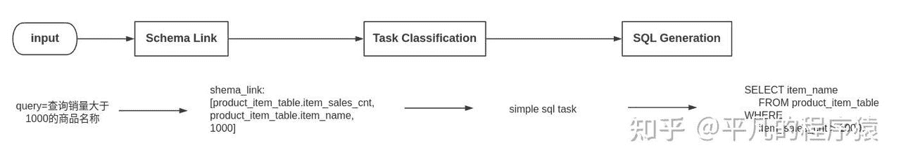
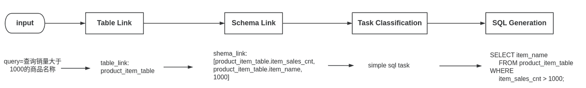

# LLM在中文Text2SQL任务上的优化V2.0

> 来源：[https://agijuejin.feishu.cn/docx/T7ptdnAs3owyV2xq8R3c84uQnWd](https://agijuejin.feishu.cn/docx/T7ptdnAs3owyV2xq8R3c84uQnWd)

> 作者：王大锤

> 原文： [https://zhuanlan.z](https://zhuanlan.zhihu.com/p/673474672)hihu.com/p/673474...

## 一.前言

### 背景

本文是根据Text2SQL的任务做的深度优化，主要是从中文Text2SQL任务中发现的问题进行总结归纳，然后根据业务问题提出候选的解决方案，并给出作者在此解决方案上的效果。

### [基线任务](https://www.zhihu.com/search?q=%E5%9F%BA%E7%BA%BF%E4%BB%BB%E5%8A%A1&search_source=Entity&hybrid_search_source=Entity&hybrid_search_extra=%7B%22sourceType%22%3A%22article%22%2C%22sourceId%22%3A673474672%7D)

基线任务是实现了2023年ACL上State of the Art一篇文章，文中提到DIN-SQL模型在中文Text2SQL任[务上对比其他](https://www.zhihu.com/search?q=%E4%B8%AD%E6%96%87%E6%95%B0%E6%8D%AE%E5%BA%93&search_source=Entity&hybrid_search_source=Entity&hybrid_search_extra=%7B%22sourceType%22%3A%22article%22%2C%22sourceId%22%3A673474672%7D)开源模型效果要好。作者在复现该文章的代码时，已经在prompt侧做了适当的优化，如加入了人设角色的信息，对 中文数据库 表schema的描述进行了优化等等。作者之前针对这个问题做了一版优化，有兴趣的读者可以阅读下面的文章，本文的实验是做V1.0任务上的进一步探索，欢迎各路大神留言指点。

> **作者基于 **[**DIN-SQL **](https://www.zhihu.com/search?q=DIN-SQL&search_source=Entity&hybrid_search_source=Entity&hybrid_search_extra=%7B%22sourceType%22%3A%22article%22%2C%22sourceId%22%3A673474672%7D)**的实践 **: LLM在中文Text2SQL的实践

> 作者基于DIN-SQL的优化V1.0 : LLM在中文Text2SQL任务上的优化V1.0


## 二.问题

这期优化工作，主要围绕着业务中的三个问题来展开，相关的问题描述如下:

### 2.1 数据库描述问题

作者的实验的数据库Demo，为参考服务企业的业务功能，简化构建的中文数据集。该数据集对比开源的数据集增加了一些业务落地时的字段描述。示例如下:

```
//示例表(Demo版)
//作者这里主要增加了optional字段和primary_key字段信息
/*
table: 表名定义
columns：表中包含的列的描述信息，实践中一般会比较多，这里Demo版是用于debug的，相对简洁。
    column中的字段描述如下:
        name: 列名的定义
        optional: 是否非空，取值为False时，表示该字段的属性值对应NOT NULL
        data_type: 字段的数据类型，Demo版用的JAVA的类型表示的，可以改成数据库中的(string, int32等数据类型)
        desc: 字段的中文描述，这里是对该列的中文解释
        primary_key: 表示字段是否为主键，取值为True表示这个字段为主键
references: 表中涉及到的外键关系， table1.item_id = table2.item_id
     references中的字段描述如下:
        key: 当前表中的外键的字段名
        foreign_table: 外键相关的表名
        foreign_key: 外键相关的列名
        desc: 外键的描述，格式为SQL中外键的定义格式，如示例中表示product_item_table.item_id
和store_info_table.item_id为外键关系
*/
{
    &quot;table&quot;: &quot;product_item_table&quot;,
    &quot;columns&quot;: [
        {&quot;name&quot;: &quot;item_id&quot;, &quot;optional&quot;: False, &quot;data_type&quot;: &quot;String&quot;, &quot;desc&quot;: &quot;商品id&quot;, &quot;primary_key&quot;: True},
        {&quot;name&quot;: &quot;item_name&quot;, &quot;optional&quot;: False, &quot;data_type&quot;: &quot;String&quot;, &quot;desc&quot;: &quot;商品名称&quot;, &quot;primary_key&quot;: False},
        {&quot;name&quot;: &quot;item_price&quot;, &quot;optional&quot;: False, &quot;data_type&quot;: &quot;Float&quot;, &quot;desc&quot;: &quot;商品价格&quot;, &quot;primary_key&quot;: False},
        {&quot;name&quot;: &quot;item_sales_cnt&quot;, &quot;optional&quot;: False, &quot;data_type&quot;: &quot;Integer&quot;, &quot;desc&quot;: &quot;商品销量&quot;, &quot;primary_key&quot;: False},
        {&quot;name&quot;: &quot;item_stock_cnt&quot;, &quot;optional&quot;: False, &quot;data_type&quot;: &quot;Integer&quot;, &quot;desc&quot;: &quot;商品库存&quot;, &quot;primary_key&quot;: False},
        {&quot;name&quot;: &quot;item_ctr_7_days&quot;, &quot;optional&quot;: True, &quot;data_type&quot;: &quot;Float&quot;, &quot;desc&quot;: &quot;商品七日点击率&quot;, &quot;primary_key&quot;: False}
    ],
    &quot;references&quot;: [
       {
         &quot;key&quot;: &quot;item_id&quot;, 
         &quot;foreign_table&quot;: &quot;store_info_table&quot;, 
         &quot;foreign_key&quot;: &quot;item_id&quot;, 
         &quot;desc&quot;: &quot;FOREIGN KEY (item_id) REFERENCES store_info_table(item_id)&quot;
       }
    ]
}
```

在处理业务问题时，同一个数据库中的表可能是比较多的，参考上期优化[工作的建模方式，可能会出](https://www.zhihu.com/search?q=schema_link&search_source=Entity&hybrid_search_source=Entity&hybrid_search_extra=%7B%22sourceType%22%3A%22article%22%2C%22sourceId%22%3A673474672%7D)[现prom](https://www.zhihu.com/search?q=COT%E9%93%BE&search_source=Entity&hybrid_search_source=Entity&hybrid_search_extra=%7B%22sourceType%22%3A%22article%22%2C%22sourceId%22%3A673474672%7D)pt tokens过长的问题；并且在每次抽取 schema_link 的时候，如果库中高频有新增表结构的行为，需要去修改整体的 COT链 ，适配新的业务场景，这种建模方式是不利于产品迭代的。

### 2.2 COT链路优化问题

上期针[对DIN-](https://www.zhihu.com/search?q=%E5%85%B3%E7%B3%BB%E6%98%A0%E5%B0%84&search_source=Entity&hybrid_search_source=Entity&hybrid_search_extra=%7B%22sourceType%22%3A%22article%22%2C%22sourceId%22%3A673474672%7D)SQL中的Shema Link -> Task Classification -> SQL Generation的业务进行了 prompt engineering 维度的优化。并通过对Dynamic Few-Shot Learning的方式，剔除了Task Classification的流程。 在数据库中表和列的数据量增加的时候，从数据库中召回列的属性， 关系映射 的难度是成倍增加的，Shema Link -> Task Classification -> SQL Generation的COT链路表现也不是很好。因此，对Text2SQL任务的COT链路还需进一步优化。



### 2.3 渐进式学习问题

如果整体的链路相对较长，要实现对整体的业务支持，[数据的标](https://www.zhihu.com/search?q=%E5%85%A8%E9%93%BE%E8%B7%AF&search_source=Entity&hybrid_search_source=Entity&hybrid_search_extra=%7B%22sourceType%22%3A%22article%22%2C%22sourceId%22%3A673474672%7D)注成本是很高的。这里一般需要对 全链路 的数据做对齐。如果能对COT链路能逐步实现简化，其实是可以降低模型SFT的成本，并且提高项目研发的效率。模型冷启动时，我们可能需要告诉LLM较多地专业知识，随着模型的迭代，逐步减少提示信息和流程，提高模型训练效率，也是本期研究的一个方向。

## 三.优化工作

### 3.1 知识扩充优化

这里做的核心工作是告诉LLM一些额外的字段信息，以支持一些额外的SQL指令，如query=查找商品名称不为空的商品销量信息，这里对应的SQL判断条件是item_name is not NULL。除此以外，数据库中主键和外键的关系也是一个十分关键的字段信息，外键一般能表示不同表中数据的依赖关系。在Schema Link任务时显式地告诉LLM这种依赖关系，可以帮助LLM更好地抽取对应的依赖关系。但是表多的时候，可能会出现tokens溢出的问题。为此，作者尝试了下列的建模方法，使得LLM能相对降低tokens溢出的问题。方法如下:

这里先给出上期优化工作中对Schema Link建模时的promot生成方法, 读者可以对比下几种策略的差异:

```
#以上述表prod[uct_](https://www.zhihu.com/search?q=%E5%95%86%E5%93%81%E4%BF%A1%E6%81%AF&amp;search_source=Entity&amp;hybrid_search_source=Entity&amp;hybrid_search_extra=%7B%22sourceType%22%3A%22article%22%2C%22sourceId%22%3A673474672%7D)item_table的数据结构为例:
&quot;&quot;&quot;
上期优化工作(V1.0)对应的prompt可能参考如下:
product_item_table:
    columns:
        item_id: [ 商品id, String ]
        item_stock_cnt: [ 商品库存, Integer ]
        item_price: [ 商品价格, Float ]
        item_name: [ 商品名称, String ]
        item_sales_cnt: [ 商品销量, Integer ]
        item_ctr_7_days: [ 商品七天点击率, Float ]
&quot;&quot;&quot;

#扩充新的知识信息后的表的prompt结构可能如下:
#表和列较多的时候，描述整个表可能会出现tokens溢出。
&quot;&quot;&quot;
product_item_table:
    info：商品信息描述表，包括商品id，商品库存，商品价格，商品名称，商品销量，商品7天点击率
    columns:
        item_id: [ 商品id, String, NOT NULL, PRIMARY_KEY ]
        item_stock_cnt: [ 商品库存, Integer, NOT NULL ]
        item_price: [ 商品价格, Float, NOT NULL ]
        item_name: [ 商品名称, String, NOT NULL ]
        item_sales_cnt: [ 商品销量, Integer, NOT NULL ]
        item_ctr_7_days: [ 商品七天点击率, Float ]
&quot;&quot;&quot;

#简化后的表的prompt结构可能如下:
#应用于Table Link Task。大幅减少prompt tokens量，便于支持复杂的业务建模场景。
&quot;&quot;&quot;
product_item_table:
    info：商品信息描述表，包括商品id，商品库存，商品价格，商品名称，商品销量，商品7天点击率
&quot;&quot;&quot;
```

通过对Table Link Tas[k任务的简化，](https://www.zhihu.com/search?q=token%E6%95%B0&search_source=Entity&hybrid_search_source=Entity&hybrid_search_extra=%7B%22sourceType%22%3A%22article%22%2C%22sourceId%22%3A673474672%7D)能大幅减少prompt的 token数 ，实现对多表数据库的业务支持(40多张表，20多个字段的数据结构，在之前的任务下容易溢出)。

### 3.2 COT链路优化

对于整体的 [COT链路 ](https://www.zhihu.com/search?q=COT%E9%93%BE%E8%B7%AF&search_source=Entity&hybrid_search_source=Entity&hybrid_search_extra=%7B%22sourceType%22%3A%22article%22%2C%22sourceId%22%3A673474672%7D)，作者尝试了进一步的探索和实践，从Schema Link -> Task Classification -> SQL Generation的COT链路改为了Table Link -> Schema Link -> Task Classification -> SQL Generation的链路。当然，在出现耗时增加和标注成本增加的前提下，作者后续加入了渐进式学习的优化工作。



这里对新增的Table Link任务，对数据库中的每张表采用简化后的prompt进行描述，返回能满足用户查询需求的表名的召回。对应的prompt可以参考如下:

```
&quot;[&quot;&quot;
你是一名专业的数据分](https://www.zhihu.com/search?q=few-shot%20case&amp;search_source=Entity&amp;hybrid_search_source=Entity&amp;hybrid_search_extra=%7B%22sourceType%22%3A%22article%22%2C%22sourceId%22%3A673474672%7D)析师，熟悉数据库相关的SQL功能。请根据下列每张表的字段信息描述，以及用户输入信息的需求场景，
找出能实现用户业务需求的表名。要求输出逐步分析的过程，包括表中字段和用户需求的描述。最终得到的信息以table_link: 开始。
数据库中各表的描述如下:
product_item_table:
    info：商品信息描述表，包括商品id，商品库存，商品价格，商品名称，商品销量，商品7天点击率
product_item_sales_table:
    info: 商品销量信息描述表，包括商品id, 商品名称，商品规格id，商品规格名称，商品销量，商品近一日销量，商品近七日销量

#few-shot case (略)
&quot;&quot;&quot;
```

这里通过Table Link任务的召回，一般会抽取到和用户需求相关的N张表(N一般较小)，然后通过扩充后的知识构建Schema Link任务的prompt。这里一般会包含召回的N张表的列名和字段描述，主键外键关系等等。可能参考的prompt如下:

```
[&quot;&quot;&quot;
你是一名专业的S](https://www.zhihu.com/search?q=foreign_keys&amp;search_source=Entity&amp;hybrid_search_source=Entity&amp;hybrid_search_extra=%7B%22sourceType%22%3A%22article%22%2C%22sourceId%22%3A673474672%7D)QL分析师，请根据下列数据库中各表结构的定义，找出和用户输入信息相关的表的字段的关联信息。 (建议写详细点)
以下是数据库中和用户查询需求相关的表的定义，主要包括表名，列名和列的相关说明信息等。
product_item_table:
    info：商品信息描述表，包括商品id，商品库存，商品价格，商品名称，商品销量，商品7天点击率
    columns:
        item_id: [ 商品id, String, NOT NULL, PRIMARY_KEY ]
        item_stock_cnt: [ 商品库存, Integer, NOT NULL ]
        item_price: [ 商品价格, Float, NOT NULL ]
        item_name: [ 商品名称, String, NOT NULL ]
        item_sales_cnt: [ 商品销量, Integer, NOT NULL ]
        item_ctr_7_days: [ 商品七天点击率, Float ]
product_item_sales_table:
    info: 商品销量信息描述表，包括商品id, 商品名称，商品规格id，商品规格名称，商品销量，商品近一日销量，商品近七日销量，商品近三十日销量
    columns:
        item_id: [ 商品id, String, NOT NULL, PRIMARY_KEY ]
        item_name: [ 商品名称, String, NOT NULL ]
        sku_id: [ 商品规格id, String, NOT NULL ]
        sku_name: [ 商品规格名称, String, NOT NULL ]
        item_sales_cnt: [ 商品销量, Integer, NOT NULL ]
        item_sales_cnt_1_days: [ 商品近一日销量, Integer ]
        item_sales_cnt_7_days: [ 商品近七日销量, Integer ]
        item_sales_cnt_30_days: [ 商品近三十日销量, Integer ]
foreign_keys = [product_item_table.item_id = product_item_sales_table.item_id, 
       product_item_table.item_name = product_item_sales_table.item_name]
&quot;&quot;&quot;
```

因为Table Link Task已经实现了相关表的召回，在Schema Link可以尽可能地将表的描述和需求写清楚，同时，也可以加入更多地few-shot case。 完成Schema Link的建模后，后续的Task Classification和SQL Generation模块可以按照上期V1.0版本的逻辑完成整体Text2SQL的业务需求。

### **3.3 Tabl**e Prompt Ensemble

数据库中表较多的时候，在针对Table Link任务的建模时，需要对每张表进行简要的概要描述。这里采用了和上期优化工作类似的Trick。这里的Ensemble主要针对2个场景:

+   针对单个表的prompt生成

```
#针对表的列的描述进行打散，避免生成单一的表结构描述
&quot;&quot;&quot;
#如:
product_item_table:
    info：商品信息描述表，包括商品id，商品库存，商品价格，商品名称，商品销量，商品7天点击率
或:
product_item_table:
    info：商品价格，商品名称，商品销量，商品7天点击率，商品信息描述表，包括商品id，商品库存
&quot;&quot;&quot;
```

+   针对多个表prompt的拼接

```
#针对每个表对应prompt的描述，采用随即打散的顺序进行拼接，保障prompt的多样性
&quot;&quot;&quot;
如:
product_item_table:
    info：商品信息描述表，包括商品id，商品库存，商品价格，商品名称，商品销量，商品7天点击率
product_item_sales_table:
    info: 商品销量信息描述表，包括商品id, 商品名称，商品规格id，商品规格名称，商品销量，商品近一日销量，商品近七日销量
或:
product_item_sales_table:
    info: 商品销量信息描述表，包括商品id, 商品名称，商品规格id，商品规格名称，商品销量，商品近一日销量，商品近七日销量
product_item_table:
    info：商品信息描述表，包括商品id，商品库存，商品价格，商品名称，商品销量，商品7天点击率
&quot;&quot;&quot;
```

### 3.4 RAG数据增强

在作者的实践中，这个方向上的优化，是十分有必要的。本期主要是针对用户的输入的query和召回的表的字段信息进行了RAG优化。这里作者利用LLM对few-shot case中的query进行了同义句生成的子任务建模，在构建对应的prompt时，可以用同义句对原始query进行替换，保留其他COT链的推理关系。同时对表的字段信息构建prompt时，可以利用LLM对属性值进行字段信息描述，或者用对应的同义词表示的当前字段信息。

```
&quot;&quot;&quot;
如:
query的RAG优化:
   查询销量大于1000的产品名称。 -&gt; 查询卖了1000件以上的产品名称。
   Tips: 对表的的描述中有销量字段，但是&quot;卖了1000件以上&quot;，LLM就不一定能知道是销量大于1000。

字段的RAG优化:
product_item_table:
    info：商品信息描述表，包括商品id，商品库存，商品价格，商品名称

-&gt;
product_item_table:
    info：商品信息描述表，包括[商品id]，[商品库存]，[商品价格]，[商品名称,产品名称,货品名称,货物称呼]
    Tips：用组的同义词描述该列的信息
&quot;&quot;&quot;
```

### 3.5 渐进式学习优化

这里的优化，主要是针对COT的渐进式学习优化，由于新增了Table Link的任务，子任务增加后，数据标注和推理的耗时也会明显增加。这里尝试了用渐进式学习的方法对Task Classification进行剔除。

即开始训练的时候按照Table Link -> Schema Link -> Task Classification -> SQL Generation的流程完成整体业务需求的实现。随着SFT epoch的增加，逐步用单一的Task Classification进行替换(Simple Task)。在实验中，效果基本上能保持稳定。

## 四.实验结果

采用上述 [优化方法 ](https://www.zhihu.com/search?q=%E4%BC%98%E5%8C%96%E6%96%B9%E6%B3%95&search_source=Entity&hybrid_search_source=Entity&hybrid_search_extra=%7B%22sourceType%22%3A%22article%22%2C%22sourceId%22%3A673474672%7D)，对比于V1.0优化的版本， 在为某企业开发的Text2SQL Demo数据集上, 准确率提升了5.6%。 效果整体上还是比较明显的。

> 数据集是合作的某企业的业务需求，不大方便提供。本实验也是基于具体的业务问题进行实验的，没有在开源数据上做AB-Test。有数据字段对齐问题，也不大方便进行验证，有兴趣的读者可以自行分析实践。

从业务层面上看，作者本期优化主要取得了以下几点成果，欢迎大家给出相关的意见:

+   加入了Table Link的任务，并优化了该任务下的prompt溢出问题，使得Text2SQL有能力去解决更复杂的SQL业务问题。

+   针对中文SQL数据表中的定义，扩充了额外的知识(非空，主键，外键关系等)，便于相关信息的知识推理。

+   [通过RA](https://www.zhihu.com/search?q=%E6%B3%9B%E5%8C%96%E8%83%BD%E5%8A%9B&search_source=Entity&hybrid_search_source=Entity&hybrid_search_extra=%7B%22sourceType%22%3A%22article%22%2C%22sourceId%22%3A673474672%7D)G对用户的输入进行了优化，提升LLM推理的 泛化能力

+   通过RAG对表的chema link定义进行优化，扩充了字段的语义推理功能

+   通过Table Prompt Ensemble的优化，提高了prompt建模的多样性

+   通过渐进式学习的方法，优化了整体的COT链，剔除了冗余的Task Classification子任务。

## 五.总结

这里的优化，整体上对Text2SQL任务的效果提升还是很明显的，但是仍在存在一些问题，后续可以尝试着去探索。

RAG的效果提升相对较为明显，可以尝试更深入的RAG优化尝试。

针对复杂的数据结构，需要支持部分agent的功能，如抽取某字段的K-V对信息，或对表中的数据实现对应的api操作。

对比不同基座LLM的效果，尝试更多PEFT的SFT的技术方法，提升业务整体的准确率。

支持多轮交互的Text2SQL实现形式。

优化本任务的整体推理耗时，如LLM的推理加速等。

## 六.版权声明

本文中声明的技术方法为作者原创，引用请备明出处，欢迎合作交流，共同成长。

本文中的实验没有在开源数据集上进行对比，只是和开源的Text2SQL模型，以及在部分LLM底座上进行了相关的探索，实验结果可能存在不足，有兴趣的读者可以自行验证。

作者的实践主要是围绕合作的企业方的需要进行开发的，部分模块涉及到商业合作，请勿要随意搬运，有相关业务合作需求，可以留言联系。