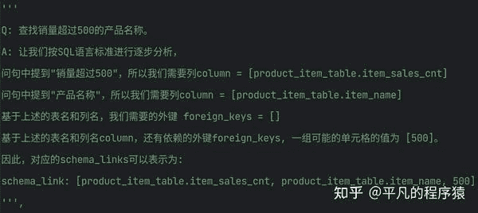
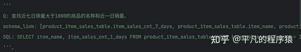
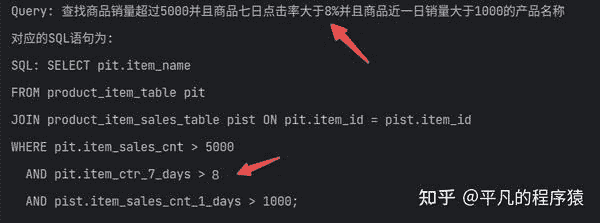
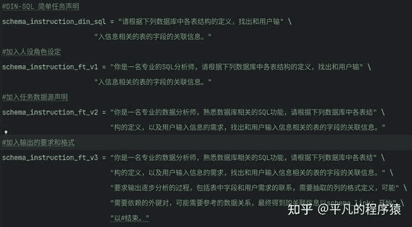
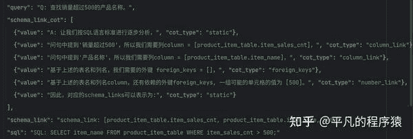
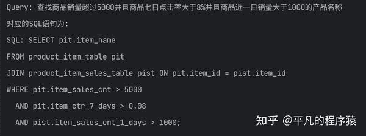

# LLM在中文Text2SQL任务上的优化V1.0

> 来源：[https://agijuejin.feishu.cn/docx/LGgUdOF91oYuetxMDNvc43tznOe](https://agijuejin.feishu.cn/docx/LGgUdOF91oYuetxMDNvc43tznOe)

> 作者：王大锤

> 原文： [https://zhuanlan.z](https://zhuanlan.zhihu.com/p/670913902)hihu.com/p/670913...


## 一. 前言

### 背景:

本文是根据上文提到的中文Text2SQL任务进行的优化，主要从中文Text2SQL任务中发现的问题进行总结归纳，提出候选的解决方案以及对应的效果等等，如果你在实践中也遇到了类似的问题，可以留言讨论。代码部分作者在整理，后续会统一放出来。如有相关的业务，也欢迎给作者留言合作。

### [基线任务 ](https://www.zhihu.com/search?q=%E5%9F%BA%E7%BA%BF%E4%BB%BB%E5%8A%A1&search_source=Entity&hybrid_search_source=Entity&hybrid_search_extra=%7B%22sourceType%22%3A%22article%22%2C%22sourceId%22%3A670913902%7D):

基线[任务是实现了2](https://www.zhihu.com/search?q=prompt&search_source=Entity&hybrid_search_source=Entity&hybrid_search_extra=%7B%22sourceType%22%3A%22article%22%2C%22sourceId%22%3A670913902%7D)[023年AC](https://www.zhihu.com/search?q=%E4%B8%AD%E6%96%87%E6%95%B0%E6%8D%AE%E5%BA%93&search_source=Entity&hybrid_search_source=Entity&hybrid_search_extra=%7B%22sourceType%22%3A%22article%22%2C%22sourceId%22%3A670913902%7D)L上State of the Art一篇文章，文中提到DIN-SQL模型在中文Text2SQL任务上对比其他的模型效果确实要好一些。作者在复现该文章的代码时，已经在 prompt 侧做了适当的优化，如加入了人设角色的信息，对 中文数据库 表schema的描述进行了优化等等。这里的实验是在上次优化结果的基础上进行优化的。

**论文引用 **: DIN-SQL: Decomposed In-Context Learning of Text-to-SQL with Self-Correction

**作者基于DIN-SQL的实践 **: LLM在中文Text2SQL的实践

## 二. 问题

针对上期优化的结果，我们做了进一步的数据分析，发现了下列问题:

### 输出结构对齐问题:

这里主要是指大模型输出的结果可能不是单纯的SQL语句，格式没有实现对齐。如:

```
&#x27;&#x27;&#x27;SQL: SELECT item_name FROM product_item_sales_table WHERE item_sales_cnt_1_days &gt; 500; &#x27;&#x27;&#x27;
```

或者类似于这种:

```
对应的SQL语句可能为:
SELECT item_name FROM product_item_sales_table WHERE item_sales_cnt_1_days &gt; 500;
```

输[出格式没有对](https://www.zhihu.com/search?q=SQL%E8%AF%AD%E5%8F%A5&search_source=Entity&hybrid_search_source=Entity&hybrid_search_extra=%7B%22sourceType%22%3A%22article%22%2C%22sourceId%22%3A670913902%7D)齐的前提下，我们需要对模型的输出结果做对应的后处理，使得只保留以下部分的内容，保障是可以直接执行的 SQL语句 。

```
SELECT item_name FROM product_item_sales_table WHERE item_sales_cnt_1_days &gt; 500;
```

### 模型优化成本问题:

[这里的问题主要是只](https://www.zhihu.com/search?q=few-shot&search_source=Entity&hybrid_search_source=Entity&hybrid_search_extra=%7B%22sourceType%22%3A%22article%22%2C%22sourceId%22%3A670913902%7D)构建包含思维链的 few-shot 样本比较复杂，特别是在构建条件复杂的查询结构时，需抽取的字段和数据信息抽取的表示需要投入大量的时间，并且这部分数据如果以单纯的文本信息表示，相对来说会比较难维护。上期的few-shot数据格式如:





这种纯文本的prompt不好维护，而且设置的example可能和当前预测的query的场景不符合。

### SQL多样化问题:

[这个问题比](https://www.zhihu.com/search?q=%E5%8D%95%E8%A1%A8%E6%9F%A5%E8%AF%A2&search_source=Entity&hybrid_search_source=Entity&hybrid_search_extra=%7B%22sourceType%22%3A%22article%22%2C%22sourceId%22%3A670913902%7D)较好理解，SQL的句式类型是比较多的，比如简单的 单表查询 操作可能如:

```
SELECT store_name FROM store_info_table WHERE store_sales_cnt &gt; 1000 AND store_score &gt; 4.8;
```

涉及到的op操作可能会包含: is NULL, ==, 聚合操作COUNT(*), 排序操作ORDER BY等。

在 [多表查询 ](https://www.zhihu.com/search?q=%E5%A4%9A%E8%A1%A8%E6%9F%A5%E8%AF%A2&search_source=Entity&hybrid_search_source=Entity&hybrid_search_extra=%7B%22sourceType%22%3A%22article%22%2C%22sourceId%22%3A670913902%7D)时可能会有下列场景:

```
SELECT 
     product_item_table.item_name, 
     item_sales_cnt 
FROM 
     product_item_table 
       join product_item_sales_table 
       ON product_item_table.item_name = product_item_sales_table.item_name 
     WHERE 
        product_item_table.item_ctr_7_days &gt; 5% 
        AND product_item_sales_table.item_sales_cnt_7_days &gt; 1000;
```

如果涉及到嵌套查询可能会更加复杂，一般通过few-shot的prompt优化不一定能得到正确的结果，一般需要做SFT。

### [大模型幻觉问题 ](https://www.zhihu.com/search?q=%E5%A4%A7%E6%A8%A1%E5%9E%8B%E5%B9%BB%E8%A7%89%E9%97%AE%E9%A2%98&search_source=Entity&hybrid_search_source=Entity&hybrid_search_extra=%7B%22sourceType%22%3A%22article%22%2C%22sourceId%22%3A670913902%7D):

[这应该是大模型做应用](https://www.zhihu.com/search?q=%E4%B8%80%E6%9C%AC%E6%AD%A3%E7%BB%8F%E5%9C%B0%E8%83%A1%E8%AF%B4%E5%85%AB%E9%81%93&search_source=Entity&hybrid_search_source=Entity&hybrid_search_extra=%7B%22sourceType%22%3A%22article%22%2C%22sourceId%22%3A670913902%7D)时比较常见的一个问题，有时大模型会 一本正经地胡说八道 。如作者在测试是发现了以下场景:



### 大模型推理耗时问题:

在prompt设置的内容较长，比如few-shot case的部分较多时耗时会增加，再比如如果将Text2SQL的子任务拆成3个子任务(Schema Link -> Task Classification -> Sql Generation)，耗时会明显增加。

## 三. 优化

针对以上问题，作者主要从下列几个方向做了相关的优化工作:

### Prompt(Instruction)微调:

这里主要是对prompt中的instruction部分进行了改写和优化，这里简单地说明一下LLM应用中常说的prompt中的基本结构, 针对于复杂的任务场景，prompt一般会包含Instruction, Context, Input Data和Output Indicator四个部分。即LLM的输出结果可以表示为:

```
Output = LLM(Instruction + Context + Input Data + Data Indicator)
```

这里的Instruction表示大模型需要执行的指令，Context表示的是上下文信息，Input Data 表示的是需要处理的数据，Data Indicator表示输出信息格式的指引。

对于[Text2S](https://www.zhihu.com/search?q=%E4%BB%BB%E5%8A%A1%E6%95%B0%E6%8D%AE%E6%BA%90&search_source=Entity&hybrid_search_source=Entity&hybrid_search_extra=%7B%22sourceType%22%3A%22article%22%2C%22sourceId%22%3A670913902%7D)QL的第一个子任务Schema Link抽取的prompt，作者采取了下列改进，从baseline到V3版本的instruction改进，先后加入了人设角色描述， 任务数据源 声明以及输出数据要求格式等信息，通过该操作，保障了LLM在数据输出结构上的对齐。



### COT Prompt优化:

[对于复杂](https://www.zhihu.com/search?q=%E6%80%9D%E7%BB%B4%E9%93%BE&search_source=Entity&hybrid_search_source=Entity&hybrid_search_extra=%7B%22sourceType%22%3A%22article%22%2C%22sourceId%22%3A670913902%7D)的LLM推理任务，一般需要加入 思维链 (Chain-of-thought[, COT)](https://www.zhihu.com/search?q=COT%E7%BB%B4%E5%BA%A6&search_source=Entity&hybrid_search_source=Entity&hybrid_search_extra=%7B%22sourceType%22%3A%22article%22%2C%22sourceId%22%3A670913902%7D)对LLM进行引导，但是构建完整的COT信息是比较耗时耗人力的，也不好维护。对此作者尝试了下列几种方式进行了 COT维度 的优化。

[为了实现COT P](https://www.zhihu.com/search?q=few%20shot&search_source=Entity&hybrid_search_source=Entity&hybrid_search_extra=%7B%22sourceType%22%3A%22article%22%2C%22sourceId%22%3A670913902%7D)rompt优化，作者将 few shot 部分的数据进行了抽象和定义，大概的数据格式参考如下:



这里将 [shema_link_cot ](https://www.zhihu.com/search?q=shema_link_cot&search_source=Entity&hybrid_search_source=Entity&hybrid_search_extra=%7B%22sourceType%22%3A%22article%22%2C%22sourceId%22%3A670913902%7D)部分的数据定义了几种不同的类别，便于实现不同维度的操作，也方便在Dynamic COT Few Shot步骤进行丢弃这部分的prompt。

**COT ensemble **:[ 将整个C](https://www.zhihu.com/search?q=COT%E9%93%BE&search_source=Entity&hybrid_search_source=Entity&hybrid_search_extra=%7B%22sourceType%22%3A%22article%22%2C%22sourceId%22%3A670913902%7D)O[T过程打散，避免单一的](https://www.zhihu.com/search?q=COT%20prompt&search_source=Entity&hybrid_search_source=Entity&hybrid_search_extra=%7B%22sourceType%22%3A%22article%22%2C%22sourceId%22%3A670913902%7D)静态的数据输出。对于上述schema_link_cot部分的模块，一般的 COT链 是根据列表中[的文本内容按顺序进行拼接](https://www.zhihu.com/search?q=number_link&search_source=Entity&hybrid_search_source=Entity&hybrid_search_extra=%7B%22sourceType%22%3A%22article%22%2C%22sourceId%22%3A670913902%7D)生成的，ensemble操作，可以使得同类型的item在每次进行微调或预测时生成不同的 COT prompt 。如: 对于column_link信息抽取的描述有2段信息，利用ensemble操作，可以在生成prompt时，对这2段信息进行shuffle排序，然后进行拼接。这类操作在需要抽取的columns比较多或者涉及到的 number_link 比较多的时候，效果一般会比较好。

**COT Dropout **: 将整个COT中的每个推理步骤，按一定的dropout概率进行丢弃，类似于神经网络中的Dropout。

COT Mask Token Confus[ion :](https://www.zhihu.com/search?q=%E6%B3%9B%E5%8C%96%E8%83%BD%E5%8A%9B&search_source=Entity&hybrid_search_source=Entity&hybrid_search_extra=%7B%22sourceType%22%3A%22article%22%2C%22sourceId%22%3A670913902%7D) 这里是指对单个推理步骤的prompt内容，参考PTM做模糊处理，提升LLM的 泛化能力 。如:

```
{
   &quot;value&quot;: &quot;问句中提到&#x27;产品名称&#x27;，所以我们需要列column = [product_item_table.item_name]，&quot;, 
   &quot;cot_type&quot;: &quot;column_link&quot;
}
```

对'产品名称'和column = [product_item_table.item_name]这部分做Mask, 对剩余的部分做Token维度的操作:

+   以80%的概率替换为'[UNK]'

+   以10%的概率替换为其他的某个Token

+   以10%的概率替换为''

Dyn[amic ](https://www.zhihu.com/search?q=%E4%BC%98%E5%8C%96%E6%96%B9%E6%B3%95&search_source=Entity&hybrid_search_source=Entity&hybrid_search_extra=%7B%22sourceType%22%3A%22article%22%2C%22sourceId%22%3A670913902%7D)COT Few Shot : 这里主要是针对Few Shot的任务进行了优化，在利用底座模型对Text2SQL任务进行SFT微调时，我们包含COT的示例样本是不多的，其主要原因是数据标注太耗时，而且复杂的SQL语句也比较依赖于专家。对此问题，作者提出了Dynamic COT Few Shot 优化方法 。其基本思想是:

+   前几个 [epoch ](https://www.zhihu.com/search?q=epoch&search_source=Entity&hybrid_search_source=Entity&hybrid_search_extra=%7B%22sourceType%22%3A%22article%22%2C%22sourceId%22%3A670913902%7D)的数据采用包含COT数据的训练集A来进行SFT, 并且在每个epoch的训练过程中，减少COT中单个推理过程的保留概率(调整dropout)。

+   随后将训练集A中的COT全量DropOut, 加入无COT标签的训练集B进行训练，即训练Text2SQL -> Schema Link -> SQL的任务。

### Few Shot Prompt优化:

注: 我们有一批Few Shot样本，这里需要从N个样本中，抽取K个进行prompt生成。

这里主要对Few Shot Prompt做了以下几点优化:

Random Few Shot : 随即从N个样本中选出K个候选样本，生成对应的prompt。

Semamtic Few Shot : 找出N个样本中和当前prompt(query)最相似的Top K个样本，生成对应的prompt。

Few Shot Ensemble : 对抽取出来的K个样本，进行shuffle操作，然后生成prompt，即改成了prompt篇章的结构顺序。

### [大模型数据幻觉 ](https://www.zhihu.com/search?q=%E5%A4%A7%E6%A8%A1%E5%9E%8B%E6%95%B0%E6%8D%AE%E5%B9%BB%E8%A7%89&search_source=Entity&hybrid_search_source=Entity&hybrid_search_extra=%7B%22sourceType%22%3A%22article%22%2C%22sourceId%22%3A670913902%7D):

[这里主要给LLM一些相关的](https://www.zhihu.com/search?q=number_infer&search_source=Entity&hybrid_search_source=Entity&hybrid_search_extra=%7B%22sourceType%22%3A%22article%22%2C%22sourceId%22%3A670913902%7D)提示词，或者在COT中加入 number_infer 的项，如:

```
[{
   ](https://www.zhihu.com/search?q=%E6%B5%AE%E7%82%B9%E5%9E%8B%E6%95%B0%E5%80%BC&amp;search_source=Entity&amp;hybrid_search_source=Entity&amp;hybrid_search_extra=%7B%22sourceType%22%3A%22article%22%2C%22sourceId%22%3A670913902%7D)&quot;value&quot;: &quot;问句中提到&#x27;5%&#x27;，它代表的浮点型数值为 [0.05]&quot;, 
   &quot;cot_type&quot;: &quot;column_infer&quot;
}
```

通过在COT中加入数据的推理，基本可以实现数据的格式归一化。



这里的"七日点击率大于8%", 就被准确地识别为 pit.item_ctr_7_days > 0.08

### 底座模型对比和SFT:

作者主要是对以下几类大模型进行了对比, 有兴趣的可以自己对比下.

| 模型 | 规格 |
| --- | --- |
| ChatGLM2/ChatGLM3 | 6B |
| BaiChuan2 | 7B/13B |
| Qwen | 7B |
| InternLM | 7B |
| GPT | 3.5 |

## 四.实验结果

采用上述优化方法，在中文的Text2SQL数据集上，准确率取得了相对较大的效果提升(感觉可以水一篇paper了)，相关的提升可以描述为:

+   通过对 [instruciton ](https://www.zhihu.com/search?q=instruciton&search_source=Entity&hybrid_search_source=Entity&hybrid_search_extra=%7B%22sourceType%22%3A%22article%22%2C%22sourceId%22%3A670913902%7D)的改进，较好地解决了输出数据对齐的问题，基本保障了模型输出结果为标准的SQL语言格式。

+   通过COT Prompt的优化，能降低数据标注和维护的成本，利用Dynamic COT Few Shot策略，能提高SFT的效率。

+   通过Semantic Few Shot优化，有助于模型更好的选择和用户输入信息相似的示例，提升模型推理效果。

+   通过加入数据推理COT，能有效减少大模型数据幻觉问题。

+   通过Dynamic COT Few Shot策略，能简化LLM子任务流程，并减少prompt的长度，对模型推理的耗时有一定程度上的提升。

## 五. 总结分析

这里的优化，整体上对Text2SQL任务的效果提升还是很明显的，但是仍在存在一些问题，后续可以尝试着去探索。

1.  同一个数据库中的表和列名较多时，构建相关的prompt会比较长，每次请求输入原始文本会比较繁琐，可以尝试schema embedding或RAG方法。

1.  中文的语义理解需要进一步进行推理，如'九块九'表示价格为9.9元，'今天'表示需要获取今天的日期。

1.  复杂的SQL需要进一步探索，如数据库中某个字段的数据格式可能为json格式。

1.  尝试更多的SFT微调策略。

## 六. 版权声明

本文中声明的技术方法为作者原创，引用请备明出处，欢迎合作交流，共同成长。