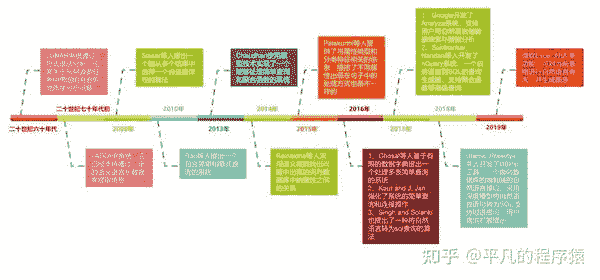
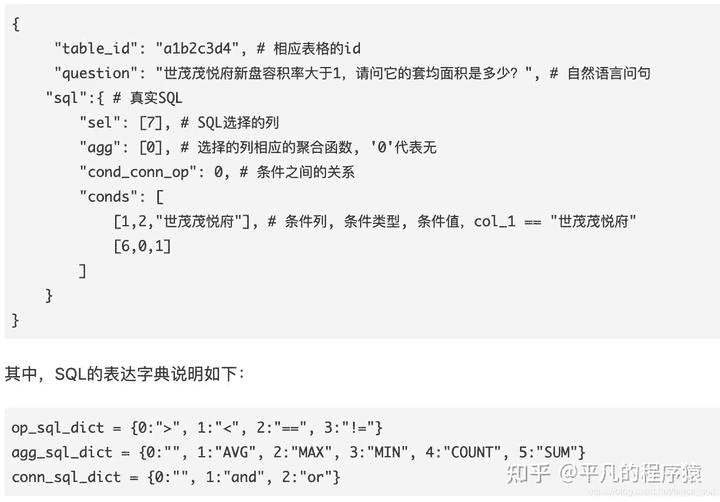
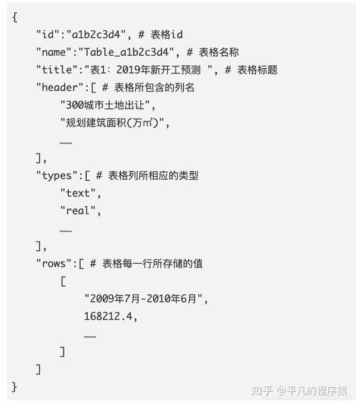
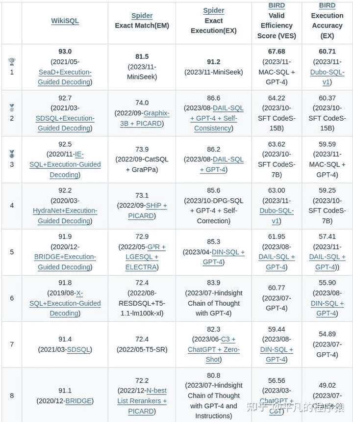
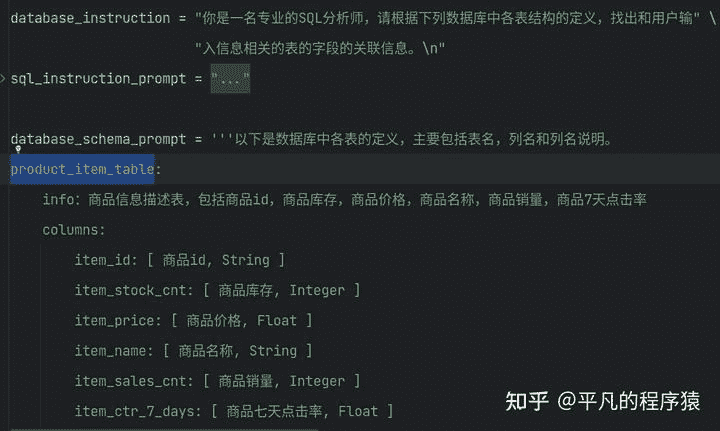
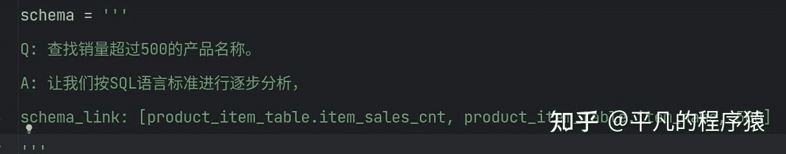
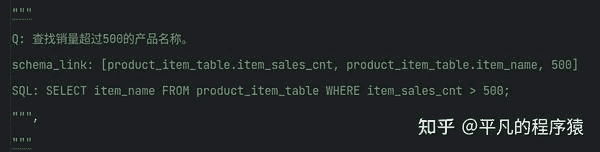
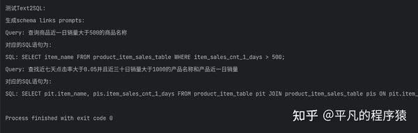
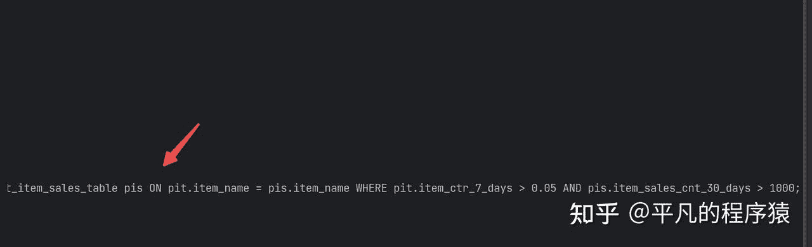

# LLM在中文Text2SQL的实践

> 来源：[https://agijuejin.feishu.cn/docx/I5w2d1Z0JoIgNLxm55fcsXa7nVc](https://agijuejin.feishu.cn/docx/I5w2d1Z0JoIgNLxm55fcsXa7nVc)

> 作者：王大锤

> 原文： [https://zhuanlan.z](https://zhuanlan.zhihu.com/p/670509396)hihu.com/p/670509...

## 一. 前言

### 什么是Text2SQL:

[Text2SQL](https://www.zhihu.com/search?q=%E7%BB%93%E6%9E%84%E5%8C%96%E6%9F%A5%E8%AF%A2%E8%AF%AD%E8%A8%80&search_source=Entity&hybrid_search_source=Entity&hybrid_search_extra=%7B%22sourceType%22%3A%22article%22%2C%22sourceId%22%3A670509396%7D)是将自然语言文本(Text)转换成 结构化查询语言 SQL的过程，属于自然语言处理-语义分[析(Sem](https://www.zhihu.com/search?q=%E7%BA%A7%E8%81%94%E6%9F%A5%E8%AF%A2&search_source=Entity&hybrid_search_source=Entity&hybrid_search_extra=%7B%22sourceType%22%3A%22article%22%2C%22sourceId%22%3A670509396%7D)antic Parsing)领域的子任务。通过该技术，可以简化查询创建过程，一般适用于简单的选择查询和复杂的查询操作，如 级联查询 等等。

### Text2SQL的主要特征:

[自然语言转换 ](https://www.zhihu.com/search?q=%E8%87%AA%E7%84%B6%E8%AF%AD%E8%A8%80%E8%BD%AC%E6%8D%A2&search_source=Entity&hybrid_search_source=Entity&hybrid_search_extra=%7B%22sourceType%22%3A%22article%22%2C%22sourceId%22%3A670509396%7D): 轻松将文本转换为结构化的SQL查询语句，方便不熟悉SQL的人员进行应用。

友好的交互方式: 落地时可以通过语音交互或者文本输入完成查询操作。

### Text2SQL示例:

假设有以下数据表, 如: table_name=product_item_table:

| 字段名 | 字段说明 | 数据格式 |
| --- | --- | --- |
| item_id | 商品ID | String |
| item_stock_cnt | 商品库存 | Integer |
| item_price | 商品价格 | Float |
| item_name | 商品名称 | String |
| item_sales_cnt | 商品销量 | Integer |
| item_ctr_1_days | 商品近一日点击率 | Float |
| item_ctr_7_days | 商品近七日点击率 | Float |

用户输入: query = 查询近七日点击率大于0.1并且商品销量大于1000的商品名称。

返回结果: SELECT item_name FROM product_item_table WHERE item_ctr_7_days > 0.1 AND item_sales_cnt > 1000;

---

## 二. 相关技术

### 发展历史:

### 数据集:

| 数据集 | 问题和SQL对 | 数据库数量 | 领域类型 | 表格数量/单数据库 | 语言 |
| --- | --- | --- | --- | --- | --- |
| ATIS | 5280 | 1 | 单领域 | 32 | 英语 |
| WikiSQL | 80657 | 26521 | 多领域 | 1 | 英语 |
| 追一NL2SQL | 49974 | 5291 | 多领域 | 1 | 中文 |
| Spider | 10181 | 200 | 多领域 | 5.1 | 英语 |
| CSpider | 9691 | 166 | 多领域 | 5.3 | 中文 |
| SparC | 4298 | 200 | 多领域 | 5.1 | 英语 |
| CoSQL | 3007 | 200 | 多领域 | 5.1 | 英语 |
| DuSQL | 23979 | 200 | 多领域 | 4.1 | 中文 |

### 参考数据格式:

### 快速入门:

(2[023-Interna](https://www.zhihu.com/search?q=approaches&search_source=Entity&hybrid_search_source=Entity&hybrid_search_extra=%7B%22sourceType%22%3A%22article%22%2C%22sourceId%22%3A670509396%7D)tional Conference on Very Large Data Bases，VLDB，CCF-A）A survey on deep learning approaches for text-to-SQL

(2022-IEEE Transactions on Knowledge and Data Engineering，TKDE，CCF-A) A Survey on Text-to-SQL Parsing: Concepts, Methods, and Future Directions

(2[022-Internat](https://www.zhihu.com/search?q=Text-to-SQL&search_source=Entity&hybrid_search_source=Entity&hybrid_search_extra=%7B%22sourceType%22%3A%22article%22%2C%22sourceId%22%3A670509396%7D)ional Conference on Computational Linguistics，COLOING，CCF-B) Recent Advances in Text-to-SQL : A Survey of What We Have and What We Expect

(2022-arXiv)Deep Learning Driven Natural Languages Text to SQL Query Conversion: A Survey

### State of the art：

---

## 三. 建模方法

### 任务拆解:

我们[可以将Tex](https://www.zhihu.com/search?q=SQL%E8%AF%AD%E5%8F%A5&search_source=Entity&hybrid_search_source=Entity&hybrid_search_extra=%7B%22sourceType%22%3A%22article%22%2C%22sourceId%22%3A670509396%7D)t2SQL任务拆解为2个大的部分，第一是利用LLM对用户的输入进行语义理解，然后结合数据库中表的结构信息，抽取出相关的字段信息。第二是利用抽取的字段信息生成结构化的 SQL语句 。对于SQL语句的执行，这部分的工作交给了应用层的服务。

### 底座模型选择:

+   Llama ：

+   2023年2月，Meta AI提出开源大模型Llama，有7b、13b、33b、65b共4种规模。

+   2023年7月，Meta AI提出第二代Ll[ama系列开源大](https://www.zhihu.com/search?q=Llama%201&search_source=Entity&hybrid_search_source=Entity&hybrid_search_extra=%7B%22sourceType%22%3A%22article%22%2C%22sourceId%22%3A670509396%7D)模型Llama 2，和 Llama 1 相比，训练数据多40%，上下文长度翻倍，模型有7b、13b、34b、70b共4种规格，但是34b没有开源。

+   ChatGLM

+   [2023](https://link.zhihu.com/?target=https%3A//github.com/THUDM/GLM)年3月，清华大学提出了开源的双语大模型ChatGLM，基于 GLM 框架，参数规格为6b。

+   2023年6月，清华大学提出了ChatGLM的第二代版本ChatGLM 2，规范为6b，具有更强的性能、更长的上下文、更高效的推理和更开放的许可。

+   Alpaca

+   2023年3月，斯坦福大学提出基于Llama 7b模型微调的开源大模型Alpaca，有7b共1种规格，训练更简单和便宜。

+   Vicuna

+   2023年3月，UC伯克利大学联合CMU、斯坦福大学提出的开源大模型Vicuna，有7b、13b共2种规格。

+   WizardLM

+   [2023年](https://www.zhihu.com/search?q=%E8%BF%9B%E5%8C%96%E6%8C%87%E4%BB%A4&search_source=Entity&hybrid_search_source=Entity&hybrid_search_extra=%7B%22sourceType%22%3A%22article%22%2C%22sourceId%22%3A670509396%7D)4月，北京大学和微软提出 进化指令 大模型WizardLM，有7b、13b、30b共3种规格，2023年6月，提出了数学领域的大模型WizardMath，2023年8月提出了代码领域的大模型WizardCoder。

+   Falcon

+   2023年6月, 阿联酋提出了大模型Falcon，这是一种仅在网络数据集上训练的开源大模型，具有 1b、7b、40b和180b四个参数规范。值得注意的是，其中Falcon 40B的性能超过了LLaMA 65B。

+   BaiChuan:

+   2023年9月， [百川智能 ](https://www.zhihu.com/search?q=%E7%99%BE%E5%B7%9D%E6%99%BA%E8%83%BD&search_source=Entity&hybrid_search_source=Entity&hybrid_search_extra=%7B%22sourceType%22%3A%22article%22%2C%22sourceId%22%3A670509396%7D)发布了百川2大模型，支持7b和13b两种规格。

+   Qwen:

+   2023年4月，阿里云发布的大模型，支持7b和18b规格。

+   InternLM:

+   2023年8月，上海AI实验室发布的大模型，支持7B和14B规格。

### 信息抽取:

这里的信息抽取是根据用户的输入信息，抽取相关表的字段信息和对应的参数值。

首先需要设置对应的 [prompt ](https://www.zhihu.com/search?q=prompt&search_source=Entity&hybrid_search_source=Entity&hybrid_search_extra=%7B%22sourceType%22%3A%22article%22%2C%22sourceId%22%3A670509396%7D)。

[对于信息抽取的任务](https://www.zhihu.com/search?q=prompt%E4%BF%A1%E6%81%AF&search_source=Entity&hybrid_search_source=Entity&hybrid_search_extra=%7B%22sourceType%22%3A%22article%22%2C%22sourceId%22%3A670509396%7D)，我们可以简单的抽取相关的数据信息，在设置 prompt信息 时，可以简单地设计为如下格式:

### SQL语句生成:

通过第一步抽取到的schema信息和用户的输入，可以构建SQL生成的prompt，可以参考如下格式:

至此，LLM已经可以根据用户的描述生成对应的SQL语句了。

---

## 四. [微调优化](https://www.zhihu.com/search?q=%E5%BE%AE%E8%B0%83%E4%BC%98%E5%8C%96&search_source=Entity&hybrid_search_source=Entity&hybrid_search_extra=%7B%22sourceType%22%3A%22article%22%2C%22sourceId%22%3A670509396%7D)

如果你采用上述的流程进行 [Text2SQL推理 ](https://www.zhihu.com/search?q=Text2SQL%E6%8E%A8%E7%90%86&search_source=Entity&hybrid_search_source=Entity&hybrid_search_extra=%7B%22sourceType%22%3A%22article%22%2C%22sourceId%22%3A670509396%7D)，流程上是可以跑通的，但是体验不怎么好，你可能会遇到下列问题:

+   1. 回复的内容不是纯SQL语言，可能包含对生成内容的解释和说明。

+   解决方法: 优化对应的prompt结构，示例中仅给出了简单的instruction指令部分和每个子任务的输入和输出的结构，可以在此基础上进一步优化。

+   2. 子任务的拆解，便于LLM学习到因果关系。

+   示例中的子任务拆解，还可以进一步优化，并且优化后的效果在我们的对比实验上要更好，因为该操作可以让LLM更容易学习到具体的推理逻辑。

+   3.大模型幻觉问题。如: 查找近七日点击率大于5%的商品名称。

+   [对于的数](https://www.zhihu.com/search?q=%E5%BD%92%E4%B8%80%E5%8C%96&search_source=Entity&hybrid_search_source=Entity&hybrid_search_extra=%7B%22sourceType%22%3A%22article%22%2C%22sourceId%22%3A670509396%7D)据的处理，可以适当地做下 归一化 处理，如将5%处理成0.05，就可以避免上述问题。

+   4.SFT优化，设计prompt时增加few-shot exsamples会比较zero-shot好。

+   5.LLM的 [fine-turning ](https://www.zhihu.com/search?q=fine-turning&search_source=Entity&hybrid_search_source=Entity&hybrid_search_extra=%7B%22sourceType%22%3A%22article%22%2C%22sourceId%22%3A670509396%7D)，条件允许，可以利用自己的数据集进行微调，以适配更复杂的业务场景，在上述的示例中，LLM能支持简单的SQL查询和简单的级联查询操作。对于复杂的SQL查询场景，需要对prompt进行更详细的设计和有监督训练。

+   6. LLM数据安全问题，一般数据库的数据会涉及到安全性问题，用本地化模块部署比GPT好。

---

## 五. 实验结果

这里直接上图(这里仅展示了2个case)，测试的结果还是相对可以的。

这里的测试case2的输出结果是正确的，可以参考2张图一起看。从上述结果可以看出，LLM是支持简单的查询和级联查询。

---

## 六. 留言

文章中只是给出了Text2SQL业务的整体建模的方法，需要进行工业落地，还是有大量的工程问题要解决的，博主在此任务上，为众多创业公司提供了技术支持，在对应的业务场景下进行业务落地，有相关的业务合作可以联系作者哦。