# 10倍加速LLM计算效率：消失的矩阵乘

> 来源：[https://agijuejin.feishu.cn/docx/JfsWdm0OuoVNrpxnMKKcm2Htnnf](https://agijuejin.feishu.cn/docx/JfsWdm0OuoVNrpxnMKKcm2Htnnf)

> 作者：Devansh | OneFlow

> 翻译：张雪聃

> 原文： [https://mp.weixin.](https://mp.weixin.qq.com/s/vXU7u13tFGapUoI-ih485A)qq.com/s/vXU7u13t...

矩阵乘法（MatMul）是深度学习中的主要计算瓶颈，尤其在ChatGPT等 Transformer模型中， 矩阵乘法的运行时长约占其总运行时长的45-60%， 解决这一挑战对发展更经济的大模型具有重要意义。

为此， 加 州大学的研究人员在论文 《 Scalable MatMul-free Language Modeling（可扩展的无矩阵乘法语言模型构建）》 中 试图通过消除矩阵 乘法来构建 更便宜、耗能更少的语言模型 ， 这将有助于解决 当今大 语言模型所面临的环境负担高和经济效益低的问题。

基于该论文，本文作者Devansh在多个维度对无矩阵乘法语言模型的影响进行了深入分析。

（本文由OneFlow编译发布，转载请联系授权。来源：https://artificialintelligencemadesimple.substack.com/p/beyond-matmul-the-new-frontier-of）

**

题图由**[** SiliconCloud**](http://mp.weixin.qq.com/s?__biz=MzU5ODY2MTk3Nw==&mid=2247494700&idx=1&sn=5a1bb060ed52181fac7b3bca0386ac98&chksm=fe42621ac935eb0c26af8703cf4e5207438fc24f8794c457a4ca45665eaf1c7b2f9d4fe619f2&scene=21#wechat_redirect)** 平台生**成

## **1**** ****摘要**

(类似的表格将在会接下来的技术解析中持续出现。特别感Andrew Gillies、Rich Falk-Wallace和Ricky Li，他们的阅读建议和讨论是这一部分的重要灵感来源。)

我对于 无矩阵乘法语言模型的发展 持乐观态度， 因为Scalable M atMul-free Language Modeling（https://arxiv.org/abs/2406.02528）这篇 论文给出的 结果非常出色。例如，无矩阵乘法语言模型的计算效率非常高。

“我们的实验表明，所提出的无矩阵乘法模型在推理过程中的性能与最先进的Transformer模型相当，而后者需要在推理时消耗更多内存，尤其在参数规模达到至少2.7B时。我们研究了扩展规律，发现随着模型规模的增大，我们的无矩阵乘法模型与全精度Transformer之间的性能差距逐渐缩小。我们还提供了一种GPU高效实现方案，在训练期间最多能将内存使用量减少61%。通过在推理过程中使用优化内核，我们的模型内存消耗比未优化模型减少超过10倍。为了准确地量化我们架构的效率，我们在FPGA上构建了定制硬件解决方案，使用了超越GPU能力的轻量级操作。”

下图展示了与Transformer相当的性能：

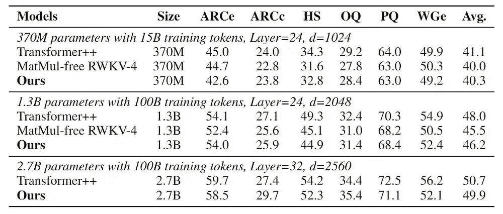

(表1：无矩阵乘法语言模型与Transformer++在基准数据集上的零样本准确率对比)

遵循优美的扩展定律:

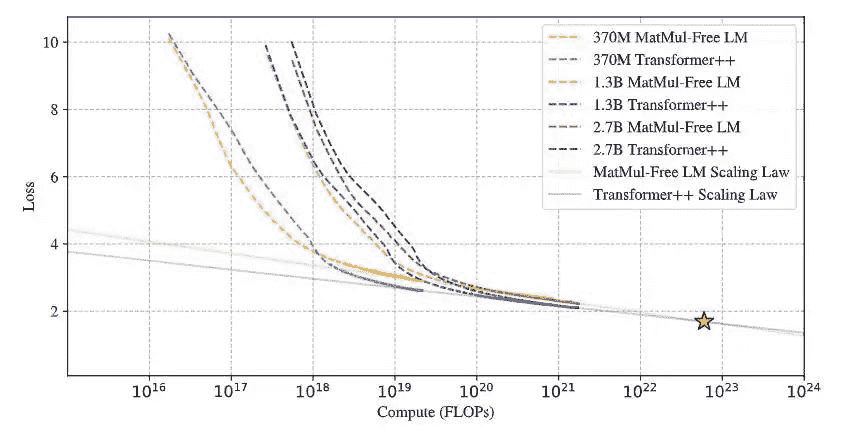

(图3：无矩阵乘法模型与Transformer++模型的扩展定律比较，图中展示了各自的损失曲线。红色线条代表无矩阵乘法模型的损失轨迹，蓝色线条表示Transformer++模型的损失。星号标记了两种模型缩放定律投影的交点。无矩阵乘法模型使用三元参数和BF16激活，而 Transformer++使用BF16参数和激活。)

这些模型表现出色，其秘密在于遵循两大主题进行了创新——简化昂贵的计算和用线性操作替换非线性操作（这样更简单且可以并行）——这是其成功的关键。

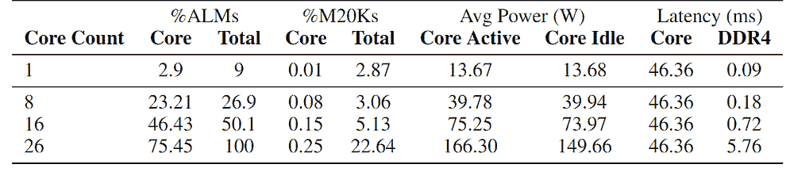

(表2：无矩阵乘法模型词元生成FPGA核心资源利用率和性能指标。当前，三值矩阵乘法操作是造成时延的主要原因，并且没有观察到本地DDR4桥接出现瓶颈。未来，这一功能单元将会进行优化，DDR接口可能会成为主要瓶颈。)

更深入地说，我们可以看到以下算法技术在无矩阵乘法模型中发挥了重要作用（自注意力机制在无矩阵乘法模型中并未使用，提供这些信息只是为了进行比较）：

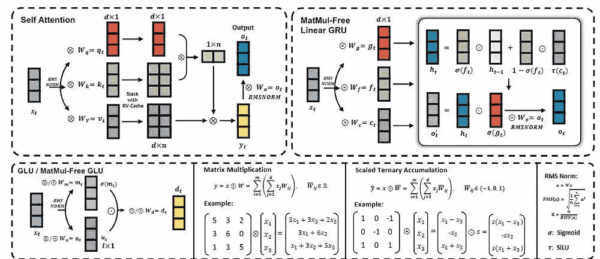

(图为无矩阵乘法语言模型的概述。图中展示了以下操作：普通自注意力机制（左上）、无矩阵乘法词元混合器（右上）和三值累加。无矩阵乘法模型采用了无矩阵乘法的词元混合器（MLGRU）和无矩阵乘法的通道混合器（MatMul-free GLU），以保持类transformer的架构，同时降低计算成本。)

**三值权重：**

+   **核心思想 **：在密集层中，模型不使用全精度权重（如32位浮点数），而是将权重限制为{-1, 0, +1}。这意味着每个权重只能表示三种可能的值，因此称为 “三值（ternary）” 。

+   **为何有效 **：三值权重将乘法操作替换为简单的加法或减法。如果权重是1，只需将相应的输入值相加。如果权重是-1，则从输入中减去。如果权重是0，则不进行任何操作。

无矩阵乘法词元混合器: MLGRU（无矩阵乘法线性GRU）

**挑战 **：自注意力机制是捕捉大语言模型中序列依赖关系的常用方法，但它依赖于昂贵的矩阵乘法和逐对比较。这导致了随着输入长度增加，计算复杂度呈平方（n²）增长。

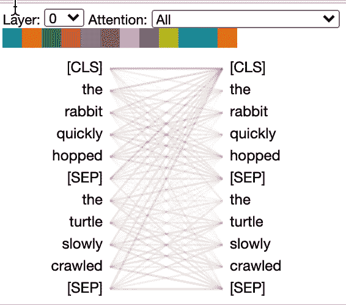

（图源：https://github.com/jessevig/bertviz）

**解决方案 **：论文将GRU架构进行了调整，以消除矩阵乘法操作。这个修改版称为MLGRU，它使用逐元素操作（如加法和乘法）来更新隐藏状态，而不是使用矩阵乘法。

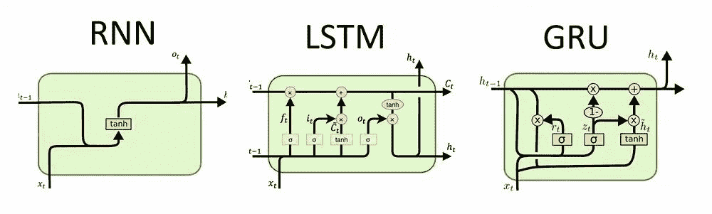

（图源：https://www.linkedin.com/pulse/recurrent-neural-networks-rnn-gated-units-gru-long-short-robin-kalia/）

**关键成分 **：

+   **三值权重 **：MLGRU中的所有权重矩阵都是三值的，这进一步降低了计算成本。

+   **简化GRU **：MLGRU消除了隐藏状态和输入向量之间的某些复杂交互，使其更适合并行计算。

+   **数据依赖输出门 **：MLGRU引入了一个类似于LSTM的数据依赖的输出门，用于控制从隐藏状态到输出的信息流。

无矩阵乘法率通道混合器：GLU与BitLinear层：

+   **通道混合 **：模型的这一部分用于在嵌入维度之间混合信息。在传统做法中，这一步通常用含有矩阵乘法操作的密集层来完成。

+   **方法 **：论文将密集层替换为BitLinear层。由于BitLinear层使用三值权重，它们实际上执行的是逐元素的加法和减法操作。

+   **门控线性单元（GLU） **：GLU 用于控制信息在通道混合器中的流动。它通过将门控信号与输入相乘来操作，使模型能够专注于输入的特定部分。

**量化：**

+   **超越三值权重 **：为了进一步减少内存使用和计算成本，模型还对激活值（层的输出）进行量化，使用8位精度。这意味着每个激活值都用有限数量的bit来表示。

+   **RMSNorm **：为了在训练过程中及量化后保持数值稳定性，模型使用了一种称为RMSNorm（均方根归一化）的层，在量化之前对激活值进行归一化。

**

训练和优化**：

+   **替代梯度 **：由于三值权重和量化引入了不可微分的操作，模型使用了替代梯度方法（直通估计器）来实现反向传播。

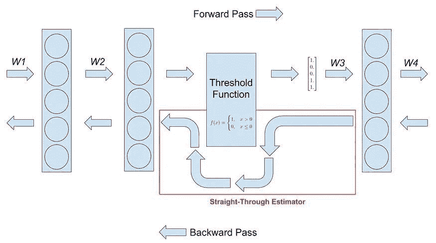

(直通估计器（STE） 是一种在神经网络训练中用于近似不可微分操作梯度的技术。它通过在反向传播过程中将不可微分操作替换为恒等函数（或输入的其他函数）来实现梯度估计。)

+   **较大学习率 **：由于三值权重的范围有限，与全精度权重相比，三值权重产生的梯度较小。这可能会影响权重更新的效果，导致收敛速度缓慢甚至无法收敛。 为了应对这一问题，本文建议使用比通常用于全精度模型更大的学习率 ，这有助于加快更新速度，并使模型更有效地逃离局部最小值。

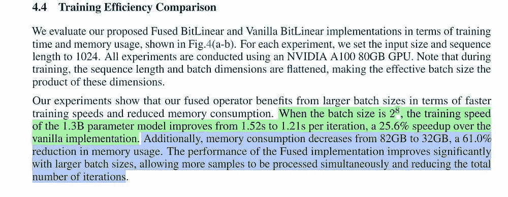

+   **学习率调度器 **： **“**然而，无矩阵乘法语言模型的学习动态与传统的Transformer模型不同，因此需要采用不同的学习策略。 我们首先保持余弦学习率调度器，然后在训练过程的中途将学习率减半。有趣的是，我们观察到在最后的训练阶段，当网络的学习率接近0时，损失显著下降，出现了S形损失曲线。这一现象也在训练二值/三值语言模型时被报道过。

+   **融合BitLinear层 **：这种优化将RMSNorm和量化合并为一个操作，从而减少内存访问次数，加快训练速度。

本文剩余部分将更详细地探讨这些算法变化。为了使重点突出、内容简洁，我会略过作者如何构建定制硬件以将无矩阵乘法模型最大化的部分。如果你对这个话题有兴趣，请阅读原论文第5章。我们将从探讨深度学习领域中最令人着迷的趋势之一开始——更多地引入线性操作。

“1.3B参数的模型，L=24且d=2048，其预计运行时间为42毫秒，每秒吞吐量为23.8个词元。这一效率达到了人类阅读速度，并且与人脑的能耗水平相当。” 这样的效率实在惊人。

## **2**** ****线性还是非线性？**

这是我最近在深度学习领域观察到的最有趣的“回归传统”趋势之一。许多前沿的大语言模型正在通过积极地用线性层替换非线性层而回归到传统方法。为了充分理解这一点的妙处，我们来回顾一下数学的历史。

为什么深度学习钟爱非线性：正如我们在探索Kolmogorov–Arnold网络(https://artificialintelligencemadesimple.substack.com/p/understanding-kolmogorovarnold-networks) 时讨论的那样，深度学习依赖于万能近似定理（Universal Approximation Theorem），该定理指出任何连续函数都可以通过堆叠一些非线性函数来逼近。我们尝试构建更大、更复杂的神经网络，本质上是为了获得更精细的逼近。不幸的是，非线性有一个巨大的缺点。由于其更具序列化的特性和更复杂的关系，非线性操作更难并行化。因此，用线性操作替换非线性操作可以提高并行性，简化整体操作。

如**果你**想了解现代的非Transformer大语言模型，如 RWKV或Mamba，这就是它们的关键创新点。 这些模型不是在每一步都添加非线性（传统的RNN），而是只在最后几步添加非线性。由于大多数计算是线性的，它们可以并行完成。然后将这些计算结果输入到非线性块（block）中，后者可以模拟复杂性。 这种方法在追求效率的同时，虽然在表达能力上做了一些权衡（从而影响一些性能），但换来了巨大效率提升。在数据工程和优质设计的帮助下，我们可以弥补失去的性能，同时保持低成本。这是一笔很划算的交易。

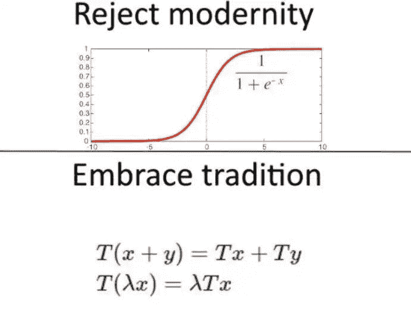

我提到这个背景故事，是因为许多人工智能论文正在积极地以更大规模的方式重新引入旧技术，以弥合性能差距。这是一个相当有趣且被忽视的领域，值得关注。你永远不知道哪些旧技术会重新流行起来（这些旧技术更接近基础技术，值得深究）。

说完这些，我们回到本文的核心内容。我们跳过三值权重（因为没有太多可谈的内容），转而讨论融合BitLinear层，这是无矩阵乘法语言模型中的一个关键创新。通过合并操作和减少内存访问，它显著提升了训练效率并降低了内存消耗，使得无矩阵乘法模型在大规模应用中变得更具实用性。

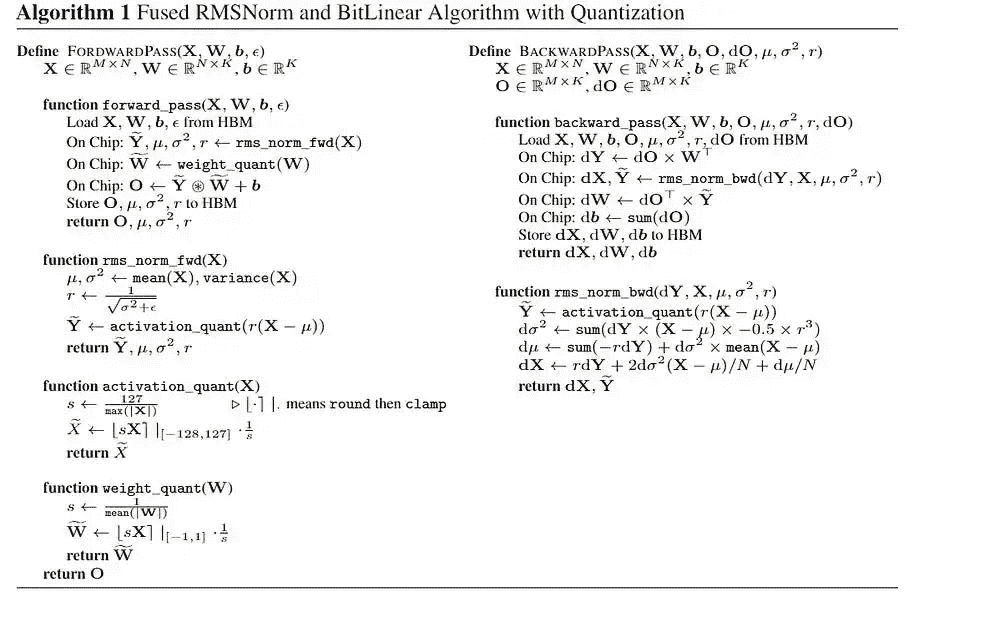

## **3**** **打破内存瓶颈：用于高效三值网络的融合BitLinear层

论文引入的“融合BitLinear 层”代表了在大规模训练中使无矩阵乘法语言模型变得切实可行的重要一步。这一步的挑战在于，与在GPU不同内存级别之间搬运数据相关的固有低效性。一种简单的方法（也是许多人使用的方法）是将输入激活从高带宽内存（HBM）加载到更快的共享内存（SRAM），执行RMSNorm和量化等操作，然后将数据移回HBM。这种重复的数据传输会产生显著的时间和带宽开销，减慢训练过程，并可能造成内存瓶颈。

为了解决这些低效性，论文提出了一种巧妙的优**化方**法：“融合BitLinear层”。 这种方法将RMSNorm和量化的操作合并为一个单一的融合操作，直接在GPU的SRAM中执行。通过在更快的SRAM中执行这些步骤，消除了多个内存级别之间的数据传输需求，显著减少了开销。 输入激活只从HBM加载一次，融合的RMSNorm和量化操作在SRAM中完成，随后三值累积操作也直接在SRAM中执行。这种优化的影响可以从Vanilla BitLinear和融合 BitLinear之间显著的时间和内存差异中看出。

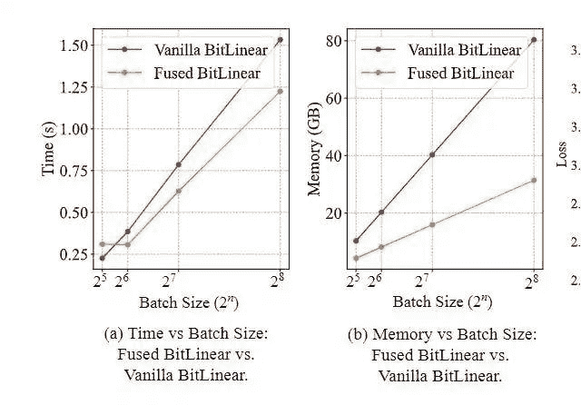

既然已经探讨了融合BitLinear层的优点，现在是时候深入了解无矩阵乘法语言模型的架构了。在这里，我们会遇到我们的新朋友——无矩阵乘法线性GRU（MLGRU），这是对传统GRU的巧妙改进，旨在消除矩阵乘法，同时保留其强大的序列建模能力。MLGRU解决了构建高效语言模型中的一个关键挑战： 词元混合器计算开销大，一直依赖于自注意力机制（需要矩阵乘法）。

## **4**** **规避矩阵乘法：MLGRU如何重新构想GRU以提升效率

要理解MLGRU的重要性，首先需要了解GRU的工作原理。GRU是一种递归神经网络（RNN），因其高效性和学习序列中长期依赖关系的能力而广受欢迎。与传统RNN经常面临梯度消失问题，而GRU利用“门控”机制来控制信息流动，并防止梯度在长序列中消失。

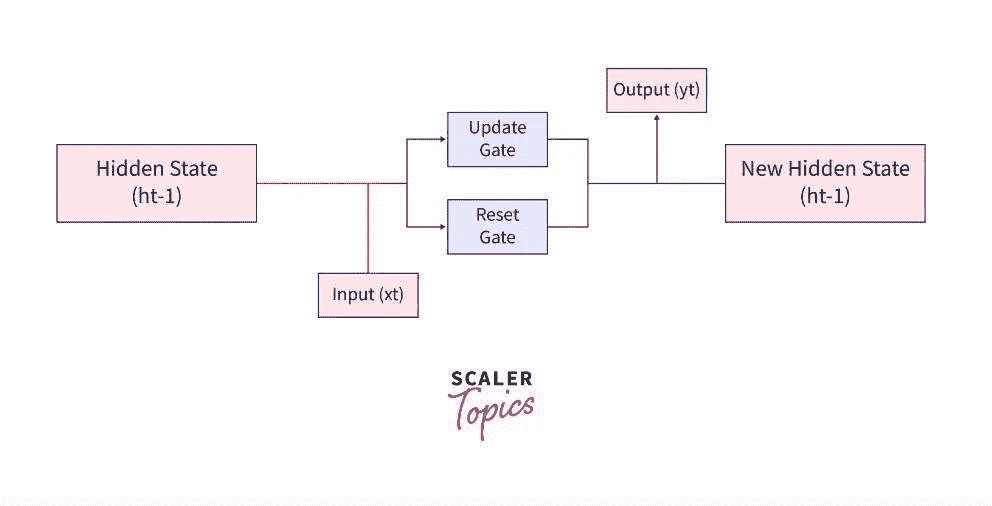

(图源：https://www.scaler.com/topics/deep-learning/gru-network/)

GRU的主要组成部分包括:

+   **隐藏状态（ht） **：封装了当前时间步之前的序列信息。

+   **输入（xt） **：表示当前的词元或数据点。

GRU 的核心在于其两个门控机制：重置门（reset gate）：决定需要忘记或重置多少先前的隐藏状态；更新门（update gate）：在结合来自当前输入的新信息与保留先前隐藏状态之间做管理平衡。

论文的创新之处在于MLGRU，这是一种专门为提高效率和消除矩阵乘法而修改的传统GRU。MLGRU通过以下两个关键变化实现这一目标：

+   **三值权重 **（Ternary Weights）：MLGRU 中涉及的所有权重矩阵都量化为三值 {-1, 0, +1}。这简化了计算门控和候选隐藏状态的过程，将传统的乘法操作替换为简单的加法和减法。

+   **简化的GRU结构 **：MLGRU移除了隐藏状态之间的一些复杂交互，特别是那些涉及隐藏到隐藏权重矩阵的交互。这种简化减少了计算复杂性，使模型更适合并行处理。

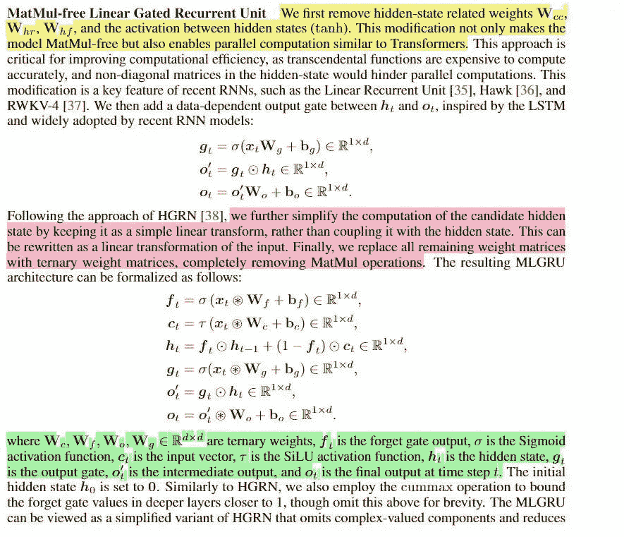

MLGRU用更简单的操作替换计算成本高昂的矩阵乘法，使词元混合器的整体计算成本显著降低。

通道混合（在语言模型中将不同嵌入维度的信息结合在一起）的计算成本一直很高昂，但本文通过使用具有三值权重的BitLinear层和GLU实现了高效。BitLinear层将乘法操作替换为加法和减法，而GLU则选择性地控制信息流动，进一步优化了这一过程。

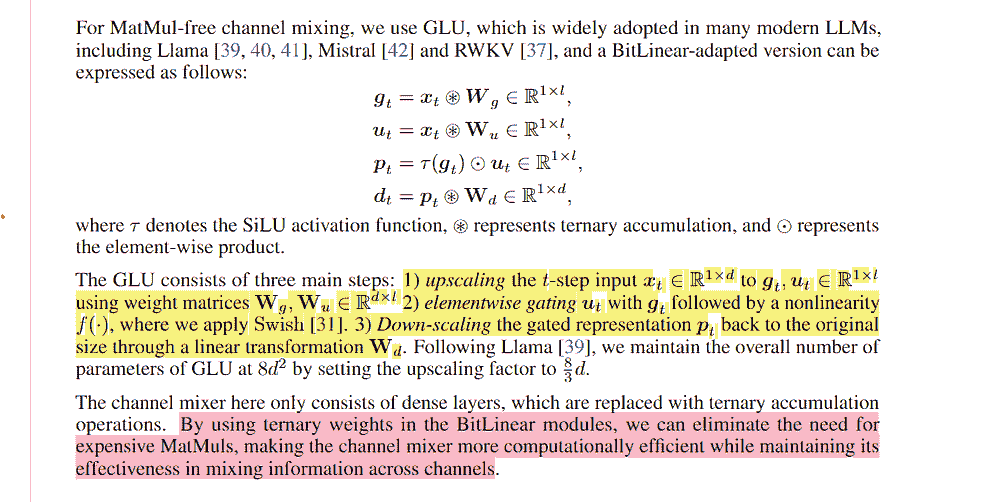

这次的分析让我很欣慰，也很感动。总的来说，我对任何直接尝试解决现有系统深层限制的东西都非常感兴趣，这篇论文非常符合这个标准。我很期待看到他们以这个想法为基础来继续发展，构建一个能够与现有的较低效语言模型竞争的主流模型。

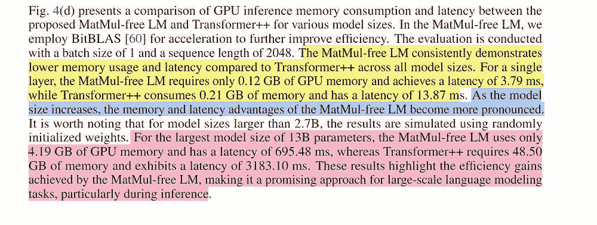

其他人都在看

+   800+页免费“大模型”电子书

+   [混合输入矩阵乘法的性能优化](http://mp.weixin.qq.com/s?__biz=MzU5ODY2MTk3Nw==&mid=2247493533&idx=1&sn=a5d770b9100932baf3aff06a65e945e3&chksm=fe4269abc935e0bdae8377b3bcb7699e19ee781f2d496d3106a6609b7dca661f36c4928d1d77&scene=21#wechat_redirect)

+   AI搜索Perplexity的产品构建之道

+    John Schulman：大模型的升级秘诀

+   大模型产品化第一年：战术、运营与战略

+   AI算力反碎片化：世界上最快的统一矩阵乘法

+   比肩GPT4，没有显卡也能用Llama-3.1-405B

+    超越SD3，比肩MJ v6，生图模型FLUX.1开源