# Mistral NeMo：这是现在最好的开源LLM！ （经过全面测试并击败 Qwen2、DeepSeek-V2 及其他）

> 来源：[https://agijuejin.feishu.cn/docx/JODOd63pLowoGzxTk0Uchj3znIC](https://agijuejin.feishu.cn/docx/JODOd63pLowoGzxTk0Uchj3znIC)

> 作者：Aitrainee | 公众号：AI进修生

> 原文： [https://mp.weixin.](https://mp.weixin.qq.com/s/0pXc5kKGajQARIZu8iPHeg)qq.com/s/0pXc5kKG...

> 🌟介绍 Mistral 和 Nvidia 的新型号 Mistral NeMo。这是一个 12B 参数模型，具有 128K 上下文限制，非常好。在我的测试中，它击败了 Qwen-2、DeepSeek-V2、Llama-3 等。

##### 它在 **编码任务 **方面甚至更好，并且也非常擅长做文本到应用程序、文本到前端和其他事情。我将对其进行测试，看看它是否真的可以击败其他LLMs，并且我还将告诉你如何使用它。

Hi，这里是Aitrainee，欢迎阅读本期新文章。

两个新模型已经推出，第一个是 OpenAI** GPT-4 Mini ，**第二个是 Mistral NeMo 。不过本文不会包括GPT-4 Mini，因为在上一篇文章，其实已经讨论过了：

[新](http://mp.weixin.qq.com/s?__biz=MzkyMzY1NTM0Mw==&mid=2247490473&idx=1&sn=a813fde4a12e0531fa3aa052d02b23a5&chksm=c1e09669f6971f7f27fc999d217d14fe31c1b21c483d024236d94b9b727ed9f710084fcacdd4&scene=21#wechat_redirect)增了四个秘密模型！OpenAI 的 GPT-Mini、Column-R & U、Eureka（全面测试）

大多数人可能没有看过，有关于 [GPT4o-Mini ](http://mp.weixin.qq.com/s?__biz=MzkyMzY1NTM0Mw==&mid=2247490473&idx=1&sn=a813fde4a12e0531fa3aa052d02b23a5&chksm=c1e09669f6971f7f27fc999d217d14fe31c1b21c483d024236d94b9b727ed9f710084fcacdd4&scene=21#wechat_redirect)发布的消息在昨天已经彻底火起来了，而上面这篇文章却发布在三四天前。

所以大家 可能 更多关注炒作内容：只谈论模型而不做任何测试的。

无论如何，今天我要谈论的是NeMo，这是Mistral推出的新最佳模型。

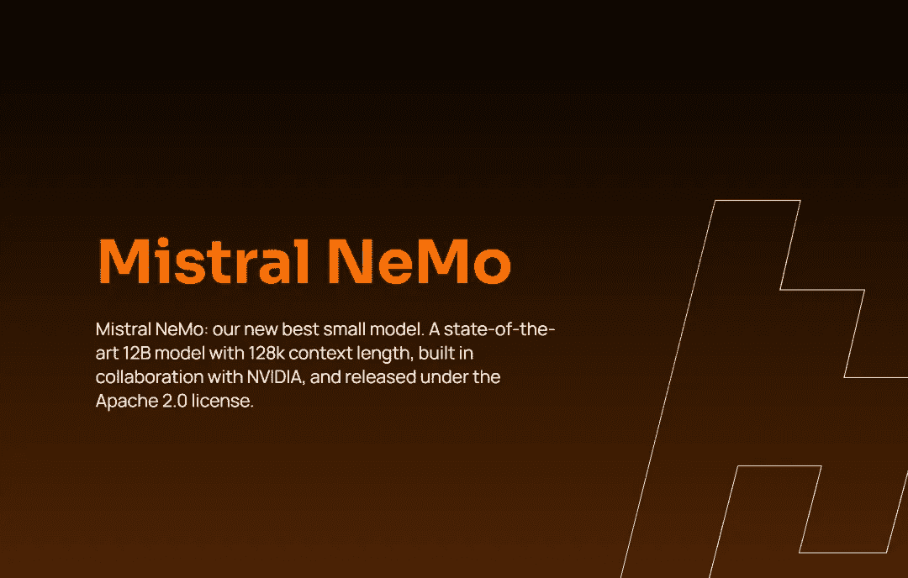

它是一个最先进的12B模型，具有128k的上下文长度。这个模型是与Nvidia合作构建的，他们说其推理、世界知识和编码准确性在其大小类别中是最先进的。

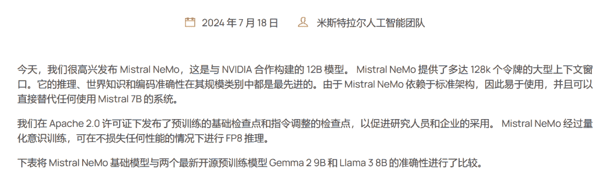

它还经过量化感知训练，能够进行FP8推理而不失性能。

> 该模型专为全球多语言应用程序而设计。它经过函数调用训练，具有较大的上下文窗口，并且在英语、法语、德语、西班牙语、意大利语、葡萄牙语、中文、日语、韩语、阿拉伯语和印地语方面特别强大。这是将前沿人工智能模型以构成人类文化的所有语言带到每个人手中的新一步。

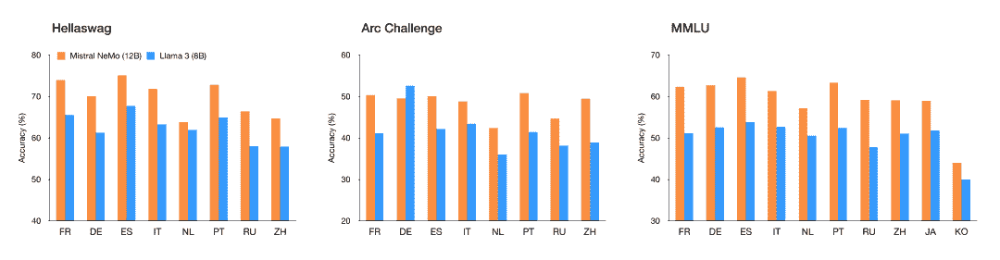

▲ Mistral NeMo 在多语言基准测试中的表现

他们还说这是Mistral 7B的一个很好的替代品，这也是他们的旧模型。

这个新模型还支持多种语言，并且有一个更高效的分词器，名为Tekken，特别是在压缩源代码方面效率高30%。

他们说Tekken在压缩大约85%的语言文本方面表现更好，这也很酷。

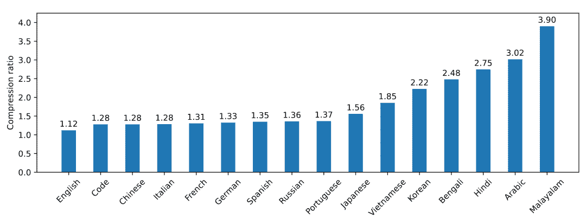

他们还做了一些很好的指令微调，使其在遵循精确指令、推理、处理多轮对话和生成代码方面表现更好。

现在我们来看看基准测试。我知道你们中的一半已经离开文章了，但无论如何，每当我想到公司分享的基准测试中可能有什么问题时，我都会看到一些不一致。

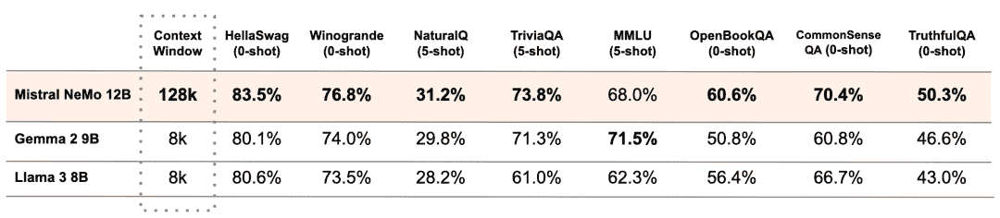

▲ Mistral NeMo 基础模型性能与 Gemma 2 9B 和 Llama 3 8B 的比较。

在hellaswag中，它得分83.5，击败了Llama 3和Gemma 2。在winogrande中，它得分76.8。在naturalquestions中，它得分31.2。在triviaQA中，它得分73.8。在MLU中，它得分68。在openbookQA中，它得分60.6。在commonsenseQA中，它得分70.4。在truthfulQA中，它得分50.3。

所以这些是基准测试分数，我不能对它们说太多，因为这些比较真的很糟糕。我是说，Qwen 2和DeepSeek V2在哪里？至少应该与主要的领先模型进行比较，但他们没有这么做，原因显而易见。

无论如何，这个模型在Apache 2许可下发布，这意味着可以用于商业和个人用途，这显然也很酷。这个模型目前在Hugging Face上可用，但尚未在其他平台上可用，但应该很快会推出。

这个模型可以在Nvidia Nims平台上试用，所以让我们从那里试试。

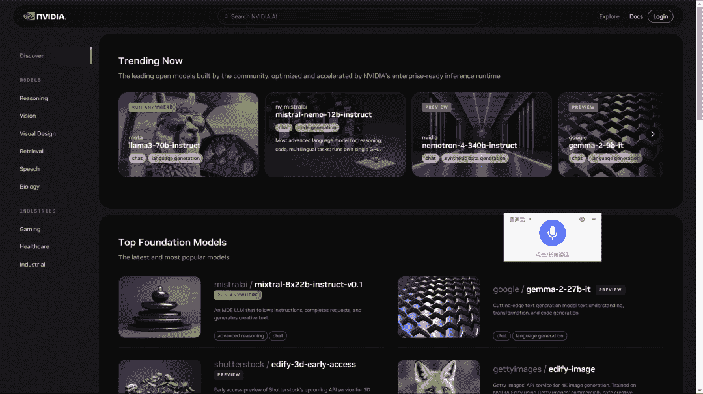

https://build.nvidia.com/explore/discover

我将使用这些九个问题来测试它。我对其中一些问题做了一些改动，大多数问题是重新结构化或新的，尽管测试的本质是相同的。让我们现在来看看。

第一个问题是：名字以“Leah”结尾的国家的首都是哪里？答案应该是堪培拉。这里是Nemo的答案，

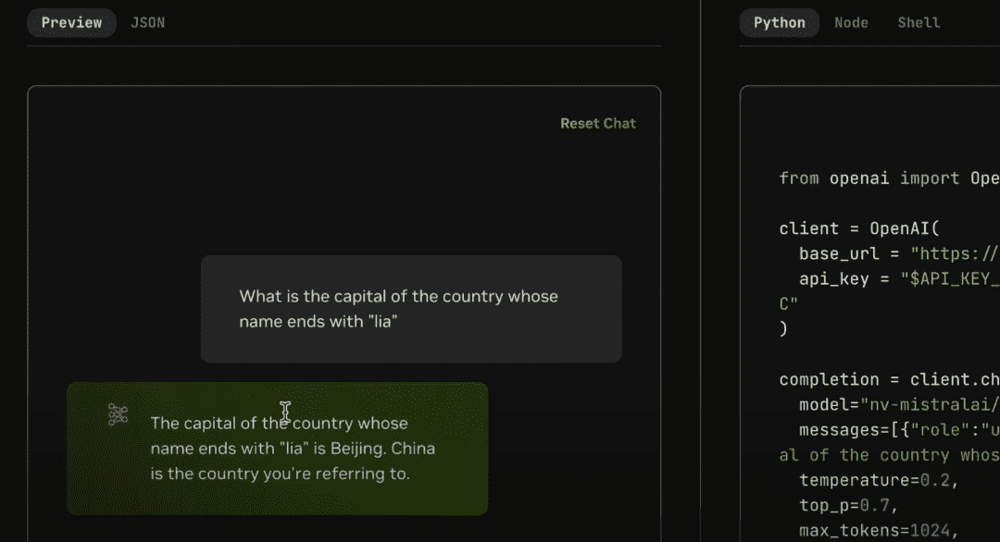

显然是错误的，所以我们标记为失败。

下一个问题是：约翰有三个盒子的铅笔，每个盒子有12支铅笔，约翰总共有多少支铅笔？答案应该是36。这是Nemo的答案，

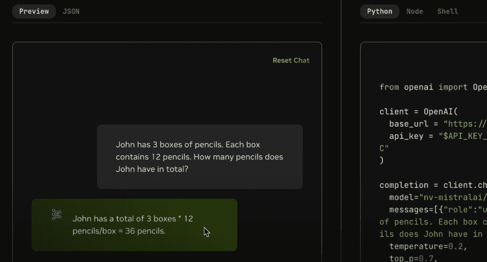

正确，所以这次成功。

下一个问题是：露西的糖果是麦克的两倍，如果麦克有七块糖果，露西有多少块糖果？答案应该是14。这是Nemo的答案，

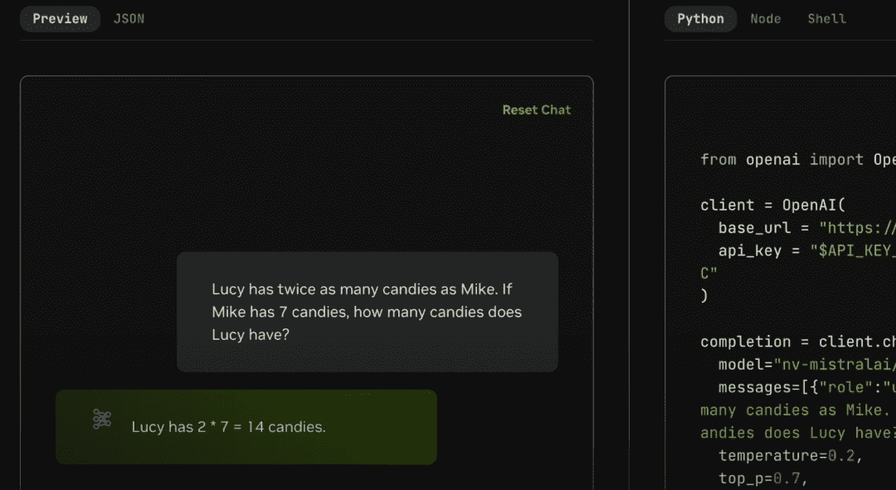

正确，所以这次成功。

下一个问题是：如果一个正六边形的短对角线是64，那么它的长对角线是多少？答案应该是73.9。这是Nemo的答案，

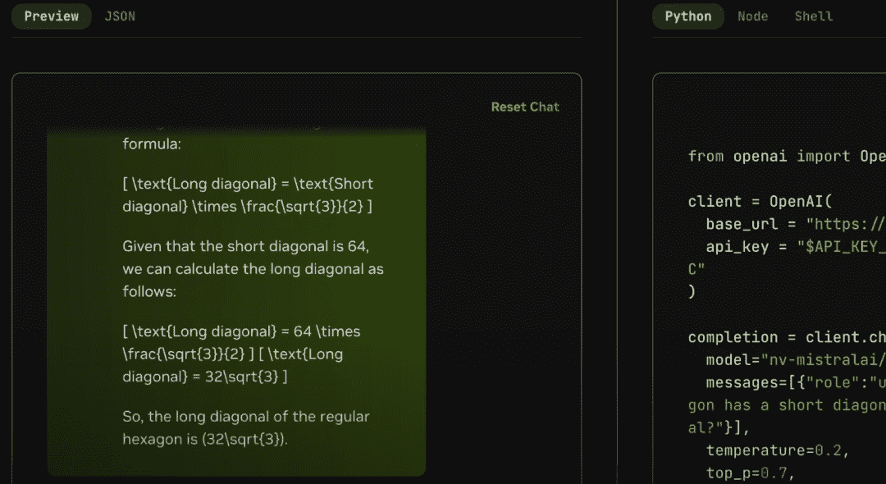

不正确，所以这次失败。

下一个问题是：创建一个包含点击按钮时爆炸彩带的HTML页面，你可以使用CSS和JS。发送它并查看是否可以做到。这是代码，预览一下，

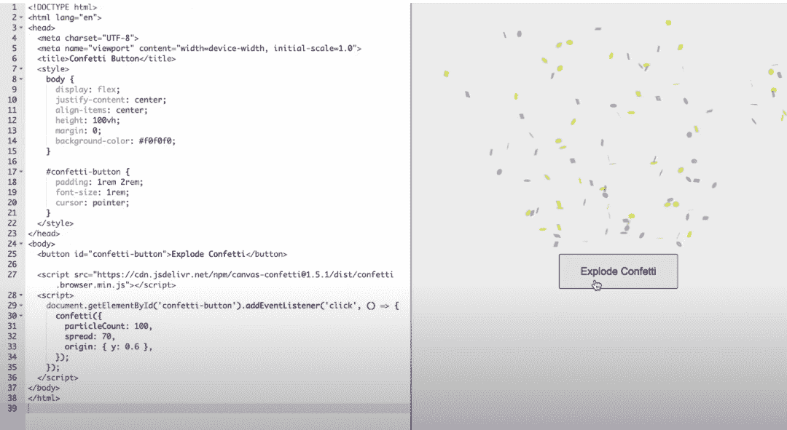

看起来很好，功能正常，所以这次成功。

下一个问题是：创建一个Python程序，根据用户输入打印下一个X个闰年。发送并检查。这是代码，

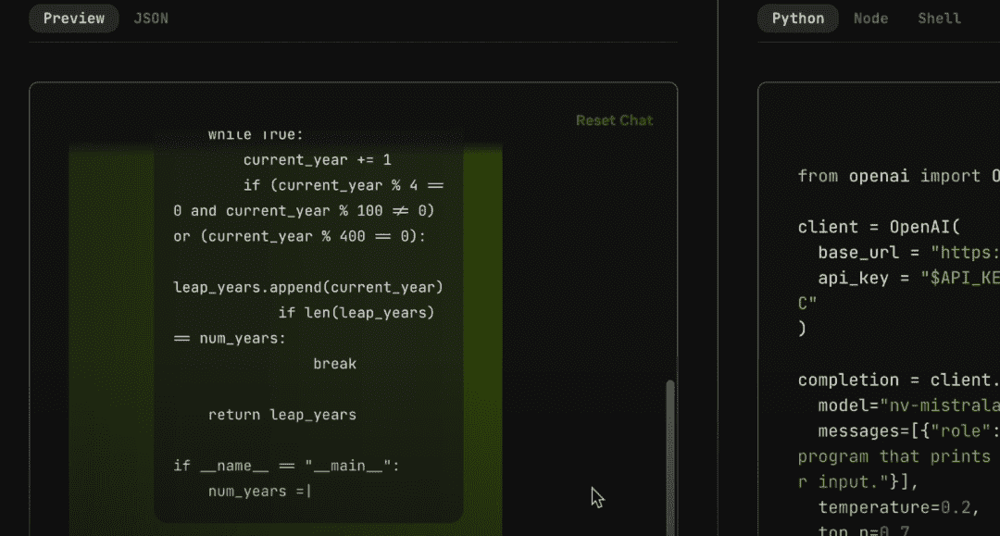

运行它，

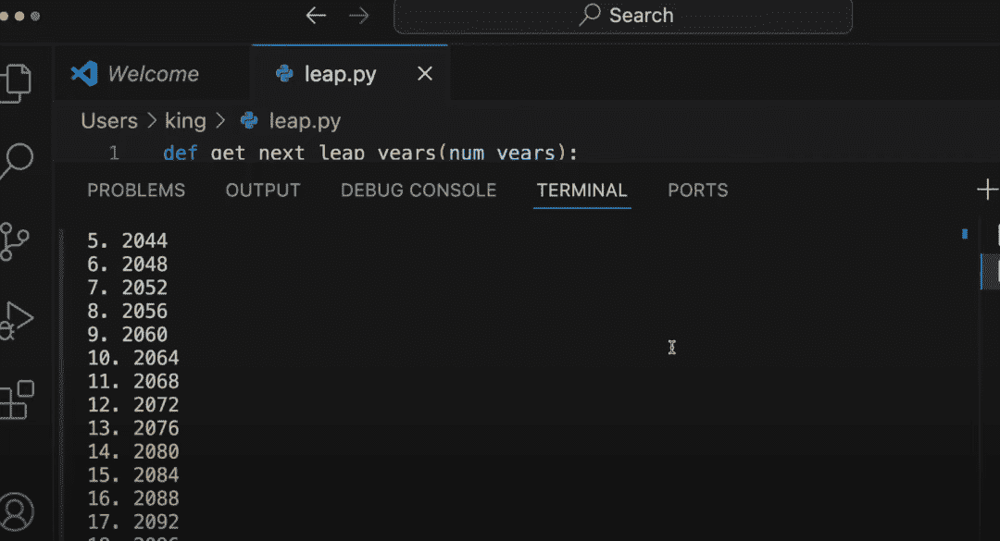

功能正常，所以这次成功。

下一个问题是：生成一个方形的SVG代码。发送并检查。这是代码，预览一下，

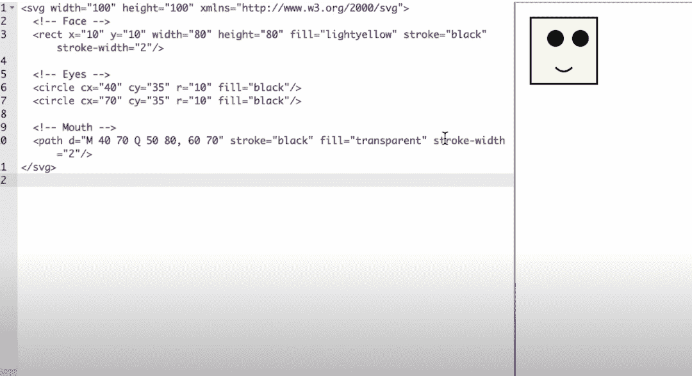

看起来也很好，所以这次成功。

下一个问题是：为一个AI公司创建一个着陆页，该着陆页应有四个部分：标题、横幅、功能和联系我们，确保页面看起来时尚和现代。发送提示并检查。这是代码，复制并预览，

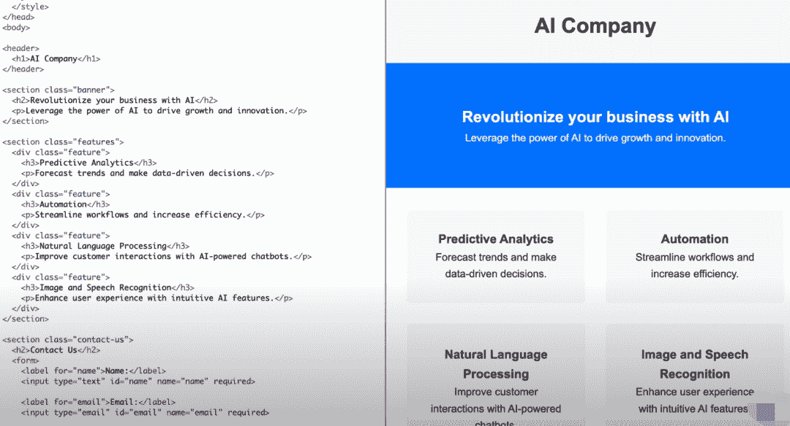

看起来很酷，所有部分都包括在内，所以这次成功。

最后一个问题是：用Python编写一个在终端上运行的贪吃蛇游戏。发送并检查。这是代码，

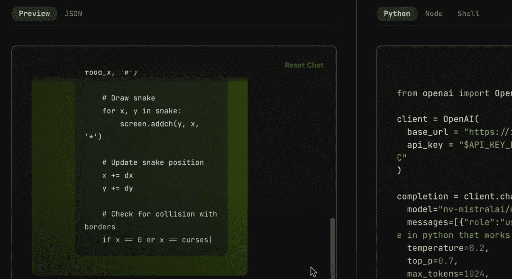

运行它，

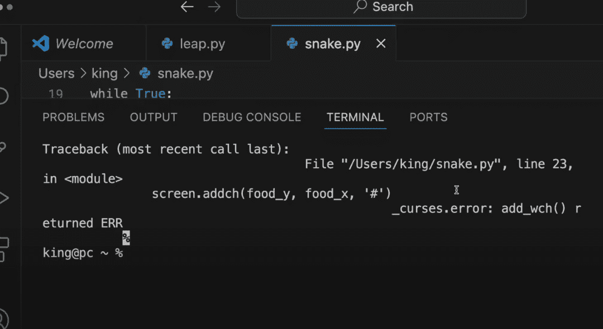

不工作，所以这次失败。

现在这是最终图表，可以看到它真的很好。

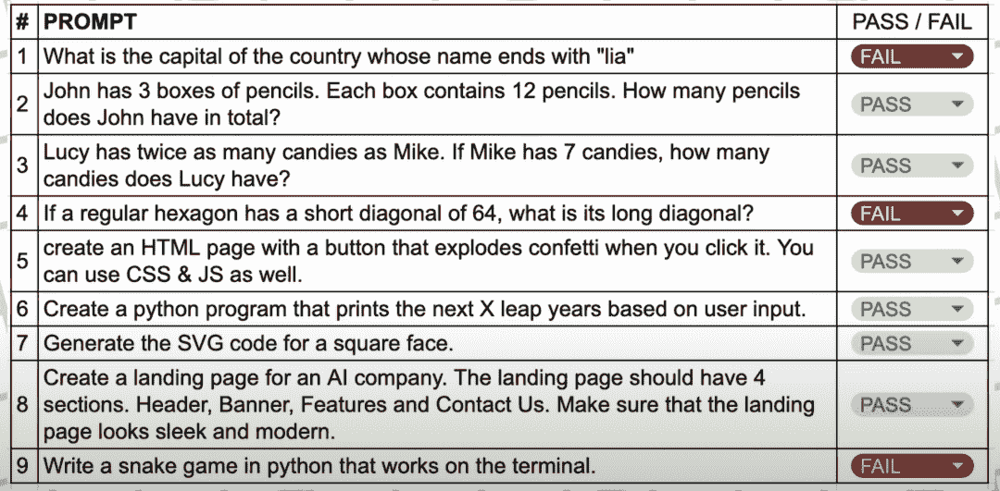

我是说，它比他们为编码发布的Cestal Mamba还要好，甚至比几乎所有其他模型都好，甚至与Qwen和DeepSeek相当。

所以这是一个非常好的模型。我认为它涵盖了几乎所有方面，包括推理和其他一切，应该比GPT-4 Mini模型更受欢迎。

我真的很喜欢这个模型，这是一个新的好模型，所以在Co-pilot场景中看到它会很酷。

希望这篇文章对你有帮助，感谢阅读！

视频教程

https://www.youtube.com/watch?v=yBWj32d_Yeo

参考链接：

[1]https://mistral.ai/news/mistral-nemo/

**知音难求，自我修炼亦艰**

抓住前沿技术的机遇，与我们一起成为创新的超级个体

**（把握AIGC时代的个人力量）**

**点这里 ****👇 关****注我，记得标星哦～**

一键三连「分享」、「点赞」和「在看」

**科技前沿进展日日相见 ~**