# 开源LLM大模型位置编码探索

> 来源：[https://agijuejin.feishu.cn/docx/F6XAdioYtoV7VxxGjN6c6ON9ngd](https://agijuejin.feishu.cn/docx/F6XAdioYtoV7VxxGjN6c6ON9ngd)

> 作者：归来仍是少年

> 原文： [https://zhuanlan.z](https://zhuanlan.zhihu.com/p/631003833)hihu.com/p/631003...

## 一、前言

随着[chatg](https://zhida.zhihu.com/search?q=%E6%96%87%E5%BF%83%E4%B8%80%E8%A8%80&zhida_source=entity&is_preview=1)pt大模型的[爆火，ch](https://zhida.zhihu.com/search?q=%E8%BE%93%E5%85%A5%E6%96%87%E6%9C%AC&zhida_source=entity&is_preview=1)atgpt多轮对话中远距离记忆能力非常惊艳，得益于位置编码外推性的改进，chatgpt能够容纳4096长度的token。国内很多大公司开始也加入做大模型阵容中，不开源的有百度 文心一言 ，阿里千义通问等，开源的大模型有Meta的LLaMA、斯坦福Alpaca、清华chatglm、谷歌palm、BigScience的Bloom等，这些开源大模型的效果各有高低，其中一些模型也采用了不同的位置编码，位置编码对于transformer结构的重要性不言而喻，不同的位置编码对于模型最后效果也是有较大影响。位置编码主要分为绝对位置编码和相对位置编码两种，以前的语言模型使用绝对位置编码居多比如Bert、Roberta之类的，但是这些模型都会有个固定的最大长度512，不能后续扩展，需要来截断 输入文本 ，这样会影响长文本的效果，后续的一些模型精力也主要放在相对位置编码的探索当中，相对位置编码能够显式的包含token之间的相对位置信息，也同时具有更加良好的外推性。

## 二、ROPE（旋转位置编码）

ROPE旋转位置编码是苏神提出来的一种相对位置编码，之前主要用在自研的语言模型roformer上，后续谷歌Palm和meta的LLaMA等都是采用此位置编码，通过复数形式来对于三角式绝对位置编码的改进。有一些同学可能没看懂苏神的公式推导，我这里来帮助大家推理理解下公式。

通过线性attention演算，现在q和k向量中引入绝对位置信息：

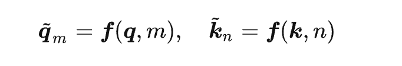

但[是需要实现](https://zhida.zhihu.com/search?q=%E5%90%91%E9%87%8F%E5%86%85%E7%A7%AF&zhida_source=entity&is_preview=1)相对位置编码的话，需要显式融入相对。attention运算中q和k会进行内积，所以考虑在进行 向量内积 时考虑融入相对位置。所以假设成立恒等式：

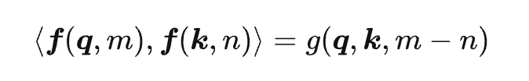

其中m-n包含着token之间的相对位置信息。

给上述恒等式计算设置初始条件，例如f(q,0)=q，f(k,0)=k。

求解过程使用复数方式求解

将内积使用复数形式表示：

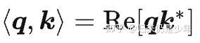

转化上面内积公式可得：

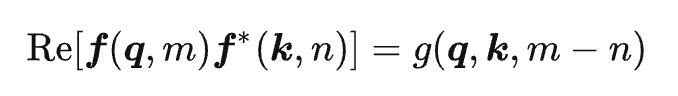

假设等式两边都存在复数形式，则有下式：

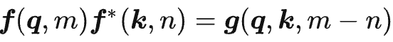

将两边公式皆用复数指数形式表示：

存在  re^{\theta\text{j}}=r\cos\theta+r\sin\theta\ \text{j} .

即任一复数  \boldsymbol{z} 可表示为  \boldsymbol{z}=re^{\theta\text{j}} ，其中  r 为复数的模，  \theta 为幅角。

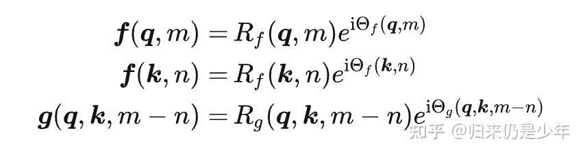

[由于带入上](https://zhida.zhihu.com/search?q=%E5%85%B1%E8%BD%AD%E5%A4%8D%E6%95%B0&zhida_source=entity&is_preview=1)面方程中f(k,n)带*是 共轭复数 ，所以指数形式应该是e^-x形式，带入上式公式可得方程组：

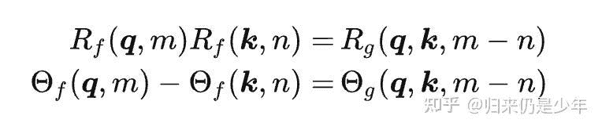

第一个方程带入条件m=n化简可得：

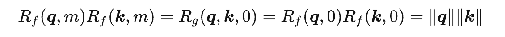

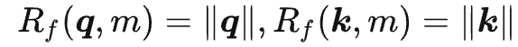

从上式可以看出来复数f(q,m)和f(k,m)与m取值关系不大。

第二个方程带入m=n化简可得：

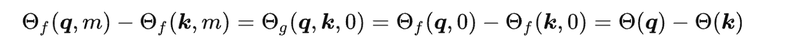

上式公式变量两边挪动下得到：

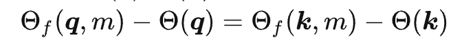

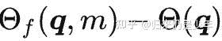

其中上式结果相当于m是自变量，结果是与m相关的值，假设为  \varphi(m) ，即  \Theta_f (\boldsymbol{q}, m) = \Theta (\boldsymbol{q}) + \varphi(m) 。

n假设为m的前一个token，则可得n=m-1，带入上上个式子可得：

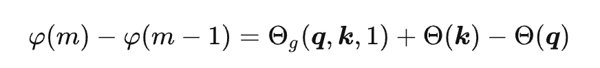

即  \varphi(m) 是等差数列，假设等式右边为  \theta ，则m和m-1位置的公差就是为  \theta ，可推得  \varphi(m)=m\theta 。

得到二维情况下用复数表示的RoPE：

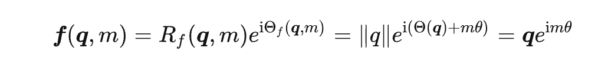

矩阵形式是：

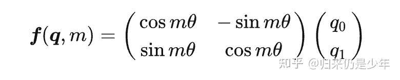

公式最后还会采用三角式一样的远程衰减，来增加周期性函数外推位置差异性。

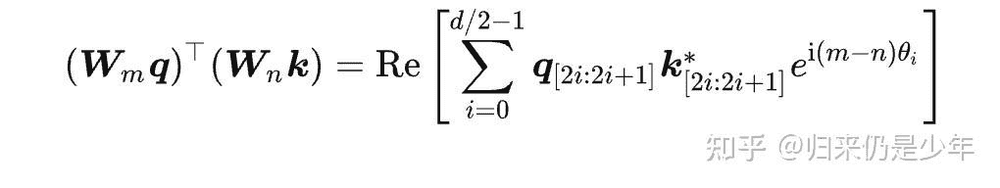

## 三、Alibi 位置编码（ Attention with Linear Biases ）

Alibi 位置编码主要是Bloom模型采用，Alibi 的方法也算较为粗暴，是直接作用在attention score中，给 attention score 加上一个预设好的偏置矩阵，相当于 q 和 k 相对位置差 1 就加上一个 -1 的偏置。其实相当于假设两个 token 距离越远那么相互贡献也就越低。

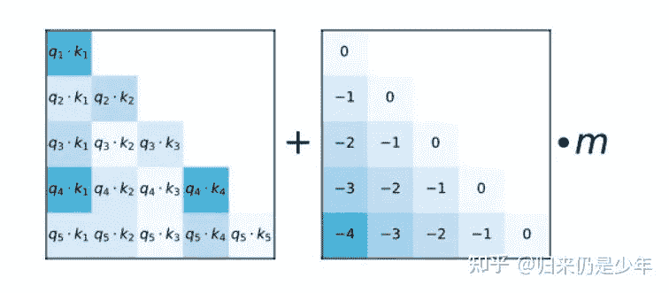

其中Alibi 位置编码是不需要通过训练的，给定的预设矩阵中还会乘上m的调节因子，m的设置与attention的头数有关，是2的指数差值。论文中也做了尝试把m作为学习参数，但是并没有获得更好的效果。

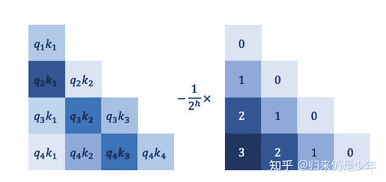

Alibi 位置编码的外推性比旋转位置编码外推性要好一些，旋转位置编码也是基于正余弦三角式位置编码改进融入相对位置信息，但是正余弦三角式位置编码外推性缺点也很明显，看起来是不需要训练可以直接推演无限长度位置编码，但是忽略了一点就是周期性函数必须进行位置衰减，到远处的位置信息趋于直线震荡，基本很难有位置信息区分了，所以外推性比训练式的好不了多少，旋转位置编码基于此改进的自然也是如此。

Alibi 相当于在k和q向量内积上加入分数上的偏置，来体现出来位置差异性，针对于远距离衰减问题，则是通过softmax函数特性进行差异软放大，将token之间的位置差异性拉大，避免远距离时被衰减无限接近于0，因为直接作用在attention分数上，拉大远距离内积值，在训练的时候带来的位置差异性减少的问题会大大缓解，从而获得更远距离的外推性能。

## 四、T5 Bias Position Embedding

T5 Bias位置编码和Alibi 位置编码有点像，其都是作用在attention计算的q和k内积上，但是不同的是Alibi 是无需训练直接推演位置，而T5 Bias则是需要训练。模型在训练的时候会根据不同的q和k学习出来一个标量值，这个标量值加上k和q内积，再经过softmax，此外还对长度有一定限制，当超过 128 长度的相对距离后，每个都分配相同的标量值。这个相对位置窗口保持在128内，但在内积上加入这个bias之后，外推性大大提升。

## 五、KERPLE(Kernelized Relative Positional Embedding for Length Extrapolation)

KERPLE主要针对Alibi 做了一些微小改进，将内积的bias由之前自然数值幂函数或指数函数，并且改成可学习参数。

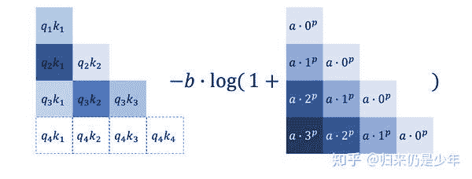

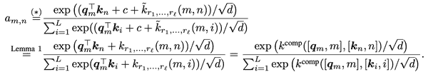

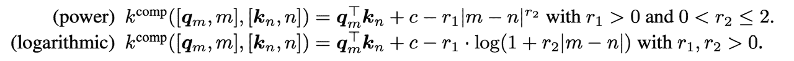

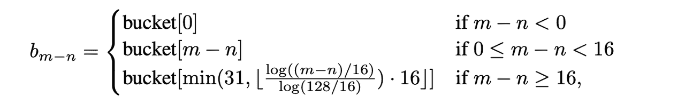

根据上述公式可以看出来，根据相对距离分为三个区间，偏置也主要是加在内积上，来调节内积分数，提高外推性。

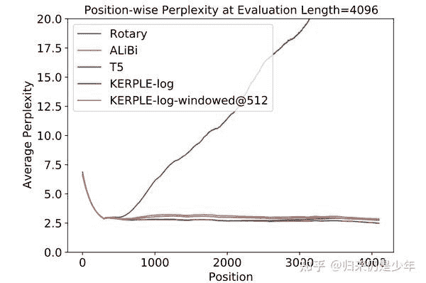

## 六、Sandwich(Receptive Field Alignment Enables Transformer Length Extrapolation)

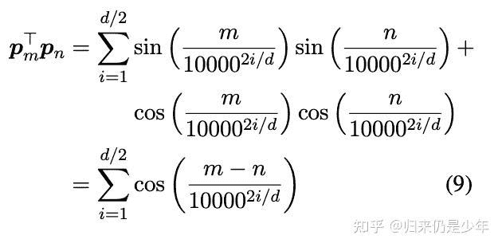

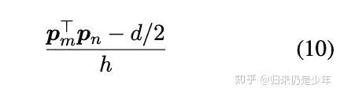

Sandwich将ALiBi的线性bias改为正弦编码的内积pm*pn，上述编码也是对于正余弦三角式的一种改进。

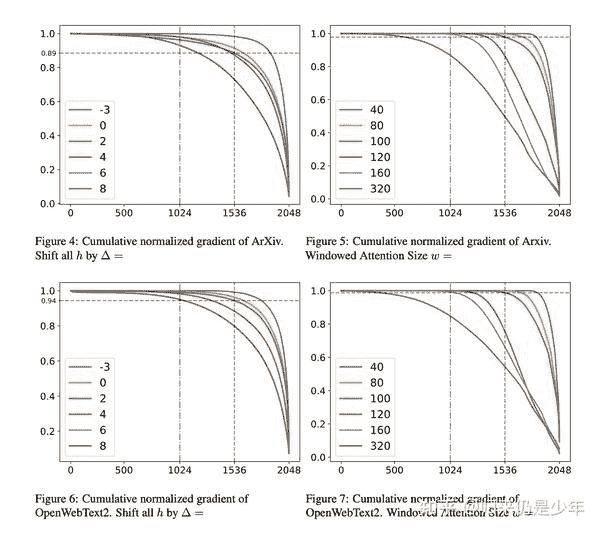

推演具体得到比较大的提升，基本做到1536个token，ppl衰减不明显。

## 七、XPOS(Extrapolatable Position Embedding)

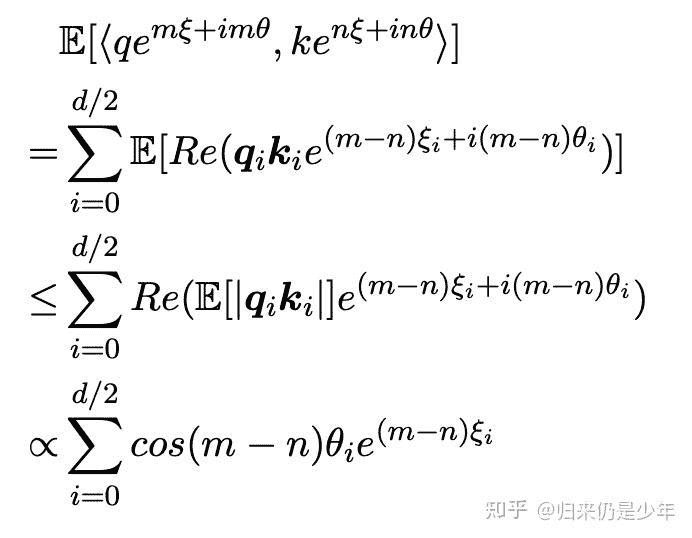

XPOS可以看作是对RoPE的略微[改进，在R](https://zhida.zhihu.com/search?q=%E6%8C%87%E6%95%B0%E8%A1%B0%E5%87%8F&zhida_source=entity&is_preview=1)oPE的内积基础上引入了一个 指数衰减 项，几何上，变换提供向量的旋转。 如果 q 和 k 之间的相对角度较大，则内积为更小。 然而，余弦值并不单调如果旋转角度大于π，这会导致一种不稳定的现象，期望内积随着相对距离的增长。

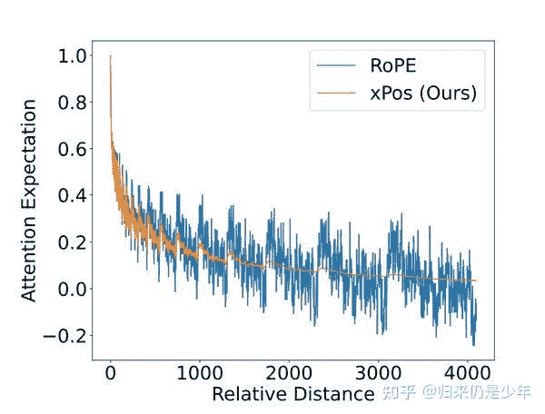

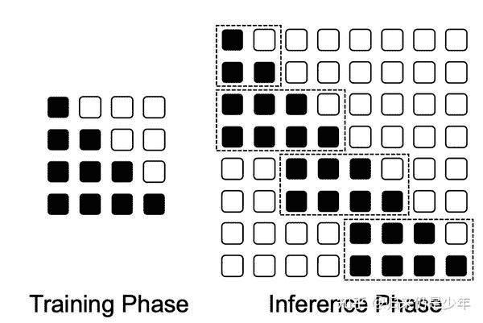

## 八、总结

大模型在进行多轮对话时，对位置编码的外推性要求很高，之前的位置编码信息，主要是在如何融入相对位置信息，但对于位置编码的外推性考虑不足，近两年对于位置编码研究则是侧重于外推性，而且研究工作也主要是在改进模型attention score计算中q和k向量内积中加入偏置，能够很好的延长外推性，使得模型能够容纳更多的上下文信息，对话变得更加流畅。

## 九、 [参考文献](https://zhida.zhihu.com/search?q=%E5%8F%82%E8%80%83%E6%96%87%E7%8C%AE&zhida_source=entity&is_preview=1)

1、 [T](https://link.zhihu.com/?target=https%3A//spaces.ac.cn/archives/8265)ransformer升级之路：2、博采众长的旋转式位置编码 - 科学空间|Scientific Spaces

2、 [羡](https://zhuanlan.zhihu.com/p/629015933)鱼智能：【OpenLLM 010】大模型基础组件之位置编码-万字长文全面解读LLM中的位置编码与长度外推性（ 中）

3、 [https:// arxiv.org/abs/2205.0](https://link.zhihu.com/?target=https%3A//arxiv.org/abs/2205.09921%3Fcontext%3Dcs.LG)992 1?context=cs.LG

4、 https:// arxiv.org/abs/2212.1035 6

5、 https:// arxiv.org/abs/2212.1055 4