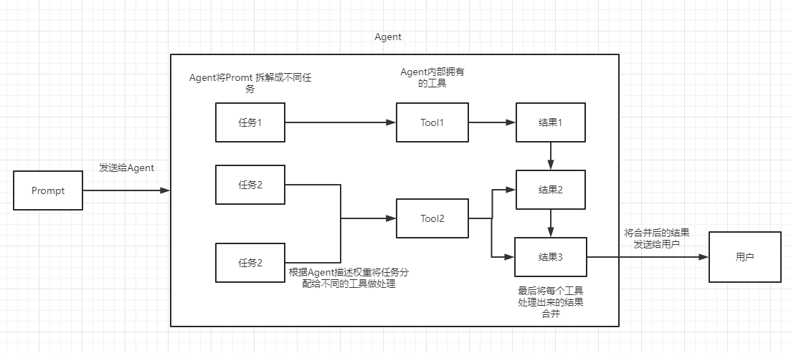

# LLM模型在公司场景中的应用探索

> 来源：[https://agijuejin.feishu.cn/docx/CKQZdIOVuou6W9xa6mNcDiOenKd](https://agijuejin.feishu.cn/docx/CKQZdIOVuou6W9xa6mNcDiOenKd)

> 作者：归来仍是少年

> 原文： [https://zhuanlan.z](https://zhuanlan.zhihu.com/p/641734707)hihu.com/p/641734...

## 一、前言

随着chatgpt的出现迅速火遍全球，国内各个公司也在大模型上开始发力。有些公司在做的时候也没想好应用场景，只是为了跟风去弄大模型，如何产生业务价值。大模型无论训练还是推理的代价都很大，如何让收益大于成本才是能更加持久的研发。谷歌在搜索不上大模型可能也是考虑推理成本太高，毕竟谷歌的搜索并发太大，大模型参数太大，性能优化是个大头，bing上的大模型也是阉割版的模型，效果比完整模型差很多，所以我们在利用大模型应用的时候，一般需要考虑好收益。

## 二、大模型应用场景

1、样本标注

以前的样本是人工进行大量标注，有多少人工就有多少智能，现在更加简单的标注方式就是利用大模型进行辅助标注，虽然chatgpt是通用领域的大模型，但是也是具有迁移学习和少样本学习的能力。

prompt：

```
笔筒创意时尚小清新学生儿童摆件简约多功能收纳笔座办公文具盒子男女欧式复古桌面上可爱摆设彩色塑料格调 黑白羽毛(2个装)\n\n抽取上面句子中的有关商品实体
```

LLM：

```
根据你的要求，我抽取了上述句子中的有关商品实体：

商品类型：笔筒、学生儿童摆件、办公文具盒子、桌面摆设
风格特点：创意、时尚、小清新、简约、多功能、欧式复古、可爱、彩色、格调
材质：塑料
颜色：黑白
图案：羽毛
数量：2个装
请注意，这些实体描述并不对应一个具体的商品，而是根据你的描述提取出的相关特征和属性。你可以使用这些关键词来搜索与你需求相匹配的商品。
```

2、文案生成

prompt：

```
你是个写文案的专家，请写一个关于云南丽江旅游的文案，500字左右
```

LLM：

```
漫步在云南的心[脏，感受着自](https://zhida.zhihu.com/search?q=%E7%A9%BF%E8%B6%8A%E6%97%B6%E7%A9%BA%E4%B9%8B%E9%97%A8&amp;zhida_source=entity&amp;is_preview=1)然[的魔力和](https://zhida.zhihu.com/search?q=%E6%B0%91%E6%97%8F%E9%A3%8E%E6%83%85&amp;zhida_source=entity&amp;is_preview=1)[历史的厚](https://zhida.zhihu.com/search?q=%E7%8E%89%E9%BE%99%E9%9B%AA%E5%B1%B1&amp;zhida_source=entity&amp;is_preview=1)重。丽江，这座魅力四溢的古城，以其壮丽的自然景观、悠久的历史和独特的民俗风情，吸引着[无数旅人](https://zhida.zhihu.com/search?q=%E6%B0%B4%E6%B3%A2%E8%8D%A1%E6%BC%BE&amp;zhida_source=entity&amp;is_preview=1)[的心弦。](https://zhida.zhihu.com/search?q=%E4%B8%BD%E6%B1%9F%E5%8F%A4%E5%9F%8E&amp;zhida_source=entity&amp;is_preview=1)在[这片神奇](https://zhida.zhihu.com/search?q=%E7%BA%B3%E8%A5%BF%E6%96%87%E5%8C%96&amp;zhida_source=entity&amp;is_preview=1)的土地上，时光仿佛凝固，历史与现代[在绚丽的](https://zhida.zhihu.com/search?q=%E9%85%B8%E8%BE%A3%E8%B1%86%E8%8A%B1&amp;zhida_source=entity&amp;is_preview=1)[舞台上](https://zhida.zhihu.com/search?q=%E8%8A%B1%E6%9E%9C%E8%8C%B6&amp;zhida_source=entity&amp;is_preview=1)[交相辉映](https://zhida.zhihu.com/search?q=%E6%9D%9F%E6%B2%B3%E5%8F%A4%E9%95%87&amp;zhida_source=entity&amp;is_preview=1)。

步入丽江，犹如穿越时空之门。迎面而来的是古城的石板街，古老而静谧，仿佛向游人述说着千年的故事。曲径通幽，巷弄纵横，街头巷尾散发着浓郁的纳西民族风情。在这里，你可以穿梭于青石巷道之间，感受古老文化的熏陶，品味古城的静谧与深邃。

迈过古城，进入丽江的自然宝库。这里有雄伟壮观的玉龙雪山，它高耸入云，傲视群山。登上山巅，俯瞰云海，触摸云朵，仿佛进入了仙境般的奇妙世界。而丽江的湖泊更是如诗如画，澄澈如镜，倒映着蓝天和山峦，让人陶醉其中。泛舟湖上，感受水波荡漾的宁静，与大自然的美妙相融合。

丽江的风景如诗如画，而丽江的人文更是别具一格。丽江古城内的木质建筑和石板街巷保留着传统的民居风貌，仿佛将你带回了古代的年代。在这里，你可以欣赏到纳西族的传统音乐和舞蹈，感受纳西文化的独特魅力。夜晚的丽江古城灯火辉煌，霓虹闪烁，热闹非凡。夜市上的各色小吃和手工艺品让人目不暇接，尽情品味着异国风情。

而丽江的饮食更是别具一格，美味与独特融为一体。品尝当地特色美食，如石头鸡、酸辣豆花、丽江酸菜鱼等，每一口都是味蕾的享受。丽江的茶文化也是一大亮点，品味着花果茶、普洱茶，仿佛能感受到大自然的恩赐和土地的滋养。

除了丽江古城，周边的古镇和自然景点也是不可错过的宝藏。束河古镇、白沙古镇等古老而宁静的小镇，仿佛是被时光遗忘的角落，保留着原始的民居建筑和传统的生活方式，让人沉醉其中。而到达泸沽湖，你会被湖光山色所震撼，与摩梭人的淳朴相处，体验独特的民俗风情。

此外，丽江还是探险和户外活动的天堂。徒步穿越虎跳峡，挑战大自然的峡谷奇观；尝试滑草、漂流等刺激的水上运动，释放你内心的激情。在丽江的大自然中，你将重新与自己和大自然连接，领略生命的无限可能。

无论是文化、自然还是美食，丽江都以其独特的魅力吸引着世界各地的旅行者。来到这里，你将与历史对话，与自然共舞，感受到生活的美好与多彩。丽江，一座瑰丽明珠，等待着你的探索与发现。让我们踏上这段奇幻之旅，畅游云南的心脏，感受丽江的神奇与美丽。
```

3、多语言翻译

prompt：

```
将下列自然语言文本翻译成韩语\n 文本：大量独生子女的出现，不仅使中国的家庭结构发生了变化，而且也带来了一些令人担忧的社会问题。
```

LLM：

```
대량의 독생자의 등장은 중국의 가족 구조뿐만 아니라 몇 가지 우려되는 사회 문제도 가져왔습니다.
```

4、构建多轮对话聊天机器人

可以通过类似于langchain的方法，结合自己的场景数据来回答，可以通过embedding的方法将自己语料召回一些，然后构建prompt让模型选择一个最有关的进行推荐。



5、文本摘要提取

prompt：

```
请将下列文本的关键信息组合成摘要\n 文本：从统计数据来看，5月份，全国城镇调查失业率为5.2%，与上月持平，失业率今年以来整体呈下降态势。分年龄看，就业主体人群失业率继续下降，5月份25—59岁就业主体人群失业率为4.1%，比上月下降0.1个百分点，连续3个月下降，说明就业基本盘总体稳定，而且还在改善；分群体看，进城务工农民工失业率继续降低，5月份外来农业户籍劳动力失业率为4.9%，比上月下降0.2个百分点，连续3个月下降，农民工就业总体向好。同时也要看到，当前就业总量压力和结构性问题仍不容忽视，青年人就业压力依然较大。接下来，要加大政策支持力度，把促进高校毕业生等青年就业工作摆在更加突出的位置，形成全社会共同支持青年就业的强大合力。
```

LLM：

```
关键信息：

5月份全国城镇调查失业率为5.2%，与上月持平，失业率整体呈下降态势。
25-59岁的就业主体人群失业率为4.1%，比上月下降0.1个百分点，连续3个月下降，显示就业基本盘总体稳定且改善。
进城务工农民工失业率持续降低，5月份外来农业户籍劳动力失业率为4.9%，比上月下降0.2个百分点，连续3个月下降，农民工就业总体向好。
当前就业总量压力和结构性问题仍不容忽视，特别是青年人就业压力较大。
需要加大政策支持力度，将促进高校毕业生等青年就业放在更加突出的位置，形成全社会共同支持青年就业的强大合力。6、文章续写
```

prompt：

```
你是一个专业作家，请针对下列文章续写，\n 文本：当下，电动轮椅已经不再是腿脚不便的老年人专属的代步工具。在一些社交媒体上的视频显示，年轻人乘坐电动轮椅频频出现在高校、食堂、商场，甚至还成群结队，在一些道路上“赛轮椅”。
```

LLM:

```
续写：

这一现象引发了人们对电动轮椅使用的广泛讨论。不再局限于老年人的代步工具，电动轮椅正逐渐成为一种时尚、便捷的交通方式，为更多人带来自由和无限可能。

年轻人乘坐电动轮椅的兴趣逐渐增加，有着多方面的原因。首先，电动轮椅的技术不断创新，不仅在舒适性和操控性方面有所提升，还具备了更好的速度和灵活性。这使得年轻人可以更加自由地穿梭于校园、商场和社区之间，享受便捷的出行体验。

此外，电动轮椅也成为一种展示个性和时尚品味的方式。年轻人们通过个性化的定制、独特的外观设计和配件装饰，将电动轮椅打造成独具个性的代步工具。这种个性化的表达方式不仅满足了年轻人对个性化和时尚的追求，也让他们在社交媒体上成为关注的焦点。

然而，电动轮椅的年轻化使用也引发了一些讨论和问题。一方面，一些人担心年轻人的使用会给老年人和行动不便的人带来困扰和不便。因此，平衡年轻人的需求与社会的整体利益变得尤为重要。另一方面，公共场所需要进一步提供无障碍设施，以确保电动轮椅的安全和便利性，同时加强管理，避免滥用和不当竞赛行为的发生。

面对这一趋势，社会和相关部门应积极回应。首先，应加强对电动轮椅的管理和规范，制定相关法律法规，明确使用规定和安全标准。同时，需要加强公众教育，提高人们对电动轮椅的认知和理解，鼓励尊重和互助。最重要的是，公共场所和社区应积极改善无障碍设施，使电动轮椅成为更加普遍和便利的出行方式。

电动轮椅的年轻化趋势是社会进步和科技发展的产物，它为更多人带来了便利和自由。我们应以开放和包容的态度看待这一现象，
```

## 三、总结

目前大模型能做的事情很多，但是落地的方向还不多，可能也是成本也是非常高，流量大实时性高的场景基本不能上线，目前也是一些离线场景能够使用，我同时也在探索更多的落地方向来更好的发挥大模型的能力。后续也会接着补充一些场景进去。