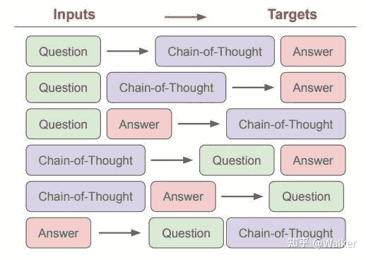

# LLM is not all you need（大模型领域知识微调实践）

> 来源：[https://agijuejin.feishu.cn/docx/LqJgdlDu7oh0f8xdJkccnSRrnHd](https://agijuejin.feishu.cn/docx/LqJgdlDu7oh0f8xdJkccnSRrnHd)

> 作者：Walker

> 原文： [https://zhuanlan.z](https://zhuanlan.zhihu.com/p/689800667)hihu.com/p/689800...

> LLM只具有通用 [世界知识 ](https://zhida.zhihu.com/search?q=%E4%B8%96%E7%95%8C%E7%9F%A5%E8%AF%86&zhida_source=entity&is_preview=1)，不具有领域知识。

> 如果想让LLM学会领域知识，最好的方式是微调，然而微调也很难让LLM成为领域专家。

### 写在前面

本文主要探究部分大模型能否在某些传统任务上打败SOTA（BERT-based model），在此将近期思考和一些有趣的实验现象做一个总结，文末附代码。如果你也有类似的经历，欢迎吐槽！

### 任务背景

笔者的任务一是对输出格式要求很高，只有指令微调才能让LLM学会指定的输出格式；二是需要非常专业的知识，要求输出准确的答案，不微调的话大模型根本搞不定。指令微调数据集从5k条到200w条不等。

### 一些关键问题

> question 1：难道GPT[4也搞不定输出格式](https://link.zhihu.com/?target=https%3A//github.com/microsoft/TypeChat)吗？不是有微软开源的 TypeChat 吗？

+   GPT4确实搞不定。TypeChat对于很多普通任务，输出的格式纠正效果非常好，但是依然达不到我要的效果。最重要的是，[GPT4的API版](https://link.zhihu.com/?target=https%3A//github.com/microsoft/TypeChat)本并没有我需要的能力和知识。by the way，如果你的任务需要比较规范化的输出，而且不是很复杂， TypeChat 是个不错的选择。当然还可以constrained decoding，但是感觉场景和这里的不一样，这里不如SFT简单直接。

> question 2：为什么要用SFT （指令微调）而不用RLHF？

+   RLHF的loss主要在优化LLM输出特定分布（风格）的内容，而笔者想要的是让LLM看到某个问题输出非常精确的答案。那能不能用RL来做基于标签反馈的优化呢？这里边有一个很大的问题是目标token序列非常少，这涉及到稀疏空间中的RL优化问题，比较棘手，不如用SFT来得直接有效，而且SFT对于格式输出的学习几乎是无可挑剔的。

> question 3：指令微调是全参数微调还是PEFT？

+   首先说PEFT吧，有Lora，P-tuning等很多种。笔者一直用Lora，虽然这些方法各有千秋，但当任务很难时性能差异不是很大。其次说全参数微调，笔者[用PEFT](https://link.zhihu.com/?target=https%3A//arxiv.org/abs/2310.05914)微调发现效果比较差之后就采用了全参数微调，但是提升不是很显著。（需要的是20+或者30+个点的提升，而不是个位数的提升）还有一些技巧，传说非常厉害的 NEFT 技术，就是给embedding添加噪声，会获得很好的泛化性。在原论文中声称有些任务能提升34个点，但笔者发现对当前任务没有什么帮助。

> question 4：能不能将领域知识以continue training的形式注入LLM？

+   尝[试过，几乎没有](https://link.zhihu.com/?target=https%3A//arxiv.org/abs/2310.03668)提升。主要是用来continue training的数据不是非常多。所以对SFT没有加成。而且在论文 GOLLIE 的研究中，用标注文档进行continue training后反而不太利于SFT，只是对zero-shot加成很大。虽然这篇论文提出用代码来嵌入标注文档的idea确实很好，但是笔者更关心SFT性能。

> question 5：有没有尝试过一些ICL的方法？CoT, CoT-SC......?

+   在此分享一些关于ICL的经验。

+   首先不经过微调的LLM使用了CoT等prompt方法，设计各种demonstration，确实能提升vanilla性能，但是不经过微调的LLM性能实在太弱。

+   构建SFT指令的时候，曾做过多组实验，发现SFT中加入CoT或者demonstration反而会影响模型性能。笔者发现最优的SFT构造数据方式似乎就是最朴素的方式。具体的，无论将CoT中的reason以提示的方式写在question中，还是直接写在answer中去训练LLM，都会产生负面作用。笔者猜测是LLM的推理方式和人类的推理方式或许根本就不一样，这就导致强行让它按照特定的方向学习反而会干扰它学习。但是又有论文指出这些策略是有效的，分析见下一条。

+   有兴趣的朋友可以看看这篇paper The Flan Collection ，作者构建了一个通用的数据集，调用了各种SFT的手段，发现很多都是有效的，刚好和我的结论相反哈哈哈，可能大家的任务不一样吧。其实指令微调可以有很多种玩法，除了上面写的，还有input inverse，也就是给定answer，输出question，还有question扩充等等，引用一张图。

> [ques](https://zhida.zhihu.com/search?q=%E8%BF%87%E6%8B%9F%E5%90%88&zhida_source=entity&is_preview=1)tion 6：拟合情况如何？是欠拟合还是 过拟合 ？

+   我试过两种SFT数据集，一种是同一对(question, answer），然后基于同义句转换做数据增强，得到多个pair。这种数据集loss当然不会降得非常低，因为同一个question对应多个answer，这种适合于SFT数据很少的情况，可以使得LLM充分理解数据集语义。

+   另一种不做数据增强，因为SFT数据量非常大（1w+, or 100w+），这种情况理论上来讲loss会非常低。笔者在此分享训练参数细节，对于8k条SFT数据量，微调30（甚至40）epoch会使得loss非常低，初始采用1e-3的学习率，scheduler策略是当发现loss没有下降时学习率减半，最后会减到大概5e-6。

+   网上的微调参数大多是适用于聊天LLM的，而笔者只是希望LLM学会一种能力，不在乎灾难遗忘的问题。在这种场景下，不存在过拟合现象，训练的Loss越低越好，Loss越低，测试集上性能越高。

> question 7：大模型是否能取代BERT-based模型？推理能力如何？不同参数量之间有什么差异？

+   大模型或许没有我们想象的那么强。有人可能认为更大的模型会不会好一点？笔者一开始用Bloom1b模型，发现确实很弱，特定格式输出是学不会的，后来用Llama1 7B，发现可以学会特定输出格式，但是准确度不高。后来又换成了Llama1 30B，没有多少提升……其实开源的一堆大模型面对这种任务时都差不多。另外，笔者也试过encoder-decoder架构的模型，比如Flan-T5-XL，发现确实比decoder only架构的模型更适合于这种任务，但也只是提高了4个点而已。

+   [关](https://link.zhihu.com/?target=https%3A//arxiv.org/abs/2309.03882)于大模型的推理能力，我想分享几篇有趣的论文和我的实验观察。论文 L[a](https://link.zhihu.com/?target=https%3A//arxiv.org/pdf/2402.17709.pdf)rge Language Models Are Not Robust Multiple Choice Selectors 发现大模型做多选题任务时还和选项的顺序有关。这个发现就很有意思了，这说明什么？说明大模型推理可能只是按照语言分布采样而不是真正在推理。还有一篇是 Case-Based or Rule-Based: How Do Transformers Do the Math? ，作者探究了transformer做加减法的原理，实验指出transformer不是基于数学规则运算的，而是基于训练样例做推理。笔者发现这个问题其实在SFT之后表现得更加突出，SFT在激发LLM知识储备的同时又在削弱其推理能力。

### 代码

Github： [https:// github.com/Walke](https://link.zhihu.com/?target=https%3A//github.com/WalkerMitty/Fast-Llama2)rMitty/ Fast-Llama2

篇幅太长，工程建议见文章 Walker：指令微调工程建议（代码） 。