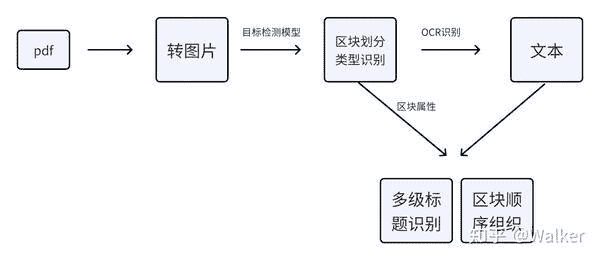
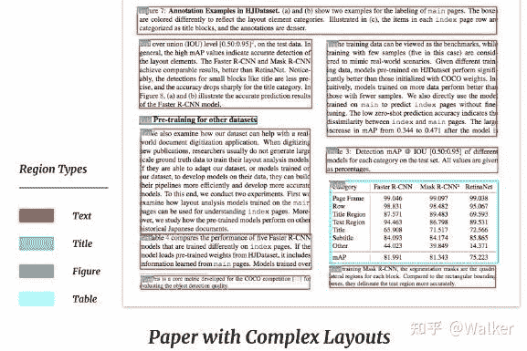
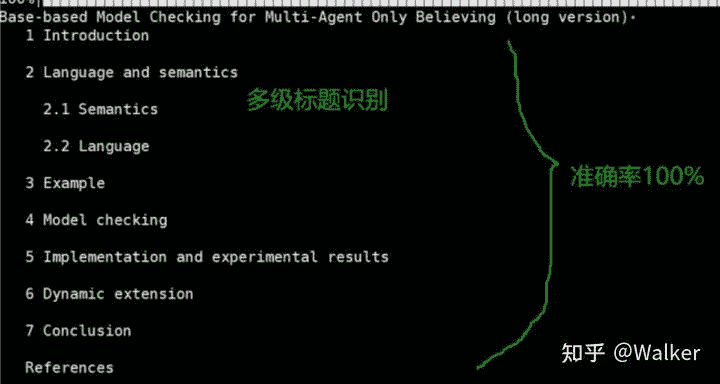
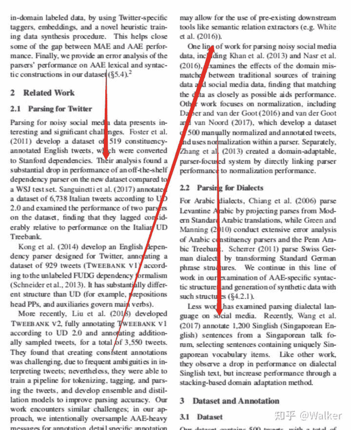
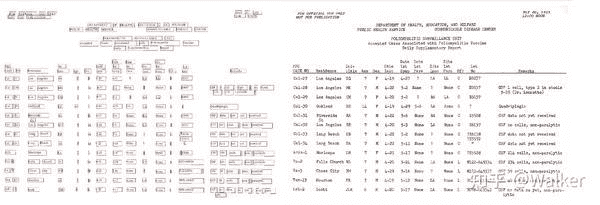
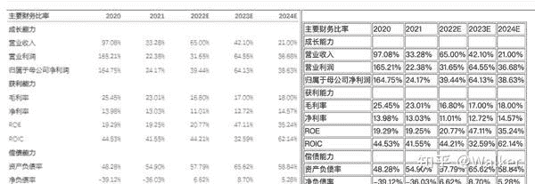

# ChatPDF | LLM文档对话 | pdf解析关键问题

> 来源：[https://agijuejin.feishu.cn/docx/DMBCdZX3UosaVmxWZiAcD3yDnve](https://agijuejin.feishu.cn/docx/DMBCdZX3UosaVmxWZiAcD3yDnve)

> 作者：Walker

> 原文： [https://zhuanlan.z](https://zhuanlan.zhihu.com/p/652975673)hihu.com/p/652975...

笔者最近在探索ChatPDF和ChatDoc等方案的思路，也就是用LLM实现文档助手。在此记录一些难题和解决方案，首先讲解主要思想，其次以问题+回答的形式展开。

> github: [https:// github.com/Wal](https://link.zhihu.com/?target=https%3A//github.com/WalkerMitty/PDFparser)kerMitty/ PDFparser

### 场景描述和主要思想

+   场景是利用LLM实现用户与文档对话。由于pdf是最通用，也是最复杂的文档形式，因此本文主要以pdf为案例介绍

+   如何精确地回答用户关于文档的问题，不重也不漏？笔者认为非常重要的一点是文档内容解[析。](https://zhuanlan.zhihu.com/p/651179780)如果内容都不能很好地组织起来，LLM只能瞎编。至于解析后怎么处理，见上一篇 笔记

+   pdf的解析大体上有两条路，一条是基于规则，一条是基于AI。所谓基于规则就是根据文档的组织特点去“算”每部**分的样式和内容。笔者认为这种**方式很不通用，因为pdf的类型、排版实在太多了，没办法穷举。因此笔者采用AI的方式来解决： 目标检测 和 OCR文字识别

+   pipeline如下：

### Q1：如何对一本书做摘要？

前段时间看到有人在讨论这样一个问题，如何快速对几十万字内容做摘要？我认为这确实是一个重要且有挑战性的工作，但是今天要讨论的文本是有一个前提条件的，那就是有标题（目录）存在。比如书籍或者论文等。对于这类文本，我们的策略是把多级标题提取出来，然后适当做语义扩充，或者去向量库检索相关片段，最后用LLM整合即可。

### Q2：如何提取多级标题？

没有[处理过LLM文档对话的](https://zhida.zhihu.com/search?q=high-level&zhida_source=entity&is_preview=1)朋友可能不明白为什么要提取标题甚至是多级标题，因此我先来阐述提取标题对于LLM阅读理解的重要性有多大。一是如Q1阐述的那样，标题是快速做摘要最核心的文本。二是对于有些问题 high-level 的问题，没有标题很难得到用户满意的结果。举个例子：

如图所示，假如用户就想知道3.2节是从哪些方面讨论的（标准答案就是3个方面），如果我们没有将标题信息告诉LLM，而是把所有信息全部扔给LLM，那它大概率不会知道是3个方面（要么会少，要么会多。做过的朋友秒懂）

[OK，讲完了](https://zhida.zhihu.com/search?q=pdf%E8%BD%AC%E6%8D%A2&zhida_source=entity&is_preview=1)提取标题的重要性，我们进入正题。第一步是用一些工具将 pdf转换 为图片，这里有很多开源工具可以选，笔者采用fitz，一个python库。速度很快，时间在毫秒之间。接下来就是如何在图片中识别出 标题、文本、表格、图片、列表等元素。如下图效果：

这一步就要采用目标检测模型，笔者做了很多[探索，发现有几款开源工具可以](https://link.zhihu.com/?target=https%3A//github.com/Layout-Parser/layout-parser)选择，一是 La[yout-parser ，](https://link.zhihu.com/?target=https%3A//unstructured-io.github.io/unstructured/)二是 PaddlePaddle-ppstructure ，三是 unstructured 。对于论文pdf来说，Layout-parser的最大的模型（约800MB）精度非常高，但是速度慢一点，可以考虑GPU加速。而Paddle的模型比较小，效果也还行。unstructured的fast模式效果很差，基本不能用，会将很多公式也识别为标题。其他模式或许可行，笔者没有尝试。接下来用OCR工具来对标题区块提取文字即可，用上述工具都可以。

到[目前为止，](https://zhida.zhihu.com/search?q=%E4%B8%80%E7%BA%A7%E6%A0%87%E9%A2%98&zhida_source=entity&is_preview=1)我们已经得到了一个list，存储所有检测出来的标题，接下来利用标题区块的高度（也就是字号）来判断哪些是 一级标题 ，哪些是二级、三级、……N级标题。这个时候我们发现一些目标检测模型提取的区块并不是严格按照文字的边去切，导致这个idea不能实施，那怎么办呢？unstructured的fast模式就是按照文字的边去切的，同一级标题的区块高度误差在0.001之间。因此我们只需要用unstructured拿到标题的高度值即可（虽然繁琐，但是不耗时，unstructured处理也在毫秒之间）。

我们来看看提取效果，按照标题级别输出：

### Q3：如何区分单栏还是双栏pdf？如何重新排序？

很多目标检测模型识别区块之后并不是顺序返回的，因此我们需要根据坐标重新组织顺序。单栏的很好办，直接按照中心点纵坐标排序即可。双栏pdf就很棘手了，有的朋友可能不知道pdf还有双栏形式，我这里贴张图大家好体会，行文顺序如红色箭头所示：

首先如何区分单双栏论文？我们可以得到所有区块的中心点的横坐标，用这一组横坐标的极差来判断即可，双栏论文的极差远远大于单栏论文，因此可以设定一个极差阈值。

其次是双栏论文如何确定区块的先后顺序？先找到中线，将左右栏的区块分开，中线横坐标可以借助上述求极差的两个横坐标  x_{1} 和  x_{2} 来求，也就是  \frac{x_{1}+x_{2}}{2} 。分为左右栏区块后，对于每一栏区块按照纵坐标排序即可，最后将右栏拼接到左栏后边。

### Q4：如何提取表格和图片中的数据？

思路[仍然是目标](https://link.zhihu.com/?target=https%3A//github.com/Layout-Parser/layout-parser/blob/main/examples/OCR%2520Tables%2520and%2520Parse%2520the%2520Output.ipynb)检测和OCR。无论是layoutparser还是PaddleOCR都有识别表格和图片的目标检测模型，而表格的数据可以直接OCR导出为excel形式数据，非常方便。以下是layoutparser demo 的示例：

[以下是PaddlePadd](https://link.zhihu.com/?target=https%3A//github.com/PaddlePaddle/PaddleOCR/blob/release/2.7/ppstructure/table/README_ch.md)le的 PP structure 示例：

提取出表格之后喂给LLM，LLM还是可以看懂的，可以设计prompt做一些指导。关于这一块两部分demo代码都很清楚明白，这里不再赘述。

### Q5：基于AI的文档解析有什么优缺点？

上述解析手段都是基于AI的，这里简要阐述它的优点和缺点。

优点：准确率高，通用性强。

缺点：耗时慢，建议用GPU等加速设备，多进程、多线程去处理。耗时只在目标检测和OCR两个阶段，其他步骤均不耗时。

### Q6：如何处理跨页（跨栏）内容？

跨页如果是一段文本被隔开了，可以用NSP判断是否拼接（上一篇文章提过）。如果是表格的话，目前的操作是强行合并，因为两个独立表格分别占据两页首尾概率很小，虽然不够完美，但是能用。

### 最后要说的

笔者建议按照不同类型的pdf做特定处理，例如论文、图书、财务报表、PPT都可以根据特点做一些小的专有设计。

没有GPU的话目标检测模型建议用PaddlePaddle提供的，速度很快。Layout parser只是一个框架，目标检测模型和OCR工具可以自由切换。

[一家之言 ](https://zhida.zhihu.com/search?q=%E4%B8%80%E5%AE%B6%E4%B9%8B%E8%A8%80&zhida_source=entity&is_preview=1)，姑且听之。还请大佬们多多指点

编辑于 2024-01-25 16:45 ・IP 属地广东