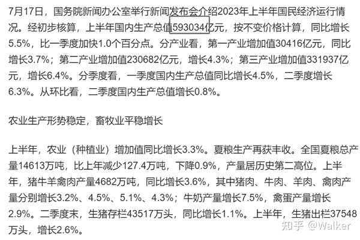
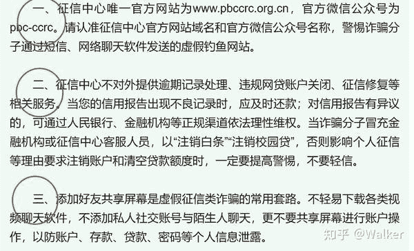

# 基于LLM+向量库的文档对话痛点及解决方案

> 来源：[https://agijuejin.feishu.cn/docx/UpbVd4ch5orPAkxGjhOcFqmjnpf](https://agijuejin.feishu.cn/docx/UpbVd4ch5orPAkxGjhOcFqmjnpf)

> 作者：Walker

> 原文： [https://zhuanlan.z](https://zhuanlan.zhihu.com/p/651179780)hihu.com/p/651179...

### [痛点：文档](https://zhida.zhihu.com/search?q=%E8%AF%AD%E4%B9%89%E4%BF%A1%E6%81%AF&zhida_source=entity&is_preview=1)切分粒度不好把控，既担心噪声太多又担心 语义信息 丢失

笔者之前采用了Langchain的文档切分工具，发现不能问题。笔者做了一些探索，希望与大家共同探讨

### 问题1：如何让LLM简要、准确回答细粒度知识？

+   举例及标答如下：



```
用户：2023年我国上半年的国[内生产总值是](https://zhida.zhihu.com/search?q=%E5%9B%BD%E6%B0%91%E7%94%9F%E4%BA%A7%E6%80%BB%E5%80%BC&amp;zhida_source=entity&amp;is_preview=1)多少？
LLM：根据文档，2023年的国民生产总值是593034亿元。
```

+   需求分析：一是简要，不要有其他废话。二是准确，而不是随意编造。

### 问题2：如何让LLM回答出全面的粗粒度（跨段落）知识？

+   举例及标答如下



```
用户：根据文档内容，征信中心有几点声明？
LLM：根据文档内容，有三点声明，分别是：一、……；二……；三……。
```

+   **问题解释及需求分析：**

[要实现语](https://zhida.zhihu.com/search?q=%E6%8D%A2%E8%A1%8C%E7%AC%A6&zhida_source=entity&is_preview=1)义级别的分割，而不是简单基于html或者pdf的 换行符 分割。笔者发现目前的痛点是文档分割不够准确，导致模型有可能只回答了两点，而实际上是因为向量相似度召回的结果是残缺的。

有人可能会问，那完全可以把切割粒度大一点，比如每10个段落一分。但这样显然不是最优的，因为召回片段太大，噪声也就越多。LLM本来就有幻觉问题，回答得不会很精准（笔者实测也发现如此）。

所以说，我们的文档切片最好是按照语义切割。

### 解决方案

### 思想（原则）

**基于L**LM的**文档对话**架构分为两部分[，先 检索](https://zhida.zhihu.com/search?q=%E6%8E%A8%E8%8D%90%E7%B3%BB%E7%BB%9F&zhida_source=entity&is_preview=1)[ ，后 ](https://zhida.zhihu.com/search?q=%E5%8F%AC%E5%9B%9E%E7%8E%87&zhida_source=entity&is_preview=1)推理。 重心在检索（ 推荐系统 ），推理交给LLM整合即可。而检索部分要满足三点 ①尽可能提高 召回率 ，②尽可能减少无关信息；③速度快。

**将所有的文本组**织成二级索引**，第一级索引是 **[关键信息] ，第二级是** [原****始文本]，** 二者一一映射。检索部分 只对 关键信息做embedding，参与相似度计算，把召回结果映射的 原始文本 交给LLM。

主要架构图如下：

### 如何构建关键信息？

首先从架构图可以看到，句子、段落、文章都要关键信息，如果为了效率考虑，可以不用对句子构建关键信息。

+   **文章的切分及关键信息抽取**

**关键信息: **为各 **语义段 **的关键信息集合，或者是各个子标题语义扩充[之后的集合（](https://zhuanlan.zhihu.com/p/652975673)pdf多级标题识别及提取见 下一篇文章 ）

**语义切分方法1： **利用NLP的 [篇章分析 ](https://zhida.zhihu.com/search?q=%E7%AF%87%E7%AB%A0%E5%88%86%E6%9E%90&zhida_source=entity&is_preview=1)（**discour**se parsing）工具，提取出段落之间的主要关系，譬如上述极端情况2展示的段落之间就有从属关系。把所有包含主从关系的段落 合并成一段。 这样对文章切分完之后保证每一段在说同一件事情.

**语义切分方法2： **除了dis[cour](https://zhida.zhihu.com/search?q=%E4%BA%8C%E5%88%86%E6%B3%95&zhida_source=entity&is_preview=1)se parsing的工具外，还可以写一个简单算法利用BERT等模型来实现语义分割。BERT等模型在预训练的时候采用了NSP（next sentence prediction）的训练任务，因此BERT完全可以判断两个句子（段落）是否具有语义衔接关系。这里我们可以设置相似度阈值t，从前往后依次判断相邻两个段落的相似度分数是否大于t，如果大于则合并，否则断开。当然算法为了效率，可以采用 二分法 并行判定，模型也不用很大，笔者用BERT-base-Chinese在中文场景中就取得了不错的效果。

这部分代码网上似乎没有，那我贴出来吧

```
    def is_nextsent(sent, next_sent):

        encoding = tokenizer(sent, next_sent, return_tensors=&quot;pt&quot;,truncation=True, padding=False)

        with torch.no_grad():
            outputs = model(**encoding, labels=torch.LongTensor([1]))
            logits = outputs.logits
            probs = torch.softmax(logits/TEMPERATURE, dim=1)
            next_sentence_prob = probs[:, 0].item()

        if next_sentence_prob &lt;= MERGE_RATIO:

            return False
        else:
            return True
```

+   语义段的切分及段落（句子）关键信息抽取

如果向量检索效率很高，获取语义段之后完全可以按照真实段落及句号切分，以缓解细粒度知识点检索时大语块噪声多的场景。当然，关键信息抽取笔者还有其他思路。

**方法1： **利用NLP中的成分 [句法分析 ](https://zhida.zhihu.com/search?q=%E5%8F%A5%E6%B3%95%E5%88%86%E6%9E%90&zhida_source=entity&is_preview=1)[（consti](https://zhida.zhihu.com/search?q=%E5%91%BD%E5%90%8D%E5%AE%9E%E4%BD%93%E8%AF%86%E5%88%AB&zhida_source=entity&is_preview=1)[tuenc](https://zhida.zhihu.com/search?q=%E5%8A%A8%E8%AF%8D%E7%9F%AD%E8%AF%AD&zhida_source=entity&is_preview=1)y parsing）工具和 命名实体识别 （NER）工具提取，前者可以提取核心部分（名词短语、 动词短语 ……），后者可以提取重要实体（货币名、人名、企业名……）。譬如说：

```
原始文本：MM团队的成员都是精英，核心成员是前谷歌高级产品经理张三，前meta首席技术官李四…… 
关键信息：（MM团队，核心成员，张三，李四）
```

**方法2： **可以用 [语义角色标注 ](https://zhida.zhihu.com/search?q=%E8%AF%AD%E4%B9%89%E8%A7%92%E8%89%B2%E6%A0%87%E6%B3%A8&zhida_source=entity&is_preview=1)（Semantic Role Labeling）来分析句子的谓词论元结构，提取“谁对谁做了什么”的信息作为关键信息。类似的方向还有依[存分析（depen](https://link.zhihu.com/?target=https%3A//arxiv.org/abs/1611.01734)dency pa[rsing）](https://link.zhihu.com/?target=https%3A//github.com/yzhangcs/parser)，依存分析可以对一个句子构建一棵树，我们只需要去除树的最后几层，即可得到一个句子的关键信息。有一个又快又好的方法 biaffine ，推荐开源实现 SuPar 。

**方法3：直接法。 **其[实NLP的研](https://link.zhihu.com/?target=https%3A//hanlp.hankcs.com/)究中本来就有关键词提取工作[（Key](https://zhida.zhihu.com/search?q=%E5%85%8D%E8%B4%B9%E7%89%88&zhida_source=entity&is_preview=1)[phrase E](https://link.zhihu.com/?target=https%3A//maartengr.github.io/KeyBERT/index.html)xtraction）。也有一个成熟工具可以使用。一个工具是 HanLP ，中文效果好，但是付费， 免费版 调用次数有限。还有一个开源工具是 KeyBERT ，英文效果好，但是中文效果差。

**方法4： **[**垂直领域 **](https://zhida.zhihu.com/search?q=%E5%9E%82%E7%9B%B4%E9%A2%86%E5%9F%9F&zhida_source=entity&is_preview=1)**建议的方法。 **[以上两个方法在垂](https://link.zhihu.com/?target=https%3A//github.com/PKU-YuanGroup/ChatLaw)直领域都有准确度低的缺陷，垂直领域可以仿照 ChatLaw 的做法，即：训练一个生成关键词的模型。ChatLaw就是训练了一个KeyLLM。

### 常见问题

+   句子、语义段、之间召回不会有 [包含关系 ](https://zhida.zhihu.com/search?q=%E5%8C%85%E5%90%AB%E5%85%B3%E7%B3%BB&zhida_source=entity&is_preview=1)吗，是否会造成冗余？

回答：会造成冗余，但是笔者试验之后回答效果很好，无论是细粒度知识还是粗粒度（跨段落）知识准确度都比Longchain粗分效果好很多，对这个问题笔者认为可以优化但没必要

### 部分idea参考

> 小虫飞飞：LLM+Embedding构建问答系统的局限性及优化方案