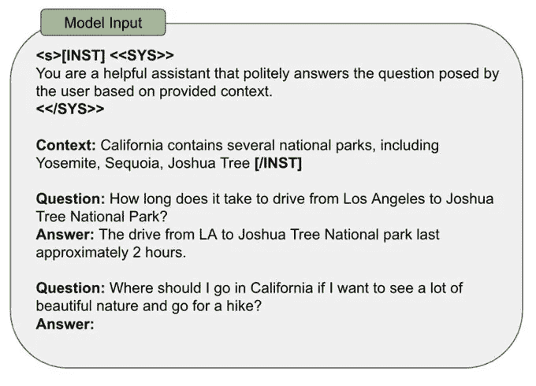
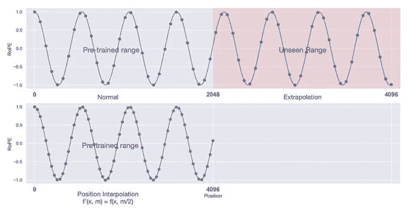
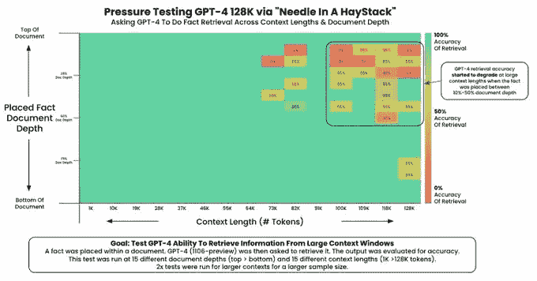
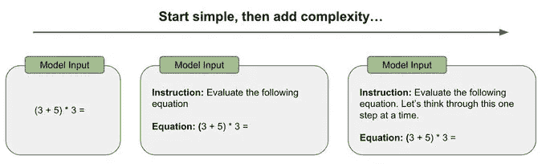

# Netflix 机器学习科学家的提示词优化经验分享

> 来源：[https://agijuejin.feishu.cn/docx/EFHJd89H3oXnOhxzzpLcQ0ubnyf](https://agijuejin.feishu.cn/docx/EFHJd89H3oXnOhxzzpLcQ0ubnyf)

**原文链接：****https://mp.weixin.qq.com/s/7Y**7i0OGfLq9KB-spn6UFdg

作者 | Cameron R. Wolfe, Ph.D.

**编译 | 岳扬**

---

**编者按：**如何充分发挥大模型的潜能，用好大模型，关键在于如何优化向它们发送的提示词（prompt），是为提示词工程（prompt engineering）。

本文Netflix 机器学习科学家Cameron R. Wolfe的提示词优化经验分享，阐述了目前提示词的主要构成要素，介绍了与提示词相关的上下文窗口相关信息，并总结了一些行之有效的优化策略，如实事求是，实证为本、先从简单着手、若无必要，尽量简单明了、使用示例等，这些策略应能为在实践中优化提示词提供参考思路。

作者 | Cameron R. Wolfe, Ph.D.

**编译 | 岳扬**

本文将介绍一些提示词工程（prompt engineering）的基本概念，以及如何应用这些概念来提升大语言模型（LLM）的性能。

1.  **LLM 的界面极其简便易用**

LLMs 如此受欢迎的主要原因之一是它们采用了 text-to-text 的输入输出界面（译者注：用户只需要在Web或客户端界面上输入文本提示词，模型就能根据输入的文本生成相应的文本输出。），使得使用起来非常简单直观。在之前，使用深度学习解决一项任务至少需要我们通过一些数据对模型进行微调，以教会模型如何解决这项任务。此外，大多数此类模型都是专门解决单一任务的专家模型。由于 LLMs 具有一种新出现的上下文学习（in-context learning）能力，我们可以通过文本提示词解决各种问题。以往复杂的问题解决过程现在已经被简化为通过自然语言描述解决问题！

> “p**r**ompt工程作为一个相对新兴的学科领域，其目标是开发和改进优化提示词（prompt），使大模型（LMs）能基于这些提示词充分发挥潜力，高效地被用于各项应用方向和研究领域。”  —— 摘自文献 [1]

1.  **什么是提示词工程？**

得益于大语言模型基于文本对话的简单交互界面，使用它们已不再是专业人士（数据科学家或机器学习工程师（MLE））的“私房菜”。普通大众只要掌握一定的语言能力，就可以直接与这些模型对话交互，借助它们的能力解决较为复杂的问题。不过，在使用 LLM 解决问题时，我们得到的结果很大程度上取决于提供给模型的文本提示词。由于这个原因，提示词工程（通过大量的实证试验和反复优化，指导如何为特定任务设计高质量的prompt）变得极其受欢迎和具有影响力，行业目前已经积累了诸多有效的技术手段和优秀的实践方法。

1.  **提示词的主要构成要素**

为大语言模型设计 prompt，有多种不同的方法。但是，大多数 prompt 设计策略通常会包含以下几个共同的组成要素：

+   **要处理的输入数据**（Input Data）： 大模型需要处理的输入数据，比如待翻译或分类的句子、待总结的文档等。

+   **具体的示例**（Exemplars）：在 prompt 中介绍输入数据和期望输出之间的对应关系，明确地指导模型产生所需的输出形式，提高任务完成的准确性，使得大模型完成预期的文本输入到模型输出的映射转换。

+   **指令型文本**（Instruction）：使用自然语言文字对期望的模型输出的性质、格式等进行描述和指导。

+   **结构化和格式化的元素或标签**（Indicators）：通过标签、格式化元素（ tags、formatting elements）等方式在 prompt 中引入一些人工结构，使其不只是简单的自然语言文本，而是带有一些额外的语义信息和视觉提示，从而指导模型的输出更契合要求。

+   **上下文**（Context）：prompt 中提供给大模型的一些背景信息、情况说明、限制条件等内容，有助于模型更好地把握语境，理解 prompt 的全部含义，从而生成更准确、更符合预期的输出结果。

在下图中展示了一个真实的 prompt 实例，它将上述所有提示词的主要构成要素都整合到了一个句子分类任务的提示词中。

1.  上下文窗口（The context window）

在预训练**阶段，模型有一个固定**的最大输入长度，如果输入的内容超过这个长度，模型的输出就可能失常。这个预训练时设定的序列长度限制，就决定了模型实际运行时能够一次性处理的最大文本长度，被称为上下文窗口（The context window）。如果文本序列的长度大大超过了这一预设的上下文长度，那么模型的行为就可能无法预测，并产生错误的输出。不过，有一些方法可以用来扩展模型的上下文窗口，例如 Self-Extend ([2]) 或位置插值法（positional interpolation）([3])。

近期关于 LLMs 的最新研究强调了创建长上下文窗口（long context windows）的重要性，从而使得模型能够在每**个提示词（prompt）中处理更多**的信息（例如，更多的示例对（Exemplars）或更多的上下文内容）。然而，并非所有的 LLM 都能完美地利用上下文！通常通过“大海捞针测试”（needle in the haystack test）([4]) 来评估 LLM 利用长上下文窗口信息的能力，这项测试具体包括：

1.  在上下文中嵌入一个随机 fact（译者注：独立存在、真实无误但与上下文无关的陈述性信息，可以检验模型在真实应用场景中对关键信息的识别和提取能力。）。

1.  要求模型检索这个 fact。

1.  反复地改变上下文长度以及 fact 在上下文中的位置，并在各种上下文配置下反复测试。

这项测试会生成如下图所示的测试结果（摘自文献 [4]），我们可以很容易地发现上下文窗口的不足之处。

1.  我的提示词（prompt）工程策略

针对不同的大型语言模型，提示词工程的具体细节会有很大区别。但是，有一些通用的原则是非常有用的，可以用来指导如何设计提示词：

+   **实事求是，实证为本**：提示词工程的首要步骤是建立一个可靠的评估机制（例如通过测试用例评估、人工评估或让大模型进行评估），从而轻松地评估或测量提示词工程中 prompt 的优化效果。

+   **先从简单着手**：刚开始接触提示词工程时，不应当直接尝试 “chain-of-thought prompt” 这种复杂技术，而应先从最简单的形式着手，然后逐步添加复杂元素，同时根据提示词的性能变化（见上文）来判断是否有必要继续增加提示词的复杂度。

+   **追求明确具体而直接**：尽可能消除 prompt 中的任何歧义，尽量使用简洁、明确、直接和具体的自然语言来描述期望大模型输出的内容。

+   **使用一些具体的示例**（exemplars）：如果很难具体描述期望的理想输出，可以尝试在提示词中添加一些具体的示例，通过具体实例消除歧义，明确期望输出的形式。

+   **若无必要，尽量简单明了**：有些情况下确实需要使用很多复杂的 Prompt 策略（如解决多步推理问题），但我们在使用这些方法之前应三思而后行。要根据经验，通过判断实践效果和采用评估方法来确定是否必须引入复杂提示词策略。

综上所述，本文介绍的提示词工程策略主要是：i) 先加大投入构建一个非常好的评估框架；ii) 从简单的 Prompt 形式入手；iii) 根据实际需求，逐步适度引入复杂提示词策略，以便尽可能达到理想的性能水平。

Thanks for reading!

Cameron R. Wolfe, Ph.D.

I’m a researcher with an interest in deep learning and a passion for explaining scientific concepts to others.

**END**

**参考资料**

[1]https://www.promptingguide.ai/zh

[2]https://arxiv.org/abs/2401.01325

[3]https://arxiv.org/abs/2306.15595

[4]https://github.com/gkamradt/LLMTest_NeedleInAHaystack

**本文经原作者授权，由 Baihai ID**P 编译。如需转载译文，请联系获取授权。

**原文链接：**

https://x.com/cwolferesearch/status/1786025095959298234