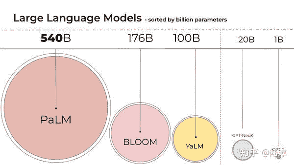
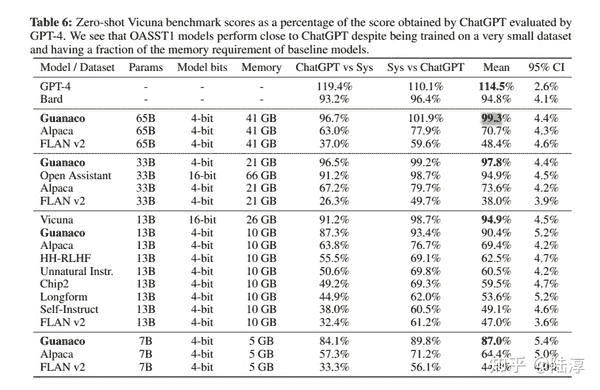
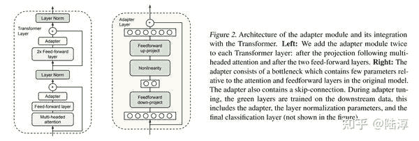
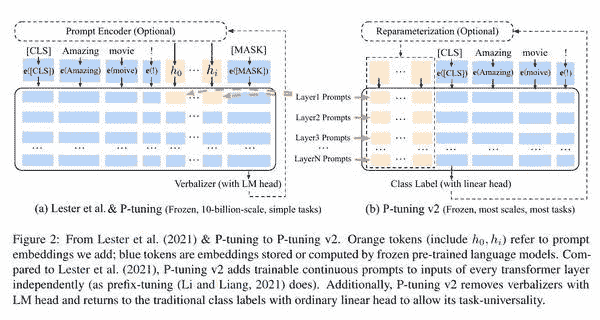
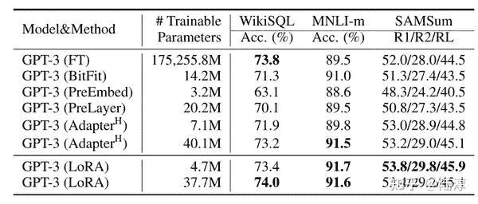
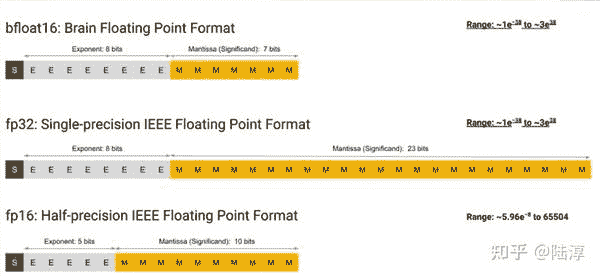
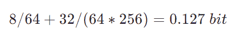
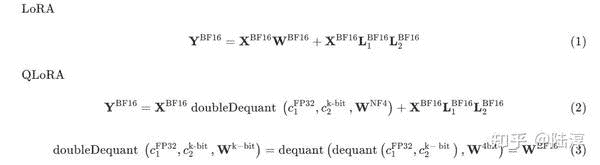
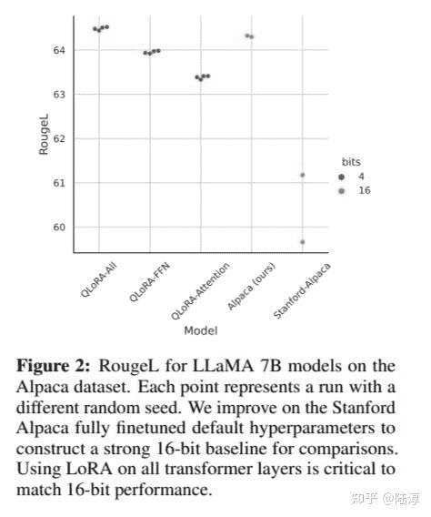
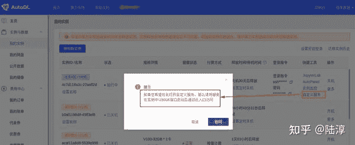

# QLoRA：4-bit级别的量化+LoRA方法，用3090在DB-GPT上打造基于33B LLM的个人知识库

> 来源：[https://agijuejin.feishu.cn/docx/DUQ4dbkhKow6wsxYcsZchsrHnjd](https://agijuejin.feishu.cn/docx/DUQ4dbkhKow6wsxYcsZchsrHnjd)

> 作者：陆淳

> 原文：[https://zhuanlan.zhihu.com/p/634516004](https://zhuanlan.zhihu.com/p/634516004)

## 一、背景

大型语言模型（`LLM`）的发展日新月异，是近年来自然语言处理（`NLP`）领域的热门话题，`LLM`可以通过大规模的无监督预训练来学习丰富的语言知识，并通过微调来适应不同的下游任务，从而在各种`NLP`任务上取得了令人瞩目的性能。然而，`LLM`也带来了一些挑战，其中一个便是它们的巨大规模和高昂的计算成本。例如，微调`LLaMA`的`65B`模型需要超过`780G`的显存，在`BLOOM-176B`上进行推理，需要`8`个`80GB`的`A100 GPU`（每个约`1.5`万美元）。这远远超出了普通用户和研究者的可用资源。虽然最近出现的一些量化方法可以减少`LLM`的内存占用量，但是这些技术仅适用于推理，并不适合在训练过程中使用。因此，如何在保持或提高性能的同时，降低`LLM`的内存占用和训练时间，是一个急需解决的问题。



5月24日华盛顿大学在《 [`QLORA: Efficient Finetuning of Quantized LLMs`](https://link.zhihu.com/?target=https%3A//arxiv.org/pdf/2305.14314.pdf) 》这篇文章中提出了一种针对`LLM`的低精度量化和高效微调技术，可以在保证完整的`fp16`的微调任务性能的同时，减少内存使用，从而能够在单个`48GB`显存的`GPU`上微调`65B`参数模型。作者 `Tim Dettmers` 在 `huggingface` 上已经公布了他们利用`QLoRA`方法训练的系列模型`Guanaco`，其中`33B`和`65B`的模型可以直接下载使用，`7B`和`13B`的模型需要和对应的`LLaMA`模型进行参数融合。同时作者表明`Guanaco`在`Vicuna`基准测试中的表现超过了所有以前公开发布的模型，在`24`小时内微调的`Guanaco 65B`大模型甚至能够达到`chatgpt`性能水平的`99.3%`。以下是华盛顿大学的作者所公布的数据：



以下是我自己在`40GB`显存，`500GB`磁盘空间的`A100`上对`Guanaco`模型的推理实测：

| MODEL | GPU RAM（括号内为未使用`qlora`的显存） | CPU RAM | DISK |
| --- | --- | --- | --- |
| `Guanaco 7b merged` | `4.8GB`（`14.7GB`） | `3.6GB` | `36.4GB` |
| `Guanaco 13b merged` | `8.4GB`（`28.7GB`） | `5.9GB` | `60.2GB` |
| `Guanaco 33b merged` | `18.3GB`（`OOM`） | `8.4GB` | `122GB` |
| `Guanaco 65b merged` | `38.7GB`（`OOM`） | `13.1GB` | `434GB` |

看到这里相信有很多同学已经按捺不住准备去尝试了[，但如果](https://zhida.zhihu.com/search?q=%E7%9F%A5%E8%AF%86%E5%BA%93&zhida_source=entity&is_preview=1)我告诉你只要`5`元就可以在`DB-GPT`上部署自己的`Guanaco 33B`模型呢。在安全隐私的环境下拥有如此一个强大的模型将对个人知识库带来怎样的改变？不妨先耐着性子看完以下介绍。

## 二、QLoRA

总的来说`QLoRA`使用一种低精度的存储数据类型（`NF4`）来压缩预训练的语言模型。通过冻结 `LM` 参数，将相对少量的可训练参数以 `Low-Rank Adapters` 的形式添加到模型中，`LoRA` 层是在训练期间更新的唯一参数，使得模型体量大幅压缩同时推理效果几乎没有受到影响。从`QLoRA`的名字可以看出，`QLoRA`实际上是`Quantize+LoRA`技术。

[ ](https://link.zhihu.com/?target=https%3A//github.com/artidoro/qlora)

我们首先简单了解一些微调方法。

### 1、Fine-Tuning

在[大语言模型](https://zhida.zhihu.com/search?q=%E5%A4%A7%E8%AF%AD%E8%A8%80%E6%A8%A1%E5%9E%8B&zhida_source=entity&is_preview=1)对特定任务或领域进行微调任务时，重新训练所有模型参数将会带来昂贵的训练成本，因此出现了各种优化的微调方案：

### 1.1、Adapters-Tuning

在[预训练模型每一层（或某些层）中添加`Adapter`（`bottleneck`）模块，可以理解为在`attention`外面整体包一个复杂的非线性函数进行空间变换。微调时冻结预训练模型主体，由`Adapter`模块学习特定下游任务的知识。每个`Adapter`模块由两个前馈子层组成，第一个前馈子层将`Transformer`块的输出作为输入，将原始输入维度`d`投影到`m`，通过控制`m`的大小来限制`Adapter`模块的参数量，通常情况下`m<<d`。在输出阶段，通过第二个前馈子层还原输入维度，将`m`重新投影到`d`，作为`Adapter`模块的输出。



`Adapter`方法不需要微调预训练模型的全部参数，通过引入少量针对特定任务的参数，来存储有关该任务的知识，降低了对模型微调的算力要求。论文指出`adapter`规模超参数在为`8`、`256`的时候，该方案微调时每个任务仅增加`3.6%`的训练参数量。


然而，基于`Adapter`的微调方案需要在预训练模型中添加针对下游任务的相关参数。虽然提高了模型的训练效率，但也会降低模型推理时的性能。将模型在实际应用中部署时，速度下降会非常明显。

以下是相关代码：

```
from transformers import AutoModelWithHeads

model = AutoModelWithHeads.from_pretrained("bert-base-uncased")
adapter_name = model.load_adapter("AdapterHub/bert-base-uncased-pf-imdb", source="hf")
model.active_adapters = adapter_name
```

### 1.2、prompt tuning (P-tuning v2)

要把一篇电影评论`x="了不起的电影！"`分类为正面或负面，自然会想到在评论中附加一个提示 `"[它是[MA]SK]"`，并生成`mask token`被预测为 `"好 "`或 `"坏 "`的条件概率作为分类。在这种情况下，提示`token{"它"、"是"、"[MASK]"}`都属于模型的单词表`V`，而输入嵌入序列将为


然而，由于模型`M`本质上是连续的，从优化的角度来看，用离散的自然提示语永远不可能达到最优。相反，`P-tuning`建议用可训练的连续嵌入`[h0，...，hi]`代替提示`token`，并将输入序列变成


`P-tuning v2`可以被看作是`prefix tuing`的优化版本。`prefix tuing`是在输入的`embedding`层最前端插入`prompt`。`P-tuing V2`为了提升模型解决`NLU`任务的能力，是除了在输入层的`embedding`加入`promt`之外，其他的`Transformer`层也加了可训练的独立的连续提示。该方案会增加`0.1%~3%`的训练参数量。



`p-tuning`的缺点是`promt`所构造的连续`embedding`很难优化，它在可训练参数中呈非单调变化，为保留自适应的最佳序列长度必然会减少用于处理下游任务的序列长度，这会导致性能下降。

相关代码如下：

```
from transformers import AutoModelForCausalLM, AutoTokenizer, default_data_collator, get_linear_schedule_with_warmup
from peft import get_peft_config, get_peft_model, PromptTuningInit, PromptTuningConfig, TaskType, PeftType
import torch
from datasets import load_dataset
import os
from torch.utils.data import DataLoader
from tqdm import tqdm

device = "cuda"
model_name_or_path = "bigscience/bloomz-560m"
tokenizer_name_or_path = "bigscience/bloomz-560m"
peft_config = PromptTuningConfig(
    task_type=TaskType.CAUSAL_LM,
    prompt_tuning_init=PromptTuningInit.TEXT,
    num_virtual_tokens=8,
    prompt_tuning_init_text="Classify if the tweet is a complaint or not:",
    tokenizer_name_or_path=model_name_or_path,
)
```

### 1.3、LoRA

`transformer`的`attention`网络结构中的参数通常是冗余的，它们可以精简到一个低维中完成各种`NLP`任务。低秩分解便是一种将高维稠密参数向量降维分解为稀疏的低维向量的方法。

低秩自适应（`LoRA`）方法冻结了预训练的模型权重，并将可快速迭代的秩分解矩阵注入`Transformer` `attention`架构的`Q`、`V`中，从而大大减少了下游任务的可训练参数数量。如图，训练阶段`pretrained weights`直接`freeze`，只更新右边的`AB`参数即可，模型的输入输出维度不变，输出时将`BA`与`PW`叠加即可。

> 关于秩的理解：一个教师里面有`50`个学生，每个学生代表一个权重，每个学生都要完成学习任务和练习来更新自己的知识，教师独立的让每个学生都是完成作业，那么这个班级的学习水平是满秩的；由于不同学生的基础水平不同，如果`50`个学生中有`10`个学生先掌握了知识，这`10`个学生把作业借给别人抄袭，这样班级也按时完成了作业，这时候班级学习水平便是低秩的。


神经网络包含许多执行矩阵乘法的密集层，对于预训练的权重矩阵，将 `W_0∈R^{d*k}` 用低秩分解，即 `h=W_0x+∆W_x=W_0x+BAx` 来更新权重，`W_0`是预训练模型初始化的参数，`∆W`就是需要更新的参数， `B∈R^{d*r}`,`A∈R^{r*k}`，而秩 `r≪min(d,k)`。在训练期间，`W_0`被冻结并且不接收梯度更新，而`A`和`B`包含可训练参数。对 `A` 使用随机高斯初始化，对`B`使用零初始化，然后用 `\frac{a}{r}`缩放`∆W_x`，其中`α`是`r`中的常数，可设置为尝试的第一个`r`，因此当改变`r`时便有助于减少重新调整超参数的需要。这意味着，将`LoRA`应用于所有权重矩阵并训练所有权重时，通过设置秩`r`将会使模型大致恢复到完全微调时的能力。



`LoRA`的优势很明显：

+ 预训练模型参数可以共享并保持冻结，因此模型不容易发生灾难性遗忘。
+ 秩分解矩阵的参数明显少于原始模型，根据不同的任务可以构建不同的小型`LoRA`模块，移植性很强。我们可以通过替换矩阵`A`和`B`来冻结共享模型并有效地切换任务，从而显著降低存储需求和任务切换开销。
+ 当使用`adapter`时，因为我们不需要计算梯度或维护大多数参数的优化器状态，`LoRA`使显存开销下降。
+ `LoRA`简单的线性设计允许我们在输出时将可训练矩阵与冻结权重合并即可，通过构造与完全微调的模型相比，`LoRA`不会引入推理延迟。
+ `LoRA`与许多先前的方法正交，并且可以与其中的许多方法组合，例如`p-tuning`。

`LoRA`也有一些缺点：

+ `LORA`进行低秩分解时候可能会损失一些模型的表达能力和泛化能力。
+ `LORA`微调方法可能会受到初始化和超参数的影响较大，需要进行适当的调整。

以下是代码部分：

```
from transformers import AutoModelForSeq2SeqLM
from peft import get_peft_config, get_peft_model, LoraConfig, TaskType
model_name_or_path = "bigscience/mt0-large"
tokenizer_name_or_path = "bigscience/mt0-large"

peft_config = LoraConfig(
    task_type=TaskType.SEQ_2_SEQ_LM, inference_mode=False, r=8, lora_alpha=32, lora_dropout=0.1
)

model = AutoModelForSeq2SeqLM.from_pretrained(model_name_or_path)
model = get_peft_model(model, peft_config)
model.print_trainable_parameters()
# output: trainable params: 2359296 || all params: 1231940608 || trainable%: 0.19151053100118282
```

### 2、Quantize

模型的大小通常由其参数的数量及其精度决定，常见的精度有全精度`float32`(`FP32`)、半精度`float16`(`FP16`)和`bfloat16`(`BF16`)。

+ `FP32`：单精度浮点数，用`8bit`表示指数，`23bit`表示小数。使用此数据类型，可以表示各种浮点数，并且支持大多硬件。
+ `FP16`：半精度浮点数，用`5bit`表示指数，`10bit`表示小数。`FP16`表示整数范围较小，但是尾数精度较高。


`BF16`：是对`FP32`单精度浮点数截断数据，用8bit 表示指数，7bit 表示小数。`BF16` 可表示的整数范围与`FP32`一样广泛。但只有新的硬件(A100/3090/4090等)才支持，V100/昇腾910等不支持



在`ARM NEON`指令集中，一条指令最多`load` 128bit 数据，则对于`FP32`的数据，一次性最多支持4个数据的并行计算；对`FP16`/`BF16`数据，一次性最多支持8个数据的并行计算，那么在计算中，`FP16`/`BF16`的性能峰值应该是`FP32` 的两倍 。而且，实验表明`FP16`/`BF16`往往能够在 模型大小减半 的情况下还能获得和`FP32`模型几乎相同的推理结果，这种惊人的效果吸引着众多研究人员前往更深的领域——`FP8`、`FP4`、`FP2`、`FP1`。许多量化的技术也逐渐引入了大模型的研究中。

### 2.1 LLM.int8 量化

量化的本质实际是从一种数据类型 舍入 到另一种数据类型，通常包含量化和反量化两步，假如我们有两组数据类型`A`、`B`，`A`可以表示的数值为[0, 1, 2, 3, 4, 5]，`B`可以表示的数值为[0, 2, 4]。我们要做的便是：

+   将数据范围从`A`标准化为`B`。数据类型`A`表示的向量为`[3, 1, 2, 3]`。

+   找到向量`[3, 1, 2, 3]`的最大绝对值3

+   向量`[3, 1, 2, 3]`除以最大值3：`[3, 1, 2, 3]->[1, 0.33, 0.66, 1.0]`

+   将向量`[1, 0.33, 0.66, 1.0]`与`B`的数据范围4相乘：`[1, 0.33, 0.66, 1.0]->[4.0, 1.33, 2.66, 4.0]`

+   将向量`[4.0, 1.33, 2.66, 4.0]`中的每个值用`B`中最接近的数值表示：`[4.0, 1.33, 2.66, 4.0] -> [4, 2, 2, 4]`。

+   用`B`中最接近的数值表示`A` 。

+   `[4, 2, 2, 4]除以4->[1.0, 0.5, 0.5, 1.0]`

+   乘以量化过程中找到的最大的绝对值：`[1.0, 0.5, 0.5, 1.0] -> [3.0, 1.5, 1.5, 3.0]`

+   近似表示：`[3.0, 1.5, 1.5, 3.0] -> [3, 2, 2, 3]`


经过量化、反量化，原来的`[3, 1, 2, 3]`变成了`[3, 2, 2, 3]`，产生了量化误差。这样的误差在模型中传播、积累，最终会影响模型性能。提高 量化精度 的最佳方法是 使用更多的量化参数 。例如，我们有一个二维的张量：`[[3, 1, 2, 3], [0, 1, 1, 0]]`。如果分别为`[3, 1, 2, 3]`和`[0, 1, 1, 0]`设置独立的量化参数为各自的最大绝对值3和1，那么量化的精度会比为整个`[[3, 1, 2, 3], [0, 2, 2, 0]]`只设置一个量化参数3更高。

同样是Tim Dettmers，他在 [《LLM.int8(): 8-bit Matrix Multiplication for Transformers at Scale》](https://arxiv.org/pdf/2208.07339.pdf) 这篇文章中提出将 vector-wise量化与混合精度分解 结合的方法`LLM.int8`，这里简单介绍，具体细节见原文：

+   vector-wise量化：为矩阵内积中独立的行、列向量设置各自的scaling constant。这种量化方式引入了更多的量化参数，量化的结果也更加精确。

+   混合精度分解：`Transformer`的hidden state中存在一些绝对值很大的 离群值 ，这种离群值对于数据分布的影响是重大的。混合精度分解将包含了离群值的几个维度从矩阵中分离出来，对其做高精度的矩阵乘法；其余部分进行量化。


以下是`int8`和`FP16`的`OPT-175B`模型生成质量的对比结果:

| benchmarks | metric | value - int8 | value - fp16 | std err - fp16 | difference - value |

| --- | --- | --- | --- | --- | --- |

| hellaswag | acc_norm | 0.7849 | 0.7849 | 0.0041 | 0 |

| hellaswag | acc | 0.5921 | 0.5931 | 0.0049 | 0.001 |

| piqa | acc | 0.7965 | 0.7959 | 0.0094 | 0.0006 |

| piqa | acc_norm | 0.8101 | 0.8107 | 0.0091 | 0.0006 |

| lambada | ppl | 3.0142 | 3.0152 | 0.0552 | 0.001 |

| lambada | acc | 0.7464 | 0.7466 | 0.0061 | 0.0002 |

| winogrande | acc | 0.7174 | 0.7245 | 0.0125 | 0.0071 |

以下是在`BLLOM 176B`模型，`batch size`为1、8、32的情况下，`BF16`和`LLM.int8`生成一个`token`所需的毫秒级的时间表现。


### 2.2 NF4

`QLoRA`的量化核心技术有三个： `4-bit NormalFloat (NF4)`量化、`Double Quantization`和`Paged Optimizers` 。首先介绍一下`NF4`。

`4-bit NormalFloat (NF4)` 是建立在 分位数 量化技术 的基础之上的一种信息理论上最优的数据类型。

由于预训练的神经网络权值通常具有标准差为0的正态分布性质，因此我们可以通过缩放系数将所有的权值转换为固定期望值，从而使该分布完全适合我们的数据类型范围。一旦权重范围和数据类型范围匹配，我们就可以像往常一样进行量化。

分位数量化技术的主要思想便是将数值尽量落到均值为0，标准差为[-1,1]的正态分布的固定期望值上。前面我们知道离群值对于模型量化的影响极其重要，而由于分位数估计算法的近似性质，精度量化对于离群值又有很大的误差。分位数量化技术使得每个量化分区中具有相等的期望值，相等的期望值可以避免昂贵的分位数估计和近似误差，使得精确的分位数估计在计算上可行。

分位数量化技术步骤如下：

+   估计`N(0,1)`分布的  `2^{k+1}` 个分位数，得到正态分布的`k-bit`位量化数据类型。

+   将其值归一化到`[-1, 1]`范围内

+   通过`absmax`去重新缩放权重张量的标准差，以获得`k-bit`的数据形式。

以下是分位数`q_i`的计算过程：


它在量化过程中保留了零点，并使用所有 `2^k` 位来表示`k-bit`数据类型 。这种数据类型通过估计两个范围的分位数`q_i`来创建一个非对称的数据类型，这两个范围分别是负数部分`[-1, 0]`的 `r≪min(d,k)` 和正数部分`[0, 1]`的 `2^{k-1}+1` 。然后，它统一了这两组分位数`q_i`，并从两组中都出现的两个零中移除一个。这种结果数据类型在每个量化`bin`中都有相等的期望值数量，因此被称为 `2^{k-1}+1` 。

以`NF4`，即`k=4`为例， 标准正态分布量化函数把`[-1, 0]`分成7份，然后生成`[-1, ..., 0]`共8个分位数, 把`[0, 1]`分成8份，然后生成`[0, ..., 1]`共9个分位数，两个合起来去掉一个0就生成全部的16个分位数了。

`q_i` 创建了`NF4`数据类型的  `2^4 = 16` 个值，并用零填充，以便在8位量化函数中使用（256个值，其中包括256-16个零）。该函数在 `bitsandbytes` 库中使用8位量化方法来“模拟”`NF4`。以下是更直观的解释：

> 我们的目标是找到等面积的量化区间，使得量化区间左右两侧的面积相等。这意味着我们不从正态分布的0和1量化区间开始，而是从一个偏移量量化区间开始。代码片段中称之为`offset`，其值为`1-1/(2*15)`。如果我们有一个非对称的 数据类型 ，其中一侧的间隔等于每个量化区间周围的16个“半个”，而另一侧只有15个“半个”。因此，平均偏移量为`(1-1/(2*15) + 1-1/(2*16))/2 = 0.9677083`。

我们使用`norm.ppf`函数获取标准正态分布（`N(0, 1)`）的量化区间。然后，通过将这些量化区间的值除以绝对最大值来重新缩放它们。

### 2.3 Double Quantization

`Double Quantization`是将额外的量化常数进行二次量化以减小内存开销的过程。例如每64个参数块共享一个32bit的量化常数， 这样的话相当于每一个参数的量化额外开销为`32/64 = 0.5 bit`。这个总体来说也是比较大的一个开销，所以为了进一步优化这个量化开销，我们对其进行二次量化( `Double Quantization` )，即把第一次32bit量化的输出作为第二次量化的输入，我们采用256的块大小对量化常数进行`FP8`量化，这样的话，我们可以把每个参数的量化额外开销降低到：



### 2.4 Paged Optimizers

使用NVIDIA统一内存功能，该功能在CPU和GPU之间进行自动page对page传输，以便在GPU偶尔OOM的情况仍然下进行模型训练和微调。 可以理解成显存偶发OOM时，`QLoRA`会将优化器状态自动的驱逐到`CPU RAM`，当在优化器更新步骤中需要内存时，它们会被分页回`GPU`内存，从而保证训练正常训练下去。

### 3 总结

`QLoRA` 的量化过程如下：`QLoRA`有一个用于基本模型权重的存储数据类型（`NF4`）和一个用于执行计算的计算数据类型（`BF16`）。`QLoRA` 将权重从存储数据类型反量化为计算数据类型以执行向前和向后传递， 但在传递过程中仅计算使用 `BF16` 的 `LoRA` 参数的权重梯度。权重仅在需要时解压缩，因此在训练和推理期间内存使用量保持较低。



文中还有几个观点值得关注：

+   `NF4`量化 优于`FP4`和`int4`量化的性能 ，并且`NF4`+`Double Quantization`减少存储的同时，精度并未下降。


+   单卡24G/48G训练33B/65B模型的时候，`Paged optimziers` 表现很好。


+   使用默认的`LoRA`参数时，`NF4`训练达不到`BF16`的评估指标，`QLoRA(4bit)`需要`LoRA`应用到所有的`transformer`层才会有好的效果。



+   `NF4`+`Double Quantization`的方案`finetune`的模型精度可以 媲美`BFloat 16`

**同时作者也**在文章中留下了`Guanaco`模型的一些 不足之处 ：

+   在模型评估过程中：人为的主观性影响着模型评估，在自动评估系统中，评估方式存在明显的偏见，系统对首次出现的结果给予更高的分数，并且`GPT-4`对其自身的输出给予的分数高于人类评分。

+   在数据准备过程中：训练`Guanaco`模型的`OASST1`数据集是多语言的，而`Vicuna13B`模型仅在英语数据上训练，这表明`Vicuna13B`与`Guanaco` 模型的测试评估是不太公平的。

+   在模型训练过程中：`Guanaco`仅使用 `交叉熵` 损失(监督学习)进行训练，而不依赖于来自人类反馈的强化学习(`RLHF`)

总的来说，`QLoRA`方法有三个意义：

+   `QLoRA`是第一种能够在单个消费者`GPU`上微调33B参数模型和在单个专业`GPU`上微调65B参数模型的方法，同时相比于`full finetuning baseline`并不会降低性能。这有助于大模型微调方法的普及，让更多的普通人和小团队参与到`LLM`研究中来

+   另一个是`QLoRA`为`LLM`在手机端微调训练带来了可能，作者估计在`iPhone 12 Plus`上, `QLoRA`可以在手机充电状态下每晚微调300万个`token`。

+   `QLoRA`还可以帮助实现`LLM`的隐私保护，用户可以拥有和管理他们自己的数据和模型，同时`LLM`更容易部署。这一点会放在`DB-GBT`中讲述。

### 4 代码

[`QLoRA`](https://github.com/artidoro/qlora)的相关代码已经开源，下面简单介绍一下安装过程：

```
git clone https://github.com/artidoro/qlora.git

conda create -n qlora python=3.10
conda activate qlora
cd qlora
pip install -r requirements.txt

# 安装 bitsandbytes，transformers, accelerate， peft
pip install -q -U bitsandbytes
pip install -q -U git+https://github.com/huggingface/transformers.git
pip install -q -U git+https://github.com/huggingface/peft.git
pip install -q -U git+https://github.com/huggingface/accelerate.git

#这四个库的版本号应该为：
bitsandbytes 0.39.0
transformers 4.30.0.dev0
accelerate 0.20.0.dev0
peft 0.4.0.dev0

#若官方安装方法不成功可以试试手动安装：
#transformers
git clone https://github.com/huggingface/transformers.git
cd transformers
python -m pip install -e . -i https://mirror.baidu.com/pypi/simple

#bitsandbytes
git clone https://github.com/TimDettmers/bitsandbytes.git
cd bitsandbytes
# CUDA_VERSIONS in {110, 111, 112, 113, 114, 115, 116, 117, 118, 119, 120, 120}
# make argument in {cuda110, cuda11x, cuda12x}
# 看好自己的cuda版本, cuda11.8 对应 118和cuda11x . 
CUDA_VERSION=118 make cuda11x
python setup.py install

#peft
git clone https://github.com/huggingface/peft.git
cd peft && pip install -e . -i https://mirror.baidu.com/pypi/simple

#accelerate
git clone https://github.com/huggingface/accelerate.git
cd accelerate && pip install -e . -i https://mirror.baidu.com/pypi/simple
```

在`scripts`文件夹中有模型微调和合成脚本，可以根据自身需要进行修改参数和模型，然后一键运行即可


模型量化部分代码如下：


## QLoRA 模型加载与使用示例

```python
model = AutoModelForCausalLM.from_pretrained(
    model_name_or_path='/name/or/path/to/your/model',
    load_in_4bit=True,  # 模型压缩的关键
    device_map={"": 0},  # 调用GPU，并使用accelerate加载模型
    max_memory=max_memory,
    torch_dtype=torch.bfloat16,
    quantization_config=BitsAndBytesConfig(
        load_in_4bit=True,
        bnb_4bit_compute_dtype=torch.bfloat16,  # 计算时采用BF16最快，默认为FP32
        bnb_4bit_use_double_quant=True,  # 二次量化
        bnb_4bit_quant_type='nf4'  # 量化时使用nf4最优，也可以使用fp4
    )
)
```

官方也给出了 `llama-7b` 模型和 `guanaco-7b` [adapter modules](https://link.zhihu.com/?target=https%3A//github.com/artidoro/qlora/blob/main/examples/guanaco_7B_demo_colab.ipynb) 的合成示例：

```python
import torch
from peft import PeftModel    
from transformers import AutoModelForCausalLM, AutoTokenizer, LlamaTokenizer, StoppingCriteria, StoppingCriteriaList, TextIteratorStreamer

model_name = "decapoda-research/llama-7b-hf";
adapters_name = 'timdettmers/guanaco-7b';

print(f"Starting to load the model {model_name} into memory")

m = AutoModelForCausalLM.from_pretrained(
    model_name,
    #load_in_4bit=True,
    torch_dtype=torch.bfloat16,
    device_map={"": 0}
)
m = PeftModel.from_pretrained(m, adapters_name)
m = m.merge_and_unload()
tok = LlamaTokenizer.from_pretrained(model_name)
tok.bos_token_id = 1

stop_token_ids = [0]

print(f"Successfully loaded the model {model_name} into memory")
```

### QLoRA 方法注意事项

- `load_in_4bit=True` 的情况下模型推理能力较慢。`4bit` 推理还未能与 `4bit` 矩阵乘法结合
- `bnb_4bit_compute_type='fp16'` 会导致量化模型训练不稳定。
- 要设置 `tokenizer.bos_token_id = 1`

## 三、Guanaco+DB-GPT 的部署

[DB-GPT](https://link.zhihu.com/?target=https%3A//github.com/csunny/DB-GPT/tree/main) 是一个在数据库领域与 `LLM` 大模型结合的项目，核心理念是 技术的绝对开放、环境的绝对私有。自从 5 月 6 号发布第一个版本以来，不到一个月就突破了 3.3k star，在半个月内数次占领 GitHub Trending 之后，又登上了 Hacker News 首页，项目仍然在不断开发中，后续我们会不断将最前沿的技术逐渐集成到项目中来，大家可以持续关注~

下面讲讲我在 `DB-GPT` 上是如何部署 `Guanaco 33b` 大模型，打造自己的知识库

### 1、安装 `DB-GPT`

[这里](https://zhuanlan.zhihu.com/p/629467580) 有在阿里云上部署的详细教程，大家可以看看。但是阿里 [云的价格还是有](https://link.zhihu.com/?target=https%3A//www.autodl.com/) 点小贵，今天教大家怎么在 `AutoDL` 上部署。

首先在算力市场中选择适合我们的 `GPU`，这里根据我自己的需要选择 3090 显卡：


由于后续会存储各种大模型，所以我会扩容一下硬盘，注意这里系统会根据硬盘扩容大小按日收费。然后选择好要安装的基础镜像。


点击立即创建后进入控制台就可以看到我们创建的实例啦，然后开机进入 `jupyter lab` 即可。这里有个小技巧，如果仅仅是部署环境而不涉及到模型训练，我们可以使用 无卡开机模式，每小时只要 0.1 元，可以说相当划算了。


进入 `jupyter lab` 的终端环境后，我们就可以开始配置环境了，首先我们要安装 `git lfs` 方便下载 `hf repo` 的大模型，

```bash
curl -s https://packagecloud.io/install/repositories/github/git-lfs/script.deb.sh | sudo bash
sudo apt-get install git-lfs
```

我们所购买的扩容数据盘都是放在 `auto-tmp` 目录下的，所以我们要 `cd` 到 `auto-tmp` 目录下，再进行后续安装。`AutoDL` 内置了学术资源加速方法，可以提高 `github` 的访问速度，在帮助文档里有详细说明，这里我们也加载一下。

```bash
#设置学术加速
source /etc/network_turbo
cd auto-tmp
# 下载项目代码
git clone https://github.com/csunny/DB-GPT.git

# 更新bashrc中的环境变量
conda init bash && source /root/.bashrc

#构建并激活conda环境
conda create -n dbgpt_env python=3.10 
conda activate dbgpt_env

#安装环境依赖，这里保险起见我加入了信任的镜像源下载
cd DB-GPT
pip install -r requirements.txt -i http://pypi.douban.com/simple/ --trusted-host pypi.douban.com

#若后续使用guanaco，还需安装QLoRA的bitsandbytes，transformers，accelerate，peft，安装方法在上面
#这四个库的版本号应该为：
bitsandbytes 0.39.0
transformers 4.30.0.dev0
accelerate 0.20.0.dev0
peft 0.4.0.dev0
```

环境安装完成后，我们要在 `DB-GPT` 里新建文件夹 `models`，然后我们把 `huggingface` 上下载的模型放在这个目录里面即可

```bash
#若想体验完整的DB-GPT项目，建议也下载vicuna-13b和all-MiniLM-L6-v2
git clone https://huggingface.co/Tribbiani/vicuna-13b 
git clone https://huggingface.co/sentence-transformers/all-MiniLM-L6-v2

#guanaco-33b-merged是量化后可以直接使用的33b模型，如需使用其他量化模型，可自行选择合成或下载
git clone https://huggingface.co/timdettmers/guanaco-33b-merged
```

模型文件很大，下载时间会比较长。在下载期间，我们来配置一下 `.env` 文件，`.env` 文件需要从 `.env.template` 复制创建，我们需要将模型名称修改为要使用的 `guanaco-33b-merged`，即 `LLM_MODEL=guanaco-33b-merged`，

由于我们的项目因为要直接连接数据库，这里我们以 `MySQL` 作为样例，安装 `mysql`。

```bash
# 首先更新apt源
sudo apt update

#下载mysql-server
sudo apt install mysql-server

#查看mysql的状态，开启mysql
sudo service mysql status
sudo service mysql start

#进入mysql终端
sudo mysql

#设置root密码，注意这里的密码应该和DB-GPT中的.env文件保持一致
ALTER USER 'root'@'localhost' IDENTIFIED WITH mysql_native_password BY 'aa12345678';

#登录mysql，这里会提示输入密码，可以查看自己密码创建是否正确
mysql -u root -p
```

模型下载好以后，我们需要切换到 `DB-GPT` 最新的 `dev` 分支，`Guanaco 33b` 这个模型可以跑起来了，但目前还不是流式，后续我们会持续处理一下

```bash
#切换分支
git checkout dev
#更新分支
git pull origin dev

# 运行命令启动服务端：
python pilot/server/llmserver.py 
```

在这里我们的前后端均放在 `AutoDL` 上，因此我们再开一个新的终端

```bash
cd autodl-tmp/DB-GPT
conda activate dbgpt_env

# 由于 AutoDL 的实例无独立公网 IP，因此不能任意开启额外的端口。但是 AutoDL 为每个实例都预留了一个可对外暴露的端口，技术实现为将实例中的 6006 端口映射到公网可供访问的 ip:port 上，而 ip:port 可在「自定义服务」入口获取，这里我们使用 6006 开启客户端
python pilot/server/webserver.py --port 6006
```

然后我们访问自定义服务便可以开启我们的 `DB-GPT` 啦




### 2、`Guanaco` 相关

模型的加载代码如下：

```python
class GuanacoAdapter(BaseLLMAdaper):
    """TODO Support guanaco"""

    def match(self, model_path: str):
        return "guanaco" in model_path

    def loader(self, model_path: str, from_pretrained_kwargs: dict):
        tokenizer = LlamaTokenizer.from_pretrained(model_path)
        model = AutoModelForCausalLM.from_pretrained(
            model_path, load_in_4bit=True, device_map={"": 0}, **from_pretrained_kwargs
        )
        return model, tokenizer
```

模型的生成代码如下：

```python
import torch
import copy
from threading import Thread
from transformers import TextIteratorStreamer, StoppingCriteriaList, StoppingCriteria


def guanaco_generate_output(model, tokenizer, params, device, context_len=2048):

    print(params)
    stop = params.get("stop", "###")
    prompt = params["prompt"]
    query = prompt
    print("Query Message: ", query)

    input_ids = tokenizer(query, return_tensors="pt").input_ids
    input_ids = input_ids.to(model.device)

    streamer = TextIteratorStreamer(
        tokenizer, timeout=10.0, skip_prompt=True, skip_special_tokens=True
    )
    stop_token_ids = [0]

    class StopOnTokens(StoppingCriteria):
        def __call__(
            self, input_ids: torch.LongTensor, scores: torch.FloatTensor, **kwargs
        ) -> bool:
            for stop_id in stop_token_ids:
                if input_ids[0][-1] == stop_id:
                    return True
            return False

    stop = StopOnTokens()

    generate_kwargs = dict(
        input_ids=input_ids,
        max_new_tokens=512,
        temperature=1.0,
        do_sample=True,
        top_k=1,
        streamer=streamer,
        repetition_penalty=1.7,
        stopping_criteria=StoppingCriteriaList([stop]),
    )

    t1 = Thread(target=model.generate, kwargs=generate_kwargs)
    t1.start()

    generator = model.generate(**generate_kwargs)
    for output in generator:
        # new_tokens = len(output) - len(input_ids[0])
        decoded_output = tokenizer.decode(output)
        if output[-1] in [tokenizer.eos_token_id]:
            break

        out = decoded_output.split("### Response:")[-1].strip()

        yield out
```

### 3、`Guanaco 33B` 与 `vicuna 13B` 在 `SQL` 生成方面的对比

请根据提供的内容生成对应的 `sql`，内容如下： Here are the birth dates of all guests with the letter M in their first or last name schema: `Guests(guest_id,gender_code,guest_first_name,guest_last_name,date_of_birth)`

`guanaco`:


# SQL 查询生成示例与模型对比

## 示例 1：基于姓名模糊匹配查询宾客信息

```
SELECT guest_id, gender_code, guest_first_name, guest_last_name, date_of_birth FROM Guests WHERE guest_first_name LIKE &#x27;M%&#x27; OR guest_last_name LIKE &#x27;M%&#x27;
```

vicuna：

```
SELECT guest_id, gender_code, guest_first_name, guest_last_name, date_of_birth
FROM schema:Guests
WHERE (guest_first_name || guest_last_name) LIKE &#x27;%M%&#x27;
```

这个 SQL 查询语句将返回包含字母 `M` 的所有客人的 ID、性别码、名字、姓氏和出生日期。其中的条件运算符是 SQL 的模糊匹配符，它会匹配字母 `M` 的任何位置，并且在名字中出现次数不限。

## 示例 2：Lindenwood University 成立年份查询

请根据提供的内容生成对应的 SQL，内容如下：`In what year was Lindenwood University founded?` `schema:table_10082596_1(School,Location,Founded,Affiliation,Enrollment,Team_Nickname,Primary_conference)`

**guanaco：**

```
SELECT Founded FROM table_10082596_1 WHERE School = &quot;Lindenwood University&quot;
```

**vicuna：**

```
SELECT School, Location, Founded, Affiliation, Enrollment, Team_Nickname, Primary_conference
FROM schema:table_10082596_1
WHERE School = &#x27;Lindenwood University&#x27;
```

这个 SQL 查询语句将返回 `Lindenwood University` 所在的所有信息，包括学校、所在地、成立年份、联接机构、学生人数和主要竞技队名称，以及主要会议联盟。请注意，如果您不知道该数据库中包含的其他列的含义，请确保在查询结果中使用了正确的列名。

## 示例 3：在 George 之前下单的客户查询

请根据提供的内容生成对应的 SQL，内容如下：`Which customers placed orders before George` `schema:Customers(customer_id,customer_name,customer_details),Orders(order_id,customer_id,order_status,date_order_placed,order_details)`

**guanaco：**

```
SELECT customer_id FROM Customers AS c
LEFT JOIN Orders AS o ON c.customer_id = o.customer_id AND order_status = &#x27;Pending&#x27;
WHERE customer_name = &#x27;George&#x27;
```

**vicuna：**

```
SELECT Orders.order_id, Customers.customer_id, Orders.order_status, Orders.date_order_placed, Orders.order_details
FROM Orders
INNER JOIN Customers ON Orders.customer_id = Customers.customer_id
WHERE Orders.date_order_placed &lt; (SELECT MIN(date_order_placed) FROM Orders WHERE customer_id = Customers.customer_id AND order_status = &#x27;completed&#x27;)
AND Orders.order_status &lt;&gt; &#x27;completed&#x27;
AND Customers.customer_name = &#x27;George&#x27;
```

这个 SQL 查询语句将返回在 `George` 客户名称的所有早于 `George` 最早的订单的所有订单信息，包括订单 ID、客户 ID、订单状态、订单日期和订单详细信息。它使用了内连接（`INNER JOIN`）将 `Orders` 和 `Customers` 表连接起来，以便查询客户名称为 `George` 的所有订单。`WHERE` 子句使用了一个严格比较符（`&lt;`）和子查询，以确保只返回在 `George` 客户名称的所有订单，而不是其他客户的订单。此外，使用了一个条件表达式（`AND Customers.customer_name = &#x27;George&#x27;`）来筛选出只有 `George` 客户名称的订单。最后，使用了一个简单的 SQL 子句（`SELECT MIN(date_order_placed)`）来查询客户名称为 `George` 且订单状态为 `&#x27;completed&#x27;` 的最早订单的日期。

## 示例 4：与 Colorado 共有边界的州最高点查询

请根据提供的内容生成对应的 SQL，内容如下：`what is the highest point in states bordering colorado` `schema:highlow(state_name,highest_elevation,lowest_point,highest_point,lowest_elevation)` 以下是根据提供的内容生成的 SQL 代码：

**guanaco：**

```
SELECT state_name, highest_elevation, lowest_point, highest_point, lowest_elevation FROM highlow(state_name, highest_elevation, lowest_point, highest_point, lowest_elevation);
```

**vicuna：**

```
SELECT states.state_name, highest_point.highest_elevation, lowest_point.lowest_point, highest_point.highest_point, lowest_point.lowest_elevation
FROM states
LEFT JOIN (
  SELECT state_name, highest_point.highest_elevation
  FROM states
  JOIN highest_point ON states.state_name = highest_point.state_name
  WHERE states.state_name IN (&#x27;Colorado&#x27;)
) AS highest_point_states ON states.state_name = highest_point_states.state_name
LEFT JOIN (
  SELECT state_name, lowest_point.lowest_point, lowest_point.lowest_point
  FROM states
  JOIN lowest_point ON states.state_name = lowest_point.state_name
  WHERE states.state_name IN (&#x27;Colorado&#x27;)
) AS lowest_point_states ON states.state_name = lowest_point_states.state_name
```

这个 SQL 查询语句将返回所有与 `Colorado` 共有边界的州名称、最高点的高度、最低点的海拔高度和最高点的海拔高度，以及最低点的海拔高度。它使用了左连接（`LEFT JOIN`）将 `states` 表与最高点和最低点表连接起来，并使用了一个子查询来筛选出与 `Colorado` 共有边界的州名称。使用了一个子查询可以避免使用 `WHERE` 子句执行过多的连接，从而提高查询效率。最后，使用了一个表达式排序（`ORDER BY`）来将结果按照海拔高度从高到低排序。

## 示例 5：歌手姓名及演唱会数量查询

请根据提供的内容生成对应的 SQL，内容如下：`What are the names of the singers and number of concerts for each person?` `schema:singer_in_concert(concert_ID,Singer_ID),singer(Singer_ID,Name,Country,Song_Name,Song_release_year,Age,Is_male)`

**guanaco：**

```
SELECT s.Name AS Singer_Name, COUNT(*) AS Concert_Count
FROM
INNER JOIN singer_in_concert si ON s.Singer_ID = si.Singer_ID
GROUP BY s.Name
```

**vicuna：**

```
SELECT s.Name AS Singer_Name, COUNT(*) AS Concert_Count
FROM singer_in_concert si
INNER JOIN singer s ON si.Singer_ID = s.Singer_ID
GROUP BY s.Name
```

这个 SQL 查询语句将返回每个歌手的名字和演唱会数量，并且使用了内连接（`INNER JOIN`）将与演唱会表（`singer_in_concert`）连接起来，以便查询歌手的演出信息。使用了一个子查询来分组结果，并使用了 `COUNT(*)` 来统计每个歌手在演唱会中的次数。最后，使用了 `AS` 来为结果列的列名添加上假名，以使其与查询语句中的列名匹配

## 示例 6：注册课程最多的学生详情查询

请根据提供的内容生成对应的 SQL，内容如下：`注册课程最多的学生的详细情况是什么?` `schema:Students(student_id,student_details),Student_Course_Registrations(student_id,course_id,registration_date)`

**guanaco：**

```
SELECT * FROM Students WHERE student_id IN (
SELECT student_id FROM Student_Course_Registrations GROUP BY student_id HAVING count() = (SELECT count() FROM Student_Course_Registrations GROUP BY student_id ORDER BY count(*) DESC LIMIT 1)
);
```

**vicuna：**

```
SELECT s.student_id, s.student_details, c.course_name, s.registration_date
FROM Students s
JOIN Student_Course_Registrations sc ON s.student_id = sc.student_id
JOIN Courses c ON sc.course_id = c.course_id
WHERE s.student_id = (SELECT student_id FROM Students ORDER BY student_id DESC LIMIT 1)
```

这个 SQL 查询语句将返回注册课程最多的学生的详细情况，包括学生 ID、学生详细信息、课程名称和注册日期。它使用了内连接（`JOIN`）将三个表连接起来，并使用了一个子查询来筛选出有最多注册的学生 ID。使用了一个 `ORDER BY` 子句来按照学生 ID 降序排序，并使用了 `LIMIT` 子句来选择只有一个学生 ID。最后，使用了 `WHERE` 子句来筛选出最多注册的学生。

## 示例 7：拥有多个跟随者的用户姓名和电子邮件查询

请根据提供的内容生成对应的 SQL，内容如下：`查找有不止一个跟随者的用户的姓名和电子邮件.` `schema:user_profiles(uid,name,email,partitionid,followers),follows(f1,f2)`

**guanaco：**

```
SELECT UP.name, UP.email FROM user_profiles UP, follows F WHERE UP.uid IN (SELECT f1 FROM F) AND UP.uid IN (SELECT f2 FROM F)
```

**vicuna：**

```
以下是根据提供的内容生成的 SQL 代码：

SELECT p.name AS User_Name, p.email AS User_Email, COUNT(f.uid) AS Followers
FROM user_profiles p
LEFT JOIN follows f ON p.uid = f.f1
GROUP BY p.uid, p.name, p.email, p.partitionid
HAVING COUNT(f.uid) &gt; 1
```

这个 SQL 查询语句将返回每个用户的姓名、电子邮件以及其邻居人数，并且使用了左连接（`LEFT JOIN`）将用户背景信息表（`user_profiles`）与粉丝表（`follows`）连接起来。使用了一个子查询来筛选出有多个邻居的用户，并使用了 `COUNT(*)` 来统计每个用户的邻居人数。最后，使用了 `HAVING` 子句来筛选出只有多个邻居的用户。此外，使用了 `GROUP BY` 子句来分组结果，以便按照用户 ID、姓名、电子邮件和粉丝 ID 进行统计。

## 四、 参考文献

[A G](https://link.zhihu.com/?target=https%3A//huggingface.co/blog/hf-bitsandbytes-integration)entle Introduction to 8-bit Matrix Multiplication for transformers at scale using transformers, accelerate and bitsandbytes (huggingface.co)

[`LLM.int8()`——在大模型上使用 `int8` 量化 - 知乎](https://zhuanlan.zhihu.com/p/586406082)

[`QLoRA`: 训练更大的 GPT - 飞书云文档](https://link.zhihu.com/?target=https%3A//readpaper.feishu.cn/docx/CrMGdSVPKow5d1x1XQMcJioRnQe)

`QLoRA` 的实测记录 - 知乎 (zhihu.com)

编辑于 2023-06-07 22:11 ・IP 属地四川
