# DeepSpeed-chat：民主化LLM全攻略

> 来源：[https://agijuejin.feishu.cn/docx/JMb5drYrWoR531xhFMNcNQTEnvg](https://agijuejin.feishu.cn/docx/JMb5drYrWoR531xhFMNcNQTEnvg)

> 作者：陆淳

> 原文： [https://zhuanlan.zhihu.com/p/634692854](https://zhuanlan.zhihu.com/p/634692854)

目前训练超大规模语言模型主要有两条技术路线：`TPU` + `XLA` + `TensorFlow/JAX` 和 `GPU` + `PyTorch` + `Megatron-LM` + [`DeepSpeed`](https://github.com/microsoft/DeepSpeed) 。前者由`Google`主导，由于`TPU`和自家云平台`GCP`深度绑定，对于非`Googler`来说， 只可远观而不可把玩，后者背后则有`NVIDIA`、`Meta`、`MS`大厂加持，社区氛围活跃，也更受到群众欢迎。

`DeepSpeed-chat`是基于`DeepSpeed`生态系统的一个深度学习优化套件，它可以让你用一键就能训练出高质量的`ChatGPT`风格的模型。它使用了强化学习和人类反馈的方法，可以在不同的规模上实现快速、经济、可扩展的聊天模型训练。

关于模型训练部署的理论与实践还可以看这里:

[个人使用`DB-GPT`部署`33b`模型推理的相关理论和实践](https://zhuanlan.zhihu.com/p/634516004) 178 赞同 · 25 评论 文章

## 一、理论篇

### 1、RLHF：从人类反馈中学习

2017年6月由`OpenAI`联合`Google DeepMind`一块推出：基于人类偏好的深度强化学习《 Deep Reinforcement Learning from Human Preferences 》，也简称`RLHF`，主要思路是不让模型在人类制定的规则下自己学习，而是让模型模仿人类的行为。它可以归纳为以下三个步骤：

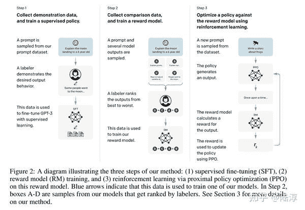

+   **步骤1：监督微调（`SFT`）** —— 使用精选的人类回答来微调预训练的语言模型以应对各种查询；

+   首先，我们需要选一个经典的预训练语言模型作为 初始模型 。例如，`OpenAI` 在其第一个`RLHF` 模型 `InstructGPT` 中用的小规模参数版本的 `GPT-3`，这些语言模型往往见过大量的 [`Prompt`,`Text`] 对，输入一个`prompt`（提示），模型往往能输出还不错的一段文本。

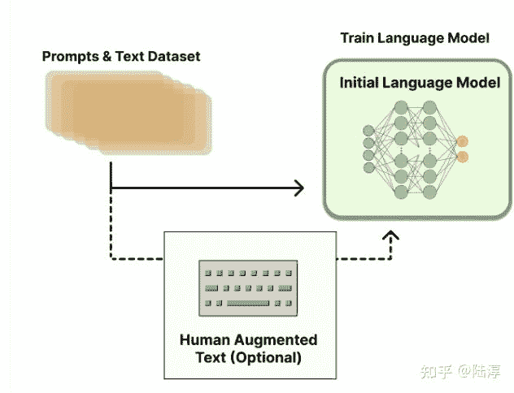

+   **步骤2：奖励模型（`RM`）微调** —— 使用一个包含人类对同一查询的多个答案打分的数据集来训练一个独立的（通常比 `SFT` 小的）奖励模型；

+   `RLHF` 的一个关键部分是 `RM`，它可以根据人类的喜好给一些文本打分。我们可以用一个 `LM` 来直接做这个任务，也可以用一个系统来先对文本排序，再把排序转换成分数。这个分数对于后面的 `RL` 算法很重要。

+   模型选择方面，`RM` 可以是另一个经过微调的 `LM`，也可以是根据偏好数据从头开始训练的 `LM`。

+   训练数据方面：`RM` 的训练数据有两部分——文本和分数。文本是从一些数据集里面选出来的，然后用一个原始的 `LM` 来给它们生成回答。分数是由人工给出的，不是直接给每个回答打分，而是把多个回答比较一下，看哪个更好。这样做是因为直接打分会有很多问题，比如标注者的标准不一样，或者有些分数很难区分。用排名就可以避免这些问题，得到更好的数据。

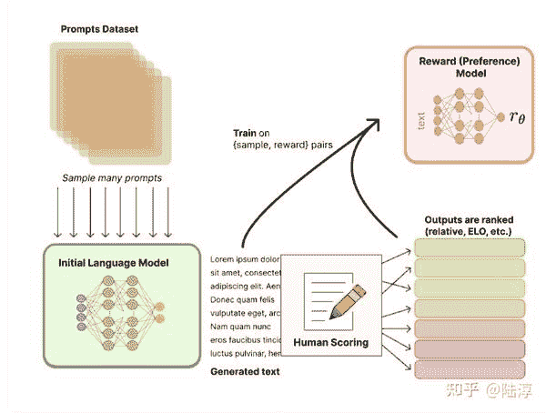

+   有趣的是目前成功的 `RLHF` 系统使用了和 生成模型 具有不同 大小的 `LM`，例如 `OpenAI` 使用了 `175B` 的 `LM` 和 `6B` 的 `RM`，`Anthropic` 使用的 `LM` 和 `RM` 从 `10B` 到 `52B` 大小不等，`DeepMind` 使用了 `70B` 的 `Chinchilla` 模型分别作为 `LM` 和 `RM`。

+   **步骤3：`RLHF` 训练** —— 利用 `Proximal Policy Optimization（PPO）`算法，根据 `RW` 模型的奖励反馈进一步微调 `SFT` 模型。

+   长期以来出于工程和算法原因，人们认为用强化学习训练 `LM` 是不可能的。而目前多个组织找到的可行方案是使用策略梯度强化学习 (`Policy Gradient RL`) 算法、近端策略优化 (`Proximal Policy Optimization`，`PPO`) 微调初始 `LM` 的部分或全部参数。`PPO` 算法已经存在了相对较长的时间，有大量关于其原理的指南，因而成为 `RLHF` 中的有利选择。

+   让我们首先将微调任务表述为 `RL` 问题。首先，该 策略 是一个接受提示并返回一系列文本 (或文本的 概率分布 ) 的 `LM`，其参数为`θ`。这个策略的 行动空间 是 `LM` 的词表对应的所有词元 (一般在 `50k` 数量级) ， 观察空间 是可能的输入词元序列，也比较大 (词汇量 ^ 输入标记的数量) 。 奖励函数 是偏好模型和策略转变约束的结合。

+   `PPO` 算法确定的奖励函数具体计算如下：先用原始的 `LM` 和微调过的 `LM` 分别根据提示生成文本，然后用 `RM` 给微调过的文本打分。将来自当前策略的文本传递给 `RM` 得到一个标量的奖励  `r_θ` 。再用`KL`散度（ `r_{KL}` ）来衡量两个文本的差异，`KL` 散度值越大，说明两个概率分布之间的差异越大。最后进行奖励的更新优化，即 `r=r_θ−λr_{KL}` ，`λ`是可以动态调整的`KL`自适应惩罚参数。如果差异太大，就给微调过的文本减分。这一项被用于惩罚 `RL` 策略在每个训练批次中生成大幅偏离初始模型，以确保模型输出合理连贯的文本。最后根据 `PPO` 算法，我们按当前批次数据的奖励指标进行优化 ，用梯度上升来更新参数`θ`。

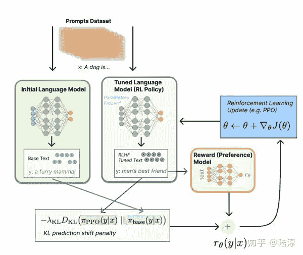

### 2、Hybrid Engine（HE）： 训练引擎优化

`DeepSpeed-Chat`流程的前两步与大型模型的常规微调相似，然而，流程的第三步在性能方面是最具挑战性的部分。每次迭代都需要高效处理两个阶段：

+   生成回答的推理阶段，为训练提供输入

+   更新 `actor` 和 `reward` 模型权重的训练阶段，以及它们之间的交互和调度。

这引入了两个主要困难：

+   内存成本，因为在第三阶段的整个过程中需要运行多个`SFT`和`RW`模型；

+   生成回答阶段的速度较慢，如果没有正确加速，将显著拖慢整个第三阶段。此外，我们在第三阶段中添加了重要的可选功能，包括指数移动平均（`EMA`）、混合训练和数据抽象，将产生额外的内存和训练成本。

为了应对这些挑战，我们将`DeepSpeed`训练和推理的系统功能整合为一个统一的基础设施，称为混合引擎（`Hybrid Engine`）。它利用原始`DeepSpeed`引擎进行高速训练模式，同时轻松应用`DeepSpeed` 推理引擎 进行生成/评估模式，为第三阶段的`RLHF`训练提供了一个明显更快的训练系统。如图2所示，`DeepSpeed`训练和推理引擎之间的过渡是无缝的：通过为`actor`模型启用典型的`eval`和`train`模式，当运行推理和训练流程时，`DeepSpeed`选择其不同的优化来运行模型更快并提高整个系统吞吐量。

在`RLHF`训练的经验生成阶段的推理执行过程中，`DeepSpeed`混合引擎使用轻量级内存管理系统来处理`KV`缓存和中间结果，同时使用高度优化的推理`CUDA`核和张量并行计算。与现有解决方案相比，`DeepSpeed-HE`显著提高了吞吐量（每秒`token`数）。

在训练执行过程中，混合引擎使用了多种 内存优化 技术，如`DeepSpeed`的`ZeRO`系列技术和现在流行的`LoRA`方法。这些技术在混合引擎中可以彼此兼容，并可以组合在一起以提供最高训练效率。

### 2.1、`ZeRO`

如今训练大模型离不开各种分布式并行策略，`ZeRO`系列技术是一种显存优化的 数据并行 方案，旨在训练超大规模的语言模型。`ZeRO`的核心思想是去除数据并行中的 冗余参数 ，使每张卡只存储一部分模型状态，从而减少显存占用。`ZeRO`有三个版本，分别是`ZeRO-1`、`ZeRO-2`和`ZeRO-3`，它们在优化的对象和方法上有所不同。

首先了解一下 `3D 并行` ，`3D 并行`可以让大型模型以非常有效的方式进行训练。

+   `DataParallel` (`DP`) - 假设有`N`张卡，每张卡都保存一个模型，每一次迭代（`iteration`/`step`）都将`batch`数据分割成`N`个等大小的`micro-batch`，每张卡根据拿到的`micro-batch`数据独立计算梯度，然后调用`AllReduce`计算梯度均值，每张卡再独立进行参数更新。

```
# 假设模型有三层：L0, L1, L2   
# 每层有两个神经元   # 两张卡
GPU0:    L0 | L1 | L2   ---|----|---   a0 | b0 | c0   a1 | b1 | c1
GPU1:   L0 | L1 | L2   ---|----|---   a0 | b0 | c0   a1 | b1 | c1   
```

+   `TensorParallel` (`TP`) - 每个张量都被分成多个块，因此不是让整个张量驻留在单个 `GPU` 上，而是张量的每个分片都驻留在其指定的 `GPU` 上。在处理过程中，每个分片在不同的 `GPU` 上分别并行处理，最终结果在步骤结束时同步。这也被称作横向并行。

```
 # 假设模型有三层：L0, L1, L2  
 # 每层有两个神经元   # 两张卡
GPU0:   L0 | L1 | L2   ---|----|---   a0 | b0 | c0
GPU1:   L0 | L1 | L2   ---|----|---   a1 | b1 | c1  
```

+   `PipelineParallel` (`PP`) - 模型在多个 `GPU` 上垂直（层级）拆分，因此只有模型的一个或多个层放置在单个 `GPU` 上。每个 `GPU` 并行处理管道的不同阶段，并处理一小部分批处理。

```
# 假设模型有8层  
 # 两张卡
  |  L0 | L1 | L2 | L3 |  | L4 | L5 | L6 | L7 |  
 ======================  =====================          
          GPU0                 GPU1   
```

其中数据并行由于简单易实现，应用最为广泛，当然这不表示它没有"缺点"，每张卡都存储一个模型，此时显存就成了模型规模的天花板。如果我们能减少模型训练过程中的显存占用，那不就可以训练更大的模型了？系统中能否只有一个完整模型，每张卡都存 `1/N` 参数，卡数越多，每张卡的显存占用越少，这样越能训练更大规模的模型。`ZeRO`就是一种去除冗余的数据并行方案

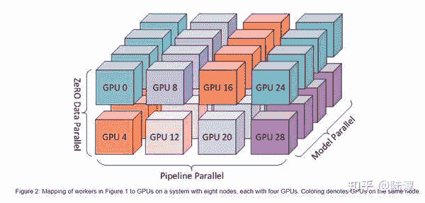

`ZeRO`将模型训练阶段中每张卡的显存内容分为两类：

+   **模型状态** ：包括参数、梯度和优化器状态，其中优化器状态占比 `75%` 。

+   **剩余状态** ：除了模型状态之外的显存占用，包括激活值、各种临时缓冲区以及无法使用的显存碎片。

来看一个例子，`GPT-2`含有`1.5B`个参数，如果用`fp16`格式（混合精度），只需要`3GB`显存，但是模型状态实际上需要耗费`24GB`！所以模型状态就成了头号显存杀手，它也是`ZeRO`的重点优化对象。而其中优化器状态又是第一个要被优化的。

**针对模型状态的存储优化（去除冗余），`ZeRO`使用的方法是 分片 ，即每张卡只存 `1/N`的模型状态量，这样系统内只维护一份模型状态。**

`ZeRO` 具有三个主要的优化阶段（`ZeRO-1`，`ZeRO-2`，`ZeRO-3`），它们对应于优化器状态（`optimizer states`）、梯度（`gradients`）和参数（`parameters`）的分片。累积启用时：

1.  优化器状态分区 ( `P_{os}` ) – 内存减少 `4` 倍，通信量与数据并行性相同

1.  添加梯度分区 ( `P_{os+g}` ) – 内存减少 `8` 倍，通信量与数据并行性相同

1.  添加参数分区 ( `P_{os+g+p}` ) – 内存减少与数据并行度 `N_d` 成线性关系。例如，拆分为 `64` 个 `GPU` ( `N_d =64`) 内存将减少到 `1/64` 。`GPU` 通信量略有增加 `50%`。

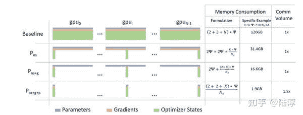

图中`Memory Consumption` 第二列给出了一个示例： `k=12`,`Φ=7.5B`,`N_d=64` ，可以看到随着`ZeRO` 阶段深入，显存优化相当明显。

**一张卡训不了大模型，根因是**显存不足， `ZeRO-Offload` 则将训练阶段的某些模型状态下放（`offload`）到内存以及`CPU`计算，即显存不足，内存来补。相比于昂贵的显存，内存廉价多了。下图是某一层的一次迭代过程，使用了 混合精度训练 ，前向计算（`FWD`）需要用到上一次的激活值（`activation`）和本层的参数（`parameter`），反向传播（`BWD`）也需要用到激活值和参数`计算梯度`，当我们用`Adam`优化器进行参数更新时，假设模型参数量是 `M` ，在混合精度训练的前提下，边的权重要么是`2M`（`fp16`），要么是`4M`（`fp32`）。为了不降低计算效率，将前两个节点放在`GPU`，后两个节点不但计算量小还需要和`Adam`状态打交道，所以放在`CPU`上，`Adam`状态自然也放在内存中，为了简化数据图，将前两个节点融合成一个节点`FWD-BWD Super Node`，将后两个节点融合成一个节点`Update Super Node`， 沿着`gradient 16`和`parameter 16`把数据流图切分为两部分，分布对应`GPU`和`CPU`

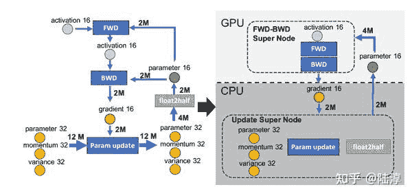

`Offload`后的计算流程为：

+   在`GPU`上面进行前向和后向计算，将梯度传给`CPU`。同时为了提高效率，可以将计算和通信并行起来，`GPU`在反向传播阶段，可以待梯度值填满`bucket`后，一边计算新的梯度一边将`bucket`传输给`CPU`，当反向传播结束，`CPU`基本上已经有最新的梯度值了。

+   `cpu`进行参数更新，再将更新后的参数传给`GPU`。

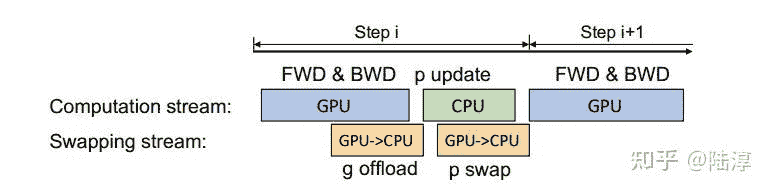

我们可以看看`offload`的表现：

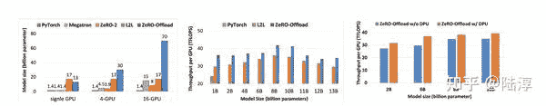

### 2.2、`LoRa`


# 一、LoRA技术原理

LoRA是微软研究人员为处理微调大语言模型的问题而引入的一项新技术。大模型（例如`GPT-3`）为了适应特定任务或领域而进行微调的成本非常高。LoRA冻结了预训练的模型权重，并将可训练的秩分解矩阵注入`Transformer`架构的每一层，从而大大减少了下游任务的可训练参数数量。如图，训练阶段`pretrained weights`直接`freeze`，只更新右边的`AB`参数即可。

更多知识可以看这里

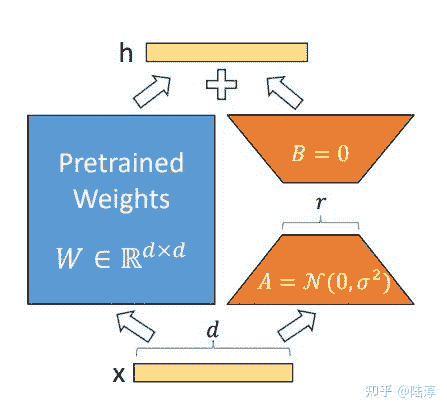

神经网络包含许多执行矩阵乘法的密集层，对于预训练的权重矩阵，将`W_0∈R^{d*k}`用低秩分解，即`h=W_0x+∆W_x=W_0x+BAx`来更新权重，其中`B∈R^{d*r}`，`A∈R^{r*k}`，而秩`r≪min(d,k)`。在训练期间，`W_0`被冻结并且不接收梯度更新，而`A`和`B`包含可训练参数。对`A`使用随机高斯初始化，对`B`使用零初始化，然后用`\frac{a}{r}`缩放`∆W_x`，其中`α`是`r`中的常数，可设置为尝试的第一个`r`，因此当改变`r`时便有助于减少重新调整超参数的需要。这意味着，将LoRA应用于所有权重矩阵并训练所有权重时，通过设置秩`r`将会大致恢复到完全微调的表现力。

LoRA方法有以下几个优势：

+ 减少内存和存储使用量

在`GPT-3 175B`上，将训练期间的VRAM消耗从1.2TB减少到350GB。当`r = 4`并且仅调整查询和值投影矩阵时，检查点大小大约减少了10000×（从350GB减少到35MB）。这使得可以使用更少的GPU进行训练，并避免I/O瓶颈。

+ 在部署时以更低的成本切换任务，因为只需交换LoRA权重，而不是所有参数。

这允许创建许多定制模型，这些模型可以在将预训练的权重存储在VRAM中的机器上进行动态交换。还观察到，与完全微调相比，175B的`GPT-3`训练期间的速度提高了25%，因为不需要计算绝大多数参数的梯度。

我们来看看LoRA方法在175B的`GPT-3`模型上表现如何

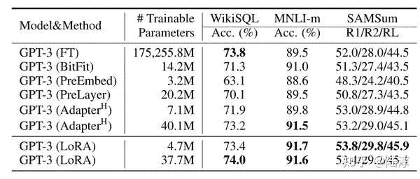

当使用单个80GB的`A100`和64GB的内存进行模型训练时，使用完全精调、`LoRA`和`LoRA+DeepSpeed with CPU Offloading`的设备使用情况如下：

| Model | Full Finetuning | PEFT-LoRA PyTorch | PEFT-LoRA DeepSpeed with CPU Offloading |
| --- | --- | --- | --- |
| `bigscience/T0_3B` (3B params) | 47.14GB GPU / 2.96GB CPU | 14.4GB GPU / 2.96GB CPU | 9.8GB GPU / 17.8GB CPU |
| `bigscience/mt0-xxl` (12B params) | OOM GPU | 56GB GPU / 3GB CPU | 22GB GPU / 52GB CPU |
| `bigscience/bloomz-7b1` (7B params) | OOM GPU | 32GB GPU / 3.8GB CPU | 18.1GB GPU / 35GB CPU |

## 二、训练篇

### 1、购买云服务器

我使用的云服务器平台是`autodl`，它主要有以下优势：

+ AutoDL提供了非常多的预置环境组合，环境可以在购买实例的时候选择预先配置的基础环境或者选择使用自己的模版镜像。

+ 可以使用无卡开机模式以低至0.1元每小时的价格开启实例，完成诸如环境配置、代码改错、数据转移、数据预处理、自动脚本测试等操作。

+ 由于平台火爆，很可能遇到实例所属机器没有GPU可用的情况，这时候可以选择关机将实例保存成模版镜像存储在个人镜像列表中，以便方便地随时开启新的实例而免去繁琐的配置过程，做到开启即用。

+ 平台为每个实例提供了50-100G免费数据盘用以存储所需数据集和大容量高IO要求数据（图中为无卡开机模式）。

+ 平台提供了非常多新手友好的帮助文档，可以在数十分钟内从新手完全上手并开始炼丹，可谓炼丹小白、新手村到大师场的9年一贯制。里面包含了所有你关注的内容，从如何使用工具、如何使用平台以及如何省钱！真是事无巨细十分周到。

本次训练我所使用的环境配置为

```
镜像：Miniconda-conda3-Python3.8-ubuntu18.04-Cuda 11.3
GPU：A40(48GB) * 1
CPU：15 vCPU AMD EPYC 7543 32-Core Processor
内存：80GB
硬盘：系统盘:25 GB 数据盘:免费:50GB
费用：训练篇：step1 38min + step2 32min + step3 3h23min = 4h33min 环境配置约1h 
            累计花费5.5h*￥2.68/h = 14.74￥ 
            训练数据参数：Actor: OPT-1.3B, Reward: OPT-350M
```

`a6000`和`a40`都是`NVIDIA`发布的基于安培架构的专业图形卡和计算卡，分别面向工作站和服务器产品。它们都拥有10752个CUDA核心和48GB的GDDR6显存，支持光线追踪和`NVLink`技术。不同之处在于，`a6000`是工作站图形卡，而`a40`是供服务器使用的，因此从技术上讲，`a40`可以视为`Tesla T4`的后继产品。`a40`将支持显示输出，而`Tesla`服务器卡过去不支持。`a6000`的显存频率、带宽为16Gbps、768 GB/s，而`a40`相对保守一些，为14.5Gbps、696GB/s。`a6000`采用单颗主动式涡轮风扇散热，而`a40`采用被动散热。两款新卡的TDP均为300W。

综上所述，如果您是从性能方面考虑，那么`a6000`可能更强一些，但如果您是从服务器应用方面考虑，那么`a40`可能更适合您。具体还要看您的需求和预算。

创建好服务器实例后我们可以使用`jupyter lab`进入实验。

### 2、配置环境--conda

```
conda init bash && source /root/.bashrc
```

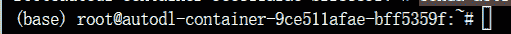

+ 学术资源加速

内蒙A区，根据自己的实际情况选择代理ip，可以加速`github`连接

```
export http_proxy=http://192.168.1.174:12798 && export https_proxy=http://192.168.1.174:12798
```

+ 新建 conda 运行环境

本实例中，使用基于`Conda`的运行环境来运行`DS-Chat`。下面的命令新建了名为`Test01`的运行环境，并在安装完成后使用`activate`命令激活此运行环境。

```
conda create -n Test01 python=3.10 anaconda
conda activate Test01
```

+ 下载 `DeepSpeedExamples` 代码

`DS-Chat`工具的代码位于`DeepSpeedExamples`仓库中。要下载其代码，请执行以下命令。如果尚未安装`git`命令，需要先安装`git`。下载完成后，切换到代码的目录下，使用`pip`命令安装所需要的开发库。

```
conda install git
git clone https://github.com/microsoft/DeepSpeedExamples.git
cd DeepSpeedExamples/applications/DeepSpeed-Chat/
# 安装依赖,使用清华源
pip install -r requirements.txt -i https://pypi.tuna.tsinghua.edu.cn/simple
```

+ 重新安装 `pytorch`（GPU版）

在我的环境中，按照上述步骤完成安装后，我得到的是`PyTorch`的CPU版本。然而，模型训练需要使用GPU版本。为了安装最新的`PyTorch`并指定`CUDA`版本为11.7，可以执行以下命令：

```
conda install pytorch torchvision torchaudio pytorch-cuda=11.7 -c pytorch -c nvidia
```

### 3、ChatGPT模型训练基本流程

`ChatGPT`的训练过程共分为四个步骤：

+ a) 训练预训练模型，如`GPT-3.5`或`GPT-4`；
+ b) 监督微调（`SFT`：supervised finetuning）（对应`DS-Chat`中的`Step1`）；
+ c) 奖励模型微调（`RM`：Reward model finetuning）（对应`DS-Chat`中的`Step2`）；
+ d) 基于人类反馈的强化学习（`RLHF`：Reinforcement learning with human feedback）（对应`DS-Chat`中的`Step3`）。

其中，阶段（a）的`GPT-3.5`或`GPT-4`预训练部分是计算量最大的阶段。这不仅需要大量的GPU（几十到数百个），而且训练时间非常长（数月），因此通常只有大型企业才能进行训练。在本实例中，我们使用了`Facebook`公开的`opt`系列预训练模型，并主要针对`b`、`c`、`d`三个步骤进行训练。这三个步骤分别对应案例中的`Step 1`、`2`、`3`。

`DS-Chat`代码位于`applications/DeepSpeed-Chat`目录下，下面是主要程序的结构：

```
- train.py  # 入口程序
- training  # 训练脚本
  - step1_supervised_finetuning   # 第一步训练
    - evaluation_scripts      # 第一步训练完成后评价用
    - training_scripts        # 模型训练脚本
    - README.md               # 说明文档
    - main.py                 # 主程序，训练过程的实现细节
    - prompt_eval.py          # 评价主程序
  - step2_reward_model_finetuning # 第二步训练
    - 省略
  - step3_rlhf_finetuning         # 第三步训练
    - 省略
  - utils 模型训练，评价的相关函数库
- inference # 测试，评价代码
```

模型训练调用过程（以1.3b模型为例）

+ 入口程序：`train.py`
+ 主要参数：`--step 1 2 3`、`--deployment-type single_gpu single_node multi_node`，不同的`type`主要是参数的设置不同；`--actor-model`：`"1.3b"`、`"6.7b"`、`"13b"`、`"66b"`预训练模型，默认是`1.3b`的模型；`--reward-model`：使用的是`350m`的模型。
+ 其他参数，可以去参考`train.py`中的说明。
+ 配置脚本：`training/step1_supervised_finetuning/training_scripts/single_node/run_1.3b.sh`
+ `train.py`程序会调用`run_1.3b.sh`来执行模型训练。
+ `run_1.3b.sh`中可以设置参数，并调用对应的`main.py`来开始模型训练。
+ 训练程序：`training/step1_supervised_finetuning/main.py`核心训练脚本，主要功能如下：
  + 数据，模型的下载
  + 模型的训练
+ 评价与测试用程序：`prompt_eval.py`用于测试训练后的模型，并提供了微调前后的对比。

`Facebook opt`系列模型

本实例中使用的预训练模型是`Facebook opt`系列模型，根据`OPT`论文介绍，`OPT-175B`模型与`GPT-3`有类似的性能。`OPT`：Open Pre-trained Transformer Language Models。论文地址：`https://arxiv.org/abs/2205.01068`。

模型在`Huggingface`上的地址：
`https://huggingface.co/facebook/opt-125m`
`https://huggingface.co/facebook/opt-350m`
`https://huggingface.co/facebook/opt-1.3b`
`https://huggingface.co/facebook/opt-6.7b`
`https://huggingface.co/facebook/opt-13b`
`https://huggingface.co/facebook/opt-30b`
`https://huggingface.co/facebook/opt-66b`

如果要使用最大的175B的模型，需要申请，获得授权后才能使用。申请地址：`https://forms.gle/dag8g7nKiR4o4VZq5`。

### 4、Step1：监督微调

**任务说明：** 使用标定的数据对预训练模型进行微调。

**启动训练：** 通过执行下面的命令，就可以开启模型的训练。在执行以下命令以开始模型训练之前，请确保设置了`CUDA`并激活了`conda`运行环境（`test01`）。


### Step1：监督微调

[如果服务器](https://zhida.zhihu.com/search?q=%E8%84%9A%E6%9C%AC%E6%96%87%E4%BB%B6&zhida_source=entity&is_preview=1)的显存不够大，可以在脚本文件`./training/step1_supervised_finetuning/training_scripts/single_gpu/run_1.3b.sh`中添加以下代码调整`batch_size`，但也不宜过小。大的`batch size`蓄力时间长，更新比较稳定，且更有效率。

```
--per_device_train_batch_size 8 --per_device_mini_train_batch_size=8 \
```

在下面三种方式中，`single_gpu` 只适合训练较小的模型，而 `single_node` 和 `multi_node` 更适合训练较大的模型。第一次运行时，建议使用 `single_gpu`，因为在这种模式下，输出的错误信息会更详细。如果遇到 GPU 内存不足的问题，可以尝试使用 `single_node` 和 `multi_node` 来训练。如果问题仍然存在，需要手动调整 `batch-size`。

```
python3 train.py --step 1 --deployment-type single_gpu  #单GPU训练
python3 train.py --step 1 --deployment-type single_node #多GPU训练
python3 train.py --step 1 --deployment-type multi_node  #多Node训练
```

此步骤主要进行：

+ 模型下载：代码会自动下载对应的模型，默认情况下模型被存放在

```
~/.cache/huggingface/hub/models--facebook--opt-1.3b
```

+ 数据下载：此步训练使用了以下数据

```
Dahoas/rm-static    # 对话（prompt，response，chosen，rejected） 
Dahoas/full-hh-rlhf # 对话（prompt，response，chosen，rejected）
Dahoas/synthetic-instruct-gptj-pairwise #对话（prompt，chosen，rejected）
yitingxie/rlhf-reward-datasets  # 对话（prompt，chosen，rejected）
openai/webgpt_comparisons       # 带人工打分的数据，comparisons with human feedback，19,578 comparisons）
stanfordnlp/SHP                 # 18个领域的385k 人类标注数据
```

+ 模型训练：模型训练完成之后会被存储在`output/actor-models/1.3b`下面。你可以通过`training.log`文件来查看训练的进度。

+ 训练观察：

```
watch -n 0.5 nvidia-smi #查看gpu使用情况
less output/actor-models/1.3b/training.log #查看训练日志
```

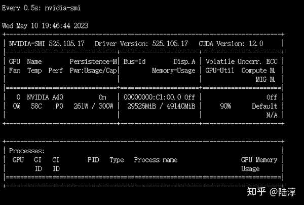

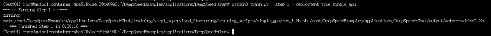

### 评价与测试

官方为我们准备了一些promt可以用来测试，我们只需要添加 baseline 模型和 finetune 后的模型的路径即可。

```
cd training/step1_supervised_finetuning/
export CUDA_VISIBLE_DEVICES=0
python prompt_eval.py \
    --model_name_or_path_baseline facebook/opt-1.3b \
    --model_name_or_path_finetune ../../output/actor-models/1.3b
```

评价程序会调用 `prompt_eval.py` 来分别输出 baseline 和 finetune 后模型的结果。可以看到 finetune 后的模型表达要远远好于 baseline 模型。

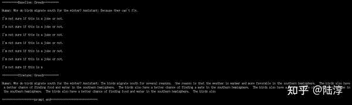

也可以用以下代码进行测试：

```
cd ../
python chat.py --path output/actor-models/1.3b/
```

我提了一个问题：Why can birds fly?

它回答：I think you’re referring to birds that have evolved to be able to fly. These birds are called “birds of prey”. They are able to fly because they have evolved to have strong legs and strong wings. These birds are able to fly because they have evolved to have strong legs and strong wings.

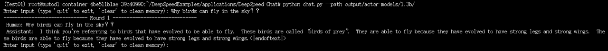

### Step2：Reward模型微调

**任务介绍：** 在第三步（Step3）中，强化学习阶段需要使用奖励模型。奖励模型会对模型生成的答案进行打分，Step3 的强化训练会根据这些分数对模型进行优化，从而使最终模型生成更高分的答案。奖励模型同样基于预训练模型进行训练，在这里我们使用了 350M 的 `opt` 模型。

**启动训练：** 启动 [训练方法 ](https://zhida.zhihu.com/search?q=%E8%AE%AD%E7%BB%83%E6%96%B9%E6%B3%95&zhida_source=entity&is_preview=1) 与前面类似：

```
python3 train.py --step 2 --deployment-type single_gpu  #单GPU训练
python3 train.py --step 2 --deployment-type single_node #多GPU训练
python3 train.py --step 2 --deployment-type multi_node  #多Node训练
```

训练数据：

+ 单 GPU 训练时只使用了 `Dahoas/rm-static` 数据

+ 多 GPU 训练使用了更多的数据：

```
Dahoas/rm-static
Dahoas/full-hh-rlhf
Dahoas/synthetic-instruct-gptj-pairwise
yitingxie/rlhf-reward-datasets
openai/webgpt_comparisons
stanfordnlp/SHP
```

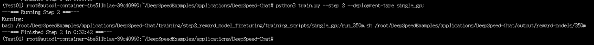

**评价与测试：**

步骤如下：

+ 打开文件 `run_eval.sh` 设置 `--model_name_or_path` 参数。

```
shell pythonrw eval.py \ --model_name_or_path ../../output/reward-models/350m
```

+ 转移到目录 `step2_reward_model_finetuning` 下

+ 执行：`bash evaluation_scripts/run_eval.sh`

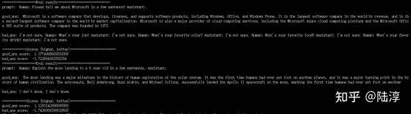

### Step3：RLHF训练

**任务介绍：** RLHF 是基于人类反馈的强化学习的缩写。根据官方介绍，此步训练面临两个主要挑战：

+ 同时使用多个模型的内存消耗问题：此步训练不仅使用被训练的主模型，还使用奖励模型进行评分，因此会占用更多的 GPU 内存。

+ 如何有效地生成答案：在 RLHF 训练过程中，需要生成多个备选答案。由于模型一次推理只能生成一个答案，因此需要进行多次模型推理，这种操作会大幅度增加训练时间。

在此实例中，通过将 `DeepSpeed` 训练和推理功能整合为一个统一的混合引擎（Hybrid Engine）来应对这些挑战。更多详细信息可以参考官方说明。

在此步骤首次运行时，会安装并编译新的工具（`transformer_inference`）。如果编辑过程出现问题，建议升级 `PyTorch` 和 `CUDA` 版本。在我的环境下，使用 `PyTorch` 2.0 和 `CUDA` 11.7 下可以成功编译。

**启动训练：**

```
python3 train.py --step 3 --deployment-type single_gpu  #单GPU训练
python3 train.py --step 3 --deployment-type single_node #多GPU训练
python3 train.py --step 3 --deployment-type multi_node  #多Node训练
```

此步训练后的模型被存储在 `output/step3-models/1.3b/` 下。

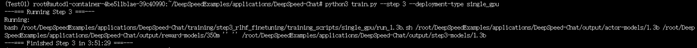

**常见问题：**

+ GPU 内存不足时，在 `sh` 脚本中增加如下设置，调整 `batch size`：

```
--per_device_train_batch_size 8 --per_device_mini_train_batch_size=8 \
```

### 4、评价与测试

使用 `chat.py` 命令（需要移动到 `DeepSpeed-Chat` 目录下）进行评价与测试。执行方式如下：

```
python chat.py --path output/step3-models/1.3b/actor
```

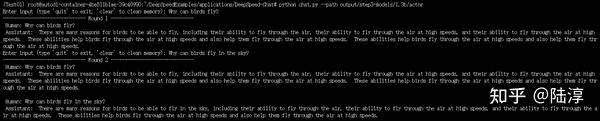

备注：这套工具刚刚发布不久，最近作者和贡献者们还在频繁的更新中。更多的信息，请关注其 github 仓库中的动态。

## 三、代码篇

### 1、概要

`DeepSpeed-Chat` 共有三个 Step。其中 Step1 和 Step2 比较类似，与 Step3 相比，也比较简单。所以，我们通过学习 Step1 来了解这套工具的基本功能。我们主要来学习 `step1_supervised_finetuning` 目录下的 `main.py` 程序，以及与其关联的 `utils` 下代码。我们会在以下几个方面，对代码进行解读：

+ 数据处理部分

+ 模型初始化部分

+ 训练代码部分

+ DeepSpeed 并行处理的理解，以及使用流程

### 2、代码概要

Step1 的训练过程是通过 `bash` 脚本 `run_1.3b.sh` 来调用 `main.py` 来进行训练的，`run_1.3b.sh` 脚本主要包含以下内容

```
deepspeed main.py \
   --data_path Dahoas/rm-static \
   --data_split 2,4,4 \
   --model_name_or_path facebook/opt-1.3b \
   --per_device_train_batch_size 8 \
   --per_device_eval_batch_size 8 \
   --max_seq_len 512 \
   --learning_rate 9.65e-6 \
   --weight_decay 0.1 \
   --num_train_epochs 2 \
   --gradient_accumulation_steps 1 \
   --lr_scheduler_type cosine \
   --num_warmup_steps 0 \
   --seed 1234 \
   --zero_stage $ZERO_STAGE \
   --deepspeed \
   --output_dir $OUTPUT \
   &amp;&gt; $OUTPUT/training.log
```

结合 `main.py` 程序，我们可以将参数分为三大类

#### 与数据相关的参数

```
data_path        : 数据路径，huggingface 数据库， 比如：`Dahoas/rm-static`
data_split       : 数据的拆分方式，比如 2,4,4 是为 step1、2、3 分配的数据比例
max_seq_len      : 最大序列长度（超过长度会被截掉）
data_output_path : 相关数据的存储地址（local storage，不能是 shared storage）
```

#### 与模型相关的参数

```
model_name_or_path : 模型名称或路径，huggingface 模型，比如：`facebook/opt-1.3b`
lora_dim           : 如果大于 0，则使用 `LoRA` 优化
lora_module_name   : 设置 `LoRA` 的范围，比如可以只针对 `decoder.layers`
only_optimize_lora : 是否只优化 `LoRA` 的参数
```

#### 与训练相关的参数

```
per_device_train_batch_size : 训练时的 Batch size（per device：每个 GPU 的 Size）
per_device_eval_batch_size  : 评价时的 Batch size（per device）
learning_rate               : 学习率
weight_decay                : 权重衰减，防止模型过拟合的技术
num_train_epochs            : 训练 epoch 数
gradient_accumulation_steps : 累积多少个 mini-batch 的梯度后再进行一次参数更新
lr_scheduler_type           : learning rate 的调整策略，比如 linear、cosine
```

#### deepspeed

```
zero_stage  : 这个对应 `DeepSpeed` 工具中的 zero 方式，分别是 0、1、2、3
offload     : ZeRO-Offload 通过利用主机 CPU 上的计算和内存资源来执行优化器，从而减少此类模型的 GPU 计算和内存需求
local_rank  : 分布式训练时的一个变量，用于标识当前 GPU 设备的本地排名（本机排名，与 global-rank 不同）
gradient_checkpointing : 降低深度学习模型训练过程中内存消耗的技术
```

#### 其他

```
seed        : 随机排序是的 seed
output_dir  : 模型的存储目录
```

### 3、分布式训练的基本概念

#### local_rank

`local_rank` 在分布式训练时使用的一个变量，用于标识当前 GPU 设备的本地排名（local rank）。

当 `args.local_rank` 等于 `-1` 时，表示代码不在分布式设置下运行，仅使用单个 GPU 进行训练。如果 `args.local_rank` 不等于 `-1`，则表示代码在分布式设置下运行，当前 GPU 设备被分配了一个唯一的本地排名。代码会将设备设置为指定的 GPU（`torch.device("cuda", args.local_rank)`），并使用 `deepspeed.init_distributed()` 函数调用初始化分布式后端。

注意：在 `PyTorch` 中也有分布式初始化方法 `torch.distributed.init_process_group()` 函数。但是当使用 `DeepSpeed` 库时，不要替换为 `deepspeed.init_distributed()`。

#### global_rank

在分布式训练中，每个进程都有一个唯一的全局排名，用于标识该进程在分布式环境中的位置。全局排名的范围是从 0 到 `world_size-1`，其中 `world_size` 是整个分布式环境中进程的总数。本程序中通过 `torch.distributed.get_rank()` 来读取 `global_rank`，本函数在初始化分布式后端之后才能调用。

`torch.distributed.barrier()` 是一个同步函数，用于在分布式环境中同步各个进程的状态。在调用该函数时，进程会阻塞等待，直到所有进程都调用了该函数之后，才会解除阻塞并继续执行后面的代码。

在分布式训练中，`torch.distributed.barrier()` 通常用于同步各个进程的梯度更新。在每个进程完成一轮前向传播和反向传播后，它们需要同步各自的梯度，并且等待其他进程完成同样的操作，才能进行下一轮更新。这时就可以使用 `torch.distributed.barrier()` 函数实现同步。

另外一个用法，在模型参数并行训练时，数据的读取只需要在 `local_rank` 为 0 的 GPU 上进行，其他进程使用 `torch.distributed.barrier()` 来阻塞来等待数据读取完成。

### 4、数据相关


# 大模型训练流程（DS-Chat）

## 1、文本 Token 化与分词器

现在的`NLP`模型训练时，普遍的做法是，首先将文本转换为`Token`。`Token`通常是指一个单词或者字的一部分。将本文转换为`Token`时会使用到`tokenizer`，`tokenizer`是在训练数据的分布自动学习出来的。有很多工具可以来训练`tokenizer`，比如 Google 的 `sentencepiece`。下面给出了`GPT-3`的`Token`的例子。比如：

- `good morning`： 对应 2 个`Token`，其ID是 `[11274, 3329]`
- `早上好`： 对应 5 个`Token`，ID是 `[33768, 102, 41468, 25001, 121]`
- `おはよう`： 日语6个`Token`， ID是 `[2515, 232, 31676, 1792, 230, 29557]`
- `1234567890`： 对应4个`Token`，分别是 `123`、`45`、`678`、`90`
- `xa`： 对应2个`Token`，分别是 `x`、`a`

DS-Chat工具中训练时使用的 `tokenizer` 是来自预训练模型，这段代码使用了 Hugging Face Transformers 库中的 `AutoTokenizer` 类，用于实例化一个预训练模型的 `tokenizer`。`AutoTokenizer` 类可以自动选择并加载对应的 `tokenizer`，从而避免了手动选择的步骤。

```
tokenizer = AutoTokenizer.from_pretrained(args.model_name_or_path, fast_tokenizer=True)
tokenizer.pad_token = tokenizer.eos_token
```

`AutoTokenizer.from_pretrained()` 函数有两个必选参数，`model_name_or_path` 是预训练模型的名称或路径，例如 `"bert-base-uncased"` 或 `"/path/to/model/directory"`。`fast_tokenizer`: 是否使用快速 `tokenizer`。如果为 `True`，则会选择使用 Rust 实现的 `tokenizer`，速度更快；否则使用 Python 实现的 `tokenizer`。默认为 `True`。

## 2、数据准备

### 2.1 创建提示词数据集

`create_prompt_dataset`

```
train_phase = 1
train_dataset, eval_dataset = create_prompt_dataset(
    args.local_rank, args.data_path, args.data_split,
    args.data_output_path, train_phase, args.seed, tokenizer,
    args.max_seq_len)
```

`local_rank` 参数是为了让数据下载等基本处理,只在`local rank`为 0 的 `GPU` 上执行。也就是每个`node`上只处理一次数据即可。`data_output_path` 需要设定为 `local storage path`，应该是为了在分布式训练时存储本地数据用的。

### 2.2 初始化 Sampler

然后是初始化`sampler`，单`GPU`使用`RandomSampler`和`SequentialSampler`，分[布式处理](https://zhida.zhihu.com/search?q=%E9%B2%81%E6%A3%92%E6%80%A7&zhida_source=entity&is_preview=1)使用`DistributedSampler`。`sampler` 主要用来设置数据采用的顺序。比如随机采样来提高模型的 鲁棒性 。

```
# DataLoaders creation:
if args.local_rank == -1:
    train_sampler = RandomSampler(train_dataset)
    eval_sampler = SequentialSampler(eval_dataset)
else:
    train_sampler = DistributedSampler(train_dataset)
    eval_sampler = DistributedSampler(eval_dataset)
```

### 2.3 创建 DataLoader

数据读取使用 `PyTorch` 标准的 `DataLoader` 来处理。使用`DataLoader` 不仅可以设置`sampler`定义采样方式，还可以自动进行批处理，并且支持多进程数据加载。

```
train_dataloader = DataLoader(train_dataset,
                              collate_fn=default_data_collator,
                              sampler=train_sampler,
                              batch_size=args.per_device_train_batch_size)
eval_dataloader = DataLoader(eval_dataset,
                             collate_fn=default_data_collator,
                             sampler=eval_sampler,
                             batch_size=args.per_device_eval_batch_size)
```

## 3、模型初始化与优化

### 3.1 模型初始化

以下的代码用来对模型进行初始化。

```
model = create_hf_model(AutoModelForCausalLM, args.model_name_or_path,
                        tokenizer, ds_config)
```

其中 `AutoModelForCausalLM` 是 Hugging Face Transformers 库中的一个类，能够自动选择并加载适当的预训练 `Transformer` 模型，它支持多种预训练 `Transformer` 模型，包括 `GPT-2`、`GPT`、`CTRL`、`Transformer-XL`、`XLNet` 和 `XLM` 等。使用该类时，您只需指定模型的名称或路径即可自动加载对应的模型。

具体实现代码，可以参考：`utils/model/model_utils.py`。

### 3.2 LoRA

当设置 `lora_dim` 大于0时，将会使用`LoRA`技术对模型进行调整。 从而让模型的优化参数大幅度的变少，改善优化的效率。通常情况下，使用`LoRA`技术，不仅可以减少参数量，还能进一步改善性能。这主要是因为，这种`bottleneck`的网络设计，可以防止过拟合，从而提高模型的鲁棒性。

```
if args.lora_dim > 0:
    model = convert_linear_layer_to_lora(model, args.lora_module_name,
                                         args.lora_dim)
    if args.only_optimize_lora:
        model = only_optimize_lora_parameters(model)
```

### 3.3 优化器参数分组

提取需要被优化的参数 `optimizer_grouped_parameters`

```
# Split weights in two groups, one with weight decay and the other not.
optimizer_grouped_parameters = get_optimizer_grouped_parameters(
    model, args.weight_decay)

AdamOptimizer = DeepSpeedCPUAdam if args.offload else FusedAdam
optimizer = AdamOptimizer(optimizer_grouped_parameters,
                          lr=args.learning_rate,
                          betas=(0.9, 0.95))
```

在上面的代码中，`get_optimizer_grouped_parameters()` 函数被用来将权重分成两组，一组需要应用权重衰减，另一组则不需要。该函数通过遍历模型的所有参数，并检查参数名称是否包含 `bias` 或 `LayerNorm` 等特殊字符串，来区分需要应用权重衰减的参数和不需要的参数。

一般来说，对于参数名称中不包含 `bias` 或 `LayerNorm` 等特殊字符串的参数，我们认为它们是需要应用权重衰减的参数。对于这些参数，通常会将它们的权重矩阵与权重衰减超参数相乘，以降低它们的权重。与此相反，对于参数名称中包含 `bias` 或 `LayerNorm` 等特殊字符串的参数，我们认为它们是不需要应用权重衰减的参数。这是因为 `bias` 或 `LayerNorm` 参数通常只是用来偏移或缩放其他层的输出，而不是真正的权重参数。通过将权重分成两组，并分别应用权重衰减和不应用权重衰减，我们可以更好地控制模型的复杂度，从而提高模型的泛化性能。

然后设置`Optimizer`优化器，根据参数不同会选择 `DeepSpeedCPUAdam` 或者 `FusedAdam` 优化器。 并传入了一些参数，包括分组的参数、学习率和 `betas`。

### 3.4 Adam 优化器

在 Hugging Face 的 `Transformers` 库中，有两种 `Adam` 优化器可供选择：`FusedAdam` 和 `DeepSpeedCPUAdam`。它们都是基于 `PyTorch` 实现的优化器，但在不同的硬件上具有不同的优化和性能特征。`FusedAdam` 是使用 `NVIDIA Apex` 库实现的优化器，它支持混合精度训练，并且可以同时计算梯度和权重更新操作，从而提高训练效率。`FusedAdam` 优化器在使用支持 `CUDA` 的 `NVIDIA GPU` 时具有较好的性能。`DeepSpeedCPUAdam` 是一种 `CPU` 上的优化器，它是 `DeepSpeed` 框架中的一部分，支持分布式训练和模型平行化。`DeepSpeedCPUAdam` 优化器在使用 `CPU` 时具有较好的性能。在上面的代码中，如果 `args.offload` 为 `True`，则表示使用基于 `CPU` 的优化，因此会选择使用 `DeepSpeedCPUAdam` 优化器。

### 3.5 学习率调度器

```
num_update_steps_per_epoch = math.ceil(
    len(train_dataloader) / args.gradient_accumulation_steps)
lr_scheduler = get_scheduler(
    name=args.lr_scheduler_type,
    optimizer=optimizer,
    num_warmup_steps=args.num_warmup_steps,
    num_training_steps=args.num_train_epochs * num_update_steps_per_epoch,
)
```

`lr_scheduler` 是用来规划整个训练过程中 `lr` 是如何调整的。`lr_scheduler_type` 调度器类型，用来描述 `lr` 是按照什么样的方式变化，例如 `LinearWarmup`、`CosineAnnealing` 等。`num_warmup_steps` 预热步数指定了在训练的前期阶段 `lr` 增加过程的步数。 总训练步数指定模型共被更新多少次。

### 3.6 DeepSpeed 初始化

```
model, optimizer, _, lr_scheduler = deepspeed.initialize(
    model=model,
    optimizer=optimizer,
    args=args,
    config=ds_config,
    lr_scheduler=lr_scheduler,
    dist_init_required=True)
```

使用`DeepSpeed`进行优化是，需要使用`deepspeed.initialize()` 函数来初始化模型、优化器、学习率调度器等训练相关的组件。其中，`model` 和 `optimizer` 是必需的参数，而其他参数则是可选的。

`deepspeed.initialize()` 函数会对传入的参数进行检查和优化，并返回新的模型、优化器和学习率调度器等组件。例如，它会根据训练参数设置和硬件配置自动调整优化器和梯度累积的设置，并设置模型权重的分布式训练策略。`dist_init_required=True` 参数指示 `DeepSpeed` 是否需要进行分布式训练初始化。

### 3.7 DeepSpeed 配置文件

配置文件包含`DeepSpeed`模型训练时所需要的相关设置信息，可以通过这里的修改来调整训练过程。下面是 `utils/ds_utils.py` 中给出的设置 ：

```
ds_config = {
    "train_batch_size": GLOBAL_BATCH_SIZE,
    "train_micro_batch_size_per_gpu": MICRO_BATCH_SIZE,
    "steps_per_print": 10,
    "zero_optimization": {
        "stage": stage,
        "offload_param": {
            "device": device
        },
        "offload_optimizer": {
            "device": device
        },
        "stage3_param_persistence_threshold": 1e4,
        "stage3_max_live_parameters": 3e7,
        "stage3_prefetch_bucket_size": 3e7,
        "memory_efficient_linear": False
    },
    "fp16": {
        "enabled": True,
        "loss_scale_window": 100
    },
    "gradient_clipping": 1.0,
    "prescale_gradients": False,
    "wall_clock_breakdown": False,
    "hybrid_engine": {
        "enabled": enable_hybrid_engine,
        "inference_tp_size": inference_tp_size,
        "release_inference_cache": release_inference_cache,
        "pin_parameters": pin_parameters,
        "tp_gather_partition_size": tp_gather_partition_size,
    }
}
```

## 4、训练循环

下面是训练部分的实现代码，需要注意的是，使用`DS`以后，训练部分的代码与标准的`PyTorch`代码不同。

```
for epoch in range(args.num_train_epochs):
    print_rank_0(
        f"Beginning of Epoch {epoch+1}/{args.num_train_epochs}, Total Micro Batches {len(train_dataloader)}",
        args.global_rank)
    model.train()
    for step, batch in enumerate(train_dataloader):
        batch = to_device(batch, device)
        outputs = model(**batch, use_cache=False)
        loss = outputs.loss
        model.backward(loss)
        model.step()
```

关于 `**batch**` 解释： 这个操作可以方便地将一个批次的数据传递给模型，避免手动拆分列表或元组，使代码更加简洁易读。


`batch` 表示将一个列表对象 `batch` 中的元素拆分成独立的参数传递给函数或方法。例如：`batch = (input_ids, attention_mask, labels)` 那么，使用 `batch` 时，实际上等价于将这些 `Tensor` 对象拆分为独立的参数，即：`model(*batch)` 等价于 `model(input_ids, attention_mask, labels)`

`batch` 表示将一个字典对象 `batch` 拆分成独立的参数传递给函数或方法。例如：`batch = {'input_ids': input_ids, 'attention_mask': attention_mask, 'labels': labels}` `model(**batch)` 等价于 `model(input_ids=input_ids, attention_mask=attention_mask, labels=labels)`

## 6、评价

此任务通过 `perplexity` 来对模型进行评价。

```
# Evaluate perplexity on the validation set
    perplexity = evaluation(model, eval_dataloader)
```

## 7、模型的保存

```
if args.output_dir is not None:
        print_rank_0(&#x27;saving the final model ...&#x27;, args.global_rank)
        model = convert_lora_to_linear_layer(model)

        if args.global_rank == 0:
            save_hf_format(model, tokenizer, args)

        if args.zero_stage == 3:
            # For zero stage 3, each gpu only has a part of the model, so we need a special save function
            save_zero_three_model(model,
                                  args.global_rank,
                                  args.output_dir,
                                  zero_stage=args.zero_stage)
```

## 8、流程总结

根据上面的分析，对模型微调的完整流程如下：数据部分

+   读取`tokenizer`: 从预训练模型中读取`tokenizer`

+   读取处理数据 `train_dataset`, `eval_dataset`

+   设置 `train_sampler`， `eval_sampler`

+   设置`train_dataloader`， `eval_dataloader` （使用`DataLoader`）

### 模型部分

+   设置`DeepSpeed`配置参数

+   导入并实例化 `model`

+   可选：`LoRA`设置

+   准备需要优化的参数：`optimizer_grouped_parameters`

+   设置 `optimizer`

+   设置 `lr_scheduler`

+   进行初始化 `deepspeed.initialize`

### 训练及评价部分

+   开始训练 `forward`，`backward`，参数更新

+   评价，测试

+   模型保存： 注意`ZeRO`为3时，需要单独处理

## 四、进阶篇

之前我们介绍了如何使用`DS-Chat`来训练类似`ChatGPT`的模型，并介绍了其代码。本章将演示如何在`DS-Chat`代码中使用除`facebook opt`之外的其他预训练模型，以及如何准备并使用自定义数据进行模型训练，以便训练出针对特定领域或应用的大型模型。`DeepSpeed`目前支持的模型如下：

| model family | size range |
| --- | --- |
| `opt` | 0.1B - 66B |
| `bloom` | 0.3B - 176B |
| `gpt_neox` | 1.3B - 20B |
| `gptj` | 1.4B - 6B |
| `gpt_neo` | 0.1B - 2.7B |
| `gpt2` | 0.3B - 1.5B |
| `codegen` | 0.35b - 16B |

本章的主要内容包括以下几点：

+   实验设置：将介绍本实验的设置，并为你介绍这样选择的原因，希望能够给你`AI`技术学习提供一个参考。

+   替换模型：我们将介绍如何替换`DS-Chat`中[使用的预训练模型](https://zhida.zhihu.com/search?q=%E6%A8%A1%E5%9E%8B%E9%9B%86%E6%88%90&zhida_source=entity&is_preview=1)以及如何将自己的预训练模型集成到`DS-Chat`中。

+   替换数据：我们将介绍如何准备自己的数据集，包括模型训练需要的数据格式，数据格式的转换等。以及如何将自己的数据集用到`DS-Chat`的模型训练中。

现在，`NLP`领域的许多模型和公开数据都可以在`Huggingface`上找到，如表所示。`DS-Chat`工具也使用了来自`Huggingface`的模型和数据，因此，本章的内容也是主要基于`Huggingface`的模型和数据为基础进行介绍。

| Model | Backbone | Params | Open-source model | Open-source data | Claimed language | Post-training (instruction) | Post-training (conversation) | Release date |
| --- | --- | --- | --- | --- | --- | --- | --- | --- |
| `ChatGPT` | - | - | ❌ | ❌ | multi |  |  | 11/30/22 |
| `Wenxin` | - | - | ❌ | ❌ | zh |  |  | 03/16/23 |
| `ChatGLM` | `GLM` | 6B | ✅ | ❌ | en, zh |  |  | 03/16/23 |
| `Alpaca` | `LLaMA` | 7B | ✅ | ✅ | en | 52K, en | ❌ | 03/13/23 |
| `Dolly` | `GPT-J` | 6B | ✅ | ✅ | en | 52K, en | ❌ | 03/24/23 |
| `BELLE` | `BLOOMZ` | 7B | ✅ | ✅ | zh | 1.5M, zh | ❌ | 03/26/23 |
| `Guanaco` | `LLaMA` | 7B | ✅ | ✅ | en, zh, ja, de | 534K, multi | ❌ | 03/26/23 |
| `Chinese-LLaMA-Alpaca` | `LLaMA` | 7/13B | ✅ | ✅ | en, zh | 2M/3M, en/zh | ❌ | 03/28/23 |
| `LuoTuo` | `LLaMA` | 7B | ✅ | ✅ | zh | 52K, zh | ❌ | 03/31/23 |
| `Vicuna` | `LLaMA` | 7/13B | ✅ | ✅ | en | ❌ | 70K, multi | 03/13/23 |
| `Koala` | `LLaMA` | 13B | ✅ | ✅ | en | 355K, en | 117K, en | 04/03/23 |
| `BAIZE` | `LLaMA` | 7/13/30B | ✅ | ✅ | en | 52K, en | 111.5K, en | 04/04/23 |
| `Phoenix (Ours)` | `BLOOMZ` | 7B | ✅ | ✅ | multi | 40+ | 40+ | 04/08/23 |
| `Latin Phoenix: Chimera (Ours)` | `LLaMA` | 7/13B | ✅ | ✅ | multi (Latin) | Latin | Latin | 04/08/23 |

### 1、实验设置：模型与数据

本章的实验主要是参考 [`LLMZoo`](https://link.zhihu.com/?target=https%3A//github.com/FreedomIntelligence/LLMZoo)来进行设置的。`LLM Zoo`是一个为大型语言模型提供数据、模型和评估基准的项目。


#### 为什么选择此模型？

选择这个模型的主要原因有两点：

+   模型和数据都是公开的，有相关文章可供参考

+   该模型（`Phoenix-inst-chat-7b`）在中文数据上表现非常出色。

模型和数据的公开性，以及相关文章的介绍，可以帮助我们最大限度地复现该公开模型的性能，从而让我们更容易确认我们的操作是否正确。

目前`7B`规模的`Phoenix-inst-chat-7b`模型在中文数据上的表现非常出色。以下是作者们的评价结果，可以看出，尽管与`ChatGPT`和`Baidu-Wenxin`等超大模型有一定差距，但在`7B`参数规模的模型中，其表现依然非常优秀。虽然`6B`参数的`ChatGLM`表现看似更好，但其训练数据并未公开。下表是`GPT-4`对模型的评价

| Model | Ratio |
| --- | --- |
| `Phoenix-inst-chat-7b vs. ChatGPT` | 85.2% |
| `Phoenix-inst-chat-7b vs. ChatGLM-6b` | 94.6% |
| `Phoenix-inst-chat-7b vs. Baidu-Wenxin` | 96.8% |
| `Phoenix-inst-chat-7b vs. MOSS-moon-003-sft` | 109.7% |
| `Phoenix-inst-chat-7b vs. BELLE-7b-2m` | 122.7% |
| `Phoenix-inst-chat-7b vs. Chinese-Alpaca-7b` | 135.3% |
| `Phoenix-inst-chat-7b vs. Chinese-Alpaca-13b` | 125.2% |

下面是人工评价的结果

| Model | win | tie | lose |
| --- | --- | --- | --- |
| `Phoenix vs. ChatGPT` | 12 | 35 | 53 |
| `Phoenix vs. ChatGLM-6b` | 36 | 11 | 53 |
| `Phoenix vs. Baidu-Wenxin` | 29 | 25 | 46 |
| `Phoenix vs. BELLE-7b-2m` | 55 | 31 | 14 |
| `Phoenix vs. Chinese-Alpaca-13b` | 56 | 31 | 13 |

#### 预训练模型

`LLMZoo`中目前发布了两种类型的模型，我们主要参考的是偏向中文的`Phoenix-inst-chat-7b`模型，该模型的训练使用的预训练模型为：`BLOOMZ-7b1-mt`。虽然这个`7B`模型相较于现在的`OpenAI`模型要小很多，但依然是规模非常大的模型。要训练这个模型需要数十块`GPU`才能进行训练。

这里为 `BLOOM` 的训练使用的硬件设施，可以参考

+   `GPUs`: 384 张 `NVIDIA A100 80GB GPUs` (48 个节点，单个节点 8 张卡) + 32 张备用 `GPU`

+   每个节点 8 个 `GPU` 使用 `NVLink 4 inter-gpu connects`，4 `OmniPath links`

+   `CPU`: `AMD EPYC 7543 32-Core Processor`

+   `CPU memory`: 每个节点 512GB

+   `GPU memory`: 每个节点 640GB

+   节点间连接: `Omni-Path Architecture (OPA)` w/ non-blocking fat tree

+   `NCCL-communications network`: a fully dedicated subnet

+   硬盘 `IO` 网络: `IBM` 通用并行文件系统-`GPFS` shared with other nodes and users

在学习初期阶段，推荐使用参数量更少的`BLOOMZ-560M`模型。虽然这个模型较小，但通过调整参数并对其进行不断优化，依然可以有效地学习`LLM`训练的相关知识和技巧。当代码在这个较小的模型上运行顺利后，有条件的同学可以尝试使用更多的硬件资源来训练`7B`规模的模型。当然，这时你需要了解更多关于`DeepSpeed`的相关知识，以掌握如何在多节点上进行训练。

相关的预训练模型如下：

+   `BLOOMZ-7b1-mt`：`Phoenix-inst-chat-7b` 使用的预训练模型，`Huggingface` 的名称为 `bigscience/bloomz-7b1-mt`，大约需要 48 枚 32G `GPU` 才可以训练。

+   `BLOOMZ-560M`：学习用模型，`bigscience/bloomz-560m`，单个 24G `GPU` 即可训练。

参考：不同配置所需要的 `GPU` 资源：

| Model | 最低GPU量 | batch-size | batch-size(device) | max_seq_len | Status |
| --- | --- | --- | --- | --- | --- |
| `BLOOMZ-7b1-mt` | 48（6x8， 32G） | 48x8x1 | 8 | 512 | 正常训练 |
| `BLOOMZ-560m` | 1 （32G） | 2 | 2 | 512 | 正常训练 |

#### 训练数据

`LLMZoo` 中的模型训练数据已在 `Huggingface` 上公开，名称为 `FreedomIntelligence/phoenix-sft-data-v1`。此训练数据共包含 473K 条记录，包括 `instruction` 和 `conversation` 两种类型。其中，`instruction` 类型有 267K 条记录，`conversation` 类型有 198K 条记录。这些数据涵盖多种语言，包括中文（113K 条记录）和英语（51K 条记录），共涉及 40 多种语言。

[下载](https://huggingface.co/datasets/FreedomIntelligence/phoenix-sft-data-v1/resolve/main/data.json)此数据，可以直接通过下面的链接进行下载：https://huggingface.co/datasets/FreedomIntelligence/phoenix-sft-data-v1/resolve/main/data.json

关于数据的更多信息，请参考：https://arxiv.org/abs/2304.10453

### 2、替换模型

`DS-Chat` 的训练中默认使用的是基于 `Huggingface` 格式的模型和数据，因此切换到基于 `Huggingface` 的 `BLOOMZ` 模型非常简单，只需将 `model_name_or_path` 参数修改为要使用的模型即可。 注意：由于模型架构和封装类的影响，并不是所有 `Huggingface` 上的模型都可以直接使用。例如，`GLM` 模型并不能直接被 `DS-Chat` 使用，需要逐行检查修改代码。

下面以 `BLOOMZ-560M` 模型为例，介绍如何在 `DS-Chat` 中使用 `BLOOMZ` 模型。

首先将`1.3b`的脚本复制一份

```
cd training/step1_supervised_finetuning/training_scripts/single_gpu
cp run_1.3b.sh run_bloomz_560m.sh
cd ../.. 
bash training_scripts/single_gpu/run_bloomz_560m.sh
```

以下是修改后的 `run1.3b.sh` 脚本，通过将 `model_name_or_path` 修改为 `bigscience/bloomz-560m` 来使用此预训练模型：

```
deepspeed --num_gpus 1 main.py \
   --data_path Dahoas/rm-static \
   --model_name_or_path bigscience/bloomz-560m \
   --gradient_accumulation_steps 8 --lora_dim 128 --zero_stage $ZERO_STAGE \
   --per_device_train_batch_size 8 --per_device_eval_batch_size 8 \
   --deepspeed --output_dir $OUTPUT 2>&1 | tee $OUTPUT/training.log #把日志信息输出到终端
```

注：以上设置显存占用约30G， 你可以调整 `per_device_train_batch_size` 和 `per_device_eval_batch_size` 来降低显存的使用。

模型导入可以分为三个部分：

+   导入 `tokenizer`： `AutoTokenizer.from_pretrained(...)`

+   导入 `model_config`： `AutoConfig.from_pretrained(...)`

+   导入 `model`: `AutoModelForCausalLM.from_pretrained(...)`

详细的实现细节，可以参考下面的代码。


```python
from utils.model.model_utils import create_hf_model
tokenizer = AutoTokenizer.from_pretrained(args.model_name_or_path,
                                          fast_tokenizer=True)
model = create_hf_model(AutoModelForCausalLM,
                        args.model_name_or_path,
                        tokenizer,
                        ds_config,
                        disable_dropout=args.disable_dropout)
```

`create_hf_model`函数的实现代码如下：

```python
def create_hf_model(model_class,
                    model_name_or_path,
                    tokenizer,
                    ds_config=None,
                    rlhf_training=False,
                    disable_dropout=False):
    model_config = AutoConfig.from_pretrained(model_name_or_path)
    if disable_dropout:
        model_config.dropout = 0.0
    # Note: dschf is defined in function scope to avoid global effects
    # https://huggingface.co/docs/transformers/main_classes/deepspeed#nontrainer-deepspeed-integration
    if ds_config is not None and ds_config["zero_optimization"]["stage"] == 3:
        dschf = HfDeepSpeedConfig(ds_config)
    else:
        dschf = None
    if rlhf_training:
        # the weight loading is handled by create critic model
        model = model_class.from_config(model_config)
    else:
        model = model_class.from_pretrained(
            model_name_or_path,
            from_tf=bool(".ckpt" in model_name_or_path),
            config=model_config)

    model.config.end_token_id = tokenizer.eos_token_id
    model.config.pad_token_id = model.config.eos_token_id
    model.resize_token_embeddings(int(8 * math.ceil(len(tokenizer) / 8.0)))
    # make the vocab size multiple of 8

    return model
```

使用 BLOOMZ 系列模型时，不需要修改任何模型导入代码。但在使用其他模型，例如 GLM 时，DS-Chat 无法直接导入模型，这时需要对上述代码进行调整。

## 常见问题

+ 训练过程中出现内存不足：对策：调小 `batch-size`，可以添加参数 `--per_device_train_batch_size` 1 `--per_device_eval_batch_size` 1 另外也可以修改参数：`--max_seq_len` 255

+ 从 Huggingface 下载的模型，本地存放位置：默认位置在：`~/.cache/huggingface/hub` 目录下

+ 如何使用自己的模型 设置参数 `model_name_or_path` 为本地的路径即可。注意需要确认模型文件夹下是否有 `tokenizer_config.json` 和 `tokenizer.json` 两个文件（DS-Chat 保存模型时，并不存储此两个文件）。

### 3、替换数据

针对大型模型的一个重要开发工作是使用特定任务的数据对模型进行进一步优化。通常情况下，使用相关任务的数据进行优化的模型会在目标任务上表现更好。在 DS-Chat 工具中使用自己的数据进行模型训练可以分为以下三个步骤：

1. 准备数据，并按照一定的格式整理数据，例如使用 JSON 格式。
2. 修改 `data_utils.py` 和 `raw_datasets.py` 的代码，以添加对新数据的支持。
3. 在训练 `shell` 脚本中设置使用新数据，并开始模型训练。

#### 3.1、如何准备数据

在准备数据之前，首先需要了解模型训练时所需的数据格式。我们可以通过查看 `raw_datasets.py` 代码来了解训练时使用的数据格式。以下是代码中实现的其中一种类型数据读取的示例：

```python
class HelloSimpleAIHC3ChineseDataset(PromptRawDataset):
    def get_prompt(self, sample):
        if sample['question'] is not None:
            return " Human: " + sample['question'] + " Assistant:"
        return None

    def get_chosen(self, sample):
        if sample['human_answers'][0] is not None:
            return " " + sample['human_answers'][0]
        return None

    def get_prompt_and_chosen(self, sample):
        if sample['question'] is not None and sample['human_answers'][0] is not None:
            return " Human: " + sample['question'] + " Assistant: " + sample['human_answers'][0]
        return None

    def get_rejected(self, sample):
        ...
    def get_prompt_and_rejected(self, sample):
        ...
```

通过上面的代码，我们可以看到，此数据中共有三种数据格式：`prompt`、`answer`、`rejected`，以及它们的组合：`prompt+answer` 和 `prompt+rejected`。因此，训练数据最基本的内容是 `prompt`、`answer` 和 `rejected`。

然后，我们可以在 `data_utils.py` 文件中第 141 行的部分了解到：

+ 在 Stage 1 阶段调用了 `get_prompt_and_chosen()` 来读取训练数据。所以，如果要进行 Stage 1 的训练，我们需要准备 `prompt` 和 `answer` 即可。
+ Stage 2 中调用了 `get_prompt_and_chosen` 和 `get_prompt_and_rejected` 读取数据来训练 reward 模型，也就是此部分需要 `prompt`、`answer` 和 `rejected` 数据。
+ Stage 3 中只调用了 `get_prompt`，因此只需要有 `prompt` 即可进行 Stage 3 的训练。

LLMZoo模型中模型的训练类似 Stage 1，所以，你需要准备的数据只需包含 `prompt` 和 `answer` 即可。

为了便于数据读取，我对 phoenix-sft-data-v1 数据进行格式转换，下面是其数据的 JSON 示例：

```json
[
  {
    "id": "0",
    "type": "Instruction",
    "from_human": "假设你是一位Airbnb房主。... \n",
    "from_gpt": "很抱歉，作为AI语言模型，我无法检查您的Airbnb列表。"
  },
  {
    "id": "1",
    "type": "Instruction",
    "from_human": "假设你是一位翻译。... \n",
    "from_gpt": "\"Al dente\" means cooking the ..."
  }
]
```

其中，`from_human` 为 `prompt`，而 `from_gpt` 为 `answer`。接下来，如果你有自己的数据，就可以按照上述格式来准备数据了。

#### 3.2、修改代码读取数据

接下来，我们将介绍如何修改代码以读取自定义数据。DS-Chat 中提供了多种格式的数据读取方式，你可以选择与自己数据格式相似的数据读取类进行修改。或者直接选择其中一个格式，并按照其格式准备数据，这样可以减少代码修改量。

代码修改包括：

+ `data_utils.py` 新增内容：需要定义新数据类的对象及接口。

```python
elif dataset_name == "Local/PhoenixDatav1":
    return raw_datasets.LocalPhoenixDatav1(output_path, seed, local_rank, dataset_name)
```

```python
class LocalPhoenixDatav1(PromptRawDataset):

def __init__(self, output_path, seed, local_rank, dataset_name):

      super().__init__(output_path, seed, local_rank, dataset_name)

      self.dataset_name = "Loacal/PhoenixDataV1"

      self.dataset_name_clean = "loacal_PhoenixDatav1"

      #设置你自己放数据的路径

      raw_data = load_dataset (path="DeepSpeedExamples/applications/DeepSpeed-Chat/data.json", data_files="data.json") 

      self.raw_datasets = raw_data.map(self.process_data)

  def process_data (self, data):

      # 初始化空字典

      formatted_entry = {}

      # 提取ID和对话

      formatted_entry['id'] = data['id']

      formatted_entry['from_human'] = data['conversations'][0]['value']

      # 检查数据是否同时包含prompt和answer的数据

      if len(data['conversations']) > 1:

          formatted_entry['from_gpt'] =data['conversations'][1]['value']

      else:

          formatted_entry['from_gpt'] = None 

          print ("Warning:",data)

      return formatted_entry

  def get_train_data(self):

      from .data_utils import get_raw_dataset_split_index

      dataset = self.raw_datasets["train"]

      index = get_raw_dataset_split_index(self.local_rank, self.output_path,

                                          self.dataset_name_clean,

                                          self.seed, "train_eval", "9,1", 0,

                                          len(dataset))

      dataset = Subset(dataset, index)

      return dataset

  def get_eval_data(self):

      from .data_utils import get_raw_dataset_split_index

      dataset = self.raw_datasets["train"]

      index = get_raw_dataset_split_index(self.local_rank, self.output_path,

                                          self.dataset_name_clean,

                                          self.seed, "train_eval", "9,1", 1,

                                          len(dataset))

      dataset = Subset(dataset, index)

      return dataset

  def get_prompt(self, sample):

      if sample['from_human'] is not None:

          return " Human: " + sample['from_human'] + " Assistant:"

      return None

  def get_chosen(self, sample):

      if sample['form_gpt'] is not None:

          return " " + sample['form_gpt']

      return None

  def get_rejected(self, sample):

      print(

          f"Warning: dataset {self.dataset_name} does not include rejected response."

      )

      return None

  def get_prompt_and_chosen(self, sample):

      if sample['from_human'] is not None and sample['from_gpt'] is not None:
```


# 模型训练数据处理与调用

```python
return " Human: " + sample['from_human'] + " Assistant: " + sample['form_gpt']

return None

def get_prompt_and_rejected(self, sample):
    print(
        f"Warning: dataset {self.dataset_name} does not include rejected response."
    )
    return None
```

## 数据读取与缓存机制

修改 [`run1.3b.sh`](https://link.zhihu.com/?target=http%3A//run1.3b.sh/)，设置使用自己的数据库名称。

模型训练过程中，会通过数据库名称，在 `data_utils.py` 中调用数据的读取类，来初始化数据读取对象。然后在 `raw_datasets.py` 文件中，第一次调用 `load_dataset` 时，`load_dataset` 会将 JSON 文件转换为 arrow 格式，并缓存到 `cache_dir` 目录下。在下次再次读取数据时，会直接读取缓存的 arrow 文件。

### 注意事项

如果是使用分布式训练时，建议先使用单 GPU 进程对数据部分进行缓存处理，因为在分布式训练时，多进程对数据进行缓存可能会出现错误，尤其是在数据量比较大的情况下。

另外要[注意](https://github.com/microsoft/DeepSpeedExamples/issues/450)，`DS-Chat` 会对数据进行第二次的本机数据缓存处理，这可能会额外占用你的硬盘存储空间。并且这种方法在数据量比较大时，也会导致内存消耗过大的问题。目前官方正在解决中，具体信息可以参考下面的链接。在学习阶段，你可以使用少量样本，或者使用多 GPU 训练的方式来缓解此问题。

## 数据调用流程

接下来，我给出了代码修改的过程。在修改代码时，你可以参考以下的调用过程进行修改。

```
- File: step1_supervised_finetuning/main.py：

  - Line 224 （train_dataset, eval_dataset = create_prompt_dataset（）

    - File: /training/utils/data/data_utils.py

      - Line 268: train_dataset, eval_dataset = create_dataset()

      - Line 212: raw_dataset = get_raw_dataset()

        - Line 20：def get_raw_dataset():

            return raw_datasets.Wangrui6ZhihuKOLDataset()

            - File: training/utils/data/raw_datasets.py

              - Line 307: class Wangrui6ZhihuKOLDataset(PromptRawDataset)

      - Line 220: train_dataset = create_dataset_split()

        - Line 141: if train_phase == 1:

            chosen_sentence = raw_dataset.get_prompt_and_chosen()
```

## 参考文献

- [ZeRO: Memory Optimizations Toward Training Trillion Parameter Models](https://arxiv.org/abs/1910.02054)
- [DeepSpeed之ZeRO系列：将显存优化进行到底 - 知乎](https://zhuanlan.zhihu.com/p/513571706)
- [LoRA: Low-Rank Adaptation of Large Language Models](https://arxiv.org/abs/2106.09685)
- [Training language models to follow instructions with human feedback](https://arxiv.org/abs/2203.02155)
- ChatGPT 背后的“功臣”——RLHF 技术详解
- [DeepSpeed: Extreme-scale model training for everyone - Microsoft Research](https://www.microsoft.com/en-us/research/blog/deepspeed-extreme-scale-model-training-for-everyone/)
- [ZeRO和DeepSpeed：新的系统优化使训练模型具有超过100亿个参数 - 微软研究院](https://www.microsoft.com/en-us/research/blog/zero-deepspeed-new-system-optimizations-enable-training-models-with-over-100-billion-parameters/)
- [huggingface/peft: PEFT: State-of-the-art Parameter-Efficient Fine-Tuning.](https://github.com/huggingface/peft)
- [DeepSpeed-Chat 模型与数据 | 大模型训练入门实战](https://techdiylife.github.io/big-model-training/deepspeed/deepspeed-chat-model-data.html)
