# 注意力机制与transformer的深度解析（附代码）

> 来源：[https://agijuejin.feishu.cn/docx/MRl2dGjCHo3rWCxyuEsc9gTunTd](https://agijuejin.feishu.cn/docx/MRl2dGjCHo3rWCxyuEsc9gTunTd)

> 作者：陆淳

> 原文： [https://zhuanlan.z](https://zhuanlan.zhihu.com/p/634744620)hihu.com/p/634744...

我们知道利用 [循环神经网络 ](https://zhida.zhihu.com/search?q=%E5%BE%AA%E7%8E%AF%E7%A5%9E%E7%BB%8F%E7%BD%91%E7%BB%9C&zhida_source=entity&is_preview=1)来处理序列信息，它的处理方式是模拟人类的阅读习惯从左到右依次的阅读信息，并将前面已经阅读到的信息作为记忆。在现实生活中其实人类对序列信息的处理还具有其他的特征和特点。例如当我们翻译一个句子的时候，会特别关注现在翻译的单词。当我们做英语听力的时候，前面的套话可能会略听，而[格外关注听力](https://zhida.zhihu.com/search?q=%E6%B3%A8%E6%84%8F%E5%8A%9B%E6%9C%BA%E5%88%B6&zhida_source=entity&is_preview=1)语音中出现的数字（九磅十五便士）。如果让一个人形容现在所处的位置，会先扫视周围的环境，再从中抓取到重点的有标识性的环境特征。传统的循环神经网络RNN和LSTM本质上还是利用隐藏状态依序一步步递进，并不能做到一个先通读全文再抓取重点的效果，这就导致在长文本、复杂文本环境下的模型效果受到限制。神经网络可以使用 注意力机制 实现上诉提到的行为，这就是我们接下来要重点介绍的内容

### 本章节的基本组织如下：

+   注意力机制(Attention)

+   transformer结构

+   利用transformer结构实现文本分类任务(虚假评论识别)

文中源码放在这里：

[NLP-with-Python/Attention机制与transformer_2_17.ipynb at main · superlin30/NLP-with-Python · GitHub  github.com/superlin30/NLP-wi](https://link.zhihu.com/?target=https%3A//github.com/superlin30/NLP-with-Python/blob/main/Chapter%25207%2520Attention%25E6%259C%25BA%25E5%2588%25B6%25E4%25B8%258Etransformer/Attention%25E6%259C%25BA%25E5%2588%25B6%25E4%25B8%258Etransformer_2_17.ipynb)th-Python/blob/main/Chapter%207%20Attention%E6%9C%BA%E5%88%B6%E4%B8%8Etransformer/Attention%E6%9C%BA%E5%88%B6%E4%B8%8Etransformer_2_17.ipynb

```
# 可以先导入要用到的包
import os
from os.path import exists
import torch
import torch.nn as nn
from torch.nn.functional import log_softmax, pad
import math
import copy
import time
from torch.optim.lr_scheduler import LambdaLR
import pandas as pd

import warnings
from torch.utils.data.distributed import DistributedSampler
import torch.distributed as dist
import torch.multiprocessing as mp
from torch.nn.parallel import DistributedDataParallel as DDP
from torch.autograd import Variable

import torch.nn.functional as F
from sklearn import metrics

from torch.nn.utils.rnn import pad_sequence
from sklearn.model_selection import train_test_split
from sklearn.metrics import confusion_matrix
import numpy as np

import matplotlib.pyplot as plt

import warnings
warnings.filterwarnings(&quot;ignore&quot;)
RUN_EXAMPLES = True

from tensorboardX import SummaryWriter
# 用于pytorch神经网络的强大可视化工具，可通过 pip install tensorboardX 进行安装
```

### 1.Attention机制

[2014年google mind团队发](https://link.zhihu.com/?target=https%3A//arxiv.org/abs/1406.6247)表[了论文 《Recurrent Models of Visual ](https://link.zhihu.com/?target=https%3A//arxiv.org/abs/1409.0473v7)At[tention](https://zhida.zhihu.com/search?q=%E7%A5%9E%E7%BB%8F%E7%BD%91%E7%BB%9C%E6%A8%A1%E5%9E%8B&zhida_source=entity&is_preview=1)》 ，他们在RNN模型上使用了attention机制来进行图像分类，取得了很好的性能。随后Bahdanau等人在论文 《Neural Machine Translation by Jointly Learning to Align and Translate》 中，使用类似attention的机制在机器翻译任务上将翻译和对齐同时进行，他们算是第一个将attention机制应用到NLP领域的人，接着attention机制就被广泛应用在基于RNN/CNN等 神经网络模型 的各种NLP任务中。2017年，google机器翻译团队发表的 《Attention is all you need》 中大量使用了自注意力（self-attention）机制来学习文本表示，这篇论文引起了超大的反应，使得Attention机制不仅成为了现在NLP领域众多任务的标配，在CV、语音、统计学习中都得到了广泛的应用。

Attention机制的本质是指将有限的注意力集中在重点信息上，从而节省资源并快速的获得最有效的信息。那为什么要使用Attention机制？Attention机制的具体结构和作用又是什么样的？接下来将会依次展开介绍。

### 1.1 Encoder-Decoder

除了章节开头概念化的 [理解之外 ](https://zhida.zhihu.com/search?q=%E7%90%86%E8%A7%A3%E4%B9%8B%E5%A4%96&zhida_source=entity&is_preview=1)，让我们再从模型本身的角度来探讨**一下循环神**经网络与attention的 区别和联系

**在之前的章**节我们知道循环神经网络可以对 时序数据 进行处理，即当输入是一段不定长的序列**，输出是**定长的，例如输入序列They are，输出可能是watching或者sleeping。然而，很多问题的输出却是 不定长 的序列。以机器翻译为例，输入是一段英文，输出是一段法语，输入和输出皆不定长，例如输入序列They are watching，输出序列lls regardent。

针对此类问题诞生了 **Encoder-De**cod**er （编**码器-解码器） 模型。Enco**der-D**ecoder是一个模型**构架，是一**类算法统称，并不是特指某一个具体的算法，在这个框架**下可以使用不同的**算法来解决不同的任务。在机器翻译任务中，编码器（encoder）和解码器（decoder）分别对应输入序列和输出序列，编码器将输入序列转化成一个固定维度的 稠密向量 ，解码器则将这个激活状态生成 目标译文 。编码器的作用是提取 主要特征 ，通过接受一个长度可变的序列作为输入，将其转换为具有固定形状的编码状态；解码器主要是用于 生成式任务学习 ，它可以将固定形状的编码状态映射到长度可变的序列。

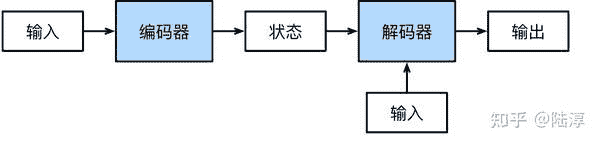

### 1.2 Seq2Seq

[提起Encode](https://link.zhihu.com/?target=https%3A//arxiv.org/abs/1409.3215)r-De**code**r，就不得不提 Seq2Seq (sequence to sequence)，两者本质上其实是同样的东西，主要区别在于Seq2Seq是抽象的理论，只要满足输入序列生成输出序列的模式都可以归类为Seq2Seq模型；而Encoder-Decoder是具象的实现，比如使用RNN、LSTM、GRU等进行实现的过程。因此Seq2Seq可以看作是Encoder-Decoder针对某一类任务的 模型框架

Seq2Seq通常使用两个RNN将源（输入）语句编码为单个文本向量，然后解码器通过一次生成一个单词来学习输出目标（输出）句子。

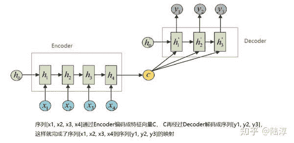

**以上图为例，输入**  x_1,x_2,x_3,x_4 ，通过 Enc**oder 生**成隐藏层的状态值  h_1,h_2,h_3,h_4 ，用最**后时刻输出的**  h_4 作为 语义编码C 的状态值，此刻的C包含了  x_1,x_2,x_3,x_4 所有的信息，然后在Decoder**中将 语义编**码C 作为隐藏层状态值  h_0 的初始值，并且我们希望Decoder每个时刻的输入即取决于之前Encoder的输出，因此语义编码C将参与Decoder每个时刻的隐藏层的计算，隐藏状态ht依赖于  h_{t-1} 以及状态t时刻的输入,最终再通过 *解码器* 将隐藏层的值转换为输出值

** 将整个序列的信**息压缩在了一个 *语义编码C* 中，从概念上来理解，**相较于隐藏状态**只能包含当前状态和之前状态的信息，C实现了我们之前提到的 “通读全文” 的效果。从模型效果来看。仅用一个语义编码C来记录整**个序列的信息会导致文**本信息受损，序列较短还行，如果序列是长序列，比如是一篇上万**字的文章，**我们要生成摘要，那么只是用一个语义编码C来表示整个序列的信息肯定会损失很多，而且序列一长，就可能出现* 梯度消失或梯度爆炸 *的问题，将所有信息都压缩在一个C里面显然就不合理。为了解决这一由长序列到定长向量转化而造成的* 信息损失 *的问题，基于Encoder-Decoder的Attention机制出现了

将整个序列的信息压缩在了一个 **语义编码C **中，从概念上来理解，相较于隐藏状态只能包含当前状态和**之前状态的信息**，C实现了我们之前提到的 “通读全文” 的效果。从模型效果来看。仅用一个语义编码C来记录整个序列的信息会导致文本信息受损**，序列较短还行，如果**序列是长序列，比如是一篇上万字的文章，我们要生成摘要，**那么只是用****一个语义编码C来表示整个**序列的信息肯定会损失很多，而且序列一长，就可能出现 梯度消失或梯度爆炸 的问题，将所有信息都压缩在一个C里面显然就不合理。为了解决这一由长序列到定长向量转化而造成的 信息损失 的问题，基于Encoder-Decoder的 Attention机制 出现了

### 1.3 基于Encoder-Decoder的Attention机制

**Atten**tion机制就是要从序列中学习到每一个元素的 重要程度 ，然后**按重要程度****将元素合并。这就****表明了序**列元素在编码的时候，所对应的语义编码C是不一样的，即解码器的 不同时刻 可以使用不同的语义编码C，如图所示，语义向量C是各个元素按其 重要度加权求和 得到的，目的是在解码器的每一时刻的输入序列中分配不同的 注意力 ，使模型可以集中在下一个重要的目标单词的输入信息上，从而关注不同时刻的重要信息，减少信息损失，改善模型效果。

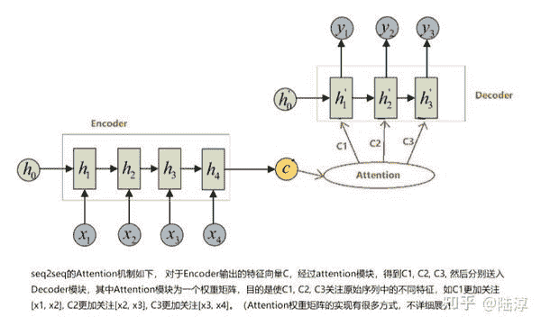

### 1.4 Seq2Seq+Attention

以英语**-法语翻译为****例，给定****一对输入**序列 "They are watching" 和输出序列 "lls regardent"，解码器在时刻1可以使用编码了 "They are" 信息的语义编码来生成 "lls"，而在时刻2可以使用编码了 "watching" 信息的 语义编码C 来生成 "regardent"。这看上去就像是在 解码器 的每一时刻对输入序列中不同时刻分配不同的 注意力 。这也是注意力机制的由来

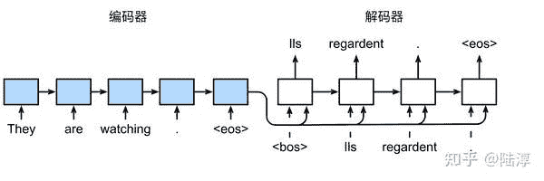

上**面的文字叙述****与模型比**较抽象和**复杂，让我们用一****个段****子来加强理解：有一对小情侣，**女方说：“我今天开车不小心撞到了”，这是 input 。男方听到了这句话，大脑字面意义上**理解这句话的中**文含**义并处理成了 **语义C ，这是 Encoder ；假如说他是一个直男，那他对这个语义 C 关注的就是“撞到了”，于是得到  C_1 并且经由他的 语言系统(Decoder) 做出作死回答  y_1 :“车没有撞坏吧”；又或者他关注到的是“我今天开车”，根据  C_2 便会回答  y_2 :“人没事吧，要不要去医院看看”。而这就是注意力机制 “通读全文” 并 “关注重点” 的概念性理解。

用公式[来表示：令编码器在](https://link.zhihu.com/?target=https%3A//arxiv.org/abs/1409.0473)  t 时刻的隐藏层变量为  h_t ，解码器在  t^{'} 时刻的语义编码  C_{t^{'}} 为：  C_{t^{'}} = \sum_{t=1}^{T}a_{t{'}t}h_t  关于注意力权重  a_{t{'}t} 的计算有许多种不同方案，最初是 Bahdanau 所提出的GRU设计，现在比较主流的，同时也是 Transformer 结构使用的则是一种缩放点积注意力机制。

### 1.5 (缩放点积注意力机制)Scaled Dot-product Attention

Attention机制的主要作用便是分配一系列注意力权重，Scaled Dot-**product A**tt**ention是**目前**比较主流的一种At**te**ntion框架。 Q**uery(**Q) 、 Key(K) 和 V**alue(V) 值是计算每个单词注意力的关键输入数据，通过对输入值有选择的进行加权平均，从而得到最终的注意力权重，其中K和V为一个向量，Q为一个值。如图所示attention value的本质其实就是一个 查询(query) 到一系列 键值(key-value)对 的映射。

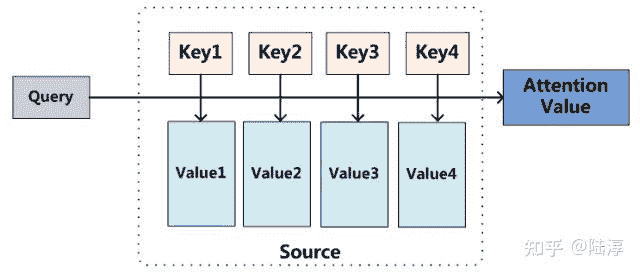

举一个例子来理解QKV的关系

假设世界上所有小吃都可以被标签化，例如微辣、特辣、变态辣、微甜、有嚼劲....，总共有**1000个**标签，现在我想要吃的小吃是[微辣、微甜、有嚼劲]，这三个单词就是我的 Query

来到 [东门老街 ](https://zhida.zhihu.com/search?q=%E4%B8%9C%E9%97%A8%E8%80%81%E8%A1%97&zhida_source=entity&is_preview=1)一共1**00家小**吃点，每个店铺卖的东西不一样，但是肯定可以被标签化，例如第一家小吃被标签化后是[微辣、微咸]，第二家小吃被标签化后是[特辣、微臭、特咸]，第二家小吃被标签化后是[特辣、微甜、特咸、有嚼劲]，其余店铺都可以被标签化，每个店铺的标签就是 Keys

**Values **就是**每家店铺对**应的单品，例如第一家小吃的Values是[烤羊肉串、炒花生] 将Query和所有的Keys进行一一比对，相当于计算相似性，此时就可以知道我想买的小吃和每一家店铺的 匹配情况 ，最后有了匹配列表，就可以去店铺里面买东西了 (Values和相似性加权求和) 。最终的情况可能是，我在第一家店铺买了烤羊肉串，然后在第10家店铺买了个玉米，最后在第15家店铺买了个烤面筋

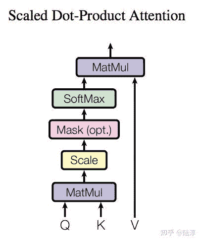

Scaled Dot-product Attention详细计算步骤为：

第一步：Query与每一个Key通过矩阵计算相似性得到相似性评分

第二步：根据文本维度对相似性归一化

第三步（可选)：为了仅将有意义的词元作为值来获取注意力权重，我们指定一个有效序列长度（即词元的个数），以便在计算softmax时过滤掉超出指定范围的位置，即掩码操作，任何超出有效长度的位置都被掩蔽并置为0,下一小节将详细介绍。

第四步：将注意力权重进行softmax转换成[0,1]之间的概率分布��

第五步：将[$a_1,a_2,a_3…a_n$]作为权值矩阵对Value进行加权求和得到最后的Attention值

以上步骤归结为一个Attention函数表示为：

\ Attention(Q,K,V)=softmax（\frac{QK^T}{\sqrt{d_k}}）V

QK^T 的意义在于计算词向量间的相似性；

d_k 是指向量k的维度，除以  \sqrt{d_k} 有利于梯度训练；

softmax 函数将对括号内的结果做归一化，经过 softmax 之后的注意力分数表示 在计算当前位置的时候，其他单词受到的关注度的大小。显然在当前位置的单词肯定有一个高分，但是有时候也会注意到与当前单词相关的其他词汇

V 乘以注意力得分函数是为了留下我们想要关注的单词的value，并把其他不相关的单词丢掉。

**用代码可以表示为：**

```
import torch
import torch.nn as nn
import torch.nn.functional as F

q = torch.randn((1,128,512))
k = torch.randn((1,256,512))
v = torch.randn((1,256,512))
# 假设q是(1,N,512),N就是最大标签化后的序列长度，k是(1,M,512),M可以等于N，也可以不相等，V和k的shape相同

scores = torch.matmul(q,k.transpose(1,2))  #transpose即矩阵转置
# Q(1,N,512) x K(1,512,M)--&gt;attn(1,N,M) 矩阵相乘 

scores=F.softmax(scores, dim=-1)
print(f&quot;scores.shape: {scores.shape}&quot;) 
# softmax转化为概率，输出(1,N,M)，表示q中每个n和每个m的相关性

output = torch.matmul(scores, v) #在演示中省略dk
print(f&quot;output.shape: {output.shape}&quot;) 
# (1,N,M) x (1,M,512)--&gt;(1,N,512)
```

scores.shape: torch.Size([1, 128, 256]) output.shape: torch.Size([1, 128, 512])

**将上述代码进行封装得到如下：**

```
[def](https://zhida.zhihu.com/search?q=%E8%AF%8D%E5%B5%8C%E5%85%A5&amp;zhida_source=entity&amp;is_preview=1) Scaled_Dot_product_Attention(query, key, value, mask=None, dropout=None):
    &quot;Compute &#x27;Scaled Dot Product Attention&#x27;&quot;
    #首先取query的最后一维的大小，对应词嵌入维度
    d_k = query.size(-1)
    #按照注意力公式，将query与key的转置相乘，这里面key是将最后两个维度进行转置，再除以缩放系数得到注意力得分张量scores
    scores = torch.matmul(query, key.transpose(-2, -1)) / math.sqrt(d_k)
    #判断是否使用掩码张量
    if mask is not None:
        #使用torch的masked_fill方法，主要是用来mask掉当前时刻后面时刻的序列信息
        #将掩码张量和scores张量每个位置一一比较，如果掩码张量不为空，则其对应的scores张量用-1e9这个置来替换
        scores = scores.masked_fill(mask == 0, -1e9)
    #对scores的最后一维进行softmax操作，使用F.softmax方法，这样获得最终的注意力张量
    p_attn = F.softmax(scores, dim = -1)
    #之后判断是否使用dropout对注意力进行随机置0
    if dropout is not None:
        p_attn = dropout(p_attn)
    #最后，根据公式将p_attn与value张量相乘获得最终的query注意力表示，同时返回注意力张量
    return torch.matmul(p_attn, value), p_attn
```

### 1.6 Mask

在上面的代码中出现了 mask ，让我们对 mask** 进行**详细的解释:例如在翻译的过程中是 顺序 翻译的，即翻译完第i个单词，才可以翻译第i+1个单**词。通过sequenc**e mask操作可以防止第i个单词知道i+1个单词之后的信息，而这也是在模仿模型在预测时只能看到 当前时刻及其之前位置 上的信息。其实现过程非常简单，首先生成一个下三角全 0，上三角全为负无穷的矩阵，然后将其与 Scaled Scores 相加即可


之后再做 softmax，就能将 - inf 变为 0，得到的这个矩阵即为每个字之间的权重

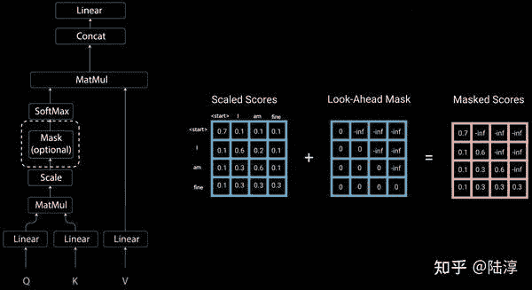

**代码实现：**

```
import numpy as np
import torch
import torch.nn as nn

attn_shape = (1, 10, 10) #假设attention矩阵大小为1*10*10
mask = np.triu(np.ones(attn_shape), k=1).astype(&#x27;uint8&#x27;) #形成一个和attention矩阵大小相同、元素为1的上三角阵
print(f&quot;(mask矩阵:\n {mask}&quot;) 

mask = torch.from_numpy(mask) == 0#最后将numpy类型转化为torch中的tensor，并与0进行逻辑运算
print(f&quot;(mask矩阵: \n{mask}&quot;)
```

(mask矩阵: [[[0 1 1 1 1 1 1 1 1 1] [0 0 1 1 1 1 1 1 1 1] [0 0 0 1 1 1 1 1 1 1] [0 0 0 0 1 1 1 1 1 1] [0 0 0 0 0 1 1 1 1 1] [0 0 0 0 0 0 1 1 1 1] [0 0 0 0 0 0 0 1 1 1] [0 0 0 0 0 0 0 0 1 1] [0 0 0 0 0 0 0 0 0 1] [0 0 0 0 0 0 0 0 0 0]]] (mask矩阵: tensor([[[ True, False, False, False, False, False, False, False, False, False], [ True, True, False, False, False, False, False, False, False, False], [ True, True, True, False, False, False, False, False, False, False], [ True, True, True, True, False, False, False, False, False, False], [ True, True, True, True, True, False, False, False, False, False], [ True, True, True, True, True, True, False, False, False, False], [ True, True, True, True, True, True, True, False, False, False], [ True, True, True, True, True, True, True, True, False, False], [ True, True, True, True, True, True, True, True, True, False], [ True, True, True, True, True, True, True, True, True, True]]])

### 1.7 Attention与Self-Attention

Attention的优点和缺点分别为

优点： 1.速度快。Attention机制每一步计算不依赖于**上一步****的计算**结果，因此可以和CNN一样 并行 处理。 2.效果好。效果好主要就是因为注意力机制，能够获取到 局部 的重要信息，能够抓住重点。

缺点： 1.只能在Decoder阶段实现并行运算，Encoder部分依旧采用的是RNN，LSTM这些按照顺序编码的**模型，En**coder部分还是无法实现并行运算，不够完美。 2.就是因为Encoder部分目前仍旧依赖于RNN，所以对于 中长距离 之间，两个词相互之间的关系没有办法很好的获取。

**为了改进上面两个缺点，更加完美**的 Self-Attention 出现了。

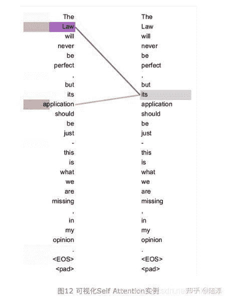

在一**般任务的Encoder-****Decod**e**r框架中，**输入Source和输出**Targe**t内容是不一样的，比如对于英-中机器翻译来说，Source是英文句子，Target是对应的翻译出的中文句子， Attention机制 发生在Target的元素和Source中的 所有元素 之间。而Self Attention顾名思义，指的不是Target和Source之间的Attention机制，而是Source 内部元素 之间或者Target 内部元素 之间发生的Attention机制，也可以理解为Target=Source这种特殊情况下的注意力计算机制。其具体计算过程是一样的，只是计算对象发生了变化而已，相当于是Query=Key=Value，计算过程与attention一样

例如上图是self-attention的一个例子： 我们想知道这句话中的**its，在这**句话里its指代的是什**么，与哪**一些**单词相关，那**么就可以将its作为 Query ，然后将这一句话作为 Key 和 Value 来计算attention值，找到与这句话中its最相关的单词。通过self-attention我们发现its在这句话中与之最相关的是Law和application，通过我们分析语句意思也十分吻合。

**引入Sel****f—Atte**nt**ion后会**更容易捕获句子 中长距离 的相互依赖的特征，因为如果是RNN或者LSTM，需要 依次序序列 计算，对于远距离的相互依赖的特征，要经过若干时间步步骤的信息累积才能将两者联系起来，而距离越远，有效捕获的可能性越小。但是Self Attention在计算过程中会直接将句子中任意两个单词的联系通过一个计算步骤 直接联系 起来，所以远距离依赖特征之间的距离被极大缩短，有利于有效地利用这些特征。除此外，Self Attention对于增加计算的并行性也有直接帮助作用。正好弥补了attention机制的两个缺点，这就是为何Self Attention逐渐被广泛使用的主要原因。

(通俗理解就是， **Attention **就是同学们全部在操场排队站好，你需要在操场一个个去找到你最喜欢的对象，**那么受限于距离和人数限制，你可**能只能在你面前的一小部分人里面去找最喜欢的对象。 Self—Attention 就是你直接站到了讲台上向下看，就可以 众里寻他千百度，蓦然回首，那人却在灯火阑珊处 ，从而跨越了距离限制)

## 2.Transformer

由于传统的 **Encoder-D**ecoder 架构在建模过程中，下一个时刻**的计算**过程会 依赖于上一个时刻 的输出，而这种固有的属性**就限制了传统的Encod**er-Decoder模型就不能以 并行 的方式进行计算，Transformer中抛弃了传统的CNN和RNN，整个网络结构完全是由 Attention机制 组成。更准确地讲，Transformer由Multi-head attention、Position-wise-Feed-Forward和Add&Norm 组成。一个基于Transformer的可训练的神经网络可以通过堆叠Transformer的形式进行搭建，编码器和解码器各6层，总共12层的Encoder-Decoder，并在机器翻译中取得了BLEU值的新高。


让我们从下到上，从左到右逐层解析tranformer的结构

### 2.1. Embedding层

Embedding层主要用来处理Transformer中文本的输入向量表示，单词x由词向量和位置向量相加得到，即

X = EmbeddingLookup(X)+PositionalEncoding

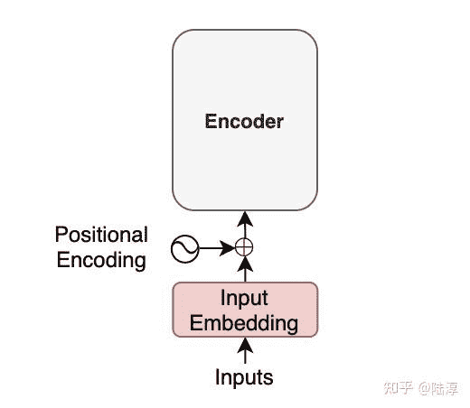

### 2.1.1 Token Embedding

在之前的章节学习中我们知道如果要对文**本数据进**行训练，首先要做的便是对其进行 向量化 ，常见的方法有one-h**ot编码、word2v**ec和Glove等。在transformer中也是同样的逻辑，模型会将输入的词（或者字）通过一个 Embedding层 映射到低维稠密的向量空间。

首先第一步是构建词典，将分词后的文本映射成向量的形式

```
[import](https://zhida.zhihu.com/search?q=%E8%A5%BF%E5%8D%97%E8%B4%A2%E7%BB%8F%E5%A4%A7%E5%AD%A6&amp;zhida_source=entity&amp;is_preview=1) jieba
import math

input_sequence = &#x27;我来自西南财经大学金融科技国际联合实验室.&#x27; #输入句子
input_tokens = jieba.lcut(input_sequence) #分词
print(input_tokens) #打印分词结果
word2id = {word:index for index,word in enumerate(input_tokens)} #构建分词字典
print(word2id) #打印分词字典

input_id = np.array([word2id[words] for words in input_tokens])
input_id = torch.LongTensor([input_id])
print(input_id) #将id类型转为tensor
```

['我', '来自', '西南财经大学', '金融', '科技', '国际', '联合', '实验室', '.'] {'我': 0, '来自': 1, '西南财经大学': 2, '金融': 3, '科技': 4, '国际': 5, '联合': 6, '实验室': 7, '.': 8} tensor([[0, 1, 2, 3, 4, 5, 6, 7, 8]])

**然**后将文本向量通过Embedding层映射到一个大小为num_embeddings（词典大小）embedding_dim（词向量维度）的矩阵

```
max_len = 9 
#此处不仅指词典的大小，也可以作为句子的长度
dim_model = 4 
#即embedding_dim，词向量维度

embed = torch.nn.Embedding(num_embeddings = max_len, embedding_dim = dim_model) 
# 搭建大小为9*4的emdedding层
# num_embeddings: 词典的大小尺寸，比如总共出现5000个词，那就输入5000。此时index为（0-4999）
# embedding_dim: 词向量的维度，即用多少维来表示一个符号，根据字典大小决定，这里设置为4

print(f&quot;词向量大小:\n{embed(input_id).size()}&quot;) 
#输入一个batch（批次）的词向量，输出大小为1*9*4的embedding向量矩阵

token_embedding = embed(input_id)*math.sqrt(dim_model) 
#乘以权重是为了放大向量，防止token_embedding与positional_embedding的量级相差过大，做加法后被忽视掉
print(f&quot;词向量矩阵：\n{token_embedding}&quot;) 
#输出最终的token_embedding,size为（batch， max_len, dim_model）
```

词向量大小: torch.Size([1, 9, 4]) 词向量矩阵： tensor([[[-0.9278, 0.1536, -5.1977, 3.0676], [ 1.0338, 1.4268, 0.0782, -1.9430], [ 0.4330, 1.5696, 2.2857, -0.7265], [-1.2089, -2.5234, -0.4389, -2.1536], [ 1.1732, 0.1545, 3.1197, -1.7922], [-2.8027, 2.2008, -0.3908, 1.9304], [-0.9812, 0.8429, -0.1347, 3.6269], [-2.3494, 2.9623, -1.4192, 0.0190], [-0.7541, -0.8092, 1.1441, 2.5261]]], grad_fn=)

**将上述代码封装成类Token_Embeddings，用来后续**处理完整transformer模型的输入

```
class Embeddings(nn.Module):
    def __init__(self, dim_model, vocab):
        #参数d_model指词嵌入的维度，vocab指词表的大小
        super(Embeddings, self).__init__()
        #调用nn中的预定义层Embedding，获得一个词嵌入对象self.lut
        self.lut = nn.Embedding(vocab, dim_model)
        #one-hot转词嵌入，这里有一个待训练的矩阵E，大小是vocab*dim_model
        self.dim_model = dim_model

    def forward(self, x):
        #参数x代表输入给模型的单词文本通过词表映射后的向量编码，将x传给self.lut并与根号下self.dim_model相乘作为结果返回
        #这里的输入输出的tensor大小类似于(batch_size, max_sequence_length, dim_model)
        return self.lut(x) * math.sqrt(self.dim_model) #最后的token_embedding乘以权重是为了放大向量，防止token_embedding与positional_embedding的量级相差过大，做加法后被忽视掉
```

### 2.1.2Positional Embedding

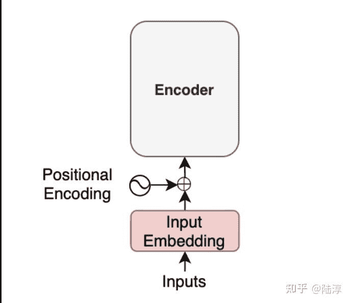

**在自注意力机制中****，文本向量**的计算仅涉及到 普通的线性变化 而没有本质的区别，即Attent**ion机制**不能捕捉 语序顺序 。然而自然语言的语序包含太多的信息，如果缺失了这方面的信息，结果往往不佳。所以就有了position-embedding(位置向量)的概念了， 位置嵌入 的设计应该满足以下条件：

（1）它应该为每个字输出唯一的编码 （2）不同长度的句子之间，任何两个字之间的差值应该保持一致 （3）它的值应该是有界的

因此，位置编码运用了如下公式：

PE_{(pos,2i)} = sin(pos / 10000^{2i/d_{\text{model}}})

PE_{(pos,2i+1)} = cos(pos / 10000^{2i/d_{\text{model}}})

上式中$ pos $ 指的是一句话中某个字的位置，取值范围是[0,max_sequence_length)，$ i $指的是字向量的维度序号，取值范围是[0,embedding_dimension/2) ，$ d_{model} $ 指的是embedding_dimension的值

位置嵌入随着维度增大周期变化会越来越慢，最终产生一种包含位置信息的纹理，位置嵌入函数的周期从$ 2\pi $ 到$ 1000*2\pi $ 变化，而每一个位置在 embedding_dimension维度上都会得到不同周期的sin和cos函数的取值组合，从而产生唯一的纹理位置信息

**初始化位置:**

```
positional_embedding = torch.zeros(max_len, dim_model) 
#初始化positional_embedding，每行代表一个词的位置，每列代表一个编码位
position = torch.arange(0, max_len).unsqueeze(1) 
#初始化词的位置以便公式计算，size=(max_len,1)：unsqueeze()函数起升维的作用
print(f&quot;初始化位置：\n{position}&quot;)
```

初始化位置： tensor([[0], [1], [2], [3], [4], [5], [6], [7], [8]])

**公式实现(得到位置编码):**

```
div_term = torch.exp(torch.arange(0, dim_model, 2) * -(math.log(10000.0) / dim_model)) 
#计算公式中1/10000**（2i/d_model)
positional_embedding[:, 0::2] = torch.sin(position * div_term)  
#计算偶数维度的pe值
positional_embedding[:, 1::2] = torch.cos(position * div_term)  
#计算奇数维度的pe值
positional_embedding = positional_embedding.unsqueeze(0) 
#unsqueeze函数使位置编码大小为(1, max_len, dim_model)，为了后续与word_embedding相加, 意为batch维度下的操作相同
print(f&quot;位置编码：\n{positional_embedding}&quot;) 
print(f&quot;位置编码（奇数维度）：\n{positional_embedding[:, 0::2]}&quot;)
print(f&quot;位置编码（偶数维度）：\n{positional_embedding[:, 1::2]}&quot;)
```

位置编码： tensor([[[ 0.0000, 1.0000, 0.0000, 1.0000], [ 0.8415, 0.5403, 0.0100, 0.9999], [ 0.9093, -0.4161, 0.0200, 0.9998], [ 0.1411, -0.9900, 0.0300, 0.9996], [-0.7568, -0.6536, 0.0400, 0.9992], [-0.9589, 0.2837, 0.0500, 0.9988], [-0.2794, 0.9602, 0.0600, 0.9982], [ 0.6570, 0.7539, 0.0699, 0.9976], [ 0.9894, -0.1455, 0.0799, 0.9968]]]) 位置编码（奇数维度）： tensor([[[ 0.0000, 1.0000, 0.0000, 1.0000], [ 0.9093, -0.4161, 0.0200, 0.9998], [-0.7568, -0.6536, 0.0400, 0.9992], [-0.2794, 0.9602, 0.0600, 0.9982], [ 0.9894, -0.1455, 0.0799, 0.9968]]]) 位置编码（偶数维度）： tensor([[[ 0.8415, 0.5403, 0.0100, 0.9999], [ 0.1411, -0.9900, 0.0300, 0.9996], [-0.9589, 0.2837, 0.0500, 0.9988], [ 0.6570, 0.7539, 0.0699, 0.9976]]])

**得到embedding:**

```
[drop](https://zhida.zhihu.com/search?q=%E6%B3%9B%E5%8C%96%E8%83%BD%E5%8A%9B&amp;zhida_source=entity&amp;is_preview=1)out = nn.Dropout(p=0.1) 
#以0.1的概率随机置0，提高模型泛化能力
embedding = token_embedding + positional_embedding[:, :token_embedding.size(0)]
dropout = nn.Dropout(p=0.1) 
#以0.1的概率随机置0，提高模型泛化能力
embeddings = dropout(embedding)
print(f&quot;最终的embedding:\n{embedding}&quot;)
```

最终的embedding: tensor([[[-0.9278, 1.1536, -5.1977, 4.0676], [ 1.0338, 2.4268, 0.0782, -0.9430], [ 0.4330, 2.5696, 2.2857, 0.2735], [-1.2089, -1.5234, -0.4389, -1.1536], [ 1.1732, 1.1545, 3.1197, -0.7922], [-2.8027, 3.2008, -0.3908, 2.9304], [-0.9812, 1.8429, -0.1347, 4.6269], [-2.3494, 3.9623, -1.4192, 1.0190], [-0.7541, 0.1908, 1.1441, 3.5261]]], grad_fn=)

**封装版**

```
class Positional_Encoding(nn.Module):
    &quot;位置编码类封装&quot;
    def __init__(self, dim_model, dropout, max_len=100):
        #参数dim_model指词嵌入维度，max_len指每个句子的最大长度
        super(Positional_Encoding, self).__init__()
        self.dropout = nn.Dropout(p=dropout)
        # 注意下面代码的计算方式与公式中给出的是不同的，但是是等价的，你可以尝试简单推导证明一下。
        # 这样计算是为了避免中间的数值计算结果超出float的范围，
        pe = torch.zeros(max_len, dim_model) #初始化空表，每行代表一个词的位置，每列代表一个编码位
        position = torch.arange(0, max_len).unsqueeze(1) #建个arrange表示词的位置以便公式计算，size=(max_len,1)
        # (100) -&gt; (100,1)
        div_term = torch.exp(torch.arange(0, dim_model, 2) * -(math.log(10000.0) / dim_model))
        # div_term产生大量值供sin, cos调用
        pe[:, 0::2] = torch.sin(position * div_term) #偶数位置公式
        pe[:, 1::2] = torch.cos(position * div_term) #奇数位置公式
        pe = pe.unsqueeze(0) 
        #unsqueeze函数使位置编码大小为(1, max_len, dim_model)，为了后续与word_embedding相加, 意为batch维度下的操作相同
        #register_buffer函数使pe在模型训练时不会更新的前提下被保存
        self.register_buffer(&#x27;pe&#x27;, pe)

    def forward(self, x):
        #更新位置编码，size = (batch, max_len, dim_model)
        #接受Embeddings的词嵌入结果x，然后把自己的位置编码pe，封装成torch的Variable(不需要梯度)，加上去。
        x = x + self.pe[:, :x.size(1)]
        return self.dropout(x)
```

### 2.2 Encoder

[Encod](https://zhida.zhihu.com/search?q=%E7%89%B9%E5%BE%81%E6%8F%90%E5%8F%96&zhida_source=entity&is_preview=1)er作**用是用**于对输**入进行 特征提取 ，即 编**码 ，Encoder位于tra**nform**er示意图的左边，整体来**看由N个 Mu**lti-Head Attention 和层 Feed Forward 组成，这两部分网络来都加入了 残差连接 ，并在残差连接还进行了 层归一化操作 :用公式来表示层归一化就是：  X=LayerNorm(x+Sublayer(x))

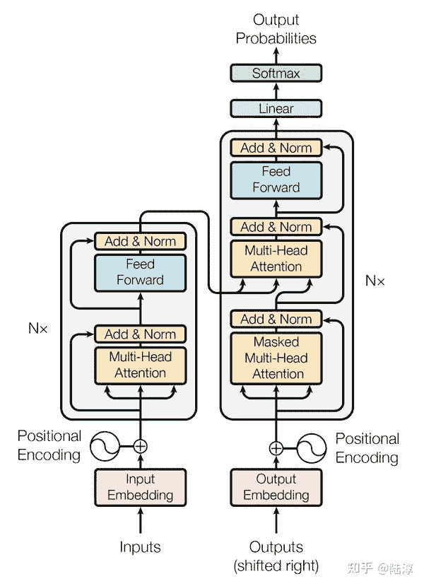

假设N=1，即只堆叠一次情况下，详细的结构如下图所示：

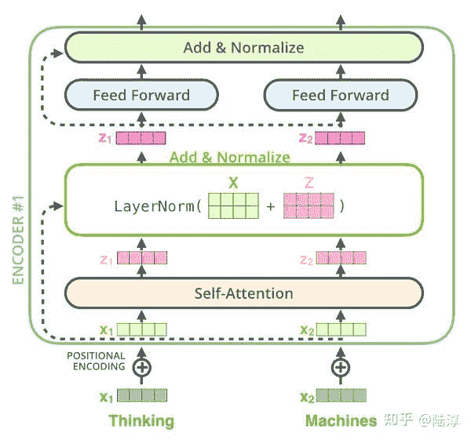

让我们将Encoder进行拆分：

### 2.2.1 Norm

Norm指 Layer Normalizati[on，作用是把](https://zhida.zhihu.com/search?q=%E6%A0%87%E5%87%86%E6%AD%A3%E6%80%81%E5%88%86%E5%B8%83&zhida_source=entity&is_preview=1)神经网络中隐藏层归一化为 标准正态分布 ，以起到加快训练速度，加速收敛的作用

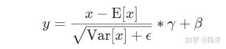

**LN和BN不同****，BN是对句子**中单词的 同一特征维度 进行规范化，而LN是对句中每个单词的 不同特征维度 进行规范化。在NLP中单词之间的特征进行规范化没有意义，因此我们经常使用LN，

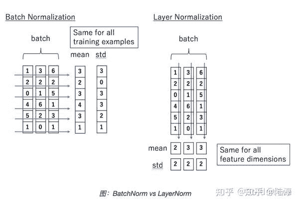

代码演示，dim_model、embeddings来自于前面部分代码演示得到的数据，在运行下面代码块时确保notebook上面的内容已被运行

```
a = nn.Parameter(torch.ones(dim_model))
b = nn.Parameter(torch.zeros(dim_model))
e = 1e-6

mean_embeddings = embeddings.mean(-1, keepdim=True)
std_embeddings = embeddings.std(-1, keepdim=True)
#对输入变量embeddings求其最后一个维度的均值和标准差，并用keepdim=True将输出维度与输入维度保持一致
#将标准化后的结果乘以我们的缩放参数a后再加上位移参数b。*号代表同型点乘，即对应位置进行乘法操作
out = a * (embeddings - mean_embeddings) / (std_embeddings + e) + b
print(f&quot;按行求均值：\n{mean_embeddings}\n按行求标准差：\n{std_embeddings},\n归一化结果：\n{out}&quot;)
```

按行求均值： tensor([[[-0.2512], [ 0.7211], [ 1.5450], [-1.2014], [ 1.2931], [-0.0731], [ 0.2020], [ 0.3368], [ 1.1408]]], grad_fn=) 按行求标准差： tensor([[[4.3294], [1.5933], [1.3389], [0.5090], [1.7745], [2.6119], [1.3217], [3.1364], [2.0418]]], grad_fn=), 归一化结果： tensor([[[-0.1801, 0.3541, -1.2759, 1.1019], [ 0.2684, 1.2398, -0.3980, -1.1101], [-0.7946, 0.9785, 0.7429, -0.9269], [-0.2787, -0.9653, 1.4020, -0.1580], [ 0.0059, -0.0058, 1.2247, -1.2248], [-1.1643, 0.0280, -0.1383, 1.2746], [-0.9776, 1.3965, -0.2660, -0.1528], [-0.9397, 1.2963, -0.6102, 0.2536], [-0.9691, -0.4549, 0.0639, 1.3601]]], grad_fn=)

**封装**

```
class LayerNorm(nn.Module):
    &quot;对特征做正则化&quot;
    def __init__(self, features, eps=1e-6):
        #参数features表示词嵌入的维度,参数eps是一个足够小的数，在规范化公式的分母中出现,防止分母为0，默认是1e-6。
        super(LayerNorm, self).__init__()
        self.a_2 = nn.Parameter(torch.ones(features))
        self.b_2 = nn.Parameter(torch.zeros(features))
        self.eps = eps

    def forward(self, x):
        #对输入变量x求其最后一个维度的均值和标准差，并用keepdim=True将输出维度与输入维度保持一致
        #将标准化后的结果乘以我们的缩放参数a_2后再加上位移参数b_2。*号代表同型点乘，即对应位置进行乘法操作
        mean = x.mean(-1, keepdim=True)
        std = x.std(-1, keepdim=True)
        return self.a_2 * (x - mean) / (std + self.eps) + self.b_2
```

### 2.2.2 Multi-head attention

**自注意力**机制的缺陷在于模**型在对当前位**置的[信息进行编码时，会 过度的 将](https://zhida.zhihu.com/search?q=%E5%8F%AA%E6%98%AF%E5%9B%A0%E4%B8%BA%E5%9C%A8%E4%BA%BA%E7%BE%A4%E4%B8%AD%E5%A4%9A%E7%9C%8B%E4%BA%86%E4%BD%A0%E4%B8%80%E7%9C%BC&zhida_source=entity&is_preview=1)注意力集中于 自身的位置 ( 只是因为在人群中多看了你一眼 ，再也没能忘掉你容颜)， 因此提出了通过多头注意力机制来解决这一问题。所谓的多头注意力机制就是将输入序列进行多组的自注意力处理过程，然后再将每一组的自注意力机制计算的结果拼接起来进行一次线性变化的得到最终的输出结果。多头注意力层能够给予注意力层的输出包含有不同子空间中的编码表示信息，从而增强模型的表达能力

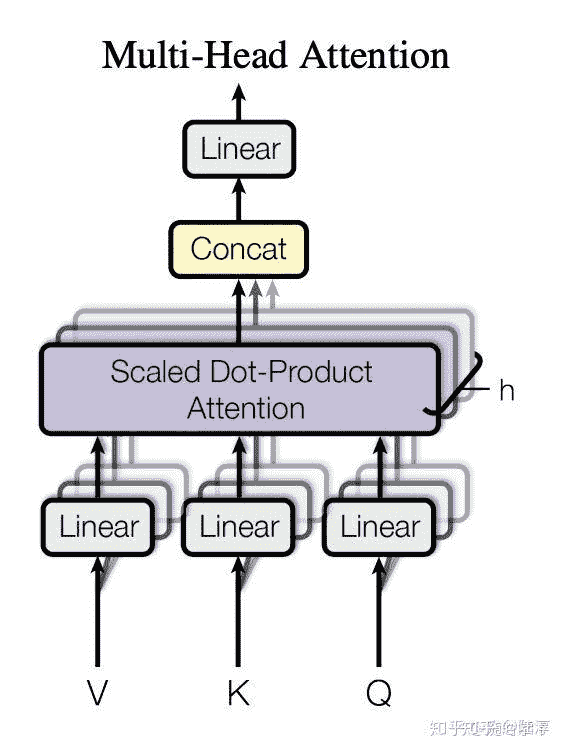

首先我们需要利用缩放点积注意力机制计算出关键参数q、k、v。

```
def clones(module, N):
    &quot;克隆模型结构&quot;
    #参数module指要克隆的模型，N指要克隆的份数
    #clones函数将某个结构深拷贝若干份，并将以列表的形式存入ModuleList中，方便后续调用    
    return nn.ModuleList([copy.deepcopy(module) for _ in range(N)])
num_head = 2 #头数
dim_head = dim_model // num_head #得到每个头获得的词向量维度d_k
linears = clones(nn.Linear(dim_model, dim_model), 4) 
src_mask = torch.ones(1, 1, max_len) #生成源码（encoder）端的输入掩码，size为[batch,1,1,max_len]
mask = src_mask.unsqueeze(1)
#通过nn的Linear实例化创建linear层，它的内部变换矩阵大小是dim_model*dim_model,因为在多头注意力中，Q,K,V各需要一个线性层，最后拼接的矩阵还需要一个线性层，因此一共需要克隆四个
q =  out 
k = out
v = out
nbatches = q.size(0) #代表有多少条样本，这里为1
q, k, v = [l(x).view(nbatches, -1, num_head, dim_head).transpose(1, 2) for l,x in zip(linears, (q, k, v))]  
#利用zip函数和for循环将QKV分别传到线性层中，并分别为每个头做输入，再由[batch,max_len,dim_model]维度变换为[batch,head,max_len,dim_head],即[1,9,4]变为[1,2,9,2]的形式
print(f&quot;q、k、v的大小为：{q.size()}&quot;)
q、k、v的大小为：torch.Size([1, 2, 9, 2])
```

q、k、v的大小为：torch.Size([1, 2, 9, 2])

接着我们需要利用公式

\ Attention(Q,K,V)=softmax（\frac{QK^T}{\sqrt{d_k}}）V

计算出最终的注意力权重

```
score = torch.matmul(q, k.transpose(-2, -1)) / math.sqrt(dim_head)
#按照注意力公式，将query与key的转置相乘，这里面key是将最后两个维度进行转置，再除以缩放系数得到注意力得分张量scores
#使用torch的masked_fill方法，主要是用来mask掉当前时刻后面时刻的序列信息

score = score.masked_fill(mask == 0, -1e9)
#将掩码张量和scores张量每个位置一一比较，如果掩码张量不为空，则其对应的scores张量用-1e9这个置来替换


qk_attn = dropout(F.softmax(score, dim = -1))
#对scores的最后一维进行softmax操作，使用F.softmax方法，这样获得最终的注意力张量

attn = torch.matmul(qk_attn, v).transpose(1, 2).contiguous().view(nbatches, -1, num_head * dim_head)
attention = linears[-1](attn)
print(attention) 
print(f&quot;attention.shape：{attention.shape}&quot;)
#最后，根据公式将p_attn与value张量相乘获得最终的query注意力表示，同时返回注意力张量
```

tensor([[[-0.5186, 0.0789, -0.3201, 0.0575], [-0.3979, -0.0613, -0.3007, -0.0510], [-0.4077, -0.0628, -0.2860, -0.0351], [-0.4190, -0.0918, -0.2980, -0.0242], [-0.2408, -0.2913, -0.2515, -0.1825], [-0.5519, 0.0365, -0.3243, 0.0987], [-0.3596, -0.0821, -0.2835, -0.0860], [-0.5051, 0.0344, -0.3241, 0.0475], [-0.4602, -0.0485, -0.3070, 0.0123]]], grad_fn=) attention.shape：torch.Size([1, 9, 4])

### 2.2.3 Add

Add是一种残差连接，通常用于解决多层网络训练的问题，可以让网络只关注当前差异的部分，训练的时候可以使梯度直接走捷径反传到最初始层，解决了梯度消失和权重矩阵的退化问题

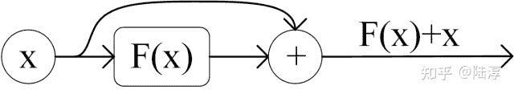

在encoder层里的每个sublayer之间（Multi-head attention或者feed forward）都有一个残差连接Add&Norm层，该层由Add和Norm两部分组成，其计算公式如下:

X=x+MultiheadAttention(LayerNorm(x))

或者

X=x+FeedForward(LayerNorm(x))

```
ff_input = embeddings + dropout(attention) #embeddings经过多头注意力机制之后之后得到了attention(数据来自Multi-head attention)
print(ff_input)
print(f&quot;ff_input.shape：{ff_input.shape}&quot;)
```

tensor([[[-1.6071, 1.3694, -5.7752, 4.5834], [ 0.7066, 2.6284, -0.2472, -1.1044], [ 0.0281, 2.7853, 2.5397, 0.2649], [-1.8088, -1.7947, -0.8188, -1.3087], [ 1.0360, 0.9591, 3.4664, -1.0830], [-3.7274, 0.0405, -0.7945, 3.3657], [-1.4897, 1.9565, -0.4646, 0.0000], [-3.1717, 4.4407, -1.9370, 1.1850], [-1.3492, 0.1580, 0.9301, 3.9316]]], grad_fn=) ff_input.shape：torch.Size([1, 9, 4])

### 2.2.4 Feed-Forward

[Feed-](https://zhida.zhihu.com/search?q=%E5%85%A8%E8%BF%9E%E6%8E%A5%E5%B1%82&zhida_source=entity&is_preview=1)Forward层比较简单，是一个两层的 全连接层 ，第一层的激活函数为 Relu，第二层不使用激活函数，对应的公[式如下 在](https://zhida.zhihu.com/search?q=%E7%BA%BF%E6%80%A7%E5%8F%98%E6%8D%A2&zhida_source=entity&is_preview=1)进行了Attention操作之后，encoder和decoder中的每一层都包含了一个全连接前向网络，对每个position的向量分别进行相同的操作，包括两个 线性变换 和一个ReLU激活输出：Feed Forward Layer 其实就是简单的由两个前向全连接层组成，核心在于，Attention模块每个时间步的输出都整合了所有时间步的信息，而Feed Forward Layer每个时间步只是对自己的特征的一个进一步整合，与其他时间步无关

X=Linear(ReLu(Linear(X)))

```
hidden = 2048
L_1 = nn.Linear(dim_model, hidden)
L_2 = nn.Linear(hidden, dim_model)
#dim_model是第一个线性层的输入维度也是第二个线性层的输出维度
#hidden是第二个线性层的输入维度和第一个线性层的输出维度，即通过前馈全连接层后输入和输出的维度不变

norm = LayerNorm(dim_model)
ff_output = L_2(dropout(F.relu(L_1(norm(ff_input)))))#使用F中的relu函数进行激活，之后再使用dropout进行随机置0，最后通过第二个线性层L_2，返回最终结果
encode_output = ff_input + dropout(ff_output)

print(encode_output)
print(f&quot;encode_output.shape：{encode_output.shape}&quot;)
```

tensor([[[-1.6385, 1.5783, -5.6910, 4.5859], [ 0.7066, 2.6284, -0.3470, -1.0904], [ 0.0871, 2.4978, 2.5264, 0.0185], [-1.8088, -1.6816, -0.7299, -1.3113], [ 1.1894, 0.6240, 3.5389, -1.0365], [-3.5973, 0.5606, -0.7548, 3.3206], [-1.4897, 2.1547, -0.5109, -0.0612], [-3.1343, 4.6234, -1.9206, 1.0640], [-1.3888, 0.4672, 0.9489, 3.6229]]], grad_fn=) encode_output.shape：torch.Size([1, 9, 4])

以上便是N=1时 **Encode层 ****的具体**内容，在实际模型中编码器由N个这样的层 堆叠 而层，因此下面我们定义一个完整的Encode并进行堆叠来输出我们最终的结果：

### 2.2.5 一个完整的Encode


**Encode定义**

```
def clones(module, N):
    &quot;克隆模型结构&quot;
    #参数module指要克隆的模型，N指要克隆的份数
    #clones函数将某个结构深拷贝若干份，并将以列表的形式存入ModuleList中，方便后续调用    
    return nn.ModuleList([copy.deepcopy(module) for _ in range(N)])  

class Encoder(nn.Module):
    def __init__(self, layer, N):
        super(Encoder, self).__init__()
        #我们将N个克隆层叠加在一起组成完整的Encoder
        self.layers = clones(layer, N)
        #在编码器中使用LayerNorm进行正则化
        self.norm = LayerNorm(layer.size)


    def forward(self, x, mask):
        &quot;依次将输入和掩码传递到每个层&quot;
        for layer in self.layers:
            x = layer(x, mask)
        return self.norm(x)

class EncoderLayer(nn.Module):
    &quot;编码器由self-attention层和feed_forward层组成&quot;
    def __init__(self, size, self_attn, feed_forward, dropout):
        super(EncoderLayer, self).__init__()
        self.self_attn = self_attn
        self.feed_forward = feed_forward
        self.sublayer = clones(SublayerConnection(size, dropout), 2) #之所以克隆两个层是因为self-attention层和feed_forward层都需要残差连接
        self.size = size

    def forward(self, x, mask):
        &quot;Follow Figure 1 (left) for connections.&quot;
        x = self.sublayer[0](x, lambda x: self.self_attn(x, x, x, mask)) #多头self-attention
        return self.sublayer[1](x, self.feed_forward) #前向传播

def Scaled_Dot_product_Attention(query, key, value, mask=None, dropout=None):
    #首先取query的最后一维的大小，对应词嵌入维度
    d_k = query.size(-1)
    #按照注意力公式，将query与key的转置相乘，这里面key是将最后两个维度进行转置，再除以缩放系数得到注意力得分张量scores
    scores = torch.matmul(query, key.transpose(-2, -1)) / math.sqrt(d_k)
    #判断是否使用掩码张量
    if mask is not None:
        #使用torch的masked_fill方法，主要是用来mask掉当前时刻后面时刻的序列信息
        #将掩码张量和scores张量每个位置一一比较，如果掩码张量不为空，则其对应的scores张量用-1e9这个置来替换
        scores = scores.masked_fill(mask == 0, -1e9)
    #对scores的最后一维进行softmax操作，使用F.softmax方法，这样获得最终的注意力张量
    p_attn = F.softmax(scores, dim = -1)
    #之后判断是否使用dropout对注意力进行随机置0
    if dropout is not None:
        p_attn = dropout(p_attn)
    #最后，根据公式将p_attn与value张量相乘获得最终的query注意力表示，同时返回注意力张量
    return torch.matmul(p_attn, value), p_attn


class LayerNorm(nn.Module):
    &quot;对特征做正则化&quot;
    def __init__(self, features, eps=1e-6):
        #参数features表示词嵌入的维度,参数eps是一个足够小的数，在规范化公式的分母中出现,防止分母为0，默认是1e-6。
        super(LayerNorm, self).__init__()
        self.a_2 = nn.Parameter(torch.ones(features))
        self.b_2 = nn.Parameter(torch.zeros(features))
        self.eps = eps

    def forward(self, x):
        #对输入变量x求其最后一个维度的均值和标准差，并用keepdim=True将输出维度与输入维度保持一致
        #将标准化后的结果乘以我们的缩放参数a_2后再加上位移参数b_2。*号代表同型点乘，即对应位置进行乘法操作
        mean = x.mean(-1, keepdim=True)
        std = x.std(-1, keepdim=True)
        return self.a_2 * (x - mean) / (std + self.eps) + self.b_2

class Multi_Head_Attention(nn.Module):
    def __init__(self, dim_model, num_head, dropout):
        #参数h代表头数，d_model代表词嵌入的维度，dropout代表进行数据操作时置0比率，默认是0.1
        super(Multi_Head_Attention, self).__init__()
        #assert语句判断d_model是否能被h整除，这是因为我们之后要给每个头分配等量的词特征，也就是embedding_dim/head个
        assert dim_model % num_head == 0
        # We assume d_v always equals d_k
        #得到每个头获得的词向量维度d_k
        self.d_k = dim_model // num_head
        self.h = num_head
        #通过nn的Linear实例化创建linear层，它的内部变换矩阵大小是embedding_dim*embedding_dim
        #因为在多头注意力中，Q,K,V各需要一个线性层，最后拼接的矩阵还需要一个线性层，因此一共需要克隆四个
        self.linears = clones(nn.Linear(dim_model, dim_model), 4)
        #self.attn代表最后得到的注意力张量，现在还没有结果所以为None
        self.attn = None
        self.dropout = nn.Dropout(p=dropout)

    def forward(self, query, key, value, mask=None):
        &quot;Implements Figure 2&quot;
        #前三个参数就是注意力机制需要的Q,K,V，最后一个参数是注意力机制中可能需要的mask掩码张量，默认是None 
        if mask is not None:
            # Same mask applied to all h heads.
            #使用unsqueeze扩展维度，代表多头中的第n头
            mask = mask.unsqueeze(1)
        #接着，我们获得一个batch_size的变量，他是query尺寸的第1个数字，代表有多少条样本
        nbatches = query.size(0)        
        # 1) Do all the linear projections in batch from d_model =&gt; h x d_k
        #首先利用zip函数和for循环将QKV分别传到线性层中，并分别为每个头做输入
        #view方法对线性变换的结构进行维度重塑，h代表头，d_k代表词向量维度，这样就意味着每个头可以获得一部分词特征组成的句子，
        #view中的-1代表自适应维度，计算机会根据这种变换自动计算这里的值，
        #然后对第二维和第三维进行转置操作，使得代表句子长度维度和词向量维度能够相邻，这样注意力机制才能找到词义与句子位置的关系，得到每个头的输入 
        query, key, value = [l(x).view(nbatches, -1, self.h, self.d_k).transpose(1, 2) for l, x in zip(self.linears, (query, key, value))]      
        # 2) Apply attention on all the projected vectors in batch. 
        #得到每个头的输入后，接下来就是将他们传入到attention中，这里直接调用我们之前实现的attention函数，同时也将mask和dropout传入其中                
        x, self.attn = Scaled_Dot_product_Attention(query, key, value, dropout=self.dropout)        
        # 3) &quot;Concat&quot; using a view and apply a final linear.      
        #为了方便后续的计算，我们要将每个头计算结果组成的4维张量转换为输入的形状
        #因此这里开始进行第一步处理环节的逆操作，先对第二和第三维进行转置，
        #然后使用contiguous方法将tensor变成在内存中连续分布的形式，从而让转置后的张量应用view方法，否则将无法直接使用
        #最后就是使用view重塑形状，变成和输入形状相同。   
        x = x.transpose(1, 2).contiguous().view(nbatches, -1, self.h * self.d_k)
        #使用线性层列表中的最后一个线性变换得到最终的多头注意力结构的输出
        return self.linears[-1](x)

def subsequent_mask(size):
    &quot;Mask out subsequent positions.&quot;
    #生成向后遮掩的掩码张量，参数size是掩码张量最后两个维度的大小，它最后两维形成一个方阵
    attn_shape = (1, size, size)
    #形成元素为1的上三角阵
    subsequent_mask = np.triu(np.ones(attn_shape), k=1).astype(&#x27;uint8&#x27;)
    #最后将numpy类型转化为torch中的tensor，内部做一个1- 的操作。这个其实是做了一个三角阵的反转，subsequent_mask中的每个元素都会被1减。
    #如果是0，subsequent_mask中的该位置由0变成1
    #如果是1，subsequect_mask中的该位置由1变成0
    return torch.from_numpy(subsequent_mask) == 0

class SublayerConnection(nn.Module):
    def __init__(self, size, dropout):
        super(SublayerConnection, self).__init__()
        self.norm = LayerNorm(size) #规范化
        self.dropout = nn.Dropout(dropout)

    def forward(self, x, sublayer):
        &quot;“将剩余连接应用于具有相同大小的任何子层。”&quot;
        x = torch.tensor(x,dtype=torch.float)
        return x + self.dropout(sublayer(self.norm(x)))

class Position_wise_Feed_Forward(nn.Module):
    &quot;Implements FFN equation.&quot;
    def __init__(self, dim_model, hidden, dropout=0.1):
        #参数dim_model第一个是线性层的输入维度也是第二个线性层的输出维度，即通过前馈全连接层后输入和输出的维度不变，
        #第二个参数hidden就是第二个线性层的输入维度和第一个线性层的输出维度
        super(Position_wise_Feed_Forward, self).__init__()
        self.w_1 = nn.Linear(dim_model, hidden)
        self.w_2 = nn.Linear(hidden, dim_model)
        self.dropout = nn.Dropout(dropout)

    def forward(self, x):
        #输入参数为x，代表来自上一层的输出，首先经过第一个线性层，然后使用F中的relu函数进行激活，之后再使用dropout进行随机置0，最后通过第二个线性层w2，返回最终结果
        return self.w_2(self.dropout(F.relu(self.w_1(x))))
```

Encode调用

```
import copy

c = copy.deepcopy #定义深拷贝方法
num_head = 2
max_len = 9
dropout = 0.1
hidden = 2048
dim_model = 4

attn = Multi_Head_Attention(dim_model, num_head, dropout) #多头注意力层
ff = Position_wise_Feed_Forward(dim_model, hidden, dropout) #前向传播层
encode_mask = torch.ones(1, 1, 9) #encode端掩码
encode = Encoder(EncoderLayer(dim_model, c(attn), c(ff), dropout), N=2)  #完成了两次的堆叠
encode_output = encode(embeddings, src_mask)

print(encode_output)
print(f&quot;encode_output.shape：{encode_output.shape}&quot;)
```

tensor([[[ 0.0230, 0.1577, -1.3065, 1.1259], [ 1.0587, 0.6489, -0.8586, -0.8490], [-0.7636, 0.1162, 1.3710, -0.7236], [-0.4283, -0.9035, 1.4120, -0.0802], [-0.1035, -0.3720, 1.4077, -0.9323], [-0.9910, -0.4046, 0.0345, 1.3612], [-1.1648, 0.7927, -0.5015, 0.8736], [-0.9640, 1.0525, -0.7367, 0.6483], [-0.7196, -0.8554, 0.2824, 1.2926]]], grad_fn=) encode_output.shape：torch.Size([1, 9, 4])

### 2.3 Decoder层

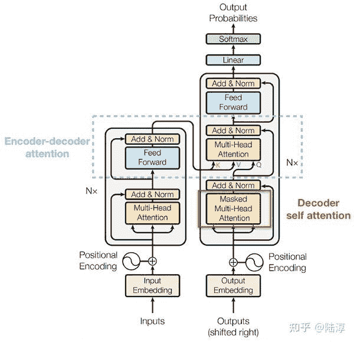

Decoder层位于transformer示意图的右边部分，一共**包含3个部分的网络结构，分****别是 Mas**ked Multi-head attention 、 Multi-head attention 、 Feed-Forward 层，层与层之间使用了残差连接。使用的组件与Eecoder 并无太大区别

需要我们注意的是Decod**er****层里面有****许多精巧的**细节设计，图中这个与 Encoder输出（Memory）进行交互的部分叫做 Encoder-Decoder attention 。 对于这部分的输入， Q 来自于Decoder下面多头注意力机制的输出， K和V 均是 Encoder 部分的输出（Memory）经过 线性变换 后得到。以下是Decode端的具体代码:

```
class Decoder(nn.Module):
    &quot;Generic N layer decoder with masking.&quot;
    def __init__(self, layer, N):
        #第一个参数就是解码器层layer，第二个参数是解码器层的个数N
        super(Decoder, self).__init__()
        self.layers = clones(layer, N)
        self.norm = LayerNorm(layer.size)

    def forward(self, x, memory, src_mask, tgt_mask):
        #x代表目标数据的嵌入表示，memory是编码器层的输出，source_mask，target_mask代表源数据和目标数据的掩码张量
        #变量x通过每一个层的处理得出最后的结果，最后进行一次规范化返回即可。
        for layer in self.layers:
            x = layer(x, memory, src_mask, tgt_mask)
        return self.norm(x)

class DecoderLayer(nn.Module):
    &quot;Decoder is made of self-attn, src-attn, and feed forward (defined below)&quot;
    def __init__(self, size, self_attn, src_attn, feed_forward, dropout):
        #参数size代表词嵌入的维度大小，同时也代表解码器的尺寸，self_attn指这个注意力机制需要Q=K=V，src_attn指Q!=K=V，feed_forward是前馈全连接层对象
        super(DecoderLayer, self).__init__()
        self.size = size
        self.self_attn = self_attn
        self.src_attn = src_attn
        self.feed_forward = feed_forward
        #按照结构图使用clones函数克隆三个子层连接对象
        self.sublayer = clones(SublayerConnection(size, dropout), 3)

    def forward(self, x, memory, src_mask, tgt_mask):
        &quot;Follow Figure 1 (right) for connections.&quot;
        #参数x指上一层的输入，memory指编码器的输出，src_mask指源数据掩码张量，tgt_mask指目标数据掩码张量
        m = memory
        #第一个子层结构的输入分别是x和self-attn函数，在self_attn中Q,K,V都是相同的x，因为此时模型可能还没有生成任何目标数据所用tgt_maksyao要对目标数据进行掩蔽
        #比如在解码器准备生成第一个字符或词汇时，我们其实已经传入了第一个字符以便计算损失，但是我们不希望在生成第一个字符时模型能利用这个信息，因此我们会将其遮掩，同样生成第二个字符或词汇时，模型只能使用第一个字符或词汇信息，第二个字符以及之后的信息都不允许被模型使用。
        x = self.sublayer[0](x, lambda x: self.self_attn(x, x, x, tgt_mask))
        #第二个子层中用的是常规的注意力机制，q是x，k,v是编码层输出memory，同时传入source_mask遮蔽掉对结果没有意义的padding。
        x = self.sublayer[1](x, lambda x: self.src_attn(x, m, m, src_mask))
        #最后一个子层就是前馈全连接子层，经过它的处理后就可以返回结果，这就是我们的解码器结构
        return self.sublayer[2](x, self.feed_forward)
```

**模型输出**部分**(Generato**r**层)是由 **线性层 和 softmax层 组成。线性层通过对上一步的线性变化得到指定维度的输出，转换后的维度对应着输出类别的个数，softmax层将进一步输出模型的 分类概率 。

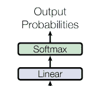

```
class Generator(nn.Module):
    &quot;线性层和softmax层的结合&quot;
    def __init__(self, dim_model, vocab): 
        #初始化模型参数 d_model：指词嵌入的维度， vocab:指词表的大小
        super(Generator, self).__init__()
        #使用nn中的预定义线性层进行实例化，得到一个对象self.proj等待使用
        #线性层的参数为初始化模型参数d_model和vocab_size
        self.proj = nn.Linear(dim_model, vocab) 

    def forward(self, x):
        #使用__init__中得到的self.proj方法对上一层的输出x进行线性变化，然后使用log_softmax进行处理
        return F.log_softmax(self.proj(x), dim=-1)
```

### 2.4 完整transformer

接下来我们利用 **编码器 **与 **解码器 ****架构将tr**ansformer的 完整架构 进行搭建


```
# 实现编码器—解码器架构
class EncoderDecoder(nn.Module):

    def __init__(self, encoder, decoder, src_embed, tgt_embed, generator): 
        &quot;初始化编码器—解码器架构&quot;
        super(EncoderDecoder, self).__init__() # 调用nn.module中的预定义层EncoderDecoder
        self.encoder = encoder # 实例化编码器对象
        self.decoder = decoder # 实例化解码器对象
        self.src_embed = src_embed # 源数据（source）嵌入函数，包括词嵌入与位置编码
        self.tgt_embed = tgt_embed # 目标数据（target）嵌入函数
        self.generator = generator # 用于线性层+softmax层得到模型的最终输出

    def forward(self, src, tgt, src_mask, tgt_mask): 
        #source代表源数据，target代表目标数据, source_mask和target_mask代表数据对应的掩码张量
        #在函数中，将source、source_mask传入编码函数，得到结果后与source_mask、target和target_mask一同传给解码函数
        return self.decode(self.encode(src, src_mask), src_mask, tgt, tgt_mask)

    def encode(self, src, src_mask):
        &quot;编码器&quot;
        #使用src_embed对source做处理，然后和source_mask一起传给self.encoder
        return self.encoder(self.src_embed(src), src_mask)

    def decode(self, memory, src_mask, tgt, tgt_mask):
        &quot;解码器&quot;
        #以memory（编码器的输出），source_mask，target和target_mask为参数,使用tgt_embed对target做处理，然后和source_mask,target_mask,memory一起传给self.decoder
        return self.decoder(self.tgt_embed(tgt), memory, src_mask, tgt_mask)
```

**文本输入与文本向量化**

```
import jieba
import math

input_sequence = &#x27;我来自西南财经大学金融科技国际联合实验室.&#x27; #输入句子
input_tokens = jieba.lcut(input_sequence) #分词
print(input_tokens) #打印分词结果
word2id = {word:index for index,word in enumerate(input_tokens)} #构建分词字典
print(word2id) #打印分词字典

input_id = np.array([word2id[words] for words in input_tokens])
input_id = torch.LongTensor([input_id])
print(input_id) #将id类型转为tensor
[&#x27;我&#x27;, &#x27;来自&#x27;, &#x27;西南财经大学&#x27;, &#x27;金融&#x27;, &#x27;科技&#x27;, &#x27;国际&#x27;, &#x27;联合&#x27;, &#x27;实验室&#x27;, &#x27;.&#x27;]
{&#x27;我&#x27;: 0, &#x27;来自&#x27;: 1, &#x27;西南财经大学&#x27;: 2, &#x27;金融&#x27;: 3, &#x27;科技&#x27;: 4, &#x27;国际&#x27;: 5, &#x27;联合&#x27;: 6, &#x27;实验室&#x27;: 7, &#x27;.&#x27;: 8}
tensor([[0, 1, 2, 3, 4, 5, 6, 7, 8]])
```

**参数设定**

```
c = copy.deepcopy
num_head = 2
max_len = 9
dropout = 0.1
hidden = 2048
dim_model = 4
```

**初始化(定义内容来自tranformer各部**分结构的封装版，请确保前面内容已经运行)

```
attn = Multi_Head_Attention(dim_model, num_head, dropout) #多头注意力
ff = Position_wise_Feed_Forward(dim_model, hidden, dropout) #前向传播
decode = Decoder(DecoderLayer(dim_model, c(attn), c(attn), c(ff), dropout), 2) #decode模型由两层decode层组成
src_mask = torch.ones(1, 1, 9) #初始化encode的mask矩阵
generator = Generator(dim_model, max_len) #输出层
tgt = torch.ones(1, 1).fill_(0).type_as(input_id.data) #decode的输入id，以encode的输入id的的第一个数字作为其开头
decode_embedding = nn.Sequential(Embeddings(dim_model, max_len), c(Positional_Encoding(dim_model, dropout=0.1)))
```

预测'我来自西南财经大学金融科技国际联合实验室.' 后面应该生成什么内容

```
for i in range(max_len-1): 
    #decode的第一个id已经知道，所以我们只用去预测剩下的id
    decode_input = decode_embedding(tgt) 
    #将id转为向量嵌入矩阵，得到decode的输入
    decode_output = decode(decode_input, encode_output, src_mask, subsequent_mask(tgt.size(1)).type_as(input_id.data)) #传入decode模型，得到decode的输出
    prob = generator(decode_output[:, -1])
    #获得词表内每个字成为预测的下一个字的概率
    _, next_word = torch.max(prob, dim = 1) 
    #返回最大概率及其id
    next_word = next_word.data[0] 
    #不让它自动更新梯度
    tgt = torch.cat([tgt, torch.ones(1, 1).type_as(input_id.data).fill_(next_word)], dim=1) 
    #将新id与原id拼接在一起

id_to_word = {index:word for index,word in enumerate(input_tokens)} 
#生成key为id，value为词的词典
text = np.array([id_to_word[w] for i in tgt.tolist() for w in i]) 
#根据输出id对应的词生成文本
for i in text:
    print(i,end=&quot;&quot;) #打印文本
```

我我来自来自科技.金融我来自

## 3.文本分类任务

接下来将进行一次完整的实验，使用transformer结构对电商商品数据进行分类

```
import os
from os.path import exists
import torch
import torch.nn as nn
from torch.nn.functional import log_softmax, pad
import math
import copy
import time
from torch.optim.lr_scheduler import LambdaLR
import pandas as pd

from torch.utils.data import Dataset, DataLoader

import warnings
from torch.utils.data.distributed import DistributedSampler
import torch.distributed as dist
import torch.multiprocessing as mp
from torch.nn.parallel import DistributedDataParallel as DDP
from torch.autograd import Variable

import torch.nn.functional as F
from sklearn import metrics
from tensorboardX import SummaryWriter
import pickle as pkl
from tqdm import tqdm
from datetime import timedelta
import jieba
import matplotlib.pyplot as plt
from torch.nn.utils.rnn import pad_sequence
from sklearn.model_selection import train_test_split
from sklearn.metrics import confusion_matrix
import numpy as np


warnings.filterwarnings(&quot;ignore&quot;)
RUN_EXAMPLES = True
```

### 3.1 数据预处理

我们使用的数据集是来自某电商平台的评论数据。首先我们来为每条电商评论贴标签，0为真实评论，1为虚假评论，我们主要关注虚假评论

```
import warnings
warnings.filterwarnings(&quot;ignore&quot;)
RUN_EXAMPLES = True

True_data = pd.read_excel(&#x27;true.xlsx&#x27;,header=None,index_col=None)
False_data = pd.read_excel(&#x27;false.xlsx&#x27;,header=None,index_col=None)
data = pd.read_excel(&#x27;电商商品评论.xlsx&#x27;,header=None,index_col=None)
# 读取原始excel文件

df = data[~data[3].isin(False_data[3])]
#isin函数用于提取和选择指定行列，条件前加~表示isin函数的逆函数，即反向选择
#剔除data数据中和False_data重复的评论文本,即剔除原始评论中的虚假评论

df[&quot;分类标签&quot;] = 0
False_data[&quot;分类标签&quot;] = 1
# 设定label，0为真实评论，1为虚假评论，即主要关注的类别

data = pd.concat([df, False_data], axis=0)
# 两张表垂直拼接在一起
data.columns = [&#x27;评论人&#x27;,&#x27;日期&#x27;,&#x27;评级&#x27;,&#x27;评论内容&#x27;,&#x27;分类标签&#x27;]
data.drop(0,axis = 0,inplace =True)
#重新命名dataframe的columns名称，方便查看
data.head()
```

|  | 评论人 | 日期 | 评级 | 评论内容 | 分类标签 |
| --- | --- | --- | --- | --- | --- |
| 1 | winebibber | 已评论商品 · 2018年5月31日 | 5颗星，满分五颗星 | 当时是跟拖地机器人绑定销售，价格还算公道，一起才3k不到； | 0 |
| 2 | winebibber | 已评论商品 · 2018年5月31日 | 5颗星，满分五颗星 | 个人很喜欢的一个系列，读的过程中有时会很纠结，感觉自己也在警察和杀手的意识… | 0 |
| 3 | winebibber | 已评论商品 · 2018年5月31日 | 5颗星，满分五颗星 | 很早就了解过 [蒙台梭利的教育 ](https://zhida.zhihu.com/search?q=%E8%92%99%E5%8F%B0%E6%A2%AD%E5%88%A9%E7%9A%84%E6%95%99%E8%82%B2&amp;zhida_source=entity&amp;is_preview=1)理论，这套书的印刷及纸质还好，内容也算丰富，参考… | 0 |
| 4 | winebibber | 已评论商品 · 2018年5月31日 | 5颗星，满分五颗星 | 之前正好想给宝贝买一副太阳镜，然后就看到了这个优惠，几十块钱的价格买到这个… | 0 |
| 5 | winebibber | 已评论商品 · 2018年5月31日 | 5颗星，满分五颗星 | 入手时有活动，性价比可说比较高； | 0 |

embedding

```
# 使用搜狗预训练的词[向量模型](https://zhida.zhihu.com/search?q=%E5%90%91%E9%87%8F%E6%A8%A1%E5%9E%8B&amp;zhida_source=entity&amp;is_preview=1)
embedding = &#x27;embedding_SougouNews.npz&#x27;

# 设置随机数种子，保证每次运行结果一致，不至于不能复现模型
np.random.seed(1)
torch.manual_seed(1)
torch.cuda.manual_seed_all(1)
torch.backends.cudnn.deterministic = True
```

下面简单说说预训练的词嵌入模块。词嵌入模块中对每一个词都进行了一个编号，读入词嵌入模型后，能够读出编号所对应的词向量，除此之外，词嵌入中还有两种特殊情况：

为了防止文本中出现词向量中不存在的词，词嵌入中还对这些不知道的词设置了一个编号，可以使用 "UNK" 字符得到相应的编号； 为了防止一些词语没有达到规定的最大长度，词嵌入允许对其进行填充，填充的字符为 "PAD" ，可以使用该字符得到编号。

```
vocab = pkl.load(open(&#x27;vocab.pkl&#x27;, &#x27;rb&#x27;)) #词表模型加载
#vocab本质上就是一个文字-数字相对应的词典，例如，可以查询“西”这个词的向量化数字
print(f&quot;vocab[&#x27;西&#x27;]：{vocab[&#x27;西&#x27;]}&quot;)

pad_size = 32
content = list(zip(list(data[&quot;分类标签&quot;].astype(str)),list(data[&quot;评论内容&quot;])))
print(f&quot;content[:5]：{content[:5]}&quot;)
UNK, PAD = &#x27;&lt;UNK&gt;&#x27;, &#x27;&lt;PAD&gt;&#x27; 
# 未知字，padding符号
```

vocab['西']：132 content[:5]：[('0', '当时是跟拖地机器人绑定销售，价格还算公道，一起才3k不到；'), ('0', '个人很喜欢的一个系列，读的过程中有时会很纠结，感觉自己也在警察和杀手的意识…'), ('0', '很早就了解过蒙台梭利的教育理论，这套书的印刷及纸质还好，内容也算丰富，参考…'), ('0', '之前正好想给宝贝买一副太阳镜，然后就看到了这个优惠，几十块钱的价格买到这个…'), ('0', '入手时有活动，性价比可说比较高；')]

向量化表示

```
contents = [] #初始化输入序列
for line in content:
  label, sentence = &quot;\t&quot;.join(line).split(&quot;\t&quot;)
  # word_id存储每个字的id 
  words_id = []
  # 分词器，分成每个字
  token = jieba.lcut(sentence)
  # 字的长度
  seq_len = len(token)
  if pad_size:
  # 如果字长度小于指定长度，则填充，否则截断
    if len(token) &lt; pad_size:
      token.extend([vocab.get(PAD)] * (pad_size - len(token)))
    else:
      token = token[:pad_size]
      seq_len = pad_size
  # 将每个字映射为ID
  for word in token:
    words_id.append(vocab.get(word, vocab.get(UNK)))
  contents.append((words_id, int(label), seq_len)) #输入序列格式为
print(contents[0])  #即第一句话的向量化表示
```

([4760, 110, 1427, 4760, 4760, 4760, 4760, 2077, 4760, 546, 1042, 4760, 2077, 4760, 789, 4760, 4760, 3935, 4760, 4760, 4760, 4760, 4760, 4760, 4760, 4760, 4760, 4760, 4760, 4760, 4760, 4760], 0, 18)

```
#训练集、测试集和验证集比例为6：2：2
train_dev_data, test_data = train_test_split(contents, test_size=0.2, random_state=0)
train_data, dev_data = train_test_split(contents, test_size=0.25, random_state=0)
#生成数据集迭代器
class DatasetIterater(object):
    def __init__(self, batches, batch_size):
        self.batch_size = batch_size
        self.batches = batches
        self.n_batches = len(batches) // batch_size
        self.residue = False  # 记录batch数量是否为整数
        if len(batches) % self.n_batches != 0:
            self.residue = True
        self.index = 0


    def _to_tensor(self, datas):
        x = torch.LongTensor([_[0] for _ in datas])
        y = torch.LongTensor([_[1] for _ in datas])

        # pad前的长度(超过pad_size的设为pad_size)
        seq_len = torch.LongTensor([_[2] for _ in datas])
        return (x, seq_len), y

    def __next__(self):
        if self.residue and self.index == self.n_batches:
            batches = self.batches[self.index * self.batch_size: len(self.batches)]
            self.index += 1
            batches = self._to_tensor(batches)
            return batches

        elif self.index &gt;= self.n_batches:
            self.index = 0
            raise StopIteration
        else:
            batches = self.batches[self.index * self.batch_size: (self.index + 1) * self.batch_size]
            self.index += 1
            batches = self._to_tensor(batches)
            return batches

    def __iter__(self):
        return self

    def __len__(self):
        if self.residue:
            return self.n_batches + 1
        else:
            return self.n_batches

def build_iterator(dataset, batch_size):
    iter = DatasetIterater(dataset, batch_size)
    return iter
train_iter = build_iterator(train_data, 32)  #batch_size = 32,一次训练时，喂给模型32条数据
dev_iter = build_iterator(dev_data, 32)
test_iter = build_iterator(test_data, 32)
```

### 3.2 搭建模型

设定模型的一些参数

```
embedding_pretrained = torch.tensor(np.load(&quot;embedding_SougouNews.npz&quot;)[&quot;embeddings&quot;].astype(&#x27;float32&#x27;)) ## 预训练词向量
n_vocab = len(vocab) # 词表大小
embed = embedding_pretrained.size(1)   # 词表大小，在运行时赋值
pad_size = 32  # 每句话处理成的长度(短填长切)
learning_rate = 5e-4
dropout = 0.1
num_head = 6
dim_model = 300
hidden = 1024
num_encoder = 2
num_classes = 2
batch_size = 32 # mini-batch大小
num_epochs = 4 
class_list = [&quot;0&quot;,&quot;1&quot;] #分类标签
```

构建模型

```
class Model(nn.Module):
    def __init__(self, embedding_pretrained):
        super(Model, self).__init__()
        self.embedding = nn.Embedding.from_pretrained(embedding_pretrained, freeze=False)
        self.postion_embedding = Positional_Encoding(embed, pad_size, dropout)
        self.encoder = Encoder(dim_model, num_head, hidden, dropout)
        self.encoders = nn.ModuleList([
            copy.deepcopy(self.encoder)
            for _ in range(num_encoder)])

        self.fc1 = nn.Linear(pad_size * dim_model, num_classes)


    def forward(self, x):
        out = self.embedding(x[0])
        out = self.postion_embedding(out)
        for encoder in self.encoders:
            out = encoder(out)
        out = out.view(out.size(0), -1)
        out = log_softmax(self.fc1(out), dim=-1)
        return out


def clones(module, N):
    &quot;克隆模型结构&quot;
    #参数module指要克隆的模型，N指要克隆的份数
    #clones函数将某个结构深拷贝若干份，并将以列表的形式存入ModuleList中，方便后续调用    
    return nn.ModuleList([copy.deepcopy(module) for _ in range(N)])

class LayerNorm(nn.Module):
    &quot;对特征做正则化&quot;
    def __init__(self, features, eps=1e-6):
        #参数features表示词嵌入的维度,参数eps是一个足够小的数，在规范化公式的分母中出现,防止分母为0，默认是1e-6。
        super(LayerNorm, self).__init__()
        self.a_2 = nn.Parameter(torch.ones(features))
        self.b_2 = nn.Parameter(torch.zeros(features))
        self.eps = eps

    def forward(self, x):
        #对输入变量x求其最后一个维度的均值和标准差，并用keepdim=True将输出维度与输入维度保持一致
        #将标准化后的结果乘以我们的缩放参数a_2后再加上位移参数b_2。*号代表同型点乘，即对应位置进行乘法操作
        mean = x.mean(-1, keepdim=True)
        std = x.std(-1, keepdim=True)
        return self.a_2 * (x - mean) / (std + self.eps) + self.b_2

class SublayerConnection(nn.Module):
    def __init__(self, dim_model, dropout):
        super(SublayerConnection, self).__init__()
        self.norm = LayerNorm(dim_model) #规范化
        self.dropout = nn.Dropout(dropout)

    def forward(self, x, sublayer):
        &quot;“将剩余连接应用于具有相同大小的任何子层。”&quot;
        return x + self.dropout(sublayer(self.norm(x)))

class Encoder(nn.Module):
    &quot;编码器由self-attention层和feed_forward层组成&quot;
    def __init__(self, dim_model, num_head, hidden, dropout=0.1):
        super(Encoder, self).__init__()
        self.self_attn = Multi_Head_Attention(dim_model, num_head, dropout)
        self.feed_forward = Position_wise_Feed_Forward(dim_model, hidden, dropout)
        self.sublayer = clones(SublayerConnection(dim_model, dropout), 2) #之所以克隆两个层是因为self-attention层和feed_forward层


    def forward(self, x):
        x = self.sublayer[0](x, lambda x: self.self_attn(x, x, x)) #多头self-attention
        return self.sublayer[1](x, self.feed_forward) #前向传播


class Positional_Encoding(nn.Module):
    &quot;Implement the PE function.&quot;
    def __init__(self, embed, pad_size, dropout):
        #参数embed指词嵌入维度，max_len指每个句子的最大长度
        super(Positional_Encoding, self).__init__()
        self.dropout = nn.Dropout(p=dropout)
        # Compute the positional encodings once in log space.
        # 注意下面代码的计算方式与公式中给出的是不同的，但是是等价的，你可以尝试简单推导证明一下。
        # 这样计算是为了避免中间的数值计算结果超出float的范围，
        self.pe = torch.tensor([[pos / (10000.0 ** (i // 2 * 2.0 / embed)) for i in range(embed)] for pos in range(pad_size)])
        self.pe = torch.tensor([[pos / (10000.0 ** (i // 2 * 2.0 / embed)) for i in range(embed)] for pos in range(pad_size)])
        self.pe[:, 0::2] = np.sin(self.pe[:, 0::2])
        self.pe[:, 1::2] = np.cos(self.pe[:, 1::2])


    def forward(self, x):
        #更新位置编码
        x = x + nn.Parameter(self.pe, requires_grad=False)
        #x = x + Variable(self.pe[:, :x.size(1)], requires_grad=False)
        return self.dropout(x)

def Scaled_Dot_Product_Attention(Q, K, V, dropout=None):
    &quot;Compute &#x27;Scaled Dot Product Attention&#x27;&quot;
    #首先取query的最后一维的大小，对应词嵌入维度
    d_k = Q.size(-1)
    #按照注意力公式，将query与key的转置相乘，这里面key是将最后两个维度进行转置，再除以缩放系数得到注意力得分张量scores
    scores = torch.matmul(Q, K.transpose(-2, -1)) / math.sqrt(d_k)
    #对scores的最后一维进行softmax操作，使用F.softmax方法，这样获得最终的注意力张量
    p_attn = F.softmax(scores, dim = -1)
    #之后判断是否使用dropout对注意力进行随机置0
    if dropout is not None:
        p_attn = dropout(p_attn)
    #最后，根据公式将p_attn与value张量相乘获得最终的query注意力表示，同时返回注意力张量
    return torch.matmul(p_attn, V), p_attn

class Multi_Head_Attention(nn.Module):
    def __init__(self, dim_model, num_head, dropout):
        &quot;Take in model size and number of heads.&quot;
        #参数h代表头数，d_model代表词嵌入的维度，dropout代表进行数据操作时置0比率，默认是0.1
        super(Multi_Head_Attention, self).__init__()
        #assert语句判断d_model是否能被h整除，这是因为我们之后要给每个头分配等量的词特征，也就是embedding_dim/head个
        assert dim_model % num_head == 0
        # We assume d_v always equals d_k
        #得到每个头获得的词向量维度d_k
        self.d_k = dim_model // num_head
        self.h = num_head
        #通过nn的Linear实例化创建linear层，它的内部变换矩阵大小是embedding_dim*embedding_dim
        #因为在多头注意力中，Q,K,V各需要一个线性层，最后拼接的矩阵还需要一个线性层，因此一共需要克隆四个
        self.linears = clones(nn.Linear(dim_model, dim_model), 4)
        #self.attn代表最后得到的注意力张量，现在还没有结果所以为None
        self.attn = None
        self.dropout = nn.Dropout(p=dropout)

    def forward(self, query, key, value):
        &quot;Implements Figure 2&quot;
        #前三个参数就是注意力机制需要的Q,K,V，最后一个参数是注意力机制中可能需要的mask掩码张量，默认是None 
        #接着，我们获得一个batch_size的变量，他是query尺寸的第1个数字，代表有多少条样本
        nbatches = query.size(0)

        # 1) Do all the linear projections in batch from d_model =&gt; h x d_k
        #首先利用zip函数和for循环将QKV分别传到线性层中，并分别为每个头做输入
        #view方法对线性变换的结构进行维度重塑，h代表头，d_k代表词向量维度，这样就意味着每个头可以获得一部分词特征组成的句子，
        #view中的-1代表自适应维度，计算机会根据这种变换自动计算这里的值，
        #然后对第二维和第三维进行转置操作，使得代表句子长度维度和词向量维度能够相邻，这样注意力机制才能找到词义与句子位置的关系，得到每个头的输入 
        query, key, value = \
            [l(x).view(nbatches, -1, self.h, self.d_k).transpose(1, 2)
             for l, x in zip(self.linears, (query, key, value))]

        # 2) Apply attention on all the projected vectors in batch. 
        #得到每个头的输入后，接下来就是将他们传入到attention中，这里直接调用我们之前实现的attention函数，同时也将mask和dropout传入其中                
        x, self.attn = Scaled_Dot_Product_Attention(query, key, value, dropout=self.dropout)        
        # 3) &quot;Concat&quot; using a view and apply a final linear.      
        #为了方便后续的计算，我们要将每个头计算结果组成的4维张量转换为输入的形状
        #因此这里开始进行第一步处理环节的逆操作，先对第二和第三维进行转置，
        #然后使用contiguous方法将tensor变成在内存中连续分布的形式，从而让转置后的张量应用view方法，否则将无法直接使用
        #最后就是使用view重塑形状，变成和输入形状相同。   
        x = x.transpose(1, 2).contiguous() \
             .view(nbatches, -1, self.h * self.d_k)
        #使用线性层列表中的最后一个线性变换得到最终的多头注意力结构的输出
        return self.linears[-1](x)

class Position_wise_Feed_Forward(nn.Module):
    &quot;Implements FFN equation.&quot;
    def __init__(self, dim_model, hidden, dropout):
        #参数d_model第一个是线性层的输入维度也是第二个线性层的输出维度，即通过前馈全连接层后输入和输出的维度不变，
        #第二个参数d_ff就是第二个线性层的输入维度和第一个线性层的输出维度
        super(Position_wise_Feed_Forward, self).__init__()

        self.w_1 = nn.Linear(dim_model, hidden)
        self.w_2 = nn.Linear(hidden, dim_model)
        self.dropout = nn.Dropout(dropout)

    def forward(self, x):
        #输入参数为x，代表来自上一层的输出，首先经过第一个线性层，然后使用F中的relu函数进行激活，之后再使用dropout进行随机置0，最后通过第二个线性层w2，返回最终结果
        return self.w_2(self.dropout(F.relu(self.w_1(x))))
```

### 3.3 训练模型

定义train函数

```
# coding: UTF-8
[impo](https://zhida.zhihu.com/search?q=%E6%B7%B7%E6%B7%86%E7%9F%A9%E9%98%B5&amp;zhida_source=entity&amp;is_preview=1)rt time
import torch
import numpy as np
from importlib import import_module
import argparse

def get_time_dif(start_time):
    &quot;&quot;&quot;获取已使用时间&quot;&quot;&quot;
    end_time = time.time()
    time_dif = end_time - start_time
    return timedelta(seconds=int(round(time_dif)))

def train( model, train_iter, dev_iter, test_iter):  # train函数
    start_time = time.time()
    model.train()
    optimizer = torch.optim.Adam(model.parameters(), lr=learning_rate)

    # 学习率指数衰减，每次epoch：学习率 = gamma * 学习率
    # scheduler = torch.optim.lr_scheduler.ExponentialLR(optimizer, gamma=0.9)
    total_batch = 0  # 记录进行到多少batch
    dev_best_loss = float(&#x27;inf&#x27;)
    last_improve = 0  # 记录上次验证集loss下降的batch数
    flag = False  # 记录是否很久没有效果提升
    writer = SummaryWriter(log_dir=&#x27;transformer&#x27; + time.strftime(&#x27;%m-%d_%H.%M&#x27;, time.localtime()))
    for epoch in range(num_epochs):
        print(&#x27;Epoch [{}/{}]&#x27;.format(epoch + 1, num_epochs))
        # scheduler.step() # 学习率衰减
        for i, (trains, labels) in enumerate(train_iter):
            outputs = model(trains)
            model.zero_grad()
            loss = F.cross_entropy(outputs, labels)
            loss.backward()
            optimizer.step()
            if total_batch % 100 == 0:
                # 每多少轮输出在训练集和验证集上的效果
                true = labels.data.cpu()
                predic = torch.max(outputs.data, 1)[1].cpu()
                train_acc = metrics.accuracy_score(true, predic)
                dev_acc, dev_loss = evaluate(model, dev_iter)
                if dev_loss &lt; dev_best_loss:
                    dev_best_loss = dev_loss
                    torch.save(model.state_dict(),&#x27;transformer.ckpt&#x27;)
                    improve = &#x27;*&#x27;
                    last_improve = total_batch
                else:
                    improve = &#x27;&#x27;
                time_dif = get_time_dif(start_time)
                msg = &#x27;Iter: {0:&gt;6},  Train Loss: {1:&gt;5.2},  Train Acc: {2:&gt;6.2%},  Val Loss: {3:&gt;5.2},  Val Acc: {4:&gt;6.2%},  Time: {5} {6}&#x27;
                print(msg.format(total_batch, loss.item(), train_acc, dev_loss, dev_acc, time_dif, improve))
                writer.add_scalar(&quot;loss/train&quot;, loss.item(), total_batch)
                writer.add_scalar(&quot;loss/dev&quot;, dev_loss, total_batch)
                writer.add_scalar(&quot;acc/train&quot;, train_acc, total_batch)
                writer.add_scalar(&quot;acc/dev&quot;, dev_acc, total_batch)
                model.train()
            total_batch += 1
            if total_batch - last_improve &gt; 100:
                # 验证集loss超过100batch没下降，结束训练
                print(&quot;No optimization for a long time, auto-stopping...&quot;)
                flag = True
                break
        if flag:
            break
    writer.close()
    test(model, test_iter)


def test(model, test_iter):
    # test
    model.load_state_dict(torch.load(&#x27;transformer.ckpt&#x27;))
    model.eval()
    start_time = time.time()
    test_acc, test_loss, test_report, test_confusion = evaluate(model, test_iter, test=True)
    msg = &#x27;Test Loss: {0:&gt;5.2},  Test Acc: {1:&gt;6.2%}&#x27;
    print(msg.format(test_loss, test_acc))
    print(&quot;Precision, Recall and F1-Score...&quot;)  # 指标
    print(test_report)
    print(&quot;Confusion Matrix...&quot;)  # 混淆矩阵
    print(test_confusion)
    time_dif = get_time_dif(start_time)
    print(&quot;Time usage:&quot;, time_dif)


def evaluate(model, data_iter, test=False):
    model.eval()
    loss_total = 0
    predict_all = np.array([], dtype=int)
    labels_all = np.array([], dtype=int)
    with torch.no_grad():
        for texts, labels in data_iter:
            outputs = model(texts)
            loss = F.cross_entropy(outputs, labels)
            loss_total += loss
            labels = labels.data.cpu().numpy()
            predic = torch.max(outputs.data, 1)[1].cpu().numpy()
            labels_all = np.append(labels_all, labels)
            predict_all = np.append(predict_all, predic)

    acc = metrics.accuracy_score(labels_all, predict_all)
    if test:
        report = metrics.classification_report(labels_all, predict_all, target_names=class_list, digits=4)
        confusion = metrics.confusion_matrix(labels_all, predict_all)
        return acc, loss_total / len(data_iter), report, confusion
    return acc, loss_total / len(data_iter)
```

### 3.4 模型训练与评估

```
model = Model(embedding_pretrained)
start_time = time.time()
print(&quot;Loading data...&quot;)
time_dif = get_time_dif(start_time)
print(&quot;Time usage:&quot;, time_dif)
# train
train(model, train_iter, dev_iter, test_iter)
```