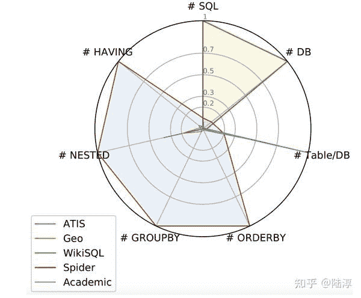
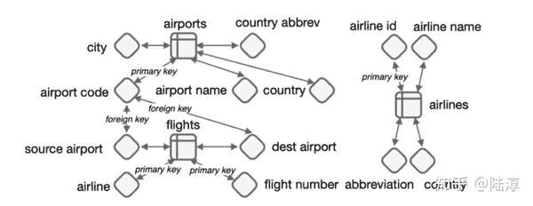
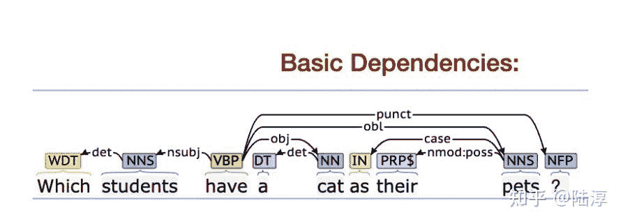
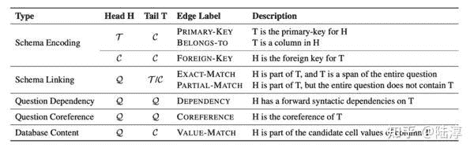
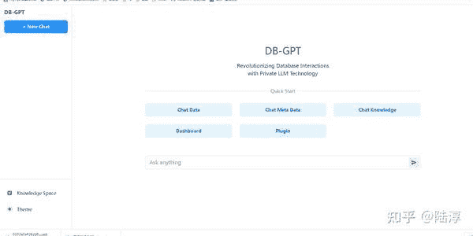

# DB-GPT-Hub：基于LLM的Text-to-SQL解析框架

> 来源：[https://agijuejin.feishu.cn/docx/UJMXdch6OoXfjixPXHkcbEATnEz](https://agijuejin.feishu.cn/docx/UJMXdch6OoXfjixPXHkcbEATnEz)

> 作者：陆淳

> 原文： [https://zhuanlan.z](https://zhuanlan.zhihu.com/p/642719916)hihu.com/p/642719...

## **一、引言**

表格或者 [关系型数据库 ](https://zhida.zhihu.com/search?q=%E5%85%B3%E7%B3%BB%E5%9E%8B%E6%95%B0%E6%8D%AE%E5%BA%93&zhida_source=entity&is_preview=1)是目前各个领域用来存储结构化信息的最常用工具。而在使用关系型数据库中，我们最常用的数据库查询语言就是sql，sql有着丰富的语法和强大的查询能力，能够解决绝大部分的查询需求，然而对于非专业用户而言，编写sql语句是比较困难的，即使对于计算机从业者来说，编写大量并保证正确率的SQL语句也比较麻烦。这极大的阻碍了用户对于数据库的查询使用。

Text-to-SQL是一项将自然语言描述转化为对应的SQL查询语句的技术，它能利用简洁清晰的自然语言描述，有效地辅助人们对海量的数据库进行查询，简化数据查询和分析的工作。随着AIGC时代的到来，使用大规模预训练语言模型来进行sql生成的方式也越来越常见，DB-GPT便基于LLM提供了一种全新的数据库交互方式，即在保证数据安全与隐私的情况下，利用自然语言与本地数据进行交互，实现知识问答、数据可视化分析以及插件任务链的调用等能力。

[DB](https://link.zhihu.com/?target=https%3A//github.com/csunny/DB-GPT/blob/main/README.zh.md)-GPT/README.zh.md at main · csunny/DB-GPT · GitHub  github.com/csunny/DB-GPT/blob/main/README.zh.md

然[而我们在实际](https://zhida.zhihu.com/search?q=%E5%88%86%E5%B8%83%E5%BC%8F%E8%AE%A1%E7%AE%97&zhida_source=entity&is_preview=1)开发中也发现当前的Text-to-SQL技术并未与LLM一些优[秀的特性有效](https://zhida.zhihu.com/search?q=%E6%95%B0%E6%8D%AE%E9%A2%84%E5%A4%84%E7%90%86&zhida_source=entity&is_preview=1)结[合，例如s](https://zhida.zhihu.com/search?q=%E6%B3%9B%E5%8C%96%E8%83%BD%E5%8A%9B&zhida_source=entity&is_preview=1)elf-instruct、思维链、 分布式计算 、量化微调、attention优化等方法，因此，DB-GPT-Hub作为DB-GPT的子项目，将会从 数据预处理 、模型架构、参数微调等方面入手，着重解决如何让本地大模型轻量、快捷、准确的生成SQL的问题，从而提升模型跨领域和跨数据库的 泛化能力 、复杂和多轮的查询能力、可执行性和可解释性。

DB-GPT-Hub项目刚刚开始，本专栏将在Text-to-SQL领域不断更新我们的项目和想法，不断尝试前沿的技术。我们欢迎有想法和技术的朋友一起参与进来

[  ](https://link.zhihu.com/?target=https%3A//github.com/csunny/DB-GPT-Hub)

下面来简单介绍一下我们最近在Text-to-SQL领域的尝试——指令微调

## **二、数据集简介**

Spider数据集是一个 **多数据库 **、 **多表 **、 **单轮 **查询的Text-to-SQL数据集，是Text2SQL任务中最具挑战性的数据集之一，由耶鲁大学的LILY实验室于2018年发布，具有如下特点：

+   **规模大 **：Spider数据集包含了10,181个自然语言问题和5,693个唯一的复杂SQL查询，涉及到200个具有多个表的数据库，覆盖了138个不同的领域。

+   **泛化强 **[：Spi](https://zhida.zhihu.com/search?q=%E8%AE%AD%E7%BB%83%E9%9B%86&zhida_source=entity&is_preview=1)der数据集与之前的Text2SQL数据集不同的是，它在 训练集 和测试集中使用了不同的SQL查询和数据库模式，这就要求模型不仅能很好地泛化到新的SQL查询，而且也要泛化到新的数据库模式。

+   **结构好 **:与WikiSQL在每个数据库中只有一个表相比，Spider上的每个数据库包含多个表，并且它们通过主外键联系在一起。

+   **有挑战 **：Spider数据集包含了SQL中几乎所有常见的高级语法，比如"ORDER BY", "GROUP BY", "HAVING", "JOIN”,"INSERTION"和嵌套等



[  ](https://link.zhihu.com/?target=https%3A//yale-lily.github.io/spider)

Spider数据集将SQL生成分成了四个等级：

+   简单：

+   What is the number of cars with more than 4 cylinders？

+   SELECT COUNT (*)FROM cars_dataWHERE cylinders > 4*

+   中等：

+   For each stadium, how many concerts are there?

+   SELECT T2.name, COUNT (*)
FROM concert AS T1 JOIN stadium AS T2ON T1.stadium_id = T2.stadium_idGROUP BY T1.stadium_idHardWhich countries in Europe have at least 3 car manufacturers?

+   较难：

+   Which countries in Europe have at least 3 car manufacturers?

+   SELECT T1.country name FROM countries AS T1 JOIN continents AS T2 ON T1.continent = T2.cont_id JOIN car makers AS T3 ON T1.country_id = T3.country WHERE T2.continent = 'Europe' GROUP BY T1.country_name HAVING COUNT (*) >= 3

+   极难：

+   What is the average life expectancy in the countries where English is not the official language?

+   SELECT AVG(life_expectancy) FROM country WHERE name NOT IN (SELECT T1.name FROM country AS T1 JOIN country_language AS T2 ON T1.code = T2.country_code WHERE T2.language = "English" AND T2.is_official = "T")

Spider数据集主要包含三部分：

+   train_spide.json ：每条text-to-SQL的QA数据与数据库相关数据存储为json文件

+   db_id：数据库名称

+   question: 以自然语言的方式向数据库发出的指令

+   query：接受自然语言指令后，能够准确执行指令的sql代码

+   **train_gold.sql **：用户question的指定正确sql代码

+   **database **：数据库 [源文件](https://zhida.zhihu.com/search?q=%E6%BA%90%E6%96%87%E4%BB%B6&zhida_source=entity&is_preview=1)

+   schema.sql: 建表语句。

+   sqlite: 数据库的具体内容。

## **三、数据预处理**

一个关系型数据库，比如一个MySQL数据库,包含了一个或多个表（table），每个表中又包含了多个列（column），表和表之间会通过一些公共的列进行联系，这些列也就是数据库中常见的主键外键。举个例子，图中是一个关系型数据库的大致结构框架，又叫数据库模式，这里有很多张表，比如student这张表中存有学生的一些信息，比如学号ID，姓名name，所在学院department_name，总学分total_credit等字段，这张表通过department_name这个列和另一张表department联系起来，department_name就是student表的一个外键，这个外键对应于department这张表中的主键department_name。


在输入的预处理阶段，我们可以将所有的输入想象建模为图网络，图网络中的每一个节点就是输入的单词或者短语，他们之间的边则是我们所定义的各种不同类型的关系，通常来说一共有五大类型的关系：

+   Schema Encoding： 对数据库的结构模式进行编码。在数据库中，[我们通常](https://zhida.zhihu.com/search?q=%E5%BA%8F%E5%88%97%E5%8C%96&zhida_source=entity&is_preview=1)会通过主键和外键进行跨表连接，通过记录这种连接关系可以保留数据库表列之间的一个结构信息，不至于在直接简单 序列化 的过程中丢失二维表结构。



+   Schema Linking： 它指的是schema和question单词之间的关系。在一般的对话中，用户他有时并不会非常精准的说出哪一些表哪一些列的名字，这时候就需要模型能够去判断用户在这个问句过程中，到底提到了哪一些表哪一些列。


+   Qu[estio](https://zhida.zhihu.com/search?q=%E5%8F%A5%E6%B3%95%E5%88%86%E6%9E%90&zhida_source=entity&is_preview=1)n Dependency Structure： 由于用户是用自然语言进行询问，因此呢他在句法上存在一些依存关系。比如用户这里问了一句which students have a cat as their pets？可以看到从下图 句法分析 的结果上来看，这个句子中包含了各种不同的复杂种类



+   Questions Coreference： 这是为多轮的Text-to-SQL任务所设计的一种关系,比如说用户呢在最开始询问which students have a cat at their pet?然后在第二轮用户又问到what are they majoring in?然后在第三轮用户还会问Also, how old are they?第二轮和第三轮中的这个指代词they所指代的呢都是students而不是pets,这样的一个指代关系，也是一个多轮对话中经常出现的一种关系


+   Database Content Mentions： 最后也是一个非常重要的关系称之为数据库内容的提及，因为在实际情况下，用户在询问一个问题时，他可以提到一个具体列中的某个值，那么在这种情况下，信息内容匹配就显得非常重要。比如用户询问Show names of properties that are either (houses)or apartments，由于horses和apartments并不是数据库的一个表明或者一个列名，所以在进行Schema Encoding或者说在序列化的时候并不会被考虑，然而如果只给出这两个单词，模型根本就无法猜测到他们到底是属于哪一个列，所以这里我们会使用模糊匹配的方式，来搜寻可能的数据库内容，并将这种信息告诉模型


最后用一张表来总结：



基于这五大思考点，我们尝试了一种用自然语言将Schema序列化的方式。判断slq语句和梳理数据库逻辑结构可以用JDBC API中提供的Statement接口的 execute () 方法，这个方法会尝试执行给定的SQL语句，如果SQL语句不合法，则会抛出一个SQLException异常。首先我们要将原始数据整理为统一的json格式，如下：

```
{
        &quot;query&quot;: sample[&quot;query&quot;],#要生成的sql指令
        &quot;question&quot;: sample[&quot;question&quot;],#输入的问题
        &quot;db_id&quot;: db_id,#数据库名称
        &quot;db_path&quot;: db_path,#数据库文件的地址
        &quot;db_table_names&quot;: schema[&quot;table_names_original&quot;],#数据库中的表名
        &quot;db_column_names&quot;: [
            {&quot;table_id&quot;: table_id, &quot;column_name&quot;: column_name}
            for table_id, column_name in schema[&quot;column_names_original&quot;]
        ],
        &quot;db_column_types&quot;: schema[&quot;column_types&quot;],
        &quot;db_primary_keys&quot;: [{&quot;column_id&quot;: column_id} for column_id in schema[&quot;primary_keys&quot;]],
        &quot;db_foreign_keys&quot;: [
            {&quot;column_id&quot;: column_id, &quot;other_column_id&quot;: other_column_id}
            for column_id, other_column_id in schema[&quot;foreign_keys&quot;]
        ],
    }
```

函数dump_db_json_schema会通过sqlite文件和对应的数据库文件，创建一个包含数据库模式信息的JSON文件。它使用sqlite3连接到数据库，并执行一些SQL查询以获得表名、列名、列类型、主键和外键。它将这些信息存储在一个名为data的字典中，并根据JSON规范对其进行格式化。它还调用convert_fk_index函数来获得外键对。函数generate_examples则对dump_db_json_schema生成的json文件进行规范化。

```
import os
import sys
import json
import sqlite3
from os import listdir, makedirs
from os.path import isfile, isdir, join, split, exists, splitext
from nltk import word_tokenize, tokenize
import traceback


def convert_fk_index(data):
        ...
    return fk_holder


def dump_db_json_schema(db, f):
    &quot;&quot;&quot;read table and column info&quot;&quot;&quot;
       ...

    return data


def _generate_examples(self, data_filepath, db_path):
        &quot;&quot;&quot;This function returns the examples in the raw (text) form.&quot;&quot; 
        ...
```

生成示例：

```
[{&#x27;query&#x27;: &#x27;SELECT count(*) FROM head WHERE age  &gt;  56&#x27;,
   &#x27;question&#x27;: &#x27;How many heads of the departments are older than 56 ?&#x27;,
   &#x27;db_id&#x27;: &#x27;department_management&#x27;,
   &#x27;db_path&#x27;: &#x27;./spider/database&#x27;,
   &#x27;db_table_names&#x27;: [&#x27;department&#x27;, &#x27;head&#x27;, &#x27;management&#x27;],
   &#x27;db_column_names&#x27;: [{&#x27;table_id&#x27;: -1, &#x27;column_name&#x27;: &#x27;*&#x27;},
    {&#x27;table_id&#x27;: 0, &#x27;column_name&#x27;: &#x27;Department_ID&#x27;},
    {&#x27;table_id&#x27;: 0, &#x27;column_name&#x27;: &#x27;Name&#x27;},
    {&#x27;table_id&#x27;: 0, &#x27;column_name&#x27;: &#x27;Creation&#x27;},
    {&#x27;table_id&#x27;: 0, &#x27;column_name&#x27;: &#x27;Ranking&#x27;},
    {&#x27;table_id&#x27;: 0, &#x27;column_name&#x27;: &#x27;Budget_in_Billions&#x27;},
    {&#x27;table_id&#x27;: 0, &#x27;column_name&#x27;: &#x27;Num_Employees&#x27;},
    {&#x27;table_id&#x27;: 1, &#x27;column_name&#x27;: &#x27;head_ID&#x27;},
    {&#x27;table_id&#x27;: 1, &#x27;column_name&#x27;: &#x27;name&#x27;},
    {&#x27;table_id&#x27;: 1, &#x27;column_name&#x27;: &#x27;born_state&#x27;},
    {&#x27;table_id&#x27;: 1, &#x27;column_name&#x27;: &#x27;age&#x27;},
    {&#x27;table_id&#x27;: 2, &#x27;column_name&#x27;: &#x27;department_ID&#x27;},
    {&#x27;table_id&#x27;: 2, &#x27;column_name&#x27;: &#x27;head_ID&#x27;},
    {&#x27;table_id&#x27;: 2, &#x27;column_name&#x27;: &#x27;temporary_acting&#x27;}],
   &#x27;db_column_types&#x27;: [&#x27;text&#x27;,
    &#x27;number&#x27;,
    &#x27;text&#x27;,
    &#x27;text&#x27;,
    &#x27;number&#x27;,
    &#x27;number&#x27;,
    &#x27;number&#x27;,
    &#x27;number&#x27;,
    &#x27;text&#x27;,
    &#x27;text&#x27;,
    &#x27;number&#x27;,
    &#x27;number&#x27;,
    &#x27;number&#x27;,
    &#x27;text&#x27;],
   &#x27;db_primary_keys&#x27;: [{&#x27;column_id&#x27;: 1}, {&#x27;column_id&#x27;: 7}, {&#x27;column_id&#x27;: 11}],
   &#x27;db_foreign_keys&#x27;: [{&#x27;column_id&#x27;: 12, &#x27;other_column_id&#x27;: 7},
    {&#x27;column_id&#x27;: 11, &#x27;other_column_id&#x27;: 1}]}]
```

然后从一个数据库中找到与一个问题最匹配的行列数据信息，将该行列的相关数据库的结构（表名、列名、主键、外键等）用自然语言描述出来：

```
def get_database_matches(
    question: str,
    table_name: str,
    column_name: str,
    db_path: str,
    top_k_matches: int = 2,
    match_threshold: float = 0.85,
) -&gt; List[str]:
    ...
    return matches
    
    
def serialize_schema_natural_language(
        question: str,
        db_path: str,
        db_id: str,
        db_column_names: Dict[str, str],
        db_table_names: List[str],
        db_primary_keys,
        db_foreign_keys,
        schema_serialization_with_db_content: bool = False,
        normalize_query: bool = True,
) -&gt; str:
        ...
    return &quot; &quot;.join(descriptions)


def spider_add_serialized_schema(ex: dict) -&gt; dict:

    serialized_schema = serialize_schema_natural_language(
            question=ex[&quot;question&quot;],
            db_path=ex[&quot;db_path&quot;],
            db_id=ex[&quot;db_id&quot;],
            db_column_names=ex[&quot;db_column_names&quot;],
            db_table_names=ex[&quot;db_table_names&quot;],
            db_primary_keys=ex[&quot;db_primary_keys&quot;],
            db_foreign_keys=ex[&quot;db_foreign_keys&quot;],
            schema_serialization_with_db_content=True,
            normalize_query=True,
        )

    return {&quot;serialized_schema&quot;: serialized_schema}

def spider_pre_process_one_function(item: dict, args):
    prefix = &quot;&quot;

    seq_out = spider_get_target(
        query=item[&quot;query&quot;],
        db_id=item[&quot;db_id&quot;],
        normalize_query=True,
        target_with_db_id=True,
    )

    return prefix + item[&quot;question&quot;].strip(), seq_out
```

最后从中提取出我们需要的instruction、input、response等信息。

```
raw_datasets = all_dicts
sql_fintune_data = []
fields = [&quot;instruction&quot;,&quot;input&quot;,&quot;response&quot;]
for raw_data in tqdm(raw_datasets):
    extend_data = deepcopy(raw_data)
    extend_data.update(spider_add_serialized_schema(extend_data))
    question, seq_out = spider_pre_process_one_function(extend_data)
    extend_data.update({&quot;instruction&quot;: extend_data[&quot;serialized_schema&quot;].strip(),
              &quot;input&quot;: question,
              &quot;response&quot;: seq_out})
    sql_fintune_data.append(data)
```

数据示例如下：

```
{&quot;instruction&quot;: &quot;concert_singer(数据库名) contains tables(表) such as stadium, singer, concert, singer_in_concert. Table stadium has columns(列) such as stadium_id, location, name, capacity, highest, lowest, average. stadium_id is the primary key(主键). Table singer has columns such as singer_id, name, country, song_name, song_release_year, age, is_male. singer_id is the primary key. Table concert has columns such as concert_id, concert_name, theme, stadium_id, year. concert_id is the primary key. Table singer_in_concert has columns such as concert_id, singer_id. concert_id is the primary key. The year of concert is the foreign key（外键）of location of stadium. The stadium_id of singer_in_concert is the foreign key of name of singer. The singer_id of singer_in_concert is the foreign key of concert_name of concert.&quot;, 
&quot;input&quot;: &quot;How many singers do we have?&quot;, 
&quot;response&quot;: &quot;concert_singer | select count(*) from singer&quot;} 
```

在模型微调时，我们还定制了prompt dict以优化输入：

```
SQL_PROMPT_DICT = {
    &quot;prompt_input&quot;: (
        &quot;I want you to act as a SQL terminal in front of an example database. &quot;
        &quot;Below is an instruction that describes a task, Write a response that appropriately completes the request.\n\n&quot;
        &quot;###Instruction:\n{instruction}\n\n###Input:\n{input}\n\n###Response: &quot;
    ),
    &quot;prompt_no_input&quot;: (
        &quot;I want you to act as a SQL terminal in front of an example database. &quot;
        &quot;Below is an instruction that describes a task, Write a response that appropriately completes the request.\n\n&quot;
        &quot;###Instruction:\n{instruction}\n\n### Response: &quot;
    ),
}
```

详细代码过程可以参考项目主页的 sql_data_process.py 。

同时在这里可以埋下一个伏笔，针对某些同学对于数据量的需求，我们可以使用Evol-Instruct方法去生成多领域、[复杂度较高](https://zhida.zhihu.com/search?q=%E8%BF%9B%E5%8C%96%E7%AE%97%E6%B3%95&zhida_source=entity&is_preview=1)的sql数据。Evol-Instruct与Self-Instrcut类似，是一种用于生成复杂多样的指令数据的 进化算法 。Evol-Instruct的目的是为了提高LLM在未见任务上的zero-shot泛化能力，以及在开放域指令微调上的表现。它的基本思想是从一组初始指令开始，使用大规模语言模型（LLM）逐步将它们重写为更加复杂的指令，同时保证指令的合理性和可执行性。Evol-Instruct有两种进化方式：深度进化和广度进化。深度进化通过添加约束、深化、具体化、增加推理步骤和使输入复杂化等方式来增强指令的复杂性和难度。广度进化通过改变主题、技能和格式等方式来增强指令的多样性和覆盖度。

## **四、微调**

这里我们微调方法使用的是QLoRA，QLoRA通过量化+lora的方法可以大大降低我们在微调模型过程中的开销，对QLoRA不太熟悉的同学可以去看看我之前的文章：

[Q](https://zhuanlan.zhihu.com/p/634516004)LoRA：4-bit级别的量化+LoRA方法，用3090在DB-GPT上打造基于33B LLM的个人知识库 - 知乎 (zhihu.com)

Base模型使用的是Falcon-7b，有条件的同学可以尝试参数量更大的Falcon模型，这个系列的模型在Huggingface的LLM榜单上有很高的排名：


### **4.1、微调参数**

一些重要的微调参数如下：

**ModelArguments **：模型相关的参数

+   model_name_or_path:

+   trust_remote_code：用于控制是否允许从Hugging Face Hub上加载和执行自定义模型的代码。如果设置为True，表示信任远程仓库中的代码，并且已经阅读过代码的内容，否则可能存在安全风险。如果设置为False，表示只加载和执行Hugging Face Transformers库中已经定义的模型的代码。默认为False。

+   use_auth_token：用于指定访问Hugging Face Hub上的远程文件时使用的HTTP授权令牌。如果设置为True，或者不指定，将使用运行huggingface-cli login命令时生成的令牌（存储在~/.huggingface中）。use_auth_token可以用于从Hugging Face Hub上加载和上传模型、数据集等资源。

**DataArguments **：包含数据相关的参数

+   eval_dataset_size：验证数据集的数量，默认为1024。

+   max_train_samples：最大训练数据样本的数量。主要是为了快速调试训练代码。

+   source_max_len：最大文本输入的最大长度。如果source文本token长度超过该值，需要做文本的截断

+   target_max_len：标签文本的最大长度，如果target文本token长度超过该值，需要做文本的截断

TrainingArguments ：包含数据相关的参数，大量使用transforemrs中Trainer的默认参数

+   train_on_source：是否在source文本上进行微调。默认是False，这部分文本对应的token会在label中设置为-100的标签，设置为-100是因为在做CrossEntropy计算的时候会将-100的值对应的token忽略掉。

+   full_finetune: 是否使用adapter进行全量微调，默认为否。

+   adam8bit： 使用8-bit的adam，是否可以调整为LION或Sophia，甚至deepspeed还提供了多个1-bit优化器选择

+   double_quant：是否使用二次量化

+   quant_type：量化类型，可以选择 fp4 或 nf4

+   bits：使用的位宽，默认为4

+   optim：默认为'paged_adamw_32bit'，使用nvidia的分页机制优化器，可以在偶尔OOM的情况，让模型继续训练下去。

+   per_device_train_batch_size：单块设备（GPU）上参与进行模型训练的批尺寸大小，默认为1

+   max_steps：训练的最大步数，默认为20

+   weight_decay：AdamW优化器的L2权重衰减因子，默认为0

+   learning_rate：默认为0.0002，因为qlora是随机初始化和全0初始化的神经网络进行训练，因此学习率较高

+   remove_unused_columns：移除不需要的列

+   [max_g](https://zhida.zhihu.com/search?q=%E6%88%AA%E6%96%AD%E5%9B%A0%E5%AD%90&zhida_source=entity&is_preview=1)rad_norm：梯度 截断因子 ，默认为3

GenerationArguments： 包含文本生成的参数

+   max_new_tokens：最大的新生成的token数量，默认为256

+   do_sample：是否采样，默认为false

+   num_beams: 集束搜索的组数量，默认为1

+   num_beam_groups：集束搜索的组数量，默认为1

+   penalty_alpha：惩罚因子，输出token过短或过长的惩罚项，默认为none

+   use_cache：是否使用cache

+   temperature：softmax函数的温度因子，来调节输出token的分布

+   top_k:随机搜索中的k个最高概率选择

+   top_p: 核采样参数，top_p最高的前n个（n是变化）概率和为p，从这些n个候选token中随机采样

### **4.2、核心代码**

```
import torch
from transformers import AutoTokenizer, AutoModelForCausalLM, BitsAndBytesConfig

model = AutoModelForCausalLM.from_pretrained(
    &quot;tiiuae/falcon-7b&quot;,
    load_in_8bit=True,
    device_map={&quot;&quot;:0},
    trust_remote_code=True,
)

tokenizer = AutoTokenizer.from_pretrained(
    &quot;tiiuae/falcon-7b&quot;,
)

```

将所有的非int8模块转换为全精度（fp32）以保证稳定性，为嵌入层添加一个forward_hook，以实现输入隐藏状态的梯度计算。

```
from peft import prepare_model_for_kbit_training

model.gradient_checkpointing_enable()
model = prepare_model_for_kbit_training(model)
```

使用lora方法微调

```
from peft import LoraConfig, get_peft_model

config = LoraConfig(
    r=8,
    lora_alpha=32,
    target_modules=[&quot;query_key_value&quot;],
    lora_dropout=0.05,
    bias=&quot;none&quot;,
    task_type=&quot;CAUSAL_LM&quot;
)

model = get_peft_model(model, config)
```

加载数据集，将instruction、input、response合在一起，形成我们的dataset。

```
fulldata = Dataset.from_json(path_or_paths=&quot;sql_fintune_data.json&quot;)
df = fulldata.to_pandas()
data = pd.DataFrame()
data[&#x27;text&#x27;] = &#x27;instruction:&#x27;+df[&#x27;instruction&#x27;] + &#x27;\n&#x27; + &#x27;input:&#x27; + df[&#x27;input&#x27;] + &#x27;\n&#x27; + &#x27;response:&#x27; + df[&#x27;response&#x27;]

data = Dataset.from_pandas(data)
tokenizer.pad_token = tokenizer.eos_token
data = data.map(lambda samples: tokenizer(samples[&quot;text&quot;], padding=True, truncation=True,), batched=True)
```

开始模型训练：

```
training_args = transformers.TrainingArguments(
    auto_find_batch_size=True,
    gradient_accumulation_steps=4,
    num_train_epochs=1,
    learning_rate=2e-4,
    fp16=True,
    save_total_limit=4,
    logging_steps=25,
    output_dir=&quot;./outputs&quot;,
    save_strategy=&#x27;epoch&#x27;,
    optim=&quot;paged_adamw_8bit&quot;,
    lr_scheduler_type = &#x27;cosine&#x27;,
    warmup_ratio = 0.05,
)

trainer = transformers.Trainer(
    model=model,
    train_dataset=data,
    args=training_args,
    data_collator=transformers.DataCollatorForLanguageModeling(tokenizer, mlm=False),
)
model.config.use_cache = False 
trainer.train()
```

3m的数据训练时间在90分钟左右，最好预留24G显存。接下来解析输入输出

```
batch = tokenizer(
    prompt,
    padding=True,
    truncation=True,
    return_tensors=&#x27;pt&#x27;
)
batch = batch.to(&#x27;cuda:0&#x27;)
with torch.cuda.amp.autocast():
    output_tokens = model.generate(
        input_ids = batch.input_ids,
        max_new_tokens=200,
        temperature=0.7,
        top_p=0.7,
        num_return_sequences=1,
        pad_token_id=tokenizer.eos_token_id,
        eos_token_id=tokenizer.eos_token_id,
    )
    
generated_text = tokenizer.decode(output_tokens[0], skip_special_tokens=True)
# Inspect message response in the outputs
```

以上是部分实验代码，详细代码均可在项目中的train_qlora.py文件中找到。微调后我们会得到一个checkpoint-10的文件夹，里面存放着训练后的adapter_model，我们需要将其与base模型进行合并。

```
from transformers import AutoModelForCausalLM, AutoTokenizer
from peft import PeftModel
import torch

import os
import argparse

def get_args():
    parser = argparse.ArgumentParser()
    parser.add_argument(&quot;--base_model_name_or_path&quot;, type=str)
    parser.add_argument(&quot;--peft_model_path&quot;, type=str, default=&quot;output/checkpoint-10/adapter_model&quot;)
    parser.add_argument(&quot;--output_dir&quot;, type=str, default=&quot;output/merged_models/&quot;)
    parser.add_argument(&quot;--device&quot;, type=str, default=&quot;cpu&quot;)

    return parser.parse_args()

def main():
    args = get_args()

    print(f&quot;Loading base model: {args.base_model_name_or_path}&quot;)
    base_model = AutoModelForCausalLM.from_pretrained(
        args.base_model_name_or_path,
        return_dict=True,
        torch_dtype=torch.float16,
    )

    print(f&quot;Loading PEFT: {args.peft_model_path}&quot;)
    model = PeftModel.from_pretrained(base_model, args.peft_model_path)
    model.to(args.device)
    print(f&quot;Running merge_and_unload&quot;)
    model = model.merge_and_unload() # https://github.com/huggingface/peft/blob/main/src/peft/tuners/lora.py#L382

    tokenizer = AutoTokenizer.from_pretrained(args.base_model_name_or_path)

    model.save_pretrained(f&quot;{args.output_dir}&quot;)
    tokenizer.save_pretrained(f&quot;{args.output_dir}&quot;)
    print(f&quot;Model saved to {args.output_dir}&quot;)

if __name__ == &quot;__main__&quot; :
    main()
```

至此便生成了你微调后的模型，你可以按照DB-GPT中的说明将该模型放在models文件夹下面，然后启动DB-GPT即可运行。




五、总结

在LLM时代下，DB-GPT-Hub旨在研究Text-to-SQL技术的各种提升方式和落地生产的能力，目前仍然处于实验学习阶段，我们会逐步的去研究和完善这方面的能力，并以开源的方式提供给大家。出于实验条件和后续持续提升的计划，本次微调并没有去追逐一个凌厉的结果，仅仅抛砖引玉，欢迎有条件或有能力的同学多多参与进来

## **五、参考及感谢**

[DAMO-ConvAI](https://link.zhihu.com/?target=https%3A//github.com/AlibabaResearch/DAMO-ConvAI)

[UnifiedSKG](https://link.zhihu.com/?target=https%3A//github.com/HKUNLP/UnifiedSKG)

[WizardLM](https://link.zhihu.com/?target=https%3A//github.com/nlpxucan/WizardLM)

[picard](https://link.zhihu.com/?target=https%3A//github.com/ServiceNow/picard)

[rasat](https://link.zhihu.com/?target=https%3A//github.com/LUMIA-Group/rasat)