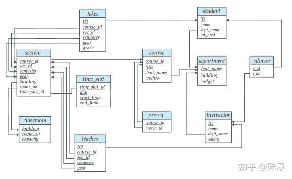
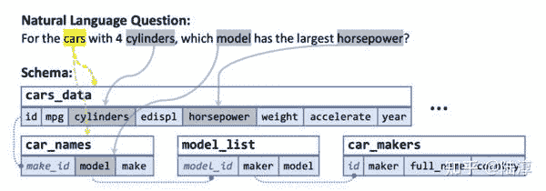
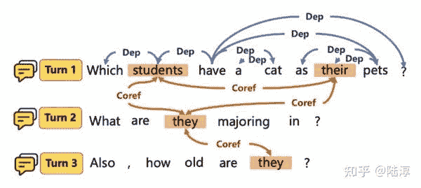
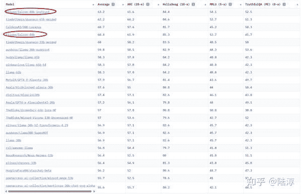
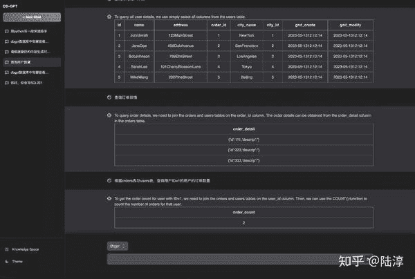
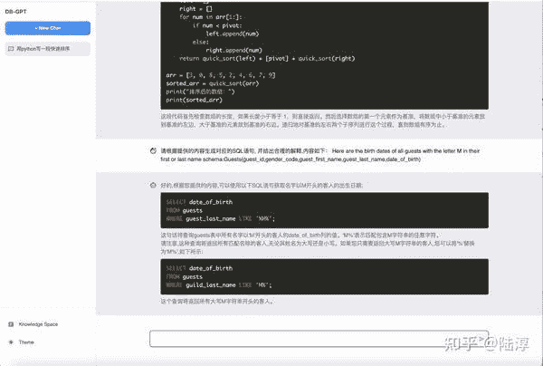

# DB-GPT-Hub：基于LLM的Text-to-SQL解析框架

> 来源：[https://agijuejin.feishu.cn/docx/UJMXdch6OoXfjixPXHkcbEATnEz](https://agijuejin.feishu.cn/docx/UJMXdch6OoXfjixPXHkcbEATnEz)  
> 作者：陆淳  
> 原文：[https://zhuanlan.zhihu.com/p/642719916](https://zhuanlan.zhihu.com/p/642719916)

## 一、引言

表格或者 [关系型数据库](https://zhida.zhihu.com/search?q=%E5%85%B3%E7%B3%BB%E5%9E%8B%E6%95%B0%E6%8D%AE%E5%BA%93&zhida_source=entity&is_preview=1) 是目前各个领域用来存储结构化信息的最常用工具。而在使用关系型数据库中，我们最常用的数据库查询语言就是 `sql`，`sql` 有着丰富的语法和强大的查询能力，能够解决绝大部分的查询需求，然而对于非专业用户而言，编写 `sql` 语句是比较困难的，即使对于计算机从业者来说，编写大量并保证正确率的 `SQL` 语句也比较麻烦。这极大的阻碍了用户对于数据库的查询使用。

`Text-to-SQL` 是一项将自然语言描述转化为对应的 SQL 查询语句的技术，它能利用简洁清晰的自然语言描述，有效地辅助人们对海量的数据库进行查询，简化数据查询和分析的工作。随着 AIGC 时代的到来，使用大规模预训练语言模型来进行 `sql` 生成的方式也越来越常见，DB-GPT 便基于 LLM 提供了一种全新的数据库交互方式，即在保证数据安全与隐私的情况下，利用自然语言与本地数据进行交互，实现知识问答、数据可视化分析以及插件任务链的调用等能力。

[DB-GPT/README.zh.md at main · csunny/DB-GPT · GitHub](https://link.zhihu.com/?target=https%3A//github.com/csunny/DB-GPT/blob/main/README.zh.md)

然而我们在实际开发中也发现当前的 `Text-to-SQL` 技术并未与 LLM 一些优秀的特性有效结合，例如 `self-instruct`、思维链、分布式计算、量化微调、`attention` 优化等方法，因此，DB-GPT-Hub 作为 DB-GPT 的子项目，将会从数据预处理、模型架构、参数微调等方面入手，着重解决如何让本地大模型轻量、快捷、准确的生成 SQL 的问题，从而提升模型跨领域和跨数据库的泛化能力、复杂和多轮的查询能力、可执行性和可解释性。

DB-GPT-Hub 项目刚刚开始，本专栏将在 `Text-to-SQL` 领域不断更新我们的项目和想法，不断尝试前沿的技术。我们欢迎有想法和技术的朋友一起参与进来。

[DB-GPT-Hub](https://link.zhihu.com/?target=https%3A//github.com/csunny/DB-GPT-Hub)

下面来简单介绍一下我们最近在 `Text-to-SQL` 领域的尝试——指令微调。

## 二、数据集简介

Spider 数据集是一个多数据库、多表、单轮查询的 `Text-to-SQL` 数据集，是 Text2SQL 任务中最具挑战性的数据集之一，由耶鲁大学的 LILY 实验室于 2018 年发布，具有如下特点：

+ **规模大**：Spider 数据集包含了 10,181 个自然语言问题和 5,693 个唯一的复杂 SQL 查询，涉及到 200 个具有多个表的数据库，覆盖了 138 个不同的领域。
+ **泛化强**：Spider 数据集与之前的 Text2SQL 数据集不同的是，它在训练集和测试集中使用了不同的 SQL 查询和数据库模式，这就要求模型不仅能很好地泛化到新的 SQL 查询，而且也要泛化到新的数据库模式。
+ **结构好**：与 WikiSQL 在每个数据库中只有一个表相比，Spider 上的每个数据库包含多个表，并且它们通过主外键联系在一起。
+ **有挑战**：Spider 数据集包含了 SQL 中几乎所有常见的高级语法，比如 `ORDER BY`、`GROUP BY`、`HAVING`、`JOIN`、`INSERTION` 和嵌套等。


[Spider 数据集官网](https://yale-lily.github.io/spider)

Spider 数据集将 SQL 生成分成了四个等级：

+ 简单：
  - 问题：What is the number of cars with more than 4 cylinders？
  - SQL：
    ```sql
    SELECT COUNT(*) FROM cars_data WHERE cylinders > 4
    ```

+ 中等：
  - 问题：For each stadium, how many concerts are there?
  - SQL：
    ```sql
    SELECT T2.name, COUNT(*)
    FROM concert AS T1 JOIN stadium AS T2 ON T1.stadium_id = T2.stadium_id
    GROUP BY T1.stadium_id
    ```

+ 较难：
  - 问题：Which countries in Europe have at least 3 car manufacturers?
  - SQL：
    ```sql
    SELECT T1.country_name FROM countries AS T1 JOIN continents AS T2 ON T1.continent = T2.cont_id JOIN car_makers AS T3 ON T1.country_id = T3.country WHERE T2.continent = 'Europe' GROUP BY T1.country_name HAVING COUNT(*) >= 3
    ```

+ 极难：
  - 问题：What is the average life expectancy in the countries where English is not the official language?
  - SQL：
    ```sql
    SELECT AVG(life_expectancy) FROM country WHERE name NOT IN (SELECT T1.name FROM country AS T1 JOIN country_language AS T2 ON T1.code = T2.country_code WHERE T2.language = "English" AND T2.is_official = "T")
    ```

Spider 数据集主要包含三部分：

+ `train_spide.json`：每条 text-to-SQL 的 QA 数据与数据库相关数据存储为 json 文件
  + `db_id`：数据库名称
  + `question`：以自然语言的方式向数据库发出的指令
  + `query`：接受自然语言指令后，能够准确执行指令的 sql 代码
+ `train_gold.sql`：用户 `question` 的指定正确 sql 代码
+ `database`：数据库源文件
  + `schema.sql`：建表语句。
  + `sqlite`：数据库的具体内容。

## 三、数据预处理

一个关系型数据库，比如一个 `MySQL` 数据库，包含了一个或多个表（`table`），每个表中又包含了多个列（`column`），表和表之间会通过一些公共的列进行联系，这些列也就是数据库中常见的主键外键。举个例子，图中是一个关系型数据库的大致结构框架，又叫数据库模式，这里有很多张表，比如 `student` 这张表中存有学生的一些信息，比如学号 `ID`，姓名 `name`，所在学院 `department_name`，总学分 `total_credit` 等字段，这张表通过 `department_name` 这个列和另一张表 `department` 联系起来，`department_name` 就是 `student` 表的一个外键，这个外键对应于 `department` 这张表中的主键 `department_name`。



在输入的预处理阶段，我们可以将所有的输入想象建模为图网络，图网络中的每一个节点就是输入的单词或者短语，他们之间的边则是我们所定义的各种不同类型的关系，通常来说一共有五大类型的关系：

+ `Schema Encoding`：对数据库的结构模式进行编码。在数据库中，我们通常会通过主键和外键进行跨表连接，通过记录这种连接关系可以保留数据库表列之间的一个结构信息，不至于在直接简单序列化的过程中丢失二维表结构。


+ `Schema Linking`：它指的是 `schema` 和 `question` 单词之间的关系。在一般的对话中，用户他有时并不会非常精准的说出哪一些表哪一些列的名字，这时候就需要模型能够去判断用户在这个问句过程中，到底提到了哪一些表哪一些列。



+ `Question Dependency Structure`：由于用户是用自然语言进行询问，因此呢他在句法上存在一些依存关系。比如用户这里问了一句 which students have a cat as their pets？可以看到从下图句法分析的结果上来看，这个句子中包含了各种不同的复杂种类。


+ `Questions Coreference`：这是为多轮的 Text-to-SQL 任务所设计的一种关系，比如说用户呢在最开始询问 which students have a cat at their pet？然后在第二轮用户又问到 what are they majoring in？然后在第三轮用户还会问 Also, how old are they？第二轮和第三轮中的这个指代词 they 所指代的呢都是 students 而不是 pets，这样的一个指代关系，也是一个多轮对话中经常出现的一种关系。



+ `Database Content Mentions`：最后也是一个非常重要的关系，称之为数据库内容的提及，因为在实际情况下，用户在询问一个问题时，他可以提到一个具体列中的某个值，那么在这种情况下，信息内容匹配就显得非常重要。比如用户询问 Show names of properties that are either (houses) or apartments，由于 houses 和 apartments 并不是数据库的一个表明或者一个列名，所以在进行 `Schema Encoding` 或者说在序列化的时候并不会被考虑，然而如果只给出这两个单词，模型根本就无法猜测到他们到底是属于哪一个列，所以这里我们会使用模糊匹配的方式，来搜寻可能的数据库内容，并将这种信息告诉模型。


最后用一张表来总结：


基于这五大思考点，我们尝试了一种用自然语言将 Schema 序列化的方式。判断 `sql` 语句和梳理数据库逻辑结构可以用 `JDBC API` 中提供的 `Statement` 接口的 `execute()` 方法，这个方法会尝试执行给定的 SQL 语句，如果 SQL 语句不合法，则会抛出一个 `SQLException` 异常。首先我们要将原始数据整理为统一的 json 格式，如下：

```json
{
        "query": sample["query"],#要生成的sql指令
        "question": sample["question"],#输入的问题
        "db_id": db_id,#数据库名称
        "db_path": db_path,#数据库文件的地址
        "db_table_names": schema["table_names_original"],#数据库中的表名
        "db_column_names": [
            {"table_id": table_id, "column_name": column_name}
            for table_id, column_name in schema["column_names_original"]
        ],
        "db_column_types": schema["column_types"],
        "db_primary_keys": [{"column_id": column_id} for column_id in schema["primary_keys"]],
        "db_foreign_keys": [
            {"column_id": column_id, "other_column_id": other_column_id}
            for column_id, other_column_id in schema["foreign_keys"]
        ],
    }
```

函数 `dump_db_json_schema` 会通过 `sqlite` 文件和对应的数据库文件，创建一个包含数据库模式信息的 JSON 文件。它使用 `sqlite3` 连接到数据库，并执行一些 SQL 查询以获得表名、列名、列类型、主键和外键。它将这些信息存储在一个名为 `data` 的字典中，并根据 JSON 规范对其进行格式化。它还调用 `convert_fk_index` 函数来获得外键对。函数 `generate_examples` 则对 `dump_db_json_schema` 生成的 json 文件进行规范化。

```python
import os
import sys
import json
import sqlite3
from os import listdir, makedirs
from os.path import isfile, isdir, join, split, exists, splitext
from nltk import word_tokenize, tokenize
import traceback


def convert_fk_index(data):
        ...
    return fk_holder


def dump_db_json_schema(db, f):
    """read table and column info"""
       ...

    return data


def _generate_examples(self, data_filepath, db_path):
        """This function returns the examples in the raw (text) form."""
        ...
```

生成示例：


```json
[{'query': 'SELECT count(*) FROM head WHERE age  >  56',
   'question': 'How many heads of the departments are older than 56 ?',
   'db_id': 'department_management',
   'db_path': './spider/database',
   'db_table_names': ['department', 'head', 'management'],
   'db_column_names': [{'table_id': -1, 'column_name': '*'},
    {'table_id': 0, 'column_name': 'Department_ID'},
    {'table_id': 0, 'column_name': 'Name'},
    {'table_id': 0, 'column_name': 'Creation'},
    {'table_id': 0, 'column_name': 'Ranking'},
    {'table_id': 0, 'column_name': 'Budget_in_Billions'},
    {'table_id': 0, 'column_name': 'Num_Employees'},
    {'table_id': 1, 'column_name': 'head_ID'},
    {'table_id': 1, 'column_name': 'name'},
    {'table_id': 1, 'column_name': 'born_state'},
    {'table_id': 1, 'column_name': 'age'},
    {'table_id': 2, 'column_name': 'department_ID'},
    {'table_id': 2, 'column_name': 'head_ID'},
    {'table_id': 2, 'column_name': 'temporary_acting'}],
   'db_column_types': ['text',
    'number',
    'text',
    'text',
    'number',
    'number',
    'number',
    'number',
    'text',
    'text',
    'number',
    'number',
    'number',
    'text'],
   'db_primary_keys': [{'column_id': 1}, {'column_id': 7}, {'column_id': 11}],
   'db_foreign_keys': [{'column_id': 12, 'other_column_id': 7},
    {'column_id': 11, 'other_column_id': 1}]}
```

然后从一个数据库中找到与一个问题最匹配的行列数据信息，将该行列的相关数据库的结构（表名、列名、主键、外键等）用自然语言描述出来：

```python
def get_database_matches(
    question: str,
    table_name: str,
    column_name: str,
    db_path: str,
    top_k_matches: int = 2,
    match_threshold: float = 0.85,
) -> List[str]:
    ...
    return matches

def serialize_schema_natural_language(
        question: str,
        db_path: str,
        db_id: str,
        db_column_names: Dict[str, str],
        db_table_names: List[str],
        db_primary_keys,
        db_foreign_keys,
        schema_serialization_with_db_content: bool = False,
        normalize_query: bool = True,
) -> str:
        ...
    return " ".join(descriptions)


def spider_add_serialized_schema(ex: dict) -> dict:

    serialized_schema = serialize_schema_natural_language(
            question=ex["question"],
            db_path=ex["db_path"],
            db_id=ex["db_id"],
            db_column_names=ex["db_column_names"],
            db_table_names=ex["db_table_names"],
            db_primary_keys=ex["db_primary_keys"],
            db_foreign_keys=ex["db_foreign_keys"],
            schema_serialization_with_db_content=True,
            normalize_query=True,
        )

    return {"serialized_schema": serialized_schema}

def spider_pre_process_one_function(item: dict, args):
    prefix = ""

    seq_out = spider_get_target(
        query=item["query"],
        db_id=item["db_id"],
        normalize_query=True,
        target_with_db_id=True,
    )

    return prefix + item["question"].strip(), seq_out
```

最后从中提取出我们需要的`instruction`、`input`、`response`等信息。

```python
raw_datasets = all_dicts
sql_fintune_data = []
fields = ["instruction","input","response"]
for raw_data in tqdm(raw_datasets):
    extend_data = deepcopy(raw_data)
    extend_data.update(spider_add_serialized_schema(extend_data))
    question, seq_out = spider_pre_process_one_function(extend_data)
    extend_data.update({"instruction": extend_data["serialized_schema"].strip(),
              "input": question,
              "response": seq_out})
    sql_fintune_data.append(data)
```

数据示例如下：

```json
{"instruction": "concert_singer(数据库名) contains tables(表) such as stadium, singer, concert, singer_in_concert. Table stadium has columns(列) such as stadium_id, location, name, capacity, highest, lowest, average. stadium_id is the primary key(主键). Table singer has columns such as singer_id, name, country, song_name, song_release_year, age, is_male. singer_id is the primary key. Table concert has columns such as concert_id, concert_name, theme, stadium_id, year. concert_id is the primary key. Table singer_in_concert has columns such as concert_id, singer_id. concert_id is the primary key. The year of concert is the foreign key（外键）of location of stadium. The stadium_id of singer_in_concert is the foreign key of name of singer. The singer_id of singer_in_concert is the foreign key of concert_name of concert.", 
"input": "How many singers do we have?", 
"response": "concert_singer | select count(*) from singer"} 
```

在模型微调时，我们还定制了`prompt` dict以优化输入：

```python
SQL_PROMPT_DICT = {
    "prompt_input": (
        "I want you to act as a SQL terminal in front of an example database. "
        "Below is an instruction that describes a task, Write a response that appropriately completes the request.\n\n"
        "###Instruction:\n{instruction}\n\n###Input:\n{input}\n\n###Response: "
    ),
    "prompt_no_input": (
        "I want you to act as a SQL terminal in front of an example database. "
        "Below is an instruction that describes a task, Write a response that appropriately completes the request.\n\n"
        "###Instruction:\n{instruction}\n\n### Response: "
    ),
}
```

详细代码过程可以参考项目主页的 `sql_data_process.py` 。

同时在这里可以埋下一个伏笔，针对某些同学对于数据量的需求，我们可以使用`Evol-Instruct`方法去生成多领域、[复杂度较高](https://zhida.zhihu.com/search?q=%E8%BF%9B%E5%8C%96%E7%AE%97%E6%B3%95&zhida_source=entity&is_preview=1)的sql数据。`Evol-Instruct`与`Self-Instrcut`类似，是一种用于生成复杂多样的指令数据的 进化算法 。`Evol-Instruct`的目的是为了提高`LLM`在未见任务上的zero-shot泛化能力，以及在开放域指令微调上的表现。它的基本思想是从一组初始指令开始，使用大规模语言模型（`LLM`）逐步将它们重写为更加复杂的指令，同时保证指令的合理性和可执行性。`Evol-Instruct`有两种进化方式：深度进化和广度进化。深度进化通过添加约束、深化、具体化、增加推理步骤和使输入复杂化等方式来增强指令的复杂性和难度。广度进化通过改变主题、技能和格式等方式来增强指令的多样性和覆盖度。

## 四、微调

这里我们微调方法使用的是`QLoRA`，`QLoRA`通过量化+`lora`的方法可以大大降低我们在微调模型过程中的开销，对`QLoRA`不太熟悉的同学可以去看看我之前的文章：

[Q](https://zhuanlan.zhihu.com/p/634516004)`LoRA`: 4-bit级别的量化+`LoRA`方法，用3090在`DB-GPT`上打造基于33B `LLM`的个人知识库 - 知乎 (zhihu.com)

Base模型使用的是`Falcon-7b`，有条件的同学可以尝试参数量更大的`Falcon`模型，这个系列的模型在`Huggingface`的`LLM`榜单上有很高的排名：



### 4.1、微调参数

一些重要的微调参数如下：

`ModelArguments`：模型相关的参数

+   `model_name_or_path`:

+   `trust_remote_code`：用于控制是否允许从`Hugging Face Hub`上加载和执行自定义模型的代码。如果设置为`True`，表示信任远程仓库中的代码，并且已经阅读过代码的内容，否则可能存在安全风险。如果设置为`False`，表示只加载和执行`Hugging Face Transformers`库中已经定义的模型的代码。默认为`False`。

+   `use_auth_token`：用于指定访问`Hugging Face Hub`上的远程文件时使用的HTTP授权令牌。如果设置为`True`，或者不指定，将使用运行`huggingface-cli login`命令时生成的令牌（存储在`~/.huggingface`中）。`use_auth_token`可以用于从`Hugging Face Hub`上加载和上传模型、数据集等资源。

`DataArguments`：包含数据相关的参数

+   `eval_dataset_size`：验证数据集的数量，默认为1024。

+   `max_train_samples`：最大训练数据样本的数量。主要是为了快速调试训练代码。

+   `source_max_len`：最大文本输入的最大长度。如果`source`文本`token`长度超过该值，需要做文本的截断

+   `target_max_len`：标签文本的最大长度，如果`target`文本`token`长度超过该值，需要做文本的截断

`TrainingArguments`：包含数据相关的参数，大量使用`transforemrs`中`Trainer`的默认参数

+   `train_on_source`：是否在`source`文本上进行微调。默认是`False`，这部分文本对应的`token`会在`label`中设置为`-100`的标签，设置为`-100`是因为在做`CrossEntropy`计算的时候会将`-100`的值对应的`token`忽略掉。

+   `full_finetune`: 是否使用`adapter`进行全量微调，默认为否。


+ `adam8bit`：使用8-bit的`adam`，是否可以调整为`LION`或`Sophia`，甚至`deepspeed`还提供了多个1-bit优化器选择

+ `double_quant`：是否使用二次量化

+ `quant_type`：量化类型，可以选择 `fp4` 或 `nf4`

+ `bits`：使用的位宽，默认为4

+ `optim`：默认为`paged_adamw_32bit`，使用NVIDIA的分页机制优化器，可以在偶尔OOM的情况，让模型继续训练下去。

+ `per_device_train_batch_size`：单块设备（GPU）上参与进行模型训练的批尺寸大小，默认为1

+ `max_steps`：训练的最大步数，默认为20

+ `weight_decay`：`AdamW`优化器的L2权重衰减因子，默认为0

+ `learning_rate`：默认为0.0002，因为`qlora`是随机初始化和全0初始化的神经网络进行训练，因此学习率较高

+ `remove_unused_columns`：移除不需要的列

+ [`max_grad_norm`](https://zhida.zhihu.com/search?q=%E6%88%AA%E6%96%AD%E5%9B%A0%E5%AD%90&zhida_source=entity&is_preview=1)：梯度截断因子，默认为3

`GenerationArguments`：包含文本生成的参数

+ `max_new_tokens`：最大的新生成的token数量，默认为256

+ `do_sample`：是否采样，默认为false

+ `num_beams`：集束搜索的组数量，默认为1

+ `num_beam_groups`：集束搜索的组数量，默认为1

+ `penalty_alpha`：惩罚因子，输出token过短或过长的惩罚项，默认为none

+ `use_cache`：是否使用cache

+ `temperature`：`softmax`函数的温度因子，来调节输出token的分布

+ `top_k`：随机搜索中的k个最高概率选择

+ `top_p`：核采样参数，`top_p`最高的前n个（n是变化）概率和为p，从这些n个候选token中随机采样

### 4.2、核心代码

```
import torch
from transformers import AutoTokenizer, AutoModelForCausalLM, BitsAndBytesConfig

model = AutoModelForCausalLM.from_pretrained(
    "tiiuae/falcon-7b",
    load_in_8bit=True,
    device_map={"":0},
    trust_remote_code=True,
)

tokenizer = AutoTokenizer.from_pretrained(
    "tiiuae/falcon-7b",
)
```

将所有的非`int8`模块转换为全精度（`fp32`）以保证稳定性，为嵌入层添加一个`forward_hook`，以实现输入隐藏状态的梯度计算。

```
from peft import prepare_model_for_kbit_training

model.gradient_checkpointing_enable()
model = prepare_model_for_kbit_training(model)
```

使用`lora`方法微调

```
from peft import LoraConfig, get_peft_model

config = LoraConfig(
    r=8,
    lora_alpha=32,
    target_modules=["query_key_value"],
    lora_dropout=0.05,
    bias="none",
    task_type="CAUSAL_LM"
)

model = get_peft_model(model, config)
```

加载数据集，将`instruction`、`input`、`response`合在一起，形成我们的dataset。

```
fulldata = Dataset.from_json(path_or_paths="sql_fintune_data.json")
df = fulldata.to_pandas()
data = pd.DataFrame()
data['text'] = 'instruction:'+df['instruction'] + '\n' + 'input:' + df['input'] + '\n' + 'response:' + df['response']

data = Dataset.from_pandas(data)
tokenizer.pad_token = tokenizer.eos_token
data = data.map(lambda samples: tokenizer(samples["text"], padding=True, truncation=True,), batched=True)
```

开始模型训练：

```
training_args = transformers.TrainingArguments(
    auto_find_batch_size=True,
    gradient_accumulation_steps=4,
    num_train_epochs=1,
    learning_rate=2e-4,
    fp16=True,
    save_total_limit=4,
    logging_steps=25,
    output_dir="./outputs",
    save_strategy='epoch',
    optim="paged_adamw_8bit",
    lr_scheduler_type = 'cosine',
    warmup_ratio = 0.05,
)

trainer = transformers.Trainer(
    model=model,
    train_dataset=data,
    args=training_args,
    data_collator=transformers.DataCollatorForLanguageModeling(tokenizer, mlm=False),
)
model.config.use_cache = False 
trainer.train()
```

3m的数据训练时间在90分钟左右，最好预留24G显存。接下来解析输入输出

```
batch = tokenizer(
    prompt,
    padding=True,
    truncation=True,
    return_tensors='pt'
)
batch = batch.to('cuda:0')
with torch.cuda.amp.autocast():
    output_tokens = model.generate(
        input_ids = batch.input_ids,
        max_new_tokens=200,
        temperature=0.7,
        top_p=0.7,
        num_return_sequences=1,
        pad_token_id=tokenizer.eos_token_id,
        eos_token_id=tokenizer.eos_token_id,
    )
    
generated_text = tokenizer.decode(output_tokens[0], skip_special_tokens=True)
# Inspect message response in the outputs
```

以上是部分实验代码，详细代码均可在项目中的`train_qlora.py`文件中找到。微调后我们会得到一个`checkpoint-10`的文件夹，里面存放着训练后的`adapter_model`，我们需要将其与base模型进行合并。

```
from transformers import AutoModelForCausalLM, AutoTokenizer
from peft import PeftModel
import torch

import os
import argparse

def get_args():
    parser = argparse.ArgumentParser()
    parser.add_argument("--base_model_name_or_path", type=str)
    parser.add_argument("--peft_model_path", type=str, default="output/checkpoint-10/adapter_model")
    parser.add_argument("--output_dir", type=str, default="output/merged_models/")
    parser.add_argument("--device", type=str, default="cpu")

    return parser.parse_args()

def main():
    args = get_args()

    print(f"Loading base model: {args.base_model_name_or_path}")
    base_model = AutoModelForCausalLM.from_pretrained(
        args.base_model_name_or_path,
        return_dict=True,
        torch_dtype=torch.float16,
    )

    print(f"Loading PEFT: {args.peft_model_path}")
    model = PeftModel.from_pretrained(base_model, args.peft_model_path)
    model.to(args.device)
    print(f"Running merge_and_unload")
    model = model.merge_and_unload() # https://github.com/huggingface/peft/blob/main/src/peft/tuners/lora.py#L382

    tokenizer = AutoTokenizer.from_pretrained(args.base_model_name_or_path)

    model.save_pretrained(f"{args.output_dir}")
    tokenizer.save_pretrained(f"{args.output_dir}")
    print(f"Model saved to {args.output_dir}")

if __name__ == "__main__" :
    main()
```

至此便生成了你微调后的模型，你可以按照`DB-GPT`中的说明将该模型放在`models`文件夹下面，然后启动`DB-GPT`即可运行。






## 五、总结

在LLM时代下，`DB-GPT-Hub`旨在研究`Text-to-SQL`技术的各种提升方式和落地生产的能力，目前仍然处于实验学习阶段，我们会逐步的去研究和完善这方面的能力，并以开源的方式提供给大家。出于实验条件和后续持续提升的计划，本次微调并没有去追逐一个凌厉的结果，仅仅抛砖引玉，欢迎有条件或有能力的同学多多参与进来

## 五、参考及感谢

[DAMO-ConvAI](https://link.zhihu.com/?target=https%3A//github.com/AlibabaResearch/DAMO-ConvAI)

[UnifiedSKG](https://link.zhihu.com/?target=https%3A//github.com/HKUNLP/UnifiedSKG)

[WizardLM](https://link.zhihu.com/?target=https%3A//github.com/nlpxucan/WizardLM)

[picard](https://link.zhihu.com/?target=https%3A//github.com/ServiceNow/picard)

[rasat](https://link.zhihu.com/?target=https%3A//github.com/LUMIA-Group/rasat)
