# LLM推理算法简述

> 来源：[https://agijuejin.feishu.cn/docx/G7QIdx3jloVN5QxddEjcc9M7nYb](https://agijuejin.feishu.cn/docx/G7QIdx3jloVN5QxddEjcc9M7nYb)

> 作者：陆淳

> 原文： [https://zhuanlan.z](https://zhuanlan.zhihu.com/p/685794495)hihu.com/p/685794...

这篇文章继续完善llm推理相关工作，会需要一些基本的GPU知识，大家可以去看看之前的这篇文章

陆淳：GPU基础知识 497 赞同 · 12 评论 文章

## 一、推理显存优化

1、KV Cache

LLM 推理服务的吞吐量指标主要受制于显存限制。研究团队发现现有系统由于缺乏精细的显存管理方法而浪费了 60% 至 80% 的显存，浪费的显存主要来自 KV Cache。因此，有效管理 KV Cache 是一个重大挑战。

### **什么是KV Cache？**

Transformer 模型具有自回归推理的特点，即每次推理只会预测输出一个 token，当前轮输出token 与历史输入 tokens 拼接，作为下一轮的输入 tokens，反复执行多次。该过程中，前后两轮的输入只相差一个 token，存在重复计算。KV Cache 技术实现了将可复用的键值向量结果保存下来，从而避免了重复计算。如下图所示，展示了有无kv cache的流程

+   Without KV Cache 每次需要计算全Wq(X),Wk(X), Wv(X), 每次需要计算全量Attn

+   With KV Cache，第一步计算完整Attn，将KV保存成KV_cache

+   With KV Cache，第二步，取第一步的Next Token计算QKV， 将[KV_cache,KV]联合，计算出QKV

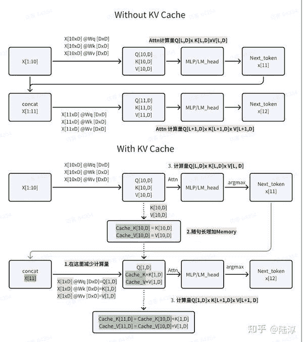

### 如何优化KV cahce？

**KV **ca**che的峰值显**存占**用大小计算公式 ：2 **x **Len**gt**h x batch_si**ze** x [d x** n**_kv_head**s] x Layers x k-bits， 由此我们可以看出影响KV cache的具体因素：

+   **k-bits: **数据类型，FP16 占2个bytes。（量化）

+   **2: **代表 Key/Value 两个向量现

+   **Length **: 输入输出序列的长度（循环队列管理窗口KV，减少长度kv）

+   **Layers **：模型层数

+   **d x n_kv_heads **：kv维度（MQA/GQA通过减少KV的头数减少显存占用）

+   **batch_size **: KV Cache 与 batchsize 度呈线性关系，随着 batch size 的增大，KV cache 占用的显存开销快速增大，甚至会超过模型本身。

+   **操作系统管理 **：现 GPU 的 KV Cache 的有效存储率较低低 （page-attention）

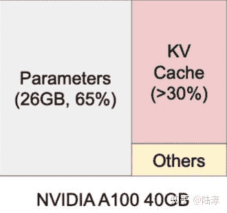

在bf16格式下的13B模型中，我们只有大约10G的空间来储存kv cache

KV Cache 的引入也使得推理过程分为[如下两个不](https://zhida.zhihu.com/search?q=%E4%BC%98%E5%8C%96%E6%96%B9%E6%B3%95&zhida_source=entity&is_preview=1)同阶段，进而影响到后续的其他 优化方法 。

+   **预填充阶段(Prefill) **：发生在计算第一个输出 token 过程中，计算时需要为每个 Transformer layer 计算并保存 key cache 和 value cache；FLOPs 同 KV Cache 一致，存在大量 GEMM (GEneral Matrix-Matrix multiply) 操作，属于 Compute-bound 类型计算。

+   **解码阶段(Decoder) **：发生在计算第二个输出 token 至最后一个 token 过程中，这时 KV Cache 已存有历史键值结果，每轮推理只需读取 Cache，同时将当前轮计算出的新的 Key、Value 追加写入至 Cache；GEMM 变为 GEMV (GEneral Matrix-Vector multiply) 操作，FLOPs 降低，推理速度相对预填充阶段变快，这时属于 Memory-bound 类型计算。

## 2、MQA/GQA

论文：

+   MQA： [https:// arxiv.org/](https://link.zhihu.com/?target=https%3A//arxiv.org/pdf/1911.02150.pdf)pdf/1911.0215 0.pdf

+   GQA： [https:// arxiv.org/](https://link.zhihu.com/?target=https%3A//arxiv.org/pdf/2305.13245.pdf)pdf/2305.1324 5.pdf

核心思想是减少kv-cache的数量，以少量kv-cache对应多个query

+   MQA[ (Mult](https://zhida.zhihu.com/search?q=%E6%B3%A8%E6%84%8F%E5%8A%9B%E6%9C%BA%E5%88%B6&zhida_source=entity&is_preview=1)i Query Attention，多查询注意力) 是多头注意力的一种变体。其主要区别在于，在 MQA 中不同的注意力头共享一个K和V的集合，每个头只单独保留了一份查询参数。因此K和V的矩阵仅有一份，这大幅度减少了显存占用，使其更高效。由于MQA改变了 注意力机制 的结构，因此模型通常需要从训练开始就支持 MQA 。也可以通过对已经训练好的模型进行微调来添加多查询注意力支持，仅需要约 5% 的原始训练数据量 就可以达到不错的效果。包括 Falcon、SantaCoder、StarCoder 等在内很多模型都采用了 MQA 机制。

+   GQA（Grouped Query Attention，分组查询注意力）是一种介于多头注意力和 MQA 之间的折中方案。它将查询头（Query Heads）分组，并在每组中共享一个键头（Key Head）和一个值头（Value Head）。表达能力与推理速度：GQA既保留了多头注意力的一定表达能力，又通过减少内存访问压力来加速推理速度。

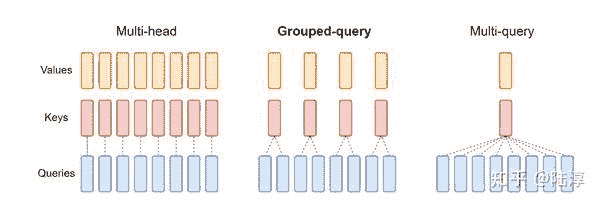

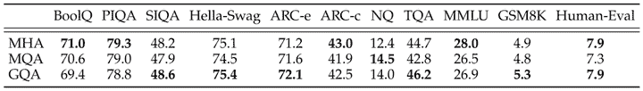

## 3、Page Attention

论文： [https:// arxiv.org/](https://link.zhihu.com/?target=https%3A//arxiv.org/pdf/2309.06180.pdf)pdf/2309.0618 0.pdf

在 Paged A[ttent](https://zhida.zhihu.com/search?q=%E5%86%85%E5%AD%98%E7%AE%A1%E7%90%86&zhida_source=entity&is_preview=1)**ion 之前，业**界主流 LLM 推理框架在 KV Cache 管理方面均存在一定的低效。HuggingFace Transformers 库中，KV Cache 是随着执行动态申请显存空间，由于 GPU显存分配耗时一般都高于 CUDA kernel 执行耗时，因此动态申请显存空间会造成极大的时延开销，且会引入显存碎片化。FasterTransformer 中，预先为 KV Cache 分配了一个充分长的显存空间，用于存储用户的上下文数据。例如 LLaMA-7B 的上下文长度为 2048，则需要为每个用户预先分配一个可支持 2048 个 tokens 缓存的显存空间。如果用户实际使用的上下文长度低于2048，则会存在显存浪费。Paged Attention 将传统操作系统中对 内存管理 的思想引入 LLM，实现了一个高效的显存管理器，通过 精细化管理显存 ，实现了在物理非连续的显存空间中以极低的成本存储、读取、新增和删除键值向量。

具体来讲，Paged Attention 将每个序列的 KV Cache 分成若干块，每个块包含固定数量token 的键和值。在注意力计算期间，Pag[edAtt](https://zhida.zhihu.com/search?q=%E8%99%9A%E6%8B%9F%E5%86%85%E5%AD%98&zhida_source=entity&is_preview=1)ention 内核可以有效地识别和获取这些块。因为块在内存中不需要连续，因而可以用一种更加灵活的方式管理 key 和 value ，就像在操作系统的 虚拟内存 中一样：可以将块视为页面，将 token 视为字节，将序列视为进程。序列的连续逻辑块通过块表映射到非连续物理块中。物理块在生成新 token 时按需分配。在 PagedAttention 中，内存浪费只会发生在序列的最后一个块中。这使得在实践中可以实现接近最佳的内存使用，仅浪费不到 4%。

接下来，我们通过一个示例（如图所示）来演示 vLLM 如何在单个输入序列的解码过程中执行 PagedAttention 并管理内存

+   与操作系统的虚拟内存一样，vLLM 不需要为初始序列保留内存，相反，它只保留必要的 KV 块来容纳即时计算期间生成的 KV 缓存。在本例中，prompt：“Four score and seven years ago our” 有 7 个token，因此 vLLM 将前 2 个逻辑 KV 块（Block 0 和 Block 1）映射到 2 个物理 KV 块（分别为 Block 7 和 Block 1）。在预填充步骤中，vLLM 使用传统的自注意力算法生成prompt的 KV 缓存和第一个输出令牌。然后，vLLM 将前 4 个令牌的 KV 缓存存储在逻辑块 0 中，将后续 3 个令牌存储在逻辑块 1 中。剩余的槽位保留用于后续自回归生成阶段。

+   第一个解码步骤中，vLLM 在物理块 7 和 1 上使用 PagedAttention 算法生成新令牌。由于逻辑块1中还有一个插槽可用，因此新生成的 KV 缓存将存储在那里，并且Block Table的 #filled 的记录同步更新。

+   在第二个解码步骤中，由于最后一个逻辑块已满，vLLM 将新生成的 KV 缓存存储在新的逻辑块中； vLLM为其分配一个新的物理块（物理块3）并将该映射存储在块表中。

在 KV 块中存储多个token使 PagedAttention 内核能够并行处[理更多位置](https://zhida.zhihu.com/search?q=%E5%86%85%E5%AD%98%E7%A2%8E%E7%89%87&zhida_source=entity&is_preview=1)的 KV 缓存，从而提高硬件利用率并减少延迟。然而，较大的块也会增加 内存碎片 。

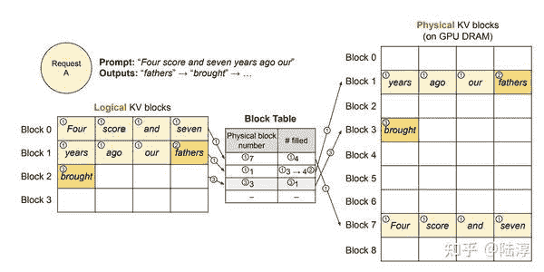

PagedAttention 还有另一个关键优势 —— 高效的内存共享。例如在并行采样中，多个输出序列是由同一个 prompt 生成的。在这种情况下，prompt 的计算和内存可以在输出序列中共享。

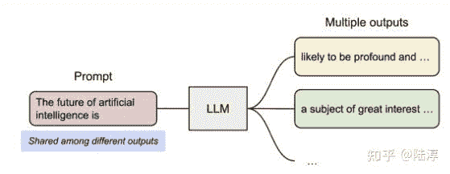

**Page**dA[ttent](https://zhida.zhihu.com/search?q=%E5%BC%95%E7%94%A8%E8%AE%A1%E6%95%B0&zhida_source=entity&is_preview=1)ion 自然地通过其 块表格 来启动内存共享。与进程共享物理页面的方式类似，PagedAttention 中的不同序列可以通过将它们的逻辑块映射到同一个物理块的方式来共享块。为了确保安全共享，PagedAttention 会对物理块的 引用计数 进行跟踪，并实现写时复制（Copy-on-Write）机制。

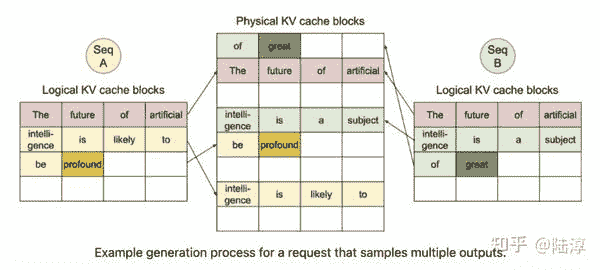

PageAttention 的内存共享大大减少了复杂采样算法的内存开销，例如并行采样和集束搜索的内存使用量降低了 55%。这可以转化为高达 2.2 倍的吞吐量提升。

## 4、FlashAttention

论文地址： [https:// arxiv.org/](https://link.zhihu.com/?target=https%3A//arxiv.org/pdf/2205.14135.pdf)pdf/2205.1413 5.pdf

此前针对Transformer类模型的优化工作致力**于减少FL**OP从而优化计算速度，忽略了 显存IO 访问上的优化。

attention计算所带来的O(n^2)复杂度的矩阵对HBM的重复读写是制约模型推理的一个主要瓶颈。

如下图所示 **GPU SRAM ****的读写（I/O）**的速度为19TB/s 和 GPU HBM 的读写（I/O）速度 1.5TB/s 相差十几倍，而对比存储容量也相差了好几个数量级。从图中可以看出Flash Attention的计算是从HBM中读取块，在SRAM中计算之后再写到HBM中。

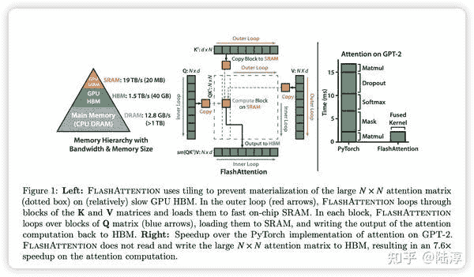

要解决这些问题，需要做两件主要的事情：

+   在不访问整个输入的情况下计算 softmax

+   不为反向传播存储大的中间 attention 矩阵

为此 FlashAttention 提出了两种方法来分布解决上述问题： tiling 和 recomputation 。

+   tiling - 注意力计算被重新构造，将输入分割成块，并通过在输入块上进行多次传递来递增地执行softmax操作。

+   recomputation - 存储来自前向的 softmax 归一化因子，以便在反向中快速重新计算芯片上的 attention，这比从HBM读取中间矩阵的标准注意力方法更快。

由于重新计算，这虽然导致FLOPS增加，但是由于大量减少HBM访问，FlashAttention运行速度更快。该算法背后的主要思想是分割输入，将它们从慢速HBM加载到快速SRAM，然后计算这些块的 attention 输出。在将每个块的输出相加之前，将其按正确的归一化因子进行缩放，从而得到正确的结果。

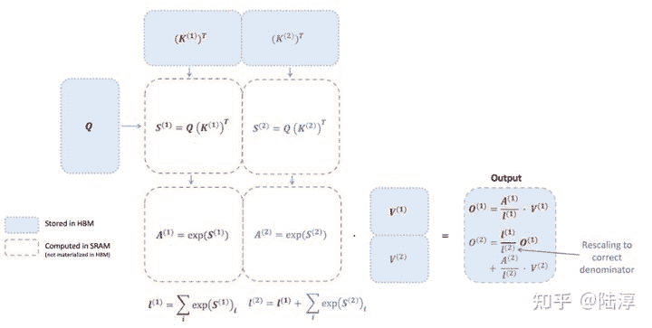

### v2

+   出发[点：Fla](https://zhida.zhihu.com/search?q=%E7%9F%A9%E9%98%B5%E4%B9%98%E6%B3%95&zhida_source=entity&is_preview=1)[shAtt](https://zhida.zhihu.com/search?q=%E6%B5%AE%E7%82%B9%E8%BF%90%E7%AE%97&zhida_source=entity&is_preview=1)ention利用了GPU内存的非对称层次结构，将内存消耗降至线性（而非二次方），并相较于优化基线实现了2到4倍的运行速度提升，然而，该技术的速度依然没有达到优化 矩阵乘法 （GEMM）操作的速度，前向传播的计算吞吐量仅达到理论最大 浮点运算 速率(FLOPs/s)的30-50%，而反向传播只能达到25-35%。这种低效率是由于GPU上不同线程块之间的负载分配不佳，导致低占用率或不必要的共享内存读/写。

+   方法：

+   (1) 调整算法，减少中间缩放的次数。 通常实现Softmax算子为了数值稳定性（因为指数增长太快，数值会过大甚至溢出），会减去最大值，这样带来的代价就是要对token遍历3次。而如果不保存中间最大值和指数和而只保留对数指数和，可以减少非矩阵乘法操作的浮点计算次数；

+   (2) **序列长度维度的并行。 **v1在batch_size和num_heads维度使用了并行化，但在处理长序列输入时，由于内存限制，通常会减小batch size和head数量，这样并行化程度就降低了。因此，FlashAttention-2还在序列长度这一维度上进行并行化，显著提升了计算速度。而序列并行要求我们交换循环的层次，FlashAttention-v2将Q移到外循环，将KV移到内循环，从而分块计算的注意力值矩阵块只存储在SRAM上，避免了在HBM上的频繁读写。(b*s*d->b*s*k*m)。

+   (3)在每个线程块内部， 分散warps之间的工作负载，减少通过共享内存的通信 。v1使用是split-K策略，这种策略会使所有warp将中间结果写入共享内存进行同步，然后将中间结果相加，这些共享内存读取会拖慢前向传播的计算。v2使用的是split-Q策略，这样在每个warp计算QK^\top后，结果只需要对应的V分片即可得到O的对应分片，而无需进行warps间的通信，减少了中间共享内存读写。

## 5、Flash-Decoding

博客地址： [h](https://link.zhihu.com/?target=https%3A//crfm.stanford.edu/2023/10/12/flashdecoding.html)ttps:// crfm.stanford.edu/2023/ 10/12/flashdecoding.html

+   出发点：

+   FlashAttention优化不适合直接应用于推理过程。因为在训练过程中，FlashAttention对batch size和query length进行了并行化加速。而在推理过程中，query length通常为1，这意味着如果batch size小于GPU上的SM数量（例如A100上有108个SMs），那么整个计算过程只使用了GPU的一小部分！特别是当上下文较长时，通常会减小batch size来适应GPU内存。例如batch size = 1时，FlashAttention对GPU利用率小于1%

+   FlashAttention对batch size和query length进行了并行化加速，Flash-Decoding在此基础上增加了一个新的并行化维度：keys/values的序列长度。即使batch size很小，但只要上下文足够长，它就可以充分利用GPU。与FlashAttention类似，Flash-Decoding几乎不用额外存储大量数据到全局内存中，从而减少了内存开销。

+   Flash Decoding主要包含以下三个步骤:

+   1.将keys和values分成较小的block;

+   [2.使用F](https://zhida.zhihu.com/search?q=%E5%B9%B6%E8%A1%8C%E8%AE%A1%E7%AE%97&zhida_source=entity&is_preview=1)lashAttention 并行计算 query与每个block的注意力（这是和FlashAttention最大的区别）。对于每个block的每行（因为一行是一个特征维度），Flash Decoding会额外记录attention values的log-sum-exp（标量值，用于第3步进行rescale）;

+   3.对所有output blocks进行reduction得到最终的output，需要用log-sum-exp值来重新调整每个块的贡献。

+   第1步中的数据分块不涉及GPU操作（因为不需要在物理上分开），只需要对第2步和第3步执行单独的kernels。虽然最终的reduction操作会引入一些额外的计算，但在总体上，Flash-Decoding通过增加并行化的方式取得了更高的效率。

## 二、算子融合

[算子融合是](https://zhida.zhihu.com/search?q=%E4%BC%98%E5%8C%96%E6%8A%80%E6%9C%AF&zhida_source=entity&is_preview=1)深度学习模型推理的一种典型 优化技术 ，旨在通过减少计算过程中的访存次数和 Kernel 启动耗时达到提升模型推理性能的目的，该方法同样适用于 LLM 推理。

以 HuggingFace Transformers 库推理 LLaMA-7B 模型为例，经分析模型推理时的算子执行分布如下图所示，该模型有 30 个类型共计 2436 个算子，其中 aten::slice 算子出现频率为 388 次。大量小算子的执行会降低 GPU 利用率，最终影响推理速度。

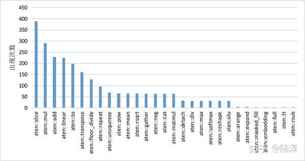

目前业界基本都针对 Transformer layer 结构特点，手工实现了算子融合。以 DeepSpeed Inference 为例，算子融合主要分为如下四类：

+   归一化层和 QKV 横向融合：将三次计算 Query/Key/Value 的操作合并为一个算子，并与前面的归一化算子融合。

+   自注意力计算融合：将自注意力计算涉及到的多个算子融合为一个，业界熟知的 FlashAttention 即是一个成熟的自注意力融合方案。

+   残差连接、归一化层、 [全连接层 ](https://zhida.zhihu.com/search?q=%E5%85%A8%E8%BF%9E%E6%8E%A5%E5%B1%82&zhida_source=entity&is_preview=1)和激活层融合：将 MLP 中第一个全连接层上下相关的算子合并为一个。

+   偏置加法和残差连接融合。

由于算子融合一般需要定制化实现算子 CUDA kernel，因此对 GPU 编程能力要求较高。随着编译器技术的引入，涌现出 OpenAI Triton 、TVM 等优秀的框架来实现算子融合的自动化或半自动化，并取得了一定的效果。

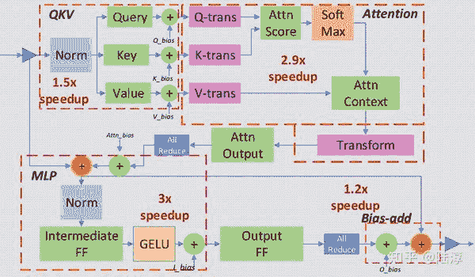

### FasterTransformer by NVIDIA

+   FasterTransformer(FT) 是一个用于实现基于Transformer的神经网络推理的加速引擎。FT框架是用C++/CUDA编写的，依赖于高度优化的 cuBLAS、cuBLASLt 和 cuSPARSELt 库，与 NVIDIA TensorRT 等其他编译器相比，FT 的特点是它支持以分布式方式推理 Transformer 大模型。

+   图融合是FT 的一个重要特征，将多层神经网络组合成一个单一的神经网络，将使用一个单一的内核进行计算。 这种技术减少了数据传输并增加了数学密度，从而加速了推理阶段的计算。 例如， multi-head attention 块中的所有操作都可以合并到一个内核中。

+   如图3所示，Faster Transformer只用了14个kernel就完成了原来将近60个kernel的计算逻辑。这其中，8个kernel是通过调用cuBLAS接口计算矩阵乘法（绿色框），其余6个是自定义kernel （蓝色框）

+   add_QKVbias

+   softmax_kernel

+   transpose

+   add_bias_act & add_bias_input_layernorm

+   x^3 -> x*x*x: c语言中x*x和pow(x,2)哪个计算更快一点？

+   rsqrt: [Why is SSE scalar sqrt(x) slowe](https://link.zhihu.com/?target=https%3A//stackoverflow.com/questions/1528727/why-is-sse-scalar-sqrtx-slower-than-rsqrtx-x)r than rsqrt(x) * x?

+   各种half2运算的使用

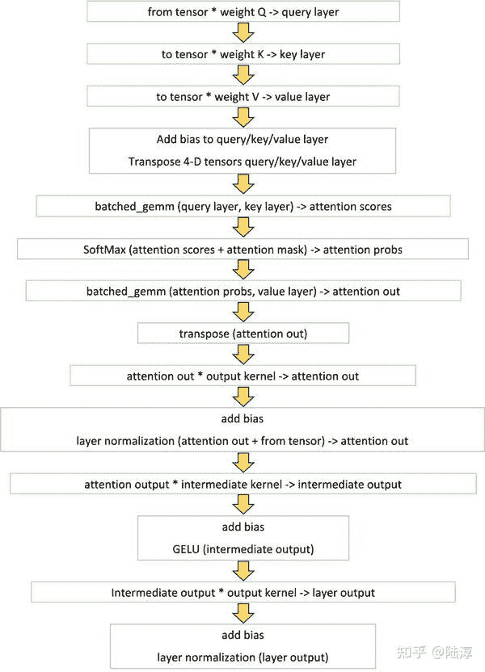

+   针对batch size比较小的场景（例如问答，TTS等），简单的融合后，基本上就可以达到很好的性能。这类场景下，推理最大瓶颈就在于频繁的kernel launch，融合后大大降低了launch的开销，因此可以比较轻易地获得很好的加速效果。

+   针对大batch的场景，我们需要对矩阵乘法和所有的自定义kernel做精细的调优，才能达到很好的加速效果。FT从矩阵乘法算法选择，非矩阵乘法操作的参数配置，SoftMax多版本实现，以及数据结构类型等几个方面对大batch的情况进行了专门的调优。

+   除此之外，FT还对部分大模型分别支持：

+   INT8 低精度量化推理

+   Ampere 架构的 GPU 硬件部分支持稀疏化

+   Hopper 架构支持 FP8 推理

+   Tensor 并行

+   Pipeline 并行

### DeepSpeed Inference by Microsoft

DeepSpeed Inference 可以将多个算子融合到单个内核中，以减少内核调用次数和跨内核访问主内存的延迟。与按元素运算的现有融合技术不同，DeepSpeed 中的深度融合可以将按元素运算、矩阵乘法、转置和约简全部融合到单个内核中，从而显着减少内核调用次数以及主内存访问次数，从而减少主存访问延迟。

**推理定制 GeMM **：G[eMM 的](https://zhida.zhihu.com/search?q=%E5%86%85%E5%AD%98%E5%B8%A6%E5%AE%BD&zhida_source=entity&is_preview=1)性能主要取决于从主存读取参数所需的时间，而不是计算时间本身。因此，为了实现最佳性能，DeepSpeed Inference 内核经过微调，以最大限度地提高加载参数时的 内存带宽 利用率。对于批量大小为 1-10 的推理工作负载，这种专业化使得 DeepSpeed Inference 内核的性能比 NVIDIA cuBLAS 高出 20%。

+   对于 Transformer layer，可分为以下4个主要部分：

+   Input Layer-Norm plus Query, Key, and Value GeMMs and their bias adds.

+   Transform plus Attention.

+   Intermediate FF, Layer-Norm, Bias-add, Residual, and Gaussian Error Linear Unit (GELU).

+   Bias-add plus Residual.

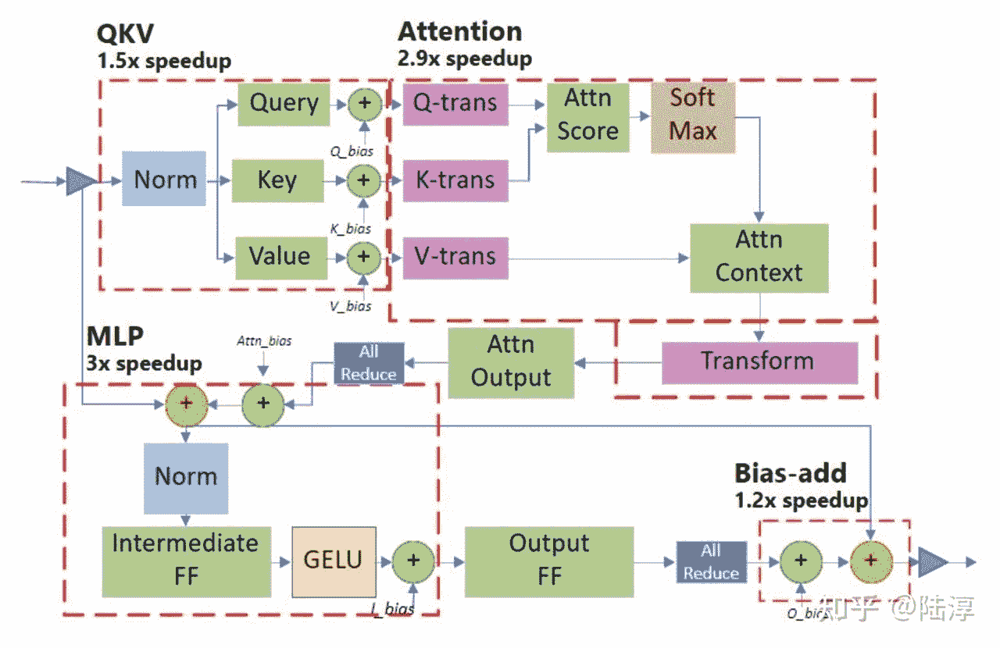

+   除此之外，DeepSpeed Inference 的优化点还有以下几点：

+   多 GPU 的 [并行优化](https://zhida.zhihu.com/search?q=%E5%B9%B6%E8%A1%8C%E4%BC%98%E5%8C%96&zhida_source=entity&is_preview=1)

+   INT8 模型量化

+   推理的 pipeline 方案

### [MLC LLM ](https://link.zhihu.com/?target=https%3A//github.com/mlc-ai/mlc-llm)by TVM

+   之前介绍的推理方案主要是基于GPU的优化，而 MLC LLM 提供了可应用于移动端（例如 iPhone）、消费级电脑端（例如 Mac）和 Web 浏览器的轻设备解决方案。

+   MLC LLM 的主要工作流基于 Apache TVM Unity，通过扩展 TVM 后端使模型编译更加透明和高效。其中以编译代码转换、融合、内存规划和库卸载（library offloading）为代表的可组合的 ML 编译优化是其中重要的优化特性。

+   除此之外，MLC LLM 还具有以下特性：

+   Dynamic shape：避免了对最大输入长度进行额外填充的需要，并减少了计算量和内存使用量。

+   量[化：MLC](https://zhida.zhihu.com/search?q=%E4%BB%A3%E7%A0%81%E7%94%9F%E6%88%90&zhida_source=entity&is_preview=1) LLM 利用低位量化来压缩模型权重，并利用 TVM 的 loop-level TensorIR 为不同的压缩编码方案快速定制 代码生成 。

+   运行时（Runtime）：TVM 编译生成的库能够通过 TVM runtime 在设备的原生环境中运行，TVM runtime 支持 CUDA/Vulkan/Metal 等主流 GPU 驱动以及 C、JavaScript 等语言的绑定。

除了上述3种方案外，其他也支持图融合的方案还包括 NVIDIA TensorRT ， Tencent TurboTransformers 等。

### 高性能算子

针对 LLM 推理运行热点函数编写高性能算子，也可以降低推理时延。

+   GEMM 操作相关优化：在 LLM 推理的预填充阶段，Self-Attention 和 MLP 层均存在多个 GEMM 操作，耗时占据了推理时延的 80% 以上。GEMM 的 GPU 优化是一个相对古老的问题，在此不详细展开描述算法细节。英伟达就该问题已推出 cuBLAS、CUDA、CUTLASS 等不同层级的优化方案。例如，FasterTransformer 框架中存在大量基于 CUTLASS 编写的 GEMM 内核函数。另外，Self-Attention 中存在 GEMM+Softmax+GEMM 结构，因此会结合算子融合联合优化。

+   GEMV 操作相关优化：在 LLM 推理的解码阶段，运行热点函数由 GEMM 变为 GEMV。相比 GEMM，GEMV 的计算强度更低，因此优化点主要围绕降低访存开销开展。

高性能算子的实现同样对 GPU 编程能力有较高要求，且算法实现中的若干超参数与特定问题规模相关。因此，编译器相关的技术如自动调优也是业界研究的重点。

## 三、调度优化

该类方法主要是针对多 Batch 的场景，通过对 Batch 的时序优化，以达到去除 padding、提高吞吐和设备利用率。传统的 Batch 处理方法是静态的，因为Batch size 的大小在推理完成之前保持不变

## Async Servering

+   Tokenize / Detokenize 过程在 CPU 上执行，期间 GPU 处于空闲状态

+   多线程异步,流水线 overlap 实现降低时延

## Dynamic Batch

+   静态batching批次大小固定不变，无法随计算资源负载动态变化，导致 GPU 资源利用率低

+   通过维护一个作业队列实现,在 batch 维度动态插入新序列，缺点是需要对输入数据进行填充以使其长度一致，或者需要暂停系统来等待构建更大的批次

## ORCA(continuous/iterative-level//in-flight batching)

论文地址： [h](https://link.zhihu.com/?target=https%3A//www.usenix.org/system/files/osdi22-yu.pdf)ttps://www. usenix.org/system/files /osdi22-yu.pdf

### 问题

1、同批次序列推理时，存在“气泡”，导致 GPU 资源利用率低

[大语言模型 ](https://zhida.zhihu.com/search?q=%E5%A4%A7%E8%AF%AD%E8%A8%80%E6%A8%A1%E5%9E%8B&zhida_source=entity&is_preview=1)的输入和输出均是可变长度的。对于给定问题，模型在运行前无法预测其输出长度。在实际服务场景下，每个用户的问题长度各不相同，问题对应的答案长度也不相同。传统方法在同批次序列推理过程中，存在“气泡”现象，即必须等同批次内的所有序列完成推理之后，才会执行下一批次序列，这就会引起 GPU 资源的浪费，导致 GPU 利用率偏低。

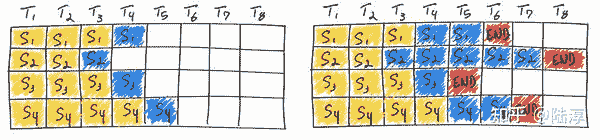

**2、另一方面，传统方法推理时 batchsize 是**固定不变的，无法随计算资源负载动态变化。

比如某一段时间内，同批次下的序列长度都偏短，原则上可以增加 batchsize 以充分利用 GPU 计算资源。然而由于固定 batchsize，无法动态调整批次大小。

### **Batching**

+   Batching就是将一段时间内到达的用户请求合并到一起，提交到GPU中执行，从而提高系统的吞吐量。然而，与传统的 DNN Model 在推理时只要正向执行一遍不同，基于 Transformer 的 Generative Model 在推理时是迭代式的（Iterative)，每个请求都需要迭代式执行多次，每次生成部分结果（一个 Token)，且每个请求的迭代次数可能是不同的（例如迭代直到模型生成一个 End-Of-Sequence Token）。因此将现有的 Batching 方式应用在 Generative Model 时，可能导致有的请求已经迭代结束了，但是还需要和同Batch中没有迭代结束的请求继续一起执行。这个问题的核心在于，传统的 Batching 技术是以 Request 为粒度的，将多个 Request 绑定在一起提交给执行引擎，多个 Request 同时开始同时结束。因此需要一个新的 Batching 的方式，这也是本项工作核心的 Insight：使用更细粒度的，Iteration-level Batching，在每个 Iteration 中将不同的 Request 合并到一起。

### 算法思想

+   由 batch 粒度的调度细化为 step 级别的调度,在时间轴方向动态插入新序列。

+   方法都来源于Orca，Orca 的第一点核心技术就是 Iteration-level scheduling ，用于解决上述 request-level scheduling 的 early-finish 的问题。Orca在调度任务时，每次只向 Execution Engine 提交一次 Iteration 的计算，而非完成整个 Request，这样 Orca 就可以在每个Iteration都动态选择Batching的Request，从而避免early-finish的请求等待其他请求的结束。Iteration-level batching 面临新的挑战：并非所有的请求都能在任意Iteration被Batching到一起。典型的问题就是Batching的Input需要有相同Shape（例如相同的 sequence length）为了解决这个问题，Orca 提出了第二点核心技术。

+   第二点核心技术： Selective batching 。这个技术的Insight是：Transformer Layer里并非所有的算子都需要Batching的Input有相同的Shape，例如，Add,Linear,GeLU等算子在计算时可以将一个Batch进行Flatten，这样不同 Sequence Length 的Input也可以Batch到一起进行计算；而对于其他必须有相同Shape才能Batching的算子（例如Attention），则对不同的输入进行单独的计算。

Continuous Batching 和 Dynamic Batching 思想最早来自论文 Orca: A Distributed Serving System for Transformer-Based Generative Models。针对问题一，提出 Continuous Batching，原理为将传统 batch 粒度的任务调度细化为 step 级别的调度。首先，调度器会维护两个队列，分别为 Running 队列和 Waiting 队列，队列中的序列状态可以在 Running 和 Waiting 之间转换。在自回归迭代生成每个 token 后，调度器均会检查所有序列的状态。一旦序列结束，调度器就将该序列由 Running 队列移除并标记为已完成，同时从 Waiting 队列中按 FCFS (First Come First Service) 策略取出一个序列添加至 Running 队列。

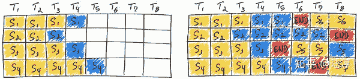

图中，序列 3 率先在 T5 时刻结束，这时调度器会检测到序列 3 已结束，将序列 3 从 Running 队列中移除，并从 Waiting 队列中按 FCFS 策略取出序列 5 添加至 Running 队列并启动该序列的推理。通过该方法，即可最大限度地消除“气泡”现象。

问题一可以理解为在时间轴方向动态插入新序列，问题二则是在 batch 维度动态插入新序列，以尽可能地充分利用显存空间。具体来讲，在自回归迭代生成每个 token 后，调度器通过当前剩余显存量，动态调整 Running 队列的长度，从而实现 Dynamic Batching。例如，当剩余显存量较多时，会尽可能增加 Running 队列长度；当待分配的 KV Cache 超过剩余显存时，调度器会将 Running 队列中低优先级的序列换出至 Waiting 队列，并将换出序列占用的显存释放。

如上两个 batching 相关的优化技术可有效提升推理吞吐量，目前已在 Text-Generation-Interface (TGI)、vLLM、OpenPPL-LLM 等多个框架中实现。

## Dynamic SplitFuse/sarathi

Deepspeed Fastgen中的一个token组合策略，用于处理prompt和生成token。

+   思路：对prompt和生成的token进行动态分解和融合，保证模型的向前传播大小一致，避免了长prompt占用过多资源的问题；vLLM 在一个前向传递中要么生成令牌，要么处理提示；令牌生成抢占提示处理。Orca 在生成过程中以完整长度处理提示。

+   实现： 对长prompt进行分块，通过多次前传逐步处理，最后一次与生成的token融合;对短prompt，则进行填充以精确满足目标token数量

+   FastGen=vllm+Dynamic SplitFuse。splitfuse的描述与sarathi的原理十分相像，但fastgen的blog没有谈及具体细节。sarathi的思想与interleaved 1F1B几乎一致，即将一个batch的多个prompt分割成均匀的chunk,属于不同prompt的chunk交叠排列，然后执行流水线并行推理，每个prompt的prefill完成后立即进入生成阶段，后续的prompt预填充与生成交叠执行，从而减少bubble的时间。

## 四、分布式并行

由于大语言模型参数量较大，可能无法存放到单一计算设备中，分布式并行可以有效解决该问题。分布式并行中的模型并行、流水线并行、张量并行已在 LLM 推理中得到应用。模型并行通过将权重参数拆分到多个计算设备中，实现分布式计算。

### [**数据并行 **](https://zhida.zhihu.com/search?q=%E6%95%B0%E6%8D%AE%E5%B9%B6%E8%A1%8C&zhida_source=entity&is_preview=1)**（DP**

主要逻辑遵循Single Program Multiple Data的原则，即**在数据并行的模型**训练、推理中，任务被切分到多个进程(设备)上,每个进程（设备） 维护相同且完整的模型参数和相同的计算任务，但是 处理不同的数据 (batch data)。数据并行不仅仅指对训练的数据并行操作，而是对网络模型梯度、权重参数、优化器状态等数据进行并行。

假设我们有两台设备，将数据划分成两份，一份给设备1，一份给设备2，通过前向和反向的计算得到梯度，对数据进行同步和梯度累积后，就完成了数据并行的第一个step的训练

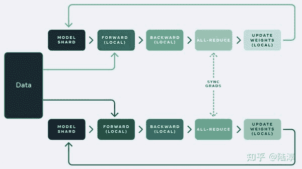

### 梯度累积

在数据并行的过程中，有两种梯度累积的方式

**同步梯度累积 **：

+   **工作原理 **：在同步梯度累积中，多个计算节点（例如，多个GPU）计算梯度，然后将它们汇总到一个主节点上。在主节点上对梯度进行求和，然后将求和后的梯度应用于模型参数更新。这确保了所有节点上的梯度都是在同一时刻被考虑的，因此称为“同步”梯度累积。

+   **优点 **：

+   确保了所有节点上的模型参数都是基于相同的梯度进行更新的，保证了模型的一致性。

+   可以避免梯度的不一致性问题，提高了模型的训练效率和稳定性。

+   **缺点 **：

+   需要一个额外的主节点来处理梯度的累积和更新，增加了通信开销和计算负载。

+   当某些节点计算速度较慢时，可能会成为训练的瓶颈，导致整体训练速度变慢（如右图所示）

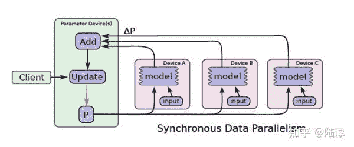

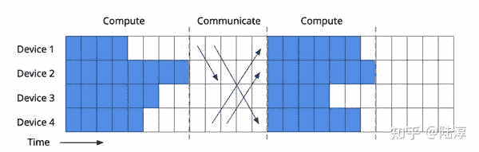

**异步梯度累积 **：

+   **工作原理 **：在异步梯度累积中，每个计算节点独立地计算梯度并更新模型参数，而不需要等待其他节点完成。每个节点可以根据自己的计算速度和资源状况独立地进行梯度更新。

+   **优点 **：

+   没有集中式的主节点，每个计算节点独立地进行梯度更新，减少了通信开销和计算负载。

+   对于计算能力较强的节点，可以更快地进行参数更新，提高了训练速度。

+   **缺点 **：

+   容易出现梯度不一致的问题，因为每个节点的更新可能基于不同的梯度计算，导致模型收敛性和稳定性方面的挑战。

+   难以控制参数的更新顺序，可能导致模型训练的不稳定性和收敛性

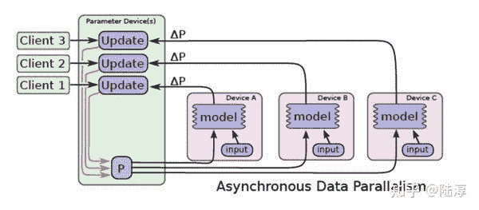

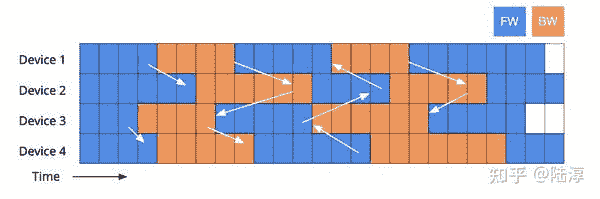

### 分布式数据并行（DDP）

特点：

+   使用了多进程的方式，不被GIL锁限制，更加灵活

+   GIL（ [全局解释器锁 ](https://zhida.zhihu.com/search?q=%E5%85%A8%E5%B1%80%E8%A7%A3%E9%87%8A%E5%99%A8%E9%94%81&zhida_source=entity&is_preview=1)）是一[种在Pyt](https://zhida.zhihu.com/search?q=%E7%AB%9E%E6%80%81%E6%9D%A1%E4%BB%B6&zhida_source=entity&is_preview=1)hon解释器中使用的机制，用于确保在多线程环境中同一时刻只有一个线程执行Python字节码。简单来说，GIL是Python解释器中的一个锁，它防止多线程程序同时执行多条Python字节码指令，简化了Python解释器的实现，避免许多与并发相关的问题，比如 竞态条件 （Race Condition）和死锁（Deadlock）。但是，它也成为了Python多线程程序性能瓶颈的一个主要原因。在I/O密集型任务中，由于线程大部分时间都在等待I/O操作完成，而不是执行Python字节码，因此GIL对性能影响较小。但在CPU密集型任务中，由于Python解释器无法利用多核CPU，因此Python多线程并不能提供与多核CPU相关的性能优势。需要注意的是，GIL只存在于CPython解释器中，而不同的Python解释器实现可能采用不同的并发模型，比如Jython和IronPython就没有GIL。因此，如果需要充分利用多核CPU，在CPython中可以考虑使用多进程（multiprocessing）或者使用C扩展来避免GIL的影响。

+   每个进程并不是同步所有的参数，而是同步梯度的误差，能够减少通讯数据

+   采用ring all reduce的方式去提高效率

+   Ring All Reduce是一种并[行计算中常用](https://zhida.zhihu.com/search?q=%E5%88%86%E5%B8%83%E5%BC%8F%E7%B3%BB%E7%BB%9F&zhida_source=entity&is_preview=1)的数据通信模式，主要用于在 分布式系统 中进行数据的聚合和全局归约操作。在深度学习等大规模并行计算任务中经常会用到。Ring All Reduce的名称源自其通信模式的特点：在一个环形的通信网络中，每个节点都将自己的局部数据发送给相邻的节点，然后在多个通信轮次中通过轮流传递和处理数据，最终实现全局数据的聚合和归约。具体地，Ring All Reduce的操作流程可以概括如下：

1.  将所有参与计算的节点排成一个环形结构，每个节点都有一个唯一的标识（例如，一个整数）用于在环形结构中定位自己的位置。

1.  初始时，每个节点都有自己的局部数据，需要将这些局部数据聚合到全局数据中。

1.  在每个通信轮次中，每个节点都会执行以下操作：

+   将自己的局部数据发送给其在环形结构中的下一个节点。

+   接收来自上一个节点的数据，并与自己的局部数据进行归约操作，例如求和、求平均等。

+   将归约后的数据再次发送给下一个节点。

4.重复上述过程，直到所有节点都接收到了全局归约后的数据

步骤：

+   **对梯度进行分桶 **：

+   在每个训练批次结束后，将模型的梯度分成多个桶（buckets）。每个桶包含一部分模型参数的梯度。分桶的目的是将梯度划分成较小的单元，以便在分布式环境下进行更好的管理和通信。

+   **对梯度进行逆向排序 **：

+   对每个桶中的梯度进行排序，以确定每个梯度的优先级。通常情况下，可以根据梯度的大小或其他指标来确定优先级。这样做可以确保在进行梯度更新时，优先考虑对重要梯度进行通信和处理。

+   跳过一些已经很久没有更新或者更新时间太慢的梯度 ：

+   在进行梯度更新之前，可能会跳过一些已经很久没有更新或者更新时间太慢的梯度。这样可以节省计算资源，并加速模型的训练过程。通常，这些梯度会被放置到较低优先级的桶中。

+   **集合通讯 **：

+   一旦梯度分桶和排序完成，各个计算节点（例如，GPU或者处理器）之间开始进行通信。通常使用集合通讯（collective communication）来实现梯度的聚合和更新。集合通讯包括诸如广播（broadcast）、归约（reduce）、散射（scatter）等操作，用于在分布式环境中有效地进行数据交换和同步。

+   **梯度更新 **：

+   一旦所有节点都完成了通信和同步操作，每个节点都可以使用聚合后的梯度来更新本地的模型参数。梯度更新通常使用优化算法（如随机梯度下降或者Adam等）来更新模型参数，并重复这个过程直到收敛。

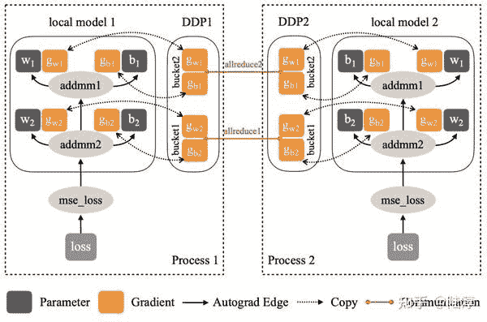

### FSDP

DP和DDP都是通过All reduce的方式去对梯度进行同步更新，All Reduce 是一种分布式计算中常用的集合通信操作，主要用于在分布式环境下对多个节点或处理器的数据进行归约操作，最终得到全局的归约结果。

FSDP则是通过all gather和reduce scatter的方式更新模型的参数、梯度和优化器的状态，更加深度的利用了网络通信空载的时间，另外还会将一些不需要用到的静态内存卸载到CPU中，减少显存压力。

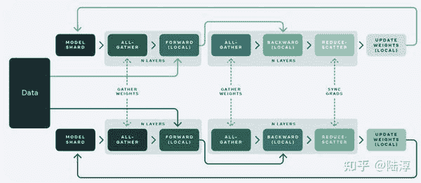

### **模型并行（MP）**

从切分角度的不同，有两个不同的含义 ：

**1）把网络的**不同层的计算分配在不同的设备上（层间模型并行），等价为 流水线并行 ；

**2）把同一**层的参数切分到不同设备上计算（层内模型并行）, 等价于 张量并行 。

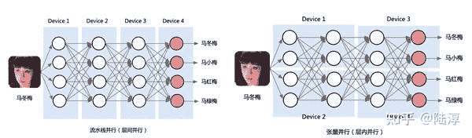

### **流水线并行（PP）**

流水线并行将模型的 **不同层 **放到不同的GPU上 ，通过切割mini-batch实现对训练数据的流水线处理，提升GPU计算通讯比。

+   Naïve Pipeline parallelism

+   朴素流水线并行：同一时刻只有一个设备进行计算，其余设备处于空闲状态，计算设备利用率通常较低

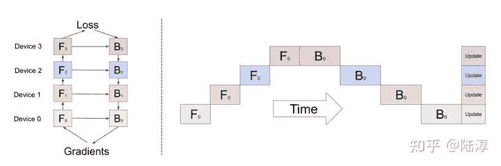

+   Mini-Batch

+   小批次流水线并行：将朴素流水线并行的 batch 再进行切分，减小设备间空闲状态的时间，可以显著提升流水线并行设备利用率。

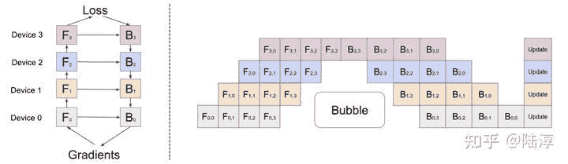

+   GPipe（google）

+   论文地址： [h](https://link.zhihu.com/?target=https%3A//arxiv.org/pdf/1811.06965.pdf%2522%2520%255Ct%2520%2522_blank)ttps:// arxiv.org/pdf/1811.0696 5.pdf%22%20%5Ct%20%22_blank

+   思路：

+   partition-stage: 将网络模型划分成不同的单元，分区算法最小化所有单元估计成本的方差，以便通过同步所有分区的计算时间来最大化管道的效率。

+   micro-batch&pipline：将mini-batch分为若干个micro-batch，像 allreduce 一样，计算完一些就传给下个节点，最后同步更新参数；

+   重计算：GPipe使用现有的技术，如梯度累积来优化内存效率，通过丢弃存储来降低显存，在后向传递需要activation时再重新计算它们。

对于Transformer-L模型，在使用128块GPU的情况下，模型最大达到937.9GB，使用了128块GPU。

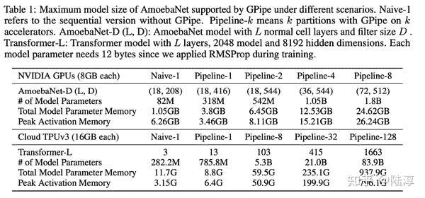

+   劣势：

+   过多流水线刷新和交互导致空闲时间的增加；

+   如果m很小，Gpipe可能会由于重新计算开销和频繁的管道刷新而降低硬件效率，所以 m 一般都设置的较大，于是需要缓存 m 份 activation导致内存增加。原因是每个micro-batch前向计算的中间结果activation都要被其后向计算所使用，即便使用了Checkpointing 技术，前向计算的 activation 也需要等到对应的后向计算完成之后才能释放。令micro-batch的数目为m,pipe的阶段为p,则空泡的比例为(p-1)/(p-1+m)

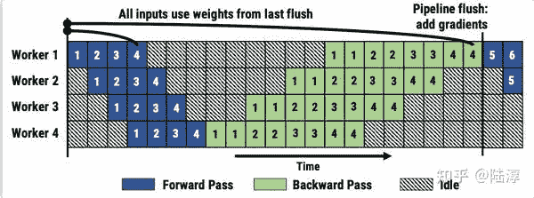

+   1F1B—one forward and one backward（microsoft）

+   思路：1F1B努力减少每个 activation 的保存时间，即这就需要每个 micro-batch 数据尽可能早的完成后向计算，从而让每个 activation 尽可能早释放。

+   方法：每个 GPU 以交替的方式执行每个 micro-batch 的正向和反向过程，使得 activation 的缓存数量只跟阶段（stage）数相关，从而进一步节省显存。步骤：在训练开始的启动阶段（图上的Startup State），输入的stage的先读入足够多micro-batch的数据，以保证pipeline在稳定阶段时，各个设备上都有相应的工作在处理。一旦输出阶段完成第一个小批次的前向传播（就是Machine 4 第一个蓝色1），它就对同一个小批次执行后向传播（就是Machine 4 的第一个绿色 1），然后开始交替执行后续小批次的前向传播和后向传播（就是 Machine 4 的 2前，2后，3前，3后…），当反向传播过程开始传播到管道中的早期阶段时（就是Work 3 ~ Work 1），每个阶段开始在不同小批次的正向和反向过程之间交替进行。

+   (Megatron-LM ) interleaved 1F1B:1F1B 并不能减少 bubble time，为了进一步减少 bubble time，Megatron-LM 又提出了 interleaved 1F1B 模式。也就是将原本每个 GPU 负责若干个连续层的计算变成负责若干个不连续层的计算，即负责的数量不变，但顺序变了，从而每个stage负责的计算更少，stage的数目变多，从而 bubble time 也变少,但这种方式要求micro-batch 的数量是流水线阶段（Stage）的整数倍，且增加了额外的通信量。bubble时间占比从(n-1)/(n-1+m)优化为(n-1)/(n-1+km)，k为每个计算设备上的stage数。

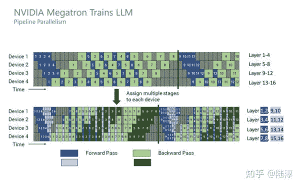

+   PipeDream

+   权重问题： 同一个micro-batch在不同stage做同样操作（同样做前向操作，或者同样做后向传播）使用的参数版本不一致，权重更新或同步变得困难。如对于 minibatch 5 在 worker 1 上的前向计算部分（蓝色5），他的前向逻辑在 minibatch 1 的后向计算以后执行。但是 minibatch 5 在 worker 2 上的前向计算部分（蓝色5），是在 “minibatch 1, minibatch 2” 的后向计算结束后才执行。

+   PipeDream 分别采用了 weight stashing 和 Vertical Sync 两种技术。

+   权重隐藏（Weight stashing） : 为权重维护多个版本，每个active micro-batch都有一个版本。每个stage 都用最新版本的权重进行前向计算，处理输入的micro-batch。计算前向传播之后，会将这份参数保存下来用于同一个micro-batch的后向计算。Weight stashing确保在一个阶段内，相同版本的模型参数被用于给定小批量的向前和向后传播，但是不能保证跨阶段间，一个给定的小批次使用模型参数的一致性。 例如在worker1中，mini-batch5的前向计算用的是mini-batch1的后向计算的激活，mini-batch5的后向计算保留了mini-batch1的权重，并且由于都经过了

+   [垂直同步 ](https://zhida.zhihu.com/search?q=%E5%9E%82%E7%9B%B4%E5%90%8C%E6%AD%A5&zhida_source=entity&is_preview=1)（Vertical Sync） : 每个micro-batch进入pipeline时都使用输入stage最新版本的参数，并且参数的版本号会伴随该micro-batch数据整个生命周期，在各个阶段都是用同一个版本的参数（而不是Weight stashing那样都使用最新版本的参数），从而实现了stage间的参数一致性。

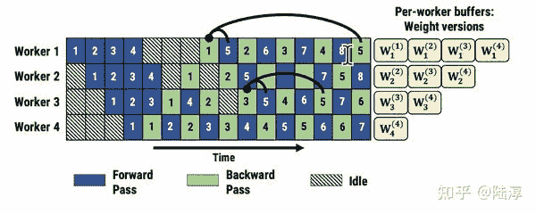

+   PipeDream-2BW 在流水线之中维护了两个版本的模型权重，“2BW” 是 双缓冲权重（double-buffered weights）”，PipeDream-2BW 会为每个微批次生成一个新的模型版本K（K>d），但是因为有些剩余后向传递仍然依赖于旧版本模型，所以新的模型版本无法立即取代旧版本，但是由于只保存了两个版本，所以极大降低了内存占用。

+   PipeDream-flush 则在 PipeDream-2BW 之上添加了一个全局同步的流水线更新刷新操作，通过限制仅保留进行中（in-flight）微批次的激活来保持较低的内存占用。思路类似 GPipe。这种方法通过牺牲吞吐量的能力部分下降的代价来减少了内存占用（即只维护一个版本的模型权重）。

### 张量并行（Tensor Paralle）

在张量并行中， 模型的参数被分割 成不同的部分，然后分配到多个设备（如GPU）上进行计算。不同的设备处理模型参数的不同部分，最后把不同设备的计算结果通过通信聚合起来，实现数学一致性（即与不拆分的计算结果等价）。

张量并行最常见的是MatMul算子并行，通过MatMul可以扩展到Embedding、Mlp、Transformer等算子并行

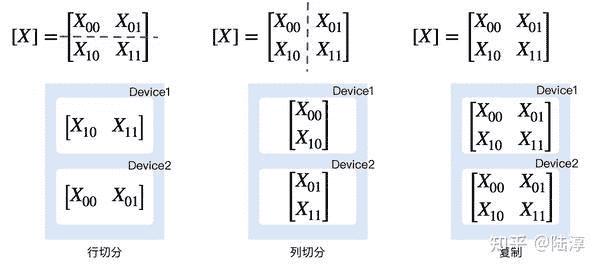

+   tensor-wise parallelism

+   MLP切分

+   对第一个线性层按列切分，对第二个线性层按行切分

+   self-attention切分

+   attention的多头计算天然适合tensor并行，因为每个头上都可以独立计算最后再将结果concat起来，从而可以把每个头的参数放到一块GPU上

+   对线性层，按照“行切割”。切割的方式和MLP层基本一致，其forward与backward原理也一致

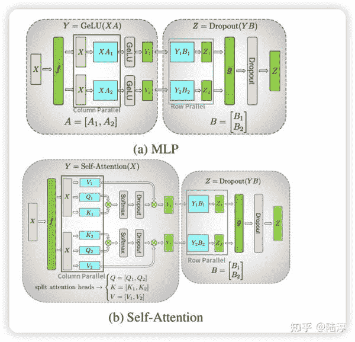

+   输入层Embedding切分

+   对positional embedding来说，max_s本身不会太长，因此每个GPU上都拷贝一份，对显存的压力也不会太大

+   将word embedding拆分到不同GPU上，每块GPU维护一分部词表。当输入X去GPU上查找时，能找到的词，就正常返回词向量，找到不到就把词向量中的全部全素都置0。按此方式查找完毕后，每块GPU上的数据做一次AllReduce，就能得到最终的输入。

+   输出层Embedding切分

+   输入层和输出层共用一个word embeding

+   当模型的输入层到输入层都在一块GPU上时（即流水线并行深度=1），我们不必担心这点（实践中大部分用Megatron做并行的项目也是这么做的）。但若模型输入层和输出层在不同的GPU上时，我们就要保证在权重更新前，两块GPU上的word embedding梯度做了一次AllReduce。

+   cross-entroy切分

+   Step1数据拆分：将 logits (input) 按照 vocab 维度进行拆分，同时将不同部分分发到各设备，labels (target)需要先进行 one hot 操作，然后 scatter 到各个设备上

+   Step2 input(logits) 最大值同步：input(logits) 需要减去其最大值后求 softmax，All Reduce (Max) 操作保证了获取的是全局最大值，有效防止溢出。

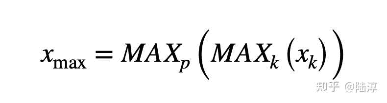

+   Step 3 exp sum 与softmax 计算：exp sum 即 softmax 计算中的分母部分， All Reduce (Max) 操作保证了获取的是全局的和。

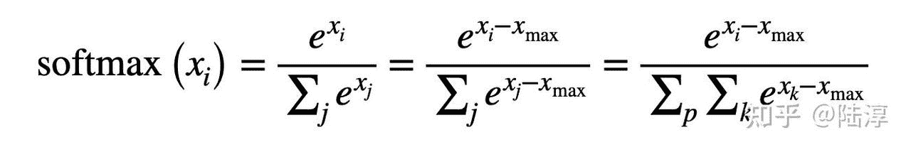

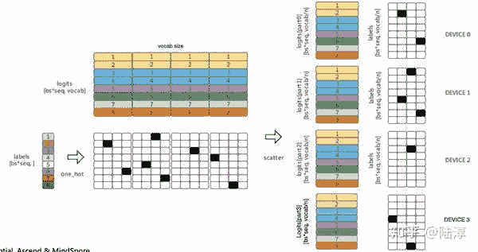

+   Step 4 计算 Loss： input (logits) 与 one_hot 相乘并求和，得到 label 位置值 [im ，](https://zhida.zhihu.com/search?q=%E4%BA%A4%E5%8F%89%E7%86%B5&zhida_source=entity&is_preview=1)并进行 all_reduce (Sum)全局同步，最后计算 log softmax 操作并加上负号，得到分布式 交叉熵 的损失值 loss。

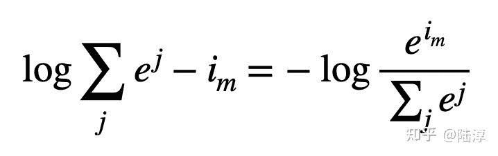

## **五、量化**

**之前有些过相关文章可以看看**

模型量化是一种将浮点计算转成低比特定点计算的技术，可以有效的降低模型计算强度、参数大小和内存消耗，但往往带来巨大的精度损失。尤其是在极低比特(<4bit)、二值网络(1bit)、甚至将梯度进行量化时，带来的精度挑战更大。

当进行矩阵[乘法时，可](https://zhida.zhihu.com/search?q=%E5%93%88%E8%BE%BE%E7%8E%9B%E7%A7%AF&zhida_source=entity&is_preview=1)以通过组合各种技巧，例如逐行或逐向量量化，来获取更精确的结果。举个例子，对矩阵乘法，我们不会直接使用常规量化方式，即用整个张量的最大绝对值对张量进行归一化，而会转而使用向量量化方法，找到 A 的每一行和 B 的每一列的最大绝对值，然后逐行或逐列归一化 A 和 B 。最后将 A 与 B 相乘得到 C。最后，我们再计算与 A 和 B 的最大绝对值向量的外积，并将此与 C 求 哈达玛积 来反量化回 FP16。

以下分别是量化公式Q和反量化公式R的具体表示

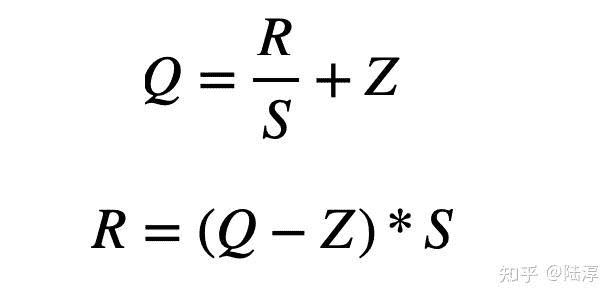

+   R 表示输入的浮点数据

+   Q 表示量化之后的定点数据

+   Z 表示零点（Zero Point）的数值，是否要做偏移（对称）

+   S 表示缩放因子（Scale）的数值

从这两个公式中可以看到S和Z是很重要的，求解 S 和 Z 有很多种方法，这里列举中其中一种线性量化的求解方式（MinMax）如下：

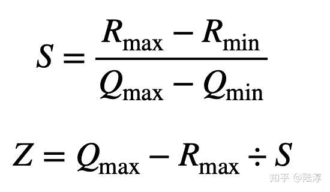

+   Rmax 表示输入浮点数据中的最大值

+   Rmin 表示输入浮点数据中的最小值

+   Qmax 表示最大的定点值（127 / 255）

+   Qmin 表示最小的定点值（-128 / 0）

**优点**

+   保持精度：量化会损失精度，这相当于给网络引入了噪声，但是神经网络一般对噪声是不太敏感的，只要控制好量化的程度，对高级任务精度影响可以做到很小。

+   加速计算：传统的卷积操作都是使用FP32浮点，低比特的位数减少少计算性能也更高，INT8 相对比 FP32 的加速比可达到3倍甚至更高

+   节省内存：与 FP32 类型相比，FP16、INT8、INT4 低精度类型所占用空间更小，对应存储空间和传输时间都可以大幅下降。

+   节[能和减少](https://zhida.zhihu.com/search?q=%E4%B9%98%E6%B3%95%E5%99%A8&zhida_source=entity&is_preview=1)芯片面积：每个数使用了更少的位数，做运算时需要搬运的数据量少了，减少了访存开销（节能），同时所需的 乘法器 数目也减少（减少芯片面积）

**缺点**

+   量化方法：线性量化对数据分布的描述不精确

+   低比特：从 16bits -> 4bits 比特数越低，精度损失越大

+   任务：分类、检测、识别中任务越复杂，精度损失越大

+   大小：模型越小，精度损失越大

## 1、方法分类

+   QAT vs. PTQ

+   量化感知训练（ Quantization Aware Training, QAT ）：在模型训练过程中加入伪量化算子，用于模拟模型量化时引起的误差。通过训练时统计输入输出的数据范围可以提升量化后模型的精度，适用于对模型精度要求较高的场景。部分文献将其称为在线量化。

+   具体流程为：

+   首先在数据集上以FP32精度进行模型训练，得到训练好的baseline模型；

+   在baseline模型中插入 **伪量化 **节点，得到QAT模型，并且在数据集上对QAT模型进行finetune；

+   **伪量化 **节点会模拟推理时的量化过程并且保存finetune过程中计算得到的量化参数；

+   finetune完成后，使用3. 中得到的量化参数对QAT模型进行量化得到INT8模型，并部署至推理框架中进行推理

+   伪量化（fake quant）

+   伪量化是quantization+dequantization的结合，实际上就是模拟量化过程引起的误差，将这种误差当做一种训练的噪声，在QAT finetune的同时，模型会去适应这种噪声，从而在最后量化为INT8时，减少精度的损失。伪量化实现公式如下

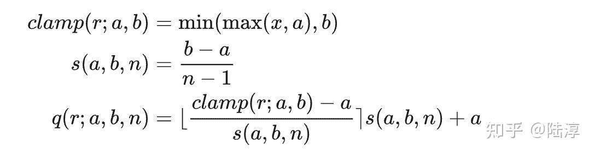

+   伪量化节点插入位置就是需要进行量化操作的位置，论文中在weights输入conv之前（weight quantization）以及activation之后(activation quantizaion)插入了伪量化节点，QAT训练时所有计算都使用FP32单精度。

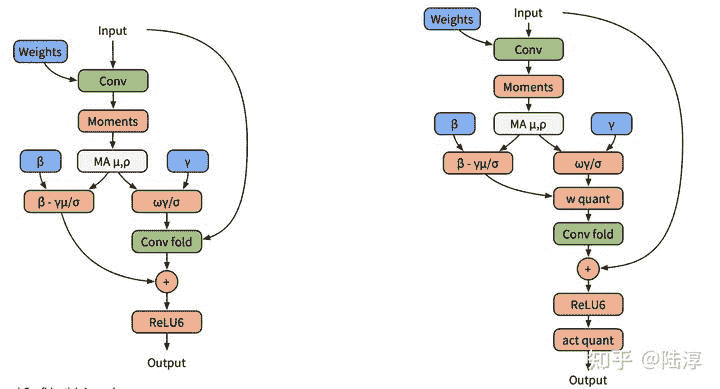

+   训练后量化（Post Training Quantization, PTQ）：在LLM训练完成后对其参数进行量化，只需要少量校准数据，适用于追求高易用性和缺乏训练资源的场景。主要目标是减少LLM的存储和计算复杂性，而无需对LLM架构进行修改或进行重新训练。PTQ的主要优势在于其简单性和高效性。但PTQ可能会在量化过程中引入一定程度的精度损失。部分文献称为离线量化，但部分文献的在线vs.离线是指量化的出发点是否是已经量化好的checkpoint

|  | PTQ | QAT |
| --- | --- | --- |
| 训练 | 不需要重新训练模型 | 需要重新训练模型 |
| 精度 | 训练与量化过程没有联系， 通常难以保证量化后模型的精度 | 由于量化参数是通过finetune过程学习得到，通常能够保证精度损失较小 |
| 使用条件 | 少量无标签数据 | 少量无标签数据大量带标签数据 |
| 适用场景 | 对量化不敏感，体积大开销大的模型 | 对量化敏感的场景，例如目标检测、分割、OCR等 |

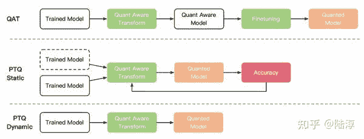

+   对称量化vs非对称量化

+   是否为以0为对称轴，即公式中z是否为0，其中s为量化数值间隔

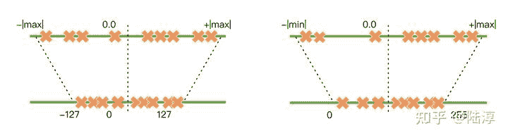

+   线性量化vs非线性量化

+   **数据范围是否均衡。非**线[性量化将F](https://zhida.zhihu.com/search?q=%E7%BA%BF%E6%80%A7%E5%8F%98%E6%8D%A2&zhida_source=entity&is_preview=1)P32映射到INT8数据类型， 每个间隔是不相等的 ，能够更好地捕捉到权重分布的密集点。与非线性量化不同，线性量化采用均匀分布的聚类中心，原始浮点数据和量化后的定点数据存在一个简单的 线性变换 关系，因为卷积、全连接等网络层本身只是简单的线性计算，因此线性量化中可以直接用量化后的数据进行直接计算。

+   动态量化vs静态量化

+   静[态量化的模](https://zhida.zhihu.com/search?q=%E6%AF%94%E4%BE%8B%E5%9B%A0%E5%AD%90&zhida_source=entity&is_preview=1)型权重是提前量化的，在使用前有“calibrate”的过程（校准缩放因子），并且基于观察校准过程中模型的行为来预先计算激活张量的 比例因子 和偏差。

+   动态量化仅将模型中特定算子的权重从FP32/16类型映射成 INT4/8/16 类型，bias和激活在推理过程中动态量化。但是对于不同的输入值来说，其缩放因子是动态计算的

+   仅将模型中特定算子的权重从FP32类型映射成 INT8/16 类型。主要可以减小模型大小，对特定加载权重费时的模型可以起到一定加速效果。

+   但是对于不同输入值，其缩放因子是动态计算，因此动态量化是几种量化方法中性能最差的。

+   权重量化成 INT16 类型，模型精度不受影响，模型大小为原始的 1/2。

+   权重量化成 INT8 类型，模型精度会受到影响，模型大小为原始的 1/4。

## 2、主流算法

+   OBD系列

+   OBD(Optimal Brain Damage)

+   利用 [二阶导数 ](https://zhida.zhihu.com/search?q=%E4%BA%8C%E9%98%B6%E5%AF%BC%E6%95%B0&zhida_source=entity&is_preview=1)信息度量模型参数的显著性，也就是度量模型删除参数对模型结果的影[响，剪掉影](https://zhida.zhihu.com/search?q=%E6%B3%9B%E5%8C%96%E8%83%BD%E5%8A%9B&zhida_source=entity&is_preview=1)响小的参数降低模型复杂度提高 泛化能力 。

+   OBS（Optimal Brain Surgeon ）

+   OBD粗暴的只考虑海森矩阵对角线元素。OBS考虑海森矩阵全局信息，由此也获得参数相互之间的影响。主要处理流程包括寻找对模型影响最小的参数并置零，然后更新模型参数补偿置零参数带来的影响。处理过程不需要对模型重新训练。

+   OBC（OPTIMAL BRAIN COMPRESSION ）

+   [OBS对整个神](https://zhida.zhihu.com/search?q=%E7%A5%9E%E7%BB%8F%E7%BD%91%E7%BB%9C%E6%A8%A1%E5%9E%8B&zhida_source=entity&is_preview=1)经[网络进行](https://zhida.zhihu.com/search?q=%E9%80%86%E7%9F%A9%E9%98%B5&zhida_source=entity&is_preview=1)剪枝，OBC对 神经网络模型 分层剪枝或者量化。具体来说OBD 和 OBS 都存在一个缺点，就是剪枝需要计算全参数的海森矩阵（或者它的 逆矩阵 ）。但在动辄上亿参数的神经网络下求解海森矩阵显然不可能。于是，我们可以假设参数矩阵的同一行参数互相之间是相关的，而不同行之间的参数互不相关，这样，海森矩阵就只需要在每一行内单独计算就行啦。

+   ExactOBS

+   参数更新和代价评估不需要使用整个海森矩阵，仅使用和剪枝参数所在行相关的 d_col\time d_col大小的海森矩阵。

+   GPTQ

+   论文地址： [https:// arxiv.org/](https://link.zhihu.com/?target=https%3A//arxiv.org/pdf/2210.17323.pdf)pdf/2210.1732 3.pdf

+   [1.是对OB](https://zhida.zhihu.com/search?q=%E7%AE%97%E6%B3%95%E5%A4%8D%E6%9D%82%E5%BA%A6&zhida_source=entity&is_preview=1)[C的改进，](https://zhida.zhihu.com/search?q=%E9%87%8F%E5%8C%96%E6%A8%A1%E5%9E%8B&zhida_source=entity&is_preview=1)OBQ 算法理论很好，但其 算法复杂度 太高 ，计算太慢;核心思想是逐一 量化模型 的各个层，并且希望量化前后该层输出变化尽量小

+   2. 取消了 [贪心算法 ](https://zhida.zhihu.com/search?q=%E8%B4%AA%E5%BF%83%E7%AE%97%E6%B3%95&zhida_source=entity&is_preview=1)，采用固定位置优化;

+   3. 延迟一部分参数的更新，缓解 bandwidth 的压力，分组量化，并行加速。

+   4.积累量化参数批量更新其他参数避免频繁访问内存。

+   5.为了解决海森矩阵的逆出现不稳定的情况，使用数值稳定的Cholesky分解提前计算所需信息。

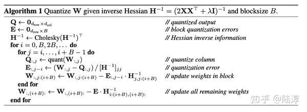

+   SmoothQuant

+   论文地址： [https:// arxiv.org/](https://link.zhihu.com/?target=https%3A//arxiv.org/pdf/2211.10438.pdf)pdf/2211.1043 8.pdf

+   主要思想：

+   1. 当模型规模更大时，单个token的值变化范围较大，难以量化，相比之下 weight 的变化范围较小，即 weight 较易量化，而 activation 较难量化；

+   2. SmoothQuant 核心思想是引入一个超参，减小激活值的变化范围，增大权重的变化范围，从而均衡两者的量化难度；

+   3. 得到smooth变换之后的 activation 和 weight 矩阵，可以再采用 per-token 或 per-tensor 的量化方式。

+   AWQ

+   论文地址： [https:// browse.arxiv.org/](https://link.zhihu.com/?target=https%3A//browse.arxiv.org/pdf/2306.00978.pdf)pdf/23 06.00978.pdf

+   1. AWQ是在smoothquant的基础上提出来的（但是一种weight-only量化）；

+   2. AWQ依据是输入X以及这个参数本身W的绝对大小把s分成两个值S_x和S_w，用二者的加权乘积作为s，我们需要W越大则s越小，X越大则s越大。

+   SpQR

+   核心思想：参数的对模型的重要程度，存在极强的不均衡性。1%的参数，可能主导的量化过程中损失的性能，假如我们在量化中保护这1%的参数，就能极大程度保护模型的性能不受影响

+   实现[： 对于每](https://zhida.zhihu.com/search?q=%E7%A8%80%E7%96%8F%E7%9F%A9%E9%98%B5&zhida_source=entity&is_preview=1)一层，它使用一个小的输入数据集X，用来计算单个参数w_ij被量化前后造成的的误差s_ij. 有了s_ij之后再取top 1%的参数认为它们是重要参数进行保护。在挑选出参数之后，SqQR使用一个 稀疏矩阵 来单独保存这些参数，令这些重要参数的精度仍为fp16。SpQR在实验中还观察到重要参数往往以行或者列聚集，因此提出使用更小的group_size比如8或16，而非GPTQ中常用的128

+   LLM.int8

+   论文地址： [https:// arxiv.org/](https://link.zhihu.com/?target=https%3A//arxiv.org/pdf/2208.07339.pdf)pdf/2208.0733 9.pdf

+   采用混合精度分解的量化方法：将包含了Emergent Features的几个维度从矩阵中分离出来，对其做高精度的矩阵乘法；其余部分进行量化

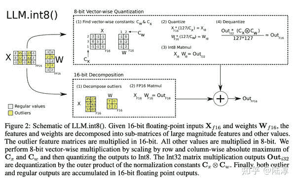

+   ZeroQuant

+   论文地址： [https:// arxiv.org/](https://link.zhihu.com/?target=https%3A//arxiv.org/pdf/2206.01861.pdf)pdf/2206.0186 1.pdf

+   1. 对权重使用分组量化，对激活使用token量化；

+   2. 开发了高度优化的推理后端，消除了量化/反量化运算符昂贵的计算成本，在现代GPU硬件上实现INT8 Tensor内核的延迟加速；

+   3. 提出了一种用于INT4/INT8混合精度量化的新的逐层知识蒸馏方法（LKD），原网络做老师，量化后的网络做学生。神经网络通过蒸馏逐层量化，迭代最小，甚至不访问原始训练数据，缓解精度损失。

## 六、采样解码

LLM推理采用的是Incremental decoding，decoding每一步需要额外输入上一步中新生成的词，只能串行运行（训练中可以通过对attention使用mask的方法实现并行化），导致推理效率较低。

Step 1:  Prompt->y_1

Step 2:$  Prompt,y_1->y_2

Step 3:  Prompt,y_1,y_2->y_3

模型每一步中直接输出的是对词表中每个词出现概率的预测，为了得到下一个词，有多种不同的解码策略：

确定性解码（更适合以输入为基础的任务，如翻译、摘要等）：

贪心：直接选取概率最大的词

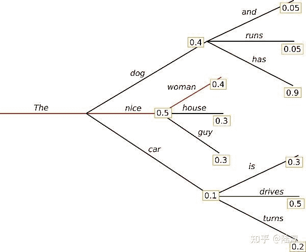

波束：在每个时间步保留最有可能的num_beams个序列

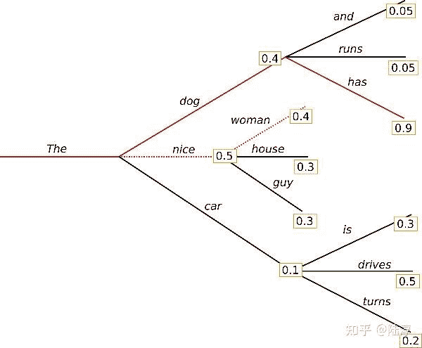

随机性解码（更适合开放性、需要创造力的任务）：

采样：根据概率进行采样（可通过调整sof[tmax的](https://zhida.zhihu.com/search?q=%E6%A6%82%E7%8E%87%E5%88%86%E5%B8%83&zhida_source=entity&is_preview=1)Temperature来调整 概率分布 ）

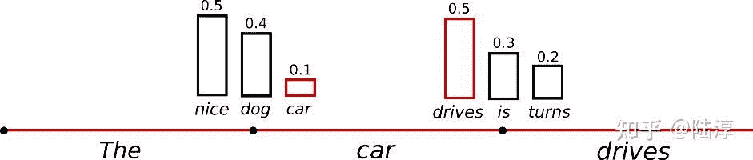

Top-K采样：只从概率最大的K个词中采样。

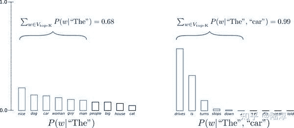

缺点：无法根据分布动态调整采样单词集。

Top-p采样：在累积概率超过p的最小单词集中采样。

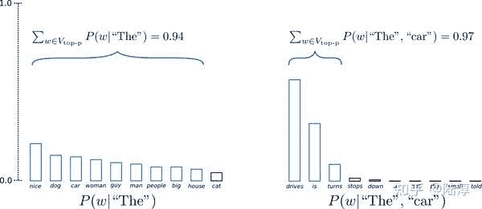

## speculative decoding

论文地址： [https:// arxiv.org/](https://link.zhihu.com/?target=https%3A//arxiv.org/pdf/2211.17192.pdf)pdf/2211.1719 2.pdf

+   =draft model + reject sampling+parallel verfication

+   投机采样使用两个模型：一个是原始目标模型，另一个是比原始模型小得多的近似模型。近似模型用于进行自回归串行采样，而大型模型则用于评估采样结果。解码过程中，某些token的解码相对容易，某些token的解码则很困难。因此，简单的token生成可以交给小型模型处理，而困难的token则交给大型模型处理。这里的小型模型可以采用与原始模型相同的结构，但参数更少，或者干脆使用n-gram模型。小型模型不仅计算量较小，更重要的是减少了内存访问的需求。

+   例如以下图为例，在第一行中，近似模型生成了5个token，目标模型使用这5个token和前缀拼接后的句子”[START] japan’s bechmark bond”作为输入，通过一次推理执行来验证小模型的生成效果。这里，最后一个token ”bond“被目标模型拒绝，重新采样生成”n“。这样中间的四个tokens，”japan” “’s” “benchmark”都是小模型生成的。以此类推，由于用大模型对输入序列并行地执行，大模型只forward了9次，就生成了37个tokens。

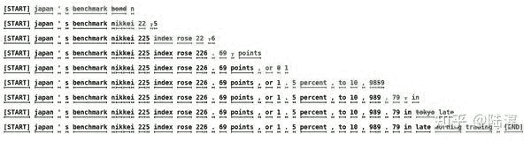

+   步骤

+   记Mp,Mq分别为大(target)模型和小(draft)模型，和前缀prefix,

+   首先基于prefix小模型串行生成r个token，并且每个token的概率值q，然后并行调用大模型对prefix和r个token进行计算采样概率p,根据p/q针对每个token进行拒绝采样确定接受的token数，若接受的token数小于r，则根据p,q分布差值的归一化进行采样得到新的token。

+   缺点：串行的r小模型自回归+并行的r次大模型自回归生成n<=r个token，最坏的情况n=1，虽然提高了生成速度但大幅增加了计算压力和显存占用。此外这种方式严重依赖小模型生成的分布是否与大模型一致。 注意下图中的norm是归一化并不是正态分布。

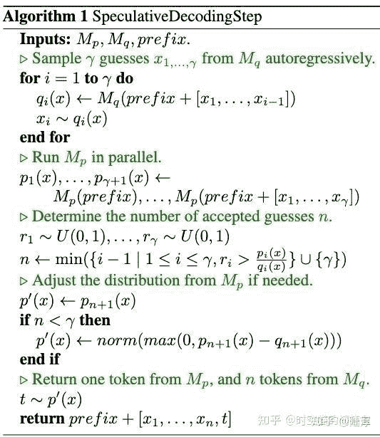

## Blockwise Parallel Decoding

论文地址： [ht](https://link.zhihu.com/?target=https%3A//proceedings.neurips.cc/paper/2018/file/c4127b9194fe8562c64dc0f5bf2c93bc-Paper.pdf)tps:// proceedings.neurips.cc/ paper/2018/file/c4127b9194fe8562c64dc0f5bf2c93bc-Paper.pdf

Blockwise Parallel Decoding=multi-draft model +top-1 sampling+ parallel verification

+   出发点：贪心解码需要m步来产生长度为m的输出，因为每次进行一个token生成的计算，却要搬运全部的模型参数和激活张量，这使解码过程严重受限于内存带宽。

+   思路：语言模型都是预测下一个token，如果我们有k-1个辅助模型 ，每个模型可以根据输入序列跳跃地预测后2到k个位置的某个token。那么，辅助模型和原始模型可以独立运行，从而并行生成后k个token。

+   想法：blockwise decoding的三个阶段，分别是Predict、Verify和Accept阶段，预测即使用原模型+k-1个辅助模型进行k个位置token的预测，然后使用原模型并行地验证这k个位置，即将其组成batch，实现合适的attention mask，一次性获得这个k个位置的词表概率，贪心地选择概率最大的token作为验证结果。Accept阶段，如果验证结果的token和Predict阶段预测的token相同则保留。如果不同，则后面的token预测都错误。进一步优化这个算法，在Verify时顺便做了下一个token的预测。如下图所示，原始模型验证时同时预测后k个token。

+   注意：算法并不需要真的构造出k-1个辅助模型，只需对原始模型略作改造，就可以让他具备预测后k个token的能力。如下图所示，在原始模型decoder和最后一个projection layer前面插入一个FFN层，它的输入是(batch_size, sequence_length, d_model)，输出是(batch_size, sequence_length, k* d_model)，然后在decoder输出和这k个project layer的输入分给进行残差连接，这k个project layer的输出就是k个不同位置token的logits。改造后的模型还需要使用训练数据进行训练。作者论文声称：由于训练时的内存限制，我们无法使用对应于k个project layer输出的k个交叉熵损失的平均值作为loss。相反，我们为每个minibatch随机均匀选择其中的一个layer输出作为loss。训练则可以是fronzen, finetuning,distillation的任何一种。

## SpecInfer

论文地址： [https:// arxiv.org/](https://link.zhihu.com/?target=https%3A//arxiv.org/pdf/2305.09781.pdf)pdf/2305.0978 1.pdf

+   =Speculative decoding+token tree verification(top-k sampling + parallel verfication)

+   Speculative Inference： 采用一批small speculative models（SSMs），并行预测多个候选SSM，可以是原始LLM的蒸馏、量化、剪枝版本（甚至是可供检索的知识库如LLMA、用户的自定义函数），由于SSM的参数规模通常会小2-3个数量级，能力有限，SpecInfer引入了“collective boost-tuning”技术，基于adaptive boosting的思想，对SSM进行微调，让SSM与原始LLM更好地对齐，提升预测准确率，降低Verification的成本。下图 (a) 为传统的增量解码方式，每次解码 1 个 Token, (b) 中对比了传统增量解码方式和投机推理解码方式差异。

+   collective boost-tuning：一种新的微调技术，其通过自适应 boosting 来实现一组 SSM 的聚合预测结果和 LLM 输出的对齐。微调的过程中，SpecInfer 一次将一个 SSM 微调到最充分，然后从训练样本中去除当前 SSM 和 LLM 生成完全一致的样本；然后使用剩余样本来最大化的微调下一个 SSM。对 SSM 池中的所有 SSM 重复这一过程，以此 SpecInfer 将获得一组不同的 SSM，其聚合输出在很大程度上保持与 LLM 输出重叠。

+   Token Tree Verification： 将SSMs预测的多个候选merge为一个新的token tree，采用原始LLM做并行验证，这显著降低了生成式 LLM 的端到端延迟和计算量，同时可以保持模型的质量。

+   SpecInfer 使用的投机推理算法以及 Token 树验证算法，其中全流程为：

+   SpecInfer 将当前 Token 序列 S 作为输入，并生成候选的 Token 树 N。

+   SpecInfer 对 LLM 的使用和现有的系统不太一样：

1.  LLM 将 Token 树作为输入，并为每个节点 u∈N 生成一个 Token O(u)。TreeParallelDecode 函数能在 LLM 的一个 decoding 步骤同时生成 O 中的所有 Token。

1.  Verify 根据 LLM 的输出 O 检查候选的 Token 树 N，并生成一系列经过验证的 Token V。

1.  将 Token 序列 V 附加到 Token 序列 S 中

## Medusa

论文地址： [https:// arxiv.org/](https://link.zhihu.com/?target=https%3A//arxiv.org/pdf/2401.10774.pdf)pdf/2401.1077 4.pdf

=multi-decoding head + tree attention + typical acceptance(threshold)

+   原理：在原本LLM模型的基础上，最后一层改成多个 可训练的Medusa Heads ，每个头负责预测n+1, n+2, n+3...个token。每个头留下topK个结果，在这些topK中选取最优的组合结果；首先，作者发现如果每个只留top1也就是进行贪心解码（每次只留最好的）并做拼接，准确率徘徊在60%左右（算法层面上容易理解的，因为后面n+2，n+3个token也都只有前n个token的信息），用top5进行笛卡尔积寻找最优。

+   具体来说就是将每个头的top-k个词[作为节点，](https://zhida.zhihu.com/search?q=%E5%8F%B6%E5%AD%90%E8%8A%82%E7%82%B9&zhida_source=entity&is_preview=1)每个头作为[树的一层，](https://zhida.zhihu.com/search?q=%E6%8E%A7%E5%88%B6%E6%A8%A1%E5%9E%8B&zhida_source=entity&is_preview=1)每条直到 叶子节点 的路径构成一组待验证的预测，在这棵树内，Attention Mask需要新的设计，该Mask只限制对一个token的前面token的注意力。同时，要为相应地为position embedding设置正确的位置索引。以上方式仍然受制于greedy search的解码能力，为此medusa提出了typical acceptance，使之支持top-k、top-p方式的采样方法。其出发点在于：在实际使用中，我们经常为 控制模型 的创造性而改变采样温度，使得投机采样中的draft模型与target模型的分布不一致，从而top-p采样可能会拒绝draft模型生成，从而导致并行解码长度很短。作者从truncation sampling工作中汲取灵感，旨在选择原始模型可能接受的候选项。根据原始模型的预测概率设定一个阈值，如果候选项超过了这个阈值，就会被接受。作者采取hard threshold和entropy-dependent threshold的最小值来决定是否像在truncation sampling中那样接受一个候选token。这确保了在解码过程中选择有意义的token和合理的延续。作者总是使用Greedy Decoding接受第一个token，确保每一步至少生成一个token。最终的输出则是通过acceptance test的最长序列。

+   特点：使用Medusa并不需要重新训练整个大模型，而是冻结大模型而只训练解码头。

## LLMA

=reuse+parallel verification

+   出发点：

+   retrieval-augmented generation：New Bing 等检索应用在响应用户输入的内容时，会先返回一些与用户输入相关的信息，然后用语言模型总结检索出的信息，再回答用户输入的内容。在这种场景中，模型的输出往往包含大量检索结果中的文本片段。

+   cache-assisted generation：大规模部署语言模型的过程中，历史的输入输出会被缓存。在处理新的输入时，检索应用会在缓存中寻找相似的输入。因此，模型的输出往往和缓存中对应的输出有很大的相似性。

+   multi-turn conversations：在使用 ChatGPT 等应用时，用户往往会根据模型的输出反复提出修改要求。在这种多轮对话的场景下，模型的多次输出往往只有少量的变化，重复度较高。

+   基于以上观察，微软提出了LLMA（LLM Accelerator），本质是“Inference with Reference”。LLMA的核心操作是：

+   1). 在每个解码step，选取当前已生成内容的部分后缀（ k 个token），与参考文本进行匹配，若命中，则将参考文本的部分后续片段（ k个token）拷贝至当前已生成内容的末端；

+   2). 并行调用目标模型，检验新增token的合法性；

+   3). 保留所有合法token直至遇到第一个不合法token。基于以上方式，目标模型的每一次并行调用，至少可以产生1个新的token，至多则可以产生 k+1 个新的token。

## Lookahead Decoding

+   =n-gram+Jacobi iteration+parallel verification

+   出发点：

+   Jacobi decoding:[ 首先随机](https://zhida.zhihu.com/search?q=%E5%9B%9E%E5%BD%92%E6%96%B9%E7%A8%8B&zhida_source=entity&is_preview=1)指定一组m个初始解y，根据自 回归方程 和初始解更新y,重复以上过程直至达到迭代停止条件。Jacobi decoding可以保证在m步内得到m个变量。与自回归解码相比，每个Jacobi decoding步骤在所需的计算量要大，因为它需要对 >1 个token进行 LLM 前向计算，但由于 GPU 的并行处理特性，这通常不会导致速度变慢。虽然Jacobi可以通过许多步骤解码多个token，但在序列中精确定位这些token常常会出错. Lookahead通过并行生成N-grams的能力克服了Jacobi decoding的缺陷，在Jacobi decoding中，某个位置的每个新token都根据之前迭代的历史值进行解码, 因此Jacobi解码的过程中会在每个位置产生一组历史token轨迹，从而构成很多n-grams，例如，回溯3个迭代轮次，就会构成一组每个位置的3-grams。Lookahead decoding会在迭代中缓存这些n-grams，在执行Jacobi decoding的同时，并行验证缓存中的n-grams。接受一个N-grams使得我们一次推进N个token。

+   方法[：为了提](https://zhida.zhihu.com/search?q=%E9%9B%85%E5%8F%AF%E6%AF%94&zhida_source=entity&is_preview=1)高该过程的效率[，每个Loo](https://zhida.zhihu.com/search?q=%E5%AD%97%E7%AC%A6%E4%B8%B2%E5%8C%B9%E9%85%8D&zhida_source=entity&is_preview=1)kahead decoding步骤被分为两个并行分支：lookahead分支和verification分支。lookahead分支维护一个固定大小的2维窗口，以根据 雅可比 迭代轨迹生成 n-gram。 同时，verification分支选择并验证有希望的 n-gram 。Lookahead分支：Lookahead 分支旨在生成新的n-gram。该分支使用由两个参数定义的二维窗口进行操作，窗口大小W和N-gram的大小N，前者代表我们希望前向生成token数，后者代表我们回溯的迭代数。注意到当N=2时，Lookahead decoding退化为Jacobi decoding。Verification分支：在验证分支中，我们识别第一个 token 与最后一个输入 token 匹配的 n-gram，这一步是通过简单的 字符串匹配 来确定的。一旦识别，这些 n -gram将被添加到当前输入token后，并通过 LLM 正向传递对其进行验证。对验证分支中考虑的候选 n -gram的数量设置上限（=W）以控制计算成本。Lookahead and Verify In the Same Step:由于 LLM 解码主要受内存带宽限制，因此我们可以在同一步骤中合并前瞻和验证分支，利用 GPU 的并行处理能力来隐藏开销。 这是通过设计一个如图 5 所示的特殊注意掩码来实现的，该掩码遵循两个规则： (1) 前瞻分支中的标记无法看到验证分支中的标记，反之亦然。 (2) 每个标记只能看到它前面的标记和它自己，就像causal mask。

+   蓝色的0代表当前t时刻的token, 橘、绿、红依次代表t-3、t-2、t-1时刻由Jaccobi迭代生成的，数字代表相对当前token的位置，在每个时刻t,我们利用前N-1步轨迹，执行Jaccobi迭代生成 window size=5个位置的token，从而得到多组同一位置的N-gram,例如在当前输入token位置的蓝0-绿1-红2。在验证时，首先通过字符串匹配识别出第一个token与最后一个 input token匹配的 n-gram,将识别到的n-gram添加当前输入后，并通过 LLM 正向传递对其进行验证，从而一次生成N个token

+   Jaccobi decoding: 从一组随机采样解开始，迭代求解右边的方程组，m元方程组至多m次可求得精确解。

## 七、其他技术

## 1、MOE

假如有一个模型，激活参数有7B，总参数有34B，那么我们能够做到性能与34B相似，吞吐量优于34B，延迟类似于7B吗

具有7B密集部分的50B Mistral MOE和34B的Yi和67B的DeepSeek性能相似

如果我已经训练了一个大的密集模型，我能把一个密集模型简化成一个MoE模型吗?

**MoEfication **: 将一个稠密模型分解为一个MoE模型，使其和小模型一样高效，但大模型一样强悍。

MoE 层即将大模型拆分成多个小模型(专家， expert )， 每轮迭代根据样本决定激活一部分专家用于计算，达到了节省计算资源的效果；并引入可训练并确保稀疏性的门( gate )机制，以保证计算能力的优化。

## 2、早退

[对于一些](https://zhida.zhihu.com/search?q=%E8%BD%AC%E6%8D%A2%E5%B1%82&zhida_source=entity&is_preview=1)简单的token，我们不需要计算所有的 转换层 ，只需要计算其中的一些层就足够了

## [参考文献](https://zhida.zhihu.com/search?q=%E5%8F%82%E8%80%83%E6%96%87%E7%8C%AE&zhida_source=entity&is_preview=1)

[紫气东来 - 知乎](https://www.zhihu.com/people/zi-qi-dong-lai-1/posts)

[https:// space.bilib](https://link.zhihu.com/?target=https%3A//space.bilibili.com/517221395/)ili.com/5172 21395/

[小冬瓜AIGC：【手撕LLM-KVCa](https://zhuanlan.zhihu.com/p/667763542)che】显存刺客的前世今生--文末含代码