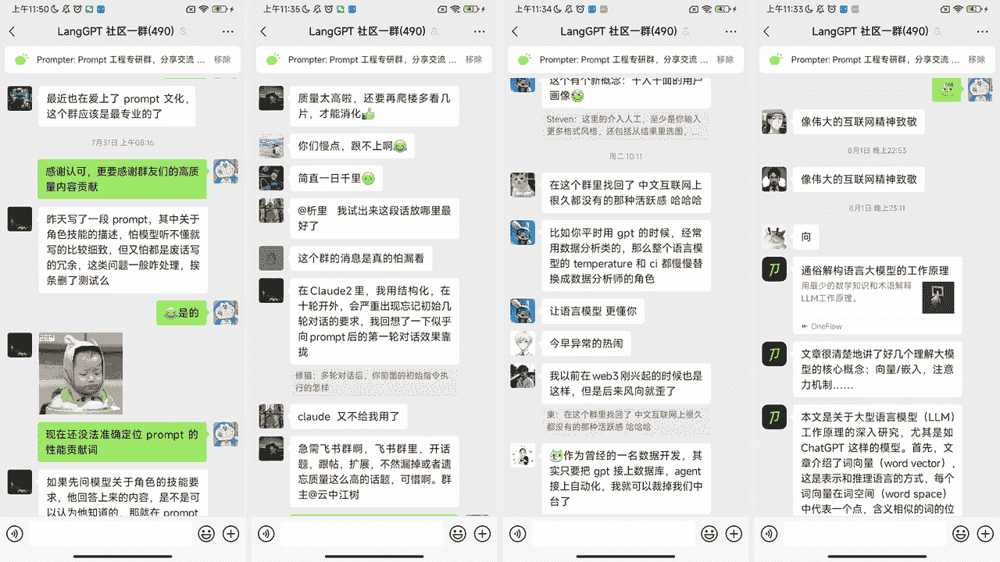
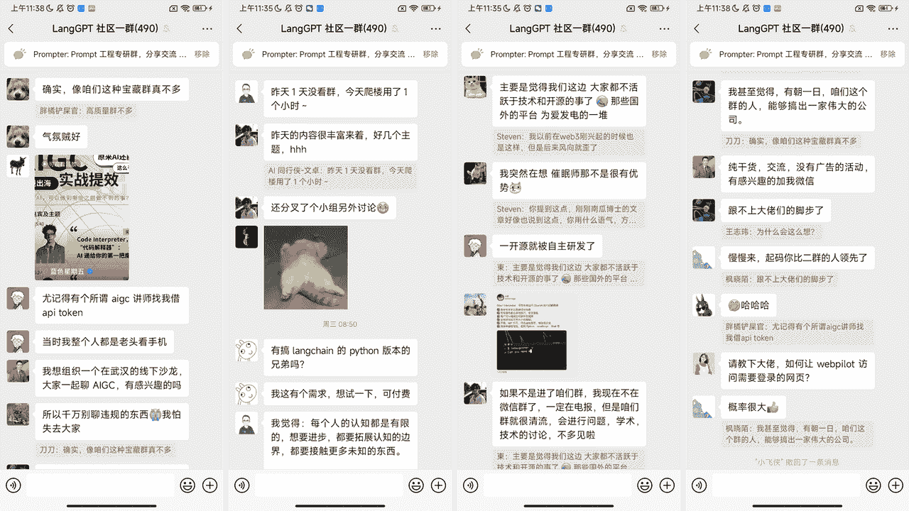

# 结构化提示词

> 来源：[https://agijuejin.feishu.cn/docx/Pks8df2Jkob19AxfEhBcwWnenlg](https://agijuejin.feishu.cn/docx/Pks8df2Jkob19AxfEhBcwWnenlg)

## 什么是 LangGPT ?

> LangGPT 社区**是国内最****大的提示工程社区****。Lang**GPT 是 Language For GPT 的简称，中文名为结构化提示词。LangGPT 是一个帮助你编写高质量提示词的工具，理论基础是我们提出的一套模块化、标准化的提示词编写方法论——结构化提示词。我们希望揭开提示工程的神秘面纱，为大众提供一套可操作、可复现的提示词方法论、工具和交流社群。我们的愿景是让人人都能写出高质量提示词。

> 结构化提示词框架由云中江树于2023年创造，最早于 2023 年 5.4 青年节开源发布为 LangGPT 项目，一经发布便成为  GitHub 开源社区全球趋势热榜前十项目，并且撰写了学术论文开源发表。LangGPT 提出的结构化提示词已被百度、智谱、字节、华为等国内主流大模型智能体平台使用，当前已经发展成为国内最具影响力的高质量提示词工程师学习交流社群。

## 最新动态：

**「Lan**gGPT丨Ai结构化提示[词」知识](https://www.feishu.cn/community/article/wiki?id=7364987863647125532)库已上线至飞书社区，欢迎大家点赞收藏订阅：飞书社区

## 如何使用？

1.  直接使用 LangGPT 生成提示词：

1.  月之暗面 Kimi × LangGPT 提示词专家: https://kimi.moonshot.cn/kimiplus/conpg00t7lagbbsfqkq0

1.  OpenAI 商店 LangGPT 代码诗人：https://chat.openai.com/g/g-Apzuylaqk-langgpt-dai-ma-shi-ren

1.  [LangGPT 社区年度分享：AI 交流的艺术](https://langgptai.feishu.cn/wiki/VXmowI2boiqVFVkj9vlcNkhNnce)浅入深了解提示词基础和无限可能

1.  系统了解结构化提示词：[结构化提示词系统论述： 构建高性能 Prompt 之路](https://langgptai.feishu.cn/wiki/ASXOwDbTEiH9CUkXFA5cLHumn88)

1.  参考和拆解高质量提示词案例 [🔥 高质Prompt合集](https://langgptai.feishu.cn/wiki/JCZHwwrsOizzaOktD4fcuGbFnzg)

1.  多提示词协同进阶玩法 [Prompt 进阶 — 提示链（Prompt Chain）和多提示词协同](https://langgptai.feishu.cn/wiki/UUJ4wDXMpiFUWokJHQpcyni7nzg)

1.  [通往 AGI 之路 ](https://waytoagi.feishu.cn/wiki/QPe5w5g7UisbEkkow8XcDmOpn8e)示词的更多可能性：搜索本知识库 或者 前往共建社区  探索更多可能性

1.  引用 LangGPT 论文：[La](https://arxiv.org/abs/2402.16929)ngGPT: Rethinking Structured Reusable Prompt Design Framework for LLMs from the Programming Language

1.  使用 PromptShow 展示你的结构化提示词: https://show.langgpt.ai/

# 提示词知识库

欢迎来到 LangGPT 结构化提示词知识库！这里汇集了高质量的提示词工程技术、教程和工具相关内容。知识空间内容均来源于 LangGPT 提示词社群，社群内汇聚了国内一大批提示词爱好者，群内讨论气氛热烈，交流质量很高，在主要的大城市建立了提示词交流小分队。

1.  开源：知识空间内的文档阅读、复制都无限制，欢迎大家分享（请勿搬运）

1.  开放：欢迎加入“LangGPT 社群”，分享交流 Prompt 工程技术

1.  共享：群里分享的优质资源和知识，我们会吸收进知识空间开放共享

1.  共建：欢迎投稿优质内容，欢迎成为共建者（私信江树，🛰️:1796060717 / 甲木，🛰️:544831183）

> **权益声明**：开源不代表可以随意搬运，未经授权禁止搬运内容！

## 内容列表

## 社群交流

# LangGPT 相关视频 & 活动分享

+   [【中国 AIGC 开发者大会分享】](https://langgptai.feishu.cn/wiki/VXmowI2boiqVFVkj9vlcNkhNnce)AI 交流的艺术：Prompt Engineering 2023 年度视角

+   【文心一言特邀分享】LangGPT作者教你编写高质量提示词【直播回放】

+   [【FlowGPT圆桌会】第一期丨Prom](https://www.bilibili.com/video/BV1AN411q77L/?spm_id_from=333.337.search-card.all.click)pt Creator 向未来【直播回放】

+    [ LangGPT 视频教程](https://www.bilibili.com/video/BV1rj411q78a/)[ (感谢](https://www.bilibili.com/video/BV1rj411q78a/)[ AIGCLINK 占冰强](https://www.bilibili.com/video/BV1rj411q78a/)[占总) ](https://www.bilibili.com/video/BV1rj411q78a/)

+   [【AIGC LINK AI超级个体分享会】Agen](https://mp.weixin.qq.com/s/v8AYQKyc71qrjLpL7iD8ng)ts 的基石— 提示词结构化方法论和实践

+   【创业邦报道】欢迎来到提示词的美丽新世界

## 提示词文章

+   **【 LangGPT 项目】**云中江树：LangGPT —— 让人人都能编写高质量 Prompt

+   **【结构化 prompt 】**[云中江树：系统论述文章 构建高性能 ](https://mp.weixin.qq.com/s/N9BrkDqvkIHQD7TTnhNk6Q)Prompt 之路—结构化 Prompt

+   [【提示链 Prompt Chai](https://mp.weixin.qq.com/s/syzvo17WQcOVqajU-xxF6Q)n】Prompt 进阶 — 提示链（Prompt Chain）和多提示词协同

+   如何构建生产级鲁棒高性能 Prompt

+   提升大模型可靠性的 prompt方法汇总

+   为什么结构化 Prompt 如此有效？

+   **【 DALLE-3 】**[DALLE-3的紧箍咒](https://mp.weixin.qq.com/s/WYv0aq6a4W1tdNQKCR9oiw)

## 开源 GitHub 项目

+   [🚀 LangGPT —— 让人人都可快速编写高质量 P](https://github.com/yzfly/LangGPT/blob/main/README_zh.md)r[om](https://github.com/yzfly/wonderful-prompts)pt! (4K+ Stars)! 🔥

+   ChatGPT 中文指南（1万+ Stars）🔥

+   中文 prompt 精选 (2K+ Stars)🔥

+   [🌐 社区开源项目](https://langgptai.feishu.cn/wiki/CZrFwzHw3iZVhkke2FucFAfxnAe)

# 如何加入社群？

1.  添加江树🛰️ 1796060717 (若无法添加，可添加甲木🛰️ zuiyn_soul )

1.  私发**正经的**自我介绍（应该都会叭，不会的请参照面试标准）

1.  江树 / 甲木邀请进群。

> 注意：加入社群请遵循🛰️社交礼仪：

> [LangGPT 🛰️社交礼仪](https://langgptai.feishu.cn/wiki/THdxw39nliLOcjktqWUcL3Q8nDh)

# 社群建设

+   [🛰️👸号: 云中江树](https://mp.weixin.qq.com/s/aJ-pze57Wc0j9wPwwjRNGA)

+   LangGPT GitHub 开源项目：https://github.com/yzfly/LangGPT

+   LangGPT 社区飞书知识库（本知识库）http://feishu.langgpt.ai/

+   **LangGPT 开源社区** https://github.com/langgptai

+   **FlowGPT 主页：**[flowgpt.com](https://flowgpt.com/@aipromptcn)

+   FlowGPT Prompts 精选合集：https://bit.ly/448vjg0

+   **推特主页：**https://twitter.com/langgpt

## 合作伙伴

> 英诺天使基金密切关注本次 AI 浪潮，欢迎有投融资需求的朋友直接联系，或者联系江树（wx: 1796060717）推荐

> http://www.innoangel.com/

> LangGPT战略合作伙伴53AI，在企业大模型落地应用领域有大量的成功案例和丰富的落地经验，有企业大模型落地应用需求的朋友欢迎联系甲木（wx: 544831183）

> http://www.53ai.com/