# 谷歌Gemini多模态提示词培训课——Part2

> 来源：[https://agijuejin.feishu.cn/docx/XlNqd81suokpzax1NXXcyStgned](https://agijuejin.feishu.cn/docx/XlNqd81suokpzax1NXXcyStgned)

本系列课[程是Deep](https://learn.deeplearning.ai/)learning联合谷歌Gemini团队开发的免费在线课程，课程中使用了Gemini模型作为教学模型，教授大家如何使用多模态提示词与模型交互。由于课程内容中有很多在国内无法应用的部分，在其之中也缺乏了某些概念。有鉴于此，我截取了部分教程内容，并适当混合了一些入门概念。将其进行重新整理和刊发，以增强其普世价值。（如有需要，请访问原版在线课程）

---

> 在本节课程中你可以学到：

1.  了解什么多模态大模型的参数概念

1.  通过对比例子了解每个参数如何影响模型生成

1.  学习多模态提示编写原则

1.  通过实践，使用Gemini模型辅助日常办公

> 扩展阅读：[Gemini API快速入门](https://ai.google.dev/gemini-api/docs/quickstart?hl=zh-cn&lang=python)

> 扩展阅读：[在线课件与谷歌云配置方法](https://learn.deeplearning.ai/courses/large-multimodal-model-prompting-with-gemini/lesson/9/how-to-set-up-your-google-cloud-account-%7C-try-it-out-yourself-[optional])

# 一、认识模型参数

接下来，我要教大家关于参数的知识，以及如何使用这些参数来影响 Gemini 模型的输出。在你们尝试不同的模型参数之前，我想快速概述一下它们，以确保每个人都在同一起点上，并掌握这些方法。

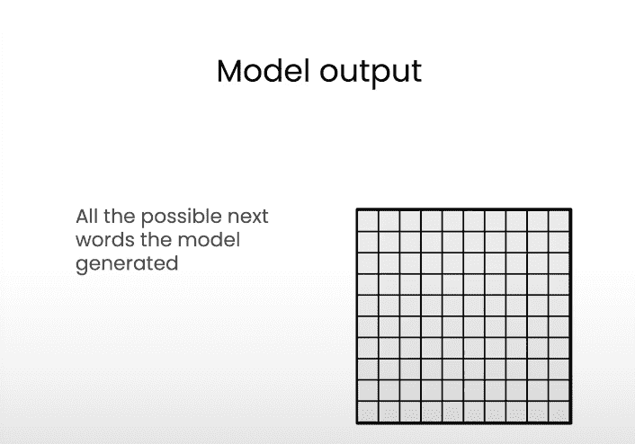

让我们从一个有趣的比喻开始：模型的输出就像一家特别的餐厅的菜单。这不是普通的菜单，而是一个包罗万象的巨型菜单，上方图形中的每个小方格代表一道菜（一个词）。然而，面对如此庞大的选择，我们通常不希望看到所有可能的选项。相反，我们可能只想关注那些最有可能让人眼前一亮的前 5 个或前 10 个选项。

## 1.1 Top K

基于这个比喻，现在让我来解释一下 Top-K 是如何帮助我们的。Top-K 的工作方式其实很有趣。在我们的餐厅比喻中，它就是在帮我们从所有的菜品中挑选最适合我们的菜。它不会让我们看遍所有的选项，而是只为我们呈现最有可能符合我们需求的前几个选择。

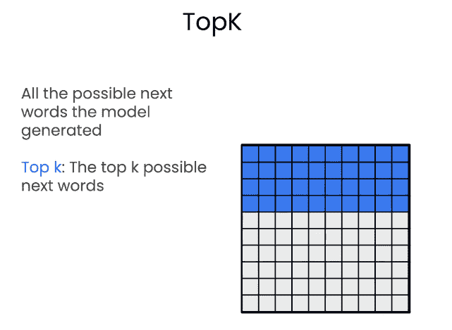

具体来说，它是这样工作的：

1.  首先，我们给每个选项（在我们的比喻中是每道菜）分配一个分数。这个分数基于它的概率或 "受欢迎程度"。就像餐厅里的每道菜都有自己的受欢迎程度一样，语言模型中的每个词也有被选中的可能性。

1.  接下来，算法会根据这些分数进行选择。它会从得分最高的选项开始，逐个挑选，直到达到我们预设的数量。例如，如果我们想要看到前五个最佳选项，我们就将参数 K 设置为 5。这就像是从菜单中挑选出最受欢迎的五道菜。

1.  最终，我们得到了一个包含前 K 个最佳选项的精简列表。

通过使用 Top-K，我们可以更有效地控制模型的输出，这个过程大大提高了效率，让我们能够快速聚焦于最相关或最有价值的选项，而不是被海量的可能性所淹没。

## 1.2 Top P

让我们来探讨另一个有趣的参数：Top-P。这是一种不同于 Top-K 的参数，它用于控制模型的创造性和随机性。Top-P 通过从一个相对较小但更加灵活的词池中进行选择来实现这一目标。

具体来说，Top-P 是这样运作的：

1.  首先，我们知道每个可能的 "菜"（也就是每个词）都有一个被选中的概率。

1.  我们从概率最高的词开始，逐个累加这些概率。

1.  然后，我们设置一个阈值，比如 0.8（这就是 P 值）。

1.  我们继续添加词及其概率，直到累加和达到或刚好超过这个阈值 0.8。

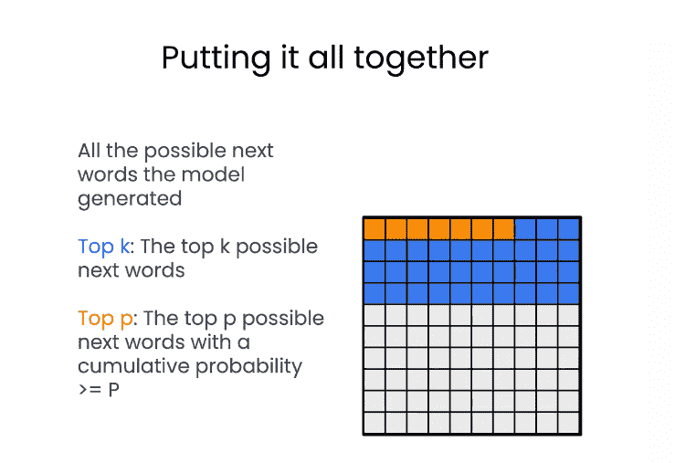

通过使用 Top-P，我们可以确保模型考虑了一定范围的可能性，而不仅仅是最常见的选项。这可以帮助我们在保持输出质量的同时，增加一些变化和创造性。这种参数特别适合那些需要一定程度随机性或创造性的任务，比如写作或对话生成。

## 1.3 Temperature

接下来，让我给大家介绍一下 Temperature（温度）参数。这个参数就像是调整餐厅的氛围一样。

想象一下，低温就像是一个平静安静的餐厅环境。当我们把温度设置得很低，比如说 0.2，这就意味着我们的语言模型会变得非常谨慎。它会选择最安全、最可能的 "菜品"，也就是词语。这样的输出通常是可预测的，而且非常集中。相反，高温就像是一个热闹繁忙的餐厅。当我们把温度调高，比如说到 0.8，这时候模型就会变得更加大胆。它会开始探索一些不太常见的 "菜品"，也就是一些不太可能被选中的词语。

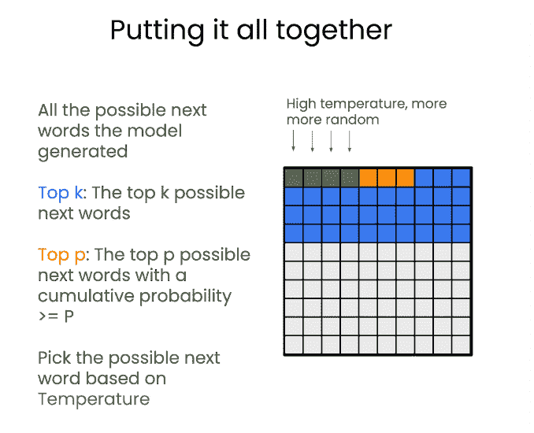

通过调整 Temperature参数，我们可以控制模型输出的 "创造性" 程度。低温适合那些需要准确、一致答案的任务，比如问答或事实陈述。高温则适合需要创意和多样性的任务，比如写作或头脑风暴。

## 1.4 三种参数的取值范围

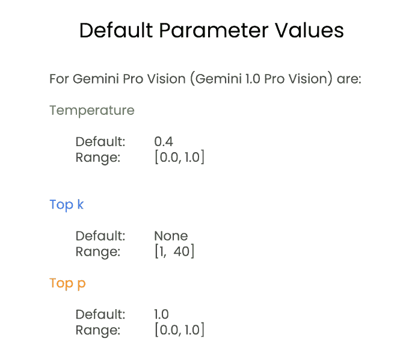

现在来聊聊参数的取值范围：Gemini 1.0 pro版本的模型的温度默认值是 0.4，可以在 0 到 1 之间调整。Top-K 的默认值是 None，也就是不启用，但如果你想用的话，可以设置在 1 到 40 之间。Top-P 的默认值是 1，可以在 0 到 1 之间调整。

作为初学者，我建议你们先保持这些默认值不变。等你们熟悉了模型的基本表现后，再开始尝试调整这些参数，看看模型的输出会有什么变化。

# 二、关于模型参数的对比例子

## 2.1 示例一：不调整参数

让我们从不调整参数的例子开始。

首先，我们加载了一张吴恩达的照片，并编写一个提示：要求 API 描述图片内容，但不提及照片中人物的名字。

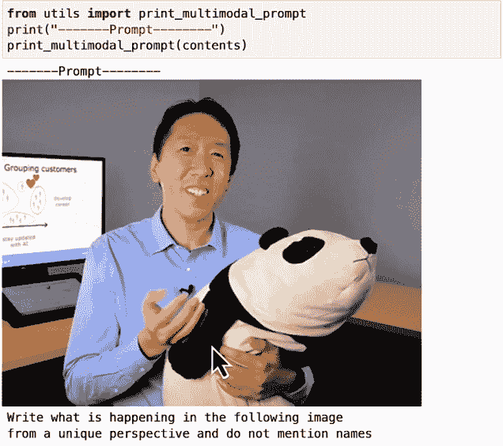

模型的响应很准确，它描述了一个男人坐在电脑屏幕前，穿着蓝色衬衫，怀里抱着一个熊猫玩偶。模型还注意到这个男人在微笑，并且在他身后的电脑屏幕上有一个图表，上面写着 "分组客户"。

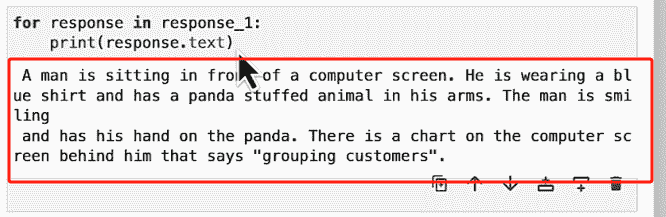

Gemini 的表现确实令人印象深刻，它甚至注意到了我没有发现的PPT细节。到目前为止，我们一直在使用默认参数。

## 2.2 示例二：尝试调整参数——偏向严谨

接下来，我们来尝试一些不同的参数设置。这可以通过生成配置来实现，它让我们能够自定义参数值，而不是简单地使用默认设置。在这个例子中，我们重点关注两个关键参数：温度和 Top-K。我们将温度设置为最低值 0.0，同时把 Top-K 设置为 1。这种特殊的组合将会产生一些有趣的效果。

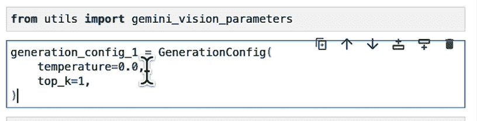

为了产生对比效果，我们再次使用了相同的内容和模型，只是这次添加了我们的参数配置。

现在，让我们看看模型的输出。果然，我们得到了完全相同的输出。这正是我们预期的结果。因为我们把温度设置得很低，并且把 Top-K 设置为 1，模型就会一直选择概率最高的词。这就导致了高度一致的输出。

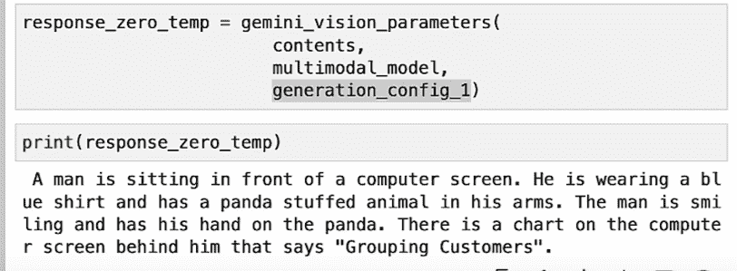

## 2.3 示例三：尝试调整参数——偏向活跃

现在，让我们把参数值调整到另一个极端。我们把温度设置为最高值 1，同时将 Top-K 设置为最大值 40。我们先运行这个设置。接着，我们用这些新的参数值来调用 API。

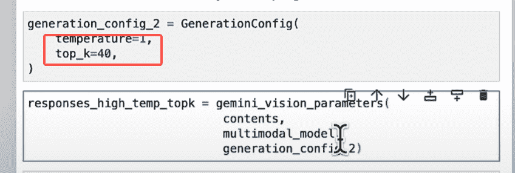

正如你所看到的，这次的输出比之前的要详细得多。虽然一些基本信息仍然一致，比如提到了蓝色衬衫和熊猫玩偶，但这次的描述包含了更多额外的细节和解释：例如，模型推测了男人抱着熊猫的方式表明他对它很兴奋，甚至还描述熊猫似乎在微笑。这种描述显然更加主观和富有想象力。

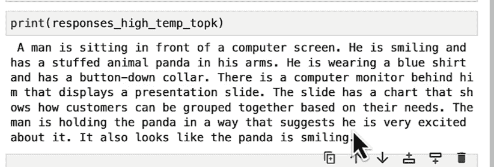

你得到的具体答案可能和我的不太一样，这是因为我们把温度和 Top-K 都设置得很高。这样的设置让模型有更多空间去探索不同的可能性，从而产生更有创意和多样化的输出。

## 2.4 示例四：尝试调整参数——偏向平衡

现在我们来看看 Top-P 这个参数的效果。我们保持温度为 1，Top-K 为 40 不变，但要加入 Top-P 参数。记住，Top-P 的取值范围是 0 到 1 之间。这次我们把它设置得很低，为 0.01。我们这样做是想看看能否在保持一定创造性的同时，平衡一下我们刚才看到的随机性。

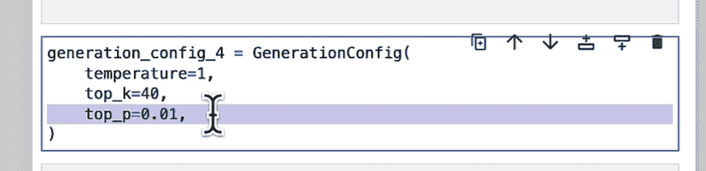

我们运行了新的设置并调用了 API。结果显示，我们得到的答案与最初的非常相似。这说明通过将 Top-P 设置为低值，我们成功地平衡了创造性和详细程度。

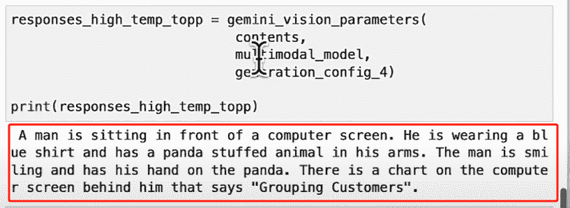

> 找到参数的最佳设置确实是一门艺术，需要不断尝试和调整。你可能需要测试不同的参数组合，看看哪种最适合你的具体需求。

## **2.5 示例五：控制输出**

Gemini 还有其他参数可以用来控制输出。让我们来看看其中两个，首先是 max_output_tokens。在生成配置中，我们可以设置 max_output_tokens。这个参数决定了响应中可以生成的最大Token数。在 Gemini 中，一个Token大约相当于 4 个字符，而 100 个Token大约对应 62-80 个单词。

如果你想得到更短的响应，可以将 max_output_tokens 设置为较低的值，比如 1。相反，如果你希望得到更长的回答，可以把它设置为较高的值，比如 2000。

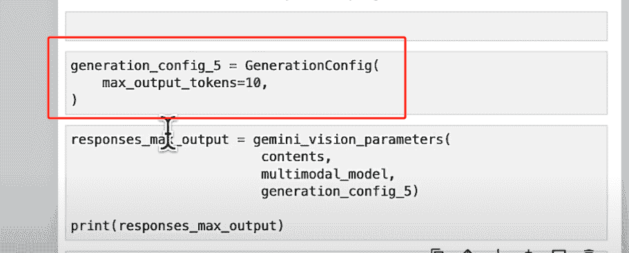

让我们把 max_output_tokens 设置为 10，看看它如何影响输出。调用 API 后，我们得到了一个非常简短的响应："一个男人坐在电脑前。" 你会发现它并没有完整输出一句话，但这正是我们预期的结果。

根据你的具体需求，你可能会想控制输出的长度。如果你需要非常简洁的回答，可以降低这个值。但要注意，设置得太低可能会导致回答在奇怪的地方被截断，比如句子中间。

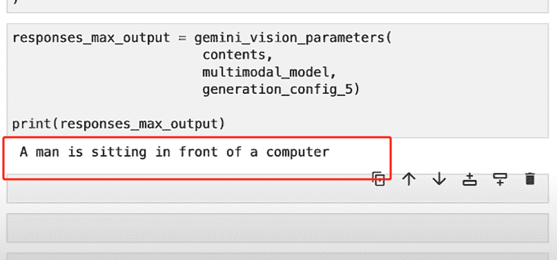

另一个我们可以设置的参数叫做 stop_sequences。它允许我们指定一个字符串列表，告诉模型在生成文本时，如果遇到这些字符串就停止。如果一个指定的字符串在响应中出现多次，模型会在第一次遇到它时就停止。但要注意，这些字符串是区分大小写的。

stop_sequences 的一个常见用途是在构建面向特定群体（比如儿童）的聊天机器人时，过滤掉某些不适合的词。让我们来试试这个参数。我们知道图片中有一个熊猫，所以我们把 "熊猫" 设为 stop_sequence。这意味着模型在生成描述时，一旦提到 "熊猫" 就会停止。

现在，我们用这个新的 stop_sequence 参数来调用 API，看看它会如何影响模型的输出。这样我们就能观察到 stop_sequences 是如何控制模型输出的内容和长度的。

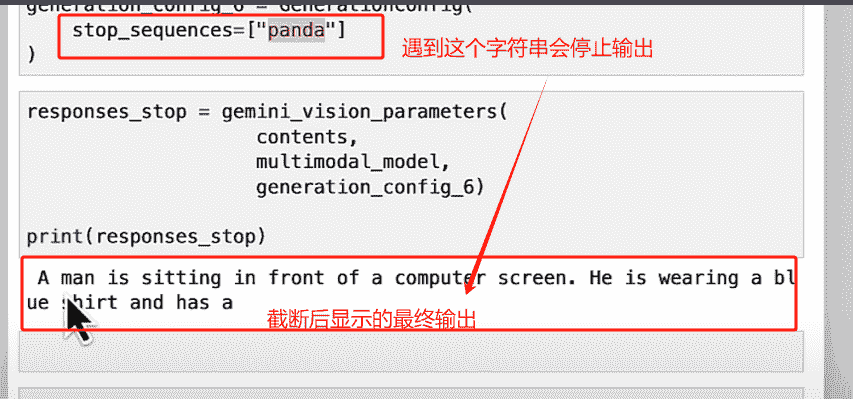

正如你所看到的，我们得到的响应是："一个男人坐在电脑屏幕前。他穿着蓝色衬衫，怀里抱着一个"。然后它就停止了。你可以猜到，下一个词应该是 "熊猫"。模型遇到了 "熊猫" 这个词，就按照我们的设置停止了输出。

# 三、多模态提示原则及注意事项

## 3.1 基础原则

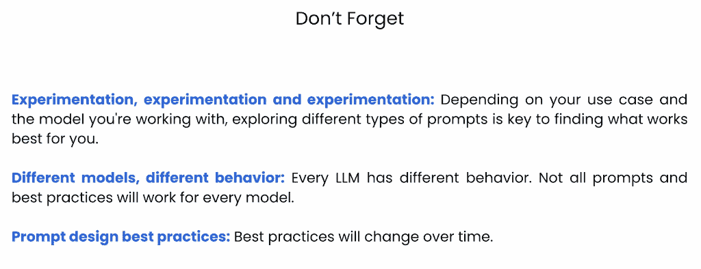

> 借用上方这幅图，我想说说我的感悟：由于大模型的黑盒性质（且不同模型的脾气秉性各不相同），提示词这个领域，到目前看来始终是一门经验科学。你能否完全掌握这项本领，全靠你自己孜孜不倦地去尝试，去探索。只有根据自己的探索成果去不断调整策略，最终才能有好的实践不断涌现。

## 3.2 多模态提示设计策略

### 3.2.1 清晰明确的指令

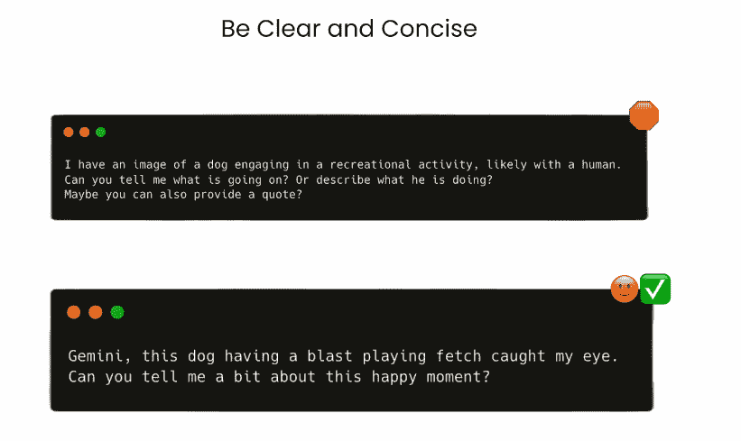

假设你在给同事分配任务，如果指示模糊或冗长，结果可能不如预期，这对模型来说也是一样的。你可以看到，第二个提示明显更好，因为它更具体、更可操作，能更好地引导模型给出我们想要的信息。虽然多模态模型很强大，但它们并不真正理解内容（没有意识）。所以，写提示时要像在向一个聪明但需要清晰指导的人解释。避免使用过于专业的术语，也不要假设模型应该知道某些信息。

通过这种方式，我们可以更有效地与模型沟通，获得更准确、更有用的结果。

### 3.2.2 角色扮演

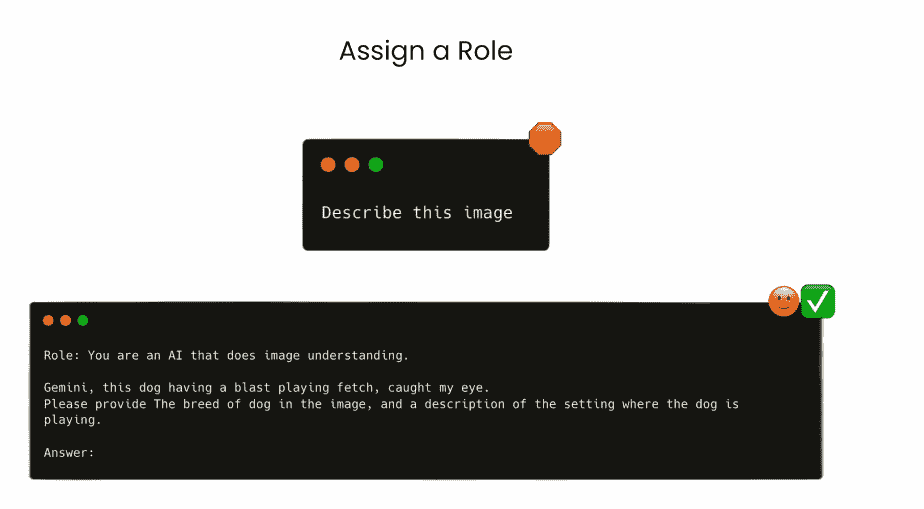

在与模型交互时，另一个有效的技巧是在提示中为模型分配特定角色。这个技巧很重要，因为：

1.  它提供了清晰度，减少歧义，提高输出的相关性。

1.  它能引导模型朝向特定的风格、语气或细节水平。

1.  它鼓励模型在输出中保持一致的声音和视角。

这就像导演一部戏：你不会只把剧本给演员就开始，而是会告诉他们角色是谁，动机是什么，以及如何与其他角色互动。同样，角色指示告诉模型在特定上下文中应该如何行动。

### 3.2.3 结构化提示

接下来，让我们讨论一下提示的结构。这一点很重要，因为你设计输入的方式直接影响多模态模型的表现。

提示的结构会影响模型解析信息的能力，也会帮助模型正确理解如何使用给定的信息。为了给提示提供清晰的结构，你可以使用前缀或类似 XML 标签的方式来划分提示的不同部分或组件（同时也推荐使用Markdown格式）。

在下方这个例子中，我们可以看到提示的结构是这样的：首先提供图片，然后分配一个角色，接着是我们的问题或要求，最后留出空间让模型给出答案。

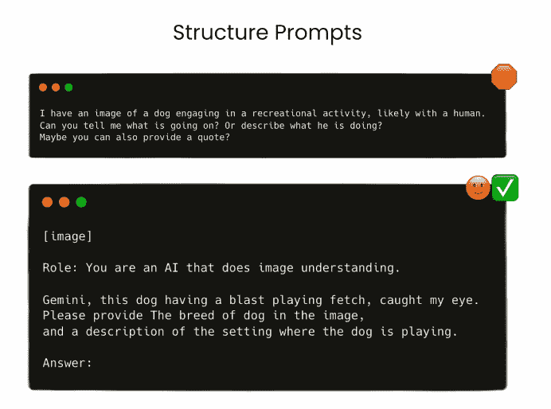

一个结构良好的提示能够做到三件关键的事：

1.  组织信息：它帮助模型轻松识别输入中的不同类型内容。比如在我们的例子中，模型可以清楚地分辨出图片、角色和问题。

1.  引导解释：它明确了每条信息应该如何使用，以及与其他信息的关系。例如，模型需要总结图片吗？还是需要执行某段代码？提示结构为模型提供了这些重要线索。

1.  鼓励所需输出：通过在提示中设置明确的期望，增加了期望获得内容的可能性。

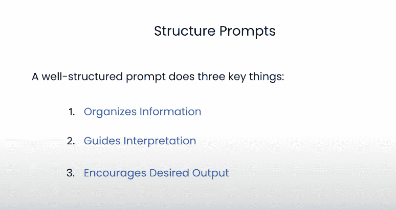

虽然没有一种通用的结构适合所有用例或模型，但这里有一些可以用来为提示添加结构的指导方向：

1.  角色：指定模型应该扮演的角色，这有助于模型理解其目的并相应调整响应。

1.  目标：明确说明你希望模型达到的目标，比如回答问题、总结文档、生成代码或提供见解。越具体越好。

1.  上下文：提供模型需要的任何背景信息或相关数据，以便理解任务并生成准确的响应。这可能包括文本、图片、图表或其他数据源。

1.  约束：指定你希望模型遵守的任何限制或要求，如响应长度、输出格式或对某些类型内容的限制。例如，你可以要求输出为 HTML 格式。

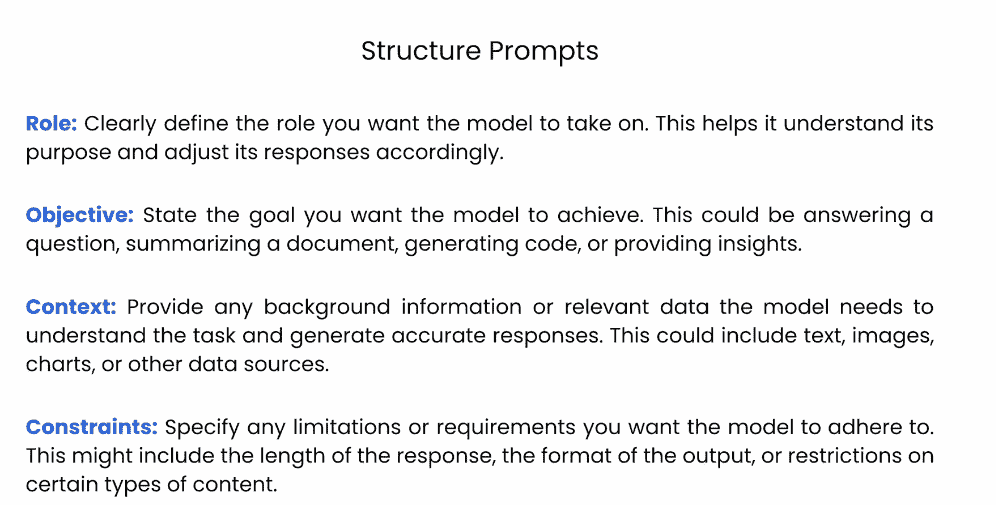

通过合理运用这些结构元素，我们可以更好地引导模型，从而更精确地控制模型的行为，使其更好地满足我们的具体需求。

### 3.2.4 提示词注意力

信息呈现的顺序对模型输出的质量和相关性有重要影响。这不仅适用于提示结构，也适用于文本提示的构建方式。你提出问题和给出指示的顺序都会影响模型的响应。同样，不同模态（如图片、文本、表格等）的呈现顺序也很重要，它会影响模型理解和建立连接的能力。例如，在分析医疗报告时，先呈现患者病史文本，再展示 X 射线图片，可能会帮助模型更好地解释视觉信息。

总的来说，顺序的重要性体现在：

1.  提供上下文理解：适当的顺序可以帮助模型在处理信息时建立更好的理解。

1.  引导注意力焦点：通过策略性地排序提示和模态，你可以引导模型关注特定方面，可能提高响应的准确性。

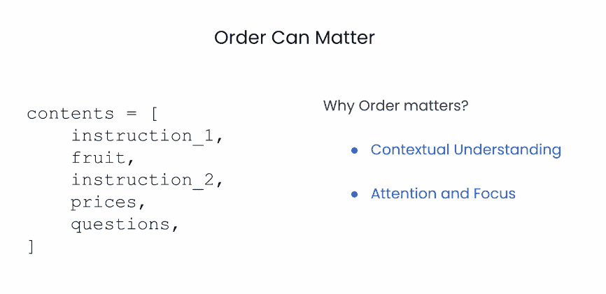

因此，建议你尝试不同的提示和模态顺序，找出最适合你特定需求的组合。这种方法可以帮助你更好地控制模型的输出，获得更准确、更相关的结果。

# 四、图片交互实践

这部分将重点讲解涉及图片的用例，这是多模态模型应用的一个重要领域。我们将学习如何从图片中提取物品或价格信息，这是一项非常实用的技能。更进一步，我们还会探索一些实际应用，比如根据一组可用图片为你的客厅推荐家具。这种应用展示了多模态模型如何结合视觉信息和文本理解来解决复杂的实际问题。

## 4.1 第一个实践示例——使用Gemini处理日常事务

在开始实际操作之前，我们需要进行一些必要的设置，这与第一课的做法类似：

1.  首先，我们需要获取凭证并确保可以进行身份验证。这是确保我们能安全访问 Gemini API 的关键步骤。

1.  接下来，我们将指定使用 Gemini API 的区域，在这个例子中是 US central 1。选择合适的区域可以优化 API 的响应速度。

1.  然后，我们将导入 Vertex AI SDK。这个 SDK 是我们与 Gemini API 交互的桥梁，提供了必要的工具和函数。

1.  最后，我们将使用之前获取的凭证、指定的区域和项目 ID 来初始化 SDK。这一步把所有前面的设置整合在一起，为我们使用 API 做好准备。

1.  导入 generative model 类和 image 类。这两个类对于我们处理图片和生成内容至关重要。

1.  导入我们将使用的多模态模型 - Gemini 1.0 Pro。这个模型特别适合处理图片，是我们这个用例的理想选择。

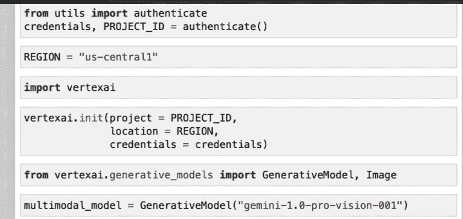

首先，我们需要导入第一张图片，这是一碗水果的照片。为了使用这张图片，我们将使用 load_from_file 函数来加载本地 JPG 文件。接下来，我们要导入第二张图片，这是一张来自我当地超市的水果价格列表。同样，这也是一个本地文件，我们可以用类似的方式加载它。

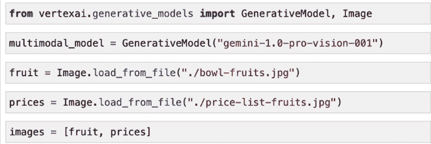

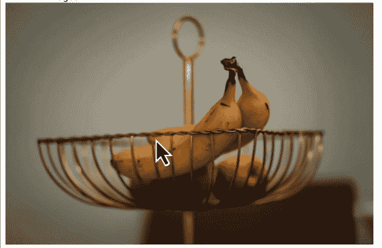

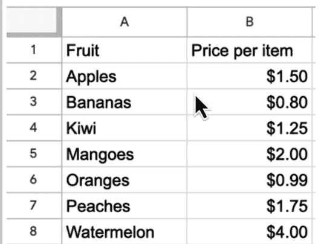

现在是时候写一些提示了。第一个指令是："我想用三根香蕉、两个苹果、一个猕猴桃和一个橙子制作水果沙拉。这是我的水果碗的图片。" 这告诉模型我们想做什么，并指出第一张图片的内容。

第二个指令是："这是我当地超市的水果价格列表。" 这解释了第二张图片的内容。通过这两个指令，我们为模型提供了清晰的上下文，帮助它更好地理解任务并分析图片。

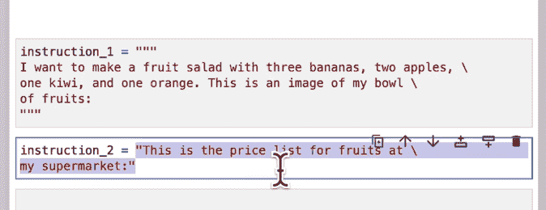

现在让我们创建三个问题，这些是我们希望模型回答的：

1.  我们要求模型描述图片中我的水果碗里有哪些食物以及数量？

1.  根据我碗中的水果图片和水果沙拉配方，我还缺少什么？

1.  考虑到我还需要购买的水果，这些水果的价格和总成本是多少？

通过这些问题，我们可以看到模型如何进行跨模态推理，从视觉信息中提取数据，并将其与文字信息（价格列表）结合起来进行计算。

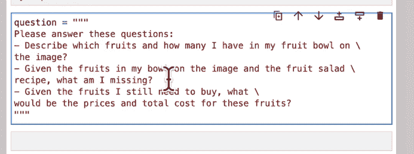

进一步，我将指令与相应的图片分组，这样可以帮助模型更好地理解每个指令与哪个图片相关联。

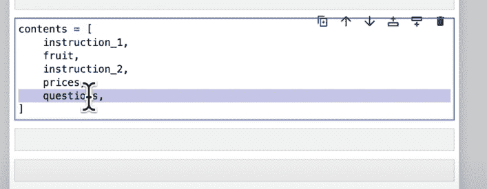

好的，模型的响应很快。让我们来分析一下结果：

模型正确识别出水果碗里有两根香蕉和两个苹果。它还指出，为了制作水果沙拉，我们还需要额外的一根香蕉、一个猕猴桃和一个橙子。

关于价格，模型给出了准确的信息：

+   香蕉：80 美分

+   猕猴桃：1.25 美元

+   橙子：99 美分

另外，模型成功地理解了我们目前缺少什么，需要购买什么，以及这些额外水果的价格。它还正确计算出购买这些额外水果的总成本是 3.04 美元（1.25 + 0.99 + 0.80）。

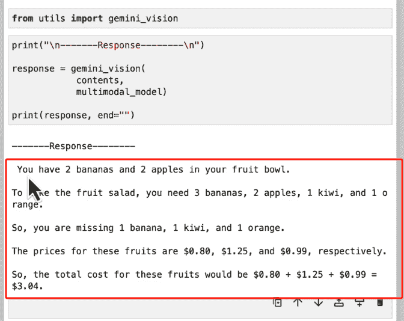

## 4.2 第二个实践示例——使用Gemini作为推荐系统

接下来，我们将探索一个新的用例：使用 Gemini 作为推荐系统，为我们的房间推荐一把新椅子。这个例子将允许我们测试模型如何结合多个图片信息，理解空间布局和风格匹配，并基于这些信息提供个性化的推荐。

具体来说，我们有以下图片：

1.  四张不同椅子的图片

1.  一张客厅的图片

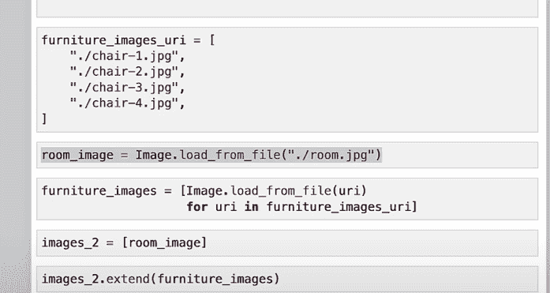

我们将椅子的图片组合成一个列表，并加载了整体房间的图片。我们从本地文件加载了房间图片，对于椅子图片也需要做同样的操作。由于椅子图片是一个列表，我们需要遍历列表中的每个 URI，从文件中加载相应的图片。

为了方便打印和展示，我们首先创建一个包含房间图片的列表，然后用椅子图片列表扩展这个列表。这样我们就可以一次性打印所有图片。

现在，让我们看看这些图片：

1.  第一张图片是我们的客厅。从图中可以看出，这是一个设计干净、空间宽敞的房间。

1.  接下来是四把不同的椅子的图片。这些就是我们要从中选择一把放入客厅的候选椅子。

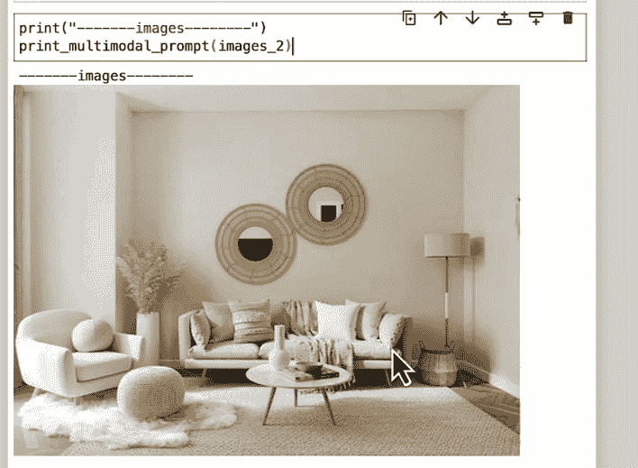

现在是时候编写我们的指令和提示了。让我们来看看这个过程：

1.  首先，我们告诉 Gemini 它是一个室内设计师。这设定了模型应该采取的角色和视角。

1.  然后，我们指示模型考虑几把椅子。我们提供了椅子的图片和房间的图片。

1.  对于每一把椅子，我们要求 Gemini 解释它是否适合房间的风格。这要求模型进行视觉分析和风格匹配。

我们将所有这些内容放在一个名为 recommendation_content 的变量中。让我们打印出所有内容，看看整个提示的流程。

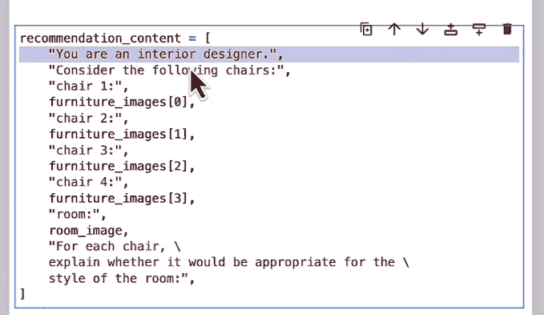

让我们来看看 Gemini 对我们的椅子选择的分析：

1.  第一、第三把椅子：
Gemini 认为这个椅子不适合房间的风格。它指出房间是现代的，有干净的线条，而椅子是由木头和金属制成的。回顾图片，我们可以确认 Gemini 的观察是准确的。这把椅子确实不太符合房间的整体风格。

1.  第二、第四把椅子：
Gemini 认为这把椅子非常适合房间的风格。它指出椅子有时尚、现代的设计，会与房间的干净线条相得益彰。此外，椅子用柔软、中性的面料包裹，能够与房间的颜色相匹配。再次查看房间和椅子的图片，我们可以同意 Gemini 的判断，这把椅子确实会在这个房间里很好看。

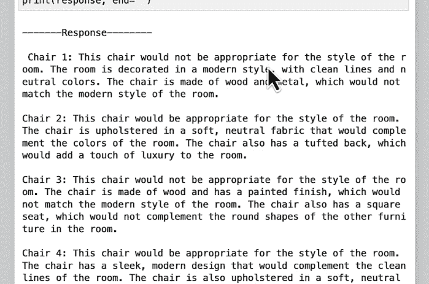

令人印象深刻的是，Gemini 不仅考虑了颜色匹配，还分析了椅子的材料和整体设计是否与房间的风格协调。这显示了模型在视觉分析和风格匹配方面的深度理解能力。

## 4.3 第三个实践示例——使用Gemini处理财务报销

在这个新的用例中，我们将探索如何使用 Gemini 1.5 pro 模型来自动化处理收据和检查费用是否符合公司政策的过程。这个任务涉及跨多种模态（图片和文本）的推理，并需要组合不同来源的信息。

Gemini 1.5 pro 是一个中型多模态模型，具有以下特点：

1.  针对各种任务进行了优化，性能与 1.0 Ultra 相似。

1.  支持最多 100 万个 token 的上下文。

1.  每个提示可包含多达 3000 张图片。

这些特性使 Gemini 1.5 pro 特别适合需要处理大量信息的应用，比如：

+   分析长文档

+   处理大型代码库

+   进行扩展对话

另外，使用 Gemini 1.5 pro 的一个重要优势是，我们不需要预先对数据进行分块处理。我们可以直接将整个长文档发送给模型并获得响应，这大大简化了工作流程。

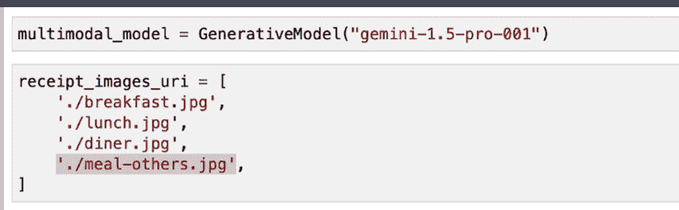

在用例最开始，我们需要遵从以下步骤，进行数据初始化：

1.  读取图片：

+   我们将使用 image.load_from_file 函数加载收据的图片。这一步将收据的视觉信息导入到我们的系统中。

1.  加载公司政策：

+   我们需要读取公司的商务旅行费用政策，这是一个文本文件。

+   使用 Python 的文件读取功能，我们将把 travel_policy.txt 文件的内容读入变量 policy 中。

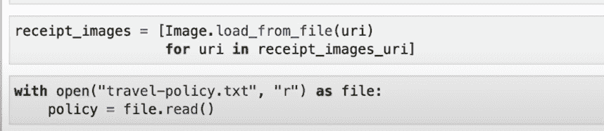

现在我们进入提示编写阶段，这是引导模型行为的关键步骤。我们将设置两个主要指令：

1.  初始指令 - 强调诚实和透明度：
我们希望模型在面对不确定性时保持诚实。如果模型没有足够的信息来回答问题，我们要求它明确指出这一点。这种透明度对于确保结果的可靠性至关重要。

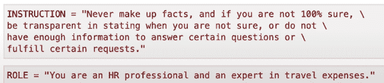

1.  角色设定 - 人力资源专业人士：
我们将指示模型扮演人力资源专业人士的角色，特别是在旅行费用方面的专家。这个角色设定将引导模型从特定的专业角度来分析和回答问题。

接下来，我们设置具体的任务和问题，要求模型分析商务旅行的费用（原教程提示里最后一个标号错写成了3）。这些任务包括：

1.  逐项列出收据上的所有内容，包括税费。

1.  计算总销售税金额。

1.  从收据中提取员工个人用餐的费用。具体是员工与同事共进晚餐时吃的 KFC 碗的成本。

1.  计算其他人（非该员工）的消费金额。

1.  根据公司政策检查这些费用，并标记任何可能存在的问题。

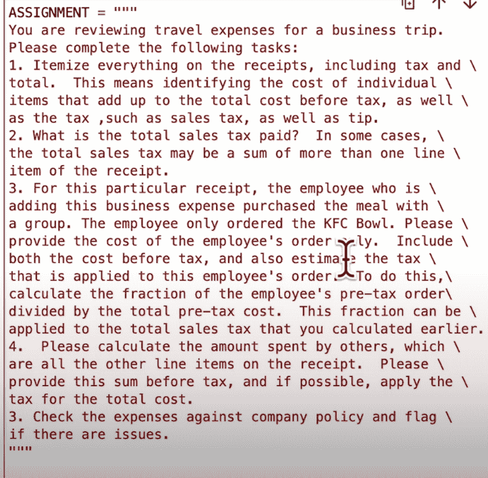

这组任务要求模型进行复杂的分析，包括：

+   图片识别（读取收据内容）

+   数学计算（总计和分项计算）

+   信息提取（识别特定项目）

+   政策理解和应用（检查合规性）

重要的是，模型必须仅基于提供的收据图片和公司政策文本来回答这些问题。这测试了模型的跨模态推理能力，要求它将视觉信息（收据）与文本信息（政策）结合起来，进行全面分析。

> 其实这个示例中还测试了边缘性问题，边缘性是指下方这些小票中的图片，有的是模糊不清的。

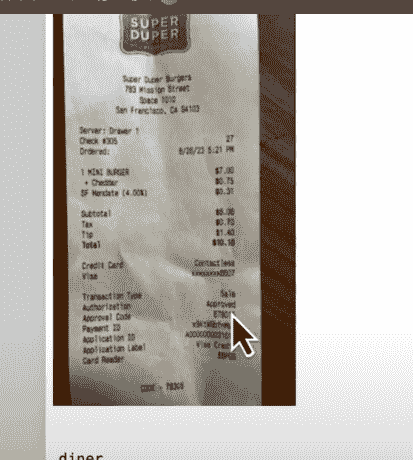

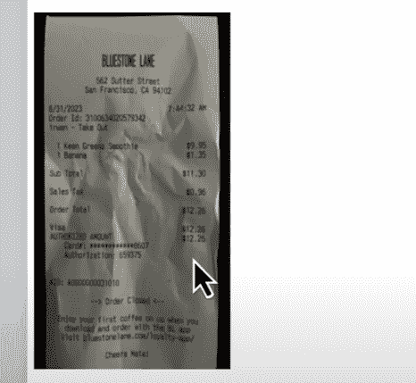

在运行后，你可以看到如下结果：模型成功地对收据进行了详细的逐项列举，计算了总销售税，并准确地分离了员工个人的餐费和同事的费用。

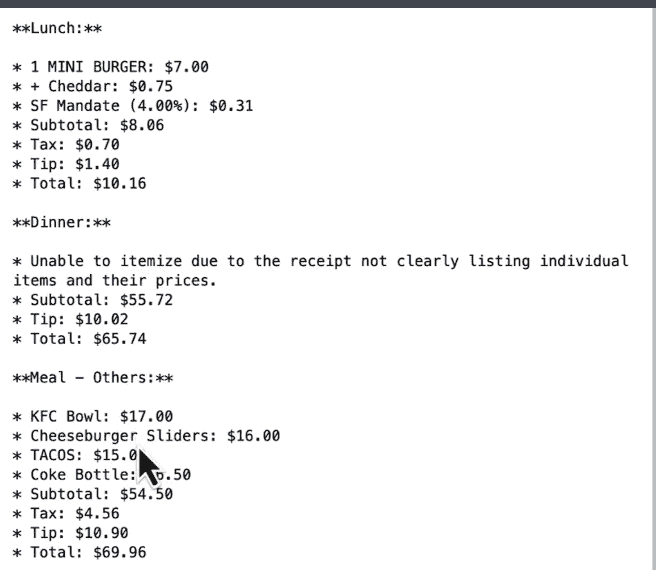

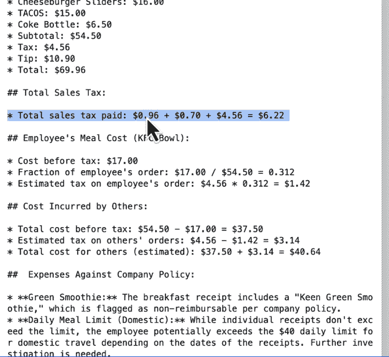

在政策合规性检查方面，模型表现出色，识别出了一些问题。它发现员工购买的绿色冰沙违反了公司政策，正确地将其标记为不可报销。而且，模型还注意到了与每日费用限额相关的问题。

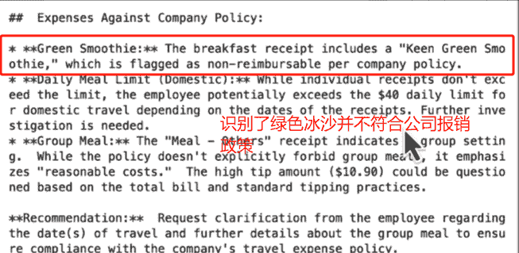

这些结果展示了 Gemini 1.5 pro 在处理多模态、多层面任务时的强大能力，包括图片识别、数学计算、逻辑推理和政策应用。这种自动化分析不仅能提高效率，减少人为错误，还展示了 AI 在处理需要细致判断和政策解释的复杂任务中的潜力，为企业提供了更准确、一致的费用审核过程。

以上就是Part2的所有内容，如果对你有一些帮助就没有白花时间写。

另外，欢迎关注我，第一时间收到课程更新。