# 谷歌Gemini多模态提示词培训课——Part3

> 来源：[https://agijuejin.feishu.cn/docx/EfGbdtgNRoko3fxfQpOcg20Mnwf](https://agijuejin.feishu.cn/docx/EfGbdtgNRoko3fxfQpOcg20Mnwf)

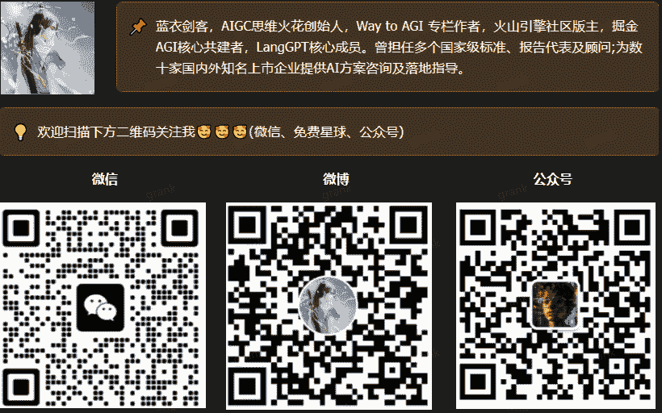

本系列课[程是Deep](https://learn.deeplearning.ai/)learning联合谷歌Gemini团队开发的免费在线课程，课程中使用了Gemini模型作为教学模型，教授大家如何使用多模态提示词与模型交互。由于课程内容中有很多在国内无法应用的部分，在其之中也缺乏了某些概念。有鉴于此，我截取了部分教程内容，并适当混合了一些入门概念。将其进行重新整理和刊发，以增强其普世价值。（如有需要，请访问原版在线课程）

---

> 在本节课程中你可以学到：

1.  通过实践，与视频内容交互，辅助工作与学习

1.  通过实践，学习Function Calling概念与实际应用

> 扩展阅读：[Gemini API快速入门](https://ai.google.dev/gemini-api/docs/quickstart?hl=zh-cn&lang=python)

> 扩展阅读：[在线课件与谷歌云配置方法](https://learn.deeplearning.ai/courses/large-multimodal-model-prompting-with-gemini/lesson/9/how-to-set-up-your-google-cloud-account-%7C-try-it-out-yourself-[optional])

# 一、 与视频交互

## 1.1 交互前的配置

像之前课程中的设置一样，让我们先为连接Gemini API做下配置。就像在之前的用例中一样，我们将使用 Gemini Pro Vision。这个模型能够处理图像、视频和文本。

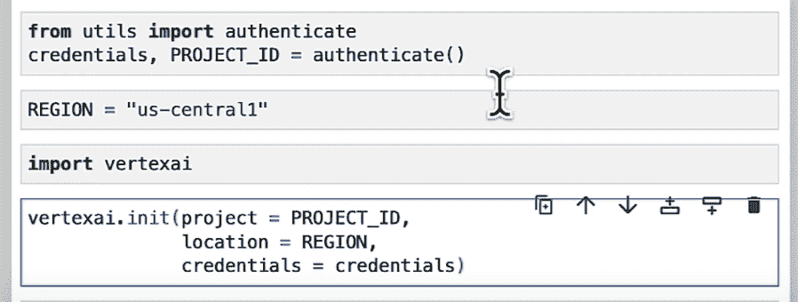

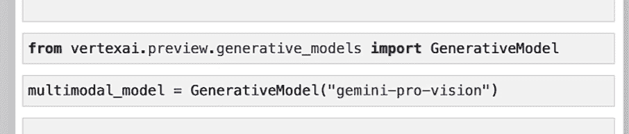

## 1.2 第一个示例——使用Gemini辅助数字营销

在这个示例中，你将扮演一名数字营销专员，你的任务是准备一个视频以发布到网站上。为了完成这项工作，我们需要从视频中提取几个关键元素：标题、描述，以及一些用于网站后台的元数据。

就像我们在之前学到的那样，我们需要加载数据，但这次我们要处理的是一个关于 Vertex 和 LinkedIn 的视频。所以我们需要准备几样东西：视频的 URI 、 URL和Path。运行相关代码后，你就可以使用 IPython 在笔记本中查看这个视频了。

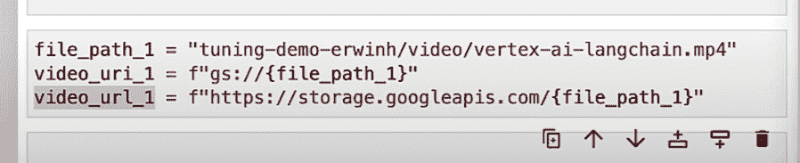

现在，我们要从 URI 加载视频。这个过程需要用到我们之前使用过的一些类。首先，我们需要导入 Part 类，接下来，我们使用 Part 类从之前指定的 URI 加载视频。在这个例子中，我们的视频文件类型是 MP4。不过，正如之前提到的，Gemini 模型也支持其他文件格式。

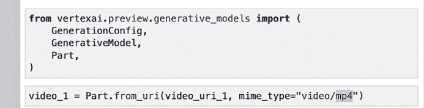

现在你已经导入了视频，是时候写提示了。我们可以首先为模型指定角色，以确保模型有更多的上下文。

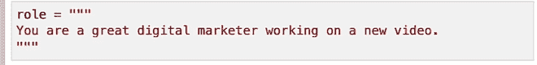

定义完角色后，我们需要明确指定模型要执行的任务。以下是我们需要模型完成的具体任务：

1.  从视频中提取一个合适的标题。

1.  撰写一个视频内容的摘要。

1.  提供网站后端所需的元数据，要求模型以 JSON 格式返回以下数据：

+   标题

+   简短描述

+   视频使用的语言

+   创建视频的公司

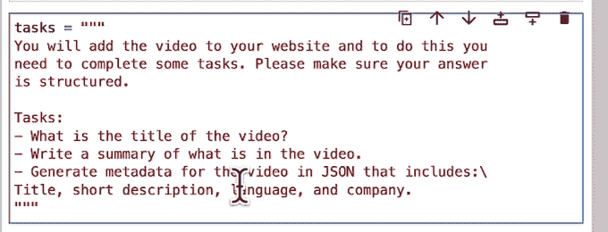

> 注意，我们已经将提示分为两个主要部分：角色说明和任务描述。这种结构可以帮助模型更好地理解和执行我们的要求。

我们已经准备好了所有必要的元素，让我们将它们组合起来，看看模型会给出什么样的响应。组合的顺序很重要：首先是视频，就像处理图像时一样；然后是角色描述；最后是任务说明。除此之外，我们还需要设置配置参数，其中最关键的是温度参数。（关于参数，在Part2中讲过，在此不做赘述）

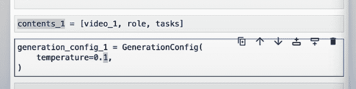

现在，让我们做好最后的准备。我们将使用 multi_model.generate_content 函数，需要提供三个关键元素：你的内容、配置文件，以及将 streaming 参数设置为 true。你可以尝试将 streaming 设置为 false，看看这与流式传输有何不同。生成响应后，我们可以通过 print函数 来打印结果。

> 将 streaming 设置为 false 时，不再需要逐个迭代和打印多个对象，而是只有一个需要打印的对象。这种方法简化了输出过程，可以直接打印整个响应文本。

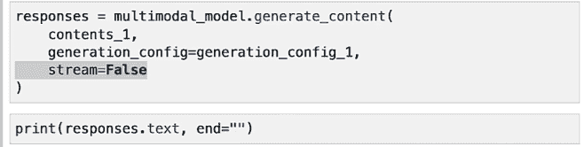

让我们来分析一下打印出的响应结果。首先映入眼帘的是视频标题："在 Vertex AI 上使用 Langchain 构建 AI 驱动的应用"。这个标题准确反映了视频的主题。

紧随其后的是一段简短的视频内容描述，概括了视频的核心内容。

最后，我们得到了以 JSON 格式呈现的元数据响应。这个 JSON 对象包含了几个关键的键值对：标题、简短描述、视频使用的语言以及创建视频的公司。

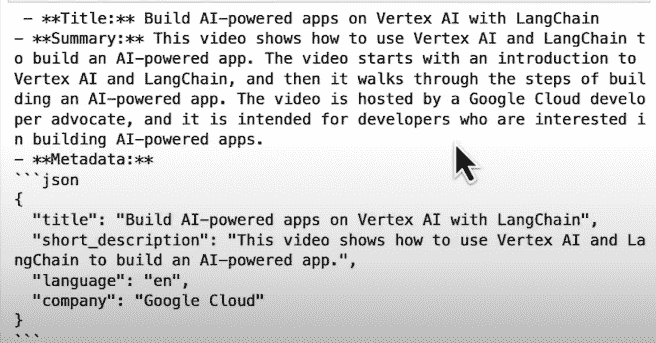

**在与 Google 团队一起工作时，我们将提示结构化为：角色、是任务、响应格式。根据我们的经验，这似乎对我们使用的大多数模型都很有效。**进一步，根据我个人的经验，将提示分解成单独的变量不仅能提高代码的可重用性，还能带来诸多便利。当你想要微调提示时，你只需要聚焦于其中一个变量，而不必重写整个提示。

**更重要**的是，当你的项目从开发阶段过渡到生产环境时，这种结构化的方法将展现出其真正的价值。假设你需要在生产系统中更新某些内容，比如调整 AI 的 "角色" 设定。在这种情况下，你只需要更新对应的变量，而不会影响到提示的其他部分。这不仅降低了出错的风险，还大大提高了维护的效率。

刚才已经提到，我们不必将角色、任务和格式挤在一个提示中，而是可以分别处理它们。现在让我们来尝试一下这种方法，看看它如何影响输出。

首先，我们要求模型以 JSON 格式输出元数据。为此，我们需要创建一个新的 format_JSON 变量。记得将这个新变量添加到contents_1中，放在任务之后。同时，我们把tasks中的“要求按JSON格式输出”去掉。

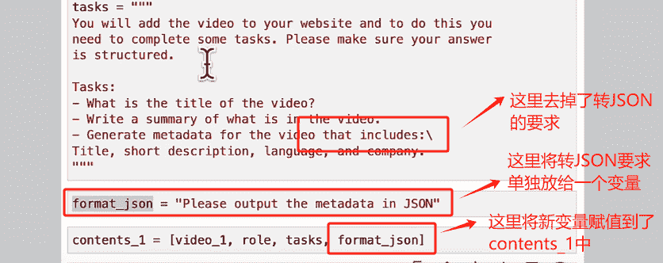

再次输出后，你可以看到，带有元数据的 JSON 响应与我们之前看到的非常相似。所以将格式分成一个单独的变量对这个响应没有太大影响。它只是让你更容易管理。

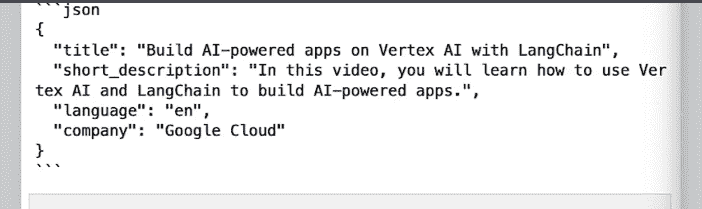

> 简而言之，这部分教学体现了：使用不同变量将提示的每个部分彻底分开，以增强提示的灵活性。这种理念同样适用于开发正式系统。

## 1.3 第二个示例——使用Gemini辅助教学总结

在接下来的例子中，我们将探索一个有趣的应用：使用模型分析视频并回答相关问题。这个过程包含几个关键步骤：

1.  我们会准备一个视频和三个相关问题。

1.  模型将先回答第一个问题，然后利用这个答案来回答问题 2 和 3。

让我们开始编写代码来实现这个功能：

首先，我们需要为视频设置 URI 和 URL。设置完成后，我们可以打印视频内容，确保一切正常。并且，如果你观看这个视频，你会发现它的主题是回归模型，这为我们的问题提供了很好的背景。

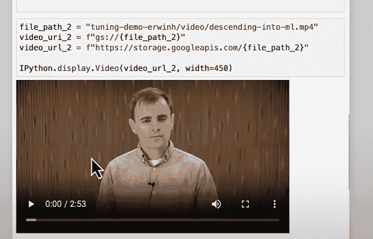

接下来，让我们来看看我们为这个视频准备的三个问题，它们逐步深入，考验模型的理解和应用能力：

1.  问题 1 是我们的起点：视频中解释了哪个概念？这个问题看似简单，但它要求模型准确把握视频的核心内容。有趣的是，我们并没有给模型任何关于视频主题的提示，这将测试它的视频理解能力。

1.  问题 2 则更具挑战性：基于问题 1 的答案，你能解释这个基本的数学原理吗？这个问题不仅要求模型理解视频内容，还需要它能够提取并阐述相关的数学原理。这将考验模型的知识整合和表达能力。

1.  问题 3 更进一步，涉及实际应用：你能提供一个简单的 scikit-learn 代码示例来解释这个概念吗？这个问题测试模型是否能将理论知识转化为实际的编程实践，这是一个相当高级的任务。

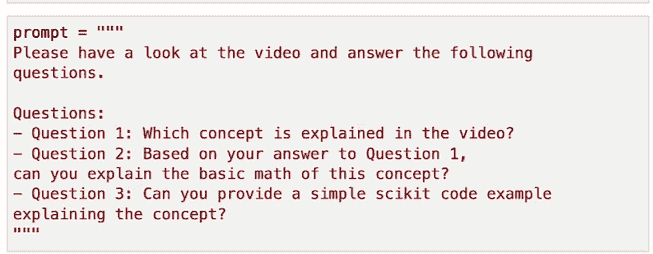

最后，我们要将三个问题和视频整合到一起，创建一个完整的查询内容。让我们称这个组合为 contents_2。

现在，让我们运行这段代码，然后仔细检查输出，看看模型是否正确理解了视频内容并恰当地回答了我们的问题。

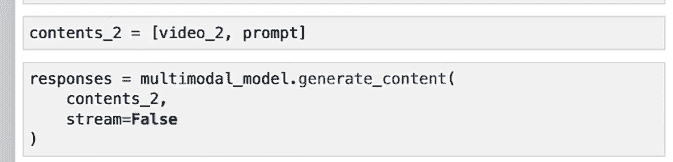

好了，让我来看看模型的回复吧！关于 Q1，模型给出的答案非常准确：视频确实在解释线性回归的概念。这个回答简洁明了，显示了模型对视频内容的准确理解。真是个好的开始！

让我们看看 Q2 的回答。模型提供了线性回归的基本数学原理，其中包括了经典的方程 y = mx + b。如果你手边有统计学教科书，不妨翻开来对照一下。

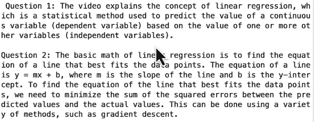

让我们来看看模型对 Q3 的回答，模型为我们提供了一个使用 scikit-learn 实现线性回归的代码示例。

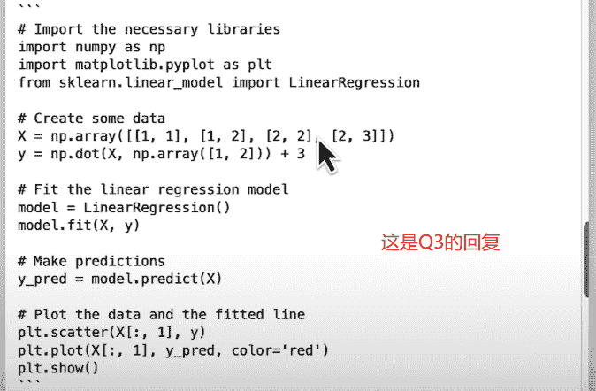

但当我运行这段代码时，结果出乎意料 —— 我得到了一个有点弯曲的奇怪图形。虽然代码确实运行了，但结果并不是我们期望的那条笔直的线性回归线。这个结果给我们上了一课：即使是 AI 生成的代码，也并非总是完美无缺的。它可能运行，但不一定能准确地实现我们的预期目标。这正是为什么我们总是需要亲自检验和测试代码的原因。

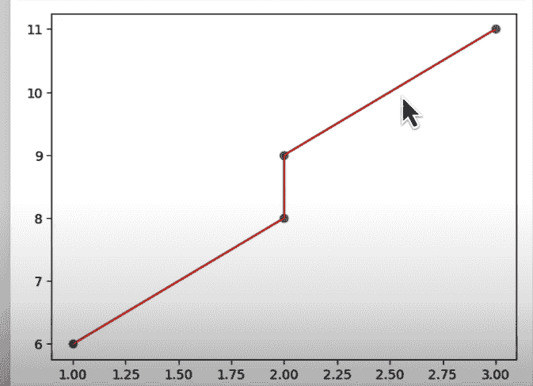

## 1.4 第三个示例——使用Gemini进行视频问答

好的，让我们一起进入下一个有趣的示例！这次我们要做些不同的事情 —— 我们将观看一个视频，然后基于视频内容向 AI 模型提出一些问题。

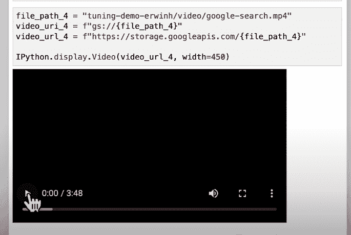

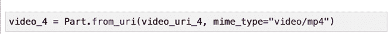

我们希望模型的回答以表格形式展示，每个问题及其对应的答案占据一行。为了让结果更加清晰和易于阅读，我们将使用 Markdown 格式来创建这个表格。这不仅能让我们的输出看起来更加专业，还能让我们在笔记本中轻松检查和展示结果。

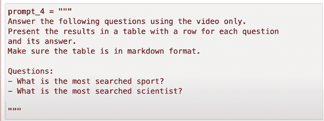

现在，让我们把所有的元素组合起来，开始我们的实验。准备就绪后，我们就可以调用 API 了。这里我们使用 generate_content 函数来获取模型的回应。

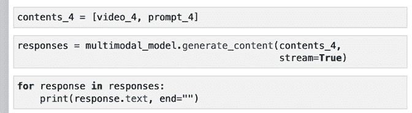

让我们看看 AI 给出了什么样的答案！根据模型的回应，搜索最多的运动是足球。而搜索最多的科学家是尼古拉・特斯拉。

现在，让我们来验证一下 Markdown 格式是否如我们预期的那样工作。我建议你将输出复制到 Excel 中，但要确保将其设置为 Markdown 格式。在你的环境中，你可能需要将其从代码视图切换到 Markdown 视图。

一旦你完成这些步骤并运行它，瞧！我们应该会看到一个结构清晰、美观的表格，每行都清楚地显示了问题和对应的答案。

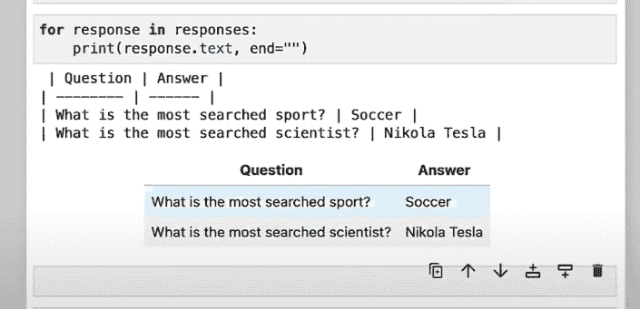

不过，说实话，我对模型给出的答案有些疑问。尼古拉・特斯拉确实是一位杰出的科学家，但在科学家排名中，我更倾向于认为爱因斯坦应该位居榜首。这个例子恰好展示了 AI 模型有时会产生 "幻觉"，即给出看似合理但实际上并不准确的答案。

重要的问题是，我们能做些什么来尝试缓解这种情况？第一个办法是改变你的提示，看看是否能改善输出（比如说如果在视频中找不到答案，就说 "在视频中未找到"）。或者尝试调整参数配置，看看是否有帮助。

## 1.5 第四个示例——使用Gemini进行大海捞针

你是否曾经在观看视频时，不得不来回拖动进度条，寻找某个特定片段？在一个 15 分钟的视频中，这种 "寻宝" 过程可能会让人感到沮丧和耗时。但是，别担心！今天我们就来解决这个问题。

你可能听说过  "大海捞针"测试。这个测试验证了 AI 在海量数据中精准定位特定信息的能力。现在，让我们来一次实战演练，看看我们能否真的在 "大海" 中找到 "针"。但这次，我们要将挑战提升到一个新的高度：我们将要求模型分析不仅一个，而是三个视频，总计超过 50 分钟的视频内容。这意味着我们必须充分利用大型上下文窗口。而且我们要搜索的不是那些显而易见的内容，而是一些隐藏得更深、不那么容易被发现的细节。

> 扩展阅读：[大海捞针测试](https://opencompass.readthedocs.io/zh-cn/latest/advanced_guides/needleinahaystack_eval.html)

> 第一步还是要做一些基础设置，步骤跟之前用例差不多，在此不做过多赘述。

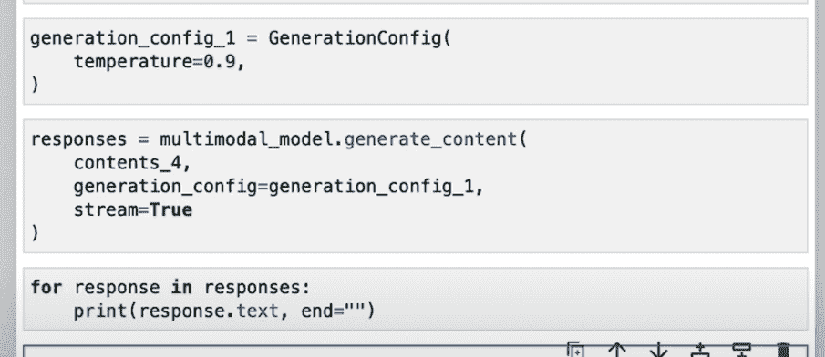

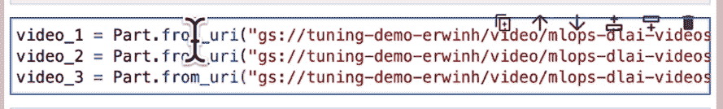

现在，让我们深入了解我们将要分析的视频内容。这些视频并非随机选择的 —— 每个视频都代表了这门课程的一节课，涵盖了不同的主题。这为我们的 AI 模型提供了一个丰富而多样的内容库来分析。

为了让你能直观地看到视频内容，我们将使用 IPython 中的 iframe 来在这里显示其中一个视频。虽然我们现在只展示一个视频，但请记住，我们的 AI 模型将会处理全部三个视频。

我邀请你花点时间浏览这个视频。随意滚动进度条，快速浏览一下内容。你可能会注意到一些关键词、图表或者特别有趣的讨论点。

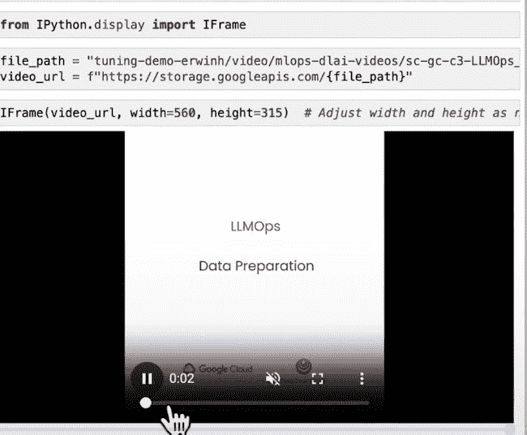

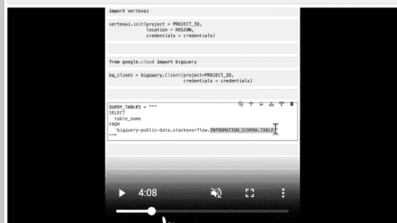

现在是时候写一些提示了。让我们使用我们在Part2中讨论的一些设计原则。首先，让我们为模型设置一个角色。在这个用例中，我们希望模型专门分析视频并从中找到"针"。

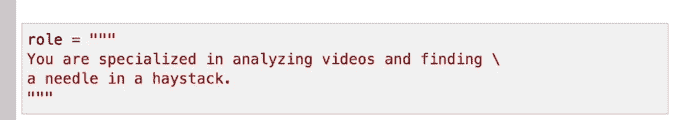

接下来，我们可以在向模型提供视频之前添加一个指令。指令说，这里有三个视频。每个都是来自 Deep Learning AI 的 LLM Ops 课程的一课。你的答案只基于视频。通过提供这个指令，模型更清楚我们对它的期望。

接下来，我们要为模型准备两个问题：

1.  第一个问题聚焦于内容概括：
"请为每个视频创建一个摘要，概述其中讨论的主要内容。每个摘要限制在 100 词以内。"

1.  第二个问题则更具挑战性：
"在这三个视频中，哪一个视频的讲师运行并解释了 Python 代码 'be_query_clients.query'？请指出在视频中可以找到这段代码的具体位置。"

这个问题有意思的地方在于，虽然这段代码确实出现在课程中，但可能并非完全一致。我们要求模型不仅识别正确的视频，还要定位代码出现的具体位置，这样我们就可以验证答案的准确性。

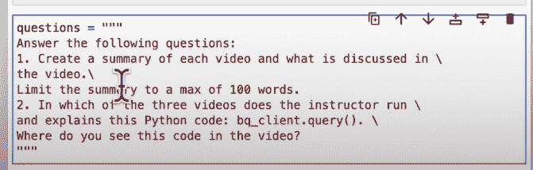

现在让我们像之前一样把所有东西放在一起,创建一个列表。首先，给出模型要扮演的角色。其次，我们将设置一个指令，在指令之后，我们将依次提供刚才提到的3个视频。最后，将以我们的问题结束。

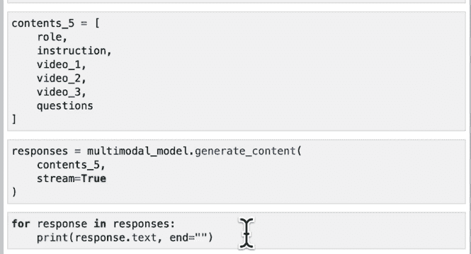

对于每个视频，我们都有一个讨论内容的摘要。所以第一个视频确实是关于 LLM Ops 概念的。第二个视频聚焦于数据操作，也是正确的。第三个视频聚焦于自动化和编排。所以这些摘要都是正确的。

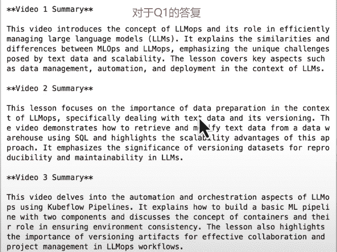

现在让我们看看大海捞针（Q2）的搜索。所以我们要求模型在视频中寻找这段代码。模型告诉我们它在第二个视频中，出现在时间戳 4 分 19 秒。

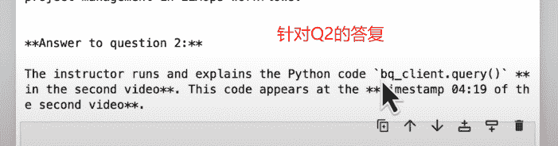

所以让我们去视频，滚动到 4:19。正如你所看到的，模型成功的找到了我们想要的内容，并给了一个确切的时间戳，这样我们就可以轻松搜索视频并找到我们正在寻找的信息。

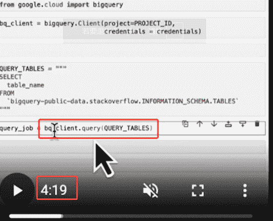

# 二、 Function Calling

这个部分我们来讲解什么是Function Calling，以及Funcation Calling的具体用法。

在这个用例中，假设你是一个从事金融方面业务的用户，你想通过模型搜索欧元兑美元的当前汇率。

但在一切开始前，我们还是需要做好配置，不过这次我们使用Gemini 1.5 Flash模型。

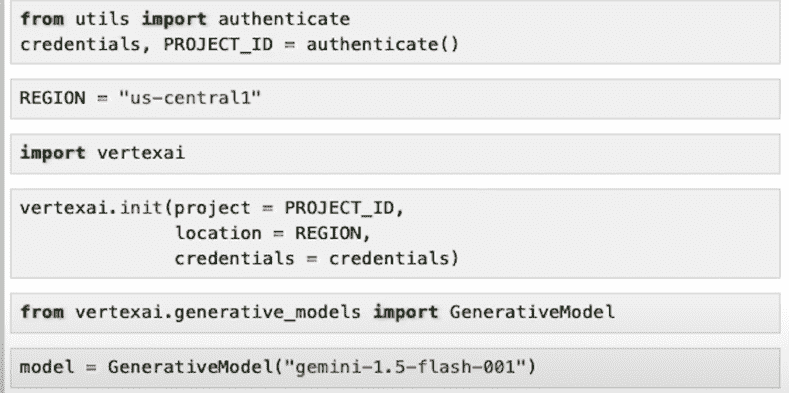

## 2.1 第一个示例——使用自定义函数辅助处理金融信息

做好基础配置后，我们必须设置我们的提示。如前所述，我们将问模型今天欧元兑美元的汇率是多少。"今天" 很重要，因为我们不想要过时的汇率。让我们看看我们的模型有多新，看看它是否知道今天欧元和美元的汇率。

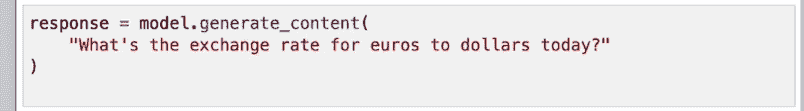

不过，在询问完之后，模型返回了："我没有访问实时信息的权限，包括像汇率这样的金融数据。" 好吧，模型无法获取今天欧元兑美元的汇率。

那么，你是否和这个例子一样：询问模型实时信息，结果只得到一个过时的信息或不准确的信息，或者在这种情况下根本没有得到任何信息？

大型语言模型在解决许多类型的问题上非常强大。然而，它们却不是万能的：模型的内部知识是有截止时间的，其并非无所不知。不过，我们可以通过函数调用解决这个缺点。

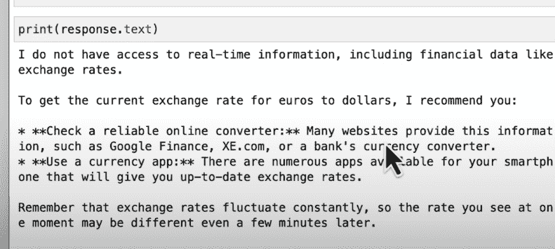

让我们看几张幻灯片。

函数调用允许你自定义函数并提供给模型使用。例如，你可以创建一个名为 get_weather 的函数，接受位置参数并返回当前天气信息。

工作流程如下：

1.  用户输入提示。

1.  提示和函数声明一起传入模型。

1.  模型处理提示，可能选择委托某些任务给指定函数。

1.  模型不直接调用函数，而是提供结构化输出，包括要调用的函数和参数值。

1.  使用这些输出调用外部 API（如天气服务）。

1.  API 返回的数据再次提供给模型。

1.  模型利用这些信息完成对提示的响应。

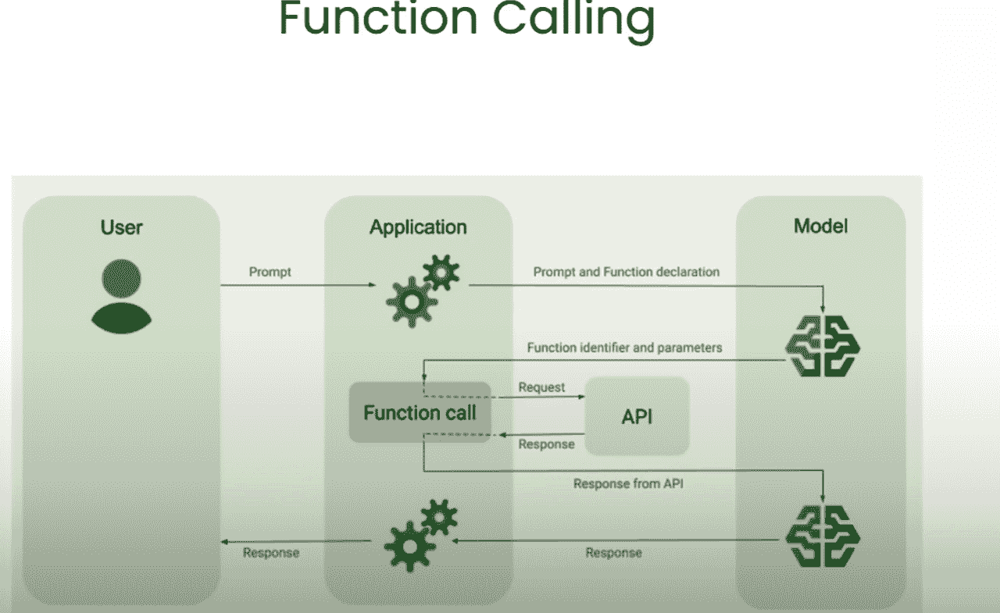

综合以上步骤，对于 "波士顿的天气如何？" 这个prompt，模型可能将任务委托给 get_weather 函数，而参数为 "波士顿"。在调用天气 API 并将数据回传给模型后，模型可能回复："波士顿目前 38 华氏度，天空部分多云。"

这种方法的优势在于灵活性：你可以使用任何编程语言、框架或 API。通常，这个功能集成在应用程序的后端系统中。

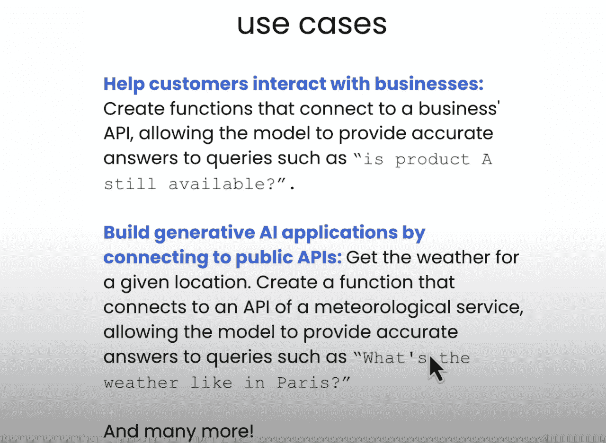

让我们回到我们当前的示例，深入探讨如何获取实时汇率。为此，我们将使用 Frankfurter(请注意，这不是香肠😀)，这是一个开源 API，专门提供欧洲中央银行发布的最新和历史外汇汇率。

为了使用这个API，我们需要导入 requests 库。导入后，使用requests.get(URL)来发送请求并获取响应。

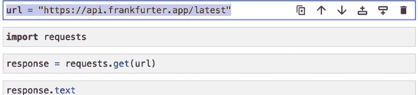

成功发送请求后，让我们来看看 API 的响应。值得注意的是，你看到的数据反映的是你执行请求时的具体日期和时间。这意味着每次运行代码，你都可能会得到稍微不同的结果，因为外汇市场是不断变化的。

另一个重要的细节是，由于这些汇率来自欧洲中央银行，欧元被设置为基础货币。这意味着你看到的数值代表的是 1 欧元可以兑换的其他货币数量。例如，如果你看到 USD 后面的数值是 1.18，这表示 1 欧元可以兑换 1.18 美元。

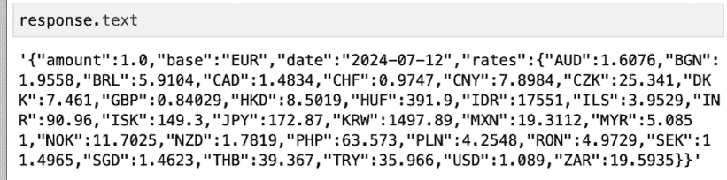

现在我们已经成功获取并理解了 API 的响应，是时候更进一步，构建一个专门用于调用 API 的函数了。这个步骤将使我们的系统更加智能和自动化。

首先，我们需要导入一些额外的 SDK 类。这些类将帮助我们实现函数调用的功能，使我们能够为大型语言模型正式描述一个函数。

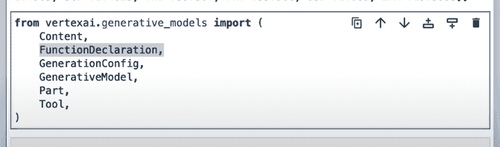

模型使用这些函数描述来理解每个函数的目的，并判断在处理用户查询时哪些函数可能有用。而每个函数声明必须包括一个函数名和函数参数。值得注意的是，在当前的设置中，你最多可以定义 128 个这样的函数。

现在，让我们详细指定我们的函数声明。这个函数的目的是获取两种货币之间的汇率。它需要以下关键参数：

1.  日期：你想要查询汇率的具体日期。

1.  从（From）货币：你要转换的初始货币。

1.  到（To）货币：你要转换成的目标货币。

> 请注意，在定义函数和参数时，提供尽可能详细的描述至关重要。这些详细信息将帮助模型准确选择合适的函数，并正确填充函数中的参数。

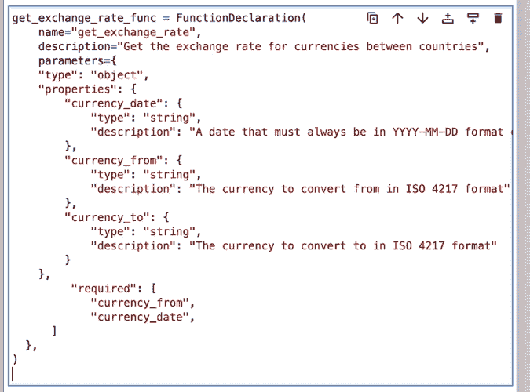

具体最后一步，我们将设置一个汇率工具，它使用我们刚才指定的 get_exchange_rate_func 函数声明。这个设置完成后，我们的函数和工具定义就配置完毕了。

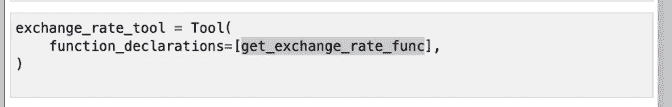

非常好，让我们继续前进，为我们的 AI 模型编写一个精确的提示。我们的目标是测试模型对汇率查询的理解和处理能力。

我们的提示是："澳元兑换瑞典克朗的汇率是多少？500 澳元值多少瑞典克朗？"这个提示巧妙地结合了两个相关但不同的问题：

1.  直接询问当前汇率

1.  要求进行具体金额的货币转换

通过这样的提示，我们不仅测试模型获取实时汇率的能力，还考验它进行简单计算的能力。

现在我们进入了这个过程的关键阶段。我们调用了 API，使用我们设计的提示和新创建的工具。模型智能地识别并选择了 get_exchange_rate 函数，为其生成了一个调用，包括澳元（AUD）、瑞典克朗（SEK）和当前日期作为参数。

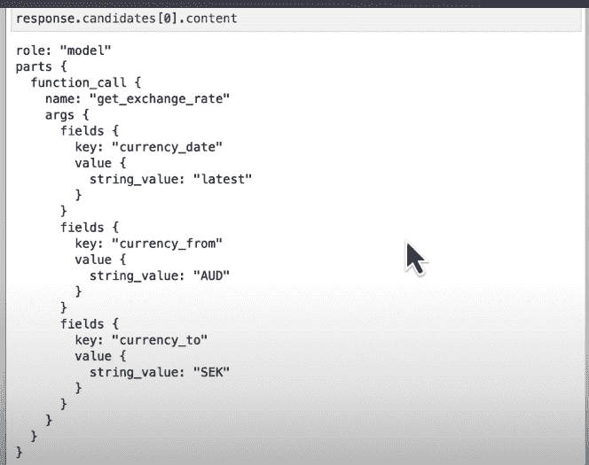

值得注意的是，模型本身并不执行外部 API 调用，而是为我们提供了执行这些调用所需的结构化信息。在我们的例子中，我们将使用之前提到的 requests 库来调用汇率 REST API。首先，我们需要将模型的响应解包到一个 Python 字典中。具体来说，我们取响应中的第一个候选项，并将其转换为 Python 字典格式。现在，我们可以清楚地看到这个 Python 字典的结构。有了这些结构化的数据，我们就可以使用 requests 库或任何其他方法来调用 API 了。

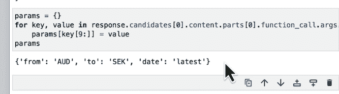

现在我们进入了实际调用 API 的阶段。首先，我们需要重新指定 URL，确保它能够正确使用我们从模型获得的参数。这个步骤至关重要，因为它模型 输出与实际的数据源连接起来。接下来，我们使用这个优化后的 URL 调用 API 并获取响应。

当我们输出这个响应时，我们可以清楚地看到 API 调用的结果：基础货币被设置为澳元，日期显示为今天，最重要的是，我们获得了澳元兑瑞典克朗的最新汇率。这些实时数据正是我们需要的。但我们的任务还没有完成。下一个关键步骤是将这些宝贵的信息传回给模型。

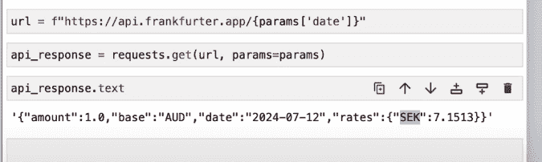

最后我们将函数响应传回给模型，让它为用户生成最终答案。具体来说，我们重新提供了初始提示："澳元兑换瑞典克朗的汇率是多少？500 澳元值多少瑞典克朗？"，同时附上了函数调用的详情和 API 的实际响应。这样做，我们就给了模型所有必要的信息来回答用户的问题。当我们运行这个查询时，模型不仅理解了原始问题，还能利用最新的 API 数据来提供准确的回答。

你可以在下方图中看到结果：模型告诉我们，当前汇率是 1 澳元兑 7.1513 瑞典克朗，并进一步计算出 500 澳元相当于 3575.65 瑞典克朗。

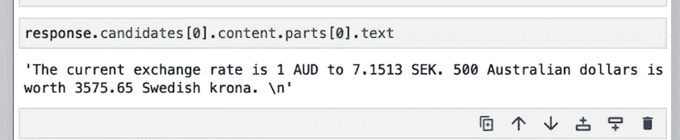

函数调用为我们的 AI 系统带来了几个至关重要的优势，显著提升了用户体验和系统效率。首先，它大大简化了用户体验。用户不再需要在模型和应用程序之间繁琐地复制粘贴信息，整个过程变得更加流畅和直观。其次，这种方法显著减少了错误发生的可能性。通过最小化用户手动输入的需求，我们降低了输入不正确信息的风险，提高了整体的准确性。最后，也许是最令人兴奋的，函数调用为更高级的自动化开辟了道路。它使我们能够处理更复杂的操作，如酒店预订或制定旅行计划，这些都可以直接由用户对 Gemini 模型的简单请求触发。这种级别的集成和自动化不仅提高了效率，还为创新的 AI 应用打开了无限可能：用户只需一个简单的语音命令就能完成一系列复杂的任务，从查询实时数据到执行多步骤的操作。这就是函数调用为我们的 AI 系统带来的革命性变化，它正在重新定义我们与技术互动的方式。

**以**上就是关于多模态提示词培训课程的所有内容了，希望这个课程能对你产生帮助。这样也就不枉我花费时间重新编排、翻译了。

**谢谢。**