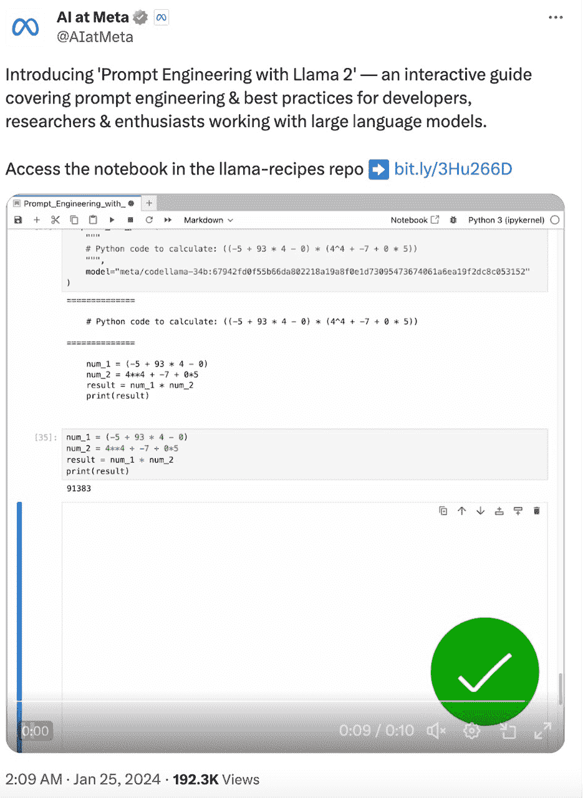
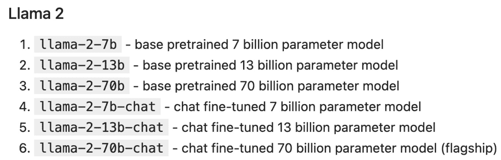
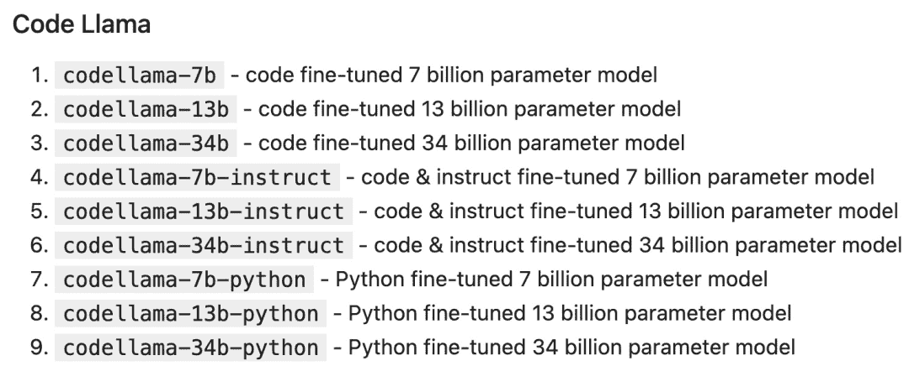

# Meta官方的Prompt工程指南：Llama 2这样用更高效

> 来源：[https://agijuejin.feishu.cn/docx/QrAydrYFFo3UoYxRtKNclAAyncb](https://agijuejin.feishu.cn/docx/QrAydrYFFo3UoYxRtKNclAAyncb)

> 作者：机器之心

> 原文：[https://mp.weixin.qq.com/s/Xy](https://mp.weixin.qq.com/s/Xy8HdQih2d3lpNigCkOWIA)8HdQih2d3lpNigCkOWIA

随着大型语言模型（LLM）技术日渐成熟，提示工程（Prompt Engineering）变得越来越重要。一些研究机构发布了 LLM 提示工程指南，包括微软、OpenAI 等等。

最近，Llama 系列开源模型的提出者 Meta 也针对 Llama 2 发布了一份交互式提示工程指南，涵盖了 Llama 2 的快速工程和最佳实践。



以下是这份指南的核心内容。

## Llama 模型

2023 年，Meta 推出了 Llama 、Llama 2 模型。较小的模型部署和运行成本较低，而更大的模型能力更强。

Llama 2 系列模型参数规模如下：



Code Llama 是一个以代码为中心的 LLM，建立在 Llama 2 的基础上，也有各种参数规模和微调变体：



## 部署 LLM

LLM 可以通过多种方式部署和访问，包括：

自托管（Self-hosting）：使用本地硬件来运行推理，例如使用 llama.cpp 在 Macbook Pro 上运行 Llama 2。优势：自托管最适合有隐私 / 安全需要的情况，或者您拥有足够的 GPU。

云托管：依靠云提供商来部署托管特定模型的实例，例如通过 AWS、Azure、GCP 等云提供商来运行 Llama 2。优势：云托管是最适合自定义模型及其运行时的方式。

托管 API：通过 API 直接调用 LLM。有许多公司提供 Llama 2 推理 API，包括 AWS Bedrock、Replicate、Anyscale、Together 等。优势：托管 API 是总体上最简单的选择。

### 托管 API

托管 API 通常有两个主要端点（endpoint）：

1.  completion：生成对给定 prompt 的响应。

1.  chat_completion：生成消息列表中的下一条消息，为聊天机器人等用例提供更明确的指令和上下文。

### token

LLM 以称为 token 的块的形式来处理输入和输出，每个模型都有自己的 tokenization 方案。比如下面这句话：

```
Our destiny is written in the stars.
```

Llama 2 的 tokenization 为 ["our", "dest", "iny", "is", "writing", "in", "the", "stars"]。考虑 API 定价和内部行为（例如超参数）时，token 显得尤为重要。每个模型都有一个 prompt 不能超过的最大上下文长度，Llama 2 是 4096 个 token，而 Code Llama 是 100K 个 token。

## Notebook 设置

作为示例，我们使用 Replicate 调用 Llama 2 chat，并使用 LangChain 轻松设置 chat completion API。

首先安装先决条件：

```
pip install langchain replicate
```

```
from typing import Dict, List
from langchain.llms import Replicate
from langchain.memory import ChatMessageHistory
from langchain.schema.messages import get_buffer_string
import os
# Get a free API key from https://replicate.com/account/api-tokens
os.environ [&quot;REPLICATE_API_TOKEN&quot;] = &quot;YOUR_KEY_HERE&quot;
LLAMA2_70B_CHAT = &quot;meta/llama-2-70b-chat:2d19859030ff705a87c746f7e96eea03aefb71f166725aee39692f1476566d48&quot;
LLAMA2_13B_CHAT = &quot;meta/llama-2-13b-chat:f4e2de70d66816a838a89eeeb621910adffb0dd0baba3976c96980970978018d&quot;
# We&#x27;ll default to the smaller 13B model for speed; change to LLAMA2_70B_CHAT for more advanced (but slower) generations
DEFAULT_MODEL = LLAMA2_13B_CHAT
def completion (
prompt: str,
model: str = DEFAULT_MODEL,
temperature: float = 0.6,
top_p: float = 0.9,
) -&gt; str:
llm = Replicate (
model=model,
model_kwargs={&quot;temperature&quot;: temperature,&quot;top_p&quot;: top_p, &quot;max_new_tokens&quot;: 1000}
)
return llm (prompt)
def chat_completion (
messages: List [Dict],
model = DEFAULT_MODEL,
temperature: float = 0.6,
top_p: float = 0.9,
) -&gt; str:
history = ChatMessageHistory ()
for message in messages:
if message [&quot;role&quot;] == &quot;user&quot;:
history.add_user_message (message [&quot;content&quot;])
elif message [&quot;role&quot;] == &quot;assistant&quot;:
history.add_ai_message (message [&quot;content&quot;])
else:
raise Exception (&quot;Unknown role&quot;)
return completion (
get_buffer_string (
history.messages,
human_prefix=&quot;USER&quot;,
ai_prefix=&quot;ASSISTANT&quot;,
),
model,
temperature,
top_p,
)
def assistant (content: str):
return { &quot;role&quot;: &quot;assistant&quot;, &quot;content&quot;: content }
def user (content: str):
return { &quot;role&quot;: &quot;user&quot;, &quot;content&quot;: content }
def complete_and_print (prompt: str, model: str = DEFAULT_MODEL):
print (f&#x27;==============\n {prompt}\n==============&#x27;)
response = completion (prompt, model)
print (response, end=&#x27;\n\n&#x27;)
```

### Completion API

```
complete_and_print (&quot;The typical color of the sky is:&quot;)
```

```
complete_and_print (&quot;which model version are you?&quot;)
```

Chat Completion 模型提供了与 LLM 互动的额外结构，将结构化消息对象数组而不是单个文本发送到 LLM。此消息列表为 LLM 提供了一些可以继续进行的「背景」或「历史」信息。

通常，每条消息都包含角色和内容：

具有系统角色的消息用于开发人员向 LLM 提供核心指令。

具有用户角色的消息通常是人工提供的消息。

具有助手角色的消息通常由 LLM 生成。

```
response = chat_completion (messages=[
user (&quot;My favorite color is blue.&quot;),
assistant (&quot;That&#x27;s great to hear!&quot;),
user (&quot;What is my favorite color?&quot;),
])
print (response)
# &quot;Sure, I can help you with that! Your favorite color is blue.&quot;
```

### LLM 超参数

LLM API 通常会采用影响输出的创造性和确定性的参数。在每一步中，LLM 都会生成 token 及其概率的列表。可能性最小的 token 会从列表中「剪切」（基于 top_p），然后从剩余候选者中随机（温度参数 temperature）选择一个 token。换句话说：top_p 控制生成中词汇的广度，温度控制词汇的随机性，温度参数 temperature 为 0 会产生几乎确定的结果。

```
def print_tuned_completion (temperature: float, top_p: float):
response = completion (&quot;Write a haiku about llamas&quot;, temperature=temperature, top_p=top_p)
print (f&#x27;[temperature: {temperature} | top_p: {top_p}]\n {response.strip ()}\n&#x27;)
print_tuned_completion (0.01, 0.01)
print_tuned_completion (0.01, 0.01)
# These two generations are highly likely to be the same
print_tuned_completion (1.0, 1.0)
print_tuned_completion (1.0, 1.0)
# These two generations are highly likely to be different
```

## prompt 技巧

详细、明确的指令会比开放式 prompt 产生更好的结果：

```
complete_and_print (prompt=&quot;Describe quantum physics in one short sentence of no more than 12 words&quot;)
# Returns a succinct explanation of quantum physics that mentions particles and states existing simultaneously.
```

我们可以给定使用规则和限制，以给出明确的指令。

+   风格化，例如：

+   向我解释一下这一点，就像儿童教育网络节目中教授小学生一样；

+   我是一名软件工程师，使用大型语言模型进行摘要。用 250 字概括以下文字；

+   像私家侦探一样一步步追查案件，给出你的答案。

+   格式化

+   使用要点；

+   以 JSON 对象形式返回；

+   使用较少的技术术语并用于工作交流中。

+   限制

+   仅使用学术论文；

+   切勿提供 2020 年之前的来源；

+   如果你不知道答案，就说你不知道。

以下是给出明确指令的例子：

```
complete_and_print (&quot;Explain the latest advances in large language models to me.&quot;)
# More likely to cite sources from 2017
complete_and_print (&quot;Explain the latest advances in large language models to me. Always cite your sources. Never cite sources older than 2020.&quot;)
# Gives more specific advances and only cites sources from 2020
```

### 零样本 prompting

一些大型语言模型（例如 Llama 2）能够遵循指令并产生响应，而无需事先看过任务示例。没有示例的 prompting 称为「零样本 prompting（zero-shot prompting）」。例如：

```
complete_and_print (&quot;Text: This was the best movie I&#x27;ve ever seen! \n The sentiment of the text is:&quot;)
# Returns positive sentiment
complete_and_print (&quot;Text: The director was trying too hard. \n The sentiment of the text is:&quot;)
# Returns negative sentiment
```

### 少样本 prompting

添加所需输出的具体示例通常会产生更加准确、一致的输出。这种方法称为「少样本 prompting（few-shot prompting）」。例如：

```
def sentiment (text):
response = chat_completion (messages=[
user (&quot;You are a sentiment classifier. For each message, give the percentage of positive/netural/negative.&quot;),
user (&quot;I liked it&quot;),
assistant (&quot;70% positive 30% neutral 0% negative&quot;),
user (&quot;It could be better&quot;),
assistant (&quot;0% positive 50% neutral 50% negative&quot;),
user (&quot;It&#x27;s fine&quot;),
assistant (&quot;25% positive 50% neutral 25% negative&quot;),
user (text),
])
return response
def print_sentiment (text):
print (f&#x27;INPUT: {text}&#x27;)
print (sentiment (text))
print_sentiment (&quot;I thought it was okay&quot;)
# More likely to return a balanced mix of positive, neutral, and negative
print_sentiment (&quot;I loved it!&quot;)
# More likely to return 100% positive
print_sentiment (&quot;Terrible service 0/10&quot;)
# More likely to return 100% negative
```

### Role Prompting

Llama 2 在指定角色时通常会给出更一致的响应，角色为 LLM 提供了所需答案类型的背景信息。

例如，让 Llama 2 对使用 PyTorch 的利弊问题创建更有针对性的技术回答：

```
complete_and_print (&quot;Explain the pros and cons of using PyTorch.&quot;)
# More likely to explain the pros and cons of PyTorch covers general areas like documentation, the PyTorch community, and mentions a steep learning curve
complete_and_print (&quot;Your role is a machine learning expert who gives highly technical advice to senior engineers who work with complicated datasets. Explain the pros and cons of using PyTorch.&quot;)
# Often results in more technical benefits and drawbacks that provide more technical details on how model layers
```

### 思维链

简单地添加一个「鼓励逐步思考」的短语可以显著提高大型语言模型执行复杂推理的能力（Wei et al. (2022)），这种方法称为 CoT 或思维链 prompting：

```
complete_and_print (&quot;Who lived longer Elvis Presley or Mozart?&quot;)
# Often gives incorrect answer of &quot;Mozart&quot;
complete_and_print (&quot;Who lived longer Elvis Presley or Mozart? Let&#x27;s think through this carefully, step by step.&quot;)
# Gives the correct answer &quot;Elvis&quot;
```

### 自洽性（Self-Consistency）

LLM 是概率性的，因此即使使用思维链，一次生成也可能会产生不正确的结果。自洽性通过从多次生成中选择最常见的答案来提高准确性（以更高的计算成本为代价）：

```
import re
from statistics import mode
def gen_answer ():
response = completion (
&quot;John found that the average of 15 numbers is 40.&quot;
&quot;If 10 is added to each number then the mean of the numbers is?&quot;
&quot;Report the answer surrounded by three backticks, for example:```123```&quot;,
model = LLAMA2_70B_CHAT
)
match = re.search (r&#x27;```(\d+)```&#x27;, response)
if match is None:
return None
return match.group (1)
answers = [gen_answer () for i in range (5)]
print (
f&quot;Answers: {answers}\n&quot;,
f&quot;Final answer: {mode (answers)}&quot;,
)
# Sample runs of Llama-2-70B (all correct):
# [50, 50, 750, 50, 50]  -&gt; 50
# [130, 10, 750, 50, 50] -&gt; 50
# [50, None, 10, 50, 50] -&gt; 50
```

### 检索增强生成

有时我们可能希望在应用程序中使用事实知识，那么可以从开箱即用（即仅使用模型权重）的大模型中提取常见事实：

```
complete_and_print (&quot;What is the capital of the California?&quot;, model = LLAMA2_70B_CHAT)
# Gives the correct answer &quot;Sacramento&quot;
```

然而，LLM 往往无法可靠地检索更具体的事实或私人信息。模型要么声明它不知道，要么幻想出一个错误的答案：

```
complete_and_print (&quot;What was the temperature in Menlo Park on December 12th, 2023?&quot;)
# &quot;I&#x27;m just an AI, I don&#x27;t have access to real-time weather data or historical weather records.&quot;
complete_and_print (&quot;What time is my dinner reservation on Saturday and what should I wear?&quot;)
# &quot;I&#x27;m not able to access your personal information [..] I can provide some general guidance&quot;
```

检索增强生成（RAG）是指在 prompt 中包含从外部数据库检索的信息（Lewis et al. (2020)）。RAG 是将事实纳入 LLM 应用的有效方法，并且比微调更经济实惠，微调可能成本高昂并对基础模型的功能产生负面影响。

```
MENLO_PARK_TEMPS = {
&quot;2023-12-11&quot;: &quot;52 degrees Fahrenheit&quot;,
&quot;2023-12-12&quot;: &quot;51 degrees Fahrenheit&quot;,
&quot;2023-12-13&quot;: &quot;51 degrees Fahrenheit&quot;,
}
def prompt_with_rag (retrived_info, question):
complete_and_print (
f&quot;Given the following information: &#x27;{retrived_info}&#x27;, respond to: &#x27;{question}&#x27;&quot;
)
def ask_for_temperature (day):
temp_on_day = MENLO_PARK_TEMPS.get (day) or &quot;unknown temperature&quot;
prompt_with_rag (
f&quot;The temperature in Menlo Park was {temp_on_day} on {day}&#x27;&quot;,  # Retrieved fact
f&quot;What is the temperature in Menlo Park on {day}?&quot;,  # User question
)
ask_for_temperature (&quot;2023-12-12&quot;)
# &quot;Sure! The temperature in Menlo Park on 2023-12-12 was 51 degrees Fahrenheit.&quot;
ask_for_temperature (&quot;2023-07-18&quot;)
# &quot;I&#x27;m not able to provide the temperature in Menlo Park on 2023-07-18 as the information provided states that the temperature was unknown.&quot;
```

## 程序辅助语言模型

LLM 本质上不擅长执行计算，例如：

```
complete_and_print (&quot;&quot;&quot;
Calculate the answer to the following math problem:
((-5 + 93 * 4 - 0) * (4^4 + -7 + 0 * 5))
&quot;&quot;&quot;)
# Gives incorrect answers like 92448, 92648, 95463
```

Gao et al. (2022) 提出「程序辅助语言模型（Program-aided Language Models，PAL）」的概念。虽然 LLM 不擅长算术，但它们非常擅长代码生成。PAL 通过指示 LLM 编写代码来解决计算任务。

```
complete_and_print (
    &quot;&quot;&quot;
    # Python code to calculate: ((-5 + 93 * 4 - 0) * (4^4 + -7 + 0 * 5))
    &quot;&quot;&quot;,
model=&quot;meta/codellama-34b:67942fd0f55b66da802218a19a8f0e1d73095473674061a6ea19f2dc8c053152&quot;
)
```

```
# The following code was generated by Code Llama 34B:
num1 = (-5 + 93 * 4 - 0)
num2 = (4**4 + -7 + 0 * 5)answer = num1 * num2
print (answer)
```

原文链接：https://github.com/facebookresearch/llama-recipes/blob/main/examples/Prompt_Engineering_with_Llama_2.ipynb?utm_source=twitter&utm_medium=organic_social&utm_campaign=llama&utm_content=video