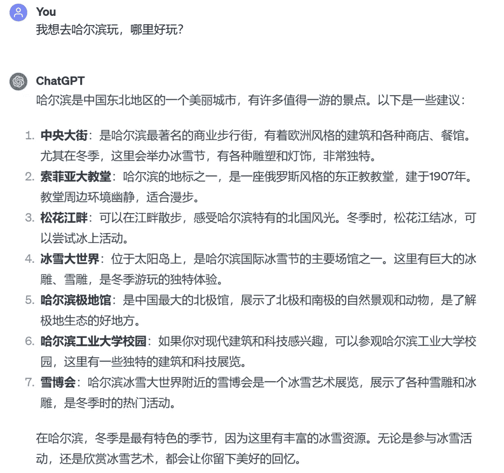
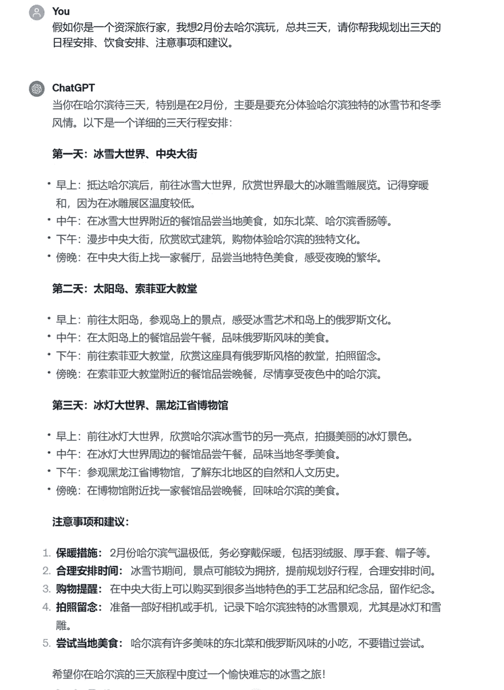
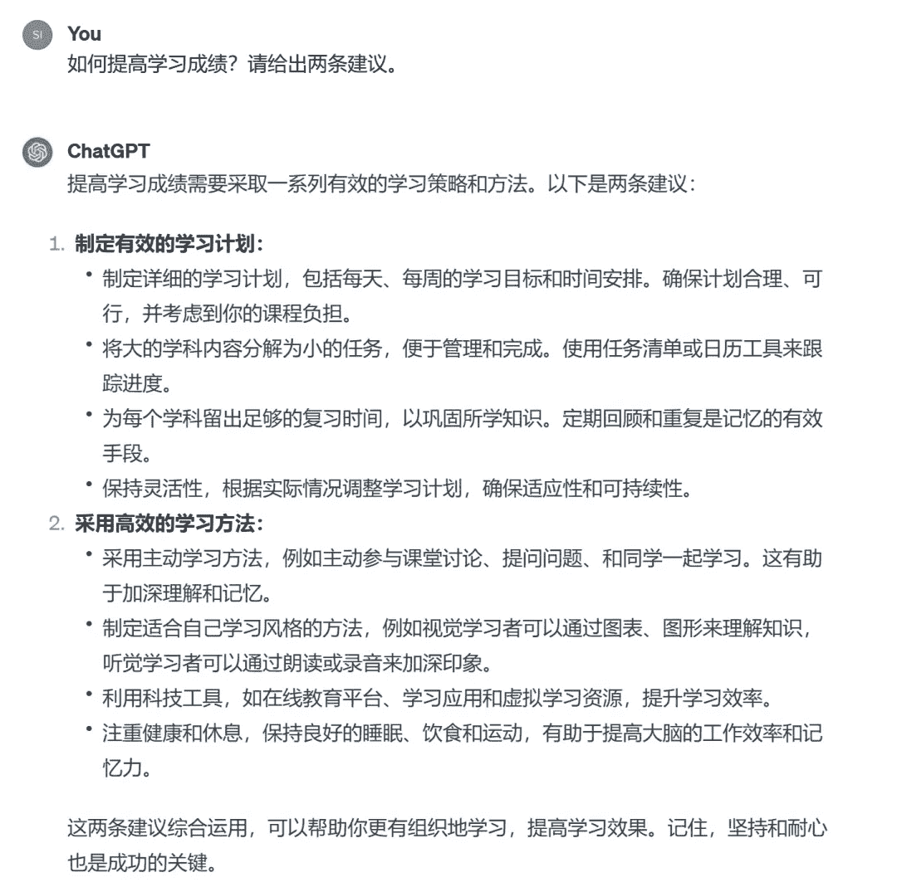
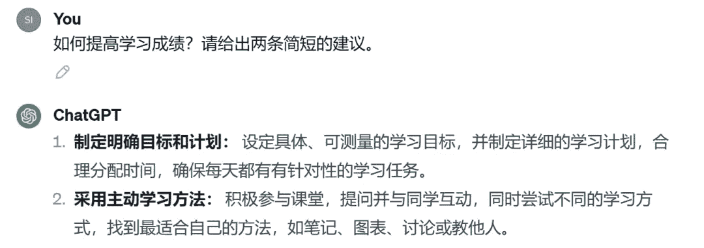
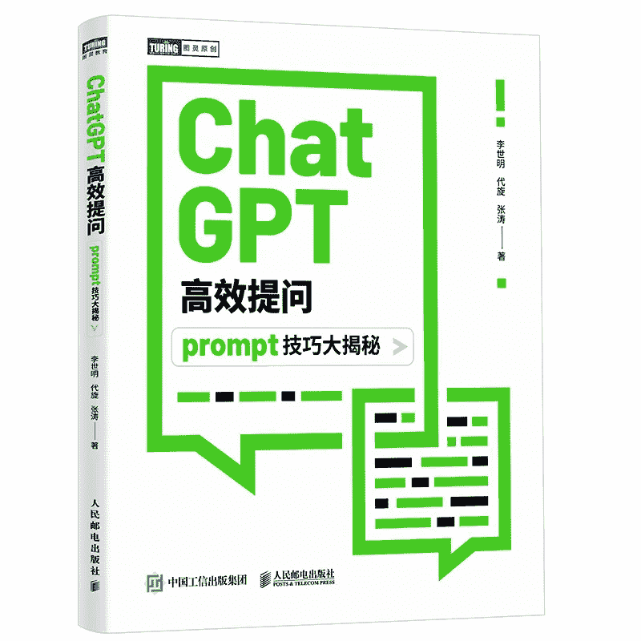

# ChatGPT不好用？记住这些prompt核心技巧，提效80%

> 来源：[https://agijuejin.feishu.cn/docx/OvDFd4L8uo4qzFxcIhAcXu2MnkT](https://agijuejin.feishu.cn/docx/OvDFd4L8uo4qzFxcIhAcXu2MnkT)

> 作者：图灵编辑部 | 图灵社区

> 原文：https://mp.weixin.qq.com/s/019Of9axH3GcYu7GmYlDSA

随着 ChatGPT 的火爆，越来越多人把它融入到日常工作、学习、生活中，有人用它做工作报告、内容创作、孵化个人 IP、编程开发等，起初大家对这个问答式的对话，感到有趣，只要你敢问，它都能回答你。但是使用一段时间之后，当简单的指令得出的结果无法满足我们的需求时，人们会觉得 ChatGPT 的回答过于宽泛，跟百度比起来，也不过如此。

其实，大多数人在使用中忽略了一个要点—— prompt。精准使用 prompt 会让 Chat GPT 更高效地为你产出内容。 比如你想去哈尔滨游玩，但对当地不了解，于是你想着可以咨询一下 Chat GPT，你得到的旅游攻略是这样的：

不对比不知道，别人的攻略可能是这样的，不仅有景点，日程安排还事无巨细。不仅把景点规划了，还给出了每日的行程，这样就无需花更多时间来回规划路线了。

用不用 prompt 的差距可以说一目了然！那么这个 promp t 功能究竟是什么呢？我们就一起来了解一下。

## **prompt 起源**

谈到 prompt 的起源，需要从计算机科学中一个神秘的分支——自然语言处理（natural language processing，NLP）开始。自然语言处理的目标是让计算机能够理解和处理人类的语言，它是人工智能和计算机科学的一个重要交叉领域。在 NLP 的发展历程中，学者们尝试了各种方法，试图让计算机能够与人类自由沟通。早期的 NLP 主要依赖规则和模式匹配的方法，将人类语言拆解为许多语法和句法规则，然而这种方法往往难以处理复杂的语言结构和表达。

随着机器学习（machine learning）和深度学习（deep learning）技术的出现和发展，自然语言处理迎来突破性进展。21 世纪初，大数据、计算能力和算法的快速发展为NLP的繁荣创造了。

有利条件。在各种创新之下，众多新型模型应运而生，例如循环神经网络（RNN）、长短时记忆网络（LSTM）、大型语言模型（LLM）和自回归语言模型（如Transformer）等。而在这些模型中，最具影响力的当属 OpenAI 研发的 GPT（Generative Pre-trained Transformer）系列大型语言模型。

GPT 模型是一种基于 Transformer 架构的生成式预训练模型。截至当前，GPT 已经历了 GPT-1、GPT-2、GPT-3、GPT-3.5、GPT-4 五个版本，在执行自然语言任务方面的表现越来越好。

prompt 并不是从一开始就存在的，它最早在 GPT-3 版本中出现。该版本引入了一种称为“system”的特殊角色，用户可以通过在对话开头为“system”提供指令或提出问题来引导对话进行。而在 GPT-3 版本之前，GPT 模型主要用于单个文本生成任务，而不是对话任务。因此，早期版本的GPT模型并没有明确的 prompt 概念，而是将整个输入文本作为上下文进行训练和生成。

GPT-3 引入了执行对话任务的能力，将对话划分为用户和系统两个角色，并使用 prompt 来引导对话进行。这种方式使得 ChatGPT 能够更好地理解上下文并生成更连贯和有针对性的回复。自此以后，prompt 成为 ChatGPT 模型中的重要概念，并在后续版本中得到进一步的发展和改进。

prompt 的核心理念就是通过设计恰当、精妙的提示，引导预训练模型生成期望的回答或完成特定任务。这种方法的优势在于，我们不需要对模型进行大量的定制化训练，节省了大量的计算资源和训练时间，而且模型具有较强的泛化能力和适应性。

随着人们对 ChatGPT 的认识逐渐加深，它被应用到各个领域，比如我们可以借助它写论文、写小说、写文案、学英语、编程、做心理辅导、做理财、做职业规划等。而 prompt 在其中起到了非常关键的作用，使用不同的 prompt 会得到完全不一样的结果。事实上，prompt 已经发展成一个专门的学科，也许不久的将来它会成为大学的一门专业。

## **什么是 prompt？**

prompt 究竟是什么呢？简单来说，它是一种与 AI（人工智能）模型进行有效交互的技巧。通过设计精妙的提示输入，我们可以引导 AI 模型生成期望的、有针对性的输出。你可以将其视为一种与智能体（agent）沟通的技巧，可以帮助我们更好地理解和利用 AI 技术，从而满足各种需求。一个好的 prompt 应该清晰、明确且有效，以便AI模型能够准确理解我们的需求并提供相关信息。下面是一个和 ChatGPT“对话”的示例，而输入的信息就是一个 prompt。

输入 prompt：

我们得到了一个很长的结果，如果想简化输出，可以在 prompt 中说明。

输入 prompt：

从上例中可以看到，当 prompt 要求输出“简短”后，ChatGPT 给出的建议更加精简，符合我们的要求。如果使用一个比较宽泛、模糊的 prompt，AI 模型可能无法确定我们的意图，从而生成不相关或者不满足需求的回答。而提供一个更明确的 prompt，可以帮助 AI 模型更好地理解 我们的需求。

因此， **prompt 工程就是研究如何设计和优化提示信息，以便更好地**引导 AI 模型输出符合我们期望的回答 。在实际应用中通常不能一蹴而就，而需要不断地调整 prompt 来获得满意的结果。其中涉及各种技巧和策略，包括理解 AI 模型的行为、设计有效的 prompt 以及评估和优化输出结果等。

## **人人都应该学习 prompt**

如今 ChatGPT 已经渗透到各行各业，给我们的生活和工作带来了巨大的变化。即便在国内使用它不太方便，也并不影响大家对它的热情。毫不夸张地说，ChatGPT 的出现引燃了全球人工智能领域，2023 年必定是 AI 发展的转折之年。

不说远了，单是 ChatGPT 在日常工作中带来的效率提升就已大大超出预期。使用 ChatGPT 生成会议纪要、写周报、写 Excel 中各种复杂的公式、制作 PPT 等，这对于很多白领来说是必备技能。而在这些方面，如何将 ChatGPT 的功能发挥到极致，关键就在于 prompt 的使用。也就是说，如果学会了 prompt 的用法，那么必定会让你的工作效率大幅提升。

伴随着 GPT-4 的发布，ChatGPT 已化身为一本“百科全书”，我们可以将它作为智能助理，向它询问任何行业的专业问题，从而快速了解或者学习跨领域知识，其关键点就在于如何使用 prompt。所以，学习 prompt 相关技能，可以让我们借助 ChatGPT 快速成为“万事通”。想象一下，一名内科医生借助 ChatGPT 利用一周时间编写了一款在线就诊软件，是不是非常神奇？

总之，随着 ChatGPT 越来越成熟，一定会涌现出各种各样类似的 AI 工具，这些 AI 工具势必会改变我们的工作和生活方式。而 prompt 作为使用这类 AI 工具的重要一环，对它的研究和学习势在必行。

## **prompt 超实用宝典**

ChatGPT 的横空出世昭示了通用人工智能的可能性，并为我们提供了更加便捷、直观和个性化的信息获取方式，有望在教育、研究、咨询和日常生活中发挥重要作用。

而驾驭 ChatGPT，使之更好地服务于我们的工作和生活，需要一些技巧和方法，这本深度讲解 prompt（提示）工程的超实用宝典，绝对值得一读。

《 ChatGPT高效提问： prompt技巧大揭秘》

李世明，代旋，张涛 | 著

本书以通俗易懂的语言，详细介绍了如何编写高质量的提示，引导 ChatGPT 输出优质答案，满足各种信息需求。 书中包含详细解释和丰富示例，旨在帮助读者掌握利用 ChatGPT  解决各种问题的实用技能。

全书内容分为 6 章， 其中前 3 章为基础介绍，后 3 章为具体用法和实战。其中包含 13 个 prompt 常见用法，8 个 prompt 高阶用法，13 个应用场景，提供丰富的实践案例，另外还有 100 个优秀的 prompt 示例可供参考。可以说一本全面丰富的 prompt 操作指南，不管你是对人工智能感兴趣的读者，还是想高效利用 ChatGPT 的职场人，这本书都非常实用。

## **作译者简介**

李世明，腾讯前高级工程师，万人社群“AI 破局俱乐部”嘉宾，《AI超级个体：ChatGPT与AIGC实战指南》作者，AIGC 领域探索和创业者，AIGC 领域在线教育践行者。

代旋，对 ChatGPT、prompt 有深入研究，拥有十多年大型互联网运维管理经验，擅长 Linux、Kubernetes、运维开发等。

张涛，曾任职 VMware、eBay 等知名 IT 公司，AI 中级训练师，擅长场景视觉、智能助手、智能搜索、智能决策等领域。

## **业内大咖推荐**

软件开发工程师变成提示词工程师，这反映了 AI 时代的人才发展趋势。未来，几乎每家企业都将需要 AI 应用工程师，每个企业家身边都需要有一个首席 AI 官。本书提供了学习 AI 知识的起点，值得每位 AI 时代的新兴人才借鉴。

**——李明顺，行行AI董事长，工信部工业文化发展中心 AI 应**用工作组执行组长， 顺福资本管理合伙人

prompt 是 AIGC 的核心技巧，是应用 ChatGPT 比较重要的环节之一。当谈及 ChatGPT prompt 时，本书是你不可或缺的指南。无论你是初学者，还是有经验的用户，无论你是探索 ChatGPT 的新手，还是希望进一步提升 prompt 技能的行家，本书都能给你提供莫大的帮助。它不仅揭示了如何通过精准的 prompt 创建流畅并且有深度的对话，还清晰地解释了如何实现引人入胜的交互。

**——易洋(findyi)，网易有道博闻前业务**负责人，万人社群“A破局俱乐部”创始人

本书详细介绍了如何利用 ChatGPT 大幅提升日常工作效率，不仅有理论讲解，还有很多实战案例。其中谈及的让 ChatGPT 模仿其他高质量的 prompt 很具实用性，即使你不擅长创作，也能借助 ChatGPT 生成高质量的内容。对于想要深入了解 ChatGPT 并高效使用它的人，本书是宝贵的指南。无论你的专业背景如何，它都能为你提供实用的知识和启发。

**——菠菜，百度前架构师，万人社群“A破局俱乐部”大**航海教练，prompt 编程”概念提出者