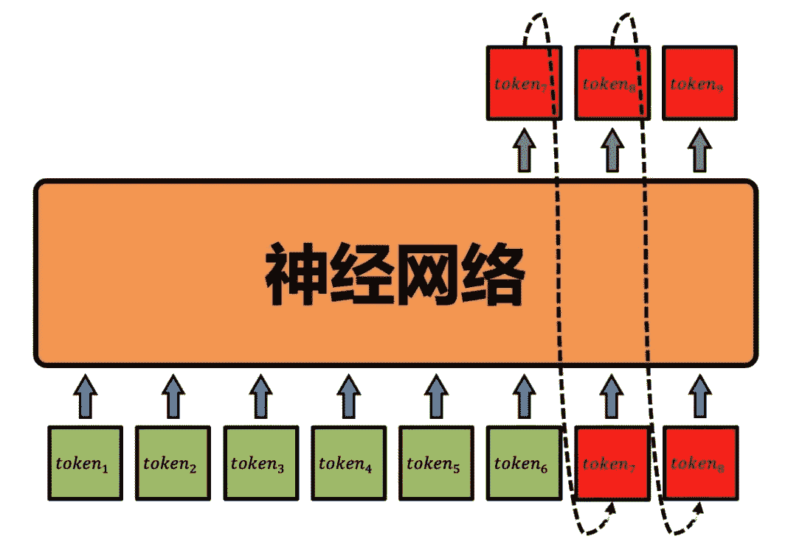
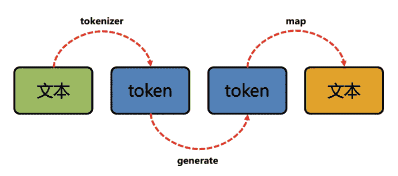
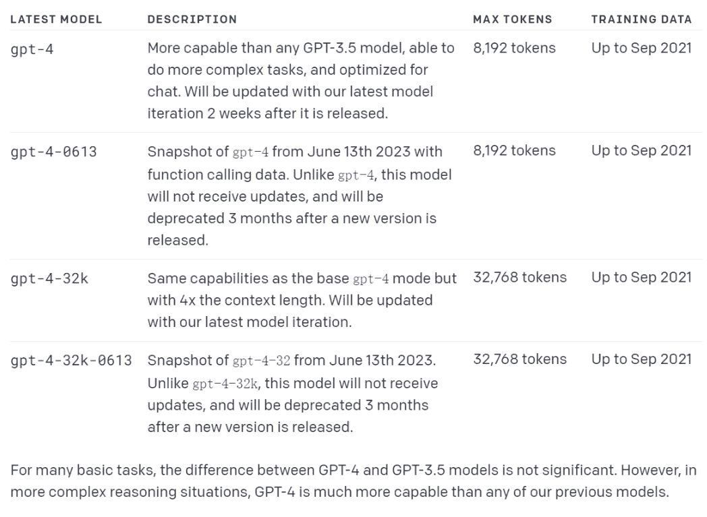
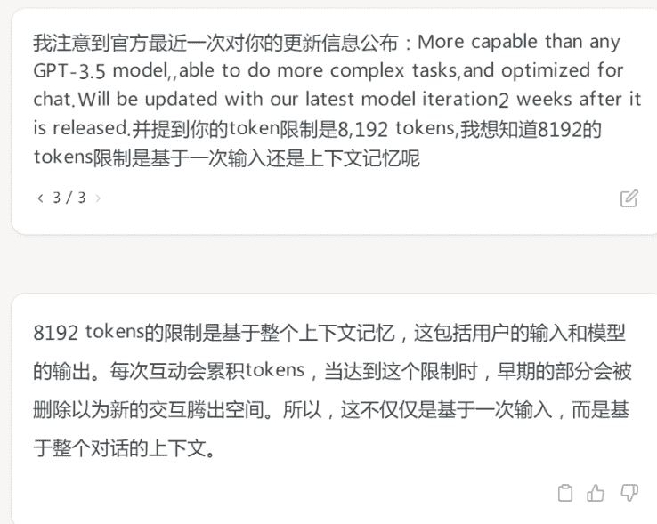
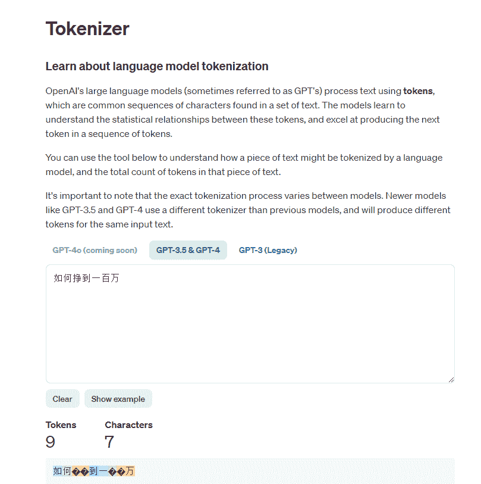

# 学prompt提示词的时候一直听到的token究竟是什么？

> 来源：[https://agijuejin.feishu.cn/docx/ZJxddbuFoopWYrxoBb4c0Phsn4c](https://agijuejin.feishu.cn/docx/ZJxddbuFoopWYrxoBb4c0Phsn4c)

> 作者：木木在学习 | 木木说AI

> 原文：https://mp.weixin.qq.com/s/USoDzGh7wjn_LA25dNqOGA

在大语言模型领域，" Token "通常用来表示文本数据中的一个单元。在不同的语境下，一个Token 可能代表一个字、一个词，或者是一个句子。

## 什么是 Token ?

在英文中，一个 Token 通常是一个词或者是标点符号。在一些汉语处理系统中，一个 Token 可能是一个字，也可能是一个词。" Token "是处理和理解文本数据的基本单元 。

基于上述解释，很多同学把 Token 理解为中文语义里的“字节”，对于这种理解，只能说从类比关系上有一定的相似度，因为"字节"是计算机存储和处理数据的基本单元，而" Token "则是语言模型处理文本信息的基本单元。

但这种理解不够准确的地方在于：" Token "在语言模型中的作用比"字节"在计算机中的作用更加复杂和多元。在大语言模型中， " Token "不仅代表文本数据中的一个单位，而且每个" Token "都可能携带了丰富的语义信息。如果一定要用中文来称呼它的话，我更愿意称之为“词元”。

在处理一句话时，" Token "可能表示一个字，一个词，甚至一个短语，这些都可以被认为是语言的基本单元。同时，每个" Token "在模型中都有一个对应的向量表示，这个向量包含了该" Token "的语义信息、句法信息等。

所以，尽管" Token "和"字节"都是基本的处理单位，但是" Token "在大语言模型中的含义和作用要比"字节"在计算机中的含义和作用更加丰富和复杂。

## 为什么会有 Token ?

ChatGPT 不是适用于某一门语言的大型语言模型，它适用于几乎所有流行的自然语言。所以 ChatGPT 的 Token 需要 兼容 几乎人类的所有自然语言，那意味着 GPT 有一个非常全的 Token 词汇表，它能表达出所有人类的自然语言。如何实现这个目的呢？

答案是通过 unicode 编码 。

Unicode（统一码、万国码、单一码）是一种在计算机上使用的字符编码。Unicode 是为了解决传统的字符编码方案的局限而产生的，它为每种语言中的每个字符设定了统一并且唯一的二进制编码，以满足跨语言、跨平台进行文本转换、处理的要求。

所以，GPT 实际是将我们输入的文字转换成 Token ，然后通过 GPT 模型预测 Token ，再将 Token 转换成文字，最后再输出给我们。

## Token 对我们使用模型有哪些影响

从官方文档可以看到我们目前使用的模型有哪些，以及每个模型的 Token 限制。

在这里我们看到的16K、32K、100K就是指 Token 上限。

Claude-2-100 k 模型的上下文上限是 100k Token s，也就是 100000 个 Token ChatGPT-16 k 模型的上下文上限是 16k Token s，也就是 16000 个 Token ChatGPT-4-32 k 模型的上下文上限是 32k Token s，也就是 32000 个 Token

关于 Token 对于上下文输入的影响，我们请 ChatGPT 做一次“我解释我自己。”：

从回答可以看出，这个 Token 限制是同时对下述两者生效的：

1）、一次性输入

2）、一次对话的总体上下文长度

值得注意的是这个长度不是达到上限就停止对话，而是遗忘最前面的对话，你可以理解为鱼的记忆只有 7 秒，第 8 秒的时候他会忘记第 1 秒的事，第 9 秒的时候……（某些同学是不是恍然大悟了）

## 怎么看我使用了多少 Token

如果我们想要直观的查看 GPT 是如何切分 token 的话， 我们可以打开：token官网

在下图可以看到实时生成的 tokens 消耗和对应字符数量：

## Token 对提示词编写有什么影响

1）理解 token 限制，形成“当前消耗了多少 token ”的自然体感，显然会有利于你在连续对话的时候把握一次有效记忆的长度。这样你就不会傻乎乎在超过 9000 token 的时候还在继续问最初的问题，然后得到一个失忆的回答，自己也很懵。

2）秉承奥卡姆剃刀原理，能不多说一句废话就不多说一句，句子、措辞，都值得精简。尤其是在连续多轮对话中，精简有效的表达习惯是非常重要的。

时代在变，不变的是学习，是与时俱进，与君共勉