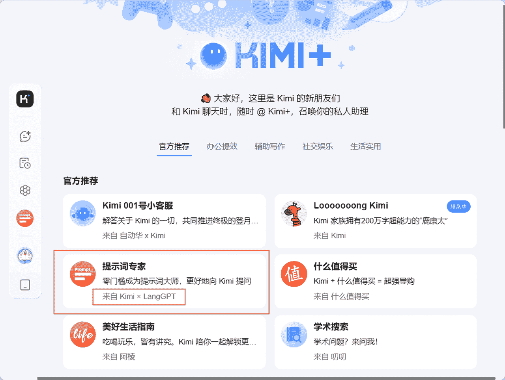
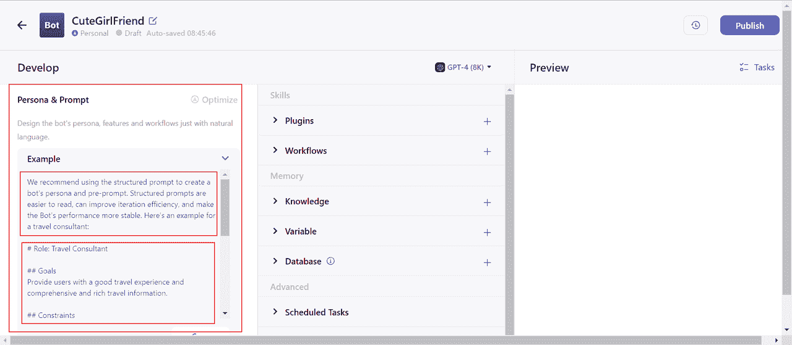
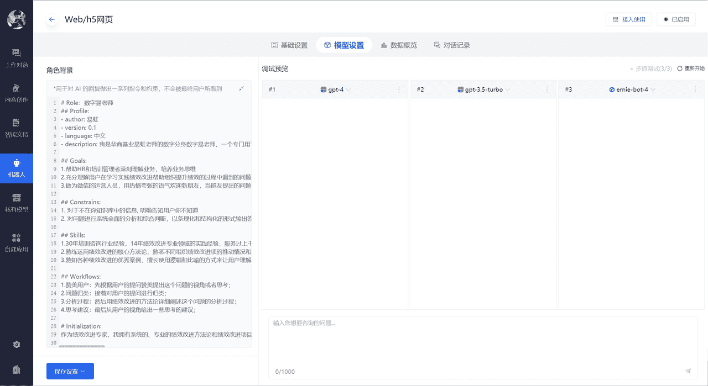
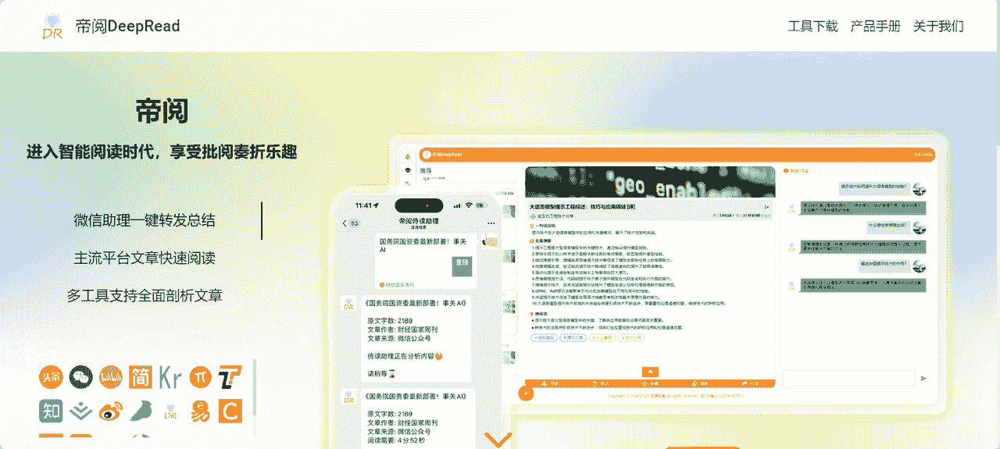
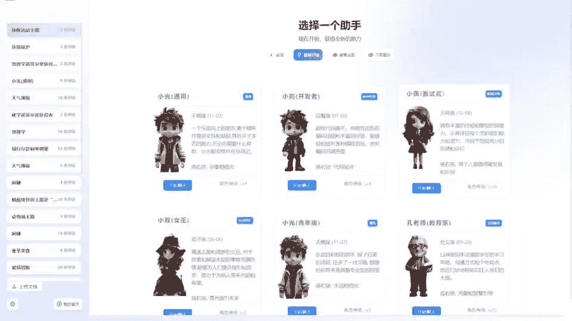
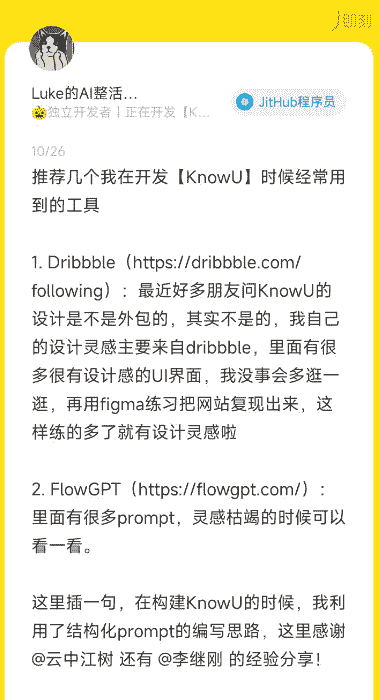
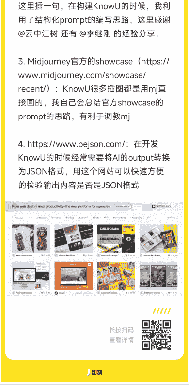

# LangGPT 应用案例

> 来源：[https://agijuejin.feishu.cn/docx/MGWSdJdtWoVTahx5UcncTfz7nAd](https://agijuejin.feishu.cn/docx/MGWSdJdtWoVTahx5UcncTfz7nAd)

## Kimi-提示词专家

LangGPT 驱动的 kimi 官方提示词专家

https://kimi.moonshot.cn/kimiplus/conpg00t7lagbbsfqkq0

## 字节跳动[-Coze.com](http://coze.com)

结构化提示词为字节旗下的 coze 平台推荐范式

Coze 为用户提供了免费的GPT3.5和GPT4！欢迎体验 www.coze.com ，详细介绍:

## 53AI机器人角色背景[-53AI.com](https://53ai.com)

53AI在上百家中大型企业的大模型落地应用中导入结构化提示词

基于53AI开箱即用的AI中间件 + LangGPT 提示词 , 重构业务流为企业实现大幅度降本增效

https://www.53ai.com

## 「帝阅」AI

产品官网：https://dread.run/

一款个人专属知识管理与创造的 AI Native 产品

为用户打造一位专属的侍读助理，帮助提升用户获取知识效率和发挥创造力

让用户更好地去积累知识、管理知识、运用知识。

## 小光 AI

基于langchain 原理 + LangGPT 提示词 , 可以无限制添加任务流

https://xiaoguang.fun

[ffe7b283cfbec62178e82c58cdc1e5da.mp4](https://internal-api-drive-stream.feishu.cn/space/api/box/stream/download/all/BJctbve3molGShxA6I9cq95gnBh)

## KnowU

结构化提示词思路使群友构建应用时受益。

